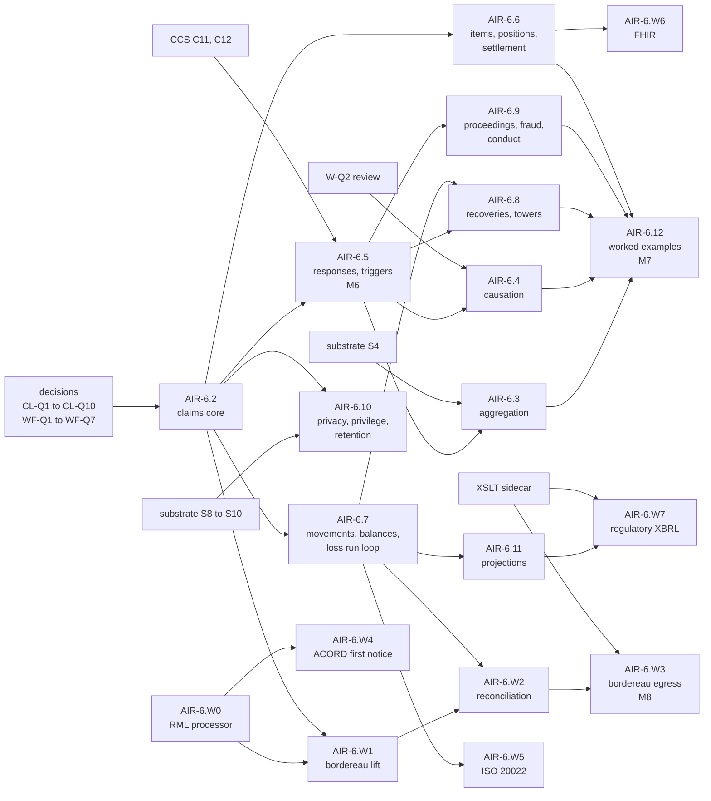

<!-- SPDX-License-Identifier: CC-BY-SA-4.0 -->

# Plan: Applied Insurance Reference — Claims

**Unit ID:** `applied-insurance-reference-claims`
**Epic:** [applied-insurance-reference](applied-insurance-reference.md), phase 6 (claims half)
**Status:** Planned 2026-10-16. Subsumes AIR-6.2 to AIR-6.4 of the
[phase 6 plan](applied-insurance-reference-phase-6.md), which keeps AIR-6.1 (submission). No slice is
briefed yet. Seventeen design questions are open (§4), each gating named slices.
**Status record:** the epic's, [applied-insurance-reference.md](../status/applied-insurance-reference.md)
(epic §3a: no per-phase status records).
**Sketches:**

- [insurance-claims-ontology.md](../sketches/insurance-claims-ontology.md) (the claims sketch): the
  model, its legal grounding and its questions CL-Q1 to CL-Q10
- [claims-sketch-references.md](../sketches/claims-sketch-references.md): what was taken from each
  source, definitions, and the crosswalks to ACORD and the Lloyd's claims bordereau
- [claims-wire-formats.md](../sketches/claims-wire-formats.md): ingress and egress through MORK and
  the XSLT sidecar, the gaps G1 to G21, and questions WF-Q1 to WF-Q7

---

## 1. Scope

A claims module, `ontology/applied/insurance/claims/` (`clm:`, `clm-voc:`), that records what
happened, who says what about it, which contracts respond and how, and what is owed, paid, reserved
and recovered, over two clocks. It adds the vocabulary and structure that tie LATTICE's existing
layers together around a loss, and restates nothing they already hold (claims sketch §4, CL2). With
it, the ingress and egress of claims data through the industry's formats.

**In scope**

| Area | Claims sketch | Slices |
|---|---|---|
| losses, demands, circumstances, notifications, claims, keys, roles | §7.1 to §7.4, §7.8 | AIR-6.2 |
| responses per instrument, triggers, the responding-instrument evaluation | §7.5, §7.9, §8.2 | AIR-6.5 |
| loss items, quanta, coverage positions, settlement as an instrument, parametric claims | §7.6, §7.7, §7.10, §7.11 | AIR-6.6 |
| movements, derived balances, the loss run loop to exposure | §9, §13.3 | AIR-6.7 |
| aggregation and occurrence grouping | §7.12 | AIR-6.3 |
| causation profiles by governing law | §2.4 | AIR-6.4 |
| recoveries, reinsurance claims, towers and erosion | §10 | AIR-6.8 |
| proceedings, findings, fraud, conduct duties implied by rule | §11 | AIR-6.9 |
| privacy, privilege, retention and legal hold | §12 | AIR-6.10, substrate S8 to S10 |
| reporting projections over the model | §13.1 | AIR-6.11 |
| worked examples, milestone M7, the catastrophe benchmark | §14 | AIR-6.12 |
| wire formats: the RML processor, the Lloyd's bordereau in and out, ACORD first notice, ISO 20022, FHIR, regulatory XBRL | wire formats sketch | AIR-6.W0 to AIR-6.W7 |

**Out of scope**, recorded in [leftovers](air-leftovers.md) where a consumer may build it: claims
workflow (diaries, tasks, assignment, triage, service levels), IBNR and portfolio reserving, IFRS 17
measurement, fraud models, identity resolution of people across senders, the transport gateway, and
catastrophe model results (epic §7).

---

## 2. Principles

The claims sketch's CL1 to CL12 and the wire formats sketch's W1 to W7, stated once there. The four
every slice is checked against:

| # | Principle |
|---|---|
| CL2 | cover is never restated. The policy's relations decide what applies, the claims module supplies the case and its facts |
| CL3 | facts, legal acts and judgements are kept apart. A coverage decision, a breach, fraud, a direction, an aggregation and a balance are each derived or found, and a shape reports one asserted without its derivation or finding |
| CL8 | never guess. A missing fact gives Undetermined with the fact it needs |
| W1 | on the way in, a mapping lifts a message faithfully into the source graph, and declared reconciliation derives the assertions (ADR-A13) |

---

## 3. Dependencies

### 3.1 On other work

| Needs | From | Gates |
|---|---|---|
| Instrument's legal acts (`ins:Declaration`, `ins:Proposal`, `ins:Assent`, `ins:forCase`) | CCS C9b1 (merged) | AIR-6.2, 6.6 |
| occasions created and moved by the runtime evaluator | CCS C11, C12 | AIR-6.5 and everything after it that evaluates |
| the Instrument rewrite (C9) merged | CCS | AIR-6.6 (settlement as an instrument) |
| the exposure loss model (`aeo:LossCause`, loss experience, assets, interests, roles, populations) | AIR-4.1 to AIR-4.5 | AIR-6.2, 6.7 |
| crosswalks and `aeo:liftedPeril` | AIR-3.4 | AIR-6.W2 |
| liability direction derivation rules, term parameters (claims basis, aggregation, limits) | AIR-5.2, 5.3, 5.5 (Phase 5) | AIR-6.5 reads term parameters when they exist (CL-Q1), AIR-6.12's D&O example |
| occurrence grouping by an anchored window | substrate S4 | AIR-6.3 |
| W-Q2's legal review of causation profiles | the maintainer, with counsel | AIR-6.4 |
| the evaluation context (ledger, combinators) | its sketch, unplanned | AIR-6.8's erosion on a ledger. AIR-6.7 derives without it (CL-Q4) |
| the XSLT sidecar (ADR-A119, Proposed) | its plan | AIR-6.W3, 6.W7, and XML egress in 6.W4 |
| an RML processor in the toolchain | AIR-6.W0 | every RML ingress |
| a disclosure class, retention and legal hold, erasure deferred by a duty to retain | substrate S8 to S10 (§6) | AIR-6.10 |

**Epic decision D2.** The epic defers claims (AIR-6.2 onwards) with the contract module. CL-Q1's
leaning (claims imports Instrument directly) lifts that for the slices marked "before Phase 5" in §5,
which need only Instrument and the exposure module. If CL-Q1 is answered (b), every slice waits for
Phase 5, and D2 stands as written.

### 3.2 Order

Three chains can run side by side once AIR-6.2 merges: the money chain (6.7, then 6.W1 to 6.W3),
the contract chain (6.5 and what follows it, after CCS C12), and the privacy chain (substrate S8 to
S10, then 6.10).

---

## 4. Decisions

Each question is set out in its sketch with options, consequences and a leaning. None is answered.
Each is recorded here against the slices it gates, and answers go here and in the status record's
history.

| # | Question | Leaning | Gates |
|---|---|---|---|
| CL-Q1 | does claims import Instrument directly, or wait for the contract module? An ADR-A98 addendum either way | Instrument directly, contract module optionally for term parameters | every slice |
| CL-Q2 | when does the indemnity occasion arise: at the trigger the governing law gives, or at notification? | at the governing law's trigger, by an evaluation profile, with notification and proof as conditions of the duty to pay | AIR-6.5 |
| CL-Q3 | one claim shared by every instrument, or a claim per insurer? | one claim, a response per instrument version | AIR-6.2, 6.5 |
| CL-Q4 | money as movements now, or wait for the evaluation context's ledger? | movements now, balances derived, the ledger later | AIR-6.7, 6.8 |
| CL-Q5 | is a settlement an `ins:Instrument`? | yes | AIR-6.6 |
| CL-Q6 | is the stated coverage position kept apart from the evaluated coverage? | yes, always | AIR-6.6 |
| CL-Q7 | prefix and module name | `clm:`, `clm-voc:`, `insurance/claims/` | AIR-6.2 |
| CL-Q8 | privilege, retention and legal hold: substrate ADRs first, or claims-local? | substrate first (S8 to S10) | AIR-6.10 |
| CL-Q9 | case reserves only? | yes. IBNR to leftovers | AIR-6.7 |
| CL-Q10 | parametric covers: trigger and payout in the contract module, the claim and its determination in claims? | yes, both | AIR-6.6 |
| WF-Q1 | lift to a source graph and reconcile, or map straight into the model? | source graph, then reconciliation | AIR-6.W1, 6.W2 |
| WF-Q2 | are movements derived from a source's balances still movements? This qualifies CL6 | yes, asserted or derived, the derived kind citing its snapshots | AIR-6.7, 6.W2 |
| WF-Q3 | which executors join the toolchain? | an RML processor for all ingress, the sidecar for egress, `mork2xslt` later | AIR-6.W0 |
| WF-Q4 | one hop or two for market formats? | one, two only where a market body owns the second | AIR-6.W3, 6.W4 |
| WF-Q5 | where do kits for licensed formats (ACORD, the London market's messaging) live? | with adopters, after checking each publisher's terms. Open formats' kits in the public repository | AIR-6.W4 |
| WF-Q6 | status rules as SKOS crosswalks and declared derivations, or code? | crosswalks and declared derivations | AIR-6.W2 |
| WF-Q7 | bordereau egress on record time or valid time? | record time | AIR-6.W3 |

Questions carried from the epic: W-Q2 (causation profiles and their legal review) gates AIR-6.4,
and W-Q3 (granularity of cause of loss in claims data) is answered by the crosswalks: the CRS and
ACORD carry one code per claim ([references](../sketches/claims-sketch-references.md) §8), and AIR-6.W2
records it as one cause link, position unknown.

**Legal propositions.** Every proposition the claims sketch marks Counsel (references §2) is confirmed
before a rule that depends on it is encoded. The slices that encode such rules (6.4, 6.5, 6.8, 6.9)
carry the review as a precondition of their brief.

---

## 5. Slices

All slices are literate (AIR-2.0), follow the documentation rule (at least one `skos:note` per
concept naming the standards it follows), and write their examples first (ADR-A-C2 for anything
domain-neutral, the epic's examples rule otherwise). Each is briefed on `main` before its branch,
with its Validation Pack skeleton. Estimates are in tokens, of order only, for comparison with the
actual cost.

| Slice | Content | Needs | Before Phase 5? | Estimate |
|---|---|---|---|---|
| AIR-6.2 | module skeleton, `clm:Loss` with its dates, `clm:Demand`, `clm:Circumstance`, `clm:Notification ⊑ ins:Declaration`, `clm:Claim` (versioned) and its keys, the role scheme, the two-clock examples | CL-Q1, Q3, Q7, AIR-4.5, CCS C9b1 | yes | 300k |
| AIR-6.5 | `clm:Response`, triggers by claims basis, the instrument version chosen by trigger date, the evaluator creating occasions per response, the reference English-law profile for when indemnity arises. Milestone M6's claims half | CL-Q2, CCS C12, AIR-6.2 | after CCS C12 | 400k |
| AIR-6.6 | loss items, quanta by stage, adjustments, `clm:CoveragePosition ⊑ ins:Declaration`, `clm:Settlement ⊑ ins:Instrument` with offers, assents and releases, parametric claims with a determination | CL-Q5, Q6, Q10, CCS C9 | yes, for the structure | 350k |
| AIR-6.7 | `clm:Movement` (asserted and derived), cost classes after the CRS heads, derived balances (paid, outstanding, incurred, recovered), the loss run derivation writing `aeo:LossExperience` and `aeo:LossRecord` | CL-Q4, Q9, WF-Q2, AIR-6.2 | yes | 300k |
| AIR-6.3 | `clm:Grouping` per response by its aggregation term, hours clauses through S4, related claims as findings | AIR-6.5, substrate S4 | after S4 | 250k |
| AIR-6.4 | causation profiles by governing law: dominant cause, efficient proximate cause, anti-concurrent clause as a precedence statement | AIR-6.5, W-Q2's review | after the review | 250k |
| AIR-6.8 | recoveries as demands run the other way (subrogation, contribution, salvage, deductible recovery), reinsurance claims (loss advice, ultimate net loss, reinstatement premium), towers (exhaustion as a threshold regime, drop-down, other insurance) | AIR-6.5, 6.7, the evaluation context for ledger erosion | after CCS C12 | 400k |
| AIR-6.9 | `clm:Proceedings`, findings and determinations, complaints as demands, fraud indicators and findings with the s.12 consequences, conduct duties `ins:impliedBy` a rule and the conduct queries | AIR-6.5 | after CCS C12 | 300k |
| AIR-6.10 | personal and special category classification, privacy profiles for claimants, disclosure classes for privileged material, retention and legal hold profiles, as examples over the claims model | CL-Q8, substrate S8 to S10, AIR-6.2 | yes, after the substrate ADRs | 200k |
| AIR-6.11 | projections: development triangle cells by valid and record time, the S.19.01 cell set, conduct report queries, each a derived artefact with its read set | AIR-6.7 | yes | 200k |
| AIR-6.12 | the four worked examples of claims sketch §14 as README walkthroughs with expected decisions, milestone M7, and the catastrophe benchmark of robustness-testing §4 under `benchmark/` (ADR-A124) | all of the above | last | 400k |
| AIR-6.W0 | an ADR for an RML processor in the toolchain, its licence checked, its mise task, one smoke test | WF-Q3 | yes | 100k |
| AIR-6.W1 | the CRS v5.2 claims bordereau: representation scheme with field codes confirmed against Lloyd's user guide, mapping graph, spreadsheet-to-CSV conversion, source graph, golden fixtures we author | WF-Q1, AIR-6.W0, AIR-6.2 | yes | 300k |
| AIR-6.W2 | reconciliation rules as data: identity by keys, movements from snapshots with the inconsistency check (G1), statuses as the sender's assertions (G4), code lifting (G5), image differences (G2), exchange rates without a date (G8), late and repeated data (G17, wire formats sketch §8) | WF-Q2, Q6, AIR-6.W1, 6.7, AIR-3.4 | yes | 400k |
| AIR-6.W3 | the bordereau's egress kit on the sidecar, on record time, with its lowering report and per-recipient minimisation. Milestone M8 | WF-Q4, Q7, the sidecar's first slice | after the sidecar | 250k |
| AIR-6.W4 | ACORD `ClaimsNotificationAddRq` ingress and its response message, kept where WF-Q5 decides | WF-Q5, AIR-6.W0 | yes | 250k |
| AIR-6.W5 | ISO 20022 `pain.001` egress from payment movements, `pain.002` and `camt.054` ingress as facts on movements | AIR-6.7 | yes | 200k |
| AIR-6.W6 | HL7 FHIR `Claim` ingress and `ClaimResponse` egress for health claims | AIR-6.6 | yes | 250k |
| AIR-6.W7 | the S.19.01 xBRL-XML instance as a sidecar kit over AIR-6.11's cells | AIR-6.11, the sidecar | after the sidecar | 200k |

AIR-6.12 is about 400k and four examples, and may split per example at its brief if it passes the
slice-sizing rule's 15 test cases.

### 5.1 Invariants, one per slice

These become each Validation Pack's invariant paragraph when the slice is briefed.

| Slice | Invariant |
|---|---|
| AIR-6.2 | a loss, a demand, a circumstance and a notification are disjoint, each evidenced and temporally scoped. A claim is versioned with a persistent identity and keys of declared schemes. No `clm:` term names a cover, a limit or an exclusion |
| AIR-6.5 | each responding instrument version has one response per claim. Occasions for the claim are the evaluator's, never asserted. The version chosen is the one in force at the trigger date the instrument's claims basis reads, and a claim with no trigger date is Undetermined for that instrument |
| AIR-6.6 | quanta of one item coexist by stage and source. An insurer's position is a legal act kept apart from the evaluated coverage. A settlement is evaluated by the same machinery as any instrument, and its release excepts exactly the relations it names |
| AIR-6.7 | every money figure on a claim is a sum of movements, derived with its read set. A correction is a reversing movement. A derived movement cites the snapshots it came from |
| AIR-6.3 | a grouping is derived per response by that response's aggregation term, and cites the term, the window and the losses it read |
| AIR-6.4 | the governing cause is selected by a profile chosen from the instrument's governing law and wording, from the recorded chain, never from one code |
| AIR-6.8 | a recovery reuses the demand model with the insurer claiming. A reinsurance claim's duty arises on the reinsured's settlement, subject to any consent rule. An excess layer's occasion reads the underlying exhaustion and nothing else |
| AIR-6.9 | every outcome of proceedings is a finding. No indicator or score denies a claim. A regulatory duty is a relation implied by its rule, and its breaches are derived |
| AIR-6.10 | personal, special category and privileged data are classified where stored, and no export reads a class its recipient may not receive |
| AIR-6.11 | every projection is reproducible from movements at its stated position, and its read set names them |
| AIR-6.12 | one loss evaluated across a primary policy, an excess layer and a reinsurance gives positions, movements, a settlement, a recovery and a derived loss run, each traced to the words |
| AIR-6.W0 | the RML processor runs through mise only, and a mapping compiled by `mork2rml` runs on it and gives the expected triples |
| AIR-6.W1 | a bordereau lifts into the source graph field by field, with nothing interpreted, and every source triple cites the field and the evidence it came from |
| AIR-6.W2 | every assertion derived from a message cites the source triples it read and the rule that read them. A sender's status is never the model's state. A repeated message adds nothing |
| AIR-6.W3 | a bordereau emitted at a position is reproducible, lists in its lowering report everything it could not carry, and carries no field the recipient's declaration excludes |
| AIR-6.W4 | a first notice lifts to a notification, a claim and a loss, and contract terms it restates are compared with the instrument, never stored as claim facts |
| AIR-6.W5 | no payment instruction is emitted for a payee without a screening run, and a returned payment becomes a reversing movement |
| AIR-6.W6 | a FHIR claim's lines become loss items, and health data is special category on arrival |
| AIR-6.W7 | the xBRL instance's cells equal AIR-6.11's derived cells at the stated position |

### 5.2 Test focus, per slice

The Validation Packs hold the full tables. The cases each brief must include:

| Slice | Must include |
|---|---|
| AIR-6.2 | a notice of circumstances and a later demand linked by relation back. An unknown loss date left absent and a check reading it Undetermined. Two keys of different schemes on one claim. A `clm:` term naming a cover rejected by a shape |
| AIR-6.5 | claims made and notified across two policy years. A continuous trigger selecting several versions. An English-law property claim whose indemnity occasion arises at the loss while the payment duty waits for notification |
| AIR-6.6 | a reservation of rights that disagrees with the evaluation. A Part 36 offer accepted. A release that leaves one relation open. A parametric determination crossing a threshold |
| AIR-6.7 | a backdated payment (valid time before record time). A reversing correction. A loss run rebuilt equal to the one derived before |
| AIR-6.W2 | the G1 worked example (references and wire formats sketches), including a restated row reported as an inconsistency. A sender status contradicting an open occasion reported as a finding. The same file twice |
| AIR-6.W3 | a backdated correction appearing in the month it is booked. A field outside the recipient's declaration not emitted |

---

## 6. Substrate asks

Added to the [substrate track](applied-insurance-reference-substrate.md), each with its own
clean-room ADR (ADR-A-C2):

| Item | Layer | Change | From |
|---|---|---|---|
| S8 | Persistence | a disclosure class beside the privacy class, read by every export | claims sketch S-CL2 |
| S9 | Persistence | retention per class after an anchoring event, and legal hold overriding retention and erasure | S-CL3 |
| S10 | Persistence | `dal:ErasurePrecedence` gains erasure deferred by a duty to retain | S-CL4 |

S-CL1 (one case under several instruments) needs no change: `ins:forCase` already lets several
instruments' relations share a case. AIR-6.5's examples confirm it, and if they do not, S-CL1 joins
the track.

---

## 7. Milestones

| # | Outcome, end to end over example graphs | Closes in |
|---|---|---|
| M6 | (epic, unchanged) a submission packages an exposure set version, and a claim records a loss cause chain against the contract that responds | AIR-6.1 and AIR-6.5 |
| M7 | one loss across a primary policy, an excess layer and a reinsurance: positions, movements, a settlement, a recovery and a derived loss run, each traced to the words | AIR-6.12 |
| M8 | a coverholder's claims bordereau lifted, reconciled into movements and statuses, and emitted again for the market with its lowering report, the round trip reproducible from the stored files | AIR-6.W3 |

---

## 8. Lanes

Not in the current trip ([lanes](applied-insurance-reference-lanes.md) §4). The lanes plan assigns
machines and branches when the slices are briefed. Briefing needs the decisions of §4, so the first
step is the maintainer's answers, then AIR-6.2's brief, AIR-6.W0's ADR and the substrate ADRs for S8
to S10, all on `main`.

---

## 9. Documentation deltas

`ontology/applied/README.md` and `insurance/domain-README.md` (the claims module row), the claims
module's README (literate), `docs/architecture/ontology-architecture.md` §3, the developer guide (the
RML processor's mise task, AIR-6.W0), ADR-A98's addendum (CL-Q1, CL-Q7), the leftovers (claims
workflow, IBNR, fraud models), and the wire formats' kits in `contracts/xml/` once the sidecar
exists.

---

## 10. Exit gate

M6, M7 and M8 demonstrated. Every Counsel proposition an encoded rule depends on confirmed. W-Q2
answered. The three sketches either deleted (the plan replaces them) or kept as background with a
note that this plan supersedes them, as the maintainer prefers.
