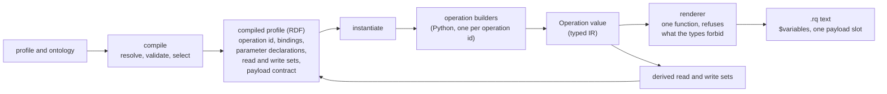
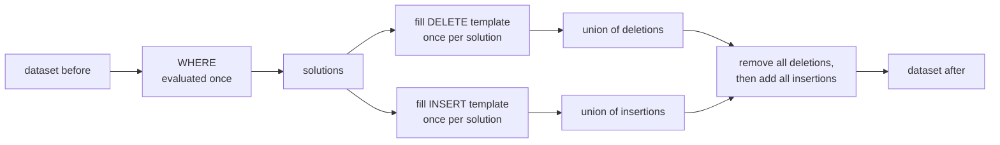
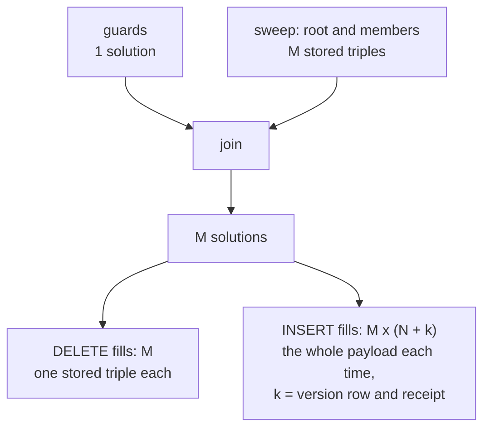
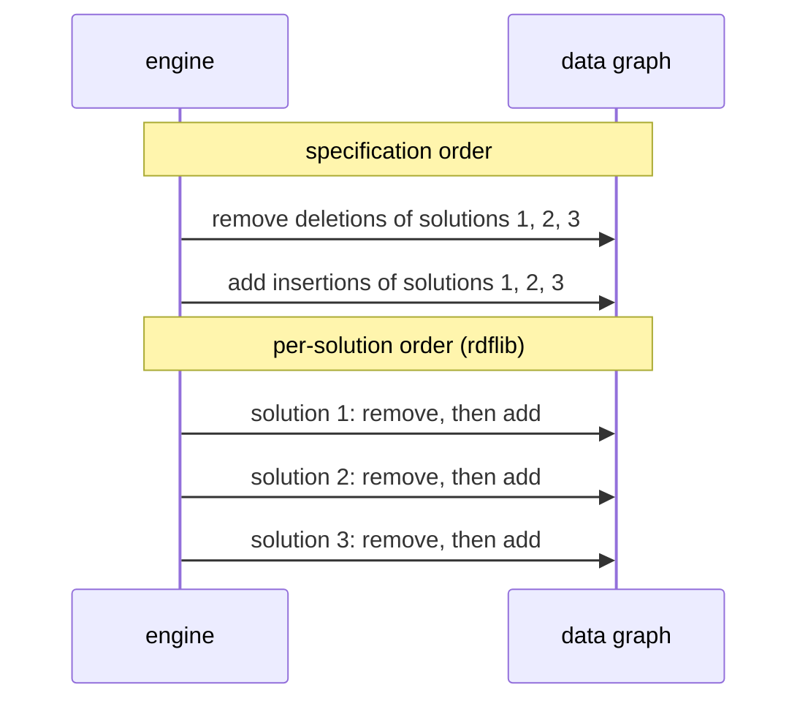
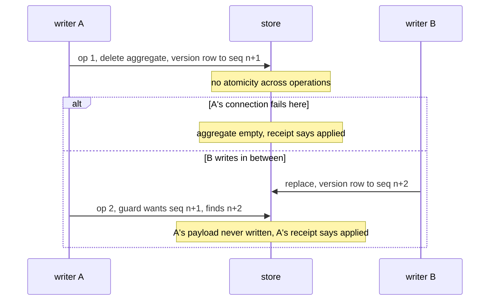
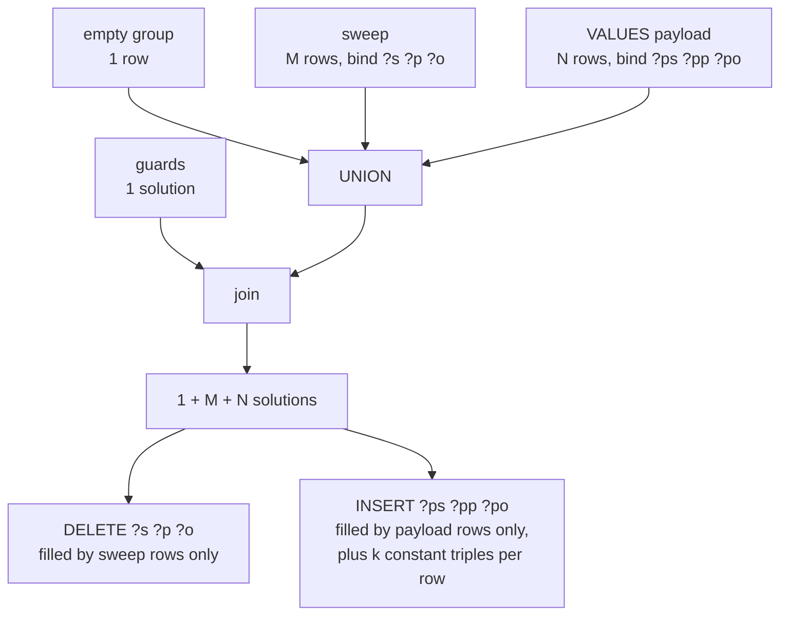

<!-- SPDX-License-Identifier: CC-BY-SA-4.0 -->

# Track H, H2: the typed operation IR and the typed payload (sketch)

**Unit:** `formal-methods-track-h`, slice H2 ([plan §4](../plans/formal-methods-track-h.md#4-h2-h3-the-typed-ir-and-the-specification-registry))
**Status:** design brief, 2026-10-10. Every question, H2-Q1 to H2-Q6, answered the same day. H2.0 is ready to branch
**Builds on:** [specification sketch §3](formal-methods-track-h-specification.md#3-the-typed-intermediate-representation)
(the hazard table, not repeated here), [aggregate-ownership sketch §12 and §15](persistence-aggregate-ownership.md#12-what-h2-inherits),
[ADR-A79](../../architecture/decisions/ADR-A79-persistence-compiler-toolchain.md),
[ADR-A122](../../architecture/decisions/ADR-A122-aggregate-ownership.md), plan [§13](../plans/formal-methods-track-h.md#13-walkthrough-the-two-assumptions-behind-check-s-3-h-d11-and-h-d12) (H-D11, H-D12)
**Proposes:** ADR-A123, *A typed operation IR for the persistence compiler*, and a dated addendum to
ADR-A79 naming the points A123 supersedes (§6)

## 1. Decisions already taken (2026-10-10)

| # | Decision |
|---|---|
| H-D18 | H2 is split into as many slices as it needs. §7 proposes ten |
| H-D19 | Option A. Each operation is built as a typed value and its SPARQL is rendered from it. The 28 Mustache templates and the `chevron` dependency are retired |
| H-D20 | the typed payload is designed here in full (§4), and the maintainer reviews it before any slice that depends on it is briefed. The test is how much configuration it asks of a user, against what the user would have to do anyway |
| H-D3 | delegated to us. We take a new ADR (A123) and a dated addendum to ADR-A79, which stays Accepted for the points A123 does not touch (§6) |
| H2-Q1 | PL-B (§4). Generated code per language (PL-D) is kept for later as a published SDK, sketched in [persistence-client-sdk.md](persistence-client-sdk.md) and discussed at the end of Track H |
| H2-Q2 | (a) and (b). Informational by default, raised to a warning by a compile option, with no new vocabulary. The maintainer confirmed this reading |
| H2-Q3 | (a), no closed-shape refusal |
| H2-Q4 | (c), the guard in the SPARQL and in the Python caller |
| H2-Q5 | (a), declarations only, on condition that it keeps the relational realisation open. H2-Q6 is the condition (§3.1) |
| H2-Q6 | (a), a logical operation contract. The SPARQL graph roles stay in the builders (§3.1) |

## 2. The scene, checked against the source

What exists, as of `09675a70`:

- `compile` resolves a profile and selects, per target, a list of `GeneratedOperation`s, each a
  template id and a list of `ParameterBinding`s (`operations.py`). It never produces SPARQL text
  (ADR-A79 point 1).
- `instantiate` reads the compiled profile, loads `templates/<id>.mustache` and renders it with
  `chevron`. Every compile-time value is an encoded `SparqlTerm` (`terms.py`), and the renderer
  refuses a bare `str` (`render.py`). This is the injection boundary of ADR-A79 point 4.
- The SPARQL structure lives in 28 template files. Its hazards (an unbound variable in an `INSERT`
  template, a blank node, a pattern in the default graph, a value comparison on a term position)
  are found after the fact by static checks S-3 and S-4 (`templatecheck.py`, H1.3) and by the
  witness harness, not prevented.
- Two request-time slots, `payloadTriples` and `logGraphs`, are passed through as Mustache tags for
  the caller to fill with "trusted, already-serialised SPARQL text"
  ([README](../../../tools/persistence/README.md#using-the-generated-sparql-directly)). The caller
  also computes `$requestDigest` from the canonical N-Triples of the payload, separately from the
  text it sends.
- A request-time variable the caller forgets is silently unbound, and an update can then write part
  of a record (TD-34).
- Nothing outside `tools/persistence` and its tests calls `instantiate` or fills the slots, so no
  compatibility is owed (H-D14).

## 3. The IR

An `Operation` is a frozen value in a new module, `persistence.ir`, built by one builder function per
operation id. Its parts, each closing a row of the specification sketch's hazard table:

| Part | Type rule | Closes |
|---|---|---|
| parameters | `Param(name, kind, required)`, kind one of `Iri`, `Long`, `String`, `LangString`, `Position`, `Digest`, `Payload`, `RegistryList`. The list is the renderer's whole domain | a missing or misspelt parameter, H-D11 |
| compile-time constants | the existing encoders of `terms.py`, reused as they are | injection from configuration (unchanged) |
| patterns | every triple pattern carries a `GraphRole` (data, meta, txn, log bucket, event bucket, keys, registry). There is no default-graph constructor | S-1, TD-40 |
| terms in a pattern | a variable, a parameter, a constant. No blank-node constructor exists | a retry that is not a no-op |
| property paths | a `PropertyPath` may appear only in a `WHERE` pattern | a path in a template |
| variables in `DELETE` or `INSERT` | tagged `Bound` (bound by a required pattern, or a `BIND` over `Bound` inputs) or `OptionalAllowed` (for example `?prevRev`, absent on a first revision). An untagged variable is refused | S-3, H-D12's first half |
| guards | `TermGuard` (`sameTerm`, or a shared pattern) or `ValueGuard` (`=`). A position is declared term-invariant or value-compared, and the renderer refuses the wrong guard | review §8.2 |
| clock | `Now()` may appear in a `BIND` for a receipt field or a bucket choice, never inside a guard | `NOW()` in a guard. The specification sketch says "audit-only position". The templates use `NOW()` for receipts and bucket months, so we read it as "never in a guard" |
| required-parameter guard | generated from the parameter list (§5, H2-Q4) | TD-34, H-D12 option D |

**Read and write sets are derived, not declared.** The renderer already walks every pattern, so the
same walk yields the graphs and subjects an operation reads (its `WHERE`, with a composite closure
read through its owned path at execution) and writes (its `DELETE` and `INSERT`). A hand-declared
set could drift from the query, and a derived one cannot. H5's models consume them from the compiled
profile.

**The compiled profile keeps ADR-A79 point 1.** `compile` still produces no SPARQL text. It emits,
per operation, the parameter declarations, the derived read and write sets and the payload contract
(§4), so a caller in another language knows what to bind without reading Python. The query structure
itself lives in the builders, and `instantiate` renders it. The alternative, the full IR as RDF in the
compiled profile, was H2-Q5's option (b), declined.

### 3.1 The operation contract and the SPARQL realisation (H2-Q6)

The relational realisation ([lattice-sql.md](../notes/rdf-engine/lattice-sql.md), out of Track H's
scope by ADR-A-FM4 decision 1) reads the resolved `dal:` profile as its transaction-scope input,
"unchanged" (its §5 and §6.1), and has its own logical and relational IRs (§6.2). It maps the same
dimensions to tables, version columns, receipt tables and unique indexes (§9), and it would generate
operations of the same kinds, a guarded replace, a create, a tombstone, a key claim. H2 does not
change the resolved profile, so the relational compiler's input stands either way. What H2 adds to
the compiled profile is where the choice matters.

| Option | The declarations in the compiled profile name | Consequence for a relational realisation |
|---|---|---|
| **(a) a logical operation contract** | the operation kind, its parameters and their kinds, and read and write sets over logical resources: the aggregate (root and members), its version row, the transaction claim, the receipt, a key claim, a log bucket. The payload contract names the boundary shape and the root, and its encoding (`dal:GroundNTriples`) is a property of the SPARQL realisation. The builders map each logical resource to its graph role | a relational compiler can implement the same contract, with rows for graphs, and the two realisations can be compared operation by operation, which is the operation oracle of `lattice-sql.md` §12. H5's models also reason about rows and claims, not graphs |
| **(b) SPARQL terms** | the same, with graph roles (meta graph, txn graph, log bucket) in place of logical resources | the declarations mean nothing to a relational realisation, which would define its own, and a comparison across realisations would need a mapping written after the fact |

**Design overheads.** (a) needs a small vocabulary of logical resources, about six terms, and one
mapping per builder. The risk is that it is designed with one realisation in hand, so its terms may
not fit SQL. We check it against `lattice-sql.md` §9's table when H2.7 is briefed, as a hypothesis to
test, not a claim. (b) costs nothing now and leaves the relational work to repeat it.

**Runtime overheads.** None for either. The declarations are read at design time.

**What neither closes.** The `OwnershipTree` of ADR-A122 stays in `persistence.boundary`, outside
`persistence.ir`, since a relational realisation reads the same classified tree as `ON DELETE
CASCADE` (lattice-sql §9, rule M37). The IR holds a reference to it, not a copy. The circularity
`sql-feedback.md` §7 warns of remains. Two realisations generated from one contract share any
misreading of it. H5's models stay the independent oracle.

**Decided: (a)** (H2-Q6, 2026-10-10).

**What is lost with Mustache.** ADR-A79 kept templates "auditable by inspection" as text files. The
builders replace them, and the audit surface becomes the builder plus a golden `.rq` per operation,
checked in and compared on every run. An adopter who rendered the templates with their own Mustache
library must now run `instantiate` once. Its `.rq` output stays plain SPARQL.

## 4. The typed payload

### 4.1 What a caller does today, and what goes wrong

To call `create-if-absent`, `cas-replace` or `unconditional-write`, a caller must, by hand:

1. build the aggregate's new state as triples, skolemised, with no blank node
2. serialise them as SPARQL triple text and substitute that text for `{{{payloadTriples}}}`
3. serialise them again as sorted canonical N-Triples, hash that with the operation kind, target and
   expected `seq`, and bind the result as `$requestDigest`
4. make sure every subject belongs to the aggregate it writes

None of the four is checked. The payload text is outside ADR-A79's injection boundary by
construction, so a payload literal containing `} } ; DROP ALL ; INSERT { {` reaches the query
structure. Steps 2 and 3 can disagree, so a confirmation read can misclassify a replay. Step 4 is
the payload check ADR-A122 decision 6 assigns to H2.

A user has to do steps 1 to 4 with or without LATTICE, since they own the data. The question is how
much they must declare so the framework can do 2 to 4 for them and check 1.

### 4.2 Options

| Option | The payload is | What it checks | New configuration a user must write |
|---|---|---|---|
| **PL-A, ground triples** | a set of `(subject IRI, predicate IRI, object IRI or literal)`, each term passed through the encoders of `terms.py`. It renders as sorted canonical N-Triples lines, and the same lines feed the digest | injection, blank nodes, a `GRAPH` break-out, digest drift (steps 2 and 3, done for the caller) | none |
| **PL-B, ground triples bounded by the boundary shape** | PL-A, plus the payload check: every subject is the root or reached from the root, within the payload, by the owned edges of the boundary shape in their declared direction | PL-A, and a subject outside the aggregate (step 4) | none for a composite family, whose boundary shape is already mandatory (ADR-A122 decisions 1 and 3). A named-graph family checks only what PL-A checks unless it names the optional `dal:boundaryShape` (decision 6), see H2-Q2 |
| **PL-C, conformance to the domain shapes** | PL-B, plus SHACL validation of the payload against the user's own shapes | value constraints, cardinalities | none, but it fails wrongly on a constraint that needs data outside the aggregate, such as `sh:class` on a reference target, and costs a SHACL run per write |
| **PL-D, generated classes** | a class per aggregate shape, generated per language | as PL-B, at the type level of the caller's language | a code generator per language, and a regeneration step for every shape change |

**Design overheads.** PL-A and PL-B add nothing a user writes. PL-B's rule is the one ADR-A122
already states for the delete set (reach by owned edges), applied to the new state, so a user has
one rule to learn for both. PL-C couples a write to every domain shape and gives false refusals that
are hard to explain. PL-D is language-specific, against ADR-A79's aim that any language can call the
SPARQL.

**Runtime overheads.** PL-A costs one sort and one hash per write, which the caller does already.
PL-B adds one reachability walk over the payload, linear in its size. PL-C adds a SHACL run.

**How a caller that does not use the Python package gets PL-B.** The store cannot check the payload
(see the next paragraph), so the check runs in the caller, before sending, in every language. A caller
using the Python package gets it inside its `Payload` type, with nothing extra to do. A caller in
another language has two duties, and the second is the extra step:

1. **PL-A, by following the payload contract.** Encode each term, emit no blank node, and compute the
   digest from the same N-Triples lines that are sent. This is today's README obligation, now stated
   as a declared type.
2. **PL-B, by running one more query.** `instantiate` renders a `payload-check` query per composite
   or shaped named-graph family, for example
   `SELECT DISTINCT ?s WHERE { ?s ?p ?o FILTER NOT EXISTS { $root <ownedPath> ?s } }`, where
   `<ownedPath>` is the same compiled path HO5 uses for the sweep, which can match no steps and so
   reaches the root itself. The caller loads its payload into a local in-memory graph, binds `$root`,
   and runs the query. It does not go to the store. An empty result passes.

Nothing forces step 2. A caller who skips it writes an unchecked payload, as every caller does today.
The [client SDK sketch](persistence-client-sdk.md) is how a supported language would get both steps
without writing them.

**Why not enforce it in the store.** The payload is new data, so a guard in the update's `WHERE` sees
the stored aggregate, not the payload. A property path cannot walk `VALUES` rows. Enforcing it in the
store would need the payload staged in a graph and a second guarded operation in the same request,
whose atomicity SPARQL 1.1 Update makes a "should". We leave it to the caller, as ADR-A122 decision 6
says, and record the staged form as an option H5's capability record could make safe later.

**The slot in the `.rq` file.** The payload stays one slot, still written `{{{payloadTriples}}}`, so
an unrendered slot remains a syntax error and fails closed. Its declared type in the compiled profile
changes from trusted text to `dal:GroundNTriples`, a set of N-Triples lines with no blank node. Any RDF
library parses and checks that form. `logGraphs` becomes a `RegistryList` of encoded IRIs in the same
way.

**The cost of a composite replace, and the store behaviour it depends on**, are worked through in
§4.3. H2.4 ports today's form unchanged and measures it.

**Decided: PL-B** (H2-Q1, 2026-10-10). It closes all four failure modes of §4.1 for a composite family,
asks for no configuration a composite user does not already write, and takes work off every caller.
PL-C can be added later per profile if a user asks for it. PL-D returns as a published SDK, in the
[client SDK sketch](persistence-client-sdk.md), for discussion at the end of Track H.

### 4.3 How a composite replace is evaluated, and what it costs

This section answers a question about stores in general, not about rdflib. Later tranches of the
epic model the concurrency of each platform, so every property below is recorded as a field those
models branch on, never as an assumption about one engine.

**How SPARQL 1.1 Update defines `DELETE … INSERT … WHERE`** (its §3.1.3). The `WHERE` clause is
evaluated once, against the dataset as it was before the operation, giving a sequence of solutions.
Each template is filled once per solution, and a triple with an unbound variable is skipped. Every
filled deletion is removed, then every filled insertion is added, as one operation.

**Today's composite replace.** Its `WHERE` joins the guard patterns, which give one solution when
the version row matches and none otherwise, with the sweep, which gives one solution per stored
triple of the root and its members. Call that count M. The `INSERT` template holds the new version
row, the receipt and the N payload triples, and none of them uses a sweep variable. So every one of
the M solutions fills the same N payload triples again, and the union removes the copies.

For example, with M = 3 stored triples and a payload of N = 2:

| Solution | Bound by the sweep | `DELETE` fills | `INSERT` fills |
|---|---|---|---|
| 1 | `?s ?p ?o` = stored triple 1 | stored triple 1 | payload 1, payload 2, version row, receipt |
| 2 | stored triple 2 | stored triple 2 | payload 1, payload 2, version row, receipt |
| 3 | stored triple 3 | stored triple 3 | payload 1, payload 2, version row, receipt |

**Measured on rdflib 7.6.0** (a scratch script, not committed, with the sweep reduced to its
essentials and M = N):

| M = N | seconds |
|---|---|
| 10 | 0.007 |
| 100 | 0.077 |
| 1000 | 5.6 |

Ten times the size costs about seventy times the time, which is quadratic. rdflib's
`evalModify` fills both templates once per solution, which matches. Oxigraph is not measured yet.
Recorded as TD-42.

**Stores apply the result in different orders.** rdflib does not follow the order above. For each
solution in turn, it removes that solution's deletions and then adds its insertions.

Today's form is correct under both orders. A payload triple that is also stored, for example an
unchanged name, is removed by its own solution, and every later solution adds the whole payload
again, so the last solution restores it. The redundancy that costs M × N is what makes the result
independent of the order. A form that adds each payload triple only once is correct only where the
store follows the specification's order. Our probe saw rdflib put the sweep's solutions first even
when the payload was written first, so it did not lose the triple. The order is the engine's choice
and nothing to rely on.

**Two store properties decide which forms are correct.** Both join the capability record of the
[main sketch §5](formal-methods-track-h.md#5-the-capability-record-is-the-formal-environment-assumption),
three-valued, with `unknown` treated pessimistically and a TCK probe each:

- `snapshotUpdateSemantics`, new. The store fills both templates from one solution sequence over the
  state before the operation, and removes before it adds.
- `atomicUpdateRequest`, already listed. Several operations in one request commit or fail together,
  and no other writer sees the state between them.

**Three forms.**

R1, two operations in one request. The first deletes the aggregate and moves the version row. The
second inserts the payload, guarded on the version row the first one wrote.

R2, one operation, the payload as rows of a `UNION` branch. The `WHERE` joins the guards with three
alternatives, an empty group, the sweep and a `VALUES` block holding the payload. The empty group
guarantees one solution, so the version row is written even for an empty aggregate.

| Form | Triples built before the union removes copies | Correct when | Payload encoding |
|---|---|---|---|
| R0, today | M + M × (N + k), quadratic | always, order-independent | N-Triples lines |
| R1, two operations | M + M × k + N, linear | `atomicUpdateRequest` holds | N-Triples lines |
| R2, `UNION` with `VALUES` | M + N + (1 + M + N) × k, linear | `snapshotUpdateSemantics` holds | `VALUES` rows, which admit no blank node |

R1 adds a window between two operations that a single operation does not have, and needs request
atomicity to close it. We do not propose it. R2 is linear and needs one operation, and it is correct
only on a store that applies an update in the specification's order.

**What H2.4 does by default, with no stop.** It ports R0 exactly, which the equivalence harness
requires anyway (§7.1). It commits the benchmark for rdflib and Oxigraph, M = N from 10 to 10,000,
and the two capability probes as tests that report what each store does, including a fixture that
forces a payload solution before a sweep solution where the engine allows it, or a note that it
could not. rdflib, the test store, reports `false` for `snapshotUpdateSemantics` by its code, so tests on it keep R0.
R2 then becomes a selection by capability, made in `compile` as ADR-A79's consequences
require of any conditional structure, once H5's capability record has `snapshotUpdateSemantics`. H5's
model A branches on the same field.

**The one stop.** If Oxigraph shows R0 to be wrong, not just slow, H2.4 stops and asks, since that is
a defect in what ships today.

**Measured 2026-10-12 (H2.4b), and corrected 2026-10-13.** The probes of [FMH-H2-4b](../validation/FMH-H2-4b.md) first reported
that rdflib follows the specification's order. That was wrong. The paragraphs above are right: rdflib 7.6.0 applies each solution in
turn, and the order of the solutions follows the process's hash seed. Oxigraph 0.5.11 also applies each solution in turn, in solution
order. So neither is snapshot, R2 is unsafe on both, and R0 is right on both because it inserts the whole payload in every solution.
R0 is superlinear on both, in memory too on Oxigraph. Request atomicity differs: Oxigraph rolls back a request whose second operation
fails, and rdflib keeps the first. The detail is in [triple-store discovery](../../architecture/triple-store-discovery.md), TSD-01,
TSD-02 and TSD-06.

## 5. Questions for the maintainer

| # | Question | Options | Leaning |
|---|---|---|---|
| H2-Q1 | which typed payload | PL-A, PL-B, PL-C, PL-D (§4.2) | PL-B. **Answered 2026-10-10: PL-B**, with PL-D later as an SDK |
| H2-Q2 | a named-graph family with payload operations and no `dal:boundaryShape` | (a) PL-A only, with an informational diagnostic, (b) a compile warning, (c) refuse, so every payload is bounded | (a). The named-graph strategy replaces the root's whole graph, so a stray subject stays inside that root's own graph and cannot reach another aggregate. The harm is the one H9's "payload outside the tree" audit detects. A warning would fire on every named-graph user who has not opted in to a shape, which ADR-A122 decision 6 makes optional. **Answered 2026-10-10: (a) and (b).** Our reading, confirmed by the maintainer: informational by default, and a warning when `compile` is run with an option such as `--warn-unbounded-payload`, so no new `dal:` term. The diagnostic model gains an `INFO` severity, since today it has only `WARNING` and `ERROR` |
| H2-Q3 | should PL-B also refuse a predicate the boundary shape does not declare | (a) no, (b) yes, closed-shape semantics | (a). An undeclared edge to a node leaves that node unreachable, so PL-B already refuses it. An undeclared value property cannot move ownership. Refusing it is SHACL's job (PL-C). **Answered 2026-10-10: (a)** |
| H2-Q4 | where the required-parameter guard runs (TD-34) | (a) in the SPARQL only, `FILTER(BOUND($p))` (in its own group, ADR-A123 decision 5) and, for `Long`, `Position` and `Digest`, a `DATATYPE` test, at the top of `WHERE`, (b) in the caller library only, (c) both | (c). The SPARQL guard turns a partial write into no write for every caller. A guard that fails is then indistinguishable from a lost race in the confirmation read, so the Python caller refuses a missing or mistyped parameter before sending, and says why. **Answered 2026-10-10: (c)** |
| H2-Q5 | what the compiled profile carries for a caller in another language | (a) declarations only: parameters, read and write sets, payload contract, with the query structure in the builders, (b) the whole IR as RDF, so another language could render it | (a). (b) adds an RDF encoding of SPARQL algebra to the ontology, which nobody consumes, and duplicates the `.rq` output. **Answered 2026-10-10: (a)**, provided it keeps the relational realisation open, which is H2-Q6 |
| H2-Q6 | whether the compiled profile's declarations name logical resources or SPARQL graph roles (§3.1) | (a) a logical operation contract, (b) SPARQL terms | (a). It costs about six terms and one mapping per builder, and it is what lets a relational realisation implement and be compared against the same contract. **Answered 2026-10-10: (a)** |

## 6. The ADRs

ADR-A123 (next free number, A121 being claimed by the repository-catalogue sketch) decides the IR,
the renderer's refusals, derived read and write sets, the payload contract and the parameter guard.
It supersedes, of ADR-A79:

- point 3's Mustache layer. Compile-time and request-time substitution stay apart, now as constants and
  parameters of one typed value
- point 4's renderer clause. The encoders stay, and the renderer refuses by type as before, over IR
  values instead of a Mustache context. The payload enters the boundary, which ADR-A79 left outside it
- the consequence that a template is auditable by inspection, replaced by builders and golden `.rq`
  files
- `dal:templatePath` in point 1's compiled profile. `dal:templateId` and `dal:templateVersion` stay as
  the builder's identity

Points 2, 5 and 6, and the rest of 1, stand. ADR-A79 gains a dated addendum naming each superseded
point and pointing at A123, and stays Accepted. Retiring it would lose the decisions that stand.
A123 is drafted Proposed in H2.0.

## 7. Slices

Each slice keeps every behaviour test of the slice before it. The ported operations are checked by
the equivalence harness of §7.1. The harness and the templates go together in H2.9. Estimates are in
tokens, rough, for comparison with the actual cost.

| Slice | Delivers | Modules | Depends on | Estimate |
|---|---|---|---|---|
| H2.0 | ADR-A123, Proposed, deciding §3, §3.1, §4 and the answers of §1. ADR-A79 addendum, drafted with A123 and dated when A123 is accepted. The ADR catalogue row | docs only | this brief | 150k |
| H2.1 | `persistence.ir` and its renderer. One refusal test per type rule of §3, a parse test for every renderable form, and a property test that a rendered operation parses as exactly one update | `ir` (new) | H2.0 | 400k |
| H2.2 | the equivalence harness of §7.1, with its non-vacuity mutations. The builders take the guards flag. `bootstrap-version-row` and `append-event`, each with its dataset-guard variant, ported. The required-parameter guard, with TD-34's demonstration as a negative test on rdflib. TD-34 closed for these operations | `ir`, `builders` (new) | H2.1 | 350k |
| H2.3 | the named-graph row writers ported: create-if-absent, cas-replace, cas-replace value guard, tombstone delete, unconditional write, with their variants (8 templates). The term and value guard tags meet their first real positions | `builders` | H2.2 | 400k |
| H2.4 | the composite family: `OwnershipTree` and `PropertyPath` as IR values, the closure read set, create, replace and tombstone (6 templates). R0 ported unchanged. The benchmark and the two capability probes of §4.3 committed, on rdflib and Oxigraph (TD-42). A stop only if R0 is wrong on Oxigraph | `builders`, `paths` | H2.2 | 400k |
| H2.5 | the ten remaining ports (key claims and audits), guard D, the closed `SELECT` fragment with a `SubSelect` element and its type rules, and the `Literal` kind. Planned in detail in the [Track H plan §4.3](../plans/formal-methods-track-h.md#43-h25-key-claims-the-audits-and-the-self-calibrating-guard-planned-2026-10-13), after the [design review](../notes/track-h-feedback.md) | `ir`, `ir_render`, `builders` | H2.4 | 600k |
| H2.6 | examples first (ADR-A-C2): nine expected compiled profiles holding the operation contract (kinds, parameters, digest contract, accesses with modes and logical keys, payload and result contracts), the role-to-resource mapping in `builders.py`, five tests, and the paper check of §7.2. Planned in detail in the [Track H plan §4.4](../plans/formal-methods-track-h.md#44-h26-the-expected-compiled-profile-examples-first-and-the-paper-check-planned-2026-10-13). Runs after H2.5 | `ontology/persistence/test`, `builders` | H2.5 | 300k |
| H2.6b | the event and patch-content slots, added 2026-10-14 (H-D30, H-D31): an event slot on the append, patch-log variants that write their delta graphs in the same update, digest parts per slot, and a warning for the snapshot model. [Track H plan §4.6](../plans/formal-methods-track-h.md#46-h26b-the-event-and-patch-content-slots-planned-2026-10-14) | `builders`, `contract` | H2.6 | 450k |
| H2.7 | planned in detail in the [Track H plan §4.7](../plans/formal-methods-track-h.md#47-h27-the-vocabulary-and-the-compilers-emission-planned-2026-10-14). The vocabulary and its emission: `dal:ParameterDeclaration`, read and write sets over the logical resources of H2-Q6, `dal:PayloadContract`, `dal:GroundNTriples`, the term recording whether guards are on, `--no-parameter-guards`, `dal:templatePath` removed. `persistence` and its shapes at 0.4.0, release tags owed | `ontology/persistence`, `compiler` | H2.6, H2.3 to H2.5 | 450k |
| H2.8 | planned in detail in the [Track H plan §4.8](../plans/formal-methods-track-h.md#48-h28-the-typed-payload-and-the-caller-side-checks-planned-2026-10-14), over every slot of H2.6b. The typed payload, per H2-Q1 to H2-Q3: the `Payload` type, canonical N-Triples and the digest, the generated `payload-check` query, the caller-side parameter check of H2-Q4, the `INFO` diagnostic and its warning option of H2-Q2, and the `INFO` diagnostic for guards that are off, with their witnesses (§7.3) | `payload` (new), `builders` | H2.4, H2.7 | 400k |
| H2.9 | Mustache retired: the templates, `render.py`, `chevron` and the harness removed. S-3 and S-4 run over the IR's output and pass by construction, and S-3 reads the parameter declarations instead of the `$name` convention (H-D11). The injection corpus runs over the builders. README, ADR-A79 addendum, milestone FMH2 | `instantiate`, `templatecheck`, tests | H2.8 | 400k |

### 7.1 The equivalence harness (H2.2)

A port changes nothing, and a change ports nothing. The harness checks the first half. Any deliberate
change to an operation, such as R2 of §4.3, is a separate step after its port, with its own test and
its golden `.rq` diff listed in the slice's Validation Pack.

For every ported template, with the bindings of every shipped example that selects it:

1. **Render both sides.** The Mustache template with `chevron`, and the builder's `Operation` built with
   guards off (ADR-A123 addendum, 2026-10-12). An operation always carries the derived guard or an explicit
   "guards off" value, so the harness asks for the second, and a builder cannot drop the guard by accident.
2. **Normalise.** Parse each with rdflib and translate it to algebra, which removes comments,
   whitespace and prefix spelling. Then put each basic graph pattern's triples in a fixed order, since
   a basic graph pattern is a set, and the conjuncts of each filter in a fixed order, since `&&` is
   commutative. Nothing else is reordered. `OPTIONAL`, `UNION`, `BIND` and group order stay as written,
   because they change meaning. Variable names must match exactly, so a builder keeps the template's
   names.
3. **Compare for equality.** Any difference fails, with both normal forms printed.
4. **Check the guard on its own.** The rendering with the guard must differ from the rendering
   without it by exactly one group holding one `FILTER`, first in the `WHERE`, whose conjuncts are one type
   test per declared required parameter (`isIRI`, `DATATYPE` or `LANG`), computed from the parameter list,
   not matched against text.

**Non-vacuity.** The harness fails if it compared fewer operations than the slice ports, or none. Its
Validation Pack shows three mutations of a builder caught: a dropped triple, a pattern moved to
another graph role, and a renamed variable. The behaviour tests that run each operation on rdflib stay
as the semantic backstop.

**A limit.** Both sides go through rdflib's parser and translator, so a translation defect there
cancels out. That is acceptable for this check, which asks whether the two queries are the same query,
not whether either is correct. Correctness stays with the behaviour tests and the witnesses.

### 7.2 The paper check of the logical resources (H2.6)

A mismatch with the relational realisation is cheapest to fix before any vocabulary exists, so the
check runs when the H2.6 fixture is written, not at H2.7. It is a table in H2.6's Validation Pack,
one row per logical resource of H2-Q6, with its SPARQL realisation (the graph role the builders map it
to) and its relational realisation from [lattice-sql.md](../notes/rdf-engine/lattice-sql.md) §9 (a
table, a column or a row). It fails when a resource has no relational counterpart, or when an
operation of §9 touches something no resource names. A failure goes to the maintainer before H2.7 is
briefed. It is a paper check, since no relational compiler exists (ADR-A-FM4 decision 1).

### 7.3 Witnesses for the new severity (H2.8)

The witness harness (`persistence.witness`, H1.2) inventories rules from the source, and today it
records an observed diagnostic only when its severity is `WARNING`. An `INFO` diagnostic would be
inventoried and never observed, so it would fail as unwitnessed. That fails closed, and H2.8 still
fixes it properly. It adds `INFO` as a rule family and three witnesses: a named-graph family with
payload operations and no boundary shape gives the `INFO` diagnostic by default, gives a `WARNING`
under the compile option, and a family that names a shape gives neither.

H2.3, H2.4 and H2.5 are independent once H2.2 lands. Removed and rewritten tests in H2.9 (the
template alignment tests, the parts of the injection corpus that load template files) are listed in
its Validation Pack for countersignature, under the non-weakening rule.

## 8. Not in H2

- H3's registry. H2's refusals are written by hand, and H3 generates them later.
- Sharding (TD-06, TD-41), infrastructure graph names (TD-05). The IR makes both easier and changes
  neither.
- PL-C, and the staged in-store payload check.
- PL-D, a published SDK, sketched separately in [persistence-client-sdk.md](persistence-client-sdk.md).
- Any relational realisation (ADR-A-FM4 decision 1). H2-Q6 only keeps its door open.

## 9. Toward a stored IR (H2-Q7, decided 2026-10-12)

H2-Q5 (a) keeps the IR out of the compiled profile, and the IR is never stored (§3). The maintainer asked whether to reverse
that, since a stored IR gives more options. We decided to keep H2-Q5 for now and to decide what a stored IR is with PDD-06's
ADR, so that the IR published is the semantic SPARQL IR of plan §5.1 and is published once. This section records why, and
the rules that keep a clean stored IR possible until then.

### 9.1 What a stored IR would give

| Gain | How |
|---|---|
| the IR can hold the `OwnershipTree` | a stored IR is built by `compile`, where the tree exists, so ADR-A123 decision 4's "the IR holds a reference to it" becomes true |
| `instantiate` becomes a printer | it turns a stored IR into text and decides nothing, which is the "mechanical, verified" last step PDD-06 asks for |
| readers outside Python | an SDK built on one core (option S-C of the [SDK sketch](persistence-client-sdk.md)), renderers in other languages, a MORK mapping target (PDD-06), H5's models reading operations |
| type rules as shapes | the rules of §3 written as SHACL shapes over the stored IR, so any language can check an operation |
| an artefact to review | the structure of every operation, versioned and diffable beside the profile |

### 9.2 What it would cost

- **The IR becomes a contract.** Every change to it is an ontology change, versioned under ADR-A86 with release tags, where
  today it can change with a builder.
- **A vocabulary for SPARQL's structure**, written or adopted. SPIN's SPARQL syntax vocabulary, a W3C member submission of
  2011, is one existing RDF encoding to evaluate. H2.7's vocabulary work grows with it.
- **The builders move into `compile`**, which reverses FMH-H2-2's decision 2, and the harness compares the stored IR, printed,
  with the templates.
- **The compiled profile grows**, by roughly hundreds of triples per operation per target.
- **Two migrations if it is done now.** Today's `persistence.ir` is a typed syntax tree, and PDD-06 plans to replace it with an
  IR of SPARQL's semantics. Storing the syntax tree would publish a format we expect to retire.

### 9.3 The options, and the decision

| Option | Consequence |
|---|---|
| **(A) keep H2-Q5, re-decide it with PDD-06's ADR** | one contract, published once, in the shape PDD-06 settles. **Decided 2026-10-12** |
| (B) reverse now, storing today's syntax IR as RDF | every gain of §9.1 now, at the cost of a contract we expect to replace and a second migration |
| (C) also export the IR as an unversioned artefact | readable now without a vocabulary, at the risk of a dependence on a format that promises nothing |

### 9.4 Rules that keep a clean stored IR possible

Until PDD-06, nothing in H2 may make storing harder. Each rule holds today unless it says otherwise.

| # | Rule | Why it matters to a stored IR | Today |
|---|---|---|---|
| SI-1 | every IR value is a frozen dataclass whose fields hold only IR values, enums, `str`, `int`, `bool`, tuples of these, or encoded terms from `persistence.terms`. No callables, no rdflib nodes, no mutable containers | a structural encoding exists for every value, so it can be written as RDF or any other form | holds, not enforced |
| SI-2 | a builder is a pure function of its bindings and options. The same inputs give an equal `Operation`. It reads no file, clock or environment | a stored IR and a rebuilt one are the same value | holds, not enforced |
| SI-3 | every option that changes an operation is visible in the value | a stored IR records it | holds. `GUARDS_OFF` is a field value, and `graph_names="caller"` shows as the parameter `$g` with its `equals` |
| SI-4 | every graph names its role, from `GRAPH_ROLES` | a stored IR carries the logical resource of each pattern (H2-Q6) | holds, enforced by H2.2's T20, T21 and H2.3's T32 |
| SI-5 | no IR value holds SPARQL text, apart from encoded terms. From H2.6 on the same rule holds, and is enforced, for the operation contract in the compiled profile | a stored IR is structure, not text to parse again | **does not hold for paths.** `Path` holds a `PropertyPath`, which is rendered text, because `instantiate` sees only the path's text in the profile. A stored IR would hold the path's structure, `persistence.paths.PathExpr`, which `compile` has |
| SI-6 | the tree and the path agree | a stored IR built by `compile` can carry both | holds on the `compile` side, by HO4's property test and, later, H4's C10 check |

SI-1 and SI-2 get a test in slice H2.4a: every ported operation goes through a generic structural encoding and back and is
equal to itself, and building it twice gives equal values. SI-5's gap is recorded here and is what PDD-06 closes.

### 9.5 What PDD-06's ADR has to decide about storage

1. Which IR is stored: the semantic SPARQL IR, the configuration IR (the logical operation contract of H2-Q6), or both, and
   which is canonical.
2. Where it is stored: in the compiled profile, or beside it as its own artefact with its own version.
3. Its encoding: a LATTICE vocabulary, SPIN's or another existing one, and whether its type rules are SHACL shapes.
4. Who builds it: `compile`, with the builders moved there, and what `instantiate` keeps.
5. How it is verified against the text: extraction of the printer, or translation validation by an independent parser.
6. How it is versioned, and what an adopter's migration from today's profile looks like.
