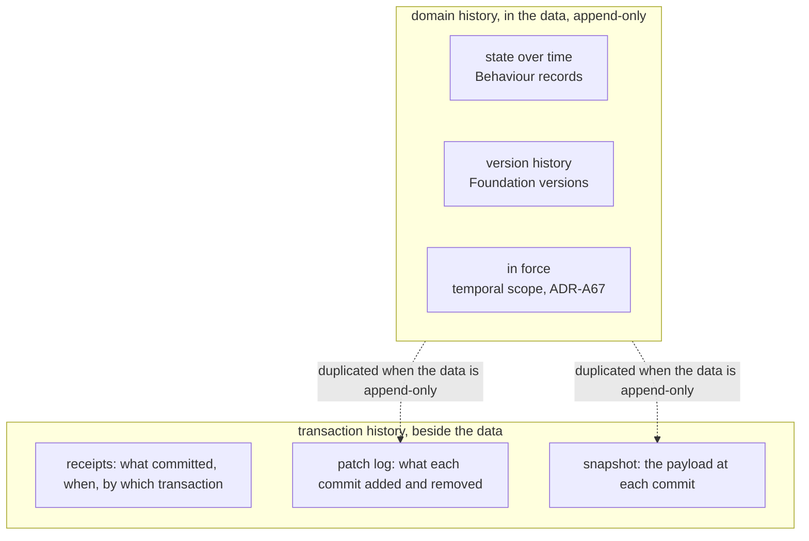
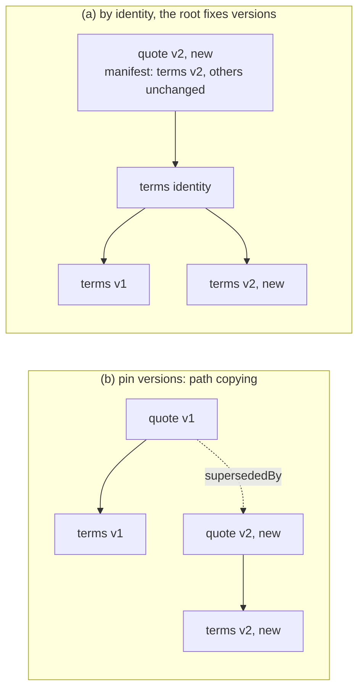
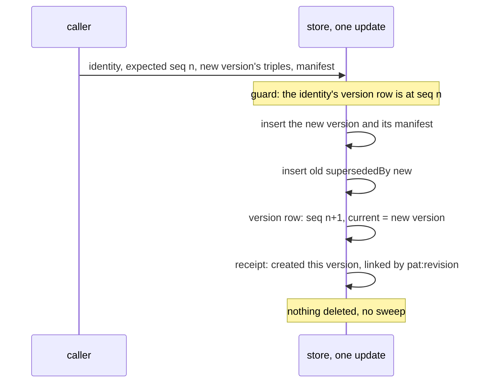
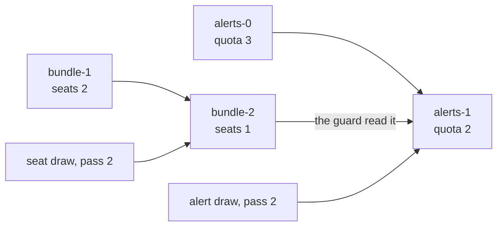
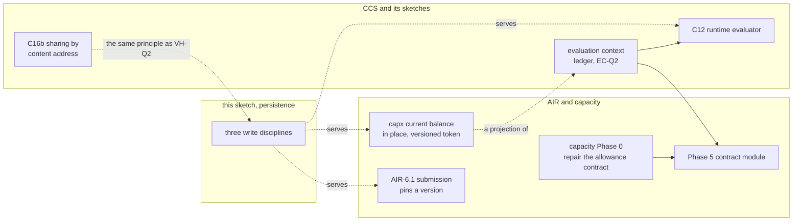
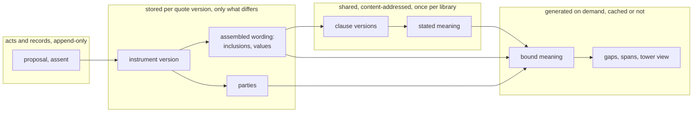

<!-- SPDX-License-Identifier: CC-BY-SA-4.0 -->

# Persistence: history, versions and the receipt models (sketch)

**Unit:** [`formal-methods-track-h`](../status/formal-methods-track-h.md), the patch-log half of H2.6b and H2.10, held for this sketch
on 2026-10-14 (H-D33)
**Status:** draft for the maintainer, 2026-10-14. Questions VH-Q1 to VH-Q7 are open. VH-Q7 researched 2026-10-14 (§6.1). §9 cross-references the placement vision papers, 2026-10-14
**Touches:** Foundation's versioning, Behaviour's runtime records, Wording's references by identity
([ADR-A112 addendum](../../architecture/decisions/ADR-A112-wording-layer.md#addendum-2026-10-06-references-by-identity)),
the bi-temporal model ([ADR-A67](../../architecture/decisions/ADR-A67-bi-temporal-model.md)), the receipt models of
[guide Chapter 20](../../architecture/rdf-sparql-patterns-guide.md#chapter-20--receipts-patches-or-snapshots-f9) and the persistence
README §7.4, aggregate ownership ([ADR-A122](../../architecture/decisions/ADR-A122-aggregate-ownership.md)), TD-42, TD-46, TD-47, TD-48

## 1. Why this sketch exists

Planning H2.6b's patch log, the maintainer asked how deep a patch must track a change, using a broker's tower and a carrier's requote as the
case. Working it through showed that persistence keeps history with a mechanism of its own, the receipt models, which never refers to the
versioning Foundation already defines, and that the two disagree. This sketch sets out the facts, the use cases, and the options, and
proposes what persistence should do with history. It decides nothing.

## 2. The scene, checked against the source on 2026-10-14

1. **Foundation versions things.** `fnd:Version` is a mixin. The individual is the version, carries one `fnd:hasIdentity`, and is followed
   by its successor through `fnd:supersededBy`. A version is never edited (the architecture skill's "identity and versions" principle).
2. **Wording references by identity, and the root fixes the version** (ADR-A112 addendum, points 1 and 2). A clause names the identity of
   what it mentions, and the assembled wording's `wrd:includes` lists the versions in force. The property-endorsement example reuses the
   unchanged `ex:sec-2` in `wording-v2` and adds only `cl-2-1-v2`.
3. **Behaviour versions its configuration and never its runtime records.** State spaces, transitions and operational profiles are
   `fnd:Version` subclasses. Runtime records are immutable individuals, evidenced and temporally scoped, and "records are never reopened"
   (nested-states sketch §4). A state occupancy names its subject's persistent identity, "so the state outlives a new version" (ADR-A106
   decision 5). An allowance account is one functional balance per record, and the ordered-draws example writes a new account record per
   change, chained by `prov:wasDerivedFrom`, with no shared identity.
4. **ADR-A67 forbids in-place correction of runtime data.** A correction is a new version superseding the old, which stays queryable.
   Transaction time is stated per assertion graph.
5. **Persistence knows nothing of versions.** Nothing under `ontology/persistence` names `fnd:Version`, and the ontology imports nothing. A
   write to a composite aggregate sweeps the owned closure and writes the caller's new state (README §7.1). The receipt models record history
   beside the data: receipt only, patch log, snapshot (README §7.4). The validator requires a patch log for every composite family.
6. **So the two conflict.** If a versioned node is inside an owned closure, a replace that writes its new version deletes the old one,
   against point 4, unless the caller resends every old version on every write.
7. **The workload note already assumes versions are kept in the payload.** Its medium programme counts 8 layers, 15 carriers per layer and
   2.5 indication versions per carrier at 80 triples a version, 24,400 triples ([workload modelling §5.2](../notes/rdf-engine/workload-modelling.md)).

## 3. Four kinds of history

| Kind | Question it answers | Where LATTICE keeps it today |
|---|---|---|
| state over time | what state was the licence in, what was the allowance, on 30 September | Behaviour's records, in the data, append-only |
| version history | what did the quote say before the requote | Foundation's versions, in the data |
| in force | which version governed the loss on 5 March, as known on 10 March | temporal scope, assents and effective dates, bi-temporal (ADR-A67) |
| transaction history | what did the store hold after commit 42, and what did commit 42 change | persistence's receipt models, beside the data |

The first three are domain facts and belong to the layers that state them. When they are append-only, the payload never loses a fact, so a
patch log or a snapshot of it duplicates them. What a storage log adds is transaction history for data that *is* edited in place, change
capture for downstream consumers, and an audit of what each commit did.

## 4. How deep a change goes

A triple-level log never needs the path from the root. A triple names its own subject, and replay is set arithmetic. Depth shows up through
four other things, which are the real design dimensions.

| Dimension | Effect on the cost of one change |
|---|---|
| whether node IRIs survive a write | a re-minted subgraph makes every triple look changed |
| whether the change is an edit or a new thing in law | a requote is a new offer, so editing it in place loses a fact |
| whether a reference pins a version or names an identity | pinning forces a new version of every node on the path, as git rewrites trees |
| how finely versioned nodes are cut | a version is copied whole, so a coarse node is copied for one value |

### 4.1 The requote, four ways

The path is tower, layer, quote, terms, premium. A quote version is 80 triples (the workload note's figure), and the premium is one value
on the terms.

| Way | Written per requote | History per requote | Current read | As-of read |
|---|---|---|---|---|
| A. edit the premium in place, patch log | 1 removed, 1 added, receipt | 2 in the log | direct | backward replay (TD-48) |
| B. rebuild the quote with new IRIs inside the tower's aggregate, patch log | the tower swept and rewritten | 160 in the log | direct | backward replay |
| C. a new quote version pinning new member versions | about 80, nothing removed | in the data | follow the current pointer | the version current at t |
| D. a new version of the smallest versioned node, members named by identity, the root's manifest fixing versions | the changed node plus one manifest entry per member | in the data | resolve through the manifest | the manifest current at t |

B is what the composite strategy does today if the quote sits in the tower's aggregate. No new nodes are created. The whole tower is
deleted and written back. A medium programme's tower holds about 9,600 quote triples (8 layers, 15 carriers, 80 triples), so a
one-value change rewrites about 19,200 triples (9,600 out, 9,600 back), and TD-42's quadratic sweep makes that roughly 92 million template
fills today. C, with the quote in its own aggregate, adds one quote version of about 80 triples and touches nothing else. A writes 2.
Clarified 2026-10-14: an earlier wording read as if the 19,000 were new nodes under C.

### 4.2 Where the quote belongs

The maintainer's answer, 2026-10-14. The quote's versions and history are not part of the tower's aggregate. A `NegotiationThread`
aggregate, not yet defined, references the tower and governs the quotes. A quote attaches to the layer it is for, though the carrier knows
nothing of layers, a broking construct, and quotes only against an attachment point and a limit. A quote is structurally a contract, an
instrument on `ins:`, with a different epistemic status: an indication, a quote, a binding offer, firming as its details build up. This
matches the computable-contract-substrate sketch's account of proposals "at different levels of commitment", checked by the same shapes as
a contract.

So in the worked case the tower is written rarely, the thread is written per move, and each firming or requote is a new quote version.
Defining the thread and the quote's status is domain modelling for another unit (§7).

## 5. Options

### 5.1 Where history lives (VH-Q1)

| Option | Says | Consequences |
|---|---|---|
| (a) **domain history in the data** | versions, records and temporal scope hold domain history. The storage log is transaction history and change capture only, and is optional | one source for each fact. As-of reads are queries over versions, with no replay. The storage log shrinks to what in-place data needs. Persistence must write versions without deleting them (VH-Q3, VH-Q4) |
| (b) **the storage log is history**, as guide Chapter 20 reads | patch log or snapshot per family, the payload holds current state only | conflicts with ADR-A67 and Foundation for versioned classes. Depth and re-minting decide the log's size (§4). A pruned log loses history the domain still needs |
| (c) both, per family | a family declares which | every reader must know which a family uses, and the guide already warns that a consumer must not assume replay |

### 5.2 How versions refer to each other (VH-Q2)

| Option | Says | Consequences |
|---|---|---|
| (a) **ADR-A112's rule, generalised** | a reference names an identity, and the aggregate root's version lists the member versions it fixes, as an assembled wording does | one rule across Wording and persistence. A change writes the changed node and a new root version with its manifest, O(members) pointers. As-of is one hop to the root version current at t |
| (b) pin versions | a reference names a version | a change at depth d writes d versions. Each root version is a complete state, so a snapshot is free |
| (c) per edge, declared beside `dal:ownership` | the adopter classifies each edge | most flexible, and a second classification on every edge |

### 5.3 How persistence learns a class is versioned (VH-Q3)

| Option | Says | Consequences |
|---|---|---|
| (a) read `fnd:Version` membership by IRI from the adopter's ontology, with no import, as a boundary shape names domain properties by IRI | the compiler checks `rdfs:subClassOf* fnd:Version` offline | no new import. Couples the compiler to one Foundation IRI, and does nothing for an adopter who versions without Foundation |
| (b) **a persistence declaration**, for example a write mode `dal:AppendVersions` on the family, with a shape that warns when a `fnd:Version` class is written by replace | the adopter states it, persistence stays import-free | domain-neutral and framework-like. The warning catches the conflict of §2 point 6 |
| (c) persistence imports Foundation | the ontology reasons about versions directly | an edge in the layer order, so an ADR (ADR-A01) |

### 5.4 The write for a versioned family (VH-Q4)

| Option | Says | Consequences |
|---|---|---|
| (a) **append, and move a current pointer on the identity's version row** | the version row, keyed by persistent identity, holds the current version beside `pat:seq` and `pat:head` | a current read is one lookup. The CAS is on the identity, so two requotes race as two writes to one quote do today. No sweep, so TD-42 does not apply. The new version links to its receipt with `pat:revision`, as an event does, which gives ADR-A67's transaction time inside a shared graph |
| (b) append, and derive current as "not superseded" | no pointer | every current read pays a `FILTER NOT EXISTS`, and a fork leaves two currents |

### 5.5 What remains of the receipt models (VH-Q5)

| Family writes | Receipt model | Why |
|---|---|---|
| by appending versions | receipt only, naming the versions created | history is in the data. The refusal `CompositeBoundaryReceiptOnly` does not apply, since nothing is swept |
| in place, history wanted | patch log, triple-level, read backward (TD-48) | transaction history and change capture for data with no versions |
| in place, no history wanted | receipt only | as today |

The snapshot model (H2.10) becomes either the root version's manifest under VH-Q2 (a), free under (b), or a copy for in-place data. Each
option keeps H2.6b's `ReceiptModelNotHonoured` warning until the model is built.

### 5.6 Retention (VH-Q6)

Superseded versions are kept until a policy prunes them, which is housekeeping (ADR-A80, TD-47). The questions are where the policy is
declared, per family or per class, and whether a version that something still references by version, an assembled wording's `includes`
for example, may be pruned at all. Leaning: never prune a version a retained version references, the version-level form of the guide's
pinned heads.

## 6. Behaviour's versioning (VH-Q7)

The maintainer suspects Behaviour's different approach has a reason, to be researched. What the source shows:

| Behaviour holds | How | Reading |
|---|---|---|
| configuration: state spaces, transitions, profiles | `fnd:Version` | things that change by being edited and restated, so versions |
| runtime records: occupancies, executions, findings | immutable individuals, never reopened, temporally scoped and evidenced | each is an occurrence, not a state of a continuant, so nothing to version |
| occasion occupancies | derived artefacts, `prov:wasDerivedFrom` their read set (law B1) | derived, so provenance, not succession |
| allowance accounts | a new record per change, `prov:wasDerivedFrom` the last and the execution, no shared identity | the odd one out: a balance is a state of a continuant, the account |

### 6.1 Research, 2026-10-14

Sources read: ADR-A08 (the four tiers), ADR-A92 (derived artefacts), ADR-A106 decision 5, the nested-states sketch §4, the
[evaluation-context sketch](evaluation-context.md) §5, §8 and §9 (unplanned since 2026-10-02), the examples `ordered-draws.ttl` and
`sequential-allowance.ttl`, and `bhv:AllowanceAccountShape`.

**Finding 1. Behaviour has three disciplines, and each has a reason.**

| Discipline | Behaviour's members | Why not versions |
|---|---|---|
| authored and edited, so **versions** | configuration | it is what versions are for |
| something that happened, so an **immutable record** | stimuli, executions, act and exercise records, state occupancies | an occurrence has no later state. A resumed state is a new occupancy, never a reopened one (nested-states §4) |
| computed from records, so a **derived artefact** | occasion occupancies (law B1), and in practice the allowance balances | a judgement is evaluated from facts, never authored (AGENTS.md, "Modelling"). Its provenance is its read set, which can span several accounts |

**Finding 2. A balance is computed state, and its order is the stimulus log's.** The evaluation-context sketch makes the ledger at
position p + 1 a function of the ledger at p and the pass at p + 1 (§8), positions come from the stimulus log because the engine never
reads a clock (law B3), and the Datalog form is `balance(Account, V, p)` (§9). A sequential pass adds micro-positions (p, i) in priority
order. So a balance record is keyed by its account and its position, and the log order already orders it. Because positions are log
order, which only grows, a late stimulus takes a later position, and the balance at an earlier position is never recomputed. That is
why no succession link is needed (a hypothesis, holding while law B3 and the evaluation-context design stand).

**Finding 3. `prov:wasDerivedFrom` carries what `fnd:supersededBy` cannot.** In `ordered-draws.ttl` the alert draw's guard reads the seat
bundle as the seat draw left it, so `alerts-1` derives from `alerts-0`, from the execution and from `bundle-2`, another account. Succession
links one identity's states. A read set crosses identities.

Arrows are `prov:wasDerivedFrom`, from source to derived record. Under versions, `bundle-2` would succeed `bundle-1` and `alerts-1`
would succeed `alerts-0`, and the edge from `bundle-2` to `alerts-1`, the reason the alert fired, would have nowhere to go.

**Finding 4. The account record is under-keyed.** Three gaps, each a gap between a stated design and the model:

1. `bhv:AllowanceAccount` is not typed `fnd:DerivedArtefact`, although its examples treat it as one and occasion occupancies are (B1).
2. A record names no owner and no position. The shape requires only `bhv:tracksAllowance` and `bhv:availableBalance`. The
   evaluation-context sketch says a ledger belongs to a persistent identity, as regime state does (ADR-A106 decision 5). Two licences on
   one allowance definition write records nobody can tell apart, and "current" can be read only from `fnd:recordedAt`, which is
   recording time, not the log position.
3. The name `AllowanceAccount` is used for a balance at a position. The account itself, the thing with an identity, has no node. The
   evaluation-context sketch's EC-Q2, whether allowances become ledger accounts, is the open question that would settle this.

The balances in the examples are blank nodes. Persistence writes no blank node (guide Chapter 5), so a balance quantity needs a minted
IRI before it is stored.

### 6.2 Options, revised

| Option | Says | Consequences |
|---|---|---|
| (a) **keep the three disciplines, and key the balance** | state the disciplines in Behaviour's README. A balance record is a `fnd:DerivedArtefact`, names its account's owner (a persistent identity) and its position, and keeps its read set in `prov:wasDerivedFrom`. Current is the record at the greatest position | matches the evaluation-context sketch and B3. About 2 more triples a record (owner, position). Each draw writes one record, append-only, so persistence writes it as a record-append family. A breaking change to Behaviour (ADR-A113), smaller if EC-Q2 decides it |
| (b) the balance becomes versions of an account identity | `fnd:hasIdentity` and `fnd:supersededBy` per record | loses the cross-account read set unless `prov:wasDerivedFrom` is kept too. Treats a computed value as authored, against the modelling rule. Within one pass, succession repeats the micro-position order |
| (c) both | allowed, since `fnd:Version` and `fnd:DerivedArtefact` are not disjoint | succession duplicates the position order at 2 triples a record, and invites a reader to edit a computed value as a version |

**Leaning (a)**, revised by §6.4. Behaviour is right to differ: what persistence calls "versioning" is one of three disciplines, and the
sketch's §5 should be read as "a versioned family" for the first, "a record family" for the other two. Finding 4 is input to EC-Q2, not a
change this sketch makes.

### 6.4 The roadmap, 2026-10-14

At the maintainer's request, before deciding anything for Behaviour, we read the planned and sketched work that touches the same
ground: the CCS plan, status and held questions, the evaluation-context, contract-amounts, reference-evaluator and terms-in-time
sketches, the capacity design and its execution profile, the AIR plans for Phases 5 and 6, the platform's phase 3 plan, the pending
design decisions and the debt register.

**Each need already has a home.**

| Need | Where it is planned or sketched | State |
|---|---|---|
| an account with an identity, keyed balances, a ledger of accounts on a tree, debits by path | [evaluation-context](evaluation-context.md) §5 and EC-Q2 ("generalising allowances into ledger accounts … at the cost of a breaking change to Behaviour"), [contract-amounts](contract-amounts.md) §3 items 1, 4, 8 | unplanned, and "comes back in" at CCS C12 (a pass as a run of the context), C13 and AIR Phase 5, which "should not start its contract module without this designed" |
| the balance at a position as a function of the previous one and the pass | evaluation-context §8, §9. [Reference evaluator](reference-evaluator.md) laws RE2 (a pass commits whole) and RE4 | sketched. RE2 and RE4 are conformance laws for formal-methods tracks B and E |
| repairing Behaviour's allowance contract: effect, application, definition, account | the [capacity design](../../architecture/capacity-domain-analysis-and-design.md) §12, Phase 0, whose exit criterion is "one unambiguous Behaviour contract for consuming a declared allowance and updating a tracked balance" | no unit. Capacity's source ontology (`cap:`) is designed, not authored, and AIR does not author it before Phase 5 |
| a capacity resource as the persistent thing a balance belongs to | `cap:CapacityResource`, linked by `cap:hasCapacityAccount` to "the balance record" | designed, not authored |
| a current balance for the hot path | `capx:ExecutableBalance`, one per resource (`capx:balanceRef` is functional), updated in place with its own `capx:balanceVersion` token and `capx:lastUpdatedAt` ([ADR-A-CAP1](../../architecture/decisions/ADR-A-CAP1-capacity-runtime-projection-profile_Version2.md), Proposed) | authored, 0.10.0, a projection materialised from the source |
| an instance stores only what differs, generated nodes shared by content address | CCS C7c D1 to D5, decided. CCS C16b builds the sharing, its cache and invalidation (TD-19) | planned, required before CCS closes |
| a record that cites exactly the data it saw | AIR-6.1: `sbm:Submission` is versioned and cites an exposure set *version*, "so an insurer's quote always refers to the data it saw". `sbm:InformationGap` is a derived artefact | briefed, in AIR's current trip |
| the quote and its firming, placements split across policies | CCS HQ-1 (a proposal arriving as data, without words), HQ-7 (several instruments covering portions of one order), AIR-6.1's `sbm:Approach` with status `Quoted`, insurml-alignment Phase 5 (placement records) | held questions and later phases. `NegotiationThread` appears only in the workload note |
| `fnd:Version` renamed `fnd:Versioned` | TD-20, "a Foundation maintenance unit, planned with its full cascade" | unplanned |
| the engine that writes Behaviour's runtime records | the platform's [phase 3 plan](../plans/phase-3-plan.md): the behaviour engine loads configuration and writes stimuli, executions, occupancies and records | rolling-wave placeholder |

**What this changes.**

1. **Behaviour should not change in Track H.** The account's identity and keying (finding 4) is EC-Q2's to decide, and EC-Q2 comes back
   at CCS C12 and AIR Phase 5, where capacity's Phase 0 needs the same answer. Changing `bhv:AllowanceAccount` here would pre-empt both. Our
   finding 4 is input to EC-Q2, not a change of our own.
2. **The word "account" is open.** The evaluation-context sketch says "ledger account", capacity says "resource" with an "account",
   and the maintainer asks for a less domain-bearing word. That choice belongs with EC-Q2 too.
3. **The three disciplines are confirmed across the roadmap.** AIR-6.1 versions its submission, records its approaches, and derives its
   information gaps. Capacity versions its dependencies and rules, records its demands and draws, and projects a current balance.
4. **Two balance forms coexist, by design.** Behaviour's records hold the history, and capacity's `capx:ExecutableBalance` is the current
   value for the hot path, which is ADR-A67's two-path split. The projection is an in-place family. Its `capx:balanceVersion` is an
   optimistic-concurrency token of its own, which a persistence profile's version row already provides. That is input to VH-Q5.
5. **VH-Q2 needs a refinement.** References by identity hold inside content (ADR-A112), but a record that must cite exactly what it saw
   pins a version: the assembled wording pins its elements, and AIR-6.1's submission pins its exposure set. So the rule is "by identity
   inside content, pinned at the root and wherever a record is evidence of what was seen".
6. **CCS C16b is where "point, do not copy" is already decided** for generated meaning (TD-19). VH-Q2 should cite it rather than restate it.
7. **TD-20 and VH-Q3 touch the same term.** A Foundation unit renaming `fnd:Version` is the natural moment for any change VH-Q3 makes
   that touches Foundation, and the reason VH-Q3 leans away from importing Foundation into persistence.

### 6.3 What this changes for persistence

Persistence needs three write disciplines, not two, which VH-Q4 and VH-Q5 should name:

| Discipline | Persistence write | History |
|---|---|---|
| versions | append a version, move the identity's current pointer (VH-Q4) | in the data |
| records, occurrences and derived artefacts | append only, never replace, keyed by what they are about and their position | in the data. Derived records can be regenerated from the records they derive from, so retention may treat them as a cache |
| in place | replace, as today | a storage log, if wanted (VH-Q5) |

## 7. Out of scope here

- Defining `NegotiationThread`, the quote's epistemic status and the attachment of a quote to a layer. They are domain modelling, for an
  applied unit, and this sketch uses them only as the worked case.
- The in-force question, which ADR-A67 and the instrument layer answer.
- The event slots of H2.6b, which do not depend on any of this.

## 8. Questions for the maintainer

| # | Question | Leaning |
|---|---|---|
| VH-Q1 | where history lives (§5.1) | (a), domain history in the data |
| VH-Q2 | how versions refer to each other (§5.2) | (a), ADR-A112's rule generalised, refined by §6.4 point 5: by identity inside content, pinned at the root and wherever a record is evidence of what was seen |
| VH-Q3 | how persistence learns a class is versioned (§5.3) | (b), a persistence declaration with a warning shape |
| VH-Q4 | the write for a versioned family (§5.4) | (a), append and move a current pointer on the identity's row |
| VH-Q5 | what remains of the receipt models (§5.5) | the table in §5.5 |
| VH-Q6 | retention of superseded versions (§5.6) | never prune a version a retained version references |
| VH-Q7 | Behaviour's versioning (§6) | researched 2026-10-14 (§6.1, §6.4). Behaviour's three disciplines are right. The keying of a balance is EC-Q2's, at CCS C12 and AIR Phase 5, so no change to Behaviour here |

Answers decide whether the patch log is built as planned in H2.6b's held half, rebuilt as an append write for versioned families, or
narrowed to in-place data, and what H2.10 builds. An ADR follows the answers, since VH-Q1 and VH-Q3 change how persistence relates to
Foundation.

## 9. The vision papers, LATTICE, and the data a placement makes (2026-10-14)

At the maintainer's request, before the examples are designed, we read a series of vision papers
against LATTICE's layers and the plans under way. The papers predate LATTICE. LATTICE's designs 
supersede theirs, and their end-state goals stay as direction: a broker's programme connected to 
large volumes of data, every decision traced to evidence, and history reconstructable at any time. 
LATTICE serves more than placement. Delegated authority in the London market (Open CBAA, through 
Instrument's `ins:boundUnder` and powers) and the other domains of Instrument's worked examples 
(facilities, licences, trials, frameworks) put the same questions to data management.

### 9.1 Where each idea of the papers lands

| Idea in the papers | In LATTICE | State |
|---|---|---|
| a contract's structure (elements, term applications, facets, flow directives) | Wording elements, Instrument's stated and bound terms, relations and qualifiers, Quantification's amounts, Eligibility's conditions | built (CCS C3 to C9b2). The template library is C8a, planned |
| a quote as a "proto-contract", structurally a contract | an instrument version whose words are a proposal (CCS sketch, "proposals are many, and are fragments of instruments") | modelled in outline. A proposal arriving as data without words is held question HQ-1 |
| epistemic status: commitment, precision, completeness, as an overlay on the terms | "precision … and completeness are recorded beside its terms, never inside them" (CCS sketch §7.4). Commitment reads from legal acts: a binding quote is the carrier's `ins:Assent` to a version, and binding is the client's assent to the same version. "Pending, decided and lapsed are derived, never stored" (`ins:Proposal`) | acts built (C9b1). The overlay's terms are not yet defined |
| `p_bind` copies the quote's structure into a child contract | no copy: the bound contract is the version both parties assented to. A change at binding, such as a signed-down line, is an amendment | a hypothesis for the examples to test |
| master contract, arrangement assembly, panels and subscription | Instrument's sections (§16), Party's groups, held question HQ-7 (several instruments covering portions of one order) | partly modelled. PDD-09 |
| tower, block, coverage term set, the contract-tower and fulfilment bindings | the AIR contract module's "coverage, layers, term parameters" (Phase 5), AIR-4.4's coverage requirements, AIR-6.1's submission | not modelled. Phase 5 is deferred |
| negotiation thread as an append-only sequence of moves, state derived | legal acts (Instrument) and records (Behaviour), with state evaluated from them | the pieces exist. PDD-09 |
| a fact ledger, immutable, hash-chained, superseded by corrections | `fnd:Evidence`, Behaviour's records, ADR-A67's corrections as new versions, persistence's receipts and request digests | built in parts |
| `VersionedEntity` with valid-from and valid-to, "never deleted, superseded" | `fnd:Version` with `fnd:supersededBy`, `fnd:TemporalScope` for valid time, persistence for transaction time, a current pointer (VH-Q4) | built, VH-Q4 open |
| a terms hash that followers acknowledge | content-addressed element versions (ADR-A51, C7c D2) | built |
| a term delta fact, an endorsement change fact: the diff in business terms | `wrd:Amendment`'s operations and `ins:Amendment`, which already record the change in the words and its legal effect | built (C5, C9a) |
| coverage gaps and spans, materialised and recomputed within minimal scope | derived artefacts (ADR-A92), Surface projections with read-set invalidation (ADR-A27), interval geometry (workload note §19) | built in parts |
| the behaviour model's tank state, per scenario | the evaluation context's ledger (PDD-08), the reference evaluator's laws | sketched |
| an exposure set versioned with every member | AIR's exposure module, with members shared across versions (TD-49) | built on the AIR branch, TD-49 to fix |
| a coverholder binding risks under an authority, bordereaux, an income limit | `ins:boundUnder` and powers, Open CBAA's migration after C9 and C12, the ledger for the limit (PDD-08) | partly built |

Four places where LATTICE departs from the papers, each a hypothesis the examples should test:

1. **State is read, not authored.** The papers keep a thread state, a quote status, a binding status
   and a fulfilment status side by side. LATTICE evaluates state from acts and records, so four
   stored statuses become one derivation and cannot disagree.
2. **Binding points, it does not copy.** See the table.
3. **Versioning is chosen per family**, not applied to every entity, by the three disciplines of §6.3.
4. **History of the words lives in the words.** Wording's amendments are the domain-level patch log
   the papers built as delta facts.

### 9.2 How much data a placement makes, revisited

The workload note counts a quote version as 80 triples. Once a quote carries wording and meaning, the
count depends on which of LATTICE's rules are applied. Judgement, for a policy form of about 150
elements whose bound meaning is about 1,000 nodes (TD-19):

| What a quote version stores | Triples per version | 300 versions, a medium programme |
|---|---|---|
| everything, copied: its wording and its bound meaning | about 5,000 | about 1,500,000 |
| only what differs from its form (C7c D1): inclusions, about 30 values, parties, header. Stated meaning shared by content address (D2). Bound meaning generated, not stored (D4) | about 270 | about 81,000 |
| as above, and a requote shares the unchanged inclusions and values of the version it follows (VH-Q2) | about 5 to 20 for a one-value requote | about 6,000 |

### 9.3 The levers, decided and open

| Lever | Saves | State |
|---|---|---|
| content-addressed element versions and stated meaning | restating a clause, across every instrument that uses it | decided, C7c D2 |
| an instance stores only what differs from its form | copying the form into each instance | decided, C7c D1 |
| bound meaning generated, cached as need dictates | storing about 1,000 nodes per instrument version | decided, C7c D4. Sharing across instruments is C16b |
| sharing within an instrument by resolution signature | one bound term per section with the same words | decided, C7c D5 |
| references by identity, versions fixed at the root | a version per ancestor for every change | decided for Wording (ADR-A112). VH-Q2 for persistence |
| members shared across versions of a set | copying unchanged members | TD-49 for exposure. VH-Q2 for inclusions and values |
| derived artefacts and projections, regenerated within minimal scope | storing what can be computed, and recomputing more than changed | decided (ADR-A92, ADR-A27). Which to materialise is open |
| the hot set sized by Little's law, the rest tiered and partitioned by tenant | keeping prior years hot | workload note §6.2, §17, unratified |
| a write discipline per family, a retention per kind | keeping history no one reads, or losing history someone needs | this sketch, TD-47 |

### 9.4 The strategies the examples should exercise

The examples should show each of these where it fits, so that guidance on "what works best when" rests
on worked cases:

| # | Strategy | Keeps | Costs | Likely fit |
|---|---|---|---|---|
| S1 | edit in place, receipts only | current state, who wrote when | 9 triples per write | working drafts, a broker's design workspace |
| S2 | edit in place with a patch log | current state, and what each write changed | 11 plus the change | data edited often whose history matters but whose old states are not cited |
| S3 | append versions, members shared, a current pointer | every version, each citable | the changed nodes plus pointers | instruments, wordings, submissions, exposure sets: what is cited as "as it was" |
| S4 | append records, state derived | every act and observation | one record per event | negotiation moves, assents, findings, stimuli |
| S5 | derived artefact, generated on demand | nothing but its recipe | compute per read, or a cache | bound meaning, gaps, spans, balances |
| S6 | content-addressed sharing | one node for equal content | a hash per node | library wording, stated meaning, bound meaning across instruments (C16b) |
| S7 | a projection, materialised and current | a fast read for a known query | refresh on change | "load my tower" within the 1 to 2 second budget (workload note §10) |
| S8 | tiering and export, an outgoing event stream | everything, cold or elsewhere | a columnar store, a stream | closed years, change capture to other systems |

A family declares its strategy, as it declares its receipt model today. That the declaration belongs
to persistence or to the domain layer is VH-Q3.
