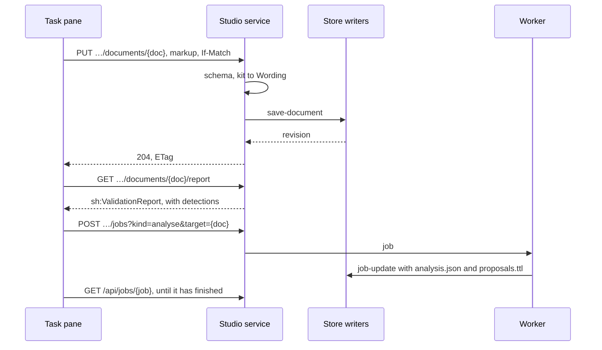

<!-- SPDX-License-Identifier: MPL-2.0 -->

# LATTICE Authoring (Word add-in)

A Word add-in that marks clauses, definitions, variables and defined-term references in a document, reads them as Logical English and shows the relations they propose (ADR-A118). It is a client of the Configuration Studio (ADR-A136). A document lives in a studio workspace, which stores it as [document markup](../../contracts/document/README.md) with the Wording graph the markup gives, reports on it, and analyses it as a job. Not a platform contract. Its code, markup and manifest may change or be withdrawn without deprecation.

## How it fits together

| Part | Concern | README |
|---|---|---|
| This add-in | the Word task pane and the ribbon and right-click commands an author uses | this file |
| [`packages/authoring-domain`](../../packages/authoring-domain) | the document model, the markup reader and writer, the tag codec and offsets, shared with the studio's browser code | its own |
| [`contracts/document`](../../contracts/document/README.md) | the markup and its schemas | its own |
| [`contracts/config-studio`](../../contracts/config-studio/README.md) | the studio's HTTP API: workspaces, documents, the report, templates, samples and jobs | its own |
| [`platform/config-studio-authoring`](../../platform/config-studio-authoring) | in the studio's service: markup validated and mapped to Wording, templates, samples, and the report's shapes, template findings and detections | the studio's |
| [`workers`](../../workers/README.md) | the `analyse` job: the sentence-form reading, the Logical English and the proposed relations | its own |



The add-in builds the document model from Word's OOXML, writes it as markup and saves it to the workspace the author chose, keeping the workspace and the revision in the document's custom XML part. The report and the analysis are read as RDF, except the analysis view, a JSON artefact the worker writes.

## Modules (`src/`)

| Module | Holds |
|---|---|
| `domain/types.ts` | the document model and the analysis view, in `@lattice/authoring-domain` |
| `domain/tags.ts` | the content-control tag codec: `encode`/`decode`, and `title` |
| `domain/offsets.ts` | `occurrenceIndex` and `escapeWordSearch`, for `Range.search` |
| `domain/keys.ts` | `suggestKey`/`guessValueType`, ported from WA3's Java detector |
| `domain/xml.ts` | small shared DOM helpers used by `ooxml.ts` and `metadata.ts` |
| `domain/ooxml.ts` | `parseBody`, `writeSections`, `writeTemplate`, `writePackage` |
| `domain/snapshot.ts` | `buildSnapshot(parsed, metadata)`, the document model that `writeMarkup` saves |
| `domain/metadata.ts` | `toXml`/`fromXml` for the document's custom XML metadata part |
| `domain/mermaid.ts` | `toMermaid(graphView)`, a deterministic Mermaid `flowchart` renderer |
| `domain/poll.ts` | `pollJob(read, options)`, until a studio job has succeeded or failed |
| `domain/uuid.ts` | a dependency-free UUID v4 generator |
| `api/client.ts` | `StudioClient`, `HttpStudioClient`, `ApiError`, and the Turtle readers for workspaces, templates, samples, jobs and the document report |
| `word/port.ts` | the `DocumentPort` interface, `MarkResult`, `InlineMark`, `AuthoringMetadata` |
| `word/officePort.ts` | `DocumentPort` over the real Word API |
| `word/fakePort.ts` | `DocumentPort` over an in-memory model, for tests and the harness |
| `app/App.tsx` | the task pane root: tabs, error banner, all shared state |
| `app/DocumentPanel.tsx`, `MarkupPanel.tsx`, `AnalysePanel.tsx`, `LogicalEnglishPanel.tsx`, `GraphPanel.tsx` | one component per tab |
| `app/uiBridge.ts` | the observable store bridging ribbon/right-click commands and the task pane |
| `commands/ids.ts` | `COMMAND_IDS`, the eight command ids |
| `commands/handlers.ts` | `createHandlers(deps)`, one handler per command (no Office global touched) |
| `commands/register.ts` | `registerCommands(handlers)`, the only module that calls `Office.actions.associate` |
| `main.tsx` / `harness.tsx` | the real and harness entry points |

## Tag codec

| Kind | Tag | Title | Appearance | Colour |
|---|---|---|---|---|
| section | `lat:s:<sectionKey>` | `Section: <heading>` | BoundingBox | `#5B6B7F` |
| clause | `lat:e:<uuid>` | `Clause` | BoundingBox | `#1F6FB2` |
| definition | `lat:d:<uuid>` | `Definition` | BoundingBox | `#6A3FB5` |
| term | `lat:term` | `Term` | Tags | `#6A3FB5` |
| variable | `lat:v:<variableKey>` | `Variable: <label>` | Tags | `#C46A00` |
| reference | `lat:r:<uuid>` | `Defined term: <term>` | Tags | `#2E7D32` |

## Commands

| Id | Ribbon | Right-click | Does |
|---|---|---|---|
| `showPane` | Show pane | | opens the task pane |
| `markClause` | Clause | Mark as clause | wraps the selected paragraphs as a clause |
| `markDefinition` | Definition | Mark as definition | wraps the selected paragraphs as a definition |
| `markTerm` | Term | Mark as defined term (in its definition) | marks the selection as the defined term |
| `markVariable` | Variable… | Mark as variable… | drafts a variable from the selection, opens the pane on the Markup tab |
| `markDefinedTerm` | Defined term… | Mark as reference to a defined term… | marks a reference when exactly one definition matches, otherwise drafts one |
| `unmark` | Unmark | Remove LATTICE mark | removes the mark, keeping the text |
| `analyse` | Analyse | | opens the pane on the Analyse tab and starts the analysis |

A command never fails silently: a `MarkResult` that is not `ok`, or an exception, posts the reason
to the Markup tab and opens the pane.

## Running the tests

```
mise run check:authoring-addin
mise run test:authoring-addin
```

`check:authoring-addin` type-checks with `tsc --noEmit` and runs the Vitest unit suite.
`test:authoring-addin` additionally runs the Playwright suite (`e2e/`) against a real `msedge`
channel and the harness, using fake/mocked API responses.

There is no end-to-end suite against a live studio yet, which is recorded as technical debt.

## Load the add-in in Word

Word loads add-ins over HTTPS only. `mise run studio:up -- --docker` serves the built add-in at `https://localhost:3443` through a proxy with a local CA (`mise run studio:ca` to trust it). Start it first, then pick one of
these ways to load `manifest/manifest.xml` into a real Word client.

### Word on the web

1. Open Word on the web, then **Home** → **Add-ins** → **More Add-ins**.
2. Choose **My Add-ins** → **Upload My Add-in**.
3. Browse to `apps/word-authoring-addin/manifest/manifest.xml` and upload it.
4. The LATTICE group appears on the Home tab.

To remove it: **Home** → **Add-ins** → **My Add-ins**, then remove it from the list.

### Desktop Word on Windows (sideload via the registry)

Desktop Word reads a list of trusted manifest folders from one user-level registry value, rather
than a file picker. Run this once, as the signed-in user (not elevated):

```powershell
New-Item -Path "HKCU:\Software\Microsoft\Office\16.0\WEF\Developer" -Force | Out-Null
New-ItemProperty -Path "HKCU:\Software\Microsoft\Office\16.0\WEF\Developer" `
  -Name "LatticeAuthoring" `
  -Value "C:\path\to\lattice\apps\word-authoring-addin\manifest\manifest.xml" `
  -PropertyType String -Force
```

Replace the path with this repository's actual location, then restart Word. **Insert** →
**Add-ins** → **My Add-ins** → **Shared Folder** lists it.

To remove it: delete the `LatticeAuthoring` value (or the whole `Developer` key if it holds nothing
else) and restart Word.

```powershell
Remove-ItemProperty -Path "HKCU:\Software\Microsoft\Office\16.0\WEF\Developer" -Name "LatticeAuthoring"
```

### Desktop Word on macOS (sideload via the manifest folder)

Quit Word completely with **Word** → **Quit Word**. From the repository root, run these commands
in Terminal as your normal user, without `sudo`:

```sh
mkdir -p "$HOME/Library/Containers/com.microsoft.Word/Data/Documents/wef"
cp apps/word-authoring-addin/manifest/manifest.xml \
    "$HOME/Library/Containers/com.microsoft.Word/Data/Documents/wef/lattice-authoring.xml"
```

Word reads manifests from this `wef` folder. This is a copy, so repeat the `cp` command whenever
the repository's manifest changes.

Before loading the add-in, run `mise run studio:ca` from the repository root. Import
`.build/config-studio/addin-root.crt` into your login keychain using **Keychain Access**.
Open the imported certificate, expand **Trust**, and set **When using this certificate** to
**Always Trust**. Only trust the CA exported by your own local stack.

Reopen Word and open a document. Select **Home** → **Add-ins** and choose **LATTICE Authoring**.
The LATTICE group appears on the Home tab.

To remove it, quit Word, run the following command, then reopen Word:

```sh
rm "$HOME/Library/Containers/com.microsoft.Word/Data/Documents/wef/lattice-authoring.xml"
```

If Word still lists a cached copy, follow Microsoft's
[Office cache clearing instructions](https://learn.microsoft.com/office/dev/add-ins/testing/clear-cache).
See also Microsoft's [macOS sideloading guide](https://learn.microsoft.com/office/dev/add-ins/testing/sideload-an-office-add-in-on-mac).

### Central deployment (an administrator, for a whole tenant)

An Microsoft 365 administrator can publish `manifest/manifest.xml` through the
[Integrated Apps](https://learn.microsoft.com/microsoft-365/admin/manage/centralized-deployment-of-add-ins)
flow in the Microsoft 365 admin center, scoped to a pilot group of users rather than the whole
tenant. This is the only option that reaches Word on the web and desktop Word without each user
sideloading individually, and the only one worth using once the POC leaves a single developer's
machine. To remove it, delete the deployment from Integrated Apps. It becomes unavailable to every
user it was assigned to within the hour.

Every method above needs the compose stack reachable at `https://localhost:3443` from the machine
running Word — the manifest's URLs are not relative to wherever the manifest file itself sits.

