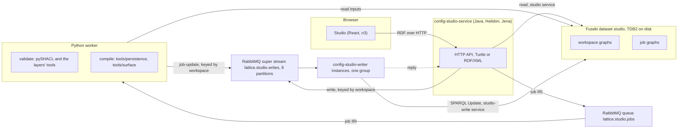
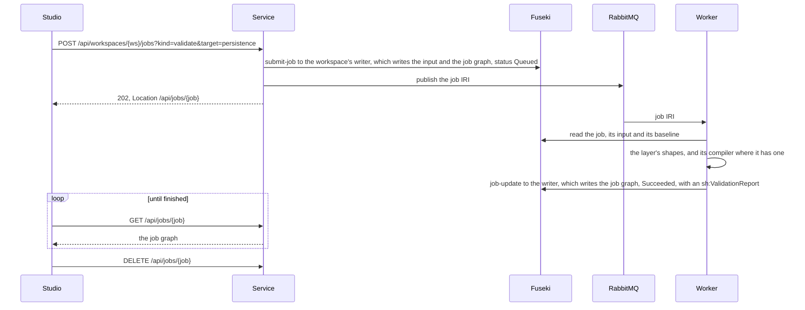

<!-- SPDX-License-Identifier: CC-BY-SA-4.0 -->

# Configuration Studio

The Configuration Studio is a web application for authoring an applied ontology's configuration against its baseline: vocabulary bindings (`voc:`), quantification (`qnt:`), eligibility (`elg:`), persistence profiles (`dal:`) and surface contracts (`srf:`). It checks each configuration with its layer's own shapes and compilers as the author edits, and compiles persistence and surface configuration into the artefacts a deployment runs. It is a supported part of LATTICE, built from a browser application in [`apps/config-studio`](../../apps/config-studio/README.md), a service in [`platform/config-studio-service`](../../platform/config-studio-service/README.md), a store writer in [`platform/config-studio-writer`](../../platform/config-studio-writer/README.md), their shared core in [`platform/config-studio-core`](../../platform/config-studio-core/README.md), a worker in [`workers`](../../workers/README.md#configuration-studio-jobs-adr-a136), and its contracts in [`contracts/config-studio`](../../contracts/config-studio/README.md). How to run and operate it is in the [operations guide](../operator/configuration-studio-operations.md) and the [runbook](../operator/configuration-studio-runbook.md).

## Components

| Component | Owns | Never does |
|---|---|---|
| browser application | the editors, derived from the vocabularies it is served, and the sorting of an imported graph into a workspace's parts | interpret a finding or compile |
| service | HTTP, reads of the store, and the publication of jobs and writes | interpret `dal:`, `srf:` or the other layers' terms, or write the store |
| store writer (`config-studio-writer`) | every write to the store for the partitions it holds, in batches of one request each, the revision guard, a receipt per write, and the sweep of finished jobs | serve HTTP, or apply a command it has not checked |
| worker | validation and compilation, with the engines `mise run check` uses | take a path, a command or a graph of its own choosing from a message |
| Fuseki | every workspace and job, as named graphs | hold state the service or worker keeps elsewhere |
| RabbitMQ | delivery of job IRIs to the worker, and of writes to the writer of their partition on a super stream | carry a job's content to the worker |

**Java owns HTTP and storage, Python owns meaning.** Validation and compilation run where pySHACL and the repository's compilers are, so the studio answers as `mise run check` would. A validation of persistence configuration also compiles it, because the `dal:` shapes target the dimension classes and do not see a `dal:DataAccessProfile` that declares several dimensions at once.

**The store is the only state.** The service keeps no registry. A workspace's revisions are triples in its own graph, and a job's status is read from the job's graph, which the worker's updates write (PRI-52). The store is a TDB2 database on disk, in the user's data folder, so workspaces and the results of past jobs outlive the application. A finished job is deleted after a retention, 30 days unless a deployment sets another.

**One writer per workspace, deployed apart.** The service and the worker never write the store, and Fuseki gives them a service that only reads. Each write is a command published to a RabbitMQ super stream, in the partition its workspace's id selects, so a workspace's writes stay in order. The store writer, `config-studio-writer`, is a deployable of its own. Its instances form one single-active-consumer group, so RabbitMQ gives each partition to one live instance, spreads the partitions across the instances that run, and moves them when one joins or leaves. A writer stores each partition's offset after a batch, and a write delivered again after a move is answered from its receipt. The service waits for the writer's reply, so a save still answers the browser at once, and past its wait it reads the write's receipt to say whether it applied.

**A batch is one commit, and each write leaves a receipt.** A writer applies the writes waiting for it in one request, since on TDB2 a commit costs far more than the operations in it ([TSD-44](triple-store-discovery.md#tsd-44-a-small-update-on-fuseki-tdb2-costs-its-commit-so-batching-updates-is-the-lever-for-write-throughput)). Each write first inserts a receipt of its cause, sender and transaction time, only where its precondition holds in the store, such as the revision a save expects, and its other operations require that receipt. So a write applies whole or not at all even should two writers hold one workspace, a write redelivered after a lost acknowledgement is answered from its receipt, and the receipts are the record of what was written.

**A job message is a job IRI and nothing else.** The worker reads the job graph, which names its input graphs by reference ([ADR-A30](decisions/ADR-A30-shared-semantic-platform-cross-runtime-boundary.md)). A job's input graph is written once under its IRI, and each baseline revision is a new graph, so a job's inputs never change under it.

## Forms are read from the ontology

The layers' specifications and shapes already say what a form needs. A class's SHACL shapes name its properties and constrain them, each property has an `rdfs:comment`, and each closed set of values is a class whose individuals are typed with it. The studio derives every field and option from the vocabulary and shapes it is served, and states only what an ontology cannot: how an editor groups classes into sections, and which properties pick a baseline term. When a layer adds a property, a constraint or a value, the studio offers it without a change.

Shapes are read first, and `rdfs:domain` and `rdfs:range` only where no shape says anything. A node shape with `sh:targetClass C`, or a class that is itself a shape, places each property its `sh:property` shapes name by a plain IRI `sh:path` on C and on C's subclasses. Several shapes for one property merge conservatively, so the highest `sh:minCount` and the lowest `sh:maxCount` hold. A property no shape names is placed by its `rdfs:domain` as before, and a property a shape names without saying what it holds takes its control from its `rdfs:range`. For each class and property, a studio override beats the shape, and the shape beats the domain and range. The staging step adds only the node shapes and property shapes to the served vocabulary. SHACL-SPARQL constraints, messages and complex paths are not staged or read.

| Shape constraint | Effect on the field |
|---|---|
| `sh:datatype xsd:integer`, `xsd:long`, `xsd:decimal` | number |
| `sh:datatype xsd:boolean` | switch |
| any other `sh:datatype` | text |
| `sh:class` of a class with individuals in the vocabulary | a select, or chips when the property takes several values, each option with its comment |
| `sh:class` of a class whose members the author creates, for example `dal:UniquenessConstraint` | a reference to a node of that type in the configuration, or a new one |
| `sh:in` of IRIs | a select over the listed values |
| `sh:nodeKind sh:IRI` | an IRI, unless the property's range gives a more specific control |
| `sh:maxCount 1` | one value. A larger count means several, and no count leaves the ontology's own rule (`owl:FunctionalProperty`, and every `dal:` property) |
| `sh:minCount` of 1 or more | marked required with an asterisk |
| `sh:name`, `sh:description` | the label and comment, where the property has none |

Without a shape, the range of the property picks the control.

| Range of the property | Control |
|---|---|
| `xsd:string`, `xsd:anyURI` | text |
| `xsd:integer`, `xsd:long`, `xsd:decimal` | number |
| `xsd:boolean` | switch |
| a class with individuals in the vocabulary | a select, or chips when the property is not functional, each option with its comment |
| a class whose members the author creates | a reference to a node of that type in the configuration, or a new one |
| a property listed as a baseline pick, for example `dal:targetClass` or `srf:carrier` | a picker over the baseline's classes or properties |

The read path of a surface contract is the one control that is not generic. It starts at the carrier and offers, at each hop, the properties whose domain is the current class, and writes `srf:readProperty` for one hop and `srf:hasPathStep` for more, never both.

## Workspaces and their graphs

A workspace is a baseline and the five configurations authored against it. Each is a named graph, and each has its own revision.

| Graph IRI | Written by | Holds |
|---|---|---|
| `urn:lattice:studio:ws:{ws}` | writer | the `cst:Workspace`, its label, its current baseline graph, each configuration's revision, and the sample it was copied from, if any |
| `urn:lattice:studio:ws:{ws}:baseline:{n}` | writer, once | baseline revision n |
| `urn:lattice:studio:ws:{ws}:{part}` | writer | the saved configuration of one part: `vocabulary`, `quantification`, `eligibility`, `persistence` or `surface` |
| `urn:lattice:studio:job:{job}` | writer, for the service and then the worker | the `cst:Job`, its references, status, report and artefacts |
| `urn:lattice:studio:job:{job}:input` | writer, once | the configurations as submitted |

A save carries the revision it expects in `If-Match`. The workspace's writer compares it with the stored revision and, in one SPARQL Update request, replaces the configuration and moves its revision, so the two never disagree ([optimistic concurrency](optimistic-concurrency-in-rdf.md)). The writer is the only one writing that workspace, so the comparison needs no lock, and several service instances may share one store.

A sample is copied into a new workspace that records which sample it came from, so a later change to the sample does not reach it. A workspace exports as one TriG file of every graph but its jobs, and imports, here or elsewhere, as a new workspace with its revisions.

**Which part a subject belongs to** is decided by one rule, which the browser applies when it sorts an imported graph and the service applies again to every graph it saves. A named subject belongs to the first of persistence, surface, eligibility, quantification and vocabulary whose namespace its `rdf:type` or its predicates use, a SKOS concept or scheme belongs to vocabulary, anything else to the baseline, and a blank node to the subject that refers to it. So an eligibility question that names a quantification range set stays with eligibility.

## A validation, end to end

Findings of every engine are `sh:ValidationResult`s, so the browser reads one shape of finding and shows each on the field that caused it. A failure inside a job is written as `cst:Failed` with a message, and the message is acknowledged. A malformed message is refused without being requeued. A worker that stops mid-job leaves its message unacknowledged, so it is redelivered, and the job, which overwrites its own graph, runs again.

A vocabulary validation also resolves every scheme contract for every time segment and set of scopes its bindings draw. An eligibility validation also compiles every condition, expands each concept condition over its resolved scheme, and decides each `elg:Question` with the condition's compiled SPARQL against the decision the author expects of it. A compilation writes the generated artefacts into the job graph, with the gaps the compiler reports.

## On the wire

Every body is RDF: Turtle by default, or RDF/XML, which an XSLT can read, when the request's `Accept` ranks it higher or its `Content-Type` names it. RDF/XML is written plain, one description per subject. The routes, graphs, messages and every status code are in the [contract](../../contracts/config-studio/README.md).

A payload says what it is in the protocol, never by its content (STD-292). Its media type is in `Content-Type`, and the profile it conforms to, where one applies, is an IRI in `Content-Profile`, following W3C Content Negotiation by Profile, or in a `Link` with `rel="profile"` (RFC 6906), or in the media type's own `profile` parameter, as JSON-LD's. The receiver records the profile as `dct:conformsTo`, refuses a declaration inside the payload that disagrees with the header, and records the bytes received with `Content-Digest` (RFC 9530). A response follows `Accept` and `Accept-Profile`.

## Security

Each component validates what it receives, whatever its client has checked, since it cannot know the input was not forged or altered on the way (PRI-75).

| Component | Validates |
|---|---|
| service | the body's size (5 MiB), media type and syntax, that an RDF/XML body declares no DTD, that a saved graph holds only its own part's subjects, every identifier in a path, the slug, the job's kind and target, and the revision a save expects |
| worker | that a message is a studio job IRI, that the job names a known kind and target, and that it names only its own input graph and a workspace baseline |
| store writer | that a command names a workspace and a job by their ids, carries only the graphs its kind may, holds only its part's subjects, and that a job's update changes nothing but its status and results, compared by value |
| browser | what an author types, so a finding appears before a save, never in place of the service's checks |

The service has no authentication. It binds to the loopback address, and a write needs `Content-Type` Turtle or RDF/XML, or a `DELETE`, none of which a page of another origin can send without a preflight that the service never answers. Every graph and update is built with Jena's typed API, never by joining strings (PRI-55). Static files are served from one directory with a normalised path check. Responses carry `nosniff`, `no-store` for the API, and a `default-src 'self'` content security policy. The worker runs one fixed operation per job kind and takes no path or command from a message ([ADR-A35](decisions/ADR-A35-trusted-surface-worker-execution-boundary.md)). Any client of the broker can send a write, so the broker is as trusted as the store, and it listens on the loopback address too. So the studio is a tool for one author on one machine. A shared deployment needs authentication first.

## Costs

| Operation | Round trips | Data |
|---|---|---|
| open a workspace | one read each of the workspace, the baseline, the configurations and the vocabulary, which is cached by its ETag | the baseline and its configuration, typically under 2,000 triples |
| an edit | none | a copy of the browser's store, under 1 ms for 2,000 triples |
| a validation | one submission, a few polls and one deletion. The worker makes three reads and one write | two graphs written and dropped |
| a save | one request, one command to the writer and its reply, a read of the revision and one SPARQL Update | the configuration graph, twice: to the broker and to the store |

Validation dominates, at about a second on a laptop. A burst of typing yields one job, because edits are debounced and the browser keeps at most one validation in flight per graph. TDB2 applies one update at a time per dataset, so more writers do not write faster on one dataset ([TSD-42](triple-store-discovery.md#tsd-42-fuseki-on-tdb2-applies-concurrent-updates-one-at-a-time-and-a-read-does-not-wait-for-them)). They keep a busy workspace from delaying others and check commands in parallel, and a read never waits for a write. A response in RDF/XML is rewritten from Turtle, which costs about 60 ms for the 640 KB vocabulary against 3 ms as Turtle.

## Decisions

The studio rests on the shared semantic platform's boundary between runtimes ([ADR-A30](decisions/ADR-A30-shared-semantic-platform-cross-runtime-boundary.md)), the trusted worker boundary ([ADR-A35](decisions/ADR-A35-trusted-surface-worker-execution-boundary.md)), the Surface Contract Studio's authoring boundary ([ADR-A38](decisions/ADR-A38-surface-output-publication-and-studio-authoring-boundary.md)), and the persistence profiles and their compiler ([ADR-A78](decisions/ADR-A78-persistence-profile-substrate-and-aggregate-boundaries.md), [ADR-A79](decisions/ADR-A79-persistence-compiler-toolchain.md)).
