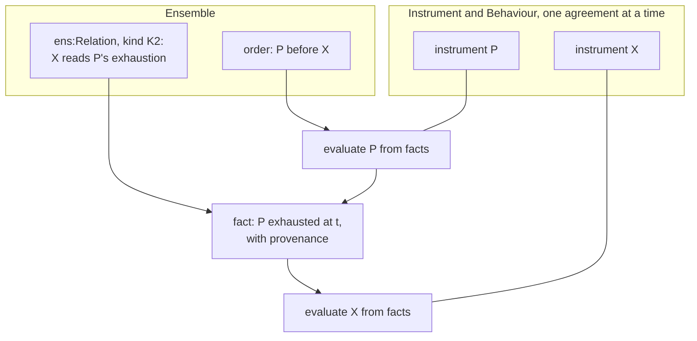

<!-- SPDX-License-Identifier: CC-BY-SA-4.0 -->

# ADR-A130: Ensemble, a substrate layer for relations between instruments

**Status:** Proposed, 2026-10-18
**Date:** 2026-10-18
**Supersedes:** none
**Related:** [ADR-A01](ADR-A01-layer-dependency-order.md) (the layer order, amended by its
2026-10-18 addendum), [ADR-A104](ADR-A104-instrument-terms-and-legal-relations.md) (Instrument),
[ADR-A106](ADR-A106-behaviour-configuration-runtime-occasions-and-records.md) (Behaviour's runtime),
[ADR-A121](ADR-A121-repository-catalogue.md) (the repository catalogue),
[ADR-A122](ADR-A122-aggregate-ownership.md) (aggregate ownership),
[ADR-A-C2](ADR-AC2-clean-room-authoring-procedure.md) (authoring order),
the [relations sketch](../../developer/sketches/instrument-relations.md) (the analysis and the options)

## Context

Instrument models one legally binding agreement. It reaches across agreements in three ways only:
`ins:boundUnder`, legal acts under another instrument, and incorporation by reference. A gate reads
the state of its own instrument, or of the occasion its arising chain reaches (Instrument §11.4).
Three held questions of the computable contract substrate need more: HQ-2 (a relation gated by
another agreement's state, such as an excess responding once the underlying is exhausted, or a
guarantee called on the principal's default), HQ-7 (several instruments placed as portions of one
order) and HQ-12 (composing shares).

The law keeps each contract separate (privity) and links contracts by terms of one that refer to
another's state, read as facts: accessory guarantees, cross-default, back-to-back subcontracts,
excess layers, intercreditor ranking, and the single agreement of a master and its confirmations.
The relations sketch compares widening Instrument (option A) with a layer of its own (option B).
Under A, evaluating one instrument loads every instrument its gates read, so a chain of *n* related
instruments costs of order *n*² loads, Instrument's single-agreement laws and proofs must be
restated for sets of instruments, and every refinement bumps Instrument for all its importers.
Under B, each instrument is evaluated alone and the link supplies a fact, at *n* loads. The
maintainer chose B on 2026-10-18 (IR-Q2).

## Decision

1. **A new substrate layer, Ensemble.** An ensemble is a set of instruments forming one operation, in
   the sense of the Code civil, art. 1186 al. 2, whose contracts are interdependent when each is needed
   for that operation. `ontology/ensemble/`, literate (ADR-A120, ADR-A126), namespace
   `https://www.nebularis.org/neuro-semantic/lattice/ensemble#`, prefix `ens:`. It imports Instrument
   and Behaviour's runtime document, and through them every layer below. Nothing in the substrate
   imports it. ADR-A01's 2026-10-18 addendum places it, and its repository catalogue entry states
   its imports.
2. **Relations are reified.** `ens:Relation` is identified and temporally scoped. It names two or
   more instruments by role, and carries the properties of its kind. The kinds form a vocabulary:
   - **K1 derivation:** created under, incorporates
   - **K2 dependency:** accessory, conditional on another's state, back to back
   - **K3 priority:** ranking between agreements, inuring order
   - **K4 portion and share:** several commitments, portions of one order, composed shares
   - **K5 single agreement:** a master and its children, for the purposes their terms state

   A relation's legal effect is stated by a term of one of its instruments, or of a master, and is
   never a property of the relation alone.
3. **Evaluation by composition.** A set of related instruments is evaluated as a sequence of
   single-instrument evaluations, ordered by the relations: dependencies before dependants, rank
   before rank. What one instrument needs of another, such as an exhaustion, a default or a payment,
   reaches it as a fact with provenance, produced by evaluating the other. The single-instrument
   evaluator never loads a neighbour. A cycle of dependencies is rejected at design time.
4. **One hook in Instrument.** A regime's measured value, or a condition's evidence, may be supplied
   from outside the instrument, as a recorded fact naming its source. It never asserts the receiving
   instrument's own state. This is Instrument's only change, and it is generic.
5. **K1 stays where it is.** `ins:boundUnder` and incorporation stay in Instrument, and Ensemble reads
   them as K1 relations.
6. **First scope.** Slice 1 builds K2 and K3, with examples first from several fields (ADR-A-C2):
   a guarantee called on default, ranking under an intercreditor agreement, an excess attaching on
   exhaustion of its underlying. K4 with HQ-12, then K5, follow.
7. **The held questions move here.** HQ-2, HQ-7 and HQ-12 leave the CCS plan's held questions and
   point to this ADR.

## Consequences

- **The layer order changes** (ADR-A01, 2026-10-18 addendum). The repository catalogue gains a
  substrate entry for Ensemble, so `mise run check:import-guard` enforces its imports with no change to
  the guard's code. `docs/architecture/ontology-architecture.md` and the root README show the new top
  layer.
- **Instrument gains one property or rule** for an externally supplied value (decision 4), a MINOR
  bump at major version zero (ADR-A113), with its own slice in the Ensemble unit.
- **The evaluator** (CCS C12) gains a composition step: order the related instruments, evaluate
  each, record the facts passed between them. The single-instrument pass is unchanged.
- **Ledger** ([ADR-A131](ADR-A131-ledger-layer.md)). An exhaustion or a payment passed between
  instruments is derived from a Ledger balance record. Slice 1 waits on Ledger slice LG-2, and the
  Ledger plan's question LG-Q3, an account shared by several instruments, is settled before slice 1 is briefed.
- **Persistence.** A relation belongs to no instrument's aggregate. It is its own aggregate root, or
  part of the master's for K5, to be confirmed against ADR-A122 in slice 1.
- **Applied insurance.** The claims plan's AIR-6.8 and milestone M7 take their cross-instrument reads
  from Ensemble. Phase 7's programme module records contract-to-layer bindings as K4 relations and
  relations between layers as K2 and K3 relations.
- **Open questions carried from the sketch:** IR-Q3 (K1 stays in
  Instrument, as decision 5 assumes), IR-Q4 (both forms of the hook, as decision 4 assumes), IR-Q5
  (slice 1's scope, as decision 6 assumes). Each is confirmed or revised before slice 1 is briefed.
