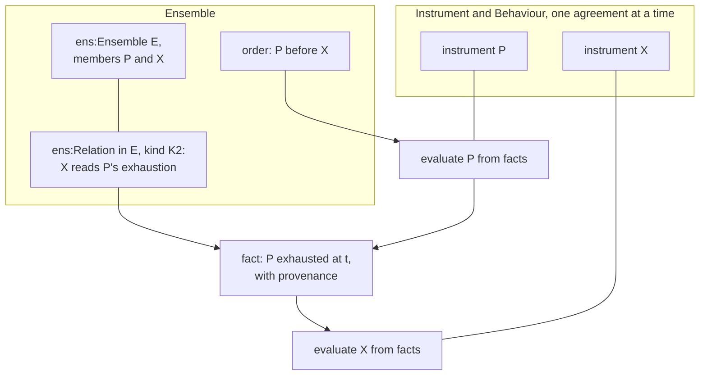

<!-- SPDX-License-Identifier: CC-BY-SA-4.0 -->

# ADR-A130: Ensemble, a substrate layer for relations between instruments

**Status:** Proposed, 2026-10-18
**Date:** 2026-10-18
**Supersedes:** none
**Related:** [ADR-A01](ADR-A01-layer-dependency-order.md) (the layer order, amended by its
2026-10-18 addendum), [ADR-A104](ADR-A104-instrument-terms-and-legal-relations.md) (Instrument),
[ADR-A106](ADR-A106-behaviour-configuration-runtime-occasions-and-records.md) (Behaviour's runtime),
[ADR-A121](ADR-A121-repository-catalogue.md) (the repository catalogue),
[ADR-A122](ADR-A122-aggregate-ownership.md) (aggregate ownership),
[ADR-A129](ADR-A129-one-release-for-the-substrate.md) (one release),
[ADR-A-C2](ADR-AC2-clean-room-authoring-procedure.md) (authoring order)

## Context

Instrument models one legally binding agreement. It reaches across agreements in three ways only:
`ins:boundUnder`, legal acts under another instrument, and incorporation by reference. A gate reads
the state of its own instrument, or of the occasion its arising chain reaches (Instrument §11.4).
Three held questions of the computable contract substrate need more: HQ-2 (a relation gated by
another agreement's state, such as an excess responding once the underlying is exhausted, or a
guarantee called on the principal's default), HQ-7 (several instruments placed as portions of one
order) and HQ-12 (composing shares).

The law keeps each contract separate (privity) and links contracts by terms of one that refer to
another's state, read as facts: accessory guarantees, cross-default, back-to-back subcontracts,
excess layers, intercreditor ranking, and the single agreement of a master and its confirmations.
The relations sketch compares widening Instrument (option A) with a layer of its own (option B).
Under A, evaluating one instrument loads every instrument its gates read, so a chain of *n* related
instruments costs of order *n*² loads, Instrument's single-agreement laws and proofs must be
restated for sets of instruments, and every module that reads one agreement carries the model of
many. Under B, each instrument is evaluated alone and the link supplies a fact, at *n* loads. The
maintainer chose B on 2026-10-18 (IR-Q2).

## Decision

1. **A new substrate layer, Ensemble.** An ensemble is a set of instruments forming one operation, in
   the sense of the Code civil, art. 1186 al. 2, whose contracts are interdependent when each is needed
   for that operation. `ontology/ensemble/`, literate (ADR-A120, ADR-A126), namespace
   `https://www.nebularis.org/neuro-semantic/lattice/ensemble#`, prefix `ens:`. It imports Instrument
   and Behaviour's runtime document, and through them every layer below. Nothing in the substrate
   imports it. ADR-A01's 2026-10-18 addendum places it, and its repository catalogue entry states
   its imports.
2. **An ensemble is an identity.** `ens:Ensemble` is a `fnd:PersistentIdentity` with versions. Each
   version names its member instruments by role, or, where its terms define membership by a rule,
   states the rule, and the members it admits at a position are derived from facts (the Ensemble
   plan's ES-Q4). An ensemble may own Ledger accounts
   ([ADR-A131](ADR-A131-ledger-layer.md) decision 5), may be a member of another ensemble, and
   scopes the order in which its members are evaluated. For example, a syndicated facility with its
   guarantees, a construction contract with its subcontracts and bonds, a master agreement with its
   confirmations, and an insurance programme are each an ensemble. Applied modules specialise it.
3. **Relations are reified.** `ens:Relation` is identified and temporally scoped, belongs to one
   ensemble, and carries the properties of its kind. The kinds form an open vocabulary:
   - **K1 derivation:** created under, incorporates
   - **K2 dependency:** accessory, conditional on another's state, back to back
   - **K3 priority:** ranking between agreements, inuring order. Where the terms state them, the
     order in which members draw and the order in which they are restored may differ, for example
     recoveries applied in the reverse of the order of loss
   - **K4 portion and share:** several commitments, portions of one order, composed shares, signed
     shares (decision 10)
   - **K5 single agreement:** a master and its children, for the purposes their terms state
   - **K6 shared resource:** several instruments drawing on one Ledger account, such as a limit
     shared by two contracts or an authority's aggregate over the contracts bound under it
   - **K7 contribution:** reserved for an addendum with its own analysis
   - **K8 representation:** one party's acts taking effect under other members' instruments
     (decision 11)

   A relation's legal effect is stated by a term of one of its instruments, or of a master, and is
   never a property of the relation alone. A K6 relation is derived from the terms that draw on the
   account, never authored, and a shape checks each one against those terms, so sharing is visible
   at design time and cannot disagree with what the terms say. A further kind is added by an
   addendum with its own analysis.

   The vocabulary of kinds is open, and their semantics are closed. An applied module may specialise
   a kind, for example a programme's placement as a K4 relation, but adds no evaluation semantics of
   its own. What a specialised relation does is stated by terms the substrate already evaluates:
   Ledger merge rules, Eligibility conditions, normative rules. New evaluation semantics come only by
   a substrate addendum with its own conformance cases, so every implementation of the evaluator runs
   every ensemble.

   Where the terms are silent on a relation's effect, the effect comes from a rule outside them that
   binds the members, selected by governing law through the normative rule substrate, never from a
   default built into this layer. Decision 11 applies this to authority. The applied modules apply
   it to readings such as when an underlying agreement counts as exhausted.
4. **Endpoints.** A relation names each member by role. By default an endpoint is the instrument's
   persistent identity, so an amendment needs no change to the relation. An endpoint names one
   version where the relation is to one text, for example the edition an instrument incorporates, or a
   proposal provisionally placed before it is accepted. An endpoint may narrow to a term, a section
   or a Ledger account of its instrument, for example a master's shared limit over two children's
   limits, or one section of a contract following the form of another. An endpoint may name an
   instrument outside the modelled set, whose state reaches the ensemble only as facts, for example a
   statutory scheme that responds first, or senior debt held by a lender the deployment does not
   model.
5. **Evaluation by composition.** What one instrument needs of another, such as an exhaustion, a
   default or a payment, reaches it as a fact with provenance, produced by evaluating the other. The
   single-instrument evaluator never loads a neighbour.
   - **The semantics.** The outcome of a set of related instruments is the least fixpoint of their
     evaluations over the facts passed between them. Every passed fact is Undetermined until the
     evaluation that produces it has run.
   - **Evaluation units.** A unit is an instrument, or a part of one that an endpoint narrows to
     (decision 4), such as a section. The dependency graph is taken over pairs of a unit and a
     position.
   - **The order.** Where that graph is acyclic, each unit is evaluated once, in its order:
     dependencies before dependants, rank before rank. This reaches the least fixpoint with no
     iteration. A cycle between whole instruments is often acyclic over units and positions. For
     example, two facilities with mutual cross-default clauses each read the other's default as
     already occurred, at an earlier position. Two insurers that each write a primary and an excess
     layer in one contract each read the other's primary payment, so both primary sections are
     evaluated before either excess section.
   - **Cycles that remain.** A strongly connected component over units and positions is rejected at
     design time. An addendum may admit one where every edge in it is monotone, so that more facts
     never change a determined outcome, and a rule the law or the terms state resolves it. Contribution
     (K7) is such a rule for policies whose other insurance clauses each make it excess of the other.
     Only an admitted component is evaluated by iteration.
   - **Independence of order.** An acyclic graph admits many valid orders. The outcome is the same
     under every one of them. Units that draw on one account at one position are the only case
     where it could differ, and Ledger's two phases settle it (ADR-A131 decision 6). The log of a
     composition is written in a canonical order, with ties between units broken by their keys, so
     two implementations that choose different valid orders produce the same log.
   - **Passed facts.** A fact passed between units records the unit and version that produced it,
     its position and a digest of that unit's read set. A receiving unit can then cite and audit it
     without reading the producing unit's terms (decision 12).
6. **One hook in Instrument.** A regime's measured value, or a condition's evidence, may be supplied
   from outside the instrument, as a recorded fact naming its source. It never asserts the receiving
   instrument's own state. This is Instrument's only change, and it is generic.
7. **K1 stays where it is.** `ins:boundUnder` and incorporation stay in Instrument, and Ensemble reads
   them as K1 relations.
8. **First scope.** The first slices build the ensemble, endpoints, K2 and K3, with examples first
   from several fields (ADR-A-C2): a guarantee called on default, ranking under an intercreditor
   agreement, mutual cross-default, an excess attaching on exhaustion of its underlying. K6, K4 with
   HQ-12, then K5, follow.
9. **The held questions move here, in part.** HQ-2's second case, a contract gated by another
   agreement's state, moves here with HQ-7 and HQ-12. HQ-2's first case, one participant's own share
   within one agreement, where several parties are each liable for their own share, is not a
   relation between instruments. It stays with Instrument and Party, beside HQ-5.
10. **Signed shares are judgements.** Where the commitments written exceed or fall short of the
    order, each member's signed share is evaluated from the written shares and the signing rule the
    terms state, recorded as a derived artefact and never authored. For example, in an oversubscribed
    offer of bonds to the public, each application is its applicant's own commitment, and the basis of
    allocation the prospectus states scales each allotment to the issue. A placement on a
    market reform contract (MRC) allocates lines marked to stand in full, reduces the rest in equal
    proportion to the order, and signs every line in full if placement is incomplete at inception,
    unless the insured elects otherwise before inception as its signing provisions allow.
11. **Representation is a set of authorities.** A K8 relation gives one party authority to act for
    other members for one subject, such as agreeing a change to the terms, agreeing a claim or giving
    a notice. An ensemble may carry several, one per subject, with different holders.
    - **Tiers, conditions and exclusions.** The authority holds within the tiers, conditions and
      exclusions stated, for example changes the leader agrees alone against changes every member
      must agree, members admitted only if they share the same terms, or acts each member keeps for
      its own share. That members share the same terms is a judgement, evaluated from a digest of
      each member version's bound terms with stated term kinds left out, such as the share and the
      premium. The digest is computed once, where the data lives, and every evaluator reads it.
    - **Defaults.** Where the holder is chosen by a default, such as the largest participation, the
      holder is a judgement from facts.
    - **Source.** The authority comes from the members' terms, or from a rule outside them that binds
      the members, which the normative rule substrate supplies.

    For example, under an intercreditor agreement a security agent acts for the creditors under the
    facility, hedging and security documents, and the instructing group the intercreditor agreement
    defines consents for all of them. Under an MRC the slip leader agrees changes for followers and a
    claims agreement party agrees claims for the insurers on its terms.
12. **An ensemble grants no visibility.** A member's terms may be confidential from the other members,
    for example terms one insurer agreed on its own security details pages. Composition passes facts,
    so evaluating one member never reads another's terms, only the facts its evaluation supplies.
    Who may read which member, and so who may evaluate a judgement that compares members' terms, is a
    deployment's access decision. The model states the confidentiality, and the deployment enforces
    it.

## Consequences

- **The layer order changes** (ADR-A01, 2026-10-18 addendum). Ensemble's README carries its
  catalogue entry, of kind `substrate` with its imports, and the root catalogue lists it after
  Instrument (ADR-A121), so `mise run check:import-guard` enforces its imports with no change to the
  guard's code.
- **Releases.** Ensemble joins the substrate's release at the release's number, with no version of
  its own (ADR-A129). Its first slice is a new release, whose notes class the new layer and the
  Instrument hook as no effect on existing data. `docs/architecture/ontology-architecture.md` and the root README show the new top
  layer.
- **Instrument gains one property or rule** for an externally supplied value (decision 6), with its
  own slice in the Ensemble unit.
- **The evaluator** (CCS C12) gains a composition step. It evaluates a part of an instrument that
  an endpoint narrows to, given the facts that part reads. Instrument already places cases at
  sections, so the part is a scope Instrument knows. The single-instrument semantics is unchanged.
  The step is built so that several implementations of the evaluator, in different languages, can
  run it and agree:
  - **Pure entry points.** Planning (the graph of units, relations and positions to a schedule, as
    data), evaluating one unit (its facts and a view of the accounts it reads to an outcome, a
    ledger delta, passed facts and a log), and evaluating one admitted cyclic component in one call.
    The host drives the schedule, persists between units and may run independent units in parallel
    or in different processes.
  - **Read sets known before evaluation.** A unit's read set, or a superset of it, follows from its
    terms, its relations and the stimulus. A pass then runs in phases: resolve endpoints, keys and
    membership, select any outside rule by governing law, plan, fetch every fact the pass reads in one
    batch, evaluate, persist. A pass never queries the store per unit.
  - **Keys, not identities.** The evaluator emits natural keys for the records it derives, and the
    host mints their IRIs from the minting recipes (ADR-A84). Unit keys come from the stable
    identities of instruments and their sections.
- **Ledger** ([ADR-A131](ADR-A131-ledger-layer.md)). An exhaustion or a payment passed between
  instruments is derived from a Ledger balance record. An account shared by several instruments is
  owned by their ensemble, and the K6 relation is derived from the terms that draw on it. How their
  draws are ordered is the Ledger plan's question LG-Q3, settled before the K6 slice is briefed.
- **Market forms.** The applied insurance modules model the MRC (Open Market) form of the London
  Market Group's implementation guide v3.0 (2023) as an ensemble of one instrument per written line,
  sharing the MRC's wording, with its signing provisions (decision 10) and its placement,
  endorsement and claims roles (decision 11). Lending's intercreditor agreement is the other field's
  reference case for representation.
- **The composition law.** Decision 5 rests on a hypothesis to be stated and proved: for an
  ensemble whose dependency graph over units and positions is acyclic, evaluating each unit once in
  that order, passing facts, reaches the least fixpoint, and so the same outcomes as evaluating every
  member together. It is stated with the K2 and K3 slice, modelled at design time when this ADR is
  reviewed, and proved later. Stating it as a least fixpoint keeps the statement unchanged when an
  addendum admits a cyclic component. That case then needs each member's evaluation to be monotone
  in the facts it reads, a proof over Instrument's and Behaviour's semantics.
- **Persistence.** A relation belongs to no instrument's aggregate. The ensemble is an aggregate
  root, and its relations are part of it, to be confirmed against ADR-A122 in the first slice. An
  ensemble whose membership follows a rule, such as every policy written under a treaty in a period,
  may have thousands of members. Its derived membership records are kept outside the root's
  aggregate, as Ledger keeps postings outside an account's definition, so the root never becomes a
  point of contention. How membership is bounded and read is the Ensemble plan's ES-Q5.
- **Applied insurance.** The claims plan's AIR-6.8 and milestone M7 take their cross-instrument reads
  from Ensemble. Phase 7's programme module makes a programme an ensemble, records
  contract-to-layer bindings as K4 relations and relations between layers as K2, K3 and K6
  relations. A risk-capital vehicle is an ensemble too.
- **Open questions carried from the sketch:** IR-Q3 (K1 stays in
  Instrument, as decision 7 assumes), IR-Q4 (both forms of the hook, as decision 6 assumes), IR-Q5
  (the first slices' scope, as decision 8 assumes). Each is confirmed or revised before the first slice, ES-0, is briefed.
- **Publication.** Ensemble's README follows ADR-A126's layout, so it cites only published decisions
  (ADR-A127). This ADR is published with slice 1, citing accepted decisions it builds on by their
  GitHub links.

## Provenance

Proposed in the [relations sketch](../../developer/sketches/instrument-relations.md), which compares
options A and B. The maintainer chose B on 2026-10-18 (IR-Q2) and the name Ensemble on 2026-10-19
(IR-Q1). On 2026-10-20 the maintainer amended it before acceptance with decisions 2 and 4, decision
5's rule for cycles broken by time, K6 as a derived relation checked by a shape, decision 9's
split of HQ-2, and decisions 10 to 12, checked against the Marine Insurance Act 1906, s. 24(2), and
the London Market Group's MRC (Open Market) implementation guide, data dictionary and example 2,
all v3.0 (2023). On 2026-10-21 the maintainer amended decision 5 with evaluation units below the
instrument and its least fixpoint semantics, after we found that one contract spanning several
layers makes an order over whole instruments cycle within one occurrence (relations sketch §11). The
same day the maintainer added closed semantics for kinds (decision 3), independence of order and
passed facts (decision 5), and the evaluator's and persistence's consequences for implementations in
several languages, after a review against the evaluator's implementation options. At design
closure the same day we added membership by rule (decision 2), separate orders for draws and
restorations and the rule for silent terms (decision 3, the second from phase 7's principle P7-7),
endpoints outside the modelled set (decision 4), and the terms digest as the evidence for members
sharing the same terms (decision 11), after a review of the layer against published excess and
following-form wordings and the law of contribution.
The [Ensemble plan](../../developer/plans/ensemble.md) sequences the slices.
