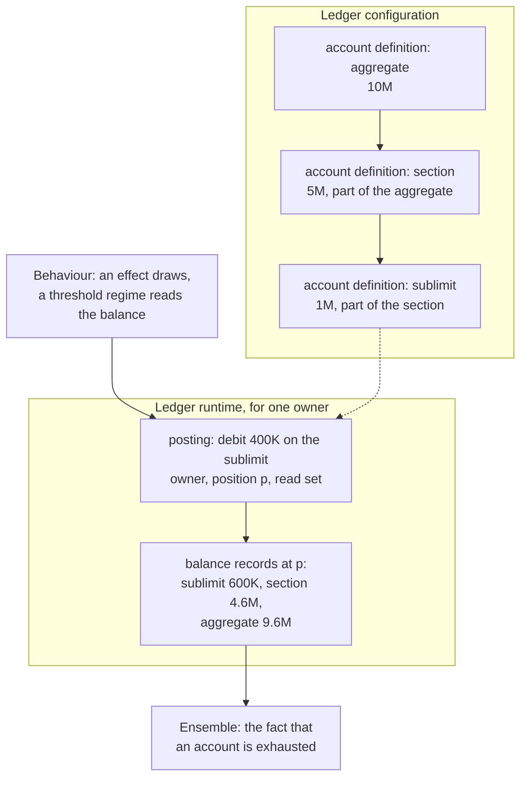

<!-- SPDX-License-Identifier: CC-BY-SA-4.0 -->

# ADR-A131: Ledger, a substrate layer for amounts consumed and restored over time

**Status:** Proposed, 2026-10-19
**Date:** 2026-10-19
**Supersedes:** none
**Related:** [ADR-A01](ADR-A01-layer-dependency-order.md) (the layer order, amended by its
2026-10-19 addendum), [ADR-A92](ADR-A92-derived-artefact-contract-and-prov-o-alignment.md) (derived artefacts),
[ADR-A106](ADR-A106-behaviour-configuration-runtime-occasions-and-records.md) (Behaviour's
configuration and runtime), [ADR-A113](ADR-A113-breaking-changes-at-major-version-zero.md) (versioning at major
version zero), [ADR-A121](ADR-A121-repository-catalogue.md) (the repository catalogue),
[ADR-A122](ADR-A122-aggregate-ownership.md) (aggregate ownership),
[ADR-A130](ADR-A130-ensemble-layer.md) (Ensemble), [ADR-A-C2](ADR-AC2-clean-room-authoring-procedure.md)
(authoring order), the [evaluation-context sketch](../../developer/sketches/evaluation-context.md) §5
(the ledger's design in outline)

## Context

Agreements in many fields state an amount that is consumed over time and sometimes restored. For
example, a software licence grants 500 seats a year, a revolving credit facility commits 20M against
which drawings are made and repaid, a research grant has a budget with sub-budgets for staff and
equipment and returns unspent funds to them, a service contract includes 40 support hours a quarter,
and an insurance policy pays up to a sublimit that is part of an aggregate, with recoveries restoring
what was paid.

Behaviour holds the only model of this today. `bhv:AllowanceDefinition` binds one value space, one
absorption policy and an optional reset recurrence, and `bhv:AllowanceAccount` carries one current
balance. It has four gaps:

- **Flat.** It has no "part of and not in addition to", so a sublimit within a section limit within
  an aggregate cannot be stated.
- **No credits.** It cannot restore a repayment, a recovery or a reinstatement.
- **One subject.** It cannot have a scope wider than one subject, such as an authority's aggregate
  over every contract bound under it.
- **Under-keyed records.** The account record is not a derived artefact and names no owner and no
  position, so two subjects on one definition write records nobody can tell apart.

Several consumers need a running amount, and most of them are not state machines:

| Consumer | Needs |
|---|---|
| Ensemble (ADR-A130) | the fact that an account is exhausted |
| authorities and programmes | an account owned by an authority or a programme |
| vehicles | collateral and allocation |
| design-time checks | an account tree's structure |
| Behaviour | effects that draw and threshold regimes that read a balance |

Keeping the model inside Behaviour would make each consumer import six layers, and a change to it
would bump Behaviour and re-pin every importer of Behaviour.

## Decision

1. **A new substrate layer, Ledger.**
   - **Where.** `ontology/ledger/`, literate (ADR-A120, ADR-A126), namespace
     `https://www.nebularis.org/neuro-semantic/lattice/ledger#`, prefix `ldg:`.
   - **Imports.** It imports Foundation, Vocabulary and Quantification, and nothing else.
   - **Importers.** Behaviour's configuration document imports it, and every layer above reaches it
     through Behaviour. Party, Eligibility, Wording and Instrument do not import it.
   - **Placement.** ADR-A01's 2026-10-19 addendum places it, and its repository catalogue entry
     states its imports.
2. **Two documents, as Behaviour has** (ADR-A106, ADR-A120).
   - **The configuration document** declares account definitions, their tree, their merge rules and
     their reset periods.
   - **The runtime document** declares postings and balance records.

   A design-time check reads only the first.
3. **Accounts form a tree.** An account definition states its amount as a `qnt:Quantity` in a
   `qnt:ValueSpace`.
   - **Parent edge.** "Part of and not in addition to" is the parent edge.
   - **Draws.** A draw on an account debits it and each ancestor, as one operation that succeeds or
     fails whole.
   - **Availability.** An account's availability is the least of its own remaining balance and its
     ancestors'.
   - **Credits.** A credit is the inverse of a draw along the same path, and never raises a balance
     above its stated amount unless a term says so.
   - **Cycles.** A cycle in the tree is refused by a shape.
4. **Postings are records, and a balance is derived.** A posting is a `fnd:DerivedArtefact` (ADR-A92).
   - **What it names.** It names its account, the account's owner, its position, its amount and
     direction, and its read set in `prov:wasDerivedFrom`.
   - **Ancestors.** A draw writes one posting, and ancestor balances follow by a closure over the
     finite tree.
   - **Balance records.** A balance record is a derived artefact keyed by account, owner and position.
     An evaluator may materialise one per pass, and the current balance is the one at the greatest
     position.
   - **Persistence.** Postings and balance records are append-only, so persistence writes them as
     record families.
5. **An account belongs to a persistent identity.** It may belong to an instrument, an authority, a
   programme, a vehicle or any other `fnd:PersistentIdentity`, so it outlives a new version of what it
   belongs to.
   - **Owner kinds.** An account definition states which kinds of owner it admits.
   - **Aggregate.** An account and its postings form an aggregate of their own under ADR-A122, owned
     by that identity and by no occasion.
6. **Merge rules are data.** What happens when several draws in one pass together exceed an account is
   a merge rule. The rules are concepts in an open scheme:
   - **in priority order**, today's `bhv:Sequential`
   - **proportional**, today's `bhv:Proportional`
   - **refuse**, which leaves the draws Undetermined with a reason

   Allocation with conservation is the same mechanism. One amount is split into postings on several
   accounts by a merge rule, and the parts sum to the amount.
7. **Behaviour uses the ledger and no longer defines one.**
   - **What Behaviour keeps.** Effects that draw, credit or accrue onto an account, threshold regimes
     whose states partition a balance, and the firing of a reset on an occasion.
   - **Allowances become a shorthand.** `bhv:AllowanceDefinition` becomes a deprecated shorthand for
     a one-account ledger with a reset period. `bhv:AllowanceAccount` and `bhv:availableBalance`
     give way to balance records, and `bhv:AbsorptionPolicy` gives way to merge rules.
   - **Versioning.** The shorthand is deprecated in a MINOR release and removed in a later one, as
     ADR-A113 allows at major version zero.
8. **Extension.** Another ontology may add account kinds, posting kinds and merge rules under its own
   prefix, as subclasses or concepts.
   - **Semantics.** Ledger documents the semantics of its own terms, and the reference evaluator
     implements only those. An extension's semantics are its author's to state and implement.
   - **Boundary.** An extension never changes what Ledger's own terms mean.
9. **What Ledger does not hold.**
   - **Pure operations over amounts (combinators).** The evaluation-context sketch's EC-Q1 places
     these, leaning towards Quantification.
   - **How effects in one pass compose (environments).** That is evaluation semantics, held by the
     evaluator (CCS C12).
   - **The order between instruments.** That is Ensemble's.

## Consequences

- **The layer order changes** (ADR-A01, 2026-10-19 addendum). The repository catalogue gains a
  substrate entry for Ledger when its first slice creates `ontology/ledger/`, so
  `mise run check:import-guard` enforces its imports with no change to the guard's code.
  `docs/architecture/ontology-architecture.md` and the root README show the new layer.
- **Behaviour changes, breaking at major version zero** (ADR-A113). It imports Ledger, retargets its
  effects and regimes, and deprecates the allowance terms. About 30 files use them today, most of
  them the insure-o example's cases. Instrument, Ensemble and every applied module re-pin.
- **Cost.** A draw on a path of depth *d* writes one posting of about 7 triples. A materialised
  balance record per affected account adds about 6 triples each, so a pass that draws once on a
  three-level path writes about 25 triples. A balance read without materialised records sums the
  postings on the account and its descendants up to a position. That is linear in the postings, and
  a per-pass materialisation bounds it.
- **The evaluator** (CCS C12) runs draws and credits as postings, in the sequential environment
  first. Parallel environments and their merge follow the evaluation-context sketch §7.
- **Ensemble** reads exhaustion as a fact derived from a balance record. An account shared by several
  instruments, such as an authority's aggregate, is drawn by their separate evaluations. How their
  draws are ordered is the Ledger plan's question LG-Q3, to be settled before Ensemble's slice 1 is
  briefed.
- **Applied modules.** Phase 7's allocation slice (AIR-7.4) builds on decision 6 rather than
  adding allocation to Behaviour. The claims plan's programme erosion (AIR-6.8) uses programme-owned
  accounts.
