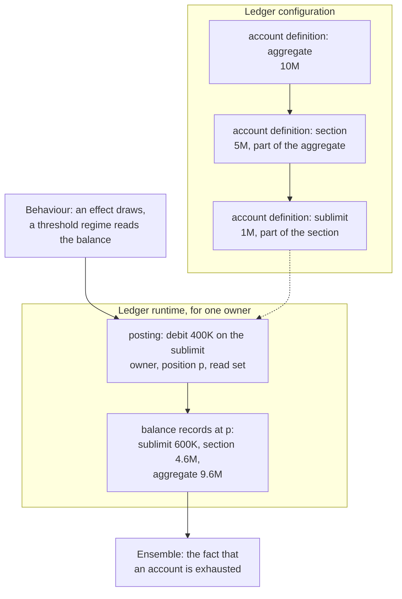

<!-- SPDX-License-Identifier: CC-BY-SA-4.0 -->

# ADR-A131: Ledger, a substrate layer for amounts consumed and restored over time

**Status:** Published, 2026-10-26. Accepted 2026-10-21.
**Described in:** [Ledger](../../../ontology/ledger/README.md)
**Date:** 2026-10-19
**Supersedes:** none
**Related:** [ADR-A01](https://github.com/nebularis/lattice/blob/main/docs/architecture/decisions/ADR-A01-layer-dependency-order.md) (the layer order, amended by its
2026-10-19 addendum), [ADR-A92](https://github.com/nebularis/lattice/blob/main/docs/architecture/decisions/ADR-A92-derived-artefact-contract-and-prov-o-alignment.md) (derived artefacts),
[ADR-A106](https://github.com/nebularis/lattice/blob/main/docs/architecture/decisions/ADR-A106-behaviour-configuration-runtime-occasions-and-records.md) (Behaviour's
configuration and runtime), [ADR-A113](https://github.com/nebularis/lattice/blob/main/docs/architecture/decisions/ADR-A113-breaking-changes-at-major-version-zero.md) (major version zero),
[ADR-A129](https://github.com/nebularis/lattice/blob/main/docs/architecture/decisions/ADR-A129-one-release-for-the-substrate.md) (one release), [ADR-A121](https://github.com/nebularis/lattice/blob/main/docs/architecture/decisions/ADR-A121-repository-catalogue.md) (the repository catalogue),
[ADR-A122](https://github.com/nebularis/lattice/blob/main/docs/architecture/decisions/ADR-A122-aggregate-ownership.md) (aggregate ownership),
[ADR-A-C2](https://github.com/nebularis/lattice/blob/main/docs/architecture/decisions/ADR-A-C2-clean-room-authoring-procedure.md)
(authoring order)

## Context

Agreements in many fields state an amount that is consumed over time and sometimes restored. For
example, a software licence grants 500 seats a year, a revolving credit facility commits 20M against
which drawings are made and repaid, a research grant has a budget with sub-budgets for staff and
equipment and returns unspent funds to them, a service contract includes 40 support hours a quarter,
and an insurance policy pays up to a sublimit that is part of an aggregate, with recoveries restoring
what was paid.

Behaviour holds the only model of this today. `bhv:AllowanceDefinition` binds one value space, one
absorption policy and an optional reset recurrence, and `bhv:AllowanceAccount` carries one current
balance. It has four gaps:

- **Flat.** It has no "part of and not in addition to", so a sublimit within a section limit within
  an aggregate cannot be stated.
- **No credits.** It cannot restore a repayment, a recovery or a reinstatement.
- **One subject.** It cannot have a scope wider than one subject, such as an authority's aggregate
  over every contract bound under it.
- **Under-keyed records.** The account record is not a derived artefact and names no owner and no
  position, so two subjects on one definition write records nobody can tell apart.

Several consumers need a running amount, and most of them are not state machines:

| Consumer | Needs |
|---|---|
| Ensemble, a layer proposed and not yet decided | the fact that an account is exhausted |
| authorities and programmes | an account owned by an authority or a programme |
| vehicles | collateral and allocation |
| design-time checks | an account tree's structure |
| Behaviour | effects that draw and threshold regimes that read a balance |

Keeping the model inside Behaviour would make each consumer import six layers where four would do,
and an ontology that extends the ledger would have to extend Behaviour with it.

## Decision

1. **A new substrate layer, Ledger.**
   - **Where.** `ontology/ledger/`, literate (ADR-A120, ADR-A126), namespace
     `https://www.nebularis.org/neuro-semantic/lattice/ledger#`, prefix `ldg:`.
   - **Imports.** It imports Foundation, Vocabulary and Quantification, and nothing else.
   - **Importers.** Behaviour's configuration document imports it, and every layer above reaches it
     through Behaviour. Party, Eligibility, Wording and Instrument do not import it.
   - **Placement.** ADR-A01's 2026-10-19 addendum places it, and its repository catalogue entry
     states its imports.
2. **Two documents, as Behaviour has** (ADR-A106, ADR-A120).
   - **The configuration document** declares account definitions, their tree, their merge rules and
     their reset periods.
   - **The runtime document** declares postings and balance records.

   A design-time check reads only the first.
3. **Accounts form a tree.** An account definition states its amount as a `qnt:Quantity` in a
   `qnt:ValueSpace`, its unit of account.
   - **Parent edge.** "Part of and not in addition to" is the parent edge. An account outside
     another's subtree is in addition to it. Agreements state both, for example a sublimit that is
     part of a section's limit beside a further limit for one class of beneficiary in addition to a
     shared aggregate, so the edge is stated, never inferred.
   - **Draws.** A draw on an account debits it and each ancestor, as one operation that succeeds or
     fails whole.
   - **Availability.** An account's availability is the least of its own remaining balance and its
     ancestors'.
   - **Credits.** A credit is the inverse of a draw along the same path, and never raises a balance
     above its stated amount unless a term says so.
   - **Cycles.** A cycle in the tree is refused by a shape.
   - **Keyed accounts.** Some amounts apply per key, for example seats per site, a sublimit per
     borrower in a facility with several borrowers, or an aggregate per location. The definition
     states a key dimension, a concept scheme or a value space, and one account per key value is
     derived on the first draw that names it. A parent above the keyed accounts is an ordinary parent
     edge (LG-Q7).
   - **Other value spaces.** A draw in another value space than the account's, for example a currency,
     is converted on its posting, by the method the terms state, or where they are silent by an
     outside rule, or else it is Undetermined. The posting records the amount drawn, the converted
     amount and the conversion's context (LG-Q8).
   - **Purposes.** A draw may name a purpose. An account outside the draw's path that counts that
     purpose is debited by the same draw, which still succeeds or fails whole, so a limit that sits
     under two parents keeps the tree (LG-Q2).
4. **Postings are records, and a balance is derived.** A posting is a `fnd:DerivedArtefact` (ADR-A92).
   - **What it names.** It names its account, the account's owner, its position, its amount and
     direction, and its read set in `prov:wasDerivedFrom`. The amount is a decimal literal in the
     account's unit of account, never a quantity node of its own, so a balance read joins nothing.
   - **Ancestors.** A draw writes one posting, and ancestor balances follow by a closure over the
     finite tree.
   - **Balance records.** A balance record is a derived artefact keyed by account, owner and position.
     An evaluator may materialise one per pass, and the current balance is the one at the greatest
     position.
   - **Persistence.** Postings and balance records are append-only, so persistence writes them as
     record families.
5. **An account belongs to a persistent identity.** It may belong to an instrument, an authority, an
   ensemble of instruments, such as a programme or a vehicle, or any other
   `fnd:PersistentIdentity`, so it outlives a new version of what it belongs to. An account drawn on by
   several instruments belongs to their ensemble.
   - **Owner kinds.** An account definition states which kinds of owner it admits.
   - **Aggregate.** An account and its postings form an aggregate of their own under ADR-A122, owned
     by that identity and by no occasion.
6. **Merge rules are data.** What happens when several draws in one pass together exceed an account is
   a merge rule. The rules are concepts in an open scheme:
   - **in priority order**, today's `bhv:Sequential`
   - **proportional**, today's `bhv:Proportional`
   - **refuse**, which leaves the draws Undetermined with a reason

   Allocation with conservation is the same mechanism. One amount is split into postings on several
   accounts by a merge rule, and the parts sum to the amount.
   - **Two phases at one position.** Where several evaluations draw on one account at one position,
     each proposes its draws, the account's owner merges them by the rule, and each evaluation then
     settles its outcome against what the merge granted. No evaluation's outcome depends on the order
     in which the others ran, so they may run in parallel, and implementations in different
     languages agree.
   - **Exactness.** A proportional merge, or a share signed down in proportion, can give a part that
     no decimal states exactly, for example a third. Postings are in the account's declared unit of
     account. Where a rule's exact parts must be rounded to that unit, the rule states the rounding
     and how the residual is allocated, so the parts still sum to the amount. Whether derived
     proportions are kept as exact rationals is the Ledger plan's LG-Q6.
7. **Behaviour uses the ledger and no longer defines one.**
   - **What Behaviour keeps.** Effects that draw, credit or accrue onto an account, threshold regimes
     whose states partition a balance, and the firing of a reset on an occasion.
   - **Allowances become a shorthand.** `bhv:AllowanceDefinition` becomes a deprecated shorthand for
     a one-account ledger with a reset period. `bhv:AllowanceAccount` and `bhv:availableBalance`
     give way to balance records, and `bhv:AbsorptionPolicy` gives way to merge rules.
   - **Releases.** The shorthand is deprecated in one release of the substrate and removed in a later
     one (ADR-A129, ADR-A113). The release notes class the deprecation as no effect and the removal as
     changes meaning, which owes a migration once an adopter holds production data.
8. **Extension.** Another ontology may add account kinds, posting kinds and merge rules under its own
   prefix, as subclasses or concepts.
   - **Semantics.** Ledger documents the semantics of its own terms, and every implementation of
     the evaluator implements only those. An extension specialises Ledger's kinds and rules, and
     states what it means in terms Ledger already evaluates, for example a merge rule composed of
     priority and proportional rules. It adds no evaluation semantics of its own, since a semantics
     only one implementation knows would make implementations disagree. New semantics come by an
     addendum to this ADR, with conformance cases.
   - **Boundary.** An extension never changes what Ledger's own terms mean.
9. **What Ledger does not hold.**
   - **Pure operations over amounts (combinators).** The evaluation-context sketch's EC-Q1 places
     these, leaning towards Quantification.
   - **How effects in one pass compose (environments).** That is evaluation semantics, stated in
     the evaluation context's model and fixed by conformance cases, never left to one
     implementation (CCS C12).
   - **The order between instruments.** That is Ensemble's.

## Consequences

- **The layer order changes** (ADR-A01, 2026-10-19 addendum). When its first slice creates
  `ontology/ledger/`, Ledger's README carries its catalogue entry, of kind `substrate` with its
  imports, the root catalogue lists it after Quantification, and Behaviour's entry adds it to its
  imports (ADR-A121). `mise run check:import-guard` then enforces them with no change to the guard's
  code.
- **Releases.** Ledger joins the substrate's release at the release's number, with no version of its
  own (ADR-A129). Each slice that changes a member is a new release, made by `release:prepare`.
  `docs/architecture/ontology-architecture.md` and the root README show the new layer.
- **Behaviour changes.** It imports Ledger, retargets its effects and regimes, and deprecates the
  allowance terms. About 30 files use them today, most of them the insure-o example's cases. The
  substrate moves with the release, and the applied modules and examples pin the new release
  (ADR-A129 decision 4).
- **Cost.** A draw on a path of depth *d* writes one posting of about 8 triples. A materialised
  balance record per affected account, holding both the remaining balance and the availability,
  adds about 8 triples each, so a pass that draws once on a three-level path writes about 32 triples
  in one batch. A balance read is one lookup on a materialised record. Without one it sums the
  postings on the account and its descendants up to a position, which is linear in the postings.
- **Realisations.** This model is the published, conceptual one. A deployment that needs speed may
  realise it in a compiled form, for example the account tree as arrays indexed by account, with
  paths precomputed, balances as integers in minor units, and postings appended to a log written
  once per pass. Such a realisation is a derived engine: it adds no semantics (decision 8), is
  populated from the configuration by a projection, and is held to the model by a stated agreement
  law, that folding its postings gives the model's balance records. The Ledger plan's performance
  section sets out the costs.
- **The evaluator** (CCS C12) runs draws and credits as postings. Draws by several evaluations on
  one account at one position follow decision 6's two phases, so they may run in parallel. Any other
  composition of effects in one pass is fixed by the evaluation context's model (decision 9).
- **Ensemble** reads exhaustion as a fact derived from a balance record. An account shared by several
  instruments, such as an authority's aggregate, is drawn by their separate evaluations. How their
  draws are ordered is the Ledger plan's question LG-Q3, to be settled before Ensemble's K6 slice
  (ES-4) is briefed.
- **Applied modules.** Phase 7's allocation slice (AIR-7.4) builds on decision 6 rather than
  adding allocation to Behaviour. The claims plan's programme erosion (AIR-6.8) uses programme-owned
  accounts.
- **Publication.** Ledger's README follows ADR-A126's layout, so it cites only published decisions
  (ADR-A127). This ADR is published with the first slice that creates the README, citing accepted
  decisions it builds on by their GitHub links.

## Addendum (2026-10-27): an account instance is named, and a posting carries two orderings

Two amendments, both from designing the runtime document that decision 2 promised. Neither changes what Ledger is for.

**Narrows decision 4.** An account instance gains a minted IRI. Decision 4 has a posting name its account by the account definition, the owner and the key, so that no account instance needs an identity of its own and a balance read joins nothing. That reasoning holds for a balance read and fails for a partition. Once postings are separated by closing period, the separation needs a name for the unit it separates, and a composite of three values is not a name. [ADR-A122](ADR-A122-aggregate-ownership.md) decision 8 keeps a named graph's IRI injective in its root, which presupposes the root has an IRI at all.

So an account instance is a node with a minted IRI, and a posting names that node rather than repeating the three values. A balance record is keyed by the account node and the position rather than by account, owner and position.

The natural key is kept, not replaced. The account definition, the owner and the key value remain a key in the sense of [ADR-A114](ADR-A114-external-and-natural-keys.md), so an adopter holding those values still resolves the instance, and the uniqueness they express is still enforced. What changes is that the instance has its own name as well, which the key resolves to. The cost is one node and one IRI per account instance where there were none. The gain is that a posting's reference to its account is one term rather than three, and that the unit of a partition can be named.

**A posting carries two orderings, not one.** A fact may be recorded after the time from which it takes effect. A correction belongs where the fact it corrects belongs, a restoration of consumed amount may take effect as of the act that consumed it, and an adjustment may be agreed later and apply earlier. One ordering cannot hold both without either losing the sequence in which facts were recorded or putting a fact in the wrong place.

- **Effective position.** Where the fact sits in the arrangement the accounts describe. Supplied by the domain, comparable across accounts, and never assigned by an evaluator.
- **Recorded position.** Where the fact sits in the account's own append-only sequence. Assigned by the writer, monotonic, and total only within one account.

Nothing is mutated to achieve this. A correction is a compensating posting whose effective position is that of the fact it corrects and whose recorded position is current, so the append-only property of decision 4 and the key guard both survive.

Three consequences follow.

1. **A reading is reproducible only when paired with the recorded position at which it was taken.** A balance as of an effective position depends on every posting at or before that effective position, whatever its recorded position, so a posting recorded late and effective early changes a historical reading. That is correct behaviour rather than a defect, and it has to be stated, because a reading quoted without its recorded position cannot be reproduced.
2. **The axis that compares accounts is effective position.** No global counter is needed, and none is wanted, since recorded position is total only within one account.
3. **Correctness arguments about what a write touches are stated over two axes**, with append-only as an explicit hypothesis rather than an assumption.

**What this does not decide.** How the name of a period's partitioned unit is minted. That rests on the account IRI this addendum provides, and it is held open until the read that spans a change of closing recurrence has been measured, because the cost of that read is what separates a derived name from a recorded one.

## Addendum (2026-10-27, second): the recorded axis keys the partition, and a period's unit is named from its root and close

The addendum above gave an account instance a minted IRI and a posting two orderings. This states what the partition is keyed on, which that addendum left implicit and which a review found to be the source of a misreading.

**Books, closes and checkpoints are keyed on the recorded axis, never the effective one.** A period's unit of partition holds the postings *recorded* in that period. The sealing rule forces this rather than merely permitting it: a unit is registrable only once complete, and a unit keyed on effective position can never be complete, because a posting effective inside it may be recorded at any later time. A unit keyed on the recorded axis is complete the moment the period closes, which is what makes the close a sealing act.

Three consequences follow, and each removes a question rather than adding a mechanism.

- **A posting effective inside an already-closed period belongs in the open unit**, carrying its earlier effective position. It has a current recorded position, and the recorded axis is what places it. The closed units are untouched, so their registered content stays true and nothing re-seals.
- **No checkpoint is disturbed by such a posting.** A checkpoint is the running balance along the recorded ordering at a close, so it was never a claim about what was effective by then. It remains exactly true, and the set of checkpoints stays the product of accounts and closes.
- **A reading as of an effective position folds, and is not a correctness-path read.** It cannot be served from a checkpoint, because a running balance cannot run along both axes at once. That is a restatement, with the latency of a reporting read rather than of an operational one.

**The name of a period's unit is derived from its root and its close position**, the question the addendum above left open and the graph-role addendum of the same date named as the one thing it did not decide. The inputs are the root's minted IRI and a close position computable from the declared recurrence, so the name needs no lookup and no stored triple, and a generated operation can compute it while a guard checks a caller's against the same rule. A name derived from the unit's content is refused: a unit must be nameable while it is open, and its content is settled only at the close.

**A change of closing recurrence starts a new family rather than renaming anything.** Within a family the recurrence is constant, so no history of recurrence need be stored or consulted, and the recurrence an as-of read already has to know is read from a node that read already fetches. Measured: a read whose range crosses such a change stays flat, at 1.53 to 1.70 ms across a tenfold history where the unpartitioned fold of the same history grows from 22 to 224 ms, and within the spread between repeats of a same-width read inside one family. The figures are one engine's.

**A posting is never effective later than it was recorded.** Its effective position does not exceed the recorded position of the pass that wrote it, so a fact may be backdated and never forward-dated. This is a consequence of the boundary between this layer and the one that owns occasions rather than a rule of arithmetic: a posting records an effect that has fired, and an effect fires on its occasion at that occasion's time, so an amount agreed now to take effect later is a term and a scheduled occasion rather than a posting dated forward. A reinstatement, an instalment and a cession on a risks-attaching basis are all of that shape.

What it buys is the only tractable form of a reading as of an effective position. Every posting in a period closed at or before the read point is effective at or before it, so the read starts from that close's checkpoint and folds only the later periods, picking up whatever was backdated into them. Without the bound a checkpoint would also over-count postings effective after the read point, and a summed checkpoint cannot be filtered, so the read would scan the whole history. The cost of that fold is measured separately and this addendum does not assume it is cheap.

## Addendum (2026-11-09): every draw arrives in its account's unit

Accepted by the maintainer on 2026-11-09. It reverses the paragraph "Other value spaces" of decision 3.

Decision 3 converted a draw in another value space than the account's on its posting, by the method the terms state or an outside rule, and had the posting record the amount drawn, the converted amount and the conversion's context. That made the ledger responsible for conversion rates. Choosing and applying a rate is a duty of its own, kept apart from recording what an account gave up, as the segregation of duties that fiduciary work requires keeps them, and a rate held inside the ledger has no clear owner when it is wrong.

**A draw whose amount is not in the account's value space is refused.** The ledger never converts. A request in another value space is logged where it arrives, a rate is applied there, a record of the conversion is written there with the rate, its source and its date, and only then is the draw made, in the account's unit. The posting may cite that record among what it read, as it cites a merge record, so the conversion stays traceable without the ledger owning it. A conversion whose result does not fit the target unit, for example one that overruns the unit's range, fails before anything reaches the ledger.

**What leaves the layer.** `ldg:conversionMethod` on an account definition, `ldg:conversionUsed` and `ldg:amountAsDrawn` on a posting, and the shape that held the last two together. The account's unit of account and the extensive value space decision 2 requires are unchanged, and a draw's value space is checked against it. Removing published terms is a breaking change, which at major version zero is a minor release of the substrate.

## Addendum (2026-11-09, second): merge rules read a declared order, refuse in two places, and split in two kinds

**Status of this addendum:** Accepted by the maintainer on 2026-11-16. Decision 8 says new evaluation semantics come by an addendum with conformance cases, and the maintainer decided these on 2026-11-09 from worked scenarios across licensing, lending, grants, insolvency and insurance. None reverses a sentence of decision 6, and each states what it left open.

**An order is declared, never taken from identifiers.** Every rule that needs an order, in priority order, the residual to the first in order and the largest remainder's tie-break, reads one that is supplied to it, by the wording, by a rule imposed on the account, or by the law. A proposal's identifier never decides an order, since it is neither chronological nor tied to any legal meaning. Law outside a contract, such as the order in which liability is ascertained, reaches the ledger as facts a jurisdiction's state machine asserts on the event stream.

**A refusal comes from a guard or from a rule, and is never a grant of nothing.** A merge's result is either its grants or a refusal with a reason, leaving the draws Undetermined. A guard may refuse before any rule runs, from the merge's inputs alone, for the refuse policy where requests exceed availability or for an order check the account declares. A rule may itself refuse, for a reason it states, where the case arises, for example a tie its declared order does not break. Refuse is therefore not a rule that splits. Each rule's laws hold for every result that grants, and a refused merge grants nothing and changes no balance.

**Two kinds of split.** Rationing divides what is available among claims that exceed it, each cut and none granted more than it claims, as the law abates claims on a fund that falls short, and its laws are the four axioms. A residual unit in rationing goes only to a claim not yet met in full. Apportionment divides an amount into proper shares among those the wording names as entitled, by a stated basis, and holds exactness, non-negativity and the whole returning the whole without the bound, so a member whose basis is zero may take a residual unit the declared order gives it. A merge at one position and an allocation across accounts are rationing. A fee or benefit shared among members and the attribution of a posting across parties are apportionment. The members of a split are those the stated meaning names, never what a rule filters.

**Rounding to the nearest is refused beside a residual rule unless the account states how an overshoot is treated.** Decision 6 requires the parts to sum to the amount. A residual rule only adds units, so rounding to the nearest can overshoot and the parts then do not sum. Where the wording states a treatment, the rounding method may govern only how a share is shown, with the split floor then residual, or the units rounded over may be taken back by the declared order or from the shares rounded up most, ties by the declared order.

**A draw is accepted only in its account's value space and unit, and only where its amount is representable** by the space's density and datatype. This completes the addendum of 2026-11-09 that took conversion out of the ledger: a proportion of a base is resolved to an amount before the ledger, and an amount that is not representable is refused, never rounded.

**Releases.** The vocabulary's definitions of the order-reading rules, the refusal of rounding to the nearest without a treatment, and the terms for the two kinds of split and the overshoot treatments change published meaning, a minor release of the substrate at major version zero, batched with the next merge into `main`.

## Addendum (2026-11-16): a credit has a kind and records what was applied, a balance is a sum less its cuts, and a reading by effective day is declared

**Status of this addendum:** Accepted by the maintainer on 2026-11-16. The maintainer decided each point between 2026-11-09 and 2026-11-15, from measurements on three engines and from worked scenarios. Decision 8 says new evaluation semantics come by an addendum with conformance cases, and the cases are at its end.

**Narrows decisions 3 and 4.** It also narrows one statement of the second addendum of 2026-10-27, on where a reading by effective position may start.

**A credit states its kind, and an account says which kinds restore it.** A credit carries a kind from a scheme whose contract Ledger declares and an applied module binds, for example a recovery, a reinstatement or a write-back. Each account declares the kinds that restore it, all of them by default, and an ancestor counts a credit only where it accepts its kind. A credit with no kind on a path where an account restricts kinds is refused as Undetermined. A version of an account definition pins the edition of the scheme its kinds were resolved against, so a historical read uses the kinds as they were.

**A credit is applied where it is posted, and a cut is recorded where an ancestor has less room.** Decision 3 has a credit as the inverse of a draw along the same path. It is narrower than that. A credit is applied at the account it is posted to, up to that account's room below its ceiling. Each ancestor that accepts its kind then takes the least of the amount applied and its own room, and where it takes less, the difference is recorded as a cut at that ancestor. The posting keeps the amount offered, the amount applied and its cuts. All three are facts of the order in which the writer settled, and no read computes them again.

**A balance is a sum.** An account's balance is its stated amount, less the debits in its subtree, plus the credits it accepts at the amount applied, less the cuts recorded at it. That equals the balance stepped posting by posting, so no read needs an ordered scan to honour a ceiling. Decision 4 allowed an evaluator a balance record for each account and pass. The runtime keeps a running balance on the posting at the account it is drawn on and a checkpoint of every account's balance at each close, and no balance record for each account and pass. A state the decision path does not read is answered from the history when it is asked for.

**A ceiling is the stated amount unless the deployment admits otherwise.** Decision 3 let a term raise a balance above its stated amount. A ceiling above a stated amount is refused by default, and a deployment whose terms need one says so in its ledger profile. The profile is one of the rules a deployment sets for every ledger it runs, and it also holds the settings that tune cost and change no meaning, the closing recurrence first. Where a credit exceeds the room at the account it is posted to, the excess is not capacity. It goes to a residual account that stands beside the limit, since a surplus held is an amount owed.

**Settlement is in recorded order, and a timestamp decides nothing.** An amount erodes in the order draws are settled and never the order in which they occurred. Two requests stamped with the same moment that arrive in different passes are two positions, and the first recorded is settled first. Where a wording treats them as one moment, whatever is upstream of the ledger hands them over in one pass, and the account's rule merges them.

**A reading by effective day is a derivation that a report declares.** The second addendum of 2026-10-27 called a reading as of an effective position a restatement and said it cannot be served from a checkpoint. There are three readings, and they answer different questions.

| Reading | What it is | Where a read may start |
|---|---|---|
| the recorded amounts | the amounts applied and the cuts as recorded, placed on their effective days | the checkpoint at the last close at or before the day |
| settled again | the same postings settled again in effective order | the start of history |
| the flows | no balance, what was drawn and what was offered in credits the account accepts | the same checkpoint |

None is the ledger's own, and none is a default. A report declares the reading it shows, with the value taken from the agreement's clauses, then from a document the agreement cites, then from a rule the deployment imposes. A read that names no reading is refused. Every report records the reading, the day, the recording as of which it was known and the version of the declaration it was made under, since a figure quoted without them cannot be reproduced.

The readings differ in what they can show. The recorded amounts can give a balance no account ever held, below zero or above a ceiling, because the amounts were settled in another order. Settling again applies each account's own policy to a debit that no longer fits, refused where the account refuses and cut where it rations, so it never shows such a balance, and it does not end at the balance the ledger recorded.

A read of the recorded amounts or of the flows starts from a checkpoint, which the earlier addendum said no such reading could. Nothing is effective after it is recorded, so everything recorded by a close is effective by any later day, and a checkpoint holds, beside each balance, the debits and the accepted credits offered that were recorded by its close.

**An account definition may be derived from an instrument's bound meaning.** The derivation is stated once for each kind of qualifier, as a projection contract that lowers into a mapping, naming the terms of both layers without either importing the other. A field's value comes from the instrument's clauses, a document it refers to, a rule the deployment imposes, or Ledger's documented default, and where all are silent the derivation refuses. An authored definition stays legal. Where an authored definition and a derived one answer the same qualifier the conflict is refused, since a silent override would be a second source of truth.

**Conformance cases.** Amounts are whole units.

| Case | Given | Result |
|---|---|---|
| a credit beyond the room | an account stated at 100 with a ceiling of 100 holds 70, and a credit of 50 is posted to it | 30 is applied and the balance is 100 |
| a cut at an ancestor | a parent and its child, each stated at 10. A debit of 5 at the child, a credit of 4 at the parent, then a credit of 4 at the child | the last credit is applied at 4 at the child and cut by 3 at the parent. The parent's balance is 10 less 5, plus 4 and 4, less 3, which is 10, and with no cut the sum would be 13 |
| the readings | one account stated at 100 with a ceiling of 100. A debit of 30 effective on day 1, a credit of 50 effective on day 4, of which 30 is applied, and then a debit of 80 recorded last and effective on day 2 | the ledger holds 20. The recorded amounts read 70, minus 10 and 20 at the ends of days 1, 2 and 4. Settled again they read 70, 0 and 50 where the account rations and 70, 70 and 100 where it refuses. The flows read 30 drawn, then 110, then 110 with 50 offered |

**Releases.** The kinds an account accepts, the amount applied and the cuts on a posting, the residual account, the ledger profile and the declaration of a reading add or change published terms, a minor release of the substrate at major version zero, made with the change to the layer's documents that states them.

## Addendum (2026-11-16, second): requests carry a rank, a rule may leave a residual, and a purpose limits a request before it competes

**Status of this addendum:** Accepted by the maintainer on 2026-11-16. It continues the second addendum of 2026-11-09, on merge rules. The maintainer decided each point on 2026-11-13 and 2026-11-15, from further worked scenarios in insolvency, share issues, grants and lending, and after the rules were written down once and tried on generated cases.

**Narrows decisions 3 and 6.**

**An order is a rank on each request.** The account declares the criterion of an order, for example the order of notification, of ascertainment or of size, and each request carries the rank derived from it, so the merge record shows what decided the order. A lower rank is served first.

**Ranks are served in turn, and requests of one rank are a tie.** A rank whose requests fit what is left is granted whole. The first rank that does not fit shares what is left by the rule the account declares for a tie, and every later rank is granted nothing. Where the account declares no rule for a tie and one arises, the merge is refused as Undetermined. An identifier never breaks a tie. With every rank distinct this is the priority rule, and with one rank it is the tie rule, so the two are one rule.

**What a rank cannot place reaches no later rank.** A unit that the tie rule cannot place among equals stays with the amount shared and is the residual. It is not granted to a later rank at that position, since a later rank takes nothing until an earlier one is met in full.

**A rank is an account only where it holds an amount.** Priority between groups of requests is held as ranks on one account. A rank is an account of its own under the fund only where it has an amount of its own or an amount must be held for it. Such accounts are settled in rank order. What one could not place is withheld from the later ones, on the fund and on every account above it, and a refusal at one refuses them all. Priority is never the order in which merges arrive, for which the ledger would record no reason. An amount owed to a claimant who joined late, and is paid ahead of the rest, is a request of its own with an earlier rank. Its amount is evaluated before the ledger from the facts, and is never read by the rule from earlier grants.

**A rule may leave a residual, where the account says one may be left.** Decision 6 has the parts sum to the amount. Some requests cannot be granted in part, and some units cannot be placed without an order. So a rule may grant parts that sum to less than the amount shared, each within its request, and state what is left as an explicit residual on the merge record. The parts and the residual sum to the amount. An account declares whether a residual may be left, and where it does not, a merge that would leave one is refused. The residual may also be posted to a residual account the account declares, whose own rule says what becomes of it. Two rules leave one. Requests that are of no use in part are granted whole or not at all, each in the declared order where it fits what is left. Whole units shared with no order declared give a leftover unit only where the remainders decide it, and leave the rest.

**Rounding to the nearest can fall short as well as over.** The second addendum of 2026-11-09 speaks of units rounded over. The rounded shares can also sum to less than the amount. A unit short goes to a share that was rounded down, by the declared order, as a unit over is taken from a share that was rounded up, so no share stands a whole unit from its exact value. Where no order is declared the configuration is refused, as it is for a unit over.

**What an account declares for a merge, and why a merge is refused.** An account declares whether requests beyond what is available are refused whole, whether the order is checked before any rule runs, the rule for a tie, whether a residual may be left, and whether a position of more than one purpose is refused. A merge is refused for one of six reasons, each recorded: the requests exceed what is available and the account refuses that, the order does not rank every request and the account checks it, a tie arises and no rule is declared for one, a residual would be left and none may be, the position mixes purposes and the account refuses that, or two sets of requests cross, as the next paragraph says.

**A purpose limits a request before it competes.** Decision 3 has a draw that names a purpose debit the accounts that count it. Where several requests at one position carry purposes, each account a request reaches limits the set of requests that reach it, and what is available to a set is the least its accounts hold. The sets are settled from the narrowest to the widest, each by the account's own merge. The widest is the path of the account drawn on, which every request reaches. So a request is cut to its own limits before it competes at the account, and every account is charged what was granted to the requests that reach it. Two sets that overlap with neither inside the other have no such order, and the position is refused unless the wording gives one. A wording that has every request compete on what it asked has its requests sized before the ledger.

**An amount allocated across accounts is written whole, and honours its purpose.** Every posting of one allocation is written in one pass or none is, so no reader sees a part of it. Whether a shortfall is charged as far as it goes or refuses the whole is the wording's. An allocated amount charges the accounts that count its purpose, as a single draw does, so a limit cannot be avoided by splitting a drawing, and each account is charged what was granted at it.

**What stays outside a rule.** A ballot is a party's act, recorded with its provenance, and its result reaches the ledger already sized. A floor on a share is decided by the scheme's own rule before the ledger. None of its treatments is a default, and where the wording states a floor and not its effect the request is not funded and is referred to a person. So that such a rule tests a floor with the ledger's arithmetic and not a copy of it, a merge can be asked for as a trial that returns the grants and the residual and commits nothing.

**The laws are stated once.** In the layer's formal statement, whatever only adds, subtracts and compares is stated once for whole units and for exact amounts, and only a rule names the numbers it works in.

**Conformance cases.** Amounts are whole units unless said.

| Case | Given | Result |
|---|---|---|
| a tie with no order | three requests of 5 share 10, one rank, the units shared with no order, a residual allowed | 3 each, and a residual of 1 |
| the same, no residual allowed | as above, with no residual allowed | refused |
| a tie with an order for odd units | as above, with an order declared for odd units | the first in that order takes the unit, so 4, 3 and 3, and no residual |
| two ranks | three requests of 5 at the first rank and one of 3 at the second share 10 | 3, 3 and 3, then 0, and a residual of 1 |
| distinct ranks | requests of 5 and 4, in that order, share 7 | 5 and 2 |
| requests of no use in part | requests of 5 and 4, in that order, share 7, each whole or not at all | 5 and 0, and a residual of 2 |
| a unit short | members with a basis of 3, 0, 11 and 11 share 62, rounded half up, with the declared order second, fourth, first, third | the shares round to 7, 0, 27 and 27, one short. The unit goes to the fourth member, the first in the order whose share was rounded down, and never to the member of no basis |
| a purpose | a facility has 100 left and a sublimit that counts one purpose has 30. A request of 90 with no purpose and one of 40 for that purpose share in proportion, in exact amounts | 75 and 25, with 5 left on the sublimit |
| ranks that hold amounts | a fund of 10 with two accounts under it, three requests of 5 at the first and one of 3 at the second, the units shared with no order, a residual allowed | 3, 3 and 3, then 0. The unit the first could not place is withheld from the second |

**Releases.** The rank on a request, an account's declarations for a merge, the reasons for a refusal, the residual and its account, and the rule for requests of no use in part add or change published terms, a minor release of the substrate at major version zero, made with the change to the layer's documents that states them.

## Addendum (2026-11-16, third): a ledger has one writer at a time, its write is guarded, and it may keep its balances

**Status of this addendum:** Accepted by the maintainer on 2026-11-16. The maintainer decided the rule the same day, from measurements of the two arrangements on three stores. It adds no evaluation semantics, so it carries no conformance cases. What it states is how a runtime writes what decisions 3, 4 and 6 already define, and the agreement it is held to.

**One writer at a time for each owner's ledger.** The postings of one owner's ledger are written by one writer at a time. Requests reach that writer through a queue or a stream partitioned by owner, so the ledgers of different owners are written in parallel and one ledger is written in the order its requests are taken. Several writers that each read, write under a guard and try again when they lose a race were measured beside it. One writer matched the best of them on every store, did not lose throughput as producers were added where they did, and wrote what a replay of its commits gives on every store, including one on which guarded writers lost writes.

**The single writer is provided in front of the store, and never assumed of it.** A store that makes a second update wait for the first keeps a guarded write safe. Not every store does, and one that does not gives no error when two updates that read the same revision both commit. So the runtime routes a ledger's writes to one writer, and a store is described as serialising its writers only where a conformance test shows that it does, as configured.

**The write stays guarded.** The writer moves one revision for the owner's ledger in the same request that writes the posting, on the value it expects, and confirms that its own posting exists. With one writer the guard never fails. It is kept because it is how a second writer is caught: the write of a writer that is no longer alone writes nothing, and it learns that from its own confirmation. The guard costs the update's condition and the confirmation, which is under a millisecond beside the reads of a write on an in-memory store.

**The writer may keep the balances it has settled.** Almost all of a write's cost is reading the balance of each account on the posting's path, so a writer that keeps those balances between writes is some tens of times faster, and writing several postings in one request is faster again. The balances it keeps are a cache and nothing more. They are derived from the ledger's records, are never the evidence for a balance, and are rebuilt from the last checkpoint and the postings recorded after it, on start and whenever a guarded write is lost. A writer that keeps its balances with no guard is not permitted, since nothing would then tell it that it was no longer alone.

**The agreement.** Whatever the arrangement, the records a writer leaves are those a replay of its commits in revision order gives: every amount applied, every cut and every balance. A runtime is held to that by reading the records back, on each store it runs on.

**What this does not decide, and what was not measured.** How long a writer may hold a batch before it writes it. What a restart costs while the balances are read again. How a second writer is caught on a store where the guard itself cannot be relied on, which is why the single writer is provided in front of the store. Writers in several processes or reached over HTTP, since the measurements were of threads in one process.

## Addendum (2026-11-16, fourth): a credit is posted to an account that accepts its kind

**Status of this addendum:** Accepted by the maintainer on 2026-11-16. The maintainer decided the rule the same day, after the proof of a law of the first addendum of that day met a case its words do not cover. Decision 8 says new evaluation semantics come by an addendum with conformance cases, and the cases are at its end.

**Narrows decision 3.**

**A credit posted to an account that does not accept its kind is refused.** The first addendum of 2026-11-16 has a credit applied at the account it is posted to, up to that account's room, and has each ancestor count it only where the ancestor accepts its kind. It does not say what happens where the account posted to does not accept the kind. There the credit is refused with a reason, no posting is written and no balance moves. The amount applied is therefore always the amount by which the account posted to was restored.

**The wording names the account, and the ledger never chooses it.** The account a credit is posted to is the one its term says is restored. A term may name that account directly, or by its relation to another, for example the aggregate under which a sublimit is stated, and such a relation is resolved along the stated tree when the term is instantiated. The ledger does not look along a path for an account that accepts the kind, and where a term does not say what a credit restores, nothing supplies an account by default.

| The term says a credit arising under a lower account restores | Posted at | What the kinds do |
|---|---|---|
| the lower account and the one above it | the lower account | both accept the kind |
| the lower account and not the one above it | the lower account | the one above does not accept the kind |
| the one above and not the lower account | the one above | nothing is needed, and a lower account that declares it does not accept the kind guards against a wrong posting |

**A credit is not bounded by what was drawn through an account it does not restore.** An account's room falls only with the credits it accepts, so the room of an account that does not accept a kind says nothing of how much of that kind has come back. Where a recovery must not exceed its loss, the amount is sized before the ledger.

**Where no cut is recorded.** Where every ceiling equals its stated amount and every credit is posted to an account with none below it, no ancestor has less room than the account credited, so no cut is recorded. A cut arises only where a ceiling stands above a stated amount or a credit is posted above the lowest accounts.

**Conformance cases.** Amounts are whole units.

| Case | Given | Result |
|---|---|---|
| a credit its account does not accept | a parent and its child, each stated at 10 with a ceiling of 10. The child does not accept a kind and the parent does. A debit of 5 at the child, then a credit of 5 of that kind posted to the child | refused. Both balances stay at 5 |
| the same credit at the account that accepts it | as above, with the credit posted to the parent | 5 is applied. The parent holds 10 and the child 5 |
| a second such credit | as the last, then another credit of 5 of that kind posted to the parent | nothing is applied, since the parent has no room, and no cut is recorded |

**Releases.** The reason for refusing a credit adds a published term, made with the minor release of the substrate that the first addendum of 2026-11-16 names.

## Addendum (2026-11-17): what an account declares for a merge is a versioned policy that its definition names

**Status of this addendum:** Accepted by the maintainer on 2026-11-17, who decided each point the same day. It adds no evaluation semantics, so it carries no conformance cases.

**Narrows decision 6.**

**A merge policy is a node of its own.** Decision 6 has an account definition name its merge rule, and the configuration of decision 2 held the rule, its rounding method and its residual allocation on the definition. They move to a merge policy, with what the second addendum of 2026-11-16 has an account declare: the criterion a request's rank is derived from, the criterion that orders requests of one rank where a single unit is placed, whether a residual may be left, whether the ranks are checked to be distinct before any rule runs, and whether a position of more than one purpose is refused. An account definition names its policy. Nothing else of the definition moves.

**A policy belongs to the scope that states it.** A contract, a document it cites and a deployment can each state how competing requests are treated, and a later source can override an earlier one, as general terms do a contract's silence. Each such statement is one policy, named by every account definition it governs, so a treatment stated once is recorded once.

**Every stored definition names exactly one policy, resolved before the ledger.** Which policy governs a definition is resolved when the definition is written, from the contract's clauses, then a document it cites, then the deployment's rules. The ledger reads one policy for a merge and looks nothing up. Where several accounts take part in one merge, the policy of the account the requests are made at governs, and a fund's policy governs the accounts that hold amounts for its ranks.

**A policy is versioned, and a definition names one version.** A policy changes when its source does, as general terms are amended or a deployment changes its rules. Each change is a new version, and a definition names the version that governs it, so a balance settled under an earlier version is reproduced under that version. The edge from a definition to its policy bears meaning, in the sense of ADR-A142. Two unrelated scopes that state the same treatment have two policies, since they have not made the same statement.

**The permission and the guards are booleans, and the criteria are concepts.** Each is unstated or false by default, so a policy that states none behaves as an account did before. The two criteria take a concept of a scheme Ledger declares with no member, which an applied module fills, since what requests are ordered by belongs to a domain.

**No rule for a tie is stated apart from the merge rule.** Ranks are served in turn, and the merge rule says what requests of one rank share by. Sharing in proportion is a rule for a tie, priority order is ranks with no rule for a tie, and refusal is the guard.

**Not declared yet.** The two kinds of split have no term until an apportionment is configured, which defers the line of the second addendum of 2026-11-09 that lists them among its releases. The reasons for a refusal, how a rounding difference is settled, and the rank on a request follow with the documents that state them.

**Releases.** Moving the three properties changes published meaning and invalidates a definition that states them itself, a minor release of the substrate at major version zero, made with the change to the layer's documents.

## Addendum (2026-11-17, second): a rounding difference is settled as the policy states, each direction apart

**Status of this addendum:** Accepted by the maintainer on 2026-11-17, who decided the rule the same day. Decision 8 says new evaluation semantics come by an addendum with conformance cases, and the cases are at its end.

**Narrows decision 6.** It also narrows one sentence of the second addendum of 2026-11-16, which sent a unit short by the declared order alone.

**A policy says how a rounding difference is settled.** The second addendum of 2026-11-09 refuses rounding to the nearest beside a residual rule unless it is stated how a difference is treated. A merge policy states one of two things. Either the rounding governs only how a share is shown, and the split is the shares rounded down with the units short given as the residual allocation says. Or each share is rounded to the nearest and the difference is settled a unit at a time.

**Each direction is stated apart, as the wording has it.** Shares rounded to the nearest can sum to less than the amount or to more. Where the difference is settled, the residual allocation says where a unit short goes: to the first share rounded down in the declared order, or to the share rounded down by the most. A second statement says where a unit over is taken from: the first share rounded up in the declared order, or the share rounded up by the most. Ties fall to the declared order in each. Neither statement is inferred from the other, since a wording may settle the two differently, and a policy that settles a difference and does not say where a unit over is taken from is refused.

**The order is the one for placing units.** The declared order here is the policy's criterion for ordering requests of one rank, never the rank itself, since the requests that share are tied in rank.

**Every pair settles exactly.** Under each of the four pairs a policy can state, the grants sum to the amount and each is within one unit of its exact share, wherever the declared order tells every request apart.

**Conformance cases.** Amounts are whole units, the requests are named in the declared order, and shares are rounded half up.

| Case | Given | Result |
|---|---|---|
| a unit short, by the declared order | 1 shared by requests of 1, 2 and 2, a unit short to the first in order | the shares round to 0, 0 and 0, one short. The first takes it: 1, 0 and 0 |
| a unit short, to the share rounded down most | the same, a unit short to the largest remainder | 0, 1 and 0. The second and third were rounded down alike, and the order decides between them |
| a unit over, by the declared order | 3 shared by requests of 1, 1 and 2, a unit over from the first in order | the shares round to 1, 1 and 2, one over. It is taken from the first: 0, 1 and 2 |
| a unit over, from the share rounded up most | the same, a unit over from the share rounded up by the most | 1, 1 and 1, since the third was rounded up by a half and the others by a quarter |
| rounding only for show | 1 shared by requests of 1, 2 and 2, the rounding stated as for show, with the largest remainder | the split is the shares rounded down, 0, 0 and 0, and the unit short goes to the largest remainder: 0, 1 and 0 |
| one direction unstated | a policy that settles the difference and does not say where a unit over is taken from | refused |

The case of a unit short in the second addendum of 2026-11-16, members with a basis of 3, 0, 11 and 11 sharing 62, is settled by the declared order. To the share rounded down by the most, its unit goes to the first member.

**Releases.** The rounding difference, the source of a unit over and their values add published terms, a minor release of the substrate at major version zero, made with the change to the layer's documents that states them.

## Addendum (2026-11-18): the owner's ledger is the unit that is consistent, and an account still owns its postings

**Status of this addendum:** Accepted by the maintainer on 2026-11-18, who decided the rule the same day. It adds no evaluation semantics, so it carries no conformance cases.

**Narrows decision 5.** It also says what the third addendum of 2026-11-16 left unsaid, that serialising an owner's ledger moved the unit decision 5 names.

**Three things the word covered.** Decision 5 has an account and its postings form an aggregate. That said three things at once: who owns a posting, what a store holds together, and what a write must see unchanged. The first two stand. The third was never right for an account.

**An account owns its postings.** A posting belongs to its account, and an account to its owner and to no occasion, so an account outlives a new version of what it belongs to. This is what decision 5 was written to say.

**A period's unit is still the partition.** What a store holds together is named from an account's root and its close, as the second addendum of 2026-10-27 has it.

**The owner's ledger is the unit that is consistent.** A draw reads the balance of every account on its path and may write a second account that counts its purpose, and an allocation writes several accounts in one pass. So the law that no account on a path falls below zero spans accounts. Two draws on two accounts under one parent can each fit and together overdraw it, and under a guard for each account neither writes what the other read, so nothing catches it. The unit a write must see unchanged is therefore every account of one owner. It is the unit one writer serialises, the unit whose revision that writer moves, and the unit a deployment places in one store. Decision 5 already gathers the accounts that interact under one owner, since an account drawn on by several instruments belongs to their ensemble, so the owner is a stable key where the accounts joined by a path or a purpose are not.

**A ledger is a node.** It stands for one owner's ledger, names the profile the deployment gave it, and holds the revision. Each pass records the revision it moved the ledger to. A revision orders every posting of a ledger, where a recorded position orders only those of one account.

**A balance as of a revision does not change.** A guard or a derivation outside the ledger reads a balance by naming the ledger's revision, and records that revision in its read set. What it read cannot change under it, so it need not be held in the ledger's store, and its judgement is defensible as of what it read. Placing an identity's other state beside the ledger it reads is a deployment's choice and no rule of this layer.

**What would reopen the unit.** An owner whose independent accounts need more writes than one writer serves, shown by measurement. The unit would then be a ledger declared within an owner, with a check that no path, purpose or allocation crosses two of them.

**Releases.** The ledger node, its revision and the revision a pass records add published terms, a minor release of the substrate at major version zero, made with the change to the layer's documents that states them.

## Addendum (2026-11-19): a checkpoint is written for an account that moved

**Status of this addendum:** Accepted by the maintainer on 2026-11-19, who decided the rule the same day. It adds no evaluation semantics, so it carries no conformance cases.

**Narrows the first addendum of 2026-11-16 and the second addendum of 2026-10-27.** Each has one sentence that reads as a checkpoint for every account at every close.

**A checkpoint is written at a close for each account that moved since its last checkpoint.** An account has moved when a posting recorded since then changes its balance, or changes the debits or the accepted credits offered that its checkpoint holds beside the balance. A credit cut in full at an account leaves the balance where it was and still moves the account, since the amount offered is counted.

**An account that did not move is read from its earlier checkpoint.** Nothing was recorded for it in between, so its latest checkpoint is still exactly true at every later close. A read as of a close takes, for each account, the checkpoint of the latest close at or before it that has one, and the stated amount with nothing drawn or offered where the account has none.

**How the two sentences now read.** The first addendum of 2026-11-16 has the runtime keep "a checkpoint of every account's balance at each close". It keeps one at each close for each account that moved. The second addendum of 2026-10-27 says the set of checkpoints "stays the product of accounts and closes". The set is at most that product. Neither addendum's reasoning rests on the product, since a posting recorded later and effective earlier disturbs no checkpoint whichever accounts have one.

**The cost.** A close writes a record only where something happened. For example, a ledger of 10,000 accounts of which 200 move in a period writes 200 checkpoints at its close, against 10,000. The read pays for it, looking for an account's latest checkpoint at or before a close in place of the one at that close.

## Addendum (2026-11-19, second): a pass is written as one request on the revision it read, and is named from its ledger and its evaluation

**Status of this addendum:** Accepted by the maintainer on 2026-11-19, who decided the rules the same day. It adds no evaluation semantics, so it carries no conformance cases. What it states is how a runtime writes a pass, as the third addendum of 2026-11-16 does for a posting, and how a pass is named.

**Narrows the third addendum of 2026-11-16.** It has the writer move the revision "in the same request that writes the posting", on "the value it expects". The request is a pass's, and the value expected is the revision the pass was evaluated from.

**A pass is one request.** Every record a pass writes, its postings, their cuts, its merge records and the pass itself, is written in one request. That request moves the ledger's revision once, by one, and the pass records the revision it moved the ledger to. No posting moves the revision alone, so no revision falls between two records of one pass, and no read by revision meets a part of a pass.

**The request names the revision the pass was evaluated from.** The writer writes it only while the ledger is at that revision. Where the ledger has moved, the writer writes nothing, keeps no record of the attempt, and answers with the revision it found, and the evaluation is made again from a newer revision. This is not one of the layer's refusals, which are records that a pass writes. Where a pass is evaluated in the writer's own turn the two revisions are the same and the request is never turned away, as the third addendum says of its guard under one writer.

**Why the revision read, and not the latest.** For example, an event draws one unit while a balance has one, and has a further consequence when the draw empties the balance. Two such evaluations each read a balance of 2 at one revision. Written on whatever revision is latest, both draw, the balance ends at 0, and neither records that it emptied the balance, which the second of them does in either order. Written on the revision read, the second request is turned away, its evaluation is made again at a balance of 1, and it records what that order gives.

**A pass is named from its ledger and its evaluation.** Derive a pass's IRI from its ledger and a key that the caller gives for the evaluation that writes it. The layer gives the key no meaning. It asks only that the same evaluation, made again, gives the same key, so the key is never taken from a clock or from a counter read when the request is made. A pass written twice is then one node, and a runtime that stopped after its request finds whether the pass was written, and the revision it recorded.

**An evaluation made again for a pass already written starts from the revision before the one the pass recorded.** That is the revision the pass was evaluated from, since its request moved the revision by one. Made again from the latest revision, it would read its own postings as another's. An evaluation that writes no record writes no pass, and is made again from whatever revision is then current.

**The cost.** The request carries one revision, and no triple is added, since a pass already records one revision and its IRI is derived where it was minted. An evaluation is made once more for each request that reaches the writer between its read and its own request, and never where the evaluations of one ledger are made in its writer's turn. That cost under contention is not measured.

**The evidence.** An exhaustive [model](../../../tools/models/ledger-pass-revision/README.md) of one evaluation with two draws and a change of state, against one other writer on the same accounts and one stop at any point, from twelve starting balances. Written on the revision read, every outcome was one that the evaluations give when made one after another, with a stop or without. Written on the latest revision, or with each posting a request of its own, some were not.

**What this does not decide.** What the layer above records when its request is turned away or its evaluation is made again. The contract of the port that a request travels through. An evaluation that writes two ledgers, which makes a request to each and was not modelled. How a caller forms the key.

## Addendum (2026-11-19, third): a merge records every request, and a refusal keeps them

**Status of this addendum:** Accepted by the maintainer on 2026-11-20, who decided the rule on 2026-11-19. It adds no evaluation semantics, so it carries no conformance cases. What it states is how the outcome of a merge, which decision 6 and its addenda define, is recorded.

**Narrows decision 6.** It also says how the record holds what the second addenda of 2026-11-09 and 2026-11-16 have a merge decide, and how the refusal of a credit by the fourth addendum of 2026-11-16 is recorded.

**A merge records every request.** A merge record holds one request for each request made at its account and position, whether the merge granted or refused. A request names the evaluation that made it and states what it asked. It states its rank where the policy states the criterion a rank is derived from, its place among requests of one rank where the policy states the criterion that orders them, and its purpose where it names one. A request on a merge that granted states what it was granted, zero included. The grant, a node for each proposal granted, is retired.

**A refusal keeps its requests.** A refused merge holds its requests with no granted value, and states one reason. A refusal is never a grant of nothing, so a refused request is not recorded as a grant, and the history shows what was asked, what decided the order and why nothing was granted. A merge that granted states no reason.

**A credit refused alone is recorded the same way.** A credit posted to an account that does not accept its kind is refused, and no posting is written. The refusal is a merge record on that account, with the credit as its one request and the reason that its kind is not accepted.

**The residual is on the merge record, and its account is named on the policy.** Where a rule leaves part of the amount shared, the merge record states the residual. The granted values and the residual sum to the amount shared, the lesser of what the requests asked and what was available. A residual above zero is stated only where the policy allows residuals. The account that takes a residual is named on the merge policy, beside the permission, since what becomes of a residual is part of the treatment a scope states. A scope whose accounts need different residual accounts states different policies. A policy names a residual account only where it allows residuals.

**The reasons for a refusal are one scheme of seven.** The six reasons the second addendum of 2026-11-16 lists and the refusal of a credit by the fourth are the concepts of one scheme, each named for the condition that held: the requests exceed what is available, two requests share a rank where distinct ranks are required, a tie arises with no rule for one, a residual would be left where none is allowed, the purposes differ where one is required, two sets of requests cross, and a credit's kind is not accepted. The layer's formal statement keeps six reasons for a merge, and its refusal of a credit has no reason of its own, which the record supplies.

**Requests of no use in part are a merge rule.** The rule the second addendum of 2026-11-16 names for them is a value of the merge rule. It grants each request whole where it fits what is left, in the declared order, and nothing otherwise, and what no request fitted is the residual.

**The cost.** A refused request costs four to six triples: its type, its evaluation and what it asked, and its rank, its place and its purpose where they are stated. A granted request costs what a grant did, with one triple more for each of its rank, its place and its purpose. A residual costs one triple on its merge record.

**Releases.** The request, the retirement of the grant, the residual and its account, the reasons for a refusal and the rule for requests of no use in part change published meaning, a minor release of the substrate at major version zero, made with the change to the layer's documents that states them.

## Addendum (proposed 2026-11-20): a pass's position is the later of its stimulus's and its ledger's latest pass's

**Status of this addendum:** Proposed, for the maintainer's acceptance of its wording. The maintainer decided the rule on 2026-11-20. It adds no evaluation semantics, so it carries no conformance cases. What it states is how a runtime gives a pass its position, which no text said.

**A pass's position is the later of two.** They are the position of the stimulus the pass was evaluated for, and the position of the latest pass of its ledger at the revision the pass was evaluated from. A ledger's first pass takes its stimulus's position.

**It is read with the revision.** The evaluation reads the latest pass's position with the revision, and the request carries the position it computed. The writer writes the request only while the ledger is at that revision, as the second addendum of 2026-11-19 has it, so the position read is still the latest when the pass is written. The writer reads no clock.

**A record keeps its stimulus's position as its effective position.** That is no later than its pass's, so the first addendum of 2026-10-27 holds as it stands, and a reading by effective position is unchanged.

**Why not the stimulus's position alone.** Two stimuli may be written out of the order of their positions, with one writer and no contention. For example, a credit at position 2 is written, and then an activation whose stimulus is at position 1. The second pass would record a greater revision at an earlier position, which the law of a ledger's passes refuses. A request that is turned away and evaluated again is one such case and not the only one.

**The cost.** No triple is added. An evaluation reads one more value with the revision.

**The evidence.** A second exhaustive [model](../../../tools/models/ledger-pass-revision/README.md) on the actors of the first, over 36 cells, the twelve starting balances with the two stimuli in either order of position or at one position. A pass that takes its stimulus's position breaks the order in 20, with the actors one after another. The later of the two, read with the revision, keeps it in all 36, with a stop or without. Written on whatever revision is latest, it breaks in 10. No pass falls before its stimulus under any rule.

**What this does not decide.** A pass over two ledgers, whose latest passes may differ and which was not modelled. What a layer above forms an evaluation's key from where its position may be read again.

## Addendum (proposed 2026-11-23): an account comes under a later version of its definition by a supersession

**Status of this addendum:** Proposed, for the maintainer's acceptance of its wording. The maintainer decided each rule between 2026-11-20 and 2026-11-23, from eleven worked histories and a benchmark on three engines. Decision 8 says new evaluation semantics come by an addendum with conformance cases, and the cases are at its end.

**Narrows the first addendum of 2026-10-27, the addendum of 2026-11-19 and the third addendum of 2026-11-19.** The first identifies an account by its definition, which is now the definition's identity and not one version of it. The second says an earlier checkpoint of an account that did not move is still exactly true, which holds of its totals, and of its balance less the difference of the stated amounts. The third gives a refusal one of seven reasons, and there are now eight.

**An account keeps its postings under a later version of its definition.** An account is identified by its definition's identity, its owner, its key and its period. A later version of the definition is the same account's terms from the position that version is in force from. No account is opened for it, so an amount raised in the middle of a period acts on what was already drawn.

**Versions of one definition differ only in what bounds or arbitrates later postings.** They are the stated amount, the credit ceiling, the kinds that restore it with their edition, the merge policy and the owner kinds, and the parent where it is a later version of the same parent. A different parent, unit of account, period recurrence, key dimension or counted purpose is another definition, and so another account, since each says which account a posting belongs to or what its amount means.

**A supersession is a record a pass writes.** It names the owner, the effective position its versions are in force from, and each later version that comes into force there, and it is one record for the pass. It reaches the accounts of that owner whose definition has a version among them. The pass moves the ledger's revision as any pass does, so a balance read as of an earlier revision does not change when the terms do. Writing a version into the configuration reaches no account.

**Two bounds hold of an account.** Everything recorded is within the stated amount of the latest version in force. And for each version that has a successor, what took effect before the successor's position is within that version's stated amount. A draw that would break either is refused. A credit counts towards a version's bound where it took effect before that version's successor.

**A balance is read against the latest version in force.** A posting's running balance is its account's stated amount under the latest version in force by the posting's pass, less what is drawn and plus what is restored. A read that starts from an earlier posting or from a checkpoint adds the difference of the stated amounts for each supersession written after it. No checkpoint is written for an account only because its terms moved.

**A later version that states less than is drawn is refused unless it is admitted.** It is admitted where the later version says so and the ledger's profile admits it, each by `ldg:admitsStatedBelowDrawn`. Where it is admitted, the account's balance reads zero and the account states what it is over by as `ldg:overdrawnValue`, two amounts, neither below zero, of which at most one is above zero. No draw is granted while an account is over, and a credit reduces what the account is over by before it restores the balance. Where it is not admitted, the supersession is refused whole, with the reason `ldg:StatedBelowDrawn`, so a change of terms is never recorded for some of the accounts it reaches and not for others.

**The layer's formal statement gains an event.** A supersession is an event of the kernel beside a draw and a restore. The book holds the terms an account opens with, and the event replaces them from an effective position.

**The cost.** A supersession is four statements and one for each later version, 18 for a change that reaches 14 definitions and 1,013 accounts, where a record for each account would be 5,065. On Oxigraph it adds 0.05 to 0.10 ms to the read of a leaf account's balance, with or without a change of terms, and the query a law runs over every account is ten times faster at ten changes than under a record for each account. A change high in a tree is also a later version of every definition below it, since a child names its parent by version, which was 159 statements of configuration for the same change.

**The evidence.** A [model](../../../tools/models/ledger-versions-in-force/README.md) of eleven histories under four rules, in which the two bounds are the only rule that agrees with our reading of the drafting on every history. A [benchmark](../../../benchmark/ledger-supersession-read/README.md) of one history held four ways on Oxigraph on disk, Jena and rdflib, in which every read equals a plain model.

**Conformance cases.** One account, whose first version states 10. Amounts are whole units, a draw or a credit is written as its amount and its effective position, and the steps are in the order they are recorded.

| Case | Given | Result |
|---|---|---|
| a raise, every draw forward | 10 at 50, a version of 15 from 100, then 3 at 120 | granted. 13 is drawn of 15 |
| a draw backdated onto a spent version | 10 at 50, a version of 15 from 100, then 2 at 90 | refused. Before 100, 12 would be drawn of 10 |
| the same draw where the first version has room | 4 at 50, a version of 15 from 100, 9 at 120, then 2 at 90 | granted. Before 100, 6 is drawn of 10, and in all 15 of 15 |
| a version recorded late | 10 at 50, then 3 at 120, then a version of 15 from 100, then 3 at 120 again | the first 3 is refused and stays refused at its revision. The second is granted |
| a lowered amount, every draw forward | 4 at 50, a version of 6 from 100, then 3 at 120, then 2 at 120 | the 3 is refused and the 2 is granted |
| a lowered amount and a backdated draw | 3 at 50, a version of 6 from 100, 2 at 120, then 4 at 90 | refused. In all, 9 would be drawn of 6 |
| a credit that took effect before the version ended | 10 at 50, a credit of 10 at 80, a version of 15 from 100, then 2 at 90 | granted |
| a credit that took effect after the version ended | 10 at 50, a version of 15 from 100, a credit of 10 at 120, then 2 at 90 | refused. Before 100, 12 would be drawn of 10 |
| three versions | 10 at 50, a version of 15 from 100, 5 at 150, a version of 20 from 200, then 2 at 90, 2 at 160 and 2 at 210 | the first two are refused, each by a version that ended after it took effect, and the third is granted |
| a version below what is drawn | 8 at 50, then a version of 6 from 100 | refused where it is not admitted. Where it is admitted, the balance reads zero and the account is over by 2, a draw of 1 at 120 is refused, and a credit of 3 leaves a balance of 1 |

**What this does not decide.** The version an account opens under where its definition states no period. How a credit is cut at a ceiling under a version that has ended. A later version of a ledger's profile, which a ledger cannot yet reach. How an amendment of an instrument gives the later versions.

**Releases.** The supersession, the account's identification by its definition's identity, the two bounds and the eighth reason change published meaning, a minor release of the substrate at major version zero, made with the change to the layer's documents that states them.

## Provenance

**Unit:** [`ledger`](../../developer/plans/ledger.md)

Designed in outline in the [evaluation-context sketch](../../developer/sketches/evaluation-context.md)
§5. The maintainer decided on 2026-10-19 that the ledger is a substrate layer above Quantification
(EC-Q7), and that allowances become ledger accounts (EC-Q2). Planned in the
[Ledger plan](../../developer/plans/ledger.md). Amended before acceptance on 2026-10-21 with the two
phases at one position and exactness (decision 6), closed semantics for extensions (decision 8) and
environments fixed by the model (decision 9), after a review against the evaluator's implementation
options. At design closure the same day we added the stated edge for "in addition to", the unit of
account, and keyed accounts and other value spaces as questions LG-Q7 and LG-Q8 (decision 3). The
maintainer answered LG-Q1 to LG-Q8 the same day, as the plan leaned, and asked that every choice be
checked for its cost at runtime. Decision 3 then states keyed accounts, conversion and purposes, and
decision 4 carries a posting's amount as a literal in the unit of account. The maintainer accepted
this ADR, with ADR-A01's 2026-10-19 addendum, on 2026-10-21.

The maintainer published this ADR on 2026-10-26, once the README of its first slice existed.

**The 2026-10-27 addendum.** Designed in the [ledger history and runtime sketch](../../developer/sketches/ledger-history-and-runtime.md), whose §2.1 states the two orderings and whose §7 holds the questions. The maintainer answered LF-Q11 (two orderings), LF-Q17 to LF-Q22 on 2026-10-27. LF-Q19 is the reversal of decision 4's keying, and the sketch records that the partition template of the [multi-store runtime sketch](../../developer/sketches/multi-store-runtime.md) rests on it (MS-Q2, answered the same day). The minting of a period's unit is deliberately left out, tracked as PDD-12 in the [pending design decisions](../../developer/pending-design-decisions.md), pending the measurement of a read spanning a change of closing recurrence. The addendum's examples are domain-neutral by the substrate rule, where the sketch's are drawn from insurance.

**The second 2026-10-27 addendum.** Written after a review of the first found that a proposal to give the checkpoint a second coordinate rested on reading a period's unit as keyed on effective position. The [ledger history and runtime sketch](../../developer/sketches/ledger-history-and-runtime.md) §4 had already recorded that a running balance cannot run along both axes, so a reading as of an effective position folds, and LF-Q17 had already fixed the running balance to the recorded ordering. The partition question is PDD-12 in the [pending design decisions](../../developer/pending-design-decisions.md), and the late-posting question PDD-14, raised while reading reinsurance material and reframed by this addendum. The cross-family measurement is `check:ledger-cross-family` under [benchmark/ledger-posting-cost](../../../benchmark/ledger-posting-cost/README.md). The forward-dating bound is left open for the maintainer and is owed a shape in LG-2.

**The second addendum of 2026-11-09.** Accepted on 2026-11-16 with the two of that day. Decided by the maintainer on 2026-11-09 as the Ledger plan's LG-Q11, LG-Q15, LG-Q16, LG-Q19 and LG-Q20 and the rulings on scenarios A2, C1, C2 and C3 of the [posting scenarios note](../../developer/notes/ledger-posting-scenarios.md), with PRI-82 and TD-161 in the registers.

**The first addendum of 2026-11-16.** Designed in the [sketch on balances under post-once](../../developer/sketches/ledger-balances-under-post-once.md), §4.5 for kinds, §4.8 for the cut and §4.9 for the readings, and in the [sketch on accounts from instruments](../../developer/sketches/ledger-accounts-from-instruments.md). The maintainer decided LG-Q9 and LG-Q10 on 2026-11-09 and 2026-11-10, LG-Q21, LG-Q24 and LG-Q25 on 2026-11-12, LG-Q22, LG-Q23 and LG-Q26 on 2026-11-13, and ruled on scenarios E2 and F2. Reading B's treatment of a debit is K2 of the [target kernel's sketch](../../developer/sketches/ledger-target-kernel.md), decided on 2026-11-15. The measurements are those of [benchmark/ledger-credit-kinds](../../../benchmark/ledger-credit-kinds/README.md), in the Validation Packs of LG-14 to LG-22. The registers hold the same decisions as MEC-106 and MEC-107 and STD-278, STD-328 to STD-331, STD-334 and STD-336. The conformance cases are evaluated by the model of [spikes/ledger-target-kernel](../../../spikes/ledger-target-kernel/README.md), and the laws behind them are owed by the proofs, LG-9 and LG-20.

**The second addendum of 2026-11-16.** The maintainer decided LG-Q12, LG-Q13, LG-Q17 and LG-Q18 on 2026-11-13 and ruled on scenarios A1, D2, D3, F1 and G1 to G3 of the [posting scenarios note](../../developer/notes/ledger-posting-scenarios.md) by 2026-11-15. The rules were then written once in their decided form, in the [target kernel's sketch](../../developer/sketches/ledger-target-kernel.md), whose questions K1 and K3 to K6 the maintainer decided the same day (LG-Q28). The registers hold the same decisions as MEC-108 to MEC-112, STD-332 and STD-333. The conformance cases are examples evaluated on the definitions of [spikes/ledger-target-kernel](../../../spikes/ledger-target-kernel/README.md), and the laws are owed by the proofs, LG-9 and LG-20.

**The third addendum of 2026-11-16.** The maintainer decided on 2026-11-16 that a ledger has one writer with the guard kept, and that kept balances are a permitted cache rebuilt from the last checkpoint. The measurements are those of the writes, the single writer and the native writer in [benchmark/ledger-credit-kinds](../../../benchmark/ledger-credit-kinds/README.md), in the Validation Packs of LG-17, LG-18 and LG-22, and the store that loses guarded writes is TSD-73, with TSD-74 for the stores that do not. It applies PAT-18, PAT-21 and PAT-04 to the ledger, keeps PRI-52 for the balances a writer holds, and answers the first part of TD-162, which stays open for the conformance test and the patterns guide. The registers hold it as MEC-113.

**The fourth addendum of 2026-11-16.** Raised as LG-Q29 of the [Ledger plan](../../developer/plans/ledger.md) by the proof of LU3 in LG-20, which found that the kernel bounded a credit's applied amount by the room of an account that did not accept it, so a cut was recorded with every ceiling at its stated amount and every credit on a leaf. The maintainer decided (b) of its three options on 2026-11-16, with the rule that a wording naming the restored account by relation is resolved at instantiation. The kernel's `post` refuses such a credit, and the law is proved as `Credits.no_cut_where_ceilings_are_stated_and_credits_on_leaves`, with the case for `credit` alone kept as LU3n ([LG-20's pack](../../developer/validation/LG-20.md)).

**The addendum of 2026-11-17.** The terms the layer's README proposed after LG-9 were walked through with the maintainer as LG-Q30 to LG-Q36 of the [Ledger plan](../../developer/plans/ledger.md). The maintainer decided for a policy node on 2026-11-17 (LG-Q32), for one policy resolved before the ledger (LG-Q35), and for a versioned policy in place of a content-addressed one first chosen that day, once that was seen to need a canonicalisation rule in the layer and a mark two other layers' checks would have to learn (LG-Q36, TD-127). LG-Q33 gave the two criteria and the two guards and found no need for a separate rule for a tie, and LG-Q34 deferred the kinds of split. Built as LG-24 ([its pack](../../developer/validation/LG-24.md)).

**The second addendum of 2026-11-17.** LG-Q30 of the [Ledger plan](../../developer/plans/ledger.md), raised by a constraint that read a term the layer had not declared. The maintainer decided on 2026-11-17 to declare it and asked that where a unit short goes be driven by the wording, as a unit over is, so the reading by symmetry first proposed was dropped. Built as LG-23 ([its pack](../../developer/validation/LG-23.md)), which holds the model's search of the four pairs and the theorem that each settles exactly.

**The addendum of 2026-11-18.** LG-Q44 of the [Ledger plan](../../developer/plans/ledger.md), raised by the read-set census of the multi-store architecture epic, MSA-I2, which met decision 5's unit and the third addendum's side by side. The maintainer decided for the owner's ledger on 2026-11-18, with the ledger node of LG-Q37 as its root. The epic's own proposal that an identity's other state be placed with its ledger was not taken, since a read by revision needs no such rule.

**The addendum of 2026-11-19.** LG-Q43 of the [Ledger plan](../../developer/plans/ledger.md), raised by the [sketch of the vocabulary's rework](../../developer/sketches/ledger-vocabulary-rework.md), which found the layer's README and STD-331 on one side and the two sentences on the other. The maintainer decided on 2026-11-19 for the accounts that moved, which is what the benchmarks stored. The rule is stated here for an account's totals as well as its balance, where the README speaks of the balance alone, and LG-27 brings the README into line. The maintainer accepted the wording on 2026-11-19.

**The second addendum of 2026-11-19.** LG-Q45 and LG-Q46 of the [Ledger plan](../../developer/plans/ledger.md). The read-set census of the multi-store architecture epic, MSA-I2, found three conditions in Behaviour's `ordered-draws.ttl` that no text stated, the first of which had the writer return a revision with each posting, where the addendum of 2026-11-18 has each pass record one. The maintainer decided on 2026-11-19 for one request for each pass, written on the revision it read, and for a pass named from its ledger and a key of its evaluation, which applies PAT-01 to the pass. Decided the same day, Behaviour states its half when it imports Ledger (LG-3), and the plan that builds the logical port states the port's. LG-27 writes the pass's name into the layer's README. The maintainer accepted the wording on 2026-11-19.

**The third addendum of 2026-11-19.** LG-Q38 and LG-Q41 of the [Ledger plan](../../developer/plans/ledger.md), raised by the [sketch of the vocabulary's rework](../../developer/sketches/ledger-vocabulary-rework.md), which found that a merge refused for a tie recorded no rank, though the second addendum of 2026-11-16 has the merge record show what decided the order. The maintainer decided on 2026-11-19 for one request node on every merge with the grant retired (LG-Q38), and for the residual account on the merge policy (LG-Q41). The seven reasons are those of LG-Q31, named for the condition each states as it asked, and the rule for requests of no use in part is the one the second addendum of 2026-11-16 names. Built as LG-26 ([its pack](../../developer/validation/LG-26.md)). Its wording awaits the maintainer's acceptance.

**The proposed addendum of 2026-11-20.** LG-Q47 of the [Ledger plan](../../developer/plans/ledger.md), raised by the review of the vocabulary's rework, which found that the layer holds a ledger's passes to one order of position and revision and that no text says who gives a pass its position. The maintainer decided on 2026-11-20, on the model, for the later of the two read with the revision. The correction to the layer's documents is a slice of its own.

**The proposed addendum of 2026-11-23.** LG-Q48 to LG-Q55 of the [sketch on an account under a later version of its definition](../../developer/sketches/ledger-definition-versions-in-force.md). The review of the vocabulary's rework found that an account could never reach a later version of its definition, since an account named one version and that version was part of its key, where the [sketch on accounts from instruments](../../developer/sketches/ledger-accounts-from-instruments.md) had agreed on 2026-11-12 that a posting folds against the definition in force when it took effect. The maintainer decided on 2026-11-20 for the same account under the version in force, and answered what that left between then and 2026-11-23, the last of it on a benchmark built as LG-32. What versions may differ in is also STD-338.
