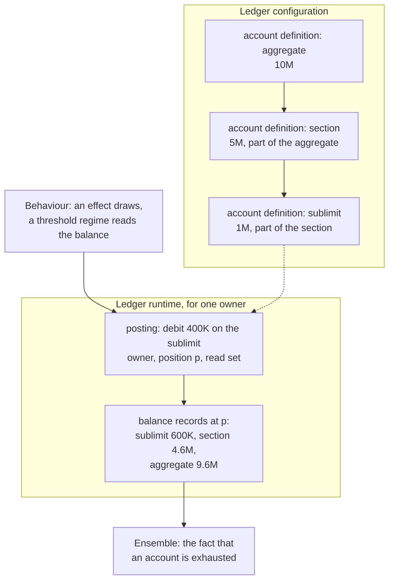

<!-- SPDX-License-Identifier: CC-BY-SA-4.0 -->

# ADR-A131: Ledger, a substrate layer for amounts consumed and restored over time

**Status:** Published, 2026-10-26. Accepted 2026-10-21.
**Described in:** [Ledger](../../../ontology/ledger/README.md)
**Date:** 2026-10-19
**Supersedes:** none
**Related:** [ADR-A01](https://github.com/nebularis/lattice/blob/main/docs/architecture/decisions/ADR-A01-layer-dependency-order.md) (the layer order, amended by its
2026-10-19 addendum), [ADR-A92](https://github.com/nebularis/lattice/blob/main/docs/architecture/decisions/ADR-A92-derived-artefact-contract-and-prov-o-alignment.md) (derived artefacts),
[ADR-A106](https://github.com/nebularis/lattice/blob/main/docs/architecture/decisions/ADR-A106-behaviour-configuration-runtime-occasions-and-records.md) (Behaviour's
configuration and runtime), [ADR-A113](https://github.com/nebularis/lattice/blob/main/docs/architecture/decisions/ADR-A113-breaking-changes-at-major-version-zero.md) (major version zero),
[ADR-A129](https://github.com/nebularis/lattice/blob/main/docs/architecture/decisions/ADR-A129-one-release-for-the-substrate.md) (one release), [ADR-A121](https://github.com/nebularis/lattice/blob/main/docs/architecture/decisions/ADR-A121-repository-catalogue.md) (the repository catalogue),
[ADR-A122](https://github.com/nebularis/lattice/blob/main/docs/architecture/decisions/ADR-A122-aggregate-ownership.md) (aggregate ownership),
[ADR-A-C2](https://github.com/nebularis/lattice/blob/main/docs/architecture/decisions/ADR-A-C2-clean-room-authoring-procedure.md)
(authoring order)

## Context

Agreements in many fields state an amount that is consumed over time and sometimes restored. For
example, a software licence grants 500 seats a year, a revolving credit facility commits 20M against
which drawings are made and repaid, a research grant has a budget with sub-budgets for staff and
equipment and returns unspent funds to them, a service contract includes 40 support hours a quarter,
and an insurance policy pays up to a sublimit that is part of an aggregate, with recoveries restoring
what was paid.

Behaviour holds the only model of this today. `bhv:AllowanceDefinition` binds one value space, one
absorption policy and an optional reset recurrence, and `bhv:AllowanceAccount` carries one current
balance. It has four gaps:

- **Flat.** It has no "part of and not in addition to", so a sublimit within a section limit within
  an aggregate cannot be stated.
- **No credits.** It cannot restore a repayment, a recovery or a reinstatement.
- **One subject.** It cannot have a scope wider than one subject, such as an authority's aggregate
  over every contract bound under it.
- **Under-keyed records.** The account record is not a derived artefact and names no owner and no
  position, so two subjects on one definition write records nobody can tell apart.

Several consumers need a running amount, and most of them are not state machines:

| Consumer | Needs |
|---|---|
| Ensemble, a layer proposed and not yet decided | the fact that an account is exhausted |
| authorities and programmes | an account owned by an authority or a programme |
| vehicles | collateral and allocation |
| design-time checks | an account tree's structure |
| Behaviour | effects that draw and threshold regimes that read a balance |

Keeping the model inside Behaviour would make each consumer import six layers where four would do,
and an ontology that extends the ledger would have to extend Behaviour with it.

## Decision

1. **A new substrate layer, Ledger.**
   - **Where.** `ontology/ledger/`, literate (ADR-A120, ADR-A126), namespace
     `https://www.nebularis.org/neuro-semantic/lattice/ledger#`, prefix `ldg:`.
   - **Imports.** It imports Foundation, Vocabulary and Quantification, and nothing else.
   - **Importers.** Behaviour's configuration document imports it, and every layer above reaches it
     through Behaviour. Party, Eligibility, Wording and Instrument do not import it.
   - **Placement.** ADR-A01's 2026-10-19 addendum places it, and its repository catalogue entry
     states its imports.
2. **Two documents, as Behaviour has** (ADR-A106, ADR-A120).
   - **The configuration document** declares account definitions, their tree, their merge rules and
     their reset periods.
   - **The runtime document** declares postings and balance records.

   A design-time check reads only the first.
3. **Accounts form a tree.** An account definition states its amount as a `qnt:Quantity` in a
   `qnt:ValueSpace`, its unit of account.
   - **Parent edge.** "Part of and not in addition to" is the parent edge. An account outside
     another's subtree is in addition to it. Agreements state both, for example a sublimit that is
     part of a section's limit beside a further limit for one class of beneficiary in addition to a
     shared aggregate, so the edge is stated, never inferred.
   - **Draws.** A draw on an account debits it and each ancestor, as one operation that succeeds or
     fails whole.
   - **Availability.** An account's availability is the least of its own remaining balance and its
     ancestors'.
   - **Credits.** A credit is the inverse of a draw along the same path, and never raises a balance
     above its stated amount unless a term says so.
   - **Cycles.** A cycle in the tree is refused by a shape.
   - **Keyed accounts.** Some amounts apply per key, for example seats per site, a sublimit per
     borrower in a facility with several borrowers, or an aggregate per location. The definition
     states a key dimension, a concept scheme or a value space, and one account per key value is
     derived on the first draw that names it. A parent above the keyed accounts is an ordinary parent
     edge (LG-Q7).
   - **Other value spaces.** A draw in another value space than the account's, for example a currency,
     is converted on its posting, by the method the terms state, or where they are silent by an
     outside rule, or else it is Undetermined. The posting records the amount drawn, the converted
     amount and the conversion's context (LG-Q8).
   - **Purposes.** A draw may name a purpose. An account outside the draw's path that counts that
     purpose is debited by the same draw, which still succeeds or fails whole, so a limit that sits
     under two parents keeps the tree (LG-Q2).
4. **Postings are records, and a balance is derived.** A posting is a `fnd:DerivedArtefact` (ADR-A92).
   - **What it names.** It names its account, the account's owner, its position, its amount and
     direction, and its read set in `prov:wasDerivedFrom`. The amount is a decimal literal in the
     account's unit of account, never a quantity node of its own, so a balance read joins nothing.
   - **Ancestors.** A draw writes one posting, and ancestor balances follow by a closure over the
     finite tree.
   - **Balance records.** A balance record is a derived artefact keyed by account, owner and position.
     An evaluator may materialise one per pass, and the current balance is the one at the greatest
     position.
   - **Persistence.** Postings and balance records are append-only, so persistence writes them as
     record families.
5. **An account belongs to a persistent identity.** It may belong to an instrument, an authority, an
   ensemble of instruments, such as a programme or a vehicle, or any other
   `fnd:PersistentIdentity`, so it outlives a new version of what it belongs to. An account drawn on by
   several instruments belongs to their ensemble.
   - **Owner kinds.** An account definition states which kinds of owner it admits.
   - **Aggregate.** An account and its postings form an aggregate of their own under ADR-A122, owned
     by that identity and by no occasion.
6. **Merge rules are data.** What happens when several draws in one pass together exceed an account is
   a merge rule. The rules are concepts in an open scheme:
   - **in priority order**, today's `bhv:Sequential`
   - **proportional**, today's `bhv:Proportional`
   - **refuse**, which leaves the draws Undetermined with a reason

   Allocation with conservation is the same mechanism. One amount is split into postings on several
   accounts by a merge rule, and the parts sum to the amount.
   - **Two phases at one position.** Where several evaluations draw on one account at one position,
     each proposes its draws, the account's owner merges them by the rule, and each evaluation then
     settles its outcome against what the merge granted. No evaluation's outcome depends on the order
     in which the others ran, so they may run in parallel, and implementations in different
     languages agree.
   - **Exactness.** A proportional merge, or a share signed down in proportion, can give a part that
     no decimal states exactly, for example a third. Postings are in the account's declared unit of
     account. Where a rule's exact parts must be rounded to that unit, the rule states the rounding
     and how the residual is allocated, so the parts still sum to the amount. Whether derived
     proportions are kept as exact rationals is the Ledger plan's LG-Q6.
7. **Behaviour uses the ledger and no longer defines one.**
   - **What Behaviour keeps.** Effects that draw, credit or accrue onto an account, threshold regimes
     whose states partition a balance, and the firing of a reset on an occasion.
   - **Allowances become a shorthand.** `bhv:AllowanceDefinition` becomes a deprecated shorthand for
     a one-account ledger with a reset period. `bhv:AllowanceAccount` and `bhv:availableBalance`
     give way to balance records, and `bhv:AbsorptionPolicy` gives way to merge rules.
   - **Releases.** The shorthand is deprecated in one release of the substrate and removed in a later
     one (ADR-A129, ADR-A113). The release notes class the deprecation as no effect and the removal as
     changes meaning, which owes a migration once an adopter holds production data.
8. **Extension.** Another ontology may add account kinds, posting kinds and merge rules under its own
   prefix, as subclasses or concepts.
   - **Semantics.** Ledger documents the semantics of its own terms, and every implementation of
     the evaluator implements only those. An extension specialises Ledger's kinds and rules, and
     states what it means in terms Ledger already evaluates, for example a merge rule composed of
     priority and proportional rules. It adds no evaluation semantics of its own, since a semantics
     only one implementation knows would make implementations disagree. New semantics come by an
     addendum to this ADR, with conformance cases.
   - **Boundary.** An extension never changes what Ledger's own terms mean.
9. **What Ledger does not hold.**
   - **Pure operations over amounts (combinators).** The evaluation-context sketch's EC-Q1 places
     these, leaning towards Quantification.
   - **How effects in one pass compose (environments).** That is evaluation semantics, stated in
     the evaluation context's model and fixed by conformance cases, never left to one
     implementation (CCS C12).
   - **The order between instruments.** That is Ensemble's.

## Consequences

- **The layer order changes** (ADR-A01, 2026-10-19 addendum). When its first slice creates
  `ontology/ledger/`, Ledger's README carries its catalogue entry, of kind `substrate` with its
  imports, the root catalogue lists it after Quantification, and Behaviour's entry adds it to its
  imports (ADR-A121). `mise run check:import-guard` then enforces them with no change to the guard's
  code.
- **Releases.** Ledger joins the substrate's release at the release's number, with no version of its
  own (ADR-A129). Each slice that changes a member is a new release, made by `release:prepare`.
  `docs/architecture/ontology-architecture.md` and the root README show the new layer.
- **Behaviour changes.** It imports Ledger, retargets its effects and regimes, and deprecates the
  allowance terms. About 30 files use them today, most of them the insure-o example's cases. The
  substrate moves with the release, and the applied modules and examples pin the new release
  (ADR-A129 decision 4).
- **Cost.** A draw on a path of depth *d* writes one posting of about 8 triples. A materialised
  balance record per affected account, holding both the remaining balance and the availability,
  adds about 8 triples each, so a pass that draws once on a three-level path writes about 32 triples
  in one batch. A balance read is one lookup on a materialised record. Without one it sums the
  postings on the account and its descendants up to a position, which is linear in the postings.
- **Realisations.** This model is the published, conceptual one. A deployment that needs speed may
  realise it in a compiled form, for example the account tree as arrays indexed by account, with
  paths precomputed, balances as integers in minor units, and postings appended to a log written
  once per pass. Such a realisation is a derived engine: it adds no semantics (decision 8), is
  populated from the configuration by a projection, and is held to the model by a stated agreement
  law, that folding its postings gives the model's balance records. The Ledger plan's performance
  section sets out the costs.
- **The evaluator** (CCS C12) runs draws and credits as postings. Draws by several evaluations on
  one account at one position follow decision 6's two phases, so they may run in parallel. Any other
  composition of effects in one pass is fixed by the evaluation context's model (decision 9).
- **Ensemble** reads exhaustion as a fact derived from a balance record. An account shared by several
  instruments, such as an authority's aggregate, is drawn by their separate evaluations. How their
  draws are ordered is the Ledger plan's question LG-Q3, to be settled before Ensemble's K6 slice
  (ES-4) is briefed.
- **Applied modules.** Phase 7's allocation slice (AIR-7.4) builds on decision 6 rather than
  adding allocation to Behaviour. The claims plan's programme erosion (AIR-6.8) uses programme-owned
  accounts.
- **Publication.** Ledger's README follows ADR-A126's layout, so it cites only published decisions
  (ADR-A127). This ADR is published with the first slice that creates the README, citing accepted
  decisions it builds on by their GitHub links.

## Addendum (2026-10-27): an account instance is named, and a posting carries two orderings

Two amendments, both from designing the runtime document that decision 2 promised. Neither changes what Ledger is for.

**An account instance gains a minted IRI, which reverses part of decision 4.** Decision 4 has a posting name its account by the account definition, the owner and the key, so that no account instance needs an identity of its own and a balance read joins nothing. That reasoning holds for a balance read and fails for a partition. Once postings are separated by closing period, the separation needs a name for the unit it separates, and a composite of three values is not a name. [ADR-A122](ADR-A122-aggregate-ownership.md) decision 8 keeps a named graph's IRI injective in its root, which presupposes the root has an IRI at all.

So an account instance is a node with a minted IRI, and a posting names that node rather than repeating the three values. A balance record is keyed by the account node and the position rather than by account, owner and position.

The natural key is kept, not replaced. The account definition, the owner and the key value remain a key in the sense of [ADR-A114](ADR-A114-external-and-natural-keys.md), so an adopter holding those values still resolves the instance, and the uniqueness they express is still enforced. What changes is that the instance has its own name as well, which the key resolves to. The cost is one node and one IRI per account instance where there were none. The gain is that a posting's reference to its account is one term rather than three, and that the unit of a partition can be named.

**A posting carries two orderings, not one.** A fact may be recorded after the time from which it takes effect. A correction belongs where the fact it corrects belongs, a restoration of consumed amount may take effect as of the act that consumed it, and an adjustment may be agreed later and apply earlier. One ordering cannot hold both without either losing the sequence in which facts were recorded or putting a fact in the wrong place.

- **Effective position.** Where the fact sits in the arrangement the accounts describe. Supplied by the domain, comparable across accounts, and never assigned by an evaluator.
- **Recorded position.** Where the fact sits in the account's own append-only sequence. Assigned by the writer, monotonic, and total only within one account.

Nothing is mutated to achieve this. A correction is a compensating posting whose effective position is that of the fact it corrects and whose recorded position is current, so the append-only property of decision 4 and the key guard both survive.

Three consequences follow.

1. **A reading is reproducible only when paired with the recorded position at which it was taken.** A balance as of an effective position depends on every posting at or before that effective position, whatever its recorded position, so a posting recorded late and effective early changes a historical reading. That is correct behaviour rather than a defect, and it has to be stated, because a reading quoted without its recorded position cannot be reproduced.
2. **The axis that compares accounts is effective position.** No global counter is needed, and none is wanted, since recorded position is total only within one account.
3. **Correctness arguments about what a write touches are stated over two axes**, with append-only as an explicit hypothesis rather than an assumption.

**What this does not decide.** How the name of a period's partitioned unit is minted. That rests on the account IRI this addendum provides, and it is held open until the read that spans a change of closing recurrence has been measured, because the cost of that read is what separates a derived name from a recorded one.

## Provenance

**Unit:** [`ledger`](../../developer/plans/ledger.md)

Designed in outline in the [evaluation-context sketch](../../developer/sketches/evaluation-context.md)
§5. The maintainer decided on 2026-10-19 that the ledger is a substrate layer above Quantification
(EC-Q7), and that allowances become ledger accounts (EC-Q2). Planned in the
[Ledger plan](../../developer/plans/ledger.md). Amended before acceptance on 2026-10-21 with the two
phases at one position and exactness (decision 6), closed semantics for extensions (decision 8) and
environments fixed by the model (decision 9), after a review against the evaluator's implementation
options. At design closure the same day we added the stated edge for "in addition to", the unit of
account, and keyed accounts and other value spaces as questions LG-Q7 and LG-Q8 (decision 3). The
maintainer answered LG-Q1 to LG-Q8 the same day, as the plan leaned, and asked that every choice be
checked for its cost at runtime. Decision 3 then states keyed accounts, conversion and purposes, and
decision 4 carries a posting's amount as a literal in the unit of account. The maintainer accepted
this ADR, with ADR-A01's 2026-10-19 addendum, on 2026-10-21.

The maintainer published this ADR on 2026-10-26, once the README of its first slice existed.

**The 2026-10-27 addendum.** Designed in the
[ledger history and runtime sketch](../../developer/sketches/ledger-history-and-runtime.md), whose §2.1
states the two orderings and whose §7 holds the questions. The maintainer answered LF-Q11 (two orderings),
LF-Q17 to LF-Q22 on 2026-10-27. LF-Q19 is the reversal of decision 4's keying, and the sketch records that
the partition template of the
[multi-store runtime sketch](../../developer/sketches/multi-store-runtime.md) rests on it (MS-Q2, answered
the same day). The minting of a period's unit is deliberately left out, tracked as PDD-12 in the
[pending design decisions](../../developer/pending-design-decisions.md), pending the measurement of a read
spanning a change of closing recurrence. The addendum's examples are domain-neutral by the substrate rule,
where the sketch's are drawn from insurance.
