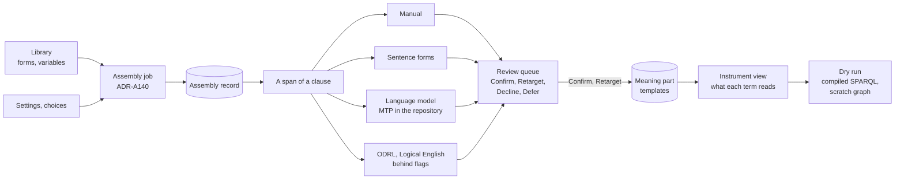

<!-- SPDX-License-Identifier: CC-BY-SA-4.0 -->

# ADR-A138: The contract builder, a mode of the Configuration Studio

**Status:** Accepted 2026-10-28
**Date:** 2026-10-28
**Related:** [ADR-A136](ADR-A136-configuration-studio.md) (the studio the builder is a mode of), [ADR-A137](ADR-A137-document-markup-vocabulary.md) (documents as XML), [ADR-A139](ADR-A139-wording-baseline-assembly-model.md) (the assembly the builder drives), [ADR-A140](ADR-A140-wording-assembler-topology.md) (where assembly runs), [ADR-A104](ADR-A104-instrument-terms-and-legal-relations.md) (stated and bound meaning), [ADR-A112](ADR-A112-wording-layer.md) (Wording), [ADR-A42](ADR-A42-mork-review-snapshot-and-decision-learning-boundary.md) (review decisions), [ADR-A-FM3](ADR-A-FM3-reference-evaluator-home-and-scope.md) (the reference evaluator's scope)
**Unit:** [`config-studio`](../../developer/plans/config-studio.md), slices CB0 to CB4 (CS11)

## Context

The Configuration Studio authors the configuration of an applied ontology: vocabularies, quantification, eligibility, persistence and surfaces. What a contract says, and what it means, is authored nowhere. Wording holds a contract's documents and the result of assembling one from library forms, with its laws, but no way to assemble. Instrument holds a contract's stated meaning, its terms, relations, triggers and regimes as templates that name roles and variables, which instantiation binds to one contract's parties and values. The Word add-in marks a document's structure, and a worker reads plain English sentences against a small profile of sentence forms and proposes the relation each states.

A drafter needs to build a contract from a library of clauses, give each clause its stated meaning, and see what that meaning reads before any contract is instantiated. Doing that in the studio puts the whole domain of discourse in one place, so a concept or a range a term reads opens the studio view that defines it.

## Decision

1. **A mode of the studio.** The builder is a mode of the Configuration Studio, not an application of its own (CB-Q1). It shares the studio's workspace, graph model, inspector, problems drawer, job bus and store writers, and `packages/authoring-domain` with the Word add-in. A workspace gains four parts, each a graph that holds only its own part's terms as the studio's other parts do (STD-279): **library**, the forms and their variables (Wording), **assembly**, an assembly's settings and choices (ADR-A139), **meaning**, the templates each clause states (Instrument), and **review**, the proposals and the decisions on them (decision 4).
2. **Stated meaning only.** The builder writes forms, settings and templates. It never writes bound meaning, which only an instantiator produces, from an assembled wording and its values (ADR-A104). A template's roles and variables stay roles and variables wherever the builder shows them.
3. **Assembly is a job.** The builder never assembles in the browser. It asks for an assembly as a job, which the worker runs (ADR-A140), and shows the assembly record or the findings that refused it. An amendment is a new assembly against the record it amends, shown as the difference between the two records.
4. **Meaning arrives as proposals.** Every template the builder records, whether typed by the drafter or read from the text, is first a proposal, and enters the meaning part only through one review queue. A proposal names the span of text it reads, the template it proposes, and its provenance: which proposer made it, with which version and configuration, from which input, as PROV. A reviewer decides each with one of four decisions from ADR-A42's closed set, Confirm, Retarget, Decline or Defer, and the decision is recorded with the proposal. The queue records decisions and changes nothing else.
5. **Proposers behind one interface.** A proposer takes a span and its context, the clause, its wording and the workspace's vocabularies, and returns candidate templates, each with the evidence it rests on. Manual entry is the trivial proposer, so typed and read meaning take one path. LATTICE ships three. **Manual.** **Sentence forms**, the worker's existing reader. **A language model**, whose only pack in the repository is MORK's teaching pack (MTP), any other pack being loaded from outside the repository by configuration. A proposer runs in the worker, never the browser, and a language-model proposer is off unless a deployment configures its endpoint and pack (CB-Q3).
6. **What each term reads.** The instrument view draws terms in their two tiers, regimes as state machines, and gating, and shows for each term what it reads: the concepts, ranges and eligibility conditions its templates name, and the regime states it applies in. These are derived by query from the meaning part and never stored.
7. **A dry run, never an instantiation.** A drafter may run one term's eligibility conditions over sample facts, through the conditions' compiled SPARQL as the studio's tests run them, and never through the reference evaluator (ADR-A-FM3, CB-Q2). The sample facts and the outcome live in a scratch graph of the job, never in the workspace. Roles are shown as roles. Stepping a regime over sample events has no compiled path, so the regime dry run is marked under construction until one exists (decision BQ-1 below).
8. **Rule languages as proposers.** ODRL and Logical English are imported as proposers, each behind a feature flag (CB-Q4, CB5), so an imported rule is reviewed like any other proposal.
9. **The wire.** Documents travel as the markup of ADR-A137, and meaning, proposals and decisions as RDF.

**Rejected.** An application of its own over a shared core, which would duplicate the studio's editors, inspector and jobs for one persona. A preview instantiation that is never saved, which is bound meaning arriving before its contract and would need an instantiator in the browser or a store path for discarded data. Manual meaning written straight into the meaning part, which would give typed meaning a second path with no provenance. Running proposers in the browser, which would put a language model's credentials in the client and skip the service's validation (PRI-75). The reference evaluator for the dry run, which ADR-A-FM3 scopes to the formal methods.

## Consequences

- The studio's contracts gain the four parts' graph roles, a `cst:` term for a proposal and its decision, and the assemble, propose and dry-run job kinds. They change with deprecation, as ADR-A136 makes them contracts.
- The examples are a facility agreement and a software licence. The builder carries no domain's clause library.
- Instrument's templates gain an author through the studio. The laws Instrument already states check what the builder writes, and the studio reports their findings on the fields that caused them.
- A regime's dry run waits on a compiled path for triggers, which is compiler work outside this unit.
- What a language-model proposer proposes depends on its pack and its model, and the review queue is the only way a proposal becomes meaning.

## Questions

| ID | Question | Decided |
|---|---|---|
| BQ-1 | Stepping a regime in the dry run: compile triggers and regime transitions to SPARQL now, in `tools/mork_compilers`, or mark the regime dry run under construction | **decided 2026-10-28:** under construction for the November tag, and the compiler work as its own slice after it, since it is new compiler surface with its own laws |
| BQ-2 | How a language-model proposer reaches a model, and what a deployment supplies to it | **decided 2026-10-28:** one proposer contract in `contracts/`, a job that takes a span, its context and a pack reference and returns proposals as RDF with their provenance, reached two ways and built in stages. First a Python proposer worker that a deployment extends by supplying a pack (prompt templates, an output schema, model parameters and which pack applies to which span) and a model endpoint, model and key in its environment, never in the repository. It speaks the Chat Completions wire format, which most providers and gateways accept, and Open Responses may be added beside it. Then an MCP server on the studio, whose tools read a span and its context and submit a proposal, so an MCP host proposes with its own model and keys, and which serves MTP as a prompt. MCP's sampling is not used, since its 2026-07-28 revision deprecates it. Both paths end in the one review queue |

## Provenance

**Unit:** [`config-studio`](../../developer/plans/config-studio.md) (plan, CS11 and the builder's questions CB-Q1 to CB-Q5), drafted 2026-10-28. The maintainer answered CB-Q1 to CB-Q5 on 2026-10-28, which decisions 1, 5, 7 and 8 record. The maintainer accepted it on 2026-10-28 with BQ-1 as recommended, and reopened BQ-2, which the maintainer decided the same day.
