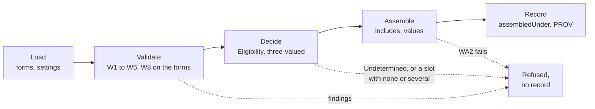

<!-- SPDX-License-Identifier: CC-BY-SA-4.0 -->

# ADR-A139: Wording's baseline assembly model

**Status:** Accepted 2026-10-28
**Date:** 2026-10-28
**Related:** [ADR-A112](ADR-A112-wording-layer.md) (Wording), [ADR-A104](ADR-A104-instrument-terms-and-legal-relations.md) (an instrument version is expressed in one assembled wording), [ADR-A140](ADR-A140-wording-assembler-topology.md) (the assembler), [ADR-A138](ADR-A138-contract-builder.md) (the builder that drives it), [ADR-A92](ADR-A92-derived-artefact-contract-and-prov-o-alignment.md) (derived artefacts and PROV), [ADR-A86](ADR-A86-ontology-semantic-versioning.md) (versioning)
**Unit:** [`config-studio`](../../developer/plans/config-studio.md), slice CB0

## Context

Wording has the result of assembly and its laws. A form's elements come into an instance as Mandatory, Variation, Optional or Conditional (§5.11), an assembled wording records the element versions it includes and the values it supplies (§5.12), an amendment is recorded with five operations (§5.13), and laws W3 to W6 and W8 hold of every assembled wording (§8). It has no statement of how an assembled wording was produced, and nothing produces one.

The assembly-interface sketch of the InsurML alignment proposes models, thirteen hooks and one assembly record, with InsurML's model as the insurance default (IMA-D17). The contract builder needs assembly now, for domains that are not insurance, and only Wording's own semantics. This ADR takes the domain-neutral part of that proposal that the builder needs, as Wording's baseline model, and leaves the rest of the interface, and any default for a domain, to be decided when a second model is built.

## Decision

1. **A named model, recorded on every result.** Wording gains `wrd:AssemblyModel`, a versioned class, and one individual, the baseline model, whose semantics are Wording's own (§5.11 to §5.13 and this ADR). Every assembled wording an assembler produces names the model version it was assembled under, with `wrd:assembledUnder` (law WA1). A contract written from scratch, assembled from no form, names none.
2. **The record is the interface.** Instrument, Surface and Persistence read the assembled wording and nothing about how it was produced. The record is what Wording already has, `wrd:AssembledWording` with `wrd:assembledFrom`, `wrd:includes` and `wrd:hasValue`, and adds `wrd:assembledUnder` and the assembly as a `prov:Activity` that used the form versions, the settings and the model version, each by digest (ADR-A92).
3. **Decisions and their treatment.** An inclusion condition is decided by Eligibility, three-valued. In the baseline, Admitted includes the element, Denied leaves it out, and Undetermined refuses the assembly with a finding that names the governing variable it lacks. A variation slot with no admitted variant, or with several, refuses the assembly. An Optional element is included only when the settings choose it.
4. **References by version.** A reference finds the version the assembled wording includes, as law W8 states, and no resolution is stored, since W8 makes it a function of the record.
5. **Numbers derived, never stored.** Object ids are derived from the record by rank order among included siblings, as law W7 requires. Assembly from a form numbers afresh, so a clause left out moves those after it up, and a chosen variant takes its slot's number. An amendment never renumbers. A clause it deletes keeps its number in the amended wording, shown as deleted, as drafters of amending agreements do.
6. **Stages and their findings.** Assembly runs in stages, load, validate, decide, assemble and record, and a stage that fails gives findings as `sh:ValidationResult`, the form the studio already shows on the fields that caused them. A failed assembly produces findings and no record (law WA6).
7. **Re-assembly.** An amendment, or new settings, yields a new assembled wording version under the same model, with the same `fnd:hasIdentity`, sharing every value record and element version the change leaves alone (§5.12, §5.13).
8. **Laws.** Wording adopts four laws for every assembled wording an assembler produces, beside W1 to W8.

| # | Law |
|---|---|
| WA1 | An assembled wording drawn from a form names exactly one assembly model version |
| WA2 | Whatever the model, the record satisfies W3 to W6 and W8 |
| WA4 | Assembly reads the forms, the settings and the choices only, never runtime records or state |
| WA5 | The same form versions, settings, choices and model version give the same record, up to minted identifiers |
| WA6 | A failed assembly produces findings and no record |

WA3 (capabilities and lowerings) and WA7 (parity between two realisations of one model) keep the sketch's numbers and are decided with the second model, since one model can neither lack a capability nor disagree with itself.

**Deferred, each to its own decision when a case outside insurance needs it.** Transclusion of an element version into another form (H1) and inline parts (H2), which change Wording's structure. Inclusion that depends on another element's inclusion (H3), which derived governing variables carry until then. A model's declared capabilities and lowerings, and choosing a model per scope through Vocabulary. Inherited attributes (H6), content held outside the graph (H7) and publication views (H9).

**Rejected.** A new Assembly layer between Wording and Instrument, which would hold one model's declarations and no meaning, and which Instrument would have to import. Storing numbers or reference resolutions on the record, which W7 and W8 make derivable and which would then need keeping in step. An Undetermined inclusion that asks the drafter during assembly, which would make assembly interactive. The builder asks for the missing settings before it asks for an assembly. Adopting InsurML's model as Wording's own, which would bring a domain's structure into the substrate.

## Consequences

- Wording gains one class, one individual and one property, a MINOR change, and the laws WA1, WA2, WA4, WA5 and WA6 as shapes where a shape can state them and as assembler tests where it cannot (WA4, WA5).
- An assembled wording records which model produced it, so a second model can be added later without changing what Instrument reads.
- The InsurML model and any domain default remain the InsurML alignment's to decide, under IMA-D17, and the baseline does not wait for them.
- Numbering on amendment follows drafting practice, which a rendered amended wording shows with its deleted clauses in place.

## Provenance

**Unit:** [`config-studio`](../../developer/plans/config-studio.md), slice CB0, drafted 2026-10-28 from the assembly-interface sketch of the InsurML alignment, taking its domain-neutral parts. The builder's examples, a facility agreement and a software licence, are its cases. The maintainer accepted it on 2026-10-28.
