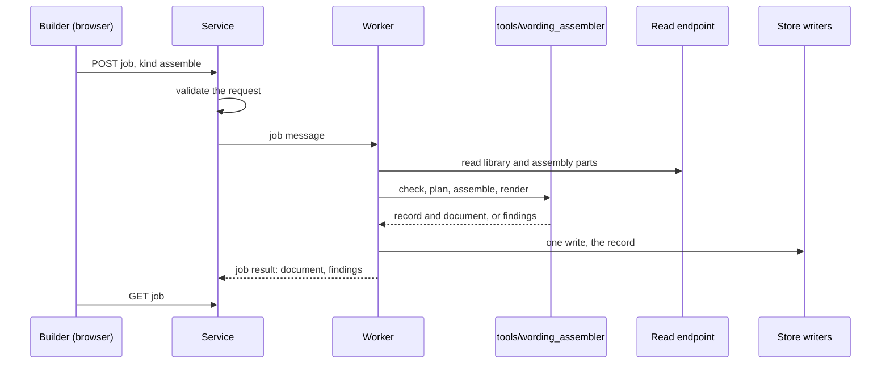

<!-- SPDX-License-Identifier: CC-BY-SA-4.0 -->

# ADR-A140: Where the Wording assembler lives and how it runs

**Status:** Proposed
**Date:** 2026-10-28
**Related:** [ADR-A139](ADR-A139-wording-baseline-assembly-model.md) (the model it implements), [ADR-A138](ADR-A138-contract-builder.md) (the builder that asks for it), [ADR-A136](ADR-A136-configuration-studio.md) (the studio's jobs and store writers), [ADR-A137](ADR-A137-document-markup-vocabulary.md) (the markup it renders), [ADR-A19](ADR-A19-staged-compiler-architecture-and-backend-fanout.md) (staged compilers), [ADR-A92](ADR-A92-derived-artefact-contract-and-prov-o-alignment.md) (derived artefacts), [ADR-A79](ADR-A79-persistence-compiler-toolchain.md) (a reference toolchain in `tools/`), [ADR-A83](ADR-A83-test-only-reasoning-engine-isolation.md) (optional adapters), [ADR-A28](ADR-A28-parity-and-conformance-release-gate.md) (parity)
**Unit:** [`config-studio`](../../developer/plans/config-studio.md), slice CB0

## Context

ADR-A139 defines what an assembly produces under Wording's baseline model. Something has to run it, for the builder now and for any other client later, and its result has to reach the store by the path every other studio write takes. The repository keeps reference implementations of its compilers in `tools/` as packages with their own tests (ADR-A79), the studio's worker already runs those packages as jobs, and since ADR-A136's third amendment only the store writers write the store.

## Decision

1. **A reference package in `tools/`.** The assembler is a Python package, `tools/wording_assembler`, beside `tools/persistence` and `tools/surface`. Its public functions are `check` (a form version against the model, giving findings), `plan` (a checked form compiled once into its inclusion decisions and the questions they pose), `assemble` (a plan, settings and choices, giving a record or findings), `reassemble` (a record and an amendment or new settings, giving a new record version) and `render` (a record, giving a document in the markup of ADR-A137). A second model makes these an interface with contract tests and a parity suite (ADR-A83, ADR-A28), and until then they are one implementation's functions.
2. **Pure, with time and identity as inputs.** Every function takes graphs and returns graphs. The assembly time and the minter of the record's identifiers are arguments, so the same inputs give the same record (WA5), which a test checks with permuted inputs and a repeat (PRI-56, PRI-58).
3. **Decisions through compiled conditions.** `plan` compiles each inclusion condition with `tools/mork_compilers`, and `assemble` decides it by the compiled SPARQL against the settings, as the studio's eligibility jobs do. The plan is a derived artefact of the form version and the model version, with its digest (ADR-A92).
4. **Run as a studio job.** The studio's worker runs `assemble` and `render` as a job kind, `assemble`, on the job bus. The service validates the request and never assembles. The worker reads the workspace's library and assembly parts through the read-only endpoint, and sends the record to the store writers as one write, so a record is stored whole or not at all (WA6). The rendered document and the findings are the job's artefacts and report.
5. **Findings in the studio's form.** A refused assembly reports `sh:ValidationResult`s, each naming the stage, the element or the governing variable, so the builder shows them where they arose.

**Cost.** A plan is compiled once per form version and model version and reused while neither changes. An assembly evaluates one compiled query per conditional element or variant of the form, so a form with 200 elements of which 30 are conditional costs 30 queries over a settings graph of tens of triples, and writes one record of one triple per included element and one value record per variable. The write is one batch to the writers, whose cost per commit TSD-44 records.

**Rejected.** The assembler in the Java service, which would put meaning code beside the transport and apart from the compilers it uses. The assembler in the browser, which a client could alter and whose result the service would have to assemble again to trust (PRI-75). An assembler that writes the store directly, which ADR-A136's third amendment rules out. An adapter interface before a second model exists, which would have one implementation.

## Consequences

- `tools/wording_assembler` gains a `check` task and its tests, and the worker depends on it as it depends on the other compiler packages.
- The studio's contracts gain the `assemble` job kind, its artefacts and its findings' codes.
- Another client, such as the Word add-in, assembles by the same job, so the record never depends on which client asked.
- A second model is added as a second implementation of the same functions, with the parity suite then required.

## Provenance

**Unit:** [`config-studio`](../../developer/plans/config-studio.md), slice CB0, drafted 2026-10-28 from §8 of the assembly-interface sketch of the InsurML alignment.
