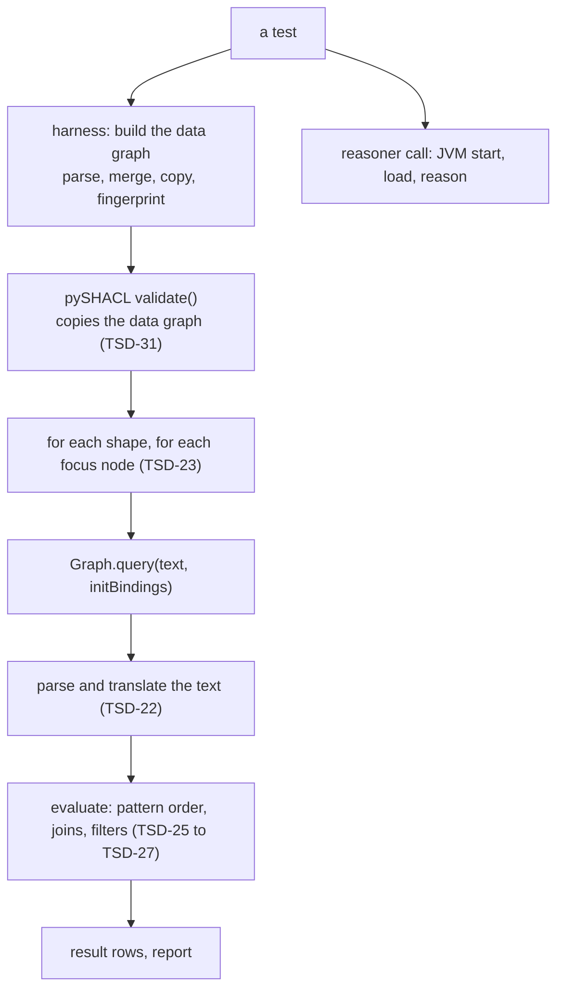

<!-- SPDX-License-Identifier: CC-BY-SA-4.0 -->

# Efficient queries and shapes

**What this is.** The project's record of how to write SPARQL queries and SHACL shapes that run in a reasonable time, and how to keep the test suites that run
them fast. It says what we measured, why it happens, what we decided to do about it, and, for every statement, whether it holds for any SPARQL engine or only for
the engine, validator or machine we measured it on.

**Status:** a living record, begun 2026-10-17 from the work that took the ontology test suite (`check:ontology-catalog`) from 427 s to about 70 s on a four-core
machine and from 237 s to 36 s on the maintainer's laptop. The rules are decided in [ADR-A128](decisions/ADR-A128-efficient-queries-and-shapes.md). The evidence for each
mechanism is in [triple-store-discovery.md](triple-store-discovery.md), findings TSD-22 to TSD-33, and is reproduced by a benchmark, `mise run
check:sparql-constraint-query-cost`.

**Versions covered:** rdflib 7.6.0, pySHACL 0.40.1, pyoxigraph 0.5.11 (Oxigraph), pytest-xdist 3.8.0, Temurin 25.0.4, Python 3.14. A statement holds for these until it is
checked again.

## Contents

1. [How to read this document](#1-how-to-read-this-document)
2. [What is specific to rdflib, and what is not](#2-what-is-specific-to-rdflib-and-what-is-not)
3. [Where a validation spends its time](#3-where-a-validation-spends-its-time)
4. [Rules for queries and shapes](#4-rules-for-queries-and-shapes)
5. [Rules for the test harness](#5-rules-for-the-test-harness)
6. [Method: how to find a cost and how to change it safely](#6-method-how-to-find-a-cost-and-how-to-change-it-safely)
7. [If the engine or the validator changes](#7-if-the-engine-or-the-validator-changes)
8. [What we have not measured](#8-what-we-have-not-measured)
9. [The measurements](#9-the-measurements)

## 1. How to read this document

### 1.1 Scope tags

Every rule and finding carries one of these, because the same observation can be a fact about SPARQL, about one engine, or about our own test code.

| Tag | Means | Changes when |
|---|---|---|
| **spec** | holds on any engine that implements the SPARQL 1.1 or SHACL specification, because the specification says so | the specification changes |
| **rdflib** | a property of rdflib's SPARQL parser or evaluator, version 7.6.0 | rdflib changes, or we use another engine |
| **pySHACL** | a property of pySHACL 0.40.1, the validator we run on rdflib | pySHACL changes, or we use another validator |
| **Oxigraph** | observed on pyoxigraph 0.5.11 through `tools/testing/oxigraph` | Oxigraph changes |
| **harness** | a property of our own test suite, mostly `tools/conftest.py` | we change the harness |
| **JVM** | a property of the Java virtual machine that runs the reasoner | the JVM or the reasoner changes |
| **machine** | a property of the computer running the tests | the computer or its settings change |

### 1.2 Evidence

The words are those of the [discovery record](triple-store-discovery.md#1-how-to-read-and-write-this-document): **Source** (we read the code at a named version),
**Observed** (we ran a probe and a script or a test shows it), **Documented** (the tool's own documentation says so) and **Reasoned** (it follows from other
statements and is not yet observed, so it is a hypothesis). A statement without a tag of evidence is Observed.

### 1.3 Where the numbers come from

Run records follow the discovery record's convention, the kind of machine and never the machine or person. R-D is a Linux x86_64 container with four logical cores
and 15 GB. R-E is a macOS arm64 laptop with four performance and four efficiency cores and 8 GB. Both ran Python 3.14 with the versions above. Timings on a shared
container drift by 10 to 15% between runs, so a ratio between two runs of the same session means more than an absolute figure. The measurements are collected in
§9.

## 2. What is specific to rdflib, and what is not

This is the part to read first. The rules in §4 and §5 are not equally general, and applying one where its cause is absent costs effort and buys nothing.

### 2.1 In one table

| # | Statement | What is true on any engine (spec) | What we measured on rdflib | What we measured on Oxigraph | Scope of the benefit |
|---|---|---|---|---|---|
| R1 | A test on a variable bound by an earlier pattern is cheaper as `FILTER EXISTS` | the two forms mean the same, since `EXISTS` is evaluated with the current solution substituted | up to 65 times on a uniqueness test, 16 times on a type test (E1, E2) | no difference (0.8 to 1.1 times) | **rdflib** |
| R2 | Keep a group to two operands, or move the dependent operand into `EXISTS` | joins have no fixed evaluation order | a later operand is built whole for each focus node | not tested | **rdflib** (Source) |
| R3 | Put cheap guards in a group of their own, ahead of an enumeration | a `FILTER` applies to its whole group | 14 to 27 times when the guards reject 90% of nodes (E3), 2 times on the wording slots | 1.3 to 1.5 times | **rdflib**, smaller elsewhere |
| R4 | Prefer `FILTER NOT EXISTS` to `GROUP BY … HAVING COUNT` for absence | the forms mean the same | 1.4 times on one rule, noise on `OPTIONAL` plus `!BOUND` | noise | little anywhere, take it when rewriting |
| R5 | A shape's cost is its focus nodes times one run, so target narrowly | the specification defines a constraint per focus node | one run per focus node, 15,713 runs for one rule | pySHACL runs only on rdflib | **pySHACL** (Source) |
| R6 | Never write a constant `FILTER` to make a query fail | a constant false filter removes every solution | **dropped**, so it removes none (TSD-32) | correct | **rdflib defect**, a correctness rule |
| R9 | Say what a row with no value means before an aggregate meets it: filter it, give it a neutral element, or detect and propagate it | `COUNT` removes an error row, `SUM`, `AVG` and `GROUP_CONCAT` are errors over one, `MIN` is unbound, and the engines differ, so a bare aggregate or a blanket coalesce gives a different or a wrong answer (TSD-41, TSD-43) | **skips the row** for `GROUP_CONCAT`, `SUM` and `AVG`, and counts it for `COUNT(expr)` (TSD-41) | unbound for `GROUP_CONCAT`, `SUM` and `AVG`, and for `COUNT(expr)` | **rdflib and Oxigraph defects**, a correctness rule, and the specification's own for `GROUP_CONCAT` and `SUM` |
| H1 | Translate each distinct query text once | none | parsing is 20 ms of a 20 ms run, 0.5 ms when prepared (E5) | 0.17 ms for parse and run | **rdflib** |
| H2 | Sort the `PREFIX` block before keying a cache | order does not matter | pySHACL writes it in a varying order | not applicable | **pySHACL** |
| H3 | Parse a fixture once and copy it | blank-node labels are minted fresh by every parser | two parses never match as sets | the same | **any parser** |
| H4 | Distribute tests with `worksteal`, not by file | none | 9 to 11% faster, two machines | not applicable | **harness** and xdist |
| H5 | Use no more workers than cores that do real work | none | eight workers on 4 + 4 cores did no better than four | not applicable | **machine** |
| H6 | Keep one reasoner JVM per process, started with a class-data archive | none | 41 closures 37.7 s to 6.3 s | not applicable | **JVM** |
| H7 | Check the machine's power mode and memory before profiling | none | Low Power Mode made a run 3.5 times slower | not applicable | **machine** |

### 2.2 In words

- **Facts about SPARQL and SHACL.** The two forms in each of R1 to R4 mean the same on every engine. That is what makes the rewrites safe to apply anywhere, and
  safe to check by comparing results. A `FILTER` applying to its whole group, `EXISTS` being evaluated with the current solution substituted, and a SHACL
  constraint being defined per focus node are all in the specifications.
- **Facts about rdflib.** How fast the forms are is not in any specification. rdflib fixes the order of the patterns of a group when it translates the query, before it
  knows the initial bindings, and does not move a filter ahead of the patterns it guards (TSD-25, TSD-27). It evaluates a chain of three or more groups by building
  the later ones whole (TSD-26). It parses a query's text with a pure-Python grammar on every call (TSD-22). Oxigraph, which plans queries itself, showed none of the
  first three (E1 to E3: its naive forms ran in 0.04 to 0.15 ms, within 1.5 times of the improved forms).
- **Facts about pySHACL.** It runs a constraint once per focus node (TSD-23), writes the `PREFIX` block in a varying order (TSD-24) and copies the data graph for every
  validation (TSD-31). Another validator may do none of this. This is why a shape that targets a common class is expensive here (R5).
- **Defects.** rdflib drops a constant false `FILTER` (TSD-32) and Oxigraph returns no row for `COUNT(*)` over one it can fold (TSD-33). These are not
  performance matters. They are reasons to write queries a particular way.
- **Facts about our harness and machines.** H3 to H7 do not depend on the engine at all.

### 2.3 The consequence

The rules for writing a query (R1 to R4) buy their benefit on rdflib. We apply them because rdflib is the engine that runs our shapes in the test suite and in any
continuous integration, and because they cost nothing in meaning. If shapes were validated by another engine, those rules would become optional and the
measurements in §9 would need repeating there (§7). We have not shown that any other engine is insensitive, only that Oxigraph was on the experiments we ran.

## 3. Where a validation spends its time

A SHACL-SPARQL validation on rdflib is several layers, and a cost can sit in any of them.



### 3.1 The cost of a node shape

The cost of a node shape on pySHACL and rdflib is the number of its focus nodes times the cost of one run, plus a fixed cost per validation.

```
cost of a shape  =  focus nodes  x  ( per-run overhead + parse (if not cached) + evaluation )
cost of a test   =  building its data  +  validations  x  ( copy of the data + the sum of its shapes' costs )  +  reasoner calls
```

The per-run overhead is pySHACL's own checks of the text, about 0.4 ms. Parsing is 20 ms for a twenty-line query when it is repeated. Evaluation is what §4 is about
and ranged from 0.04 ms to 266 ms in the queries we measured.

### 3.2 Where six of the largest test files spent their time

Six files (`test_wording`, `test_exposure_ontology`, `test_constitutive_terms`, `test_instrument`, `test_parameter_bindings`, `test_regimes`) accounted for 75% of the
suite's test time. We instrumented them with the translation cache already in place, running the six at once on four cores (R-D), so the absolute figures are
inflated and the shares are what matter.

| Cost | Seconds | Share |
|---|---|---|
| SPARQL evaluation inside SHACL constraints | 97 | 30% |
| Reasoner calls (82 s of JVM, 11 s of Python around it) | 93 | 28% |
| pySHACL outside its SPARQL constraints (core constraints, the graph copy) | 71 | 22% |
| Graph merging (27 s) and parsing inside tests (21 s) | 48 | 15% |
| SPARQL parse and translate, after the cache | 13 | 4% |
| Cache fingerprinting | 8 | 2% |

The changes of §4 and §5 that followed went at the first, fifth and sixth rows, the fourth, and part of the second.

### 3.3 How the suite got faster

R-D, four workers, `check:ontology-catalog`, each row cumulative. The container drifts by 10 to 15% between runs.

| Step | Wall time | Summed test time |
|---|---|---|
| Start, `--dist loadfile`, no cache | 427 s | 1,174 s |
| Translate each query text once (H1) | 128 s | 330 s |
| Prefix key, JVM class-data archive, peril shapes 0.3.1 (R1) | 103 s | 335 s |
| `--dist worksteal` (H4) | 88 s | 330 s |
| Prefix sort, exposure fixture copy, exposure shapes 0.1.1, wording shapes 0.4.1 | 71 s | 265 s |
| A long-running reasoner JVM (H6), measured on its own against the row above on a different day | about 55 s against 82 s | |

On R-E the run went from 237 s to 36 s. Of that, turning off the laptop's Low Power Mode accounted for a factor of 3.5 and the code changes for the rest (§5, H7).

## 4. Rules for queries and shapes

Each rule says what to do, why, what it cost and gained where we measured it, and which scope (§1.1) the benefit has. The examples are generic. The measured cases are in
§9.3. A rule is a default and not a law, so measure when it matters (§6).

### R1. Check a fact about a bound variable with `FILTER EXISTS` or `FILTER NOT EXISTS`

**Do.** When a pattern exists only to test something about a variable that an earlier pattern binds, write it as `FILTER EXISTS { … }`, or `NOT EXISTS`, and not as
a pattern of the group. When a test asks for another node with the same value, look the other node up by the value inside `FILTER EXISTS`.

```sparql
# a pattern that types ?s, which $this ex:inScheme ?s binds
$this ex:inScheme ?s . ?s a ex:Scheme .
# the same test, once ?s is bound
$this ex:inScheme ?s . FILTER EXISTS { ?s a ex:Scheme }

# "another node of the scheme has the same code": a join of every node
$this ex:inScheme ex:S ; ex:code ?c . ?o ex:inScheme ex:S ; ex:code ?c . FILTER (?o != $this)
# a lookup by the code
$this ex:inScheme ex:S ; ex:code ?c . FILTER EXISTS { ?o ex:code ?c . FILTER (?o != $this) FILTER EXISTS { ?o ex:inScheme ex:S } }
```

**Why.** rdflib orders the patterns of a group when it translates the query, by how many of their variables are not yet bound by the patterns before them, and `$this`
counts as unbound then because initial bindings arrive only at run time. The pattern `?s a ex:Scheme` has one unbound term and sorts ahead of `$this ex:inScheme ?s`,
which has two. So rdflib scans every node of the type for each focus node, and the cost grows with the data ([TSD-25](triple-store-discovery.md#tsd-25-rdflib-fixes-the-order-of-a-groups-patterns-before-it-knows-the-initial-bindings)). `EXISTS` is evaluated per solution with that solution's
values substituted, so inside it the variable is already bound and the pattern is a lookup.

**Gain, rdflib.** The scheme test cost 0.7 ms of 1.4 ms per concept in a real rule, and the `EXISTS` form cost 0.19 ms in all. A uniqueness test grew from 3.5 ms to 13.8 ms per focus node as
the data grew from 200 to 800 nodes while the lookup form stayed at 0.2 ms, and the peril rules went from 2.0 s to 0.11 s over 405 focus nodes. **Oxigraph:** no difference.

**Scope.** rdflib. **Not when:** the pattern also binds a variable the query returns or uses later, since `EXISTS` binds nothing for the rest of the group.

### R2. Keep a group to two operands, or move a dependent operand into `EXISTS`

**Do.** In a group of a basic pattern followed by braced groups, `UNION`s or `OPTIONAL`s, do not add a third part that depends on a variable the first two bind. Put it inside `FILTER
EXISTS`, or in the group of the part that binds the variable.

**Why.** rdflib joins a group lazily, passing the left side's bindings into the right side, only when no operand is itself a join. A chain of three or more parts is left-deep, so its outer joins evaluate their right
operand whole and hash-join. For a constraint query the left side is one row, because `$this` is pre-bound, so an operand such as `?parent skos:notation ?parentCode` is built over every notation
for each focus node ([TSD-26](triple-store-discovery.md#tsd-26-a-chain-of-three-or-more-groups-is-joined-by-evaluating-the-later-ones-whole)). Evaluating whole is cheaper when the left side is large, so this is a rule about constraint queries and not about joins in general.

**Gain, rdflib.** The peril parent-code query went from 2.3 s to 0.13 s over 405 focus nodes by this rule and R1 together. **Scope.** rdflib. W8 (wording) halved when its identity lookup moved
ahead of its pair enumeration, and we do not know why (TSD-Q15), so treat that gain as an observation and not as support for this rule.

### R3. Put cheap guards in a group of their own, ahead of an enumeration

**Do.** If a query has filters that read only `$this` and a variable bound early, and it then enumerates many candidates, put the early patterns and the guards in a braced
group at the start.

```sparql
# the guard filters apply to the whole group, after every candidate is built
SELECT … WHERE { $this ex:variable ?g . $this ex:value ?a . $this ex:value ?b . FILTER (?a < ?b)
                 FILTER EXISTS { $this ex:kind ex:Interval } }
# the guard runs first, and a node it rejects never reaches the enumeration
SELECT … WHERE { { $this ex:variable ?g . FILTER EXISTS { $this ex:kind ex:Interval } }
                 $this ex:value ?a . $this ex:value ?b . FILTER (?a < ?b) }
```

**Why.** A `FILTER` applies to its whole group (spec, [§4.3 of the discovery record](triple-store-discovery.md#43-a-filter-applies-to-its-whole-group)), and rdflib builds every solution of
the group before it tests any ([TSD-27](triple-store-discovery.md#tsd-27-a-filter-is-applied-after-its-groups-patterns-and-rdflib-does-not-move-it-earlier)). The two forms mean the same exactly when the guards read only variables the sub-group binds.

**Gain.** rdflib, 14 to 27 times when the guards reject 90% of nodes, and 2 times on the real wording slots. Oxigraph, 1.3 to 1.5 times. **Scope.** rdflib mostly. **Not when:** the sub-group binds a
variable with many values, which multiplies the rows (our first reproduction did, and came out 0.6 times).

### R4. Test absence with `FILTER NOT EXISTS`, and pure existence with `FILTER EXISTS`

**Do.** Prefer `FILTER NOT EXISTS { … }` to `OPTIONAL { … } FILTER (!BOUND(…))` and to `GROUP BY … HAVING (COUNT(…) < 1)`. When a pattern exists only to prove that something exists, and its
variable is used nowhere else, write `FILTER EXISTS`, which does not multiply the rows.

**Gain.** Small. 1.4 times against the count form on one rule, 1.0 to 1.2 times against `OPTIONAL` plus `!BOUND` on both engines ([TSD-28](triple-store-discovery.md#tsd-28-presence-and-absence-tests-the-forms-differ-little)). **Scope.** little anywhere.
Take it when rewriting for another reason. Do not release a shapes version for it alone, as we decided when we reverted such a change to the instrument word-use query (12%).

### R5. Target as narrowly as the shape's meaning allows

**Do.** A node shape is run once per focus node ([TSD-23](triple-store-discovery.md#tsd-23-pyshacl-runs-a-sparql-constraint-once-per-focus-node)), so the number of nodes it targets multiplies everything in it. Target the most specific class that carries the meaning. If the check is
global, such as uniqueness within a scheme, consider a constraint on the scheme that reports the offending node as its value, at the price of the report naming the scheme as its focus node.
Do not add a SPARQL target (SHACL-AF) to a shape that must also work on a validator without it, since that validator would not select anything and the shape would silently check nothing.

**Why.** A rule targeting `skos:Concept` ran 15,713 times in 21 validations of a fixture that merges two vocabularies, and spent 19.9 s of the file's 22.1 s of SPARQL time on 748 focus nodes each, 415 of
which it had a reason to check. R1 cut each run to a seventh and left the count. **Scope.** pySHACL (the validator runs the constraint per node). Whether other validators batch is not known (TSD-Q14).

### R6. Never write a constant `FILTER` to make a query fail

**Do.** To make a probe or a test constraint fail, break a triple pattern: `$this ex:nothing ?z`. **Why.** rdflib drops a lone constant whose truth value is false (`false`, `0`, `""`, `0.0`), so the query
returns every solution, and it inverts `NOT EXISTS` that contain one ([TSD-32](triple-store-discovery.md#tsd-32-a-constant-filter-whose-value-is-false-is-dropped-by-rdflib)). Oxigraph returns no row for a `COUNT(*)` over a filter it can fold ([TSD-33](triple-store-discovery.md#tsd-33-on-oxigraph-count-over-a-statically-false-filter-returns-no-row)). **Scope.** a correctness rule for rdflib, and a
portability rule for everyone.

### R7. Write a negative test for every constraint, and replay every change

**Do.** A shape with no test that makes it fail cannot be rewritten safely. Exposure's documentation rule had none until we rewrote it. Before changing a constraint's query, record the
reports the suite produces (§6.3), with `mise run dev:record-validations`, and compare them afterwards with `mise run dev:replay-validations`. **Scope.** everything.

### R8. Start from the bound end of a path

**Do.** A property path with `*` or `+`, or a long alternation, written with its unbound end first enumerates from there. Start from the end that is bound or restricted. **Evidence:** Reasoned, and consistent with the
instrument word-use query, where the sections stage (a `wrd:directlyComprises*` closure) cost 9.5 ms of 18 ms per template. We did not isolate it. **Scope.** unknown.

### R9. Say what a row with no value means before an aggregate meets it

**Do.** An aggregate whose argument can be unbound, or can error, on a row of its group (an `OPTIONAL`, a branch of a `UNION`, `STR` of a blank node, arithmetic on a term that is not a number) is written with one of three meanings for that row, chosen from what the query is for.

1. The row is not a member of the group. Filter it out inside the group with a test of the type the aggregate needs (`FILTER(isNumeric(?x))` for `SUM`, `AVG`, `MIN` and `MAX`), since `BOUND` alone leaves an IRI. State what the filter does to `COUNT(*)`, and to the group under `GROUP BY` where every row of a group goes.
2. The row contributes the aggregate's neutral element, where one exists and absence contributes nothing. `SUM(COALESCE(?x, 0))`, `MAX(COALESCE(?x, floor))` where `floor` is below every value, a flag `SUM(IF(COALESCE(?x, "") = "k", 1, 0))`. `AVG`, `MIN` and `GROUP_CONCAT` have none. Build a list from one flag per known member and not from `GROUP_CONCAT(COALESCE(...))`, which leaves an empty element and a stray separator.
3. The row makes the answer unknown. Detect it and propagate it, as `IF(COUNT(?x) = COUNT(*), <aggregate over the coalesced argument>, 1/0)`, or project `COUNT(*) - COUNT(?x)` beside the aggregate for the consumer to read. Use `COUNT(?x)` and `COUNT(*)` for the test and never `COUNT(<expression>)`.

**Don't.** Pass a bare optional variable, or an expression that can error, to `SUM`, `AVG`, `MIN`, `MAX` or `GROUP_CONCAT`, or to `COUNT` as an expression, and rely on what the engine does with the row.

**Why.** Under SPARQL 1.1 §18.5.1 `COUNT` removes an error row, `SUM`, `AVG` and `GROUP_CONCAT` are errors over one, and `MIN` is unbound, so the variable is unbound. What `MAX` gives is open. rdflib skips the row, `COUNT(expr)` differs on every engine, and a coalesce can change what the group means, for example `SUM(COALESCE(?w, 0))` cannot tell a missing weight from a zero and `AVG(COALESCE(?x, 0))` changes the denominator ([TSD-41](triple-store-discovery.md#tsd-41-an-aggregate-over-an-expression-that-errors-on-one-row-of-a-group-is-unbound-on-oxigraph-and-skips-the-row-on-rdflib), [TSD-43](triple-store-discovery.md#tsd-43-what-an-aggregate-does-with-a-row-that-has-no-value-or-errors-for-every-aggregate-and-what-each-remedy-does)). **Evidence:** Source, Observed and Documented, on rdflib 7.6.0, Oxigraph 0.5.13 and Jena ARQ 5.1.0. **Scope.** a correctness rule for every engine.

### 4.1 A checklist for a new constraint query

1. Does it name `$this` in every pattern that can, so that rdflib runs it bound-first? Is any pattern that tests a bound variable a pattern and not an `EXISTS` (R1)?
2. Is any group three or more parts long (R2)? Does any guard sit in the group of an enumeration (R3)?
3. How many focus nodes will the target have in the largest data the tests build (R5)?
4. Does a test make it fail, and is its cost per focus node measured on a graph of realistic size (R7, §6)?
5. Does it use a constant filter, a `GROUP BY` on `$this`, or a projection of `$this` that a text-substituting engine would break (R6, TSD-33)?
6. Does every aggregate whose argument can be unbound or error on some row say what that row means, filtered, neutral or detected (R9, TSD-41, TSD-43)?

## 5. Rules for the test harness

These concern `tools/conftest.py`, the test modules and `mise.toml`, and do not affect the shapes.

### H1. Translate each distinct query text once, while pySHACL runs

`ValidationCache` wraps its call to pySHACL in `_sparql_translated_once`, which replaces `SPARQLProcessor.query` for the duration of the call and puts it back. It parses and translates a text the
first time and reuses the translated query, which rdflib documents as reusable with different `initBindings`. The key is the canonical text, the base, and the graph's bindings for the prefixes
the text uses and does not declare ([TSD-30](triple-store-discovery.md#tsd-30-a-querys-undeclared-prefixes-resolve-from-the-data-graphs-bindings)). The tree from the first parse is used once, because translation may rewrite it. **Gain:** 427 s to 128 s. **Scope:** rdflib. **Not when:** a test runs SPARQL
on rdflib directly, which keeps rdflib's own behaviour because the replacement is scoped to the one call.

### H2. Sort the `PREFIX` block before keying

`_canonical_query` sorts the leading declarations, and leaves a text alone that declares a prefix twice. pySHACL writes them in a varying order ([TSD-24](triple-store-discovery.md#tsd-24-the-prefix-block-pyshacl-writes-changes-order-between-validations)), and without this the wording tests made 512 parses
for 511 texts. **Scope:** pySHACL.

### H3. Parse a fixture once and copy it

Two parses of one document never compare equal as sets, because the parser mints blank nodes ([TSD-29](triple-store-discovery.md#tsd-29-two-parses-of-one-document-never-give-equal-triple-sets)). A cache keyed on content therefore cannot hit across parses. Build a fixture once with `graph_cache` and give
each test `Graph() + fixture`, which keeps the labels. **Scope:** any parser.

### H4. Distribute by test, not by file

`check:ontology-catalog` runs `-n auto --dist worksteal`. With `loadfile` the largest file sets a floor on the run, and on both machines one worker finished 14 s after the median while the others waited. `worksteal`
was 9 to 11% faster and cost 2% more summed time, because each worker parses what it needs. **Scope:** the harness and pytest-xdist 3.8.

### H5. Match the workers to the cores that do real work

`PYTEST_XDIST_AUTO_NUM_WORKERS` sets what `auto` means. On R-E, eight workers on four performance and four efficiency cores gave the same wall time as four, and doubled the summed test time (331 s to 640 s), so the efficiency cores
added nothing for this workload. **Scope:** machine. Whether macOS places the workers badly or the chip is power-limited was not isolated.

### H6. Keep one reasoner JVM per process, started with a class-data archive

A reasoner call starts a JVM, and starting it and loading the OWL API and HermiT classes was about half of a call. `reasoning.run` passes `-XX:+AutoCreateSharedArchive` with an archive beside the jar, which the JVM builds on the
first call and rebuilds when the jar changes, with a serial collector and C1-only compilation. A trivial ontology went from 0.54 s to 0.24 s, a typical closure from 1.25 s to 0.70 s, and 41 closures from 51.8 s to 29.9 s. Eight
concurrent first runs against a missing archive, six times, all returned the right result and left a valid archive. **Scope:** JVM. `LATTICE_REASONING_JVM_OPTIONS` replaces the options.

The archive halves a call and leaves a JVM start in every call. `reasoning.run` therefore sends its calls to one long-running JVM per Python process, the testkit's `serve` command (ADR-A83, addendum of 2026-10-17). A request is one tab-separated line on standard input and an answer is one line of JSON. The JVM keeps the reasoners for its last four distinct closures, keyed by the content of their files, so several questions about one closure load and classify it once. A call that exceeds `TIMEOUT` kills the JVM and the next call starts another. 41 closures from the tests took 37.7 s with a JVM per call (archive on), 6.3 s on the first pass through one server, and 4.4 s on a second pass. Thirty calls on a small closure took 15.7 s and 0.6 s. The whole suite on four workers took 82 s and 81 s with `LATTICE_REASONING_SERVER=0`, and 57 s and 54 s with the server. A JVM per worker is the cost. One held 131 MB after its first closure and 242 MB after 41, with four reasoners kept (R-D, resident size from `ps`), and a closure's reasoner stays in memory until four newer ones displace it. `LATTICE_REASONING_SERVER=0` restores a JVM per call, and a jar built before `serve` existed makes the process fall back to that by itself.

### H7. Check the machine before profiling

A run that is slow on one machine and fast on another is often the machine. Check the power mode, the memory and the load before looking at the code.

| Factor | What we saw | Check |
|---|---|---|
| Low Power Mode | the same suite took 3.5 times as long with it on (126 s against 36 s) | `pmset -g \| grep -i lowpowermode` |
| Memory | desktop applications held 7.4 of 8 GB with 2.5 GB in the compressor, and the suite adds 1 to 2 GB | `memory_pressure`, `vm_stat 5`, the profiler's memory lines |
| Workers | eight on four useful cores doubled the summed time | `mise run dev:time-ontology-tests -- --workers 4` |
| Concurrent runs | two profiles at once inflate each other | run one at a time |
| The profiler | `cProfile` inflates cost two to three times | use it for shares, not for times |

### H8. Distinguish a cost from a regression

Compare the commit before a change with the commit after, alternating, twice each, on a quiet machine. A 9 s difference that vanished under that comparison turned out to be another program running on the laptop.

## 6. Method: how to find a cost and how to change it safely

### 6.1 Find it

1. **Profile the whole run.** `mise run dev:time-ontology-tests` prints the slowest files and tests, when each worker finished, and the peak memory. Read the worker table first. If the last worker finishes much
   later than the median, a file-sized chunk sets the wall time (H4).
2. **Profile one slow test** with `cProfile` and read callers, not only totals. A SHACL validation that is mostly parsing (TSD-22) looks different from one that is mostly evaluating.
3. **Count and time per constraint.** Wrap `SPARQLBasedConstraint._evaluate_sparql_constraint` and group by the text without its `PREFIX` lines. Cost per focus node and the number of focus nodes tell which
   rule of §4 applies.
4. **Time the parts of the query.** Remove its patterns one at a time and time the rest for every focus node, with `$this` as an initial binding. This is how a type pattern turned out to be half of a
   rule's cost (TSD-25).
5. **Check the machine** (H7) before believing any of it.

### 6.2 Reproduce it without our data

`benchmark/sparql-constraint-query-cost` holds each mechanism as a pair of equivalent queries on synthetic data, on rdflib and Oxigraph. Run it when a rule is doubted, when rdflib or Oxigraph is upgraded, and when a
new engine is tried (§7). It fails on a wrong result and never on time.

### 6.3 Change it safely

1. **Write the claim of equivalence.** A rewrite is safe when the two forms mean the same. Say why (the guards read only variables the sub-group binds).
2. **Record, then replay.** Run the suite while recording every validation with the shapes as they are, which stores each data graph and its full report. After the rewrite, validate the stored graphs again with the new
   shapes and compare the reports with blank nodes masked. For wording we replayed 514 validations over 499 distinct data graphs. 
   The tool is `tools/validation_replay.py`. Record at the commit before the change, `mise run dev:record-validations -- --out DIR`. Replay at that commit with `mise run dev:replay-validations -- DIR --write-baseline FILE`, switch to the change, and replay again with `--baseline FILE`. The replay exits 1 when a validation outside the baseline reports differently. A recording is about 500 distinct validations and takes the time of one suite run, and a replay takes about 40 s on four cores. Breaking the exposure documentation rule on purpose made 22 of them differ.
3. **Compare an unchanged tree first.** Replay against the unchanged shapes and note what fails to reproduce (`--write-baseline`). Four eligibility validations did, because their options (a mix-in ontology) are not recorded, and they differ in the
   same way after a change, so the second replay subtracts them (`--baseline`). Two data graphs, which have a literal as a subject, cannot be read back from N-Triples and are counted and skipped.
4. **Add a test that makes it fail** (R7), and run the new tests against the old and new shapes. A test that passes only against the new shapes tests the rewrite and not the rule.
5. **Bump the shapes version** as the versioning policy says. A rewrite with the same reports is a PATCH, and its tag is the maintainer's.
6. **Measure** with the profiler and compare the constraint's cost per focus node, not the suite's wall time, which includes noise.

### 6.4 Pitfalls we met

- A reproduction has to be checked against what it stands for. Ours of R3 came out 0.6 times because its guard group bound a variable with many values (discovery record, §7.4).
- Do not mix a changed README with the old generated file. A test that checks the two agree will fail, and it will look like a behaviour change.
- A test that pins a current shapes version moves with the version. We left one failing for a commit by running one file after the bump and not the suite.
- A benchmark's own pass criterion needs a test that it can fail. That is how TSD-32 was found.

## 7. If the engine or the validator changes

| Change | What stays | What goes | What to repeat |
|---|---|---|---|
| Shapes validated on Oxigraph, or another planner-based engine | the rewrites (they mean the same), R5 to R7, H3 to H5 | the benefit of R1 to R3, and H1 and H2 if the engine parses quickly | the benchmark, then the suite |
| Another SHACL validator on rdflib | R1 to R4, R6, R7, H1 | R5's cost model if the validator batches, H2 and H3's pySHACL parts | TSD-23, then the profiler |
| rdflib upgraded | everything, as a hypothesis | any rule whose cause was fixed | the benchmark. A fix to TSD-32 makes R6 a style rule |
| A faster laptop or a CI runner | the rules | the tuning of H5 | the profiler's worker table |

If a query is run by both engines, as the persistence compiler's are, write it so that it is correct on both first, and treat the rules of §4 as an optimisation for the engine that needs it.

## 8. What we have not measured

- **Other engines.** Fuseki, Jena ARQ and RDF4J were not run on the benchmark (TSD-Q18), nor was another SHACL validator (TSD-Q14). Every statement in §2 that says "any engine" is a statement of the specification and not of
  measurement.
- **Why W8 got faster** (TSD-Q15) and whether the guard group (R3) always helps when the join is not lazy.
- **`inplace=True`** for pySHACL's data copy, 9% of a validation here (TSD-Q16).
- **The instrument word-use query.** 23 ms per template, half of it in a path closure. We tried an existence rewrite and reverted it for a 12% gain.
- **The wording interval queries.** They enumerate candidate points, 132 ms and 82 ms per slot after the guard group. A different formulation of the candidate set could remove the redundant enumeration of the second end, and
  it would be a change of meaning to check carefully.
- **Efficiency cores.** Why they added nothing on R-E.
- **The server's memory over a long session.** We measured one server over 41 closures (242 MB) and the wall time of the suite, and not the memory of eight servers at once on a small machine. The cache holds four reasoners per JVM.

## 9. The measurements

### 9.1 The query forms (benchmark, R-D, milliseconds per focus node)

| Experiment | Size | rdflib naive | rdflib improved | Oxigraph naive | Oxigraph improved |
|---|---|---|---|---|---|
| E1 type test, 400 focus nodes | 16 schemes | 0.23 | 0.21 | 0.061 | 0.062 |
| | 64 schemes | 0.61 | 0.14 | 0.038 | 0.039 |
| | 256 schemes | 2.26 | 0.14 | 0.038 | 0.039 |
| E2 uniqueness | 200 nodes | 3.5 | 0.21 | 0.058 | 0.063 |
| | 400 nodes | 7.2 | 0.21 | 0.052 | 0.067 |
| | 800 nodes | 13.8 | 0.22 | 0.058 | 0.065 |
| E3 guard group, 200 focus nodes | 10 values | 9.6 | 0.51 | 0.090 | 0.069 |
| | 20 values | 38.4 | 1.4 | 0.103 | 0.072 |
| | 30 values | 81.9 | 3.5 | 0.127 | 0.099 |
| E4 absence | 600 nodes | 0.19 | 0.16 | 0.059 | 0.051 |
| | 1,200 nodes | 0.15 | 0.16 | 0.054 | 0.052 |

E5, one twenty-line query per run: rdflib from text 20.4 ms, prepared 0.48 ms, Oxigraph from text 0.17 ms.

### 9.2 Pattern-order micro-cases (R-D, rdflib, 800 focus nodes)

| Query | Milliseconds per focus node |
|---|---|
| `$this ex:inScheme ?s` alone | 0.06 |
| plus `?s a ex:Scheme` as a pattern, 16 / 64 / 256 schemes | 0.20 / 0.63 / 2.07 |
| `FILTER EXISTS { ?s a ex:Scheme }`, 16 / 64 / 256 schemes | 0.12 / 0.10 / 0.12 |

### 9.3 The shapes we changed (R-D, rdflib)

| Shape | Change | Before | After |
|---|---|---|---|
| peril `ReferenceCodeShape`, duplicate-code query | R1 (lookup by value) | 2.0 s over 405 focus nodes | 0.11 s |
| peril `ReferenceCodeShape`, parent-code query | R1, R2 | 2.3 s | 0.13 s |
| exposure `DocumentationShape` | R1 (type test as `EXISTS`), 15,713 runs | 1.4 ms per concept | 0.19 ms per concept |
| wording slot overlap | R3 | 266 ms per slot | 132 ms |
| wording slot coverage | R3 | 119 ms per slot | 82 ms |
| wording W8 | pairs after the identity lookup | 67 ms per wording | 32 ms |
| instrument word-use, existence rewrite | R4, **reverted** | 12.2 ms per template | 10.7 ms |

The wording tests' SPARQL time went from 19.7 s to 13.4 s, exposure's from 22.1 s, 19.9 s of it one rule, to about 5 s.

### 9.4 The reasoner (R-D)

| Measure | Default JVM | Archive, serial collector, C1 |
|---|---|---|
| Trivial ontology | 0.54 s | 0.24 s |
| 500 KB closure | 1.25 s | 0.70 s |
| 41 closures from the tests, total | 51.8 s | 29.9 s |
| Slowest of the 41 | 1.39 s | 0.83 s |

### 9.5 Scheduling and machines

| Run | Wall | Summed test time |
|---|---|---|
| R-D, four workers, `loadfile` (three runs) | 100, 106, 106 s | 330 s |
| R-D, four workers, `worksteal` (three runs) | 88, 90, 97 s | 336 s |
| R-E, four workers, `loadfile` | 96.6 s | 330 s |
| R-E, four workers, `worksteal` | 87.8 s | 333 s |
| R-E, eight workers, `worksteal` | 86.8 s | 640 s |
| R-E, eight workers, `loadfile` | 89.9 s | 603 s |
| R-E, Low Power Mode off | 36 s | not measured |

Memory at eight workers (R-D): 1.9 GB for the whole process tree, about 180 MB per Python worker, six JVMs at once holding 550 MB.

### 9.6 Reproductions

The scripts below need only rdflib and, for the second, pySHACL. The benchmark in `benchmark/sparql-constraint-query-cost` reproduces E1 to E5 on both engines.

**One query per focus node, and the `PREFIX` order (TSD-23, TSD-24).**

```python
import collections, re
import pyshacl
from rdflib import Graph
SHAPES = """
@prefix sh: <http://www.w3.org/ns/shacl#> . @prefix ex: <http://example.org/> .
@prefix owl: <http://www.w3.org/2002/07/owl#> . @prefix xsd: <http://www.w3.org/2001/XMLSchema#> .
ex: a owl:Ontology ; sh:declare [ sh:prefix "ex" ; sh:namespace "http://example.org/"^^xsd:anyURI ] ,
  [ sh:prefix "owl" ; sh:namespace "http://www.w3.org/2002/07/owl#"^^xsd:anyURI ] ,
  [ sh:prefix "xsd" ; sh:namespace "http://www.w3.org/2001/XMLSchema#"^^xsd:anyURI ] .
ex:NeedsNote a sh:NodeShape ; sh:targetClass ex:Concept ;
  sh:sparql [ sh:prefixes ex: ; sh:message "no note" ;
              sh:select "SELECT $this WHERE { FILTER NOT EXISTS { $this ex:note ?n } }" ] .
"""
DATA = "@prefix ex: <http://example.org/> . " + " ".join(f"ex:c{i} a ex:Concept ; ex:note 'n' ." for i in range(40))
texts, original = [], Graph.query
Graph.query = lambda self, q, *a, **k: (texts.append(q) if isinstance(q, str) else None, original(self, q, *a, **k))[1]
shapes = Graph().parse(data=SHAPES, format="turtle")
pyshacl.validate(Graph().parse(data=DATA, format="turtle"), shacl_graph=shapes, advanced=True, inference="none")
print(len(texts), "queries,", len(set(texts)), "distinct text")          # 40 queries, 1 distinct text
orders = collections.Counter()
for _ in range(12):
    texts.clear()
    pyshacl.validate(Graph().parse(data=DATA, format="turtle"), shacl_graph=Graph().parse(data=SHAPES, format="turtle"), advanced=True, inference="none")
    orders[tuple(re.findall(r"PREFIX (\w*):", texts[0]))] += 1
print(len(orders), "distinct PREFIX orders")                           # 2 on pySHACL 0.40.1
```

**Join laziness (TSD-26).** Count the lookups with an unbound subject.

```python
import collections
from rdflib import Graph, Namespace
EX = Namespace("http://example.org/")
class Counting(Graph):
    def __init__(self, *a, **k): super().__init__(*a, **k); self.calls = collections.Counter()
    def triples(self, t):
        self.calls[("S" if t[0] is not None else "_") + ("P" if t[1] is not None else "_") + ("O" if t[2] is not None else "_")] += 1
        return super().triples(t)
g = Counting()
for i in range(300):
    g.add((EX.root, EX.has, EX[f"a{i}"])); g.add((EX[f"a{i}"], EX.name, EX[f"n{i}"])); g.add((EX[f"n{i}"], EX.kind, EX.K))
P = "PREFIX ex: <http://example.org/> "
for label, q in (("one pattern", "ex:root ex:has ?a . ?a ex:name ?n . ?n ex:kind ?k"),
                 ("two parts", "ex:root ex:has ?a . { ?a ex:name ?n . ?n ex:kind ?k }"),
                 ("three parts", "ex:root ex:has ?a . { ?a ex:name ?n } { ?n ex:kind ?k }")):
    g.calls.clear(); list(g.query(P + "SELECT ?a ?k WHERE { " + q + " }"))
    print(label, sum(g.calls.values()), "lookups,", sum(v for k, v in g.calls.items() if k[0] == "_"), "with an unbound subject")
# one pattern 601, 0 / two parts 601, 0 / three parts 302, 1
```

**Blank nodes and prefixes (TSD-29, TSD-30).**

```python
from rdflib import Graph, Namespace
from rdflib.compare import isomorphic
doc = "@prefix ex: <http://example.org/> . ex:a ex:p [ ex:q 1 ] , [ ex:q 2 ] ."
a, b = Graph().parse(data=doc, format="turtle"), Graph().parse(data=doc, format="turtle")
print(set(a) == set(b), isomorphic(a, b))                              # False True
g = Graph(); g.bind("ex", Namespace("http://example.org/")); g.add((Namespace("http://example.org/").a, Namespace("http://example.org/").p, Namespace("http://example.org/").b))
print(len(list(g.query("SELECT ?s WHERE { ?s ex:p ?o }"))))              # 1, from the graph's binding
print(len(list(Graph().query("SELECT ?s WHERE { ?s ex:p ?o }"))))       # raises: Unknown namespace prefix : ex
```

**A dropped constant filter (TSD-32).**

```python
from rdflib import Graph, Namespace
EX = Namespace("http://example.org/"); g = Graph(); g.add((EX.a, EX.p, EX.b)); g.add((EX.c, EX.p, EX.d))
for c in ("false", "0", '""', "true", "1 = 2"):
    print(c, len(list(g.query("PREFIX ex: <http://example.org/> SELECT ?s WHERE { ?s ex:p ?o FILTER (%s) }" % c))))   # 2 2 2 2 0 on rdflib 7.6.0
```
