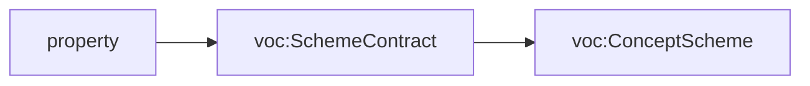

<!-- SPDX-License-Identifier: CC-BY-SA-4.0 -->

# Literate specifications

**Status:** Accepted with [ADR-A126](decisions/ADR-A126-literate-specification-layout-and-grammar.md),
2026-10-17. The extractor does not implement these conventions yet. Until a module's README is migrated to them, the
current conventions at the end of this document apply to it.

A LATTICE module's `README.md` is its specification. The normative sections are read by
`tools/literate_extract.py`, which writes the module's Turtle and SHACL from them, so each fact about a term
is written once. This document describes the layout every README takes, the grammar of its Description Logic
Encoding section, the markers it may carry, and how text becomes Turtle. A README's section 3 links here
and states only what is specific to its module.

## The layout

| § | Section | Required | Normative | Extracted to |
|---|---|---|---|---|
| 1 | Purpose and Scope | yes | yes | the ontology's `dct:description` |
| 2 | Namespace and Prefixes | yes | yes | prefixes, the ontology header, creators and contributors |
| 3 | Extraction Contract | yes | yes | the module's [repository catalogue](decisions/ADR-A121-repository-catalogue.md) entry |
| 4 | Overview | yes | no | nothing - holds the generated class diagram, narrative explanation of the layer, and other diagrams if needed |
| 5 | Detailed Design | yes | no | nothing - purely informational |
| 6 | Description Logic Encoding | yes | yes | the spec and vocab documents |
| 7 | Shapes | yes | yes | the shape files |
| 8 | Examples | yes | no | nothing - example files are written by hand and linked from here |
| 9 | Canonicalisation | no | yes | nothing |
| 10 | Formalisation | no | yes | `isabelle-spec` blocks, to the module's Isabelle theory and the Python generated from it |
| 11 | Dependencies | yes | no | nothing |
| 12 | Release Notes | yes | yes | nothing. Checked |
| 13 | Open Issues | yes | no | nothing |

- **Numbers are fixed.** An absent optional section keeps its heading and says "Not applicable." An empty
  subsection keeps its heading and says "None."
- **No section of a module's own.** Material that fits no section goes into a subsection of Detailed Design
  or of Open Issues.
- **Sections are found by title.** The extractor warns when a section's number differs from this layout.
- **Normative sections win.** Where a non-normative section disagrees with a normative one, the normative
  section is the specification. Overview and Detailed Design explain the model and never add to it.
- **Sources.** A README cites only published decisions and never a working document such as a sketch, plan
  or status record ([ADR-A127](decisions/ADR-A127-published-architecture-decisions.md)).

## Sections 1 to 3

**Section 1** becomes the `dct:description` of every document the README generates, rendered as plain
text (see "From markdown to Turtle"). Text that should stay in the README only is wrapped in an exclude
region. A table, a heading or an image in section 1 is refused unless it is excluded.

**Section 2** holds up to three tables, recognised by their columns. The header table is required, and the
other two are optional. The values below are illustrative.

| Document | Ontology IRI | Version IRI | Imports |
|---|---|---|---|
| `spec/eligibility.ttl` | <https://www.nebularis.org/neuro-semantic/eligibility> | <https://www.nebularis.org/neuro-semantic/lattice/eligibility/0.12.0> | <https://www.nebularis.org/neuro-semantic/lattice/foundation/0.4.0> |
| `vocab/eligibility-vocab.ttl` | <https://www.nebularis.org/neuro-semantic/eligibility-vocab> | <https://www.nebularis.org/neuro-semantic/lattice/eligibility-vocab/0.13.0> | <https://www.nebularis.org/neuro-semantic/lattice/eligibility/0.12.0> |

| Prefix | Namespace |
|---|---|
| `elg:` | <https://www.nebularis.org/neuro-semantic/lattice/eligibility#> |
| `fnd:` | <https://www.nebularis.org/neuro-semantic/lattice/foundation#> |

| Identifier | Role | Display name |
|---|---|---|
| <https://orcid.org/0000-0002-1825-0097> | creator | |
| `https://github.com/<handle>` | contributor | |

- **The header table** has one row for each document the README generates, a `.ttl` path under `spec/` or
  `vocab/`. Each document opens with its own ontology header: the ontology IRI, the version IRI, and an
  `owl:imports` for each IRI in the Imports cell, separated by commas or spaces. The version IRI is written
  in full, since not every ontology's version IRI extends its ontology IRI. It ends in the version
  (`X.Y.Z`), and a module's spec documents share one version, as its vocab documents do. Every fenced block
  the README extracts must go to a document this table names.
- **The prefix table** gives each document's `@prefix` lines. `rdf:`, `rdfs:`, `owl:`, `xsd:` and `dct:` are
  added with their standard namespaces where the table omits them, and binding one of them to another
  namespace is refused.
- **The creators and contributors table.** Each person is identified by an IRI, an ORCID iD where the person
  has one and their GitHub profile otherwise, and becomes a `dct:creator` or `dct:contributor` of every
  document. The display name is filled only with that person's express permission, and is never written to
  a generated file. The maintainers keep the table.

Every generated document declares the Dublin Core terms it uses as annotation properties itself, with the
`dct:` prefix, and never imports Dublin Core, so it stays in OWL 2 DL. A document's ontology header comes
first, then its other statements sorted by subject, then the README's blocks for it in document order.

**Section 3** holds the module's catalogue entry, exactly one fenced `toml repository-catalogue` block, which
the layout check requires inside section 3. It names the module's spec documents, vocab documents, shape
files in order and permitted imports. Its prose says only what is unusual about the module, for example a
second spec document, and links here for the rest.

## Section 6, the Description Logic Encoding

Section 6 is the only source of the module's axioms. Its subsections are 6.1 Classes, 6.2 Object
Properties, 6.3 Datatype Properties, 6.4 Individuals, 6.5 Disjointness and Keys, 6.6 Other Axioms and 6.7
Axiom Index.

### Entries

An entry is a level-4 heading holding one CURIE, followed by labelled paragraphs and tables. A labelled
paragraph starts a line with a bold label ending in a full stop, and runs to the next blank line. An
unknown label is an error.

| Label | Applies to | Produces |
|---|---|---|
| `**Definition.**` | every term, required | `rdfs:comment` |
| `**Utility.**` | every term | `fnd:utility` |
| `**Label.**` | every term | `rdfs:label`, which is never derived from the local name |
| `**Subclass of.**` | class | one `rdfs:subClassOf` per comma-separated class expression |
| `**Equivalent to.**` | class | `owl:equivalentClass`, one class expression |
| `**Key.**` | class | `owl:hasKey` |
| `**Restrictions.**` | class | the restriction table, below |
| `**Domain.**`, `**Range.**` | property | `rdfs:domain`, `rdfs:range`, each a class expression or a datatype |
| `**Characteristics.**` | property | functional, inverse functional, transitive or symmetric |
| `**Inverse of.**`, `**Subproperty of.**` | property | `owl:inverseOf`, `rdfs:subPropertyOf` |
| `**Scope note.**` | any term | `skos:scopeNote`. Further annotation labels are added the same way |

### Class expressions

Class expressions are written in [OWL Manchester syntax](https://www.w3.org/TR/owl2-manchester-syntax/) with
CURIEs: `and`, `or`, `not`, `some`, `only`, `value`, `min`, `max` and `exactly`, with parentheses for
nesting. Literals use Turtle's forms, for example `value "x"^^xsd:string`. For example,
`(ins:Obligation or ins:Permission)` is a union, and
`spc:hasGuardExpression some (spc:Expression and spc:hasExpressionSort value spc:bool_sort)` nests an
intersection inside a restriction.

### Restrictions

The restriction table has four columns. Values holds the body of a Manchester restriction. Asserted in says
where the restriction holds: blank for OWL and SHACL, `OWL` for OWL only, `SHACL` for SHACL only. Message is
an optional `sh:message`.

```markdown
#### `elg:EligibilityDecision`

**Definition.** A recorded admissibility decision for one profile and one or more questions.

**Subclass of.** `fnd:Evidenced`

**Restrictions.**

| Property | Values | Asserted in | Message |
|---|---|---|---|
| `elg:forProfile` | exactly 1 | | |
| `elg:hasQuestion` | min 1 | | |
| `elg:usesOperationalProfile` | exactly 1 | SHACL | |
| `elg:closureReliedOn` | only `elg:Closure` | SHACL | A decision relies only on closures. |
```

| Values | OWL | SHACL |
|---|---|---|
| `exactly n`, `min n`, `max n` | `owl:cardinality`, `owl:minCardinality`, `owl:maxCardinality` | `sh:minCount`, `sh:maxCount` |
| `exactly n C`, `min n C`, `max n C` | the qualified forms, with `owl:onClass` | `sh:qualifiedValueShape [ sh:class C ]` with the qualified counts |
| `only C` | `owl:allValuesFrom` | `sh:class`, or `sh:datatype` for a datatype |
| `some C` | `owl:someValuesFrom` | a qualified minimum count of 1 |
| `value v` | `owl:hasValue` | `sh:hasValue` |
| any nested expression | the expression | refused, unless the row says OWL |

An OWL restriction also holds in SHACL by default, since some restrictions guide the reasoner at design time
and are checked on data as well. A qualified restriction is never mapped to `sh:class` with counts. The OWL
form allows other values that are not `C`, and `sh:class` forbids them. Generated SHACL goes into one shape
per class in the module's structural shapes file. Other shapes are written by hand in section 7.

### Individuals, disjointness and other axioms

Section 6.4 lists individuals in one table per class, with the columns Individual, Type, Label and
Definition. Section 6.5 holds `**All disjoint.**` lines and pairwise disjointness. Section 6.6 holds
`turtle-spec` blocks, visible or hidden, for what the grammar does not express, for example property
chains.

### Generated views

The Axiom Index (6.7) and the class diagram in the Overview are generated from the entries into marked
regions of the README and checked. The diagram shows subclassing, a property's cardinality in words, for
example "matchStrategy, exactly one", an association arrow where a range is a class, datatype properties
with their range, and a separate box for a property with no domain or range. It draws no composition
arrows.

## Markers

HTML comments carry four kinds of marker. A region opens with `<!-- start: {...} -->` and closes with
`<!-- end -->`, which closes the innermost open region. The keys are `exclude` (a boolean), `output-file` (a
path inside the module) and `generated` (the name of a generated region). Any other key is an error. A
marker written inside a fenced block is text.

**Excluding text** from an extracted region, for example a diagram in section 1.

````markdown
## 1. Purpose and Scope

Vocabulary governs controlled vocabularies, and which edition of a scheme was in force.

<!-- start: {"exclude": true} -->

<!-- end -->
````

**Hiding a fenced block** that is still extracted, for example a shape file's SPARQL constraints. The comment
wraps the fence and has no end marker.

````markdown
<!-- hidden: {"output-file": "shapes/constraints.ttl"}
```turtle-shapes
ex:ExampleShape a sh:NodeShape ;
    sh:targetClass ex:Example .
```
-->
````

**Sending a region of entries to another file**, for example in a module with several spec documents.

````markdown
<!-- start: {"output-file": "spec/behaviour-runtime.ttl"} -->

#### `bhv:Stimulus`

**Definition.** An incoming event that may cause an act.

<!-- end -->
````

**Marking a generated region**, which the extractor writes, for example the Axiom Index.

````markdown
<!-- start: {"generated": "axiom-index"} -->
| Term | Kind | Summary |
|---|---|---|
<!-- end -->
````

`output-file` has a second form, the `# @output-file "spec/<file>.ttl"` first line of a fenced block
([ADR-A120](decisions/ADR-A120-literate-specs-with-several-documents.md)). Both forms apply to every
extracted block kind, and a block may carry only one. A hidden block may not contain `-->`, which would end
the comment early. Mermaid diagrams are never hidden.

## From markdown to Turtle

- **Plain text.** Backticks and emphasis are removed. List items stay as lines beginning `- `. A table inside
  an extracted region is an error.
- **Links** become their text followed by an absolute URL at the release tag that the section 2 version
  names, so a released document never points at a moving target.
- **Order.** Generated Turtle is sorted by subject, then by a fixed order of predicates, so reorganising a
  README changes no generated file.
- **Versions.** Generated documents are tracked and versioned as the
  [versioning policy](ontology-versioning-policy.md) describes. A module's first regeneration under this
  layout is one PATCH release, and its graph is the same as before except for reconciliations the
  maintainer approves.

## Release Notes

Every version named in section 2, and every released version in the
[release register](ontology-releases.md), has an entry. An entry says what changed and which documents
moved, and cites only published decisions.

## Current conventions, until a module is migrated

| Fence tag | Extracted to |
|---|---|
| `turtle-spec` | `spec/<layer>.ttl`, or the file its `# @output-file` first line names |
| `turtle-vocab` | `vocab/<layer>-vocab.ttl` |
| `turtle-shapes` | the shape files the module's repository catalogue entry names, in order |
| `turtle-example` | never extracted |
| `isabelle-spec` | the layer's Isabelle theory, and the Python generated from its `fun` clauses |

The [tools README](https://github.com/nebularis/lattice/blob/main/tools/README.md) gives the commands.
