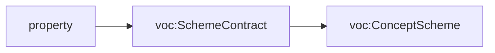

<!-- SPDX-License-Identifier: CC-BY-SA-4.0 -->

# Literate specifications

**Status:** Accepted with [ADR-A126](decisions/ADR-A126-literate-specification-layout-and-grammar.md),
2026-10-17. The extractor implements them, and [Eligibility](../../ontology/eligibility/README.md) is the first
module migrated to them. [Persistence](../../ontology/persistence/README.md) is migrated too, and shows two spec documents
generated from one README and a module whose shapes are all written by hand. Until a module's README is migrated, the current conventions at the end of this document
apply to it.

A LATTICE module's `README.md` is its specification. The normative sections are read by
`tools/literate_extract.py`, which writes the module's Turtle and SHACL from them, so each fact about a term
is written once. This document describes the layout every README takes, the grammar of its Description Logic
Encoding section, the markers it may carry, and how text becomes Turtle. A README's section 3 links here
and states only what is specific to its module.

## The layout

| § | Section | Required | Normative | Extracted to |
|---|---|---|---|---|
| 1 | Purpose and Scope | yes | yes | the ontology's `dct:description` |
| 2 | Namespace and Prefixes | yes | yes | prefixes, the ontology header, creators and contributors |
| 3 | Extraction Contract | yes | yes | the module's [repository catalogue](decisions/ADR-A121-repository-catalogue.md) entry |
| 4 | Overview | yes | no | nothing - holds the generated class diagram, narrative explanation of the layer, and other diagrams if needed |
| 5 | Detailed Design | yes | no | nothing - purely informational |
| 6 | Description Logic Encoding | yes | yes | the spec and vocab documents |
| 7 | Shapes | yes | yes | the shape files |
| 8 | Examples | yes | no | nothing - example files are written by hand and linked from here |
| 9 | Canonicalisation | no | yes | nothing |
| 10 | Formalisation | no | yes | `isabelle-spec` blocks, to the module's Isabelle theory and the Python generated from it |
| 11 | Dependencies | yes | no | nothing |
| 12 | Release Notes | yes | yes | nothing. Checked |
| 13 | Open Issues | yes | no | nothing |

- **Numbers are fixed.** An absent optional section keeps its heading and says "Not applicable." An empty
  subsection keeps its heading and says "None."
- **No section of a module's own.** Material that fits no section goes into a subsection of Detailed Design
  or of Open Issues.
- **Sections are found by title.** The extractor warns when a section's number differs from this layout.
- **Normative sections win.** Where a non-normative section disagrees with a normative one, the normative
  section is the specification. Overview and Detailed Design explain the model and never add to it.
- **Sources.** A README cites only published decisions and never a working document such as a sketch, plan
  or status record ([ADR-A127](decisions/ADR-A127-published-architecture-decisions.md)).

## Sections 1 to 3

**Section 1** becomes the `dct:description` of every document the README generates, rendered as plain
text (see "From markdown to Turtle"). Text that should stay in the README only is wrapped in an exclude
region. A table, a heading or an image in section 1 is refused unless it is excluded.

**Section 2** holds up to three tables, recognised by their columns. The header table is required, and the
other two are optional. The values below are illustrative.

| Document | Ontology IRI | Version IRI | Imports |
|---|---|---|---|
| `spec/eligibility.ttl` | <https://www.nebularis.org/neuro-semantic/eligibility> | <https://www.nebularis.org/neuro-semantic/lattice/eligibility/0.12.0> | <https://www.nebularis.org/neuro-semantic/lattice/foundation/0.4.0> |
| `vocab/eligibility-vocab.ttl` | <https://www.nebularis.org/neuro-semantic/eligibility-vocab> | <https://www.nebularis.org/neuro-semantic/lattice/eligibility-vocab/0.13.0> | <https://www.nebularis.org/neuro-semantic/lattice/eligibility/0.12.0> |

| Prefix | Namespace |
|---|---|
| `elg:` | <https://www.nebularis.org/neuro-semantic/lattice/eligibility#> |
| `fnd:` | <https://www.nebularis.org/neuro-semantic/lattice/foundation#> |

| Identifier | Role | Display name |
|---|---|---|
| <https://orcid.org/0000-0002-1825-0097> | creator | |
| `https://github.com/<handle>` | contributor | |

- **The header table** has one row for each document the README generates, a `.ttl` path under `spec/` or
  `vocab/`. Each document opens with its own ontology header: the ontology IRI, the version IRI, and an
  `owl:imports` for each IRI in the Imports cell, separated by commas or spaces. The version IRI is written
  in full, since not every ontology's version IRI extends its ontology IRI. It ends in the version
  (`X.Y.Z`), and a module's spec documents share one version, as its vocab documents do. Every fenced block
  the README extracts must go to a document this table names.
- **The prefix table** gives each document's `@prefix` lines. `rdf:`, `rdfs:`, `owl:`, `xsd:` and `dct:` are
  added with their standard namespaces where the table omits them, and binding one of them to another
  namespace is refused.
- **The creators and contributors table.** Each person is identified by an IRI, an ORCID iD where the person
  has one and their GitHub profile otherwise, and becomes a `dct:creator` or `dct:contributor` of every
  document. The display name is filled only with that person's express permission, and is never written to
  a generated file. The maintainers keep the table.

Every generated document declares the Dublin Core terms it uses as annotation properties itself, with the
`dct:` prefix, and never imports Dublin Core, so it stays in OWL 2 DL. A document's ontology header comes
first, then its other statements sorted by subject, then the README's blocks for it, ordered by their own
text, so moving a block in the README changes no generated file. A block of a README in the layout declares
no prefix of its own, since the prefix table is the one source of prefixes.

**Section 3** holds the module's catalogue entry, exactly one fenced `toml repository-catalogue` block, which
the layout check requires inside section 3. It names the module's spec documents, vocab documents, shape
files in order and permitted imports. Its spec and vocab documents are the rows of section 2's header table,
written twice, and a check holds the two lists equal. Its prose says only what is unusual about the module, for example a
second spec document, and links here for the rest.

## Section 6, the Description Logic Encoding

Section 6 is the only source of the module's axioms. Its subsections are 6.1 Classes, 6.2 Object
Properties, 6.3 Datatype Properties, 6.4 Individuals, 6.5 Disjointness and Keys, 6.6 Other Axioms and 6.7
Axiom Index, each headed `### 6.N Title`. All seven are present, an empty one saying "None.", and no other is
allowed. A subsection may open with prose before its first entry or table, which is not extracted.

Entries and the rows of 6.5 go to the module's main spec document, `spec/<name>.ttl`, and individuals to its
main vocab document, `vocab/<name>-vocab.ttl`. An `output-file` region sends what it encloses to another
document. Either way the document must be a row of section 2's header table.

### Entries

An entry is a level-4 heading holding one CURIE in backticks, followed by labelled paragraphs and tables.
A labelled paragraph starts a line with a bold label ending in a full stop, and runs to the next blank line.
Every paragraph of an entry starts with a label, an unknown label is an error, and a label that does not
apply to the entry's kind is an error. A term has one entry.

| Label | Applies to | Produces |
|---|---|---|
| `**Definition.**` | every term, required | `rdfs:comment` |
| `**Utility.**` | every term | `fnd:utility` |
| `**Label.**` | every term | `rdfs:label`, which is never derived from the local name |
| `**Preferred label.**` | every term | `skos:prefLabel` |
| `**Subclass of.**` | class | one `rdfs:subClassOf` per comma-separated class expression |
| `**Equivalent to.**` | class | `owl:equivalentClass`, one class expression |
| `**Key.**` | class | `owl:hasKey` |
| `**Restrictions.**` | class | the restriction table, below |
| `**Domain.**`, `**Range.**` | property | `rdfs:domain`, `rdfs:range`, each a class expression or a datatype |
| `**Characteristics.**` | property | functional, inverse functional, transitive or symmetric |
| `**Inverse of.**`, `**Subproperty of.**` | property | `owl:inverseOf`, `rdfs:subPropertyOf` |
| `**Scope note.**` | any term | `skos:scopeNote`. Further annotation labels are added the same way |

An annotation's text becomes plain text, as section 1 does. Written as a Turtle literal instead, for example
`"Wording node"@en`, it is used as written, which is how a language tag or a datatype is given. A
comma-separated label (Subclass of, Key, Characteristics, Subproperty of) splits only at commas outside
parentheses. `skos:` and `fnd:` must be in the prefix table for a label that uses them.

### Class expressions

Class expressions are written in [OWL Manchester syntax](https://www.w3.org/TR/owl2-manchester-syntax/) with
CURIEs: `and`, `or`, `not`, `some`, `only`, `value`, `min`, `max` and `exactly`, with parentheses for
nesting. `and` binds tighter than `or`, and `not` tighter than both. `min`, `max` and `exactly` take a whole
number and an optional class, which makes them qualified. Literals use Turtle's forms, for example
`value "x"^^xsd:string`, `value "x"@en` or `value 5`. An enumeration is written in braces, for example
`{ elg:Forward, elg:Inverse }`, and is an enumerated class (`owl:oneOf`) of individuals, or an enumerated data
range of literals. A union, intersection or complement is written with `a owl:Class`, as the layers already
write them. For example,
`(ins:Obligation or ins:Permission)` is a union, and
`spc:hasGuardExpression some (spc:Expression and spc:hasExpressionSort value spc:bool_sort)` nests an
intersection inside a restriction.

### Restrictions

The restriction table has four columns. Values holds the body of a Manchester restriction. Asserted in says
where the restriction holds: blank for OWL and SHACL, `OWL` for OWL only, `SHACL` for SHACL only. Message is
an optional `sh:message`.

```markdown
#### `elg:EligibilityDecision`

**Definition.** A recorded admissibility decision for one profile and one or more questions.

**Subclass of.** `fnd:Evidenced`

**Restrictions.**

| Property | Values | Asserted in | Message |
|---|---|---|---|
| `elg:forProfile` | exactly 1 | | |
| `elg:hasQuestion` | min 1 | | |
| `elg:usesOperationalProfile` | exactly 1 | SHACL | |
| `elg:closureReliedOn` | only `elg:Closure` | SHACL | A decision relies only on closures. |
```

| Values | OWL | SHACL |
|---|---|---|
| `exactly n`, `min n`, `max n` | `owl:cardinality`, `owl:minCardinality`, `owl:maxCardinality` | `sh:minCount`, `sh:maxCount` |
| `exactly n C`, `min n C`, `max n C` | the qualified forms, with `owl:onClass` | `sh:qualifiedValueShape [ sh:class C ]` with the qualified counts |
| `only C` | `owl:allValuesFrom` | `sh:class`, or `sh:datatype` for a datatype |
| `some C` | `owl:someValuesFrom` | a qualified minimum count of 1 |
| `value v` | `owl:hasValue` | `sh:hasValue` |
| `only { a, b }` | `owl:allValuesFrom` an enumeration | `sh:in ( a b )` |
| any nested expression | the expression | refused, unless the row says OWL |

An OWL restriction also holds in SHACL by default, since some restrictions guide the reasoner at design time
and are checked on data as well. A qualified restriction is never mapped to `sh:class` with counts. The OWL
form allows other values that are not `C`, and `sh:class` forbids them. `only` maps to `sh:datatype` when
its filler is an `xsd:` datatype, `rdfs:Literal` or `rdf:langString`, and to `sh:class` otherwise.

Generated SHACL goes into the module's `shapes/structural.ttl`, which is generated whole: one
`<Class>Shape` per class with a row checked in SHACL, targeting that class, and one property shape per
property and message. Rows for one property with the same message, or none, share a property shape, so
`max 1` and `only xsd:boolean` become one, as the layers write them today. Two such rows that state the same
constraint are refused. The shapes carry no `sh:severity`, so each is a violation. A shape the table cannot
state, such as a SPARQL constraint or a warning, is written by hand in section 7, in a block that names its
file, which may not be `shapes/structural.ttl`. In a README in the layout every shape block names its file.

### Individuals, disjointness and other axioms

Section 6.4 lists individuals in tables whose first two columns are Individual and Type, followed by any of
the annotation columns Label, Preferred label, Definition, Utility and Scope note. Type holds one or more
names, separated by commas, so an individual that is also an `owl:NamedIndividual` says so. Section 6.5 holds
`**All disjoint.**` paragraphs, each naming two classes or more, which become one `owl:AllDisjointClasses`
with its members in the order written, `**Disjoint.**` paragraphs, each naming exactly two, which become
an `owl:disjointWith`, and `**All different.**` paragraphs, each naming two individuals or more, which become
one `owl:AllDifferent` with an `owl:distinctMembers` list in the order written. An `**All different.**`
paragraph goes to the main spec document unless an `output-file` region encloses it, so a region naming the
vocab document sends it beside the individuals. The Axiom Index row of each individual it names says
"Different from" the others.

Section 6.6 holds `turtle-spec` and `turtle-vocab` blocks, visible or hidden, for what the grammar does not
express, for example property chains. Such blocks declare no prefixes, since section 2's prefix table is
their one source, and their order in the README does not matter. A block may also add statements about a term
a 6.4 table lists, when the table's columns cannot hold them, for example a `dal:logicalKey "root"` on an
individual. The table row states the individual, its types and its annotations, and the block states only the
rest. Both go to one document, so a `turtle-vocab` block (or a block in a region that names the same file)
goes with a row in the vocab document. A block that restates the row's types or annotations is accepted too,
and the document then holds the statement once, since Turtle merges equal triples. We prefer the row alone
for what a column holds.

### Generated views

The Axiom Index and the Overview's class diagram are generated from section 6 and written into the README by
the extractor, each in its own region: `<!-- start: {"generated": "axiom-index"} -->` inside 6.7 and
`<!-- start: {"generated": "class-diagram"} -->` inside section 4, each closed by `<!-- end -->`. The Axiom
Index region is required, once, in 6.7. The class diagram is either one region in section 4, or several parts
(below). The extractor rewrites what is between the markers, and `--check` reports the README as drift when a
region is out of date, for example after a hand edit, naming each stale region by its kind, its part title
and its line. No region is read as part of section 6.

The **Axiom Index** is a table of every term, classes first, then object properties, datatype properties and
individuals, each sorted by name. Its summary column states a class's superclasses, equivalent class, key,
disjoint classes and restrictions (marked "OWL only" or "SHACL only" where a row says so), a property's
domain, range, characteristics, inverse and super-property, and an individual's types.

The **class diagram** is a mermaid `classDiagram`. It shows:

- each class, with its restrictions as members in words, for example "matchStrategy, exactly one" or
  "items, at least two Item"
- a datatype property with a domain as a member of that class, with its range, for example
  "code (xsd:string)"
- subclassing as `<|--`
- an object property with a named domain and range as an association arrow labelled with its name
- a property with no named domain as a box of its own, for example "Object Property - relatesTo"

Classes are named by their local names, qualified by their prefix where two would share one. The diagram draws
no composition arrows, since nothing in section 6 says which associations are aggregates.

**Parts.** A large module's diagram is unreadable whole, so a README may draw it in parts. A part is a
class-diagram region that carries two more keys, written in the same marker.

````markdown
<!-- start: {"generated": "class-diagram", "part": "Aggregate boundaries", "classes": ["dal:AggregateBoundaryProfile", "dal:AggregateBoundaryStrategy"]} -->
<!-- end -->
````

- `"classes"` is a list of CURIEs of classes of section 6, and `"part"` is the part's title, required with
  `"classes"`. The title is written above the diagram in bold. Titles are unique.
- A part draws its listed classes with their members, the subclassing among them and the associations among
  them. A superclass of a listed class, and the range of an association from a listed class, that is not
  itself listed is drawn as a bare box with no members, so a reader sees where the part connects. An
  association or subclass arriving at a listed class from an unlisted one is drawn in the part of the unlisted
  class, not here.
- A property with no named domain is left out of a part, unless it is an object property whose range is
  listed, and then it is drawn as the box of its own.
- A part is drawn left to right (`direction LR`), which stacks its unlinked classes down the page instead of
  lining them up across it. The whole diagram keeps mermaid's default direction.
- A README draws its diagram whole or in parts. A region without `"classes"` is the whole diagram, there is
  one of it, in section 4, and a README with such a region has no part. Parts may sit in section 4 or in
  section 5, next to the prose they illustrate. A class may be listed in more than one part. Every class of
  section 6 must be listed in at least one, and the extractor names each that is not.
- `"enumerations": "table"` may be added to any class-diagram region, a part or the whole diagram. A drawn
  class that is an enumeration (`**Equivalent to.** { ... }`) then shows its individuals as members under
  `<<enumeration>>`. Without it an enumerated class is drawn as any other.

## Markers

HTML comments carry four kinds of marker. A region opens with `<!-- start: {...} -->` and closes with
`<!-- end -->`, which closes the innermost open region. The keys are `exclude` (a boolean), `output-file` (a
path inside the module) and `generated` (the name of a generated region). Any other key is an error, except
that a `generated` region may also carry `part`, `classes` and `enumerations`, which choose what a class diagram
draws (see "Generated views"). A
marker written inside a fenced block is text.

**Excluding text** from an extracted region, for example a diagram in section 1.

````markdown
## 1. Purpose and Scope

Vocabulary governs controlled vocabularies, and which edition of a scheme was in force.

<!-- start: {"exclude": true} -->

<!-- end -->
````

**Hiding a fenced block** that is still extracted, for example a shape file's SPARQL constraints. The comment
wraps the fence and has no end marker.

````markdown
<!-- hidden: {"output-file": "shapes/constraints.ttl"}
```turtle-shapes
ex:ExampleShape a sh:NodeShape ;
    sh:targetClass ex:Example .
```
-->
````

**Sending a region of entries to another file**, for example in a module with several spec documents.

````markdown
<!-- start: {"output-file": "spec/behaviour-runtime.ttl"} -->

#### `bhv:Stimulus`

**Definition.** An incoming event that may cause an act.

<!-- end -->
````

**Marking a generated region**, which the extractor writes, for example the Axiom Index.

````markdown
<!-- start: {"generated": "axiom-index"} -->
| Term | Kind | Summary |
|---|---|---|
<!-- end -->
````

`output-file` has a second form, the `# @output-file "spec/<file>.ttl"` first line of a fenced block
([ADR-A120](decisions/ADR-A120-literate-specs-with-several-documents.md)). Both forms apply to every
extracted block kind, and a block may carry only one. A hidden block may not contain `-->`, which would end
the comment early. Mermaid diagrams are never hidden.

## From markdown to Turtle

- **Plain text.** Backticks and emphasis are removed. List items stay as lines beginning `- `. A table inside
  an extracted region is an error.
- **Links** become their text followed by an absolute URL at the release tag that the section 2 version
  names, so a released document never points at a moving target.
- **Order.** Generated Turtle is sorted by subject, then by a fixed order of predicates, so reorganising a
  README changes no generated file.
- **Versions.** Generated documents are tracked and versioned as the
  [versioning policy](ontology-versioning-policy.md) describes. A module's first regeneration under this
  layout is one PATCH release, and its graph is the same as before except for reconciliations the
  maintainer approves. `mise run check:literate-migration -- <module> <ref> --reconciliations <file>` compares
  every file the module generates with the file at a git ref, and passes only when each difference is listed.

## Release Notes

Every version named in section 2, and every release in which the module changed, has an entry, newest first, and the section ends by pointing at the [release register](ontology-releases.md). An entry is one bullet, `- **X.Y.Z**.`, with one sub-bullet per change that opens with its class, *changes meaning*, *may invalidate* or *no effect*, as the [versioning policy](ontology-versioning-policy.md) defines them, cites its published decision where it has one, and says what changed and what an adopter must do. A change whose number is not yet assigned sits under `- **Unreleased**.`, which the cut renames (ADR-A126 addendum of 2026-10-29, STD-293).

## Current conventions, until a module is migrated

| Fence tag | Extracted to |
|---|---|
| `turtle-spec` | `spec/<layer>.ttl`, or the file its `# @output-file` first line names |
| `turtle-vocab` | `vocab/<layer>-vocab.ttl` |
| `turtle-shapes` | the shape files the module's repository catalogue entry names, in order |
| `turtle-example` | never extracted |
| `isabelle-spec` | the layer's Isabelle theory, and the Python generated from its `fun` clauses |

The [tools README](https://github.com/nebularis/lattice/blob/main/tools/README.md) gives the commands.
