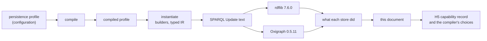
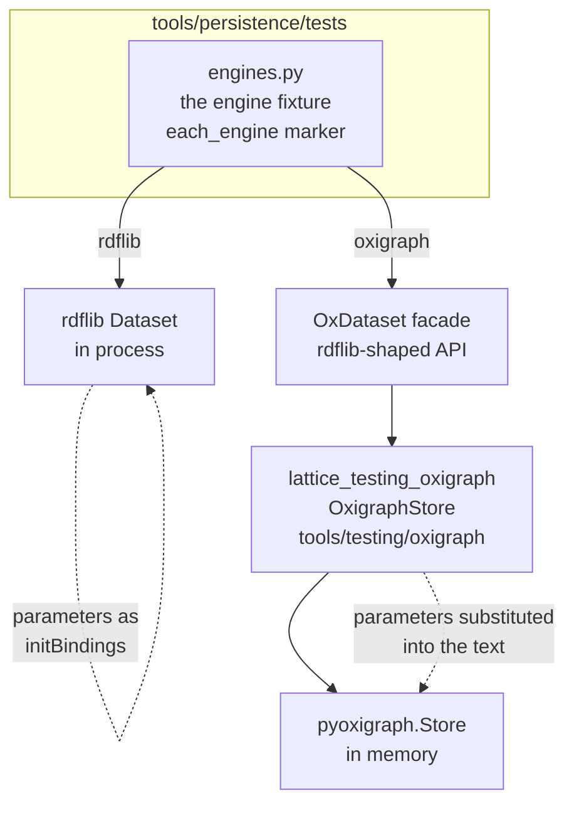
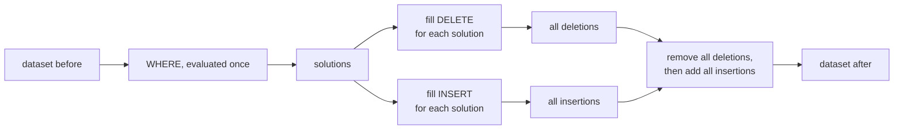
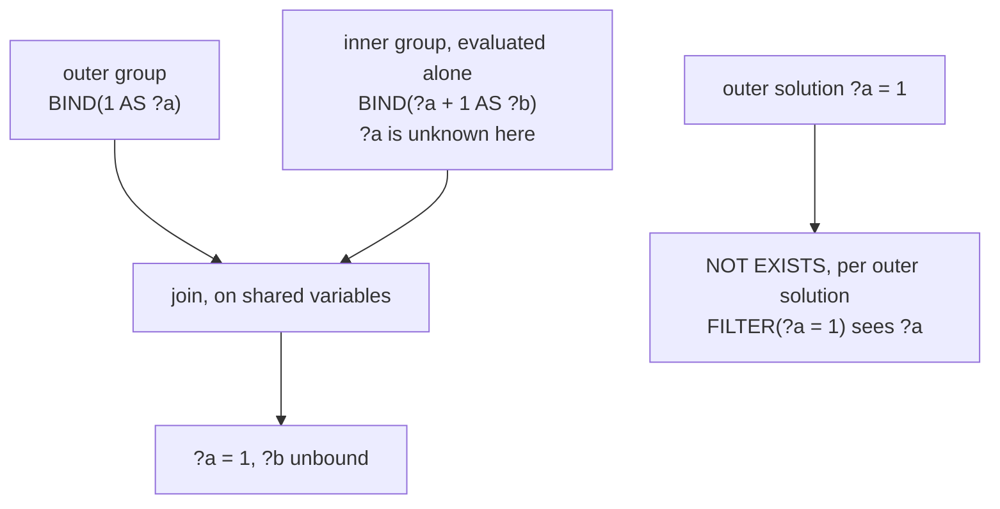
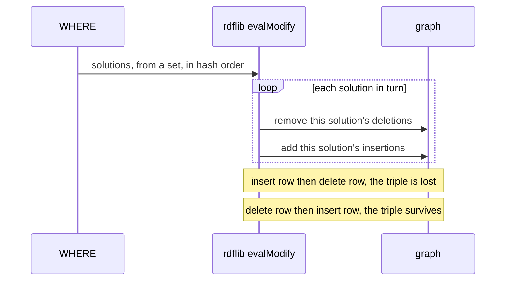
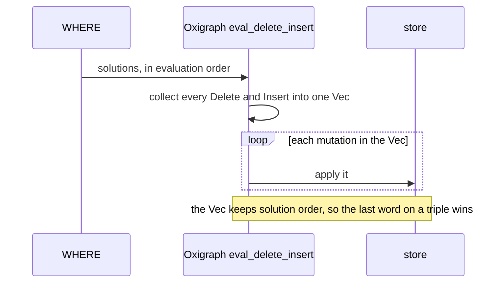
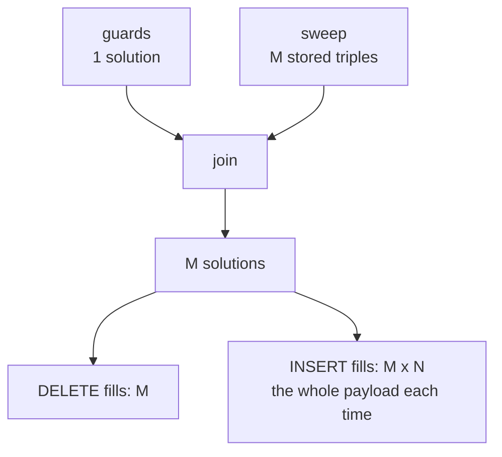
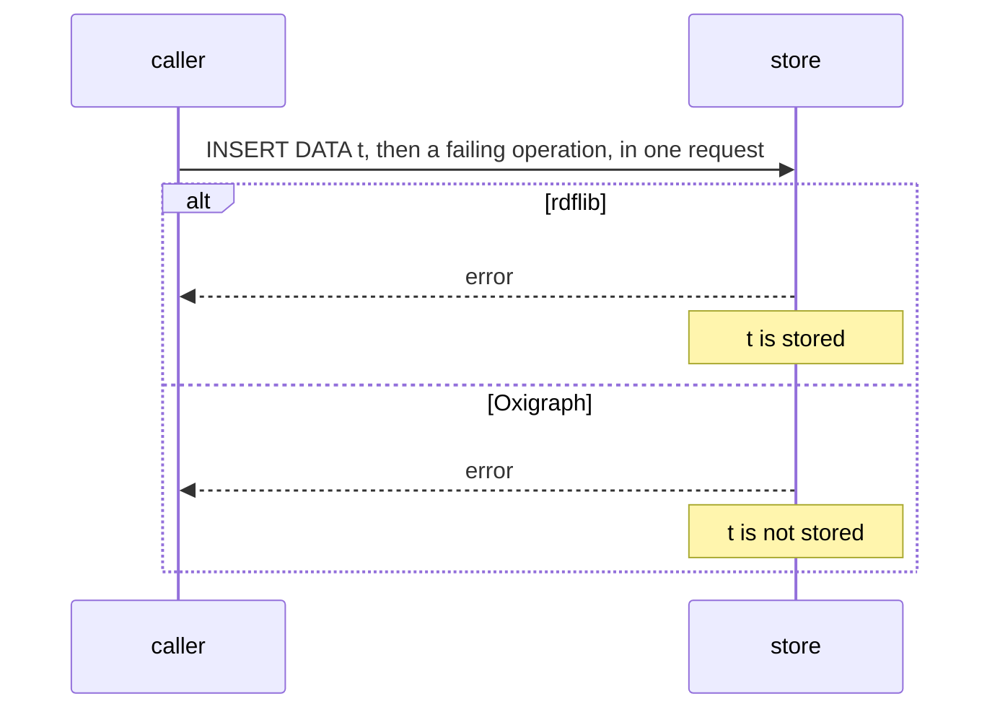
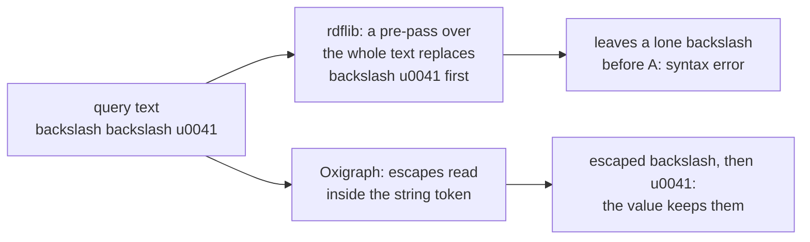
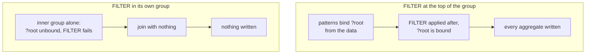

<!-- SPDX-License-Identifier: CC-BY-SA-4.0 -->

# Triple-store discovery

**What this is.** The project's record of how each triple store we run actually behaves: its features, its limits, and how it reads the standards it implements, SPARQL 1.1 Query and Update above all. Each entry says what we were doing, how we found out, what the store does, why, what follows for LATTICE, and how to see it again.

**Status:** a living document, begun 2026-10-13 from formal-methods Track H's persistence work (slices H2.1 to H2.4b). It is a source of truth for the project. Read it before relying on how a store behaves, and add to it when you find something. The skill `lattice-triple-stores` has the procedure.

**Stores covered:** rdflib 7.6.0 and Oxigraph 0.5.11 (through `pyoxigraph`), Oxigraph 0.5.12 for the findings the test suite probes, of which TSD-01 and TSD-17 changed (R-H), and Oxigraph 0.5.13 for TSD-40, TSD-41 and TSD-43. Apache Jena ARQ 5.1.0 (the version `benchmark/ledger-store-comparison` pins) is covered for TSD-15, TSD-16, TSD-25 to TSD-27, TSD-34, TSD-42, TSD-43, TSD-50 to TSD-54, TSD-56, TSD-57, TSD-60 and TSD-61, run in process through `platform/sparql-testkit` and `tools/testing/jena`. That is an in-memory transactional dataset (`DatasetFactory.createTxnMem()`) and never TDB2. Each finding names the versions it was seen on.
A finding holds for those versions only, until it is checked again. **Tools above a store covered:** pySHACL 0.40.1, which validates shapes on rdflib (TSD-23, TSD-24, TSD-31). TSD-22 to TSD-33 are about the cost of running queries and shapes, and [Efficient queries and shapes](efficient-queries-and-shapes.md) says which of them are properties of rdflib or pySHACL and which hold anywhere.

## Contents

1. [How to read and write this document](#1-how-to-read-and-write-this-document)
2. [Why we started looking](#2-why-we-started-looking)
3. [How we reach each store](#3-how-we-reach-each-store)
4. [A short primer on how SPARQL evaluates an update](#4-a-short-primer-on-how-sparql-evaluates-an-update)
5. [The findings at a glance](#5-the-findings-at-a-glance)
6. [The findings](#6-the-findings)
7. [Corrections, and what they taught us](#7-corrections-and-what-they-taught-us)
8. [Open questions](#8-open-questions)

## 1. How to read and write this document

Every finding has an identifier, `TSD-nn`, that other documents cite. It is never reused. A finding that turns out wrong is
corrected in place, with a dated note, and the story goes in §7.

Each finding states its evidence, as one or more of these.

| Evidence | Means | Example |
|---|---|---|
| **Source** | we read the store's code, at a named version and path | rdflib's `plugins/sparql/evaluate.py`, `evalJoin` |
| **Observed** | we ran a probe and saw the result, and the probe is a test or a script named here | `tools/persistence/tests/test_store_probes.py` |
| **Documented** | the store's own documentation says so | a page of the store's manual |
| **Reasoned** | it follows from the specification or from other findings, and is not yet observed | marked as a hypothesis until it is |

A finding that qualifies a register entry or a declared term names it on a line of its own, `**Bears on:** PAT-03, dal:keyShards`, by identifier or by the CURIE its layer writes, so a `read` of that entry lists the finding beside it.

A finding is only as strong as its evidence. Source tells us the mechanism, Observed tells us it really happens on this
version, and the two together are what we aim for. A finding built only on Documented or Reasoned evidence says so in its
first line.

**A run record** goes with every Observed finding: the date, the store and its version, the Python version, and the kind of machine, never the machine or person (ADR-A124 decision 5). Twenty-one run records appear below.

| Run | Machine | Python | Stores |
|---|---|---|---|
| **R-A** | a Linux x86_64 container, 15 GB, used by an agent for H2.4b, 2026-10-12 | 3.14.8 | rdflib 7.6.0, pyoxigraph 0.5.11 |
| **R-B** | a macOS arm64 workstation, used for the H2 reviews and for this document, 2026-10-10 to 2026-10-13 | 3.14.7 | rdflib 7.6.0, pyoxigraph 0.5.11 |
| **R-C** | a Linux x86_64 container, 15 GB, used by an agent for H2.5, 2026-10-13 | 3.14.8 | rdflib 7.6.0, pyoxigraph 0.5.11 |
| **R-D** | a Linux x86_64 container, 4 logical cores, 15 GB, used by an agent for the ontology test-suite speed work, 2026-10-16 to 2026-10-17 | 3.14.8 | rdflib 7.6.0, pyoxigraph 0.5.11, pySHACL 0.40.1 |
| **R-E** | a macOS arm64 laptop with four performance and four efficiency cores and 8 GB, used by the maintainer to repeat R-D's runs, 2026-10-16 to 2026-10-17 | 3.14.7 | rdflib 7.6.0, pyoxigraph 0.5.11, pySHACL 0.40.1 |
| **R-F** | a macOS arm64 laptop, used by an agent for H2.6f's `members` read, 2026-10-20 | 3.14.7 | rdflib 7.6.0, pyoxigraph 0.5.11 |
| **R-G** | a macOS arm64 laptop, used by an agent for TSD-34's upstream report, 2026-10-20 | 3.14.7 | rdflib 7.6.0, rdflib `main` at `62bf240` (7.7.0a0), rdflib `next` at `0fdac39` (8.0.0a0) |
| **R-H** | a Linux x86_64 container, 4 logical cores, used by an agent for H2.8c, 2026-10-20, where a fresh bootstrap installed pyoxigraph 0.5.12 | 3.14.8 | rdflib 7.6.0, pyoxigraph 0.5.11 and 0.5.12 |
| **R-I** | a macOS arm64 laptop, used for the ledger posting-cost and graph-partition benchmarks, 2026-10-24 and 2026-10-27 | 3.14.7 | pyoxigraph 0.5.13 |
| **R-J** | a macOS arm64 laptop, used by an agent to isolate TSD-41, 2026-10-27 | 3.14.7 | rdflib 7.6.0, pyoxigraph 0.5.13, and 0.5.11 for the minimal probes |
| **R-K** | a macOS arm64 laptop, used to review C9b3 and the pyoxigraph lock, 2026-10-27 | 3.14.7 | pyoxigraph 0.5.11, 0.5.12 and 0.5.13 |
| **R-L** | a macOS arm64 laptop, used by an agent for the aggregate matrix of TSD-43, 2026-10-27 | 3.14.7, and OpenJDK 25.0.2 for Jena | rdflib 7.6.0, pyoxigraph 0.5.13, Apache Jena ARQ 5.1.0 |
| **R-M** | a Linux x86_64 container, used by an agent for TSD-45, 2026-10-28, each pyoxigraph version in its own scratch virtual environment | 3.14.10 | pyoxigraph 0.5.11 and 0.5.13 |
| **R-N** | a Linux x86_64 container, 15 GB, used by an agent for TSD-45's Jena and RDF4J runs and for TSD-48, 2026-10-28, Java in a forked JVM with a 10 GB heap | Java 25.0.4.1 | Jena 5.1.0 (an in-memory dataset and an in-memory TDB2 store), RDF4J 6.1.0 `MemoryStore` |
| **R-S** | a macOS arm64 laptop with 8 logical cores, used by an agent to run `benchmark/persistence-store-probes` for TSD-42, 2026-10-27 | 3.14.7 | rdflib 7.6.0, pyoxigraph 0.5.11, 0.5.12 and 0.5.13 |
| **R-T** | a macOS arm64 laptop, used by an agent to run `check:persistence-conformance` on three engines for MSC-2, 2026-10-27 | 3.14.7, and OpenJDK 25.0.2 for Jena | rdflib 7.6.0, pyoxigraph 0.5.13, Apache Jena ARQ 5.1.0 in memory |
| **R-U** | the same laptop, used by an agent to run the standalone Java reproduction of TSD-50's `CLEAR GRAPH` departure, 2026-10-27 | OpenJDK 25.0.2 | Apache Jena ARQ 5.1.0 (`DatasetFactory.createTxnMem()`) |
| **R-V** | a macOS arm64 laptop, used by an agent to run the MORK compilers and Eligibility on Jena and to probe the profile read set, 2026-10-27 (MSC-3) | 3.14.7, and OpenJDK 25.0.2 for Jena | rdflib 7.6.0, pyoxigraph 0.5.13, Apache Jena ARQ 5.1.0 |
| **R-W** | the same laptop, used by an agent to run `benchmark/persistence-store-probes` and `benchmark/sparql-constraint-query-cost` with Jena, 2026-10-27 (MSC-5). Jena's JVM ran with its full compiler and the serial collector | 3.14.7, and OpenJDK 25.0.2 for Jena | rdflib 7.6.0, pyoxigraph 0.5.13, Apache Jena ARQ 5.1.0 |
| **R-X** | the same laptop, used by an agent to run `check:sparql-probes-conformance` with the MSC5 probes and standalone Java reproductions on the testkit's jar, 2026-10-27 (MSC-5) | 3.14.7, and OpenJDK 25.0.2 for Jena | rdflib 7.6.0, pyoxigraph 0.5.13, Apache Jena ARQ 5.1.0 |
| **R-Y** | the same laptop, used by an agent to read the W3C texts of SPARQL 1.1 Query and the SPARQL 1.2 Query working draft and to search the engines' issue trackers through the GitHub search API, 2026-10-27 (MSC-5) | not applicable | not applicable |

**How to add a finding** is in §6.0 and in the skill. In short: say what you were testing, how you found it, the smallest
SPARQL that shows it, the result on each store you have, the reason if you can find it in the source, what it means for
LATTICE, and how to reproduce it. If reproducing it takes more than one query, write a short plan for a script.

## 2. Why we started looking

LATTICE's persistence layer (`ontology/persistence`, ADR-A78) describes how an application stores its data in an RDF store:
which graph an aggregate lives in, how two writers are kept from overwriting each other, what receipt each write leaves. The
persistence compiler (`tools/persistence`, ADR-A79) turns that description into SPARQL 1.1 Update operations, guarded writes
of the kind the [RDF and SPARQL patterns guide](rdf-sparql-patterns-guide.md) sets out. For example, a compare-and-set replace
deletes an aggregate's old state and writes its new state only if the version row still says the sequence the caller read.

Until formal-methods Track H, nothing executed those operations. Track H's plan was to prove things about them, and proving
things about a query means knowing what the query does. Three questions turned that into store discovery.

1. **Does the generated SPARQL do what the configuration intends?** Slices H2.1 to H2.4 rebuilt the compiler's output as a
   typed intermediate representation ([ADR-A123](decisions/ADR-A123-typed-operation-ir.md)), and every rule of its checker is a
   claim about SPARQL. Two of those claims were wrong when first written (§7), and only running the queries showed it.
2. **What does a write cost?** A composite aggregate's replace was suspected, then shown, to cost time or memory quadratic in
   the aggregate's size (TD-42). The cost depends on how the store applies an update, which is not fixed by the standard.
3. **What may the compiler assume about a store?** The persistence layer's later work (H5 of the formal methods Track H) models each store's concurrency and gives the compiler a *capability
   record* to choose the right form of an operation for a store. The probes in this document are that record's first
   entries.



## 3. How we reach each store

The two stores are reached in different ways, and the difference matters to several findings.



- **rdflib** runs in the test process. An update is `Dataset.update(text, initBindings={...})`, so a request-time parameter
  such as `$root` is an *initial binding*, a value the engine starts from, and never text.
- **Oxigraph** runs through `tools/testing/oxigraph` ([ADR-A125](decisions/ADR-A125-test-support-tooling.md)), whose
  `OxigraphStore` wraps `pyoxigraph.Store`. Its `bind_parameters` writes each parameter into the query text as an encoded
  term, as a caller with no initial-binding API would. The tests reach it through `OxDataset` in
  `tools/persistence/tests/engines.py`, which offers the part of rdflib's `Dataset` API the tests use.
- **A test opts in to the engines** with `@engines.each_engine`, which runs it on each engine `PERSISTENCE_ENGINES` names and on Oxigraph
  alone when it is unset. The cases carry the engine's marker (`oxigraph`, `rdflib`), and the Oxigraph cases skip where the package is
  absent. A test whose subject is one engine's behaviour carries `conformance`. `mise run check:persistence` runs the rest on Oxigraph,
  and `mise run check:persistence-conformance` runs every engine and the conformance tests.
- **The benchmark** `benchmark/persistence-composite-cost` ([ADR-A124](decisions/ADR-A124-benchmark-root.md)) runs each size in a
  child process under a memory cap, on both engines.

So "the store" in a finding means the store as reached this way. A finding that depends on initial bindings, for example,
says which mechanism it used.

## 4. A short primer on how SPARQL evaluates an update

Most findings below are about where a store departs from, or interprets, a part of SPARQL 1.1 that few people need to think
about. This section sets out those parts once.

### 4.1 `DELETE … INSERT … WHERE`, by the specification

SPARQL 1.1 Update (§3.1.3) defines `DELETE { D } INSERT { I } WHERE { P }` in three steps. Evaluate `P` once, against the
dataset as it was before the operation, giving a sequence of solutions. Fill `D` and `I` with each solution, skipping any triple
with an unbound variable. Remove every filled deletion, then add every filled insertion. The result does not depend on the order
of the solutions.



We call a store that does exactly this **snapshot**, and the capability record will carry it as `snapshotUpdateSemantics`.
A store may instead take the solutions one at a time and, for each, remove its deletions and add its insertions. Then a triple
one solution inserts can be removed by a later solution, and the order of solutions decides the result. TSD-01 is about exactly
this.

### 4.2 Groups are evaluated bottom-up

A `WHERE` clause is a group, and it may hold inner groups: `{ … }`, `OPTIONAL { … }`, a `UNION` branch, a `GRAPH g { … }`. The
specification translates the query into an algebra (§18.2) in which each inner group is evaluated on its own and then joined
with what came before it. So an inner group cannot *see* a variable bound outside it, although its result is *joined* with it.
`FILTER NOT EXISTS { … }` is the exception. It is evaluated once per outer solution, with that solution's values substituted.



This decides two things that matter here: what a `BIND` inside an inner group computes (TSD-03), and how much a `GRAPH ?g`
inside an inner group reads (TSD-04).

### 4.3 A `FILTER` applies to its whole group

A `FILTER` is not a step in a sequence. It applies to every solution of the group it is written in, after all the group's
patterns have matched, wherever in the group it is written. A filter that tests whether a variable is bound, written at the top
of a group whose patterns also bind that variable, therefore sees it bound by the data. TSD-13 shows what this did to a guard.

### 4.4 Request-time parameters: initial bindings or text

A generated operation leaves its request-time values as variables, written `$root`, `$epoch` and so on. A caller fills them in
one of two ways.

| Way | How | Example |
|---|---|---|
| initial bindings | the engine starts evaluation with the variable bound | rdflib's `initBindings`, a prepared query's parameters |
| text substitution | the caller writes the value into the query text before sending it | the SPARQL 1.1 Protocol, which has no binding parameters, and our Oxigraph adapter |

The two are not interchangeable. Some functions accept only a variable (`BOUND`), so substituted text can stop a query parsing
(TSD-11).

## 5. The findings at a glance

`✔` means the store does what SPARQL 1.1 says, `✘` that it departs from it, and a word where the specification leaves the choice
to the store or where it is a matter of capacity.

| # | Finding | Specification | rdflib 7.6.0 | Oxigraph 0.5.11 (and 0.5.12 where it differs) | Evidence |
|---|---|---|---|---|---|
| [TSD-01](#tsd-01-the-order-in-which-a-deleteinsertwhere-is-applied) | applying a `DELETE`/`INSERT` | all deletions, then all insertions | ✘ one solution at a time, in hash order | ✘ one solution at a time, in solution order. ✔ from 0.5.12 | Source, Observed, Documented |
| [TSD-02](#tsd-02-what-filling-a-template-once-per-solution-costs) | filling a template once per solution | not specified | quadratic in time | quadratic in time and memory | Source, Observed |
| [TSD-03](#tsd-03-what-a-bind-inside-an-inner-group-can-see) | a `BIND` in an inner group | sees only its group | ✔ | ✔ | Observed |
| [TSD-04](#tsd-04-a-graph-variable-bound-outside-an-inner-group) | `GRAPH ?g` inside an inner group, `?g` bound outside | joined afterwards | passes the binding in, reads one graph | passes a constant `?g` in on 0.5.11, reads one graph. **A computed `?g` is not passed in, and a constant one is not from 0.5.13** (TSD-42). Jena ARQ: reads one graph (TSD-42) | Observed |
| [TSD-05](#tsd-05-a-template-quad-whose-graph-variable-is-unbound) | template quad, graph variable unbound | skipped | ✘ written to a new blank-node graph | ✔ skipped | Source (rdflib), Observed |
| [TSD-06](#tsd-06-a-request-whose-second-operation-fails-and-graph-management) | a request whose second operation fails | should be atomic | keeps the first operation | rolls the first back | Observed |
| [TSD-07](#tsd-07-numeric-datatypes-are-not-kept-by-oxigraph) | `"1"^^xsd:long` stored and read | the term is kept | ✔ kept | ✘ becomes `xsd:integer` | Observed |
| [TSD-08](#tsd-08-a-zero-length-path-from-a-term-that-is-in-no-triple) | zero-length path from a term in no triple | our reading: matches the term | matches it | matches nothing | Observed |
| [TSD-09](#tsd-09-unicode-escapes-and-an-escaped-backslash) | `\u` escapes and an escaped backslash | processed before parsing (§19.2) | whole-text pre-pass | inside string tokens | Source (rdflib), Observed |
| [TSD-10](#tsd-10-a-result-row-whose-projected-variables-are-all-unbound) | a result row with every projected variable unbound | kept | ✘ dropped | ✔ kept | Observed |
| [TSD-11](#tsd-11-bound-and-text-substitution) | `BOUND(<iri>)` after text substitution | a syntax error | syntax error | syntax error | Observed |
| [TSD-12](#tsd-12-initial-bindings-are-visible-inside-inner-groups-on-rdflib) | initial bindings inside an inner group | not specified | visible | not tested, the adapter substitutes text | Observed |
| [TSD-13](#tsd-13-a-filter-at-the-top-of-a-group-sees-what-the-groups-patterns-bound) | a top-level `FILTER(BOUND(?x))` with `?x` in the group's patterns | sees `?x` bound by the data | ✔ | ✔ | Observed |
| [TSD-14](#tsd-14-graph-management-operations-on-rdflib) | `CREATE GRAPH`, `DROP GRAPH` of an absent graph | defined | `CREATE` not implemented, `DROP` succeeds | `DROP` fails | Observed |
| [TSD-15](#tsd-15-a-sub-select-and-the-variables-around-it) | a sub-select and the variables around it | evaluated on its own, only its projections leave it | ✘ an outer binding leaks in | ✔. Jena ARQ ✔ (TSD-56) | Observed |
| [TSD-16](#tsd-16-min-and-max-over-iris) | `MIN` and `MAX` over IRIs | the lowest or highest IRI | ✘ a plain literal of the IRI text | ✔ an IRI. Jena ARQ ✔ an IRI (TSD-56) | Observed |
| [TSD-17](#tsd-17-a-chain-of-additions-and-subtractions) | `a - b + c` and `a / b / c` | grouped from the left | ✔ | ✘ grouped from the right. ✔ from 0.5.12 | Observed, Documented |
| [TSD-18](#tsd-18-countdistinct-over-xsdlong-and-xsdinteger-terms) | `COUNT(DISTINCT)` over `xsd:long` and `xsd:integer` | two terms, so two | counts them apart | counts them together, since it stores both as `xsd:integer` | Observed |
| [TSD-19](#tsd-19-the-order-of-group_concat) | the order of `GROUP_CONCAT` | not specified | the order the data was stored in, whatever the hash seed (this query shape) | the order of the solutions | Observed |
| [TSD-20](#tsd-20-a-filter-inside-not-exists-and-a-parameter) | a `FILTER` inside `NOT EXISTS` and a parameter or a sub-select's projection | sees them by substitution | ✔ by initial binding and by text | ✔ by text | Observed |
| [TSD-21](#tsd-21-an-empty-values-block-in-an-update) | an empty `VALUES` block in an update `WHERE` | no solution | ✘ raises `AttributeError`, before changing anything | ✔ no solution, nothing written | Observed |
| [TSD-22](#tsd-22-rdflib-parses-and-translates-a-querys-text-on-every-call) | parsing a query's text | not specified | ✘ costs 20 ms for a 20-line query, 0.5 ms when prepared | 0.17 ms, parse and run | Source, Observed |
| [TSD-23](#tsd-23-pyshacl-runs-a-sparql-constraint-once-per-focus-node) | how often a SPARQL-based constraint is run | defined per focus node | pySHACL: once per focus node | pySHACL runs on rdflib only | Source, Observed |
| [TSD-24](#tsd-24-the-prefix-block-pyshacl-writes-changes-order-between-validations) | the order of the `PREFIX` lines pySHACL writes | not specified | varies between validations | not applicable | Source, Observed |
| [TSD-25](#tsd-25-rdflib-fixes-the-order-of-a-groups-patterns-before-it-knows-the-initial-bindings) | the order of a group's patterns | not specified | ✘ fixed at translation, ignores initial bindings | ✔ no sensitivity seen. Jena ARQ: none (TSD-57) | Source, Observed |
| [TSD-26](#tsd-26-a-chain-of-three-or-more-groups-is-joined-by-evaluating-the-later-ones-whole) | joining a chain of groups | not specified | evaluates the later groups whole | not tested. Jena ARQ: no growth with size (TSD-57) | Source, Observed |
| [TSD-27](#tsd-27-a-filter-is-applied-after-its-groups-patterns-and-rdflib-does-not-move-it-earlier) | when a `FILTER` runs | after the group's patterns (scope) | ✘ after all of them | 1.3 to 1.5 times between forms. Jena ARQ: 0.9 to 1.1 times (TSD-57) | Source, Observed |
| [TSD-28](#tsd-28-presence-and-absence-tests-the-forms-differ-little) | forms of a presence or absence test | equal | 1.0 to 1.4 times | 1.1 to 1.2 times | Observed |
| [TSD-29](#tsd-29-two-parses-of-one-document-never-give-equal-triple-sets) | two parses of one document | blank nodes are fresh | fresh labels | fresh labels | Observed |
| [TSD-30](#tsd-30-a-querys-undeclared-prefixes-resolve-from-the-data-graphs-bindings) | a prefix the query does not declare | an error | resolved from the graph's bindings | not tested | Source, Observed |
| [TSD-31](#tsd-31-pyshacl-copies-the-data-graph-on-every-validation-unless-told-not-to) | copying the data graph for a validation | not specified | pySHACL copies it, 0.09 s for 5,000 to 14,000 triples | not applicable | Source, Observed |
| [TSD-32](#tsd-32-a-constant-filter-whose-value-is-false-is-dropped-by-rdflib) | `FILTER (false)` | removes every solution | ✘ removes none | ✔ | Source, Observed |
| [TSD-33](#tsd-33-on-oxigraph-count-over-a-statically-false-filter-returns-no-row) | `COUNT(*)` over a filter that is statically false | one row, 0 | ✔ except TSD-32 | ✘ no row | Observed |
| [TSD-34](#tsd-34-rdflib-evaluates-a-filter-not-exists-in-a-graph-block-against-the-wrong-graph-for-some-solutions) | `FILTER NOT EXISTS` without its own `GRAPH`, inside a `GRAPH` block that holds a sub-select and a `UNION` | tests the block's graph | ✘ sometimes tests the default graph, by hash seed | ✔ | Source, Observed |
| [TSD-35](#tsd-35-a-literal-as-the-graph-of-a-graph-block-is-refused-by-oxigraph-and-parsed-by-rdflib) | a literal as the graph of a `GRAPH` block | a syntax error | ✘ parsed, the block matches nothing | ✔ a syntax error | Observed |
| [TSD-36](#tsd-36-a-bound-object-does-not-give-the-seek-a-bound-subject-gives) | the same row reached by a bound object or by a bound subject | not specified | not tested | the bound object scans the predicate's matches, the bound subject seeks | Observed |
| [TSD-40](#tsd-40-a-zero-or-more-property-paths-cost-changed-between-oxigraph-0511-and-0513) | a `*` property path from a bound object | not specified | not tested | 2.4 times faster on 0.5.13 than on 0.5.11, where enumeration is unchanged | Observed |
| [TSD-41](#tsd-41-an-aggregate-over-an-expression-that-errors-on-one-row-of-a-group-is-unbound-on-oxigraph-and-skips-the-row-on-rdflib) | `GROUP_CONCAT`, `SUM` and `AVG` over an expression that errors on one row of the group. `COUNT` over such an expression | an error for `GROUP_CONCAT`, `SUM` and `AVG`. `COUNT` removes the error | ✘ skips the row. ✘ `COUNT` counts it | ✔ unbound. ✘ `COUNT` unbound | Source, Observed |
| [TSD-42](#tsd-42-a-graph-variable-bound-outside-an-optional-makes-oxigraph-0513-read-every-graph) | `OPTIONAL { GRAPH ?g }`, `?g` bound outside | joined afterwards | reads one graph (R-S) | passes the binding in. ✘ reads every graph from 0.5.13. Jena ARQ: reads one graph, ratio 1.0 (R-W) | Observed |
| [TSD-43](#tsd-43-what-an-aggregate-does-with-a-row-that-has-no-value-or-errors-for-every-aggregate-and-what-each-remedy-does) | each aggregate over a group with an unbound row, a row of the wrong type and no row, and the four remedies | `COUNT` removes an error row. `SUM`, `AVG` (unless the count is 0) and `GROUP_CONCAT` are an error. `MIN` is unbound. `MAX` is `2` or unbound, the text allowing both | ✘ skips the row for `SUM`, `MIN`, `GROUP_CONCAT`, counts it for `COUNT(expr)`, raises for `SUM` over an IRI, returns a row for a grouped query over no rows. 54 of 91 cells conform | ✔ except `COUNT(expr)` and `AVG` over an all-unbound group. 84 of 91 conform. Jena ARQ 5.1.0: 84 of 91 | Source, Observed, Documented |
| [TSD-45](#tsd-45-oxigraph-passes-a-constant-graph-variable-into-an-optional-before-0513-and-a-computed-one-never) | `GRAPH ?g` inside an `OPTIONAL`, `?g` bound outside | joined afterwards | passes both a constant and a computed `?g` in | constant `?g`: passed in on 0.5.11 and 0.5.12, **not on 0.5.13**. Computed `?g` (the compiler's): **never**, on any of them | Observed |
| [TSD-48](#tsd-48-rdf4j-counts-0-for-count-over-a-pattern-with-no-variable-that-matches) | `COUNT(*)` over a pattern with no variable that matches | 1, from one empty solution | not tested | not tested. **RDF4J 6.1.0 gives 0** | Observed |
| [TSD-50](#tsd-50-on-jena-arq-in-memory-a-failed-request-is-rolled-back-and-clear-graph-of-an-absent-graph-fails-where-drop-graph-does-not) | a request whose second operation fails. `CLEAR GRAPH` and `DROP GRAPH` of a graph that is not there | should be atomic. A store that does not record empty graphs always returns success for both (§3.2.1, §3.2.2) | not tested | not tested. Jena ARQ in memory: rolled back. ✘ `CLEAR GRAPH` fails and `DROP GRAPH` succeeds | Observed |
| [TSD-51](#tsd-51-jena-arq-matches-a-zero-length-path-from-a-term-in-no-triple-with-the-term-itself) | zero-length path from a term in no triple | our reading: matches the term | as TSD-08 | as TSD-08. Jena ARQ: matches it, as rdflib does | Observed |
| [TSD-52](#tsd-52-jena-arq-keeps-xsdlong-counts-distinct-terms-groups-arithmetic-from-the-left-and-divides-integers-into-a-decimal) | `"1"^^xsd:long` stored and read, `COUNT(DISTINCT)` over `xsd:long` and `xsd:integer`, a chain of `-` and `+`, a division of integers | the term is kept, distinct is by term, from the left, `xsd:decimal` (§17.3) | as TSD-07, TSD-18 and TSD-17 | as TSD-07, TSD-18 and TSD-17. Jena ARQ: ✔ all four, so `"8 / 4 / 2"` is `"1.0"^^xsd:decimal` | Observed |
| [TSD-53](#tsd-53-jena-arq-applies-a-deleteinsert-in-the-specifications-order-skips-an-unbound-template-graph-and-tests-the-right-graph-in-tsd-34s-form) | probes P1 (order of an update), P4 (unbound graph variable in a template) and TSD-34's `FILTER NOT EXISTS` | as TSD-01, TSD-05 and TSD-34 | as TSD-01, TSD-05 and TSD-34 | as TSD-01, TSD-05 and TSD-34. Jena ARQ: ✔ all three | Observed |
| [TSD-60](#tsd-60-an-aggregate-over-if-of-an-unbound-variable-raises-on-rdflib-and-is-unbound-on-oxigraph-and-jena) | `SUM(IF(?d = "x", 1, 0))` and `MAX(IF(...))` over a row whose `?d` is unbound | an error, so the aggregate is unbound | ✘ `AttributeError` from `SUM` when the result is read, and no row from `MAX` | ✔ unbound. Jena ARQ 5.1.0 ✔ unbound | Source, Observed |
| [TSD-61](#tsd-61-rdflib-orders-a-string-against-a-number-where-the-specification-gives-a-type-error) | `"abc" >= 5`, `"abc" < 5` | a type error, so unbound | ✘ a boolean | ✔ unbound. Jena ARQ 5.1.0 ✔ unbound | Observed |
| [TSD-54](#tsd-54-a-blank-node-label-loaded-twice-is-one-node-on-rdflib-and-jena-with-labels-kept-and-two-on-oxigraph) | a blank node label in a document loaded twice into one store | a label is scoped to its document, so two nodes (RDF 1.1 N-Quads) | one node (N-Quads) | two nodes. Jena ARQ: two by default, one when the parser is given `LabelToNode.createUseLabelEncoded()` | Observed |
| [TSD-55](#tsd-55-rdflibs-n3-writes-a-multi-line-literal-in-triple-quotes-which-n-quads-refuses) | `Literal.n3()` of a literal holding a newline, used as an N-Quads term | N-Quads has no triple-quoted form | triple quotes (Notation3). `serialize(format="nt")` escapes | refuses the line. Jena ARQ refuses it | Observed |
| [TSD-56](#tsd-56-jena-arq-evaluates-a-sub-select-on-its-own-and-orders-iris-as-iris) | TSD-15 and TSD-16 on Jena | as TSD-15 and TSD-16 | as TSD-15 and TSD-16 | Jena ARQ: ✔ both, as Oxigraph | Observed |
| [TSD-57](#tsd-57-jena-arq-shows-none-of-the-growth-that-tsd-25-to-tsd-27-record-on-rdflib) | the cost forms of TSD-25 to TSD-27 and TSD-22 on Jena | not specified | as TSD-25 to TSD-27 | Jena ARQ: no growth with size, a constant 2 to 3 times in E2 only | Observed |

## 6. The findings

### 6.0 The shape of an entry

Each entry has the same parts, so a reader can find what they need.

- **Context.** What we were building or testing when it came up, and why it mattered then.
- **How we found it.** The steps, in order, and the evidence each gave.
- **What the store does.** The smallest SPARQL that shows it, and the result on each store.
- **Why.** The mechanism, from the source where we read it.
- **What it means for LATTICE.** The decisions, debt and tests it touches.
- **Reproduce it.** A query to run, or a short plan for a script when the setup has layers.

---

### TSD-01. The order in which a `DELETE`/`INSERT`/`WHERE` is applied

**Evidence:** Source and Observed, on both stores. Runs R-A and R-B. **Corrected 2026-10-13**, see §7.1. **Oxigraph 0.5.12 (2026-10-20, R-H):**
Documented, Source and Observed. It applies the specification's order (step 7).

**Context.** A composite aggregate's replace, `cas-replace-composite-property`, deletes every triple of the aggregate and inserts
the new state. A cheaper form of it (R2 of the Track H typed IR design)
would put the payload in `VALUES` rows beside the sweep's rows, so each payload triple is filled once. That form is right only
if the store removes every deletion before it adds any insertion, because a payload often repeats a triple the aggregate
already holds, an unchanged name for example. So we needed to know how each store applies an update.

**How we found it.**

1. *Source, rdflib.* We read `rdflib/plugins/sparql/update.py`, `evalModify`, in 7.6.0. After evaluating the `WHERE` it loops
   `for c in list(res):` and, inside the loop, does `dg -= _fillTemplate(u.delete.triples, c)` and then
   `dg += _fillTemplate(u.insert.triples, c)` (and the same for each graph's quads). So it removes and adds per solution.
2. *A first probe, H2.4b.* The probe P1 stores one triple, then runs an update whose two solutions, written as `VALUES` rows,
   respectively insert and delete that triple. Under the specification the triple survives in either row order. In run R-A
   rdflib kept it in both orders, and the slice concluded that rdflib is snapshot. That conclusion was wrong.
3. *The contradiction.* In run R-B the same probe lost the triple on rdflib. A trace of the order of solutions, and then the
   same probe run with `PYTHONHASHSEED` fixed to each of 0 to 11, showed the result changing with the seed: lost in both
   orders for 6 seeds, kept in both for 4, and dependent on the row order for 2. The probe's test, which asserted "kept", failed
   in 2 of 3 runs of `check:persistence` with no seed set.
4. *Source again.* rdflib translates the probe's `WHERE { VALUES … }` to `Join(BGP{}, ToMultiSet(Values))`, and the join is
   not marked lazy. `evaluate.py`, `evalJoin`, then does `b = set(evalPart(ctx, join.p2))`. A Python `set` of solutions iterates
   in an order that follows the hash of each solution, and string hashes change with `PYTHONHASHSEED` per process. So the order
   of solutions, and with it the result of the update, can change from one process to the next.
5. *Source, Oxigraph.* In Oxigraph 0.5.11, `lib/oxigraph/src/sparql/update.rs`, `eval_delete_insert` does
   `prepared.execute(...).collect::<Result<Vec<_>, _>>()?` to gather every computed `DeleteInsertQuad`, then
   `for mutation in mutations` applies each `Delete` or `Insert` in turn. The reads happen before any write. The order inside the
   `Vec` is the order of solutions, deletions then insertions for each, which the probe confirms.
6. *Observed, Oxigraph.* P1 on Oxigraph loses the triple when the inserting row comes first and keeps it when the deleting row
   comes first, every time.
7. *Oxigraph 0.5.12, 2026-10-20.* A fresh bootstrap installed pyoxigraph 0.5.12, which `tools/testing/oxigraph` allows
   (`>=0.5.11,<0.6`), and the P1 tests failed on Oxigraph. P1 kept the triple in both row orders. The release notes of 0.5.12 say
   "SPARQL Update: apply all deletions before insertions", and in `lib/oxigraph/src/sparql/update.rs` at the tag `0.5.12`,
   `eval_delete_insert` still collects every mutation into a `Vec`, then loops over it twice, removing each `Delete` in the first loop
   and adding each `Insert` in the second. With 0.5.11 reinstalled, P1 behaved as in step 6 again.

**What the store does.**

```sparql
# stored beforehand: GRAPH <urn:g> { <urn:s> <urn:p> <urn:o> }
DELETE { GRAPH <urn:g> { ?d <urn:p> <urn:o> } }
INSERT { GRAPH <urn:g> { ?i <urn:p> <urn:o> } }
WHERE  { VALUES (?i ?d) { (<urn:s> UNDEF) (UNDEF <urn:s>) } }
```

| Store | Row order as written | Is `<urn:s> <urn:p> <urn:o>` still there? |
|---|---|---|
| specification | either | yes |
| rdflib 7.6.0 | either | depends on the process's hash seed |
| Oxigraph 0.5.11 | inserting row first | no |
| Oxigraph 0.5.11 | deleting row first | yes |
| Oxigraph 0.5.12 | either | yes |





**Why.** rdflib 7.6.0 and Oxigraph 0.5.11 do not keep the specification's two phases. rdflib interleaves per solution, and its
solution order for a non-lazy join comes from a Python `set`. Oxigraph separates reading from writing, which protects the `WHERE` from
the update's own changes, and 0.5.11 then applied the collected mutations in solution order rather than all deletions first. 0.5.12
applies all the deletions and then all the insertions, which is the specification's order.

**What it means for LATTICE.**

- **R0, the replace as shipped, stays right on both.** It puts the whole payload in the `INSERT` template, so every solution adds
  every payload triple again, and the last solution restores anything an earlier one removed. Its redundancy is what makes it
  correct here, and that redundancy is what TSD-02 measures.
- **R2, the linear form, is unsafe on rdflib 7.6.0 and Oxigraph 0.5.11.** The sketch's §4.3 expected it to be safe where
  `snapshotUpdateSemantics` holds, and neither has it. H5's capability record carries `snapshotUpdateSemantics = false` for both, and
  `true` for Oxigraph 0.5.12. Since rdflib still lacks it, and an adopter may run an older Oxigraph, R2 stays unused.
- **Any generated update must be right whatever the solution order.** On rdflib a wrong assumption would not fail reliably, it
  would fail in some processes. A test of order-dependent behaviour on rdflib must fix the hash seed or sweep it.
- **The P1 test was corrected** on 2026-10-13 (`test_store_probes.py`, H2.4b-T1 and T2). On rdflib it runs the probe in child
  processes under seeds 0 to 11 and requires both outcomes to occur. On Oxigraph it keeps the row-order expectations up to 0.5.11
  and expects the triple kept in both orders from 0.5.12, reading `SNAPSHOT_UPDATES` from `lattice_testing_oxigraph` (changed
  2026-10-20). A machine that cannot install 0.5.12 still passes. `test_ox_t6` in `tools/testing/oxigraph` holds the flag to the
  installed version's behaviour, so a later release that changes it again fails there.

**Reproduce it.**

A script, in four steps.

1. Write a file `p1.py` that creates an rdflib `Dataset`, adds `<urn:s> <urn:p> <urn:o>` to graph `<urn:g>`, runs the update
   above with the `VALUES` rows taken from `sys.argv[1]`, and prints whether the triple is still there.
2. Run it twelve times per row order, each with a different `PYTHONHASHSEED`:

   ```bash
   for seed in 0 1 2 3 4 5 6 7 8 9 10 11; do PYTHONHASHSEED=$seed mise exec -- python p1.py '(<urn:s> UNDEF) (UNDEF <urn:s>)'; done
   ```

3. Expect a mix of `True` and `False`. A store that applied the specification's order would print `True` every time.
4. For Oxigraph, run the same update through `pyoxigraph.Store().update(...)` in both row orders. On 0.5.11 expect `False` with the
   inserting row first and `True` with the deleting row first, whatever the seed. On 0.5.12 expect `True` in both orders.

To see the order itself, wrap `rdflib.plugins.sparql.update._fillTemplate` with a function that records, for each call, whether
`c.get(Variable("i"))` is bound, and then calls the original. Keep the wrapper this small. A wrapper that iterated the whole
solution gave a misleading result in one run, which we did not explain, see §7.1.

---

### TSD-02. What filling a template once per solution costs

**Evidence:** Source and Observed, on both stores. Run R-A for the benchmark, R-B for the first measurement.

**Context.** The composite replace R0 sweeps the root and every member of an aggregate in one `OPTIONAL` pattern, which gives
one solution per stored triple, M of them. Its `INSERT` template holds the N payload triples, and none of them uses a sweep
variable. So, by the definition in §4.1, the payload is filled M times before the union removes the copies. Whether a store
does that literally was the question behind TD-42.

```sparql
DELETE { GRAPH <data> { ?s ?p ?o } … }
INSERT { GRAPH <data> { …N payload triples… } … }
WHERE  {
  … the version-row guard, one solution …
  OPTIONAL { GRAPH <data> { $root <ownedPath> ?s . ?s ?p ?o } }   # M solutions
}
```



**How we found it.**

1. *Source, rdflib.* `evalModify`'s per-solution loop (TSD-01) calls `_fillTemplate` on the whole `INSERT` template for every
   solution, and `Graph.__iadd__` adds each filled triple.
2. *Observed, rdflib, R-B.* A scratch script reduced the replace to its essentials and timed it at M = N: 0.007 s at 10,
   0.077 s at 100, 5.6 s at 1000. Ten times the size took about seventy times as long.
3. *Source, Oxigraph.* `eval_delete_insert` collects every filled quad into a `Vec` before applying any (TSD-01), so the M × N
   filled quads exist in memory at once.
4. *Observed, both, R-A.* The benchmark `benchmark/persistence-composite-cost` ran M = N from 10 to 10,000, each size in a child
   process capped at 8 GB.

**What the store does.**

| M = N | rdflib 7.6.0 | Oxigraph 0.5.11 |
|---|---|---|
| 10 | 0.03 s | 0.0005 s |
| 100 | 0.17 s | 0.0056 s |
| 1,000 | 9.2 s | 0.59 s |
| 3,000 | 83 s | 14.4 s |
| 10,000 | 983 s | did not finish |
| fitted growth k, 100 and up | 1.87 | 2.26 |

At 10,000 Oxigraph tried to allocate about 7 GB and failed under the cap, and an uncapped run was killed at 14 GB on a 15 GB
machine. Separately, a run at 2,000 used 1.5 GB and one at 4,000 used 5.8 GB, so memory grows as the square of the size, and
10,000 would need about 36 GB. Every finished run left exactly the payload, the bystander aggregate untouched and the version
row at the next sequence.

**Why.** Both stores fill the template once per solution, as the specification's definition reads. rdflib pays in time,
adding the same triples again and again. Oxigraph is fast per quad but holds every filled quad at once.

**What it means for LATTICE.**

- R0 is correct and quadratic on both, in time on rdflib and in time and memory on Oxigraph (TD-42).
- R2 is unsafe on both (TSD-01). R1, two operations in one request, is safe only where a failing request rolls back (TSD-06),
  which Oxigraph does and rdflib does not. So no single linear form fits both, which is what the capability record exists to
  decide. H5 chooses.
- The benchmark fails on a wrong result and never on time or memory (ADR-A124). A run that does not finish is recorded with its
  exit status.

**Reproduce it.** `mise run check:persistence-composite-cost`, about 25 minutes, most of it rdflib at 10,000.
`COMPOSITE_COST_MAX=1000` gives a quick run. The report is written to `benchmark/persistence-composite-cost/report.md`.

---

### TSD-03. What a `BIND` inside an inner group can see

**Evidence:** Observed on both stores, R-B. rdflib is also covered by tests.

**Context.** The typed IR's checker tracks, for each point of a `WHERE`, which variables are bound in every solution, so it can
refuse a template variable tagged `Bound` that might not be (ADR-A123). Its first version let an inner group see the enclosing
group's variables. A review then "fixed" the `GRAPH` block the same way. Both were wrong, and only running queries showed it
(§7.2).

**How we found it.** We ran the same six queries on each store, each binding `?a` outside and computing `?b` from it inside.

**What the store does.**

| Query | rdflib | Oxigraph | Specification |
|---|---|---|---|
| `BIND(1 AS ?a) { BIND(?a + 1 AS ?b) }` | `?b` unbound | `?b` unbound | unbound |
| `BIND(1 AS ?a) GRAPH <g> { ?s ?p ?o BIND(?a + 1 AS ?b) }` | unbound | unbound | unbound |
| `BIND(1 AS ?a) OPTIONAL { BIND(?a + 1 AS ?b) }` | unbound | unbound | unbound |
| `BIND(1 AS ?a) { BIND(?a + 1 AS ?b) } UNION { BIND(5 AS ?b) }` | unbound and 5 | not run | unbound and 5 |
| `BIND(1 AS ?a) BIND(?a + 1 AS ?b)` | 2 | 2 | 2 |
| `BIND(1 AS ?a) FILTER NOT EXISTS { FILTER(?a = 1) }` | no row, so `?a` is seen | no row | no row |

**Why.** The algebra of §4.2. Both stores follow it.

**What it means for LATTICE.** The checker's scope starts empty in a nested group, an `OPTIONAL`, a `UNION` branch and a `GRAPH`
block, and starts from the enclosing scope only in `NOT EXISTS` (FMH-H2-1, F4, and H2.3). Tests H2.1-T29 and T29b check the rule
against rdflib.

**Reproduce it.** Each row is one `SELECT ?a ?b WHERE { … }` over any dataset with one triple in `<g>`. Select `?a` as well as
`?b`, or rdflib drops the row (TSD-10).

---

### TSD-04. A graph variable bound outside an inner group

**Evidence:** Observed on both stores, R-A and R-B.

**Context.** The named-graph replace sweeps the root's graph with `OPTIONAL { GRAPH ?g { ?s ?p ?o } }`, where `?g` is bound by a
`BIND` at the top of the `WHERE`. By §4.2 the inner group is evaluated on its own, so `GRAPH ?g` there ranges over every graph
until the join narrows it. The result is right either way. The question was the cost, and whether the typed IR should refuse
the form (H2.3-Q2).

**How we found it.**

1. *Reasoned.* rdflib's translation of the template and of the form the checker already accepted, `BIND(… AS ?g) GRAPH ?g { … }`,
   differ only in `LeftJoin` against `Join`. Both are `Extend[?g]` beside an independent `Graph[?g]`, so neither is cheaper by the
   specification.

   ```mermaid
   flowchart TB
     subgraph accepted["same group"]
       J1["Join"] --> E1["Extend ?g"]
       J1 --> G1["Graph ?g"]
     end
     subgraph template["inside OPTIONAL"]
       J2["LeftJoin"] --> E2["Extend ?g"]
       J2 --> G2["Graph ?g"]
     end
   ```

2. *Observed, rdflib, R-B.* On 50 graphs of 200 triples, both forms returned the 200 triples of the bound graph in about 10 ms,
   against 237 ms for `GRAPH ?g { ?s ?p ?o }` with nothing bound.
3. *Observed, both, R-A.* Probe P3 timed the `OPTIONAL` form over 100 graphs of 3,000 triples against 1 graph. The ratio was 1.1
   on both stores.

**What the store does.** Both pass the outer binding of `?g` into the graph pattern, so they read one graph. Oxigraph stopped doing so for a left join in 0.5.13 (TSD-42). A store that
followed the algebra literally would read every graph and then discard most of what it read.

**Why.** Not read for either store. The timings show both pass the left side's bindings into the right side, as an engine does
when it evaluates a join lazily (rdflib has `evalLazyJoin` for that, and TSD-Q1 asks when it is used).

**What it means for LATTICE.** The scope rule accepts a `GRAPH ?g` inside an inner group when an enclosing group binds `?g` in
every solution before it (ADR-A123, second addendum). A caller-named graph, `GRAPH $g`, is available as an override for a store
that does scan (H2.3-Q2 (c)). H2.4b's T4 fails if either store starts to scan.

**Correction, 2026-10-28.** The Oxigraph half of this finding holds on 0.5.11 and 0.5.12 for a `?g` bound to a constant, which is the form the probe used. It does not hold on 0.5.13, and it never held for a `?g` computed by an expression, which is the form the compiler emits (TSD-45). The result is unchanged and only the cost differs. The rdflib half was re-run for both forms and holds.

**Reproduce it.** Load 100 graphs of 3,000 triples, then time
`SELECT (COUNT(*) AS ?n) WHERE { BIND(<urn:g:0> AS ?g) OPTIONAL { GRAPH ?g { ?s ?p ?o } } }` against the same with one graph
loaded. Take the best of three. A ratio near 1 means the binding is passed in.

---

### TSD-05. A template quad whose graph variable is unbound

**Evidence:** Source (rdflib) and Observed, both stores, R-A and R-B.

**Context.** H2.3 tested what an unguarded `unconditional-write` does when the caller leaves out `$root`. The graph name `?g` is
computed from `$root`, so it is unbound.

**How we found it.** Test H2.3-T8 expected nothing to be written and found a new graph. A direct probe confirmed it, and probe
P4 now checks both stores.

**What the store does.**

```sparql
INSERT { GRAPH ?g { <urn:s> <urn:p> <urn:o> } } WHERE { }
```

| Store | Result |
|---|---|
| specification | skipped, since the quad has an unbound variable |
| rdflib 7.6.0 | the triple is written into a new graph named by a blank node |
| Oxigraph 0.5.11 | skipped, nothing written |

**Why.** rdflib's `evalModify` does `cg = ctx.dataset.get_context(c.get(g))` for each graph of the template (Source). With `?g`
unbound, `c.get(g)` is `None`, and the observed result is a graph with a fresh blank-node name, so `get_context(None)` must create
one. We did not read `get_context` itself.

**What it means for LATTICE.** With the parameter guards on, a missing `$root` is refused before this point. With
`--no-parameter-guards`, on rdflib, a missing `$root` leaves an orphan graph that no audit names (TD-44). The README's guards
paragraph says so.

**Reproduce it.** Run the update above on an empty `Dataset` and list `ds.graphs()` with at least one triple.

---

### TSD-06. A request whose second operation fails, and graph management

**Evidence:** Observed on both stores, R-A and R-B.

**Context.** R1, the two-operation form of the composite replace, is safe only if a request whose second operation fails leaves
no trace of its first. SPARQL 1.1 Update says a request *should* be atomic. Probe P2 asks each store.

**How we found it.** P2 sends `INSERT DATA { … } ; <a failing operation>` and reads back. Finding a failing operation took two
tries on rdflib (TSD-14).

**What the store does.**

| Store | Failing second operation | The request | The first insert |
|---|---|---|---|
| rdflib 7.6.0 | `LOAD <urn:no-such>` | fails | kept |
| Oxigraph 0.5.11 | `DROP GRAPH <urn:absent>` | fails with `RuntimeError` | rolled back |



**Why.** We did not read either store's transaction code. Oxigraph applies an update inside a transaction (TSD-01's source shows
`self.transaction`), which is consistent with the rollback.

**What it means for LATTICE.** R1 is a candidate on Oxigraph and not on rdflib. This is only the failure half of
`atomicUpdateRequest`. Its isolation half, what a concurrent writer sees between the two operations, needs concurrent writers
and is H5's.

**Other stores, from their documentation (Documented, not probed, gathered 2026-10-14).** SPARQL 1.1 Update says a request
*should* be treated atomically, a recommendation the working group chose not to make a requirement
([working draft of October 2010](https://www.w3.org/TR/2010/WD-sparql11-update-20101014/),
[a comment on the list](https://lists.w3.org/Archives/Public/public-rdf-dawg-comments/2011May/0012.html)). So it is each store's choice.

| Store | What its documentation says | Reading |
|---|---|---|
| Apache Jena, TDB2 (which `platform/semantic-dataset-fuseki` targets) | TDB2 is transactional only, with serializable transactions that cover SPARQL Update ([TDB transactions](https://jena.apache.org/documentation/tdb/tdb_transactions.html), [Jena transactions](https://jena.apache.org/documentation/txn)) | atomic per request, by inference. The documentation does not name the request as the transaction's scope |
| Amazon Neptune | a community answer says the operations of one request run as one transaction and roll back together ([Repost](https://www.repost.aws/questions/QUE09h4w48RFOW6I8RrId6SQ/are-multiple-sparl-update-queries-in-same-post-message-one-transaction)). The official page states strict isolation without that detail ([transaction semantics](https://docs.aws.amazon.com/neptune/latest/userguide/transactions.html)) | atomic per request, unconfirmed |
| Virtuoso | SPARQL updates "are generally not meant to be transactional", and the recommended mode, `log_enable(2)`, commits every operation as it is done. One mode autocommits per triple inserted or deleted ([tip](https://docs.openlinksw.com/virtuoso/virtuosotipsandtrickssparulupdatestrl), [`log_enable`](https://docs.openlinksw.com/virtuoso/fn_log_enable)) | **not atomic per request** in its recommended mode, and possibly not atomic within one operation (TSD-Q13) |

So atomicity is a property of the store and, on Virtuoso, of its configuration. A generated operation that needs two operations to commit
together cannot assume it, and H5's capability record carries it per deployment, not per product.

**Reproduce it.** On each store, run the request above and then check whether `<urn:s> <urn:p> <urn:o>` is in `<urn:g>`.

---

### TSD-07. Numeric datatypes are not kept by Oxigraph

**Evidence:** Observed on both stores, R-A and R-B.

**Context.** The persistence profile pins every sequence, epoch and position to `xsd:long` (patterns guide Chapter 13), because
`"1"^^xsd:long` and `"1"^^xsd:integer` are different RDF terms and a pattern that matches by term will not match one with the
other. The parameter guard tests `DATATYPE($epoch) = xsd:long` for that reason (ADR-A123, first addendum). On Oxigraph every
guarded operation wrote nothing, and probe P5 found why.

**What the store does.**

```sparql
INSERT DATA { GRAPH <urn:g> { <urn:s> <urn:p> "1"^^<http://www.w3.org/2001/XMLSchema#long> } }
SELECT (DATATYPE(?o) AS ?d) WHERE { GRAPH <urn:g> { ?s ?p ?o } }
```

| Store | Stored object's datatype | `DATATYPE(?o)` |
|---|---|---|
| rdflib 7.6.0 | `xsd:long` | `xsd:long` |
| Oxigraph 0.5.11 | `xsd:integer` | `xsd:integer` |

**Why.** Not read. The observation is that Oxigraph stores an integer-derived literal as `xsd:integer`, and reports it so in every
expression.

**What it means for LATTICE.** The guard's first datatype test, `DATATYPE($p) = xsd:long`, could never pass on Oxigraph, so every
guarded write there wrote nothing (TD-45, FMH-H2-4b decision 1). Guard D replaced it in H2.5 with `DATATYPE($p) = DATATYPE("0"^^xsd:long)`
(ADR-A123, addendum of 2026-10-13), which compares the parameter with what the store makes of a constant. Probe P5 now asserts that
a constant, a substituted parameter, a `VALUES` row and a stored value report one datatype on each store
(`test_h2_5_t1_p5_a_long_has_one_datatype_in_every_form_on_each_engine_so_guard_d_can_pass`), and that a simple literal stays
`xsd:string` in every form. Because every number on Oxigraph is an `xsd:integer`, requests and stored rows match each other, so the
hazard the test guards against cannot arise there. What stays is that the profile's `xsd:long` pinning cannot be checked on Oxigraph.

**Reproduce it.** The two operations above, on each store.

---

### TSD-08. A zero-length path from a term that is in no triple

**Evidence:** Observed on both stores, R-A and R-B. The specification's reading is ours and is not yet checked against the text.

**Context.** The composite sweep starts with `$root <ownedPath> ?s`, and the owned path can take zero steps, so `?s` includes the
root itself. Test H2.4a-T6 asked what happens when the root is in no triple of the data graph.

**What the store does.**

```sparql
# the graph <urn:g> holds only <urn:a> <urn:p> <urn:b>
SELECT ?x WHERE { GRAPH <urn:g> { <urn:lonely> <urn:p>* ?x } }
```

| Store | `?x` |
|---|---|
| rdflib 7.6.0 | `<urn:lonely>` |
| Oxigraph 0.5.11 | no rows |

**What it means for LATTICE.** Nothing changes for the sweep, since `?s ?p ?o` must also match and a term in no triple has none.
H2.8's `payload-check` query starts a path at `$root` over the payload alone, so it must not depend on which reading a store
takes. Its tests run on both.

**Reproduce it.** The query above on each store.

---

### TSD-09. Unicode escapes and an escaped backslash

**Evidence:** Observed on both stores, R-B. Found by H2.1's property test.

**Context.** `persistence.terms.Literal.encode` escapes a backslash as `\\`. A value holding a backslash followed by `u0041`
therefore became the text `"\\u0041"`. SPARQL 1.1 §19.2 says `\u` escapes are processed before the rest of the grammar.

**What the store does.**

| Query text | rdflib 7.6.0 | Oxigraph 0.5.11 |
|---|---|---|
| `"\\u0041"` | syntax error | the five characters `A` |
| `"A"` | `A` | `A` |



**What it means for LATTICE.** `Literal.encode` now writes the `u` of such a pair, and the hex digits after it, as escapes
themselves, so neither reading changes the value (FMH-H2-1 decision 1). The literal is correct on both stores. Any code that
writes SPARQL text must assume the stricter rdflib reading.

**Reproduce it.** `INSERT DATA { GRAPH <urn:e> { <urn:s> <urn:p> "\\u0041" } }` on each store, then read the value back.

---

### TSD-10. A result row whose projected variables are all unbound

**Evidence:** Observed on both stores, R-A and R-B. Found while making H2.1-T29 pass.

**What the store does.** `SELECT ?b WHERE { BIND(1 AS ?a) { BIND(?a + 1 AS ?b) } }` has one solution, with `?b` unbound.
Oxigraph returns one row with `?b` empty. rdflib returns no rows.

**What it means for LATTICE.** A test that counts rows on rdflib must project at least one variable it knows is bound. T29
selects `?a ?b` for that reason.

---

### TSD-11. `BOUND` and text substitution

**Evidence:** Observed on both stores, R-B.

**Context.** The first parameter guard was `FILTER(BOUND($root) && …)`. A caller that substitutes text writes
`FILTER(BOUND(<urn:x>) && …)`.

**What the store does.** Both refuse it as a syntax error (rdflib `ParseException`, Oxigraph `SyntaxError`), as the grammar
requires, since `BOUND` takes a variable. A type test such as `isIRI(<urn:x>)` parses, and `isIRI(?root)` with `?root` unbound is
an error, which fails the filter.

**What it means for LATTICE.** The guard is a type test per parameter, never `BOUND` (ADR-A123, first addendum). H2.1-T28 and
H2.3-T25 run guarded operations after text substitution.

---

### TSD-12. Initial bindings are visible inside inner groups on rdflib

**Evidence:** Observed on rdflib, R-B. Oxigraph not tested, since our adapter substitutes text.

**What the store does.** With `initBindings={"root": <urn:a>}`, `{ FILTER(isIRI(?root)) }` in its own inner group passes on
rdflib, so the initial binding is seen inside the group. An engine that joined initial bindings in only at the end would make the
guard fail every time, which would fail closed.

**What it means for LATTICE.** The guard in its own group works for an initial-binding caller on rdflib and for a
text-substituting caller anywhere. Another engine's initial-binding API must be probed before it is relied on.

---

### TSD-13. A filter at the top of a group sees what the group's patterns bound

**Evidence:** Observed on both stores, R-B.

**Context.** The H2.1 review's F1. The first guard was a `FILTER` at the top of the `WHERE`, whose patterns also matched `$root`.

**What the store does.**

```sparql
# <urn:a> and <urn:b> each have <urn:seq> 0 in <urn:m>, and ?root is not bound by the caller
INSERT { GRAPH <urn:m> { ?root <urn:w> true } }
WHERE  { FILTER(BOUND(?root)) GRAPH <urn:m> { ?root <urn:seq> ?s } }
```

| Form | rdflib | Oxigraph |
|---|---|---|
| `FILTER` at the top of the group | writes both `<urn:a>` and `<urn:b>` | writes both |
| `{ FILTER(…) }` as its own group | writes nothing | writes nothing |



**What it means for LATTICE.** The guard is its own group (ADR-A123 decision 5). It runs once per request, where the top-level
form ran once per solution and cost about 60% on a 20,000-triple sweep on rdflib.

---

### TSD-14. Graph management operations on rdflib

**Evidence:** Observed, R-A.

**What the store does.** On rdflib 7.6.0, `CREATE GRAPH` is not implemented, and `DROP GRAPH` of a graph that does not exist
succeeds. On Oxigraph 0.5.11, `DROP GRAPH` of an absent graph fails, as the specification says it should without `SILENT`.

**What it means for LATTICE.** A probe or a test that needs an operation to fail at run time on rdflib uses `LOAD` of a source
that does not exist.

---

### TSD-15. A sub-select and the variables around it

**Evidence:** Observed on both stores, R-C. Answers TSD-Q9.

**Context.** The merge and quarantine operations join a sub-select, `{ SELECT ?claim ... GROUP BY ?claim HAVING ... }`, to the
patterns around it. The checker (H2.5) treats a sub-select as evaluated on its own, so it starts with nothing in scope and only its
projections leave it, and it refuses an inner variable that is also used outside without being projected (`SubSelectLeak`).

**What the store does.**

```sparql
# <urn:g2> holds three subjects, <urn:s1> to <urn:s3>
SELECT ?c WHERE { VALUES ?s { <urn:s1> } { SELECT (COUNT(*) AS ?c) WHERE { GRAPH <urn:g2> { ?s <urn:p> ?o } } } }
SELECT ?c WHERE { GRAPH <urn:g1> { { SELECT (COUNT(*) AS ?c) WHERE { ?s ?p ?o } } } }   # <urn:g1> holds two triples
```

| Query | Specification | rdflib | Oxigraph |
|---|---|---|---|
| the count with `?s` bound outside the sub-select | 3, since `?s` inside is another variable | **1**, the outer binding is let in | 3 |
| the count inside `GRAPH <urn:g1>` | 2, the sub-select reads the active graph | 2 | 2 |

**Jena ARQ 5.1.0 (R-X, MSC-5).** 3 and 2, as Oxigraph (TSD-56).

**What it means for LATTICE.** A sub-select that reuses an outer variable's name without projecting it gives different results on the
two stores. The `SubSelectLeak` rule makes that a refusal, so no operation the IR builds can depend on it. A sub-select inside a `GRAPH`
block reads that graph on both, so the checker passes the enclosing graph to its patterns. Tests `test_h2_5_t12` and `test_h2_5_t13`.

**Reproduce it.** The two queries on each store.

---

### TSD-16. `MIN` and `MAX` over IRIs

**Evidence:** Observed on both stores, R-C. Answers TSD-Q6.

**Context.** Merge-rewrite picks a claim's canonical owner with `MIN(?owner)` over the owners' IRIs, then compares it with each owner
and writes a link from every other owner to it.

**What the store does.**

```sparql
INSERT DATA { GRAPH <urn:g> { <urn:c> <urn:p> <urn:o:2> , <urn:o:10> , <urn:o:1> } }
SELECT (MIN(?o) AS ?l) (MAX(?o) AS ?h) WHERE { GRAPH <urn:g> { <urn:c> <urn:p> ?o } }
```

| Store | `MIN` | `MAX` |
|---|---|---|
| rdflib 7.6.0 | the literal `"urn:o:1"` | the literal `"urn:o:2"` |
| Oxigraph 0.5.11 | the IRI `<urn:o:1>` | the IRI `<urn:o:2>` |

Both choose by the IRI's text, so `urn:o:10` sorts before `urn:o:2`. `IRI(MIN(STR(?o)))` gives the IRI on both. Jena ARQ 5.1.0 gives the IRIs `<urn:o:1>` and `<urn:o:2>`, as Oxigraph does (R-X, TSD-56).

**What it means for LATTICE.** The first port of merge-rewrite equalled its template, so on rdflib it wrote a plain literal as the link's object, and because
an IRI is never equal to a literal, `?other != ?canonical` also held for the canonical owner, which got a link to itself. On Oxigraph it wrote IRIs and no
self-link. Decided 2026-10-13 (FMH-H2-5, decision 1): the template and the builder project `IRI(MIN(STR(?owner)))`, which gives an IRI on both
(`test_h2_5_t30`). The `MIN` itself is still different on the two stores and `test_h2_5_t41` keeps the probe.

**Reproduce it.** The two operations above on each store.

---

### TSD-17. A chain of additions and subtractions

**Evidence:** Observed on Oxigraph, R-C, directly through `pyoxigraph`, and on rdflib. **Oxigraph 0.5.12 (2026-10-20, R-H):** Observed and
Documented. It groups from the left. The release notes of 0.5.12 say "group operators of equal precedence from left to right".

**Context.** The gap scan compares `COUNT(DISTINCT ?seq)` with `?S - ?L + 1`. On Oxigraph every audit row for a complete stream was reported
as a gap.

**What the store does.**

```sparql
SELECT (10 - 3 + 2 AS ?x) WHERE {}      SELECT (10 - 3 - 2 AS ?x) WHERE {}      SELECT (8 / 4 / 2 AS ?x) WHERE {}
```

| Query | Specification (from the left) | rdflib | Oxigraph 0.5.11 | Oxigraph 0.5.12 |
|---|---|---|---|---|
| `10 - 3 + 2` | 9 | 9 | **5**, as `10 - (3 + 2)` | 9 |
| `10 - 3 - 2` | 5 | 5 | **9**, as `10 - (3 - 2)` | 5 |
| `8 / 4 / 2` | 1 | 1 | **4**, as `8 / (4 / 2)` | 1 |
| `(10 - 3) + 2` | 9 | 9 | 9 | 9 |

**What it means for LATTICE.** The gap scan's template, written as a chain, counted wrongly on Oxigraph. The renderer therefore always writes the
parentheses of a nested arithmetic operand, and the template now says `(?S - ?L) + 1` (FMH-H2-5, decision 2), both correct on either store. Test
`test_h2_5_t44`, and the harness mutation `test_h2_5_t47`, which fails a builder that groups the sum from the right. The parentheses stay,
since an adopter may run 0.5.11. Since 2026-10-20 `test_h2_5_t44` expects the grouping of the installed version, reading
`LEFT_GROUPED_ARITHMETIC` from `lattice_testing_oxigraph`, and `test_ox_t6` holds the flag to the installed version's behaviour.

**Reproduce it.** The three queries on each store.

---

### TSD-18. `COUNT(DISTINCT)` over `xsd:long` and `xsd:integer` terms

**Evidence:** Observed on both stores, R-C. Answers TSD-Q10 for the counts.

**What the store does.** Three triples with the objects `"1"^^xsd:long`, `"1"^^xsd:integer` and `"2"^^xsd:long`, counted with
`COUNT(DISTINCT ?o)`.

| Count | rdflib | Oxigraph |
|---|---|---|
| over the stored objects | 3 | 2, since it stores both `1`s as `xsd:integer` (TSD-07) |
| over a `VALUES` row of `"1"^^xsd:long` and `"1"^^xsd:integer` | 2 | 1 |

**What it means for LATTICE.** The gap scan counts distinct `seq` terms. A receipt whose `seq` was written with another integer type adds a
term on rdflib and none on Oxigraph, so a duplicate `seq` written that way is reported on rdflib only (`test_h2_5_t43`). Comparisons with `>=` and
`<=` work across numeric types on both. The profile pins positions to `xsd:long`, so this arises only from data written outside the
generated operations.

---

### TSD-19. The order of `GROUP_CONCAT`

**Evidence:** Observed on rdflib, R-C. Answers TSD-Q7 for the query shape of the duplicate audit.

**What the store does.** Six owners stored in a fixed order and concatenated by the duplicate audit's query, run in child processes under
`PYTHONHASHSEED` 0 to 5 (12 seeds in the exploration), gave the same string every time, in the order the owners were stored. Unlike the update of
TSD-01, this query does not go through a hash-ordered join.

**What it means for LATTICE.** The order is the store's scan order and no guarantee. A different query shape or store could differ, so the
audit tests compare owners as a set. Test `test_h2_5_t45`.

---

### TSD-20. A `FILTER` inside `NOT EXISTS` and a parameter

**Evidence:** Observed on both stores, R-C. Answers TSD-Q8.

**What the store does.** `FILTER NOT EXISTS { GRAPH <g> { ?claim <claimedBy> ?other . FILTER(?other != $owner) } }`, after a sub-select that
projects `?claim`, keeps a claim held by the owner or by nobody and drops one held by someone else. The result is the same when `$owner` is
put in the text and when it is an initial binding (rdflib).

**What it means for LATTICE.** `key-claim-write` and merge-rewrite rely on this, and it holds on both stores for both ways of binding.
Test `test_h2_5_t14`.

### TSD-21. An empty `VALUES` block in an update

**Evidence:** Observed on both stores, rdflib 7.6.0 and Oxigraph 0.5.x, probe run for H2.6b.

**What the store does.** `VALUES (?a ?b) { }` as the first element of an update's `WHERE`, with a `DELETE`/`INSERT` template after it, gives no
solution on Oxigraph, so nothing is written. rdflib raises an `AttributeError` while evaluating the block. It does so before it changes
anything, so the store is left as it was.

**What it means for LATTICE.** An append with an empty `eventRows` slot writes nothing on either store, and on rdflib it raises. H2.8's caller
check refuses an empty slot before sending, so the generated operation never meets the difference. Test `test_h2_6b_t6`.

---

### TSD-22. rdflib parses and translates a query's text on every call

**Evidence:** Source (rdflib 7.6.0) and Observed, R-D and R-E. A property of rdflib. Oxigraph was timed from text only.

**Context.** `check:ontology-catalog` validates the ontology shapes with pySHACL on rdflib, and took 427 s. One validation of the exposure fixture took 13 s, and
we wanted to know where.

**How we found it.**

1. `cProfile` of that one test. Under the profiler, which inflates figures two to three times, the pySHACL call took 34 s of 36 s, and 26.6 s of it was
   `pyparsing`, the library rdflib's SPARQL grammar is written in.
2. The profile's callers table. 937 calls of `Processor.query`, each calling `parseQuery`, and `translateQuery` another 3.9 s.
3. A probe that counted the texts: 937 calls, 30 distinct texts.
4. A prototype that translated each distinct text once. The test went from 13.2 s to 1.8 s with the same result, and the whole suite from 427 s to 128 s.

**What the store does.** The same twenty-line constraint query, run for one focus node (benchmark experiment E5).

| Way of running it | Milliseconds per run |
|---|---|
| rdflib, text each time | 20.4 |
| rdflib, prepared once with `prepareQuery` | 0.48 |
| Oxigraph, text each time (parse and run) | 0.17 |

**Why.** `rdflib/plugins/sparql/processor.py`, `SPARQLProcessor.query` (line 144). For a `str` it evaluates `translateQuery(parseQuery(strOrQuery), base,
initNs)`, and for an already translated query it skips both. The grammar is `pyparsing`, in Python. We did not read Oxigraph's parser. Its figure is
consistent with a compiled one.

**What it means for LATTICE.** Parsing and translating is most of what a SHACL-SPARQL validation costs on rdflib (TSD-23 says why it happens so often).
`tools/conftest.py` translates each distinct text once while `ValidationCache` runs pySHACL (`_sparql_translated_once`), keyed on the text, the base and the
prefixes the text uses without declaring (TSD-24, TSD-30). This is not a property of SPARQL or of SHACL, and a different engine or validator may not have
the cost. [Efficient queries and shapes](efficient-queries-and-shapes.md) draws the line.

**Reproduce it.** `mise run check:sparql-constraint-query-cost`, experiment E5.

### TSD-23. pySHACL runs a SPARQL constraint once per focus node

**Evidence:** Source (pySHACL 0.40.1) and Observed, R-D. A property of pySHACL.

**Context.** TSD-22 asked why a validation issued 937 queries.

**What the tool does.** One constraint, 40 focus nodes, a shapes graph with a single `sh:sparql` constraint: 40 calls of `Graph.query`, all with one text.

**Why.** `pyshacl/constraints/sparql/sparql_based_constraints.py`, `_evaluate_sparql_constraint` (line 113), loops over the focus nodes. For each it calls
`sparql_query_helper.py`, `pre_bind_variables` (line 280), which runs `check_invalid_sparql` (a set of regular-expression checks of the text, about 0.4 ms
a call in the profile of TSD-22) and returns `$this` as an initial binding, and then `_validate_sparql_query` (line 169) calls `Graph.query(text,
initBindings=...)`. The SHACL specification defines a SPARQL-based constraint by its result for one focus node, with `$this` pre-bound, and says nothing
about batching. Running once per node is pySHACL's choice.

**What it means for LATTICE.** The cost of a node shape is the number of its focus nodes times the cost of one run, and a shape that targets a common class
has one focus node per instance of that class in the data. Exposure's documentation rule targeted `skos:Concept` and ran 15,713 times over 21 validations.
Whether Jena SHACL or another validator also runs once per node is not tested (TSD-Q14).

**Reproduce it.** A shapes graph with one `sh:sparql` constraint, 40 focus nodes, and `Graph.query` wrapped to count calls. The script is in
[efficient-queries-and-shapes.md](efficient-queries-and-shapes.md#96-reproductions).

### TSD-24. The PREFIX block pySHACL writes changes order between validations

**Evidence:** Source (pySHACL 0.40.1) and Observed, R-D. A property of pySHACL.

**Context.** After TSD-22's cache went in, the wording tests still made 512 parses, and 511 of the texts were distinct.

**What the tool does.** pySHACL writes the constraint's `PREFIX` declarations in front of its `sh:select` text. Twelve validations of one shapes document, parsed
afresh each time, wrote the same five prefixes in two different orders (nine times and three times).

**Why.** `pyshacl/helper/sparql_query_helper.py`, `__init__` (line 57), starts a dict with `rdf`, `rdfs` and `owl`, and adds each `sh:declare` it finds by
iterating the shapes graph. `apply_prefixes` (line 200) writes the dict in that order. We did not trace why the order changes. The likely cause is that
the declarations are blank nodes, whose labels differ between parses, and that the graph yields triples in the order of its indexes (Reasoned).

**What it means for LATTICE.** Text is not a stable cache key. `_canonical_query` in `tools/conftest.py` sorts the leading declarations before keying, and
leaves a text alone that declares a prefix twice, since the later declaration may be the one that applies.

**Reproduce it.** The script in [efficient-queries-and-shapes.md](efficient-queries-and-shapes.md#96-reproductions).

### TSD-25. rdflib fixes the order of a group's patterns before it knows the initial bindings

**Evidence:** Source (rdflib 7.6.0) and Observed on both stores, R-D. A property of rdflib's evaluator. Oxigraph showed no sensitivity.

**Context.** Two shape queries cost far more than the work they did. The peril vocabulary's reference-code uniqueness query took 2.0 s over 405 focus nodes,
and exposure's documentation rule spent 0.7 ms of its 1.4 ms on a single type test.

**What the store does.** A uniqueness test on nodes of one scheme, in two forms with the same solutions (benchmark E2). Milliseconds per focus node, with
`$this` as the focus.

```sparql
# naive: join every other node of the scheme
SELECT … WHERE { $this ex:inScheme ex:S ; ex:code ?c .
                 ?o ex:inScheme ex:S ; ex:code ?c . FILTER (?o != $this) }
# improved: look the other node up by the value, then test its scheme
SELECT … WHERE { $this ex:inScheme ex:S ; ex:code ?c .
                 FILTER EXISTS { ?o ex:code ?c . FILTER (?o != $this) FILTER EXISTS { ?o ex:inScheme ex:S } } }
```

| Nodes | rdflib naive | rdflib improved | Oxigraph naive | Oxigraph improved |
|---|---|---|---|---|
| 200 | 3.5 | 0.21 | 0.058 | 0.063 |
| 400 | 7.2 | 0.21 | 0.052 | 0.067 |
| 800 | 13.8 | 0.22 | 0.058 | 0.065 |

Doubling the nodes doubles the naive form's cost per focus node on rdflib, so its total is quadratic. Neither the improved form nor either form on Oxigraph grows.
A second case (E1) types a variable bound by an earlier pattern. Its cost on rdflib grows with the number of nodes of that type, and `FILTER EXISTS` removes it.

| Schemes (400 focus nodes) | rdflib pattern | rdflib `FILTER EXISTS` | Oxigraph pattern | Oxigraph `FILTER EXISTS` |
|---|---|---|---|---|
| 16 | 0.23 | 0.21 | 0.061 | 0.062 |
| 64 | 0.61 | 0.14 | 0.038 | 0.039 |
| 256 | 2.26 | 0.14 | 0.038 | 0.039 |

**Why.** `rdflib/plugins/sparql/algebra.py`, `simplify` (line 779) calls `reorderTriples` (line 122) on each basic graph pattern when the query is translated.
It sorts the patterns by `_knownTerms` (line 104), the number of variable terms not yet bound by the patterns before it. At translation `$this` is an ordinary
variable, because initial bindings arrive only when the query runs, so `?s a ex:Scheme` (one unknown term) sorts before `$this ex:inScheme ?s` (two). Then
`evalBGP` (`evaluate.py`, line 77) runs the patterns in that order as nested loops, and the first one scans every node of the type. `FILTER EXISTS` is
evaluated for each solution of its group with that solution's values substituted (`operators.py`, `Builtin_EXISTS`, line 580), so inside it `?s` is bound and
the same pattern is a lookup. The two forms mean the same by the specification, which defines `EXISTS` by substitution (SPARQL 1.1 Query §8.1, and the evaluation of `EXISTS` in §18).

SPARQL does not fix the order in which an engine matches the patterns of a group. Oxigraph, which showed no difference, orders them itself. We did not read its
planner. That its naive forms are already fast is Observed.

**What it means for LATTICE.** Rule R1 of [efficient-queries-and-shapes.md](efficient-queries-and-shapes.md). Three shapes changed: peril 0.3.1 (two queries, 2.0 s and
2.3 s down to 0.11 s and 0.13 s over 405 focus nodes), exposure 0.1.1 (the documentation rule, 1.4 ms to 0.19 ms) and wording 0.4.1 (TSD-26, TSD-27). The benefit is
specific to rdflib. The rewrite is harmless elsewhere, since it means the same, but on an optimising engine it buys nothing we measured.

**Reproduce it.** `mise run check:sparql-constraint-query-cost`, experiments E1 and E2.

### TSD-26. A chain of three or more groups is joined by evaluating the later ones whole

**Evidence:** Source (rdflib 7.6.0) and Observed, R-D. A property of rdflib's evaluator. Not measured on Oxigraph.

**Context.** The peril parent-code query joined `?parent skos:notation ?parentCode` after a `UNION` group, and cost as much as the uniqueness join of TSD-25
although it never named another node of the scheme.

**What the store does.** A two-part group passes the left side's bindings into the right side. A group of three or more parts does not. Counting
`Graph.triples` lookups over 300 `ex:has` edges:

| Query | Lookups | Scans with an unbound subject |
|---|---|---|
| `ex:root ex:has ?a . ?a ex:name ?n . ?n ex:kind ?k` (one pattern) | 601 | 0 |
| `ex:root ex:has ?a . { ?a ex:name ?n . ?n ex:kind ?k }` (two parts) | 601 | 0 |
| `ex:root ex:has ?a . { ?a ex:name ?n } { ?n ex:kind ?k }` (three parts) | 302 | 1 |

**Why.** `algebra.py`, `analyse` (line 792) marks a `Join` lazy only when none of its operands is itself a join. `evaluate.py`, `evalJoin` (line 156) then
either pushes the left side's bindings into the right (`evalLazyJoin`, line 141) or evaluates the right side whole into a set and hash-joins (`_join`). A chain
of three parts is left-deep, so its outer join has a join for an operand and is not lazy. Evaluating an operand whole is cheaper than one lookup per left row
when the left side is large. It is expensive when the left side is one row, as it is for every constraint query, because `$this` is pre-bound: the operand's
whole extent (here, every notation of the scheme) is built for each focus node.

What this does not explain. Moving W8's identity lookup ahead of its pair enumeration took that query from 67 ms to 32 ms per wording, and by this mechanism the
join stays non-lazy either way. We did not isolate why it helped (TSD-Q15).

**What it means for LATTICE.** Rule R2: keep a group to two operands, or put the dependent operand in `FILTER EXISTS`, where the substituted solution reaches it.
TSD-Q1 asks about the order of a lazy join's solutions, which this finding does not answer.

**Reproduce it.** The script in [efficient-queries-and-shapes.md](efficient-queries-and-shapes.md#96-reproductions).

### TSD-27. A `FILTER` is applied after its group's patterns, and rdflib does not move it earlier

**Evidence:** Source (rdflib 7.6.0) and Observed on both stores, R-D. The scope is the specification's (§4.3). The cost is the evaluator's.

**Context.** The wording slot-overlap query put three cheap guards (every variant has a condition, every condition is an interval condition, no variant has two)
in the group that then enumerates candidate points. It took 266 ms per slot.

**What the store does.** Guards that reject 90% of the focus nodes, in the group of an enumeration or in a group of their own (benchmark E3). Milliseconds per
focus node, 200 focus nodes.

| Values per node | rdflib same group | rdflib own group | Oxigraph same group | Oxigraph own group |
|---|---|---|---|---|
| 10 | 9.6 | 0.51 | 0.090 | 0.069 |
| 20 | 38.4 | 1.4 | 0.103 | 0.072 |
| 30 | 81.9 | 3.5 | 0.127 | 0.099 |

On the real wording slots the gain was 266 ms to 132 ms for overlap and 119 ms to 82 ms for coverage, smaller than the synthetic gain, which rejects 90% of the
nodes. The gain follows the share of focus nodes the guards reject, so it is large only when they reject most.

**Why.** A `FILTER` applies to the whole group it is written in (§4.3). rdflib wraps the whole group in one `Filter` node (`algebra.py`,
`translateGroupGraphPattern`, around line 343), and `evalFilter` (`evaluate.py`, line 208) tests each solution of `evalPart(ctx, part.p)`, so every solution is
built before any guard runs. In the synthetic case a guard in its own group is the left operand of a lazy join (TSD-26), so a node it rejects never reaches the right operand. We did not
establish that every real query meets that condition, and the wording gain is smaller. Oxigraph orders filters itself, and its two forms differ by 1.3 to 1.5 times.

**What it means for LATTICE.** Rule R3. The sub-group is exactly equivalent when the guards read only variables the sub-group binds, so the change is safe to
make and to check by replay.

**Reproduce it.** `mise run check:sparql-constraint-query-cost`, experiment E3.

### TSD-28. Presence and absence tests: the forms differ little

**Evidence:** Observed on both stores, R-D. Not explained from source.

**Context.** Exposure's documentation rule counted English notes with `OPTIONAL`, `GROUP BY` and `HAVING (COUNT(DISTINCT ?n) < 1)`. We asked whether another form
was cheaper.

**What the store does.** The three forms, over 600 focus nodes with a note on five in six, in milliseconds per focus node. Only rdflib was timed, since Oxigraph rejects the
`GROUP BY` form when the adapter substitutes `$this`.

| Form | rdflib |
|---|---|
| `OPTIONAL`, `GROUP BY`, `HAVING (COUNT(DISTINCT ?n) < 1)` | 0.178 |
| `OPTIONAL`, `FILTER (!BOUND(?n))` | 0.130 |
| `FILTER NOT EXISTS` | 0.126 |

Benchmark E4 compares the last two on both stores: 1.0 to 1.2 times on rdflib and 1.1 to 1.2 times on Oxigraph, which is noise. On the exposure fixture the first
form cost 1.19 ms and `FILTER NOT EXISTS` 0.85 ms (29% less). Turning two pure existence patterns of the instrument word-use query into `FILTER EXISTS` saved 12%.

**What it means for LATTICE.** These are worth taking when a query is being rewritten for another reason, and not worth a shapes release alone. We reverted the
instrument change for that reason. Choose by clarity.

**Reproduce it.** `mise run check:sparql-constraint-query-cost`, experiment E4.

### TSD-29. Two parses of one document never give equal triple sets

**Evidence:** Observed, R-D. Not a store property. A parser mints blank nodes (the RDF 1.1 Turtle and N-Triples specifications scope blank-node labels to a
document), so this holds for any parser.

**Context.** Exposure's test fixture is seven Turtle files, parsed afresh for each of twenty tests. Two tests that validated the same unchanged fixture never
shared a validation, although `ValidationCache` keys on a graph's content.

**What happens.** The fixture has 768 blank-node terms. Two parses compared as sets differ, and they are isomorphic. A copy of one parse (`Graph() + graph`)
keeps the labels, so two copies compare equal as sets.

**What it means for LATTICE.** A cache keyed on triple content cannot hit across parses. Build a fixture once with `graph_cache` and give each test a copy
(`tools/test_exposure_ontology.py`, `_fixture`). The copy cost 0.14 s against 0.28 s to parse.

**Reproduce it.** The script in [efficient-queries-and-shapes.md](efficient-queries-and-shapes.md#96-reproductions).

### TSD-30. A query's undeclared prefixes resolve from the data graph's bindings

**Evidence:** Source (rdflib 7.6.0) and Observed, R-D. A property of rdflib.

**Context.** The first version of the translation cache of TSD-22 keyed on all of a graph's namespace bindings, and missed: 1,258 parses for 94 distinct texts in one
test file.

**What the store does.** `g.query("SELECT ?s WHERE { ?s ex:p ?o }")` on a graph with `ex` bound gives its rows, and without the binding raises `Unknown namespace
prefix : ex`.

**Why.** `rdflib/graph.py`, `Graph.query` (line 1716): `initNs = initNs or dict(self.namespaces())`. So a translation depends on the text and on the graph's
bindings for the prefixes the text uses and does not declare. A prefix the text declares itself wins over the graph's.

**What it means for LATTICE.** A cache key holds the text, the base and the bindings of the undeclared prefixes the text uses (`_sparql_translated_once`). Replaying
a recorded validation needs the data graph's bindings restored. Whether Oxigraph has a fallback was not tested.

**Reproduce it.** The script in [efficient-queries-and-shapes.md](efficient-queries-and-shapes.md#96-reproductions).

### TSD-31. pySHACL copies the data graph on every validation unless told not to

**Evidence:** Source (pySHACL 0.40.1) and Observed, R-D. A property of pySHACL.

**What the tool does.** `validate(..., inplace=False)` (`pyshacl/entrypoints.py`, line 40) clones the data graph (`rdfutil/load.py`, `clone_graph`). In a profile of
24 validations of a 5,000 to 14,000 triple graph, the clones took 2.2 s, about 0.09 s each.

**What it means for LATTICE.** A fixed cost per validation that grows with the size of the data, about 9% of a validation in that profile. `inplace=True` would remove
it, and pySHACL then may change the graph (inference, rules). Our caches share graphs between tests, and a guard fails the run when one changes
(`_graph_cache_not_mutated`), so we did not adopt it (TSD-Q16).

### TSD-32. A constant `FILTER` whose value is false is dropped by rdflib

**Evidence:** Source (rdflib 7.6.0) and Observed on both stores, R-D. A defect in rdflib. Oxigraph is correct.

**Context.** The benchmark's test of its own pass criterion used `FILTER (false)` for a deliberately wrong query, and the check did not fail.

**What the store does.** Rows returned by `SELECT ?s WHERE { ?s ex:p ?o FILTER (<constant>) }` over two triples.

| Constant | rdflib | Oxigraph | Correct |
|---|---|---|---|
| `false`, `0`, `""`, `0.0` | 2 | 0 | 0 |
| `true`, `1`, `"x"` | 2 | 2 | 2 |
| `!true`, `1 = 2`, `true && false`, `false || false` | 0 | 0 | 0 |

The same drop occurs inside a `UNION` branch and a sub-group, and it inverts `EXISTS` and `NOT EXISTS`: `FILTER NOT EXISTS { ?s ex:p ?x FILTER (false) }` returns
0 rows on rdflib where 2 are correct.

**Why.** `rdflib/plugins/sparql/algebra.py`, `collectAndRemoveFilters` (line 278) returns `and_(*filters)`, which for one filter is that filter itself
(`operators.py`, `and_`, line 975). `translateGroupGraphPattern` then tests `if filters:` and builds the `Filter` node only when that is true. A lone constant
whose Python truth value is false (`Literal(False)`, `Literal(0)`, `Literal("")`) fails the test, and the algebra has no `Filter` node. A compound expression is
an object that is always true, which is why `true && false` works.

**What it means for LATTICE.** Never write a constant false filter to make a probe fail, on any engine, since rdflib ignores it. Break a triple pattern instead.
The authoring skill said so for pySHACL (`FILTER (false)` is reported for every focus node), and this is the reason.

**Reproduce it.** `SELECT ?s WHERE { ?s ?p ?o FILTER (false) }` over a graph with a triple.

### TSD-33. On Oxigraph, `COUNT(*)` over a statically false filter returns no row

**Evidence:** Observed, R-D. Not explained from source. A probable defect in Oxigraph 0.5.11.

**What the store does.** `SELECT (COUNT(*) AS ?n) WHERE { ?s ex:p ?o FILTER (<constant>) }`.

| Filter | rdflib | Oxigraph | Correct |
|---|---|---|---|
| `FILTER (1 = 2)`, a pattern that matches nothing, `FILTER (?o = ex:zz)` | one row, `n = 0` | one row, `n = 0` | one row, `n = 0` |
| `FILTER (false)` | one row, `n = 2` (TSD-32) | no row | one row, `n = 0` |
| `FILTER (true && false)` | one row, `n = 0` | no row | one row, `n = 0` |

An aggregate query without `GROUP BY` always has exactly one solution (SPARQL 1.1 Query §11, Aggregates), so no row is wrong. It happens when the engine can decide the
filter is false before it runs, and not when it has to evaluate it.

**What it means for LATTICE.** Code that reads the first row of a `COUNT` from `OxigraphStore.select` should expect none (the benchmark's pass criterion never
writes such a filter). The mechanism is open (TSD-Q17).

### TSD-34. rdflib evaluates a `FILTER NOT EXISTS` in a `GRAPH` block against the wrong graph for some solutions

**Evidence:** Source (rdflib 7.6.0) and Observed on both stores, R-F and R-G. A defect in rdflib. Oxigraph is correct. FMH-H2-6f and TD-68 first put this down to initial bindings, which this finding corrects. Reported upstream as [RDFLib/rdflib#3585](https://github.com/RDFLib/rdflib/issues/3585). The Why was corrected 2026-10-20 (§7.5).

**Context.** The `members` read (H2.6f) is slow on rdflib over a long chain (TD-68). A form with the nearest-checkpoint test moved into a sub-select took 0.15 s where the original took about 100 s,
but its result kept members that a later version had dropped. We took the cause to be rdflib ignoring `initBindings` inside the sub-select, and recorded that as the reason the form was not used.

**How we found it.**

1. *Initial bindings in a sub-select.* We ran `SELECT ?m WHERE { GRAPH <g> { { SELECT ?m WHERE { $v <p> ?m } } } }` with `v` as an initial binding on rdflib and as text on Oxigraph, and variants with the variable projected, unprojected, under `LIMIT`,
   under an aggregate, and inside `FILTER NOT EXISTS { SELECT ... }`. Every variant applied the value on both stores. The first cause was wrong.
2. *The members query.* We rebuilt the sub-select form on a six version chain. rdflib kept a dropped member and Oxigraph did not, with the checkpoint test in the sub-select. Moving the drop test into a sub-select instead gave the right answer on both. Replacing the sub-select by a pattern that returns the same rows also gave the right answer.
3. *Bisecting.* Cutting the query down, the wrong answer needed all of a sub-select, a `UNION` and a `FILTER NOT EXISTS` with no `GRAPH` of its own, in one `GRAPH` block. Dropping any one gave the right answer.
4. *The seed.* The same query gave a different answer in different runs. Sweeping `PYTHONHASHSEED` (skill `lattice-triple-stores`) over 32 child processes gave the wrong answer for 13 seeds and the right one for 19, with a constant in place of the parameter,
   and 15 and 17 with the parameter. So a parameter plays no part.
5. *The graph.* We traced the `NOT EXISTS` body. For the wrong solution its context's graph was the `Dataset` and not the named graph, so the body, which has no `GRAPH`, searched the default graph and found nothing.
6. *The line.* Replacing the two lines of `evalGraph` that reset the graph with `pass` gave the right answer for all 8 seeds we tried, where the stock code gave the wrong answer for 6 of them.
   **Corrected 2026-10-20 (R-G):** it gives the right answer on all 32 seeds, but it is not a fix. It breaks a `FILTER EXISTS` outside the block on every seed (Why).

**What the store does.** Data in `<g>` is a chain `v3 prev v2 prev v1` where `v1` has members `a` and `b`, `v2` drops `a` and adds `c`. The members of `v3` are `b` and `c`.

```sparql
SELECT ?m WHERE { GRAPH <g> {
  { SELECT ?cp WHERE { ?cp <cp> ?t } }
  <v3> <prev>* ?w . ?w <prev>* ?cp .
  { ?w <has> ?m } UNION { ?w <adds> ?m }
  FILTER NOT EXISTS { ?x <drops> ?m ; <prev> ?z . ?z <prev>* ?w . <v3> <prev>* ?x }
} }
```

| Form | rdflib, over 32 seeds | Oxigraph | Correct |
|---|---|---|---|
| as written, constant `<v3>` | `b c` for 19 seeds, `a b c` for 13 | `b c` | `b c` |
| as written, `$v` as an initial binding (text on Oxigraph) | `b c` for 17, `a b c` for 15 | `b c` | `b c` |
| the sub-select replaced by `?cp <cp> ?t .` | `b c` for all 32 | `b c` | `b c` |
| the sub-select kept, no `UNION` (`?w <has> ?m`) | `b` for every seed we tried | `b` | `b` |

**Jena ARQ 5.1.0 (R-X, 2026-10-27, MSC-5).** The query as written, with a constant `<v3>`, gives `b c` and the control with the sub-select replaced gives `b c` (`MSC5-07`, `MSC5-08`), as TSD-53 recorded for the persistence form. Jena evaluates each in one run with no hash seed, so there is no sweep to make. The defect is rdflib's alone among the three engines. Whether Fuseki over TDB2 shows it is TSD-Q19's remainder.

**Why.** *Corrected 2026-10-20 (R-G, §7.5). The first text had `evalGraph` reset the graph after it yields a solution, and took step 6's change for the fix.*
`rdflib/plugins/sparql/evaluate.py`, `evalGraph` (line 220), evaluates the block's pattern in a context whose graph is the named graph. Before it yields each solution it sets `x.ctx.graph = prev_graph` (lines 242 and 251), the enclosing graph.
`Builtin_EXISTS` (`operators.py`, line 580) is the only code that reads a solution's own context. It thaws that context and evaluates the body in it. The reset makes an `EXISTS` outside the block read the enclosing graph, and for the solution being yielded it does.
A solution's `ctx` is the context object it was made in, and solutions made without a new binding scope share one, so the reset also reaches solutions the block has not yet produced. `evalFilter` (line 208) evaluates a filter inside the block on each solution as the generator produces it.
Once the first solution has left the block, the shared context's graph is the dataset, which here reads the default graph (`default_union` is false), so the next `NOT EXISTS` body finds nothing and keeps the member.
Which solution comes first decides how many are affected. A sub-select joined to a `UNION` is a non-lazy join (`evalJoin`, line 156), whose right side is built in a Python `set`, so the order follows the hash seed (TSD-01).
`Dataset` is created with `default_union` false. A body that has a `GRAPH` of its own does not depend on the context's graph, and putting one in the body gave the right answer for all 32 seeds. We did not isolate why the sub-select matters and the `UNION` alone does not (TSD-Q19).
A plain `FILTER EXISTS` is affected too. `GRAPH <g1> { { SELECT ?o WHERE { ?a <p> ?o } LIMIT 1 } { ?s <p> ?o } UNION { ?s <r> ?o } FILTER EXISTS { ?s <q> ?x } }` gave 15 different wrong answers over 32 seeds and the right one for none, both adding and dropping rows.

**The fix (R-G).** Removing the reset (step 6) is not one. It gives the right answer inside the block, and the wrong one on every seed for an `EXISTS` outside it, after `GRAPH <iri>`, after `GRAPH ?g` and after a nested `GRAPH`.
Yielding `FrozenBindings(ctx, x.items())`, a new solution on `evalGraph`'s own context, whose graph is already the enclosing one, mutates no shared context and was right in every case on every seed. With that change, rdflib's own SPARQL, W3C, dataset and conjunctive-graph tests at `main` `62bf240` give the same result as without it, with the same W3C outcomes test by test.
None of them covers the defect. It reproduces on 7.6.0, on `main` (7.7.0a0, `62bf240`) and on `next` (8.0.0a0, `0fdac39`), and [RDFLib/rdflib#3585](https://github.com/RDFLib/rdflib/issues/3585) reports it with a standalone harness of these cases and proposes the change.

**What it means for LATTICE.**

- Initial bindings inside a sub-select work on both stores. The account of the fast form of the `members` read that the paid debt TD-68 gave was wrong, and this finding corrects it. The form is still not usable on rdflib.
- **Added 2026-10-20 (H2.8c).** The sub-select form with a `GRAPH` inside each `NOT EXISTS` body is right. It read every version of 24 random histories (checkpoint every 2, 3 and 4 versions, stray adds) as the reference model gives, on rdflib under 16 hash seeds in child processes and on Oxigraph, and the existing histories of `test_membership.py` on both engines with and without guards. It is the `members` read since H2.8c. The read of version 100 of a set of 500 took 1.28 s on rdflib, where the form without a sub-select took 98.6 s, and 0.005 s on Oxigraph, where it took 1.7 s (`benchmark/persistence-membership`).
- The `members` read had no sub-select, and no history we built exposed the defect in it on 192 runs over 16 seeds (FMH-H2-6g). Its two `NOT EXISTS` bodies depend on solution variables, so it is the one generated operation where the defect could change an outcome. Since H2.6g each body names its graph, and a sweep holds it to the reference model.
- A fast form of `members` on rdflib should put a `GRAPH` inside each `FILTER [NOT] EXISTS` body, which the audits (`key-claim-quarantine`, `key-claim-merge-rewrite`) already do, or avoid a sub-select beside a `UNION` in one `GRAPH` block, and be tested on a sweep of hash seeds against the reference model of `test_membership.py`.
- Which generated operations had the shape, and what it could change (H2.6g, TSD-Q19), is in the next subsection. Every builder now states a `GRAPH` inside such a body, and the IR checker refuses a `NOT EXISTS` inside a `GRAPH` block whose body has none (`NotExistsWithoutGraph`).
- A test of a `FILTER [NOT] EXISTS` inside `GRAPH` on rdflib must sweep seeds in child processes, as the probe for this finding does. One run in the test process measures luck.
- The probe is `test_tsd_34_*` in `tools/persistence/tests/test_store_probes.py`. It asserts the defect on rdflib, so a fix in rdflib fails it and this entry is then updated.

**Which generated operations had the shape (FMH-H2-6g, answering TSD-Q19 in part).** A scan of the rendered text of every operation the examples generate found 29 builders (operation ids) with a `FILTER NOT EXISTS`
with no `GRAPH` of its own inside a `GRAPH` block. `FILTER EXISTS` is not used by any builder, and the audits and key claims already named their graph.

| Builders | The body | Solutions in the block | Can the defect change the outcome |
|---|---|---|---|
| `append-version`, `append-version-delta`, the six `cas-replace-*` and six `tombstone-delete-*` variants, each with its dataset-guard variant (28 operations) | `$root pat:deleted true` in the row's graph | one per head and per current version of the row | No |
| `members` | the nearest-checkpoint test and the drop test, on `?cp`, `?w` and `?member` | one per candidate checkpoint, version and member | Possibly. Not exposed by any history we built |

The solutions of a row block do share one context on rdflib. We counted the contexts of the yielded solutions with a row of three heads and three current versions, and `cas-replace-composite-property` yielded three solutions in one context, `append-version` three in each of three. The OPTIONAL that
reads `pat:head` does it, so a sub-select is not needed for the sharing (the sub-select's own part in TSD-34 stays open). The write guards still cannot be wrong, for a reason that does not depend on how many solutions share a context. `evalGraph` resets the context's graph only when a solution leaves the block (wording corrected 2026-10-20, §7.5), and a body that mentions only `$root`, one value in every solution,
gives the same answer for every solution. If the first is dropped nothing is yielded and nothing is reset. If the first is kept, all are kept, and the wrong graph keeps what the right graph keeps. The defect can only keep a solution wrongly after another was kept rightly, which needs a body that depends on a solution variable. The test on 28
operations has a tombstoned row, three heads and three current versions, 16 seeds in child processes and Oxigraph once, and a live row as the control. The tombstoned row is never written.
The same sweep still passes when the `GRAPH` is taken out of a template, so only the text scan, the checker rule and, until H2.9 removed it, the equivalence harness guard against that. `members` has bodies that depend on solution variables, and a sweep of 192 random histories (checkpoint every 2, 3 and 4 versions, 16 seeds) and the nine version history with stray adds were right on the text
that had no `GRAPH`. In that read the solutions did not share a context. We put the `GRAPH` in anyway, so the checker rule has no exception and a later rdflib cannot expose it.

**Reproduce it.** Run the query above over the data of the table's caption, once for each `PYTHONHASHSEED` from 0 to 31, in a child process with `rdflib.Dataset`, and once on Oxigraph.
`mise run check:persistence-conformance` runs it on both engines.

### TSD-35. A literal as the graph of a `GRAPH` block is refused by Oxigraph and parsed by rdflib

**Evidence:** Observed on both stores, 2026-10-21, when the persistence tests moved to Oxigraph as their default engine (ADR-A125,
addendum of 2026-10-21).

**What the store does.** A caller that binds a graph parameter to a literal, for example `GRAPH "g" { ... }` after substitution, gives
a text the SPARQL 1.1 grammar refuses, since a `GRAPH` block takes a variable or an IRI (`VarOrIri`). Oxigraph refuses it as a syntax
error when it parses the update. rdflib parses it, the block matches no graph, and the update writes nothing.

**What it means for LATTICE.** A guarded write that is given a literal for a graph writes nothing on both stores, by different routes,
so the outcome a test asserts is the same. A test that expects the request to be accepted and do nothing holds on rdflib only, and is a
conformance test. The caller check refuses a literal for a graph parameter before the store sees it.

**Reproduce it.** `mise run check:persistence-conformance` runs `test_named_graph_builders` t23, whose literal-graph case is pinned to
rdflib.

### TSD-36. A bound object does not give the seek a bound subject gives

**Evidence:** Observed on Oxigraph 0.5.13, run R-I, 2026-10-24 and repeated 2026-10-27, probing the ledger posting-cost benchmark. Not tested on rdflib, so STD-176 makes it a hypothesis there.

**Context.** The benchmark's checkpointed reads find the latest checkpoint of an account at or before a read point, then fold the postings after it. Partitioning the postings into a graph per period made the fold flat in the history, after which this lookup was the only term still growing. It rose from 0.04 ms at 2 closes an account to 1.06 ms at 200, so it grew with the number of closes and so with time.

**How we found it.** Three forms of the same lookup were timed against the same store, at 1,000, 20,000 and 100,000 events, which is 2, 40 and 200 closes for each account. All three returned the same balance. The median of 40 runs is reported.

| Form | What is bound | 2 closes | 40 closes | 200 closes |
|---|---|---|---|---|
| A | the account, as an object, with `FILTER(?pos <= p)`, `ORDER BY DESC(?pos)` and `LIMIT 1` | 0.040 ms | 0.224 ms | 1.059 ms |
| B | the account and the exact position, both as objects | 0.032 ms | 0.114 ms | 0.485 ms |
| C | the checkpoint itself, as the subject | 0.020 ms | 0.020 ms | 0.023 ms |

**What the store does.** Form B binds every term that identifies the row and still grows linearly in the account's checkpoints, at about half of form A's cost. Removing the sort and the filter therefore accounts for half of the cost and the scan for the other half. Only form C, which names the subject, is flat.

```sparql
# B, both objects bound, still scans the account's checkpoints
SELECT ?b WHERE { ?c l:account <urn:acct:a0> ; l:position 100000 ; l:balance ?b }
# C, the subject bound, seeks
SELECT ?b WHERE { <urn:checkpoint:100000:a0> l:balance ?b }
```

**Why.** The planner picks one pattern as the entry point and joins the rest to it. With `?c` unbound it enters on a predicate-object match, here `l:account <urn:acct:a0>`, which yields every checkpoint of that account, and tests each against the remaining patterns. Binding the position does not make the planner enter there, so the selectivity of the second pattern is not used. We read the behaviour from the timings rather than from the planner, so the mechanism is inferred and the measurement is not.

**What it means for LATTICE.** [Efficient queries and shapes](efficient-queries-and-shapes.md) R8 asks that every pattern start from a bound term. This refines it. A bound term in the object position is not equivalent to a bound subject, and a query that looks fully constrained can still scan. Where a row's identity is computable, addressing it by a derived IRI is a different order of cost from searching for it by its properties, and Persistence already has the strategy for exactly that, `dal:PositionDerivedEvent`, an IRI minted from the target and the position. The ledger's checkpoints are position-derived in this sense, since a closing recurrence fixes the positions at which they exist.

**Reproduce it.** The three forms above against a store holding the benchmark's checkpointed history. `benchmark/ledger-posting-cost` builds that history, and its `LEDGER_COST_PROBE` run reaches 200 closes an account.

### TSD-37. Oxigraph refuses an IRI with two fragment separators and rdflib accepts it

**Evidence:** Observed on both stores, 2026-10-24, loading every tracked ontology document into Oxigraph for the knowledge index (knowledge-index sketch KI-Q2). 269 of 270 documents loaded. The exception was `ontology/mork/test/data/Contracts.ttl`. That file was part of an early MORK demonstration in MORK's test data, imported only by the demonstration's `Demo.ttl` and read by no code. The three files were deleted on 2026-10-26, so every tracked ontology document now loads in Oxigraph.

**What the store does.** That fixture's subjects concatenate two absolute IRIs, each with its own `#`, for example `http://www.nebularis.org/ontologies/Mork#http://www.nebularis.org/hyperthunk/examples/Contract#acceptingParty`. A second `#` is not a legal IRI code point, so Oxigraph refuses the document outright with a syntax error naming the line and column, and loads none of it. rdflib parses the same document and returns 190 triples, with the malformed text as the subject IRI.

**What it means for LATTICE.** A document that only ever passes through rdflib can hold IRIs that no strict parser accepts, and the defect surfaces at the first strict consumer rather than at authoring time. Anything that loads the corpus into Oxigraph, or hands it to a consumer's own store, has to treat a parse failure per document as expected and report which document failed, rather than loading the corpus as one batch. The fixture itself is referenced by no tool, test or document, so whether it is live input or an orphan is a question for its owner rather than a finding here.

**Reproduce it.** Load the file with `pyoxigraph.Store().load(path=..., format=RdfFormat.TURTLE)`, which raises `SyntaxError`, and with `rdflib.Graph().parse(..., format="turtle")`, which returns 190 triples.

### TSD-38. Oxigraph's read-only open costs a fraction of a read-write open, and a query over the whole corpus is sub-millisecond

**Evidence:** Measured 2026-10-24 on macOS (Darwin 27, Apple silicon), pyoxigraph 0.5.13, for the knowledge index's KI-Q2. The store held every tracked ontology document in a named graph each plus a synthetic index graph of 16,800 quads, 72,832 quads and 23.7 MB on disk in total, built in 1.17s.

**What the store does.** `Store(path)` opens read-write in 141 ms cold and about 32 ms warm, because RocksDB recovers its write-ahead log and may compact. `Store.read_only(path)` opens in 23.8 ms, repeatably, doing neither. Queries themselves are then far cheaper than either open: a property-path traversal two hops out took 0.1 ms, a two-tag conjunctive lookup 0.3 ms, a `CONTAINS` filter over every `rdfs:label` in every graph 0.6 ms, and a `GROUP BY` histogram over 16,800 quads 0.9 ms. A whole process, counting interpreter start, importing pyoxigraph, opening read-only and running a query, costs 50 ms end to end.

**What it means for LATTICE.** A caller that only reads opens read-only, which is both roughly six times faster and the mode that cannot write by accident. At this corpus size the query is not the cost and the open is, so a long-running server process to amortise loading buys little: 50 ms per call means twenty calls cost one second, against which a server has to be supervised, has a lifecycle to get wrong, and cannot be relied on where a process may not persist. Measure again before assuming this holds at ten times the quads, since the open is a fixed cost and the queries are not.

**Reproduce it.** Build a store with the corpus, then time `pyoxigraph.Store.read_only(path)` against `pyoxigraph.Store(path)` and the queries above.

### TSD-39. One Oxigraph bulk load per document fragments the store past a default open-file limit

**Evidence:** Observed 2026-10-25 on macOS, pyoxigraph 0.5.13, building the knowledge index. The maintainer's build failed with `Too many open files` on an SST file numbered above 2,300. Reproduced at `ulimit -n 256`.

**What the store does.** Each `Store.bulk_load` call writes SST files of its own and ingests them, and `Store.optimize()` does not merge them back. Loading 270 small documents with one `bulk_load` each left 1,016 SST files after compaction. A query, or a `Store.read_only` open, has to open them, so it exceeds macOS's default soft limit of 256 open files. Parsing each document with `pyoxigraph.parse` and writing all of them in one `bulk_extend` leaves 9 files, takes the same 2.1 seconds, and gives an identical graph: 56,032 quads and 5,173 blank nodes, none shared across documents, with `rename_blank_nodes=True` keeping each document's blank nodes its own as a per-document load did.

**What it means for LATTICE.** Load many documents in one bulk write, isolating a bad document by parsing it on its own first rather than by giving it a bulk load of its own (TSD-37). And test a tool that opens many files at the default limit, not only in an agent's shell: this one passed where the limit was 1,048,576 and failed in the maintainer's terminal, which had 256.

**Reproduce it.** `ulimit -n 256` and bulk load each of the ontology documents separately into one store, then query it. `check:knowledge` asserts the built index holds at most 32 SST files.

### TSD-40. A zero-or-more property path's cost changed between Oxigraph 0.5.11 and 0.5.13

**Evidence:** Observed on Oxigraph 0.5.11 and 0.5.13, run R-I, 2026-10-27, measuring the ledger posting-cost benchmark's subtree fold. Not tested on rdflib.

**Context.** The benchmark's committed figures were taken on 0.5.13 on 2026-10-24. Repeating the run on 2026-10-27, in a checkout whose environment had 0.5.11, read a programme in 148.93 ms where the record said 43.89 ms, and a contract in 127.52 ms where the record said 0.95 ms. The figures looked irreproducible, and the engine version was the only difference.

**How we found it.** Three forms of the same fold over one programme's subtree, 56 accounts and 10,063 postings, on one store, each returning the identical sum and count. The two forms that do not use a path are the controls.

| Form | 0.5.11 | 0.5.13 |
|---|---|---|
| `?acc l:partOf* <programme>`, the subtree reached by a path | 178.88 ms | **73.74 ms** |
| the 56 accounts enumerated in a `VALUES` block | 73.92 ms | 73.34 ms |
| `l:partOf/l:partOf` and `l:partOf` in a `UNION`, the depth written out | 147.27 ms | 147.40 ms |

**What the store does.** The path form is 2.4 times faster on 0.5.13, where neither control moves. On 0.5.13 the path costs what enumerating the same accounts costs, so the path is no longer the expensive part. Writing the depth out as a `UNION` of fixed-length paths is twice the cost of either on both versions, so it is not an optimisation.

**Why.** We did not read Oxigraph's source for this. The controls hold the machine, the data and the query shape fixed, so the change is in how the engine evaluates `*`, and the mechanism is inferred rather than observed.

**What it means for LATTICE.** A cost measured for a property path is a cost for one patch version, not for the engine. The project's floor is now `pyoxigraph>=0.5.13` (`tools/testing/oxigraph`), raised from `>=0.5.11` for this reason, so a figure quoted from the ledger benchmark is reproducible. Where a fold's cost matters, enumerating the accounts is the stable choice, since it measured the same on both versions, and a subtree whose members are known to the caller can be enumerated. This is a sharper case of STD-176 than the standard states: a cost is a hypothesis across patch versions of one engine, not only across engines.

**Reproduce it.** The three forms above against the benchmark's `post-once` store at 20,000 events, under each version.

### TSD-41. An aggregate over an expression that errors on one row of a group is unbound on Oxigraph and skips the row on rdflib

**Evidence:** Source and Observed, run R-J, on rdflib 7.6.0 and Oxigraph 0.5.11 and 0.5.13, 2026-10-27, building `check:mork-compilers-conformance` (`python-test-melting` TM11) and then isolating it (CCS C9b3). The specification text is SPARQL 1.1 Query §18.5.1, read from the W3C Recommendation. Oxigraph's source is `lib/spareval/src/eval.rs` at v0.5.13, read on GitHub. Answers TSD-Q20. Corrected 2026-10-27, see §7.6, since the first version of this entry blamed the `UNION` and the nested sub-selects.

**Context.** `tools/mork_compilers`' generated SPARQL had run on rdflib alone since the suite was written, with no engine abstraction. Giving it one (`mork_compilers/engines.py`), so a conformance task could run it on Oxigraph too, surfaced one disagreement in the suite's 126 tests, not a defect in the new wrapper: the wrapper's round-trip of every other binding in every other test matched rdflib exactly. The test was `test_closure_readings.py::RelianceTests::test_a_profile_row_names_the_union_of_its_conditions_closures`, which failed every run on Oxigraph.

**How we found it.** In order.

1. Running the whole suite with `MORK_SPARQL_ENGINE=oxigraph` gave one failure, every time. Running the one generated query, `render_profile_query` for the `elg:AdmissionProfile` of `set-reading-admissions.ttl` (two conditions, `no-medicine` and `stem-qualification`, over four records), on both engines gave the same `decision` for every record and a different `closures` for one. `ada` relies on the closure through `no-medicine` alone, so one of its two condition rows carries a closure and the other none. rdflib named it. Oxigraph left `closures` unbound.
2. Each condition's branch alone, in the outer aggregate, agreed on both engines. So did both branches' rows with the outer aggregate removed. The rows were identical, so the disagreement was in the outer `GROUP_CONCAT`, not in the sub-selects, the `UNION` or the `?none` idiom that produce them.
3. Dropping `DISTINCT`, then `STR`, still disagreed. Wrapping the argument in `COALESCE(STR(?relied), "")` agreed.
4. The same disagreement without a `UNION`, a sub-select or a `GROUP BY`, in one pattern: `VALUES ?x { <urn:a> UNDEF }`. The same for `SUM`, `AVG`, `MIN`, `MAX`, and for `COUNT` over an expression, but not for `COUNT(?x)`, `COUNT(*)` or `SAMPLE`.
5. Reading each engine's aggregate code (below).

The bisection table, with the result of every step, is in the Validation Pack `computable-contract-substrate-c9b3-profile-union.md`.

**What the store does.** The smallest query, over a solution with `?x` bound and one without.

```sparql
SELECT (GROUP_CONCAT(STR(?x)) AS ?g) WHERE { VALUES ?x { <urn:a> UNDEF } }
```

| Aggregate over `<urn:a>` and an unbound `?x` | Specification (§18.5.1) | rdflib 7.6.0 | Oxigraph 0.5.11 and 0.5.13 |
|---|---|---|---|
| `GROUP_CONCAT(STR(?x))`, with or without `DISTINCT`, and `GROUP_CONCAT(?x)` | an error, so `?g` is unbound | ✘ `"urn:a"`, the row is skipped | ✔ unbound |
| `SUM(?x)`, `AVG(?x)` over `1` and an unbound | an error | ✘ `1` | ✔ unbound |
| `MIN(?x)`, `MAX(?x)` over `1` and an unbound | `MIN` unbound. `MAX` unbound or `1`, since §15.1 orders no value lowest and the text does not say whether an error element is no value (TSD-43) | `1` | unbound |
| `COUNT(STR(?x))` | `1`, since `Count` removes errors | ✘ `2`, it counts the error | ✘ unbound |
| `COUNT(?x)`, `COUNT(*)`, `SAMPLE(?x)` | `1`, `2`, any bound value | ✔ | ✔ |
| `GROUP_CONCAT(COALESCE(STR(?x), ""))` | `"urn:a "` or `" urn:a"`, by the order of the group | ✔ | ✔ |
| `GROUP_CONCAT(STR(?x))` over an empty group | `""` | ✔ | ✔ |

In the generated query the group is a record's rows, one per condition. A condition that did not rely on a closure leaves `?closure` unbound, and a record that relied through one condition has one row with a closure and one without. Oxigraph turns that mix into an unbound `?closures`. A record whose rows all rely, or none does, agrees on both engines. The generated query's UNION, nesting and `?none` idiom only produce the unbound row.

**Why.** The specification defines an aggregate over `Flatten(M)`, a multiset of lists in which `ListEval` keeps an error, and says "`ListEval((unbound), μ) = (error)`" (§18.5.1). `Count` removes the error elements before counting. `Sum` and `GroupConcat` do not. `GroupConcat(S, sep) = CONCAT(S0, sep, ...)` over a sequence with an error element is an error, and an aggregate whose value is an error leaves its variable unbound in the row. So the specification gives unbound for `GROUP_CONCAT` and `SUM`, and Oxigraph follows it. Its `AccumulatorWrapper::Expression` and `DistinctExpression` (`eval.rs`, `accumulate`) set the accumulator to `None` the first time the argument's evaluator returns `None`, which is an error or an unbound value, and `finish` then returns no value. That is the poisoning the specification asks for in `GROUP_CONCAT`, `SUM` and `AVG`. It is also applied to `COUNT` over an expression that is not a plain variable (`CountAccumulator` is built inside the same wrapper, while `COUNT(?x)` takes the `CountInternal` path that skips a missing value), where the specification says to remove the error. That one is a departure from the specification on Oxigraph's side.

rdflib's `GroupConcat.update` (`rdflib/plugins/sparql/aggregates.py`) catches the unbound value as an `NotBoundError` value and returns without appending, with the comment "skip UNDEF". `Sum`, `Average`, `Minimum` and `Maximum` skip it the same way, and `Counter` counts it when the expression is not a bare variable. A different error, such as division by zero, is appended as its message (`GROUP_CONCAT(STR(?x/0))` gives `"divide by 0"`). So rdflib's `GROUP_CONCAT` and `SUM` are the lenient departure, and its `COUNT(STR(?x))` over-counts. Corrected 2026-10-27 by TSD-43: `MIN` unbound is what the specification gives on either reading, so rdflib's skip departs and Oxigraph conforms. `MAX` is the open one, and Jena ARQ answers as Oxigraph does.

The first version of this entry guessed that the order of `GROUP_CONCAT` (TSD-19) or the `?none` idiom made the engines take different paths through the `UNION`. That was wrong. Neither the order nor the `UNION` matters, and the rows the two engines feed to the aggregate are identical.

**What it means for LATTICE.**
- An aggregate whose argument can be unbound or error on some row of its group must not be written bare. Coalesce it, or make its rows never error (STD-279). The other aggregates in `tools/mork_compilers` already do (`SUM(IF(COALESCE(?outcome, "") = ...))`, `MAX(COALESCE(STR(?reason), ''))`), and `COUNT(DISTINCT ?condition)` and `SAMPLE` are safe on both. The profile query's `GROUP_CONCAT` was the one that did not.
- The profile query now builds `?closures` from one coalesced `SUM` flag per distinct closure its conditions name, in IRI order, with no `GROUP_CONCAT`. Both engines return the same strings. A `GROUP_CONCAT(DISTINCT COALESCE(STR(?x), ""))` also agrees but puts the empty element at either end by the group's order, which differs between engines, and needs a trim.
- `check:mork-compilers` and `check:mork-compilers-conformance` both pass. `check:mork-compilers` keeps rdflib as its default engine until the maintainer decides under STD-274. Tests `PU-01` to `PU-09` in `test_profile_union.py` pin the probes of each engine and the generated query on both.
- rdflib's leniency is the one the persistence suite never meets, since its generated SPARQL runs on Oxigraph by default. A query written to run on rdflib may rely on it without knowing. The conformance task is what shows it (STD-054).
- A possible upstream report, not filed: Oxigraph's `COUNT(expr)` over an erroring expression returns an unbound value where §18.5.1.2 says to count the rest. Jena ARQ 5.1.0 counts the rest (TSD-43).
- TSD-43 works through every aggregate and four remedies, and shows the coalesce this entry first recommended changes the meaning of `SUM` and `AVG`. STD-279 is under review for that reason.

**Reproduce it.** The query above on each engine, or `mise exec -- python -m pytest tools/mork_compilers/src/mork_compilers/test_profile_union.py -q`, which runs every probe of this entry on both engines whichever engine the task sets.

---

### TSD-42. A graph variable bound outside an OPTIONAL makes Oxigraph 0.5.13 read every graph

**Evidence:** Observed on Oxigraph 0.5.11, 0.5.12 and 0.5.13, run R-K, 2026-10-27, and restated with `benchmark/persistence-store-probes` on those versions and on rdflib 7.6.0, run R-S, the same day. Run on Apache Jena ARQ 5.1.0 too, run R-W, the same day (MSC-5).

**Context.** Raising the lock to pyoxigraph 0.5.13, the floor TSD-40 set, made probe P3 in `tools/persistence/tests/test_store_probes.py` fail. P3 was a timing assertion in `check:persistence`, so it has moved to `benchmark/persistence-store-probes` (ADR-A124, MSC-4). P3 is TSD-04's measure: `OPTIONAL { GRAPH ?g { ?s ?p ?o } }` with `?g` bound outside, timed over 100 graphs of 3,000 triples against 1 graph. Its ratio rose from about 1 to between 68 and 86, against a bound of 8.

**How we found it.** Four forms, each counting the 3,000 triples of one graph, timed over 100 graphs against 1, best of five, on each version.

| Form | 0.5.11 | 0.5.12 | 0.5.13 |
|---|---|---|---|
| `BIND(<g> AS ?g) OPTIONAL { GRAPH ?g { ?s ?p ?o } }` | 1.0 | 1.0 | **73 to 78** |
| `VALUES ?g { <g> } OPTIONAL { GRAPH ?g { ?s ?p ?o } }` | 1.0 | 1.0 | **73 to 78** |
| `BIND(<g> AS ?g) GRAPH ?g { ?s ?p ?o }`, a join | 1.0 | 1.0 | 1.0 |
| `GRAPH <g> { ?s ?p ?o }`, a constant | 1.0 | 1.0 | 1.0 |

The benchmark reproduces the table in run R-S (macOS arm64, best of five, 100 graphs of 3,000 triples against 1). Its ratios are a hypothesis about one machine (STD-176), and the rdflib column is new evidence. rdflib 7.6.0 reads the one graph under every form, with ratios between 1.4 and 2.5 that come from a larger dataset and not from a scan, since the constant form, which cannot scan, has the highest.

| Form | rdflib 7.6.0 | 0.5.11 | 0.5.12 | 0.5.13 |
|---|---|---|---|---|
| bind-optional | 1.4 to 1.7 | 1.0 | 1.0 | **79** |
| values-optional | 1.4 | 1.0 | 1.0 | **82** |
| join | 1.8 | 1.0 | 1.0 | 1.0 |
| constant | 2.4 to 2.5 | 1.0 | 1.0 | 1.0 |

Jena ARQ 5.1.0 in run R-W (one run, 100 graphs of 3,000 triples against 1, best of five, the JVM with its full compiler). Each cell is the ratio, with the one-graph and the 100-graph time in milliseconds. The times include the pipe to the JVM and the JSON answer, so they say nothing about Jena's speed against the in-process engines.

| Form | Jena ARQ 5.1.0 |
|---|---|
| bind-optional | 1.0 (7.7 to 7.3 ms) |
| values-optional | 1.0 (6.7 to 6.4 ms) |
| join | 1.0 (5.4 to 5.2 ms) |
| constant | 0.8 (4.6 to 3.7 ms) |

**What the store does.** On 0.5.13 a left join no longer passes the outer binding of `?g` into its right side, so the inner `GRAPH ?g` reads every graph and the join discards all but one. Whether the binding comes from `BIND` or `VALUES` makes no difference. A plain join still passes it in. 0.5.11 and 0.5.12 pass it into both. The result is the same on every version, only the cost moves. Jena ARQ reads one graph under all four forms, as rdflib does, so of three engines only Oxigraph 0.5.13 loses the binding.

**Why.** Not read in Oxigraph's source. The controls hold the data and the machine fixed and differ only in `LeftJoin` against `Join`, so the change is in how 0.5.13 plans a left join, inferred rather than observed. It may be the same change that made TSD-40's path faster.

**What it means for LATTICE.** TSD-04's finding, that both stores read one graph, no longer holds for Oxigraph from 0.5.13, and still holds for rdflib and Jena. The named-graph replace's sweep (`tools/persistence/tests/fixtures/ir/replace-named-graph.rq`) has this form, so on 0.5.13 its cost grows with the number of graphs in the store, not with the size of the root's graph. Writing the graph as a constant, or the sweep as a join, is unaffected on every version measured, which bears on H2.3-Q2's choice of the caller-named graph. P3 no longer runs in `check`. The benchmark prints the ratio per form, engine and version and fails only on a wrong count, so a release that restores the old cost shows as a ratio near 1 (TSD-Q22). A cost is a hypothesis across patch versions of one engine (TSD-40, STD-176).

A third engine that does not scan makes the cost a departure of one release and not a property of the query, which supports reporting it (TSD-Q22). Reported 2026-10-27 as [oxigraph/oxigraph#2008](https://github.com/oxigraph/oxigraph/issues/2008), and the report with its tracker search and reproduction is in [the upstream reports note](../developer/notes/upstream-sparql-engine-reports.md).

**Reproduce it.** `mise run check:persistence-store-probes`, which runs the four forms on rdflib and Oxigraph, and on Jena when `tools/testing/jena` is available. To run another Oxigraph version, install it with `pip install --target <directory> pyoxigraph==<version>` and put the directory first on `sys.path` before running `benchmark/persistence-store-probes/check.py`.

### TSD-43. What an aggregate does with a row that has no value or errors, for every aggregate, and what each remedy does

**Evidence:** Source, Observed and Documented, run R-L, on rdflib 7.6.0, Oxigraph 0.5.13 and Apache Jena ARQ 5.1.0, 2026-10-27 (CCS C9b3, aggregate errors). Jena's column was re-run as an executed suite in MSC-5, run R-X, and the specification text of `Min` and `Max` was read again in the SPARQL 1.1 Recommendation and the SPARQL 1.2 working draft, run R-Y. The specification text is SPARQL 1.1 Query §15.1 and §18.5.1, read from the W3C Recommendation. rdflib's source is `rdflib/plugins/sparql/aggregates.py` and `evaluate.py` at 7.6.0, read locally. Oxigraph's accumulators are as TSD-41 read them at v0.5.13, and Jena's source was not read, so its column is Observed only. Extends TSD-41, which probed five aggregates in one row state on two engines. Narrows TSD-Q21.

**Context.** TSD-41 led to STD-279 and rule R9, which say to coalesce the argument of an aggregate. The maintainer challenged that as not worked through for every aggregate and scenario, since a coalesce changes what the group means. This entry sets out every aggregate against every row state, says what the specification prescribes in each cell, and probes each remedy on each engine, so a rule can be derived from the evidence.

**How we found it.** In order.

1. Read §18.5.1 and §15.1 again for each set function. The result is the specification table below.
2. Wrote one data state per row state and one query per aggregate (`tools/testing/sparql_probes/src/sparql_probes/aggregate_error_cases.py`). A group is the subjects of `?s a <urn:T>` with `OPTIONAL { ?s <urn:p> ?x }`, which is how a generated query leaves a variable unbound. Every query also projects a constant, because rdflib drops a result row whose projected variables are all unbound (TSD-10), which would otherwise make an unbound aggregate look like no row.
3. Ran the 13 aggregates over the seven states on rdflib and Oxigraph through `mork_compilers.engines.run_query`, and on Jena ARQ 5.1.0 through a single-file Java program on the classpath of `benchmark/ledger-store-comparison` (Validation Pack, appendix). 91 cells per engine.
4. Added the remedies, 252 more queries over the same states (36 forms), and nine queries over three groups where one group has no value.
5. Read the aggregate classes of rdflib for each result that differs from the specification.

The run is pinned for rdflib, Oxigraph and Jena in `tools/testing/sparql_probes/tests/test_aggregate_errors.py` (AE-01 to AE-23). Jena's column was first recorded from a one-off runner and since MSC-1 is executed by the suite through `tools/testing/jena`, and all 352 cells came out as recorded. MSC-5 ran the suite again with `check:sparql-probes-conformance` (R-X), 55 tests passed (with the Jena package's own) and every cell is as recorded for each of the three engines, so Jena's column above is executed and not only recorded.

**What the store does.** The states. `all bound` is two rows with `?x` 1 and 2. `one unbound` adds a third row with no `?x`. `one IRI` and `one blank node` add a third row whose `?x` is `<urn:a>` or a blank node. `all unbound` is two rows with no `?x`. `empty` is no row and no `GROUP BY`. `empty, grouped` is no row with `GROUP BY ?s`. The aggregate is over `?x`, or over `STR(?x)` where the row says `expr`, which errors for an unbound variable and for a blank node and not for an IRI. `GROUP_CONCAT` uses the separator `" "` and its elements are sorted before they are compared, since their order is the engine's. `unbound` is a row whose aggregate has no value, `none` is no row. `a member` is any value of the group, which is all `SAMPLE` promises.

What SPARQL 1.1 prescribes, by subsection.

| Aggregate | all bound | one unbound | one IRI | one blank node | all unbound | empty | empty, grouped |
|---|---|---|---|---|---|---|---|
| `COUNT(?x)` | `2` | `2` | `3` | `3` | `0` | `0` | `none` |
| `COUNT(expr)` | `2` | `2` | `3` | `2` | `0` | `0` | `none` |
| `COUNT(*)` | `2` | `3` | `3` | `3` | `2` | `0` | `none` |
| `COUNT(DISTINCT ?x)` | `2` | `2` | `3` | `3` | `0` | `0` | `none` |
| `COUNT(DISTINCT expr)` | `2` | `2` | `3` | `2` | `0` | `0` | `none` |
| `SUM` | `3` | `unbound` | `unbound` | `unbound` | `unbound` | `0` | `none` |
| `AVG` | `1.5 dec` | `unbound` | `unbound` | `unbound` | `0` | `0` | `none` |
| `MIN` | `1` | `unbound` | `<urn:a>` | `_:b` | `unbound` | `unbound` | `none` |
| `MAX` | `2` | `2 or unbound` | `2` | `2` | `unbound` | `unbound` | `none` |
| `SAMPLE` | `a member` | `a member or unbound` | `a member` | `a member` | `unbound` | `unbound` | `none` |
| `GROUP_CONCAT(expr)` | `1 2` | `unbound` | `1 2 urn:a` | `unbound` | `unbound` | `""` | `none` |
| `GROUP_CONCAT(?x)` | `unbound or 1 2` | `unbound` | `unbound or 1 2 urn:a` | `unbound` | `unbound` | `""` | `none` |
| `GROUP_CONCAT(DISTINCT expr)` | `1 2` | `unbound` | `1 2 urn:a` | `unbound` | `unbound` | `""` | `none` |

Reading of the table. `COUNT` removes error elements before it counts (§18.5.1.2), so a row whose argument is unbound or errors is not counted, and `COUNT(*)` counts rows and never looks at an argument. `Sum` is an error when any element is (§18.5.1.3, `op:numeric-add` of an error). `Avg` is `0` when `Count` is 0 and `Sum / Count` otherwise (§18.5.1.4), so over an all-unbound group the first clause gives `0` and over a group with one unbound row `Sum` gives an error. `Min` and `Max` order the flattened values, and the Recommendation orders "no value assigned to the variable or expression in this solution" lowest, then blank nodes, IRIs and literals (§15.1). Read that way a no-value element sorts first, so `Min` is that element and the aggregate is unbound, and `Max` skips it and gives `2`. Read as the other aggregates read an error, `Max` is unbound too. The text does not say which, so the `Max` cell allows both. Read again in MSC-5 (R-Y), §18.5.1.5 and §18.5.1.6 define `Min` and `Max` as the first element of `Flatten(M)` ordered by `ORDER BY ASC` and `DESC`, `Min({})` and `Max({})` are errors, and §15.1 puts "no value assigned to the variable or expression in this solution" lowest. §18.5.1.2 says "remove error elements" for `Count`, which implies that `Flatten(M)` can hold error elements, and nothing says what `ORDER BY` does with one that is an error and not a missing value. The SPARQL 1.2 working draft (§18.6.1.6, fetched 2026-10-27) words `Max` through a list ordered by `ORDER BY DESC` in the same way and adds no rule for an error element. So the text supports `2` only if an error element counts as "no value", and supports unbound if an error element is an error as for `Sum`. The cell stays open and the specification does not decide it. `MSC5-11` pins what the engines do, `2` on rdflib and unbound on Oxigraph and Jena. `Min({})` and `Max({})` are errors (§18.5.1.5, §18.5.1.6), so unbound. `Sample` is any element of `Flatten(M)` (§18.5.1.8), which may include the error, so the `one unbound` cell allows both, and `Sample({})` is an error. `GroupConcat` is `CONCAT` over the sequence (§18.5.1.7) and `CONCAT` accepts string literals (§17.4.3.12), so an error element is an error and read strictly a bare `?x` of numbers or an IRI is a type error too, which engines treat differently, so those cells allow both. An empty group without `GROUP BY` is the one group of `Group((1), Ω)` (§18.2.4.1), so `COUNT` is 0 and `SUM` is 0. With `GROUP BY` there is no group, so no row. `STR` of a blank node is an error (§17.4.2.5 defines it for literals and IRIs only).

What each engine returned. A cross marks a departure from the table above.

**rdflib 7.6.0**

| Aggregate | all bound | one unbound | one IRI | one blank node | all unbound | empty | empty, grouped |
|---|---|---|---|---|---|---|---|
| `COUNT(?x)` | `2` | `2` | `3` | `3` | `0` | `0` | `a row ✘` |
| `COUNT(expr)` | `2` | `3 ✘` | `3` | `3 ✘` | `2 ✘` | `0` | `a row ✘` |
| `COUNT(*)` | `2` | `3` | `3` | `3` | `2` | `0` | `a row ✘` |
| `COUNT(DISTINCT ?x)` | `2` | `2` | `3` | `3` | `0` | `0` | `a row ✘` |
| `COUNT(DISTINCT expr)` | `2` | `3 ✘` | `3` | `3 ✘` | `2 ✘` | `0` | `a row ✘` |
| `SUM` | `3` | `3 ✘` | `raises ✘` | `raises ✘` | `0 ✘` | `0` | `a row ✘` |
| `AVG` | `1.5 dec` | `1.5 dec ✘` | `1.5 dec ✘` | `1.5 dec ✘` | `0` | `0` | `a row ✘` |
| `MIN` | `1` | `1 ✘` | `urn:a ✘` | `_:b` | `unbound` | `unbound` | `a row ✘` |
| `MAX` | `2` | `2` | `2` | `2` | `unbound` | `unbound` | `a row ✘` |
| `SAMPLE` | `a member` | `a member` | `a member` | `a member` | `unbound` | `unbound` | `a row ✘` |
| `GROUP_CONCAT(expr)` | `1 2` | `1 2 ✘` | `1 2 urn:a` | `1 2 _:b ✘` | ` ✘` | `""` | `a row ✘` |
| `GROUP_CONCAT(?x)` | `1 2` | `1 2 ✘` | `1 2 urn:a` | `1 2 _:b ✘` | ` ✘` | `""` | `a row ✘` |
| `GROUP_CONCAT(DISTINCT expr)` | `1 2` | `1 2 ✘` | `1 2 urn:a` | `1 2 _:b ✘` | ` ✘` | `""` | `a row ✘` |

54 of 91 cells conform.

**Oxigraph 0.5.13**

| Aggregate | all bound | one unbound | one IRI | one blank node | all unbound | empty | empty, grouped |
|---|---|---|---|---|---|---|---|
| `COUNT(?x)` | `2` | `2` | `3` | `3` | `0` | `0` | `none` |
| `COUNT(expr)` | `2` | `unbound ✘` | `3` | `unbound ✘` | `unbound ✘` | `0` | `none` |
| `COUNT(*)` | `2` | `3` | `3` | `3` | `2` | `0` | `none` |
| `COUNT(DISTINCT ?x)` | `2` | `2` | `3` | `3` | `0` | `0` | `none` |
| `COUNT(DISTINCT expr)` | `2` | `unbound ✘` | `3` | `unbound ✘` | `unbound ✘` | `0` | `none` |
| `SUM` | `3` | `unbound` | `unbound` | `unbound` | `unbound` | `0` | `none` |
| `AVG` | `1.5 dec` | `unbound` | `unbound` | `unbound` | `unbound ✘` | `0` | `none` |
| `MIN` | `1` | `unbound` | `<urn:a>` | `_:b` | `unbound` | `unbound` | `none` |
| `MAX` | `2` | `unbound` | `2` | `2` | `unbound` | `unbound` | `none` |
| `SAMPLE` | `a member` | `a member` | `a member` | `a member` | `unbound` | `unbound` | `none` |
| `GROUP_CONCAT(expr)` | `1 2` | `unbound` | `1 2 urn:a` | `unbound` | `unbound` | `""` | `none` |
| `GROUP_CONCAT(?x)` | `unbound` | `unbound` | `unbound` | `unbound` | `unbound` | `""` | `none` |
| `GROUP_CONCAT(DISTINCT expr)` | `1 2` | `unbound` | `1 2 urn:a` | `unbound` | `unbound` | `""` | `none` |

84 of 91 cells conform.

**Jena ARQ 5.1.0**

| Aggregate | all bound | one unbound | one IRI | one blank node | all unbound | empty | empty, grouped |
|---|---|---|---|---|---|---|---|
| `COUNT(?x)` | `2` | `2` | `3` | `3` | `0` | `0` | `none` |
| `COUNT(expr)` | `2` | `2` | `3` | `3 ✘` | `0` | `0` | `none` |
| `COUNT(*)` | `2` | `3` | `3` | `3` | `2` | `0` | `none` |
| `COUNT(DISTINCT ?x)` | `2` | `2` | `3` | `3` | `0` | `0` | `none` |
| `COUNT(DISTINCT expr)` | `2` | `2` | `3` | `3 ✘` | `0` | `0` | `none` |
| `SUM` | `3` | `unbound` | `unbound` | `unbound` | `unbound` | `0` | `none` |
| `AVG` | `1.5 dec` | `unbound` | `unbound` | `unbound` | `unbound ✘` | `0` | `none` |
| `MIN` | `1` | `unbound` | `<urn:a>` | `_:b` | `unbound` | `unbound` | `none` |
| `MAX` | `2` | `unbound` | `2` | `2` | `unbound` | `unbound` | `none` |
| `SAMPLE` | `a member` | `a member` | `a member` | `a member` | `unbound` | `unbound` | `none` |
| `GROUP_CONCAT(expr)` | `1 2` | `unbound` | `1 2 urn:a` | `1 2 _:b ✘` | `unbound` | `""` | `none` |
| `GROUP_CONCAT(?x)` | `1 2` | `unbound` | `1 2 urn:a` | `1 2 _:b ✘` | `unbound` | `""` | `none` |
| `GROUP_CONCAT(DISTINCT expr)` | `1 2` | `unbound` | `1 2 urn:a` | `1 2 _:b ✘` | `unbound` | `unbound ✘` | `none` |

84 of 91 cells conform.

One departure is about a function and not an aggregate. rdflib and Jena return the label for `STR` of a blank node, where the specification has an error, which is the cause of the crosses in the `one blank node` column of the `expr` rows for them. That column tests `STR`.

Upstream reports for the departures below, each with its tracker search and its reproduction, are in [the upstream reports note](../developer/notes/upstream-sparql-engine-reports.md). Oxigraph's `COUNT(expr)` is reported as [oxigraph/oxigraph#2009](https://github.com/oxigraph/oxigraph/issues/2009), and the others are not filed. They are `oxigraph-count-error`, `oxigraph-avg-all-unbound`, `jena-avg-all-unbound`, `jena-str-of-blank-node`, `rdflib-aggregate-skips-error-rows`, `rdflib-sum-over-iri-raises`, `rdflib-grouped-query-over-no-rows` and `rdflib-str-of-blank-node`. Jena's `GROUP_CONCAT(DISTINCT)` over an empty group is already reported upstream as apache/jena#4240, with a fix proposed in #4243, and rdflib's grouped query over no rows has an open pull request, RDFLib/rdflib#3498.

Summary of the aggregate departures.

| Engine | Departure |
|---|---|
| rdflib | skips an unbound or erroring row for `SUM`, `AVG`, `MIN`, `GROUP_CONCAT`, where the specification gives an error. Counts it for `COUNT(expr)`. Over an all-unbound group gives `0` for `SUM` and `""` for `GROUP_CONCAT`. `SUM` over an IRI or a blank node raises (the query fails with an `AttributeError`), `AVG` over them skips them. Returns one row for a grouped query over no rows. `MIN` over IRIs returns a plain literal (TSD-16). Gives `Max` `2` over a group with an unbound row, which the ordering reading allows |
| Oxigraph | `COUNT(expr)` and `COUNT(DISTINCT expr)` are unbound when any row errors, where §18.5.1.2 removes it. `AVG` over an all-unbound group is unbound where §18.5.1.4's first clause gives `0`. Bare `GROUP_CONCAT(?x)` of numbers is unbound, which is the strict reading. Unbound `Max` over a group with an unbound row is one of the two readings. Otherwise conforms |
| Jena ARQ | `COUNT(expr)` removes the row as §18.5.1.2 asks. `AVG` over an all-unbound group is unbound as Oxigraph's. `GROUP_CONCAT(DISTINCT expr)` over an empty group is unbound where the specification gives `""`. `STR` of a blank node gives its label. Unbound `Max` as Oxigraph. Otherwise conforms |

Remedies. Each form is probed on every state. A slash separates the results of rdflib, Oxigraph and Jena where they differ, and one value means they agree. Only the states that mean something for a remedy are discussed in the text, and the full table is in the Validation Pack.

| Remedy | Result on the four aggregates that matter |
|---|---|
| (a) `FILTER(BOUND(?x))` in the group | Gives the same answer on all three engines in the states `all bound`, `one unbound`, `all unbound` and `empty` for every aggregate except bare `GROUP_CONCAT(?x)` of numbers (unbound on Oxigraph, the strict reading) and `GROUP_CONCAT(DISTINCT ...)` over an empty group (unbound on Jena). It does not remove a row that is bound and of the wrong type, so `SUM` over an IRI is still an error (unbound on Oxigraph and Jena, a raise on rdflib). A `FILTER(isNumeric(?x))` does remove it, and `SUM`, `AVG`, `MIN` and `MAX` then agree on every engine in every state. The filter removes the row from `COUNT(*)` as well (3 becomes 2). It also removes a subject whose rows all go, so under `GROUP BY ?s` a group with no value is absent from the result and not a group with `SUM` 0 |
| (b) coalesce to the neutral element | `SUM(COALESCE(?x, 0))` agrees on all three engines wherever the values are numbers and equals the filtered sum, so it cannot tell a missing weight from a zero. `AVG(COALESCE(?x, 0))` gives `1` over 1, 2 and a missing row where the filter gives `1.5`, so it changes the denominator. `MAX(COALESCE(?x, 0))` is right only where 0 is below every value. `MIN` has no neutral element. `GROUP_CONCAT(COALESCE(STR(?x), ''))` gives ` 1 2`, an empty element and a stray separator, on every engine (an all-unbound group gives a single space), `SUM(COALESCE(?x, 0))` over an IRI is still an error. `COUNT(COALESCE(STR(?x), ''))` counts the missing row, so it agrees on all three engines and is `COUNT(*)` |
| (c) detect with `COUNT(*) - COUNT(?x)` | The number of rows with no value agrees on all three engines in every state (0, 1, 0, 0, 2, 0). `COUNT(*) - COUNT(STR(?x))` does not, since `COUNT(expr)` differs (TSD-41, above). `IF(COUNT(?x) = COUNT(*), SUM(COALESCE(?x, 0)), 1/0)` is the sum when no row is missing and unbound otherwise, on all three engines, and `0` for an empty group. It propagates the unknown where a coalesce would hide it. It does not catch a bound value of the wrong type |
| (d) a sub-select per row | Computing `?v` with `BIND(?x + 0 AS ?v)` or `BIND(STR(?x) AS ?v)` in a sub-select and aggregating `?v` outside is the bare aggregate again, since `?v` is unbound on the row. Oxigraph and Jena are unbound where the group has a missing row, and rdflib skips it. A `FILTER(BOUND(?v))` outside the sub-select is remedy (a) |

Three groups at once, `GROUP BY ?s`, one with two values, one with none and one with one value. Bare `SUM` is 3, then `0` on rdflib and unbound on Oxigraph and Jena, then 5. The filtered `SUM` is 3 and 5 with no row for the group with no value, on all three engines. `SUM(COALESCE(?x, 0))` is 3, 0, 5 on all three. The detecting `IF` is 3, unbound, 5 on all three. `AVG(COALESCE(?x, 0))` is 1.5, 0, 5 on all three.

**Why.** Specification and source.

- Oxigraph follows §18.5.1 as TSD-41 describes, through `AccumulatorWrapper` setting its accumulator to `None` on the first argument that evaluates to nothing. That gives unbound for `SUM`, `AVG`, `MIN`, `MAX`, `GROUP_CONCAT` and the departures above for `COUNT(expr)`. Its `AVG` over an all-unbound group takes the same path, so it does not reach §18.5.1.4's first clause.
- rdflib's `Sum.update` catches `NotBoundError` and passes ("skip UNDEF") and does not catch `SPARQLTypeError`, which is what an IRI raises from `numeric()`. The error surfaces as an `AttributeError` from the result object, because the evaluator's generator fails inside `SPARQLResult`. `Average.update` catches both and skips. `Extremum.update` catches both and skips ("skip UNDEF or BNode => SPARQLTypeError"), and `set_value` wraps the value in `Literal`, which is why `MIN` over an IRI is a plain literal (TSD-16). `Counter.update` skips a `NotBoundError` and counts any other error, so `COUNT(STR(?x))` counts the row. `evalAggregateJoin` ends with "there were no matches" and yields one empty row whether or not there is a `GROUP BY`, so a grouped query over no rows returns a row.
- Jena's `GROUP_CONCAT(DISTINCT)` over an empty group, and `STR` of a blank node, are observed and not explained.

**What it means for LATTICE.**
- No single rule fits every aggregate. A row with no value can mean "not a member of the group" (filter), "contributes the neutral element" (coalesce), or "the answer is unknown" (detect and propagate), and each aggregate has the choices the table shows. STD-279 and R9 say to coalesce, which is the second only. A proposed replacement is in the Validation Pack for CCS C9b3, not ratified.
- A coalesce is correct only where the aggregate has a neutral element and the meaning is that absence contributes nothing. `SUM` over weights where a missing weight must be reported Undetermined is not that case, and neither is `AVG` where the denominator should be the rows that have a value.
- `FILTER(BOUND(?x))` removes a group as well as a row. Where a group with no value must appear, the filter belongs inside the `OPTIONAL` and then leaves the variable unbound again, or a coalesce or a detect is the form.
- `COUNT(?x)` over a bare variable and `COUNT(*)` agree on all three engines and are the safe pair for detection. `COUNT(expr)` is not portable, since each engine differs from the others (rdflib counts the row, Oxigraph is unbound, Jena removes the row, which §18.5.1.2 asks for).
- A grouped query over no rows returns a row on rdflib and none elsewhere, so a consumer of generated SPARQL must not depend on it (candidate for TSD-Q23).
- `SUM` over a term that is not a number raises on rdflib and is unbound elsewhere, so a type guard (`isNumeric`) belongs in any `SUM` or `AVG` over data not validated.
- Audit of `tools/mork_compilers` and `tools/persistence` against this table is in the Validation Pack.

**Reproduce it.** `mise run check:sparql-probes-conformance` runs the cases on rdflib, Oxigraph and Jena and compares them with the recorded run. `mise exec -- python -m sparql_probes.aggregate_error_cases DIR` writes the data states and the cases for another engine. The one-off Jena runner that first produced the column is in the C9b3 Validation Pack, appendix.

### TSD-50. On Jena ARQ in memory a failed request is rolled back, and CLEAR GRAPH of an absent graph fails where DROP GRAPH does not

**Evidence:** Observed on Apache Jena ARQ 5.1.0, in memory, run R-T for the request and run R-U for the departure, 2026-10-27. The specification text is SPARQL 1.1 Update §3.2.1 and §3.2.2, read from the W3C Recommendation. Jena's source was not read. A first answer to TSD-Q13 for Jena, for the in-memory dataset only.

**Context.** TSD-06 asked each store whether a request whose second operation fails keeps its first, because the composite replace's two-operation form needs the answer. TSD-Q13 asks it of Jena TDB2. Joining Jena to the persistence conformance run (MSC-2) made probe P2 ask it of Jena ARQ. **This is an in-memory dataset, `DatasetFactory.createTxnMem()`, and says nothing yet about TDB2.**

**How we found it.** P2 sends `INSERT DATA { GRAPH <urn:g> { <urn:s> <urn:p> <urn:o> } } ; <a failing operation>` through `tools/testing/jena`, which runs each request in one write transaction, and reads back. The failing operations that Oxigraph and rdflib answer to were tried in turn, and the departure was then isolated in a Java program on `jena-arq` alone (`Repro.java`, written up in [the upstream reports note](../developer/notes/upstream-sparql-engine-reports.md) as `jena-clear-graph-of-a-store-without-empty-graphs`, not filed).

**What the store does.**

| Second operation | The request | The first insert |
|---|---|---|
| `LOAD <urn:no-such>` | fails | rolled back |
| `CLEAR GRAPH <urn:absent>` | fails, "No such graph" | rolled back |
| `ADD`, `MOVE` or `COPY` from `<urn:absent>` | fails, "No such graph" | rolled back |
| `INSERT ... WHERE { SERVICE <http://127.0.0.1:1/sparql> { ... } }` | fails | rolled back |
| `DROP GRAPH <urn:absent>` | succeeds | kept |
| `CREATE GRAPH <urn:new>` | succeeds, and the graph is not there afterwards | kept |
| `CLEAR SILENT GRAPH <urn:absent>`, `CLEAR DEFAULT`, `CLEAR ALL` on an empty dataset | succeed | not applicable |

The dataset does not record an empty graph. `CREATE GRAPH <g> ; CLEAR GRAPH <g>` fails, and so does `CLEAR GRAPH <g>` after the last triple of `<g>` was deleted. `DROP GRAPH <g>` succeeds in both cases.

**Why.** Not read in Jena's source. Each request is one write transaction and an exception aborts it, which is consistent with the rollback and is the same as what Oxigraph does (TSD-06). That `CLEAR` checks for the graph and `DROP` does not is observed only.

**Against the specification.** §3.2.1 and §3.2.2 say a store that records empty graphs SHOULD fail by default on a graph that does not exist, and that "stores that do not record empty graphs will always return success". Jena's dataset does not record them, so `CLEAR GRAPH` should succeed, as `DROP GRAPH` does. Departure, drafted for upstream and not filed. `ADD`, `MOVE` and `COPY` MAY fail on an absent source (§3.2.3 to §3.2.5), so they conform.

**What it means for LATTICE.** The two-operation replace (R1) is atomic on Jena in memory, as on Oxigraph and unlike rdflib. No generated operation in `tools/persistence/src` emits `CLEAR` or `DROP`. A hand-written update that clears a graph it may not have written to should say `SILENT`, which all three engines accept. Probe P2 expects `DROP GRAPH <urn:absent>` to succeed and `CLEAR GRAPH <urn:absent>` and `LOAD <urn:no-such>` to fail and roll back on Jena (`test_h2_4b_t3`), so a fix upstream shows as a failure there. Whether TDB2 does the same is TSD-Q13.

**Reproduce it.** `mise exec -- java -cp platform/sparql-testkit/target/sparql-testkit.jar Repro.java` from the draft's directory prints the three outcomes and exits 1 while `CLEAR GRAPH` fails. For the request itself, `mise run check:persistence-conformance`.

---

### TSD-51. Jena ARQ matches a zero-length path from a term in no triple with the term itself

**Evidence:** Observed on Apache Jena ARQ 5.1.0 in memory, run R-T, 2026-10-27. Extends TSD-08 and narrows TSD-Q3.

**What the store does.**

```sparql
# the graph <urn:h> holds only <urn:a> <urn:p> <urn:b>
SELECT ?x WHERE { GRAPH <urn:h> { <urn:lonely> <urn:p>* ?x } }
SELECT ?x WHERE { GRAPH <urn:h> { <urn:lonely> <urn:p>+ ?x } }
```

| Store | `*` | `+` |
|---|---|---|
| rdflib 7.6.0 | `<urn:lonely>` | not tested |
| Oxigraph (TSD-08) | no rows | not tested |
| Jena ARQ 5.1.0 | `<urn:lonely>` | no rows |

**What it means for LATTICE.** Two of three engines match the term, which supports TSD-08's reading and leaves Oxigraph as the outlier, though TSD-Q3 is still unanswered from the specification's text. The sweep is unaffected (TSD-08). `test_h2_4a_t6` expects the term on rdflib and Jena and nothing on Oxigraph.

**Reproduce it.** The two queries on each store.

---

### TSD-52. Jena ARQ keeps xsd:long, counts distinct terms, groups arithmetic from the left and divides integers into a decimal

**Evidence:** Observed on Apache Jena ARQ 5.1.0 in memory, run R-T, 2026-10-27. Extends TSD-07, TSD-17 and TSD-18.

**What the store does.** The probes of those entries, on Jena.

| Probe | Jena ARQ | Oxigraph | rdflib |
|---|---|---|---|
| `"1"^^xsd:long` stored, `DATATYPE` of a constant, a substituted parameter, a `VALUES` row and the stored value | `xsd:long` in all four, and the stored value equals the constant | `xsd:integer` (TSD-07) | `xsd:long` |
| `COUNT(DISTINCT ?o)` over `1^^long`, `1^^integer`, `2^^long` | 3 | 2 (TSD-18) | 3 |
| the same over a `VALUES` row of `1^^long` and `1^^integer` | 2 | 1 | 2 |
| `10 - 3 + 2`, `10 - 3 - 2` | `9`, `5` as `xsd:integer` | `9`, `5` from 0.5.12 | `9`, `5` |
| `8 / 4 / 2` | `"1.0"^^xsd:decimal` | `1` | `1` |

The last row is the specification's. A division of two integers is an `xsd:decimal` (§17.3), and Jena writes the lexical form `1.0`. `test_h2_5_t44` read the result with `int(...)` of the term, which fails on `1.0`, so it now reads the number with `int(float(...))` for every engine. That was the harness, and the assertion is as strict as before, the three values `[9, 5, 1]`.

**What it means for LATTICE.** The profile's `xsd:long` pinning can be checked on Jena, which Oxigraph cannot do (TSD-07). A receipt whose `seq` was written as `xsd:integer` adds a distinct term on Jena and is reported by the gap scan, as on rdflib (`test_h2_5_t43`). Guard D passes a well typed `xsd:long` epoch and refuses an `xsd:integer` one on Jena, as on rdflib (`test_h2_5_t4`). None of this departs from the specification. Oxigraph's canonicalisation is the departure, recorded in TSD-07.

**Reproduce it.** `mise run check:persistence-conformance`, tests `test_h2_4b_t6`, `test_h2_5_t1`, `test_h2_5_t4`, `test_h2_5_t42` to `test_h2_5_t44`.

---

### TSD-53. Jena ARQ applies a DELETE/INSERT in the specification's order, skips an unbound template graph and tests the right graph in TSD-34's form

**Evidence:** Observed on Apache Jena ARQ 5.1.0 in memory, run R-T, 2026-10-27. Extends TSD-01, TSD-05 and TSD-34.

**What the store does.**

| Probe | Specification | Jena ARQ 5.1.0 |
|---|---|---|
| P1, `DELETE { ?d } INSERT { ?i } WHERE { VALUES ... }` where one solution deletes the triple another inserts | every deletion, then every insertion | the triple survives with the inserting row first and with the deleting row first, as on Oxigraph from 0.5.12 |
| P4, `INSERT { GRAPH ?g { ... } } WHERE {}` with `?g` unbound | the quad is skipped | nothing is written, as on Oxigraph |
| TSD-34, `FILTER NOT EXISTS` with no `GRAPH` of its own inside a `GRAPH` block that holds a sub-select and a `UNION` | tests the block's graph | `b` and `c` with a constant and with a parameter, with and without the sub-select, as on Oxigraph |

Jena evaluates each in one run, with no hash seed. The rdflib columns that vary with `PYTHONHASHSEED` have no counterpart.

**What it means for LATTICE.** The generated named-graph operations rely on none of the three departures that rdflib shows, and Jena agrees with Oxigraph on them. `test_h2_4b_t1`, `t2`, `t5` and `test_tsd_34_...` hold the Jena expectation beside the other two.

**Reproduce it.** `mise run check:persistence-conformance`.

---

---

### TSD-60. An aggregate over IF of an unbound variable raises on rdflib and is unbound on Oxigraph and Jena

**Evidence:** Source and Observed, run R-V, on rdflib 7.6.0, pyoxigraph 0.5.13 and Apache Jena ARQ 5.1.0, 2026-10-27 (MSC-3). rdflib's source is `rdflib/plugins/sparql/aggregates.py` at 7.6.0, read locally. The specification text is SPARQL 1.1 Query §18.5.1. Extends TSD-43 to an argument that is a conditional.

**Context.** The profile read set aggregates `IF(?decision = "Permitted", 1, 0)` and two similar expressions over a record's per-value rows (audit items 4 to 6 of the C9b3 aggregate-errors Validation Pack). It relies on `?decision` never being unbound. The Validation Pack predicted that an unbound `?decision` would make the aggregate an error on Oxigraph and Jena and a skipped row on rdflib. MSC-3 probed it on all three.

**How we found it.** `tools/testing/sparql_probes/tests/test_decision_read_set.py` (MSC3-11 to MSC3-16) runs the three aggregate expressions of the generated query over `VALUES ?c { 7 "abc" }` with `BIND(IF(<test on ?c>, "Permitted", "Denied") AS ?decision)`, where the test is an error for `"abc"`.

| Aggregate, with `?decision` unbound for one of two rows | rdflib 7.6.0 | Oxigraph 0.5.13 | Jena ARQ 5.1.0 |
|---|---|---|---|
| `SUM(IF(?decision = "Permitted", 1, 0))`, the error being `?c + 1 > 5` | ✘ `AttributeError` when the result is read | unbound | unbound |
| the second flag, with `&& COALESCE(STR(?diagnostic), "") = ""` | ✘ `AttributeError` | unbound | unbound |
| `MAX(IF(?decision = "Permitted", COALESCE(STR(?diagnostic), "z"), ""))` | ✘ no row | unbound | unbound |
| `SUM(IF(COALESCE(?decision, "") = "Permitted", 1, 0))` | `1` | `1` | `1` |

**What the store does.** Oxigraph and Jena follow §18.5.1, an error in the argument makes `SUM` and `MAX` an error, and the projected value is unbound. rdflib's `Sum.update` receives the `SPARQLTypeError` object that the evaluated `IF` returns, treats it as a literal and fails at `value.datatype` (`aggregates.py`, line 133). Because the query is evaluated lazily, the error surfaces on the first read of the result and not from `query()`. The audit's own error, `"abc" >= 5`, does not reach this on rdflib, since rdflib answers it (TSD-61).

**What it means for LATTICE.** Oxigraph and Jena agree in every cell, so the dependence on `?decision` is a property of the generated query and not of one engine. On rdflib a malformed value would crash the profile query where the other two engines return an unbound count. `COALESCE(?decision, "")` gives `1` on all three engines for the arithmetic error, which makes the row count as none of the outcomes. Whether that is the intended meaning is a design decision for CCS slice C9b3b, and the generated query is not changed here.

**Upstream.** Written up with a standalone failing test in [the upstream reports note](../developer/notes/upstream-sparql-engine-reports.md) (`rdflib-aggregate-over-erroring-if`), not filed.

**Reproduce it.** `mise run check:sparql-probes-conformance`.

---

### TSD-61. rdflib orders a string against a number where the specification gives a type error

**Evidence:** Observed, run R-V, on rdflib 7.6.0, pyoxigraph 0.5.13 and Apache Jena ARQ 5.1.0, 2026-10-27 (MSC-3). The specification text is SPARQL 1.1 Query §17.3, whose operator mapping defines `<`, `>`, `<=` and `>=` for pairs of one kind. rdflib's code was not read.

**What the store does.** `BIND(("abc" >= 5) AS ?r)` is `true` on rdflib, `"abc" < 5` is `false` and `5 < "abc"` is `true`. Oxigraph and Jena leave `?r` unbound. `"abc" = 5` is `false` on all three, as the specification says. A string against a string orders the same on all three.

**What it means for LATTICE.** A test such as a containment check `?candLower >= 5` decides on rdflib where a candidate value is a string, and drops the row on Oxigraph and Jena. This is the divergence the C9b3 aggregate-errors audit saw in item 4 and attributed to the aggregate. It is the comparison. A generated query that orders a value of unchecked type guards it with `isNumeric` (rule R9, option 1).

**Upstream.** Written up with a standalone failing test in [the upstream reports note](../developer/notes/upstream-sparql-engine-reports.md) (`rdflib-string-number-ordering`), not filed.

**Reproduce it.** `mise run check:sparql-probes-conformance` (MSC3-14, MSC3-15).

---

### TSD-54. A blank node label loaded twice is one node on rdflib and Jena with labels kept, and two on Oxigraph

**Evidence:** Observed, run R-X, on rdflib 7.6.0, pyoxigraph 0.5.13 and Apache Jena ARQ 5.1.0, 2026-10-27 (MSC-5). Found by MSC-1, when `tools/testing/jena` loaded data in chunks. Extends TSD-29.

**Context.** `JenaStore.add_all` writes a batch of quads as N-Quads and loads it, so two calls that name `_:b` should meet at one node, as an `OxigraphStore` caller who builds a node with `BlankNode("b")` expects. Jena's parser gave two nodes.

**What the engine does.** The same line, `_:b <urn:p> "x" .`, loaded twice into one store, then the distinct subjects counted.

| Engine | Nodes after two loads |
|---|---|
| rdflib 7.6.0, `Dataset.parse(format="nquads")` twice | 1 |
| pyoxigraph 0.5.13, `Store.load` twice | 2 |
| Jena ARQ 5.1.0, `RDFParser` with its default label handling, twice (a Java program on the testkit's jar) | 2 |
| Jena ARQ 5.1.0, `RDFParser` with `labelToNode(LabelToNode.createUseLabelEncoded())` | 1 |

**What it means for LATTICE.** A test that adds quads in several calls and refers to a blank node by label gets one node on rdflib and two on Oxigraph, so it must not rely on either. `platform/sparql-testkit` passes `createUseLabelEncoded()` for every load, so a label means the same node across loads, as in rdflib. The testkit's blank node behaviour is therefore a choice and not Jena's default. TSD-29 holds on every engine for a parse that is meant to be independent. Test `MSC5-09`.

**Reproduce it.** `mise run check:sparql-probes-conformance` (`MSC5-09`).

---

### TSD-55. rdflib's n3 writes a multi-line literal in triple quotes, which N-Quads refuses

**Evidence:** Observed, run R-X, on rdflib 7.6.0, pyoxigraph 0.5.13 and Apache Jena ARQ 5.1.0, 2026-10-27 (MSC-5). Found by MSC-1 and MSC-4 when `tools/testing/jena` wrote N-Quads from rdflib terms.

**What happens.** `Literal("a\nb").n3()` is `"""a<newline>b"""`, the Notation3 and Turtle long form. An N-Quads line built from it is refused by pyoxigraph (`SyntaxError`) and by Jena (a parse error). rdflib's `Graph.serialize(format="nt")` writes the same literal as `"a\nb"` and is correct.

**What it means for LATTICE.** `n3()` is a Notation3 writer and not an N-Quads one, so nothing here departs from a specification. Code that builds N-Quads from rdflib terms must escape a literal itself or serialise with the `nt` writer. `lattice_testing_jena` does the first (`_nquads`). Test `MSC5-10`.

**Reproduce it.** `mise run check:sparql-probes-conformance` (`MSC5-10`).

---

### TSD-56. Jena ARQ evaluates a sub-select on its own and orders IRIs as IRIs

**Evidence:** Observed, run R-X, on Apache Jena ARQ 5.1.0, 2026-10-27 (MSC-5). Extends TSD-15 and TSD-16, and answers their part of TSD-Q12 for in-process ARQ.

**What the engine does.** The queries of TSD-15 and TSD-16, with the same data.

| Query | Specification | rdflib | Oxigraph | Jena ARQ |
|---|---|---|---|---|
| the count with `?s` bound outside the sub-select | 3 | 1 | 3 | 3 |
| the count inside `GRAPH <urn:g1>` | 2 | 2 | 2 | 2 |
| `MIN` and `MAX` over `<urn:o:2>`, `<urn:o:10>`, `<urn:o:1>` | the lowest and highest IRI | the literals `"urn:o:1"` and `"urn:o:2"` | `<urn:o:1>` and `<urn:o:2>` | `<urn:o:1>` and `<urn:o:2>` |
| `IRI(MIN(STR(?o)))` | an IRI | `<urn:o:1>` | `<urn:o:1>` | `<urn:o:1>` |

TSD-17 and TSD-18 were run on Jena by MSC-2 (TSD-52), and `MSC5-05` and `MSC5-06` repeat them in the probes package on the three engines.

**What it means for LATTICE.** Jena agrees with Oxigraph and with the specification where rdflib departs, so the `SubSelectLeak` rule and the `IRI(MIN(STR(?owner)))` workaround stay needed for rdflib only, and cost nothing on Jena. Tests `MSC5-01` to `MSC5-06`. Whether Fuseki differs from in-process ARQ is TSD-Q12's remainder.

**Reproduce it.** `mise run check:sparql-probes-conformance`.

---

### TSD-57. Jena ARQ shows none of the growth that TSD-25 to TSD-27 record on rdflib

**Evidence:** Observed with `benchmark/sparql-constraint-query-cost`, run R-W, on rdflib 7.6.0, pyoxigraph 0.5.13 and Apache Jena ARQ 5.1.0, 2026-10-27 (MSC-5), twice, with the same shape both times. Answers TSD-Q18 for in-process, in-memory ARQ.

**Context.** TSD-25 to TSD-27 measure how the order of a group's patterns and the place of a `FILTER` change the cost of a SHACL-SPARQL constraint on rdflib. ADR-A128's rules assume only rdflib is sensitive. The benchmark's engine list now has Jena, which runs each query through the test kit with the focus node substituted into the text, as for Oxigraph. Every call crosses a pipe to the JVM, which costs about 0.15 ms and sets Jena's floor. The JVM runs with its full compiler.

**What the engine does.** Milliseconds per focus node, the naive form over the improved form, at the smallest and largest size (the second run, the first was within 10%).

| Experiment | rdflib | Oxigraph | Jena ARQ |
|---|---|---|---|
| E1, typing a bound variable (16 and 256 schemes) | 1.6x and 14.9x | 1.0x and 1.0x | 1.8x and 1.1x |
| E2, uniqueness by a join (200 and 800 nodes) | 15.7x and 61.1x | 1.0x and 1.0x | 3.4x and 2.7x |
| E3, guards beside an enumeration (10 and 30 values) | 16.2x and 20.8x | 1.1x and 1.3x | 0.9x and 1.1x |
| E4, absence as `OPTIONAL` and `!BOUND` (600 and 1200 nodes) | 1.2x and 1.0x | 1.0x and 1.0x | 1.6x and 1.2x |
| E5, from text on every run, in milliseconds | 12.7 (0.28 prepared) | 0.105 | 0.526 |

The growth exponents of the time per focus node with size are about 1 on rdflib for the naive forms of E1 and E2 and 2 for E3, and between -0.5 and 0.06 on Jena for both forms. The first size on Jena is inflated by the JVM warming up (E1 at 16 schemes costs 0.68 ms against 0.17 at 256).

**What it means for LATTICE.** In-process ARQ does not show TSD-25 to TSD-27's sensitivity. The one difference is E2, where Jena's naive form is 2 to 3 times the improved one at every size, a constant factor and not growth. ADR-A128's rules on the order of a group's patterns and the place of a filter stay about rdflib, as that document already says. Jena's absolute times are dominated by the pipe, so the ratios are the evidence and not the milliseconds. The measure is for ARQ over an in-memory dataset. Whether Fuseki over TDB2 differs is TSD-Q18's remainder. A cost is a hypothesis across engines (STD-176).

**Reproduce it.** `mise run check:sparql-constraint-query-cost`, which runs on Jena when the testkit is built.

---

### TSD-45. Oxigraph passes a constant graph variable into an `OPTIONAL` before 0.5.13, and a computed one never

**Evidence:** Observed on Oxigraph 0.5.11, 0.5.12 and 0.5.13 and on rdflib 7.6.0, run R-M, and on Jena 5.1.0 and RDF4J 6.1.0, run R-N, 2026-10-28. The mechanism is not read from source (new question TSD-Q24).

**Context.** `test_h2_4b_t4_p3_a_graph_variable_bound_outside_does_not_make_the_query_scan_every_graph[oxigraph]` failed on `main` with pyoxigraph 0.5.13, the floor `tools/testing/oxigraph` has required since TSD-40. It checks TSD-04. The ratio was about 84 against a bound of 8. The first question was whether the failure was 0.5.13's or the probe's form. The second, once the first was answered, was whether the persistence compiler's generated updates pay for it (H2.3-Q2).

**How we found it.**

1. *Observed, R-M.* The probe's own `_p3_ratio()`, three runs in a scratch environment per version. 0.5.11 gave 1.0, 1.8 and 1.0, 0.5.12 gave about 1, and 0.5.13 gave 98.5, 81.8 and 84.7. The engine version alone moved the ratio.
2. *Observed, R-M.* The probe's query and its neighbours, `COUNT(*)` over 100 graphs of 3,000 triples against 1 graph, the best of three, the ratio of the two. The count is 3,000 in every cell, so the result is right. `computed` is `IRI(CONCAT("urn:g:", ENCODE_FOR_URI(STR("0")), ""))`, the shape of the compiler's graph name.

   | Form | 0.5.11 | 0.5.12 | 0.5.13 |
   |---|---|---|---|
   | constant `BIND(<g0> AS ?g) OPTIONAL { GRAPH ?g { … } }` (the probe) | 1.0 | 1.1 | **75** |
   | constant `VALUES ?g { <g0> } OPTIONAL { GRAPH ?g { … } }` | 1.0 | 1.0 | **45** |
   | constant `BIND`, one group, no `OPTIONAL` | 0.9 | 1.0 | 1.0 |
   | constant `VALUES`, one group, no `OPTIONAL` | 1.0 | 1.0 | 1.0 |
   | **computed** `BIND(… AS ?g) OPTIONAL { GRAPH ?g { … } }` (what the compiler emits) | **51** | **65** | **67** |
   | **computed** `BIND`, one group, no `OPTIONAL` | **99** | **91** | **85** |
   | `GRAPH <g0> { … }`, a constant | 1.3 | 1.0 | 1.1 |
   | `GRAPH ?g { … }`, nothing bound (the scan, for scale) | 80 | 109 | 82 |

   rdflib 7.6.0 gives 1.0 to 1.3 for both the constant and the computed `OPTIONAL` form.
3. *Observed, R-M.* The generated `cas-replace-named-graph` from `build()` and `render()`, guards off, run on a store holding the root's graph and ballast aggregates of 100 triples each, the best of three replaces, with `graph_names="query"` (the default) and `"caller"`.

   | Quads in other graphs | 0.5.11 query / caller (ms) | 0.5.12 query / caller (ms) | 0.5.13 query / caller (ms) | rdflib query / caller (ms) |
   |---|---|---|---|---|
   | 0 | 1.0 / 0.9 | 0.9 / 0.8 | 1.4 / 1.0 | 32 / 27 |
   | 10,000 | 6.6 / 0.8 | 7.9 / 1.4 | 6.0 / 0.9 | 30 / 24 |
   | 100,000 | 67 / 1.0 | 64 / 1.5 | 90 / 1.4 | 48 / 26 |
   | 1,000,000 | 700 / 0.9 | 687 / 1.0 | 707 / 0.9 | not run |
   | 3,000,000 | 2,176 / 1.1 | 2,029 / 1.5 | 1,861 / 1.5 | not run |

4. *Observed, R-N.* The same forms and the same generated replace, rendered by the Python benchmark and run unchanged on Jena's in-memory dataset, Jena's in-memory TDB2 store and RDF4J's `MemoryStore`. Every form read one graph, and the unbound scan read all of them.

   | Form (ratio of 100 graphs to 1) | Jena in-memory | Jena TDB2 | RDF4J |
   |---|---|---|---|
   | constant `BIND`, `OPTIONAL` | 1.0 | 1.5 | 1.6 |
   | constant `VALUES`, `OPTIONAL` | 1.2 | 1.0 | 1.0 |
   | **computed `BIND`, `OPTIONAL`** (the compiler's) | **1.8** | **0.9** | **1.3** |
   | computed `BIND`, one group | 0.5 | 1.1 | 1.2 |
   | constant graph in the text | 1.6 | 1.1 | 1.0 |
   | nothing bound (the scan, for scale) | 16.5 | 84.6 | 48.3 |

   The generated replace, `query` against `caller`, took 3 to 8 ms on all three stores at 0, 10,000, 100,000 and 1,000,000 quads in other graphs (for example 3.8 and 3.6 ms on Jena in-memory, 4.1 and 4.8 ms on Jena TDB2, and 3.3 and 2.9 ms on RDF4J, at 1,000,000). These figures are from the run with a 10 GB heap. With a 4 GB heap for each measurement, in its own JVM, only Jena's in-memory TDB2 store at 1,000,000 quads did not finish, and every other row agreed. The first attempt measured every store in one JVM at 4 GB and lost every store after the first to run out of memory, since a JVM does not get that heap back, so the benchmark now runs each measurement in a child JVM with its own cap.

**What the store does.**

- **Oxigraph never passes a graph name computed by an expression into a `GRAPH ?g`,** in an `OPTIONAL` or in the same group, on any of the three versions. It reads every graph and joins afterwards. About 0.7 ms per 1,000 quads in other graphs, and the generated replace pays it.
- **A constant `?g` is passed in on 0.5.11 and 0.5.12 by an `OPTIONAL` as by the same group,** and on 0.5.13 only by the same group. 0.5.13 stopped passing a constant bound by `BIND` or `VALUES` into the right side of an `OPTIONAL`. That is the change TSD-04's probe caught. It does not touch the generated replace, which was already scanning.
- **Jena (both stores) and RDF4J pass a computed name in,** and the generated replace is flat in the size of the dataset on all three (step 4). Of the stores measured, Oxigraph is the only one that does not.
- **A constant graph name in the query text is read as one graph on all three Oxigraph versions,** which is what `graph_names="caller"` renders once `$g` is substituted.
- **rdflib passes the binding in for both,** and the generated replace is flat within the spread of its runs, 25 to 50 ms from no ballast to 100,000 quads, for `query` and `caller` alike. The benchmark's three runs of it order the two namings differently, so the 30 to 48 ms between 0 and 100,000 quads in step 3's table is noise.

**Why.** Not read. A constant `BIND` is most likely folded into the pattern by the optimizer, which a function call cannot be, and 0.5.13 changed how an `OPTIONAL`'s right side is optimized. The Oxigraph changelog that we fetched lists no 0.5.12 or 0.5.13 entry, and the Python binding does not expose a query plan, so this is a hypothesis.

**What it means for LATTICE.**

- **TSD-04's Oxigraph half was true of a constant `?g` only, and the probe tested that form.** The compiler computes `?g` from `$root`, so TSD-04 never held for generated queries on Oxigraph, and H2.4b's T4 (a pass on 0.5.11) measured a form the compiler does not emit. The scope rule of H2.3-Q2 and ADR-A123 is unaffected, since the result is right. The cost note of H2.3-Q2 ("Oxigraph passes the binding in") is wrong for Oxigraph.
- **On Oxigraph, every named-graph replace and tombstone under the default `graph_names="query"` costs time in the size of the whole dataset,** whatever the version: 6 ms at 10,000 quads in other graphs, 65 to 90 ms at 100,000, 0.7 s at 1,000,000. `_named_where` builds the sweep for both, in `builders.py`. `graph_names="caller"` is flat at about 1 ms at every size. The composite family, which names its data graph by a bound constant, and the gap scan, whose `VALUES` sits in the same group, are not affected. The other generated forms were not run.
- **The cost of the computed form is a property of the store, and four engines have been measured.** Oxigraph scans, and rdflib, Jena and RDF4J do not, so the computed form is portable in cost across the stores measured except Oxigraph, and not across all stores. The caller-named form was no slower than the computed form on any of them, within the spread of a run (step 3 and step 4), so it bounds the cost from below. Jena on disk, Fuseki over HTTP, RDF4J's `NativeStore`, GraphDB, Virtuoso and Neptune were not measured (TSD-Q25).
- **Choosing a default, changing the sweep's form, or declining to care at a given dataset size is a design decision for the maintainer** (PDD-17).
- H2.4b's T4 for Oxigraph is a strict expected failure from 0.5.13 that cites this finding, and T4b pins the computed form (about 1 on rdflib, about 90 on Oxigraph). `CONSTANT_GRAPH_INLINED_IN_OPTIONAL` in `tools/testing/oxigraph` holds the version change to the behaviour (`test_ox_t6`).

**Reproduce it.** `mise run check:persistence-graph-naming-cost` runs the forms of step 2 and the replace of step 3 on the checkout's pyoxigraph and on rdflib, and fails only if a result is wrong. Its README says how to repeat it on another Oxigraph version in a scratch environment. Step 1 is `_p3_ratio()` in `tools/persistence/tests/test_store_probes.py`, and `test_ox_t6` in `tools/testing/oxigraph` holds the version flag to the behaviour. Steps 1 and 2 were first run, and the 0.5.11 and 0.5.12 columns of both tables were taken, with scratch scripts that the benchmark now replaces. The benchmark on 0.5.13 on 2026-10-28 gave 51 ms (query) and 0.6 ms (caller) at 100,000 quads, and 717 ms and 0.4 ms at 1,000,000.

### TSD-48. RDF4J counts 0 for `COUNT(*)` over a pattern with no variable that matches

**Evidence:** Observed on RDF4J 6.1.0 `MemoryStore`, run R-N, 2026-10-28. Not tested on other RDF4J versions or stores, nor on rdflib, Oxigraph or Jena. The mechanism is not read from source.

**Context.** Building the Jena and RDF4J side of the graph-naming benchmark (TSD-45), a check of the form `SELECT (COUNT(*) AS ?n) WHERE { GRAPH <g> { <s> <p> "v2" } }` was meant to confirm that a replace had written one triple. It passed on Jena and failed on RDF4J, although a dump of the store showed the triple present.

**How we found it.**

1. *Observed.* The replace was run on RDF4J and the whole store listed. The triple was there.
2. *Observed.* Four counts over a store holding `GRAPH <urn:g> { <urn:s> <urn:p> "v2" }`.

   | Query | RDF4J 6.1.0 |
   |---|---|
   | `COUNT(*)` over `GRAPH <urn:g> { <urn:s> <urn:p> "v2" }` | **0** |
   | `COUNT(*)` over `GRAPH <urn:g> { <urn:s> <urn:p> ?o FILTER(?o = "v2") }` | 1 |
   | `COUNT(*)` over `GRAPH <urn:g> { <urn:s> <urn:p> "absent" }` | 0 |
   | `COUNT(*)` over `<urn:s> <urn:p> "v2"`, no `GRAPH` | **0** |

**What the store does.** SPARQL 1.1 evaluates a basic graph pattern with no variable to one empty solution when it matches and to none when it does not, so `COUNT(*)` is 1 and 0. RDF4J gives 0 in both cases. A pattern with one variable gives the right count.

**Why.** Not read. The matching case may be evaluated as a boolean test and the count taken over no projected variable.

**What it means for LATTICE.** A test or check that counts over a pattern with no variable cannot tell a match from a miss on RDF4J. Bind a variable and filter on it, as `benchmark/persistence-graph-naming-cost` now does, or use `ASK`. No generated operation counts this way, and the benchmark's checks were the only place it was found.

**Reproduce it.** `mvn -q -f benchmark/persistence-graph-naming-cost-jvm/pom.xml compile exec:exec -Dexec.mainClass=org.nebularis.lattice.benchmark.graphnaming.Rdf4jCountProbe`.

## 7. Corrections, and what they taught us

### 7.1 rdflib and the order of an update (TSD-01)

The typed IR sketch first said, from reading `evalModify`, that rdflib applies an update one solution at a time. H2.4b's probe
then reported that rdflib keeps the specification's order, and a dated note in the sketch said the first statement was wrong.
The first statement was right. The probe had happened to run in processes whose hash seeds put the deleting row first. While
checking, one of our own traces, which read every binding of each solution, also gave a result we did not reproduce later. We
note it rather than explain it.

What we take from it. A probe on rdflib whose answer depends on the order of solutions must fix or sweep `PYTHONHASHSEED`, or it
measures luck. A conclusion that contradicts the source needs the source re-read before it is recorded. And a trace should touch
as little of the engine's state as it can.

### 7.2 Variable scope (TSD-03)

The checker first let every inner group see the enclosing group's variables. The H2.1 review then changed the `GRAPH` block to do
the same, calling it a fix. A probe on rdflib showed the opposite: no inner group but `NOT EXISTS` sees them. Planning H2.3 then
found that a pattern's solutions *are* joined with the enclosing group, which is a different question from what a `BIND` can see.
The checker now tracks both. Each step was a claim about SPARQL written from memory, and each was settled only by running a query.
That is why every semantic rule the checker encodes now has an engine test (Track H plan §5.1).

### 7.3 The retry on rdflib

The spike `spikes/persistence-oxigraph` once reported that rdflib and Oxigraph disagreed on a retried append. The cause was two
bugs in the first scratch scripts. rdflib does materialise the solutions of a `WHERE` before it changes anything, as its
`list(res)` shows. That is a different property from applying the changes in the specification's order, which TSD-01 shows it
does not.

### 7.4 Cost claims, and what the first versions got wrong

Four statements about cost were wrong or incomplete when first written, and a probe corrected each.

- We first called a chain of groups "slower unless lazy". A probe that counted lookups (TSD-26) showed that evaluating an operand whole can be cheaper than one
  lookup per row. It is expensive only when the left side is one row, which is the case for a constraint query, and the record now says that.
- The first reproduction of the guard group (TSD-27) came out backwards, 0.6 times where we expected a gain. The guard group we wrote bound a variable with 25
  values, so it multiplied the rows. The real guard group binds one variable. A reproduction has to be checked against the thing it stands for, as the gain
  is a property of the rejection rate and the group's cardinality.
- "Move the existence check into `FILTER EXISTS`" was first measured on the exposure documentation rule as 1.4 times, from rewriting the count as `NOT EXISTS`.
  The real cost was the type pattern (TSD-25), found only by removing the query's parts one at a time.
- `FILTER (false)` (TSD-32) was found because a test of the benchmark's own pass criterion did not fail. The authoring skill had warned against it without a
  reason.

What we take from it. State what a mechanism does not explain, as TSD-26 does for W8. Time the parts of a slow query separately before rewriting it. And test
that a check can fail.

### 7.5 The mechanism of TSD-34

TSD-34 first said that `evalGraph` resets a solution's graph after yielding it, and its step 6 found that removing the reset gave the right answer on 8 seeds.
Read that way, the reset looked like the mistake and removing it like the fix. Writing a fix for the upstream report, we re-read the source. The reset comes
before the yield, and it is there so that an `EXISTS` outside the block reads the enclosing graph. A probe of `EXISTS` outside a `GRAPH` block confirmed it.
Without the reset every such case was wrong on every seed. The defect is that the context being reset is shared, not that it is reset.

What we take from it. A change that makes a failing case pass is not a fix until the cases the changed code exists for have been run. Before calling a line
wrong, find out why it is there.

### 7.6 The mechanism of TSD-41

TSD-41 first said that Oxigraph dropped one record's contribution from a `GROUP_CONCAT` over a `UNION` of nested aggregate sub-selects, and guessed at an interaction between the order of the groups and the `?none` idiom. It named nothing smaller than the generated query. Bisecting it removed one construct at a time and found that no construct of the query mattered. The rows entering the aggregate were identical on both engines, and the disagreement reproduced on one `VALUES` row with no `UNION`, no sub-select and no `GROUP BY`. The cause is the aggregate's treatment of a row on which its argument errors, which Oxigraph follows from the specification and rdflib does not.

What we take from it. A divergence found in a large generated query is not explained by the large query's features until a small one reproduces it. The guess about the `UNION` pointed at constructs that were not at fault, while the cause sat in the aggregate. Dump the rows entering the aggregate on each engine first. If they match, the aggregate is the suspect.

### 7.7 TSD-04 on a newer Oxigraph, and the form it tested (TSD-45)

TSD-04 recorded that both stores pass an outer binding of `?g` into a `GRAPH ?g` inside an `OPTIONAL`, and H2.4b's T4 was written to fail if either started to scan. It failed after the Oxigraph floor moved to 0.5.13 for TSD-40, which is the purpose the probe was written for. The same `_p3_ratio()` on 0.5.11, 0.5.12 and 0.5.13 in separate environments showed the engine version alone moved the ratio from about 1 to about 85. The first reading of what that meant for the compiler was that 0.5.13 had made the generated replace slower. That was wrong. Measuring the generated replace itself found it linear in the dataset on all three versions, and the cause was in the probe's form, which bound `?g` to a constant IRI where the compiler computes it from `$root`. Oxigraph passes the constant in and never the computed name, so TSD-04 had never been true of a generated query on Oxigraph.

What we take from it. A probe stands in for a generated query only if it has the generated query's form, and the form of an expression matters to an optimizer as much as the pattern around it. A cost finding names the patch version it was measured on, and the floor of a dependency is a reason to re-run the cost findings that rest on it. Measure the operation the finding is about before saying what a change means for it.

## 8. Open questions

| # | Question | Why it matters | Next step | Answered by |
|---|---|---|---|---|
| TSD-Q1 | does rdflib order a lazy join's solutions deterministically | only non-lazy joins go through a `set`, so some updates may have a fixed order | read `evalLazyJoin` and probe a lazy form |  |
| TSD-Q2 | what Oxigraph does with initial bindings, if `pyoxigraph` offers them for updates | TSD-12 holds for rdflib only | probe it |  |
| TSD-Q3 | whether the specification's zero-length path includes a constant endpoint in no triple | TSD-08 names one store as right without checking the text | re-read SPARQL 1.1 §18.4 |  |
| TSD-Q4 | the isolation half of request atomicity, and whether inserting an identical statement conflicts | H5's models branch on both | H5, with concurrent writers |  |
| TSD-Q5 | why Oxigraph turns `xsd:long` into `xsd:integer` | TSD-07 is observed, not explained | read Oxigraph's literal encoding |  |
| TSD-Q11 | whether Oxigraph groups a chain of same-precedence operators from the right in a later version, and why in 0.5.11 | TSD-17 is observed, not explained, and the renderer works around it | read the parser, try the newer releases, and report it upstream if it still holds |  |
| TSD-Q12 | whether Fuseki, which `platform/semantic-dataset-fuseki` targets, shows TSD-15 to TSD-18. Narrowed 2026-10-27 (MSC-5, R-X): in-process Jena ARQ 5.1.0 shows none of them departing (TSD-15, TSD-16 in TSD-56, TSD-17 and TSD-18 in TSD-52) | they are measured on three in-process stores, and Fuseki adds an HTTP layer and perhaps a different dataset implementation | run the same probes against Fuseki, which `MSC5-01` to `MSC5-06` can do through its endpoint if MSC-Q1 ever chooses Fuseki |  |
| TSD-Q13 | whether Virtuoso applies even one `DELETE`/`INSERT` atomically under `log_enable(2)` or `(2,1)`, and whether Jena TDB2 and Neptune make a multi-operation request one transaction. Jena ARQ in memory does (TSD-50, 2026-10-27), and TDB2 is untested | the guarded writes assume a single operation is atomic, and a two-operation form assumes the request is (TSD-06) | probe each store, with a failing operation and with a large update interrupted, starting with Fuseki (TSD-Q12) |  |
| TSD-Q14 | whether Jena SHACL, TopBraid or another validator runs a SPARQL constraint once per focus node, and what a node shape costs there | TSD-23 and the choice of targets (rule R6) are measured on pySHACL only | run the same shapes on another validator |  |
| TSD-Q15 | why moving W8's identity lookup ahead of its pair enumeration halved its cost | TSD-26 does not explain it | trace the join order and the sizes of the operands |  |
| TSD-Q16 | what `inplace=True` saves, and whether it is safe with shared graphs | TSD-31's 9% is a fixed cost per validation | run the suite with a copy per test and `inplace=True`, and with the mutation guard on |  |
| TSD-Q17 | why Oxigraph returns no row for `COUNT(*)` over a statically false filter | TSD-33 is observed, not explained | read Oxigraph's query optimiser |  |
| TSD-Q18 | whether Fuseki or a disk-backed Jena shows the sensitivity of TSD-25 to TSD-27. Narrowed 2026-10-27 (MSC-5, R-W): in-process, in-memory Jena ARQ 5.1.0 does not (TSD-57) | the rules in ADR-A128 assume only rdflib is sensitive, which three engines now support | run `benchmark/sparql-constraint-query-cost` against a Fuseki endpoint, and against TDB2 |  |
| TSD-Q19 | why the sub-select decides TSD-34 when a `UNION` alone does not, and whether Fuseki shows the defect. Narrowed 2026-10-27 (MSC-5, R-X): in-process Jena ARQ 5.1.0 does not (TSD-34, `MSC5-07`). The part of TSD-Q19 about the generated operations is answered under TSD-34 (FMH-H2-6g) | TSD-34 is isolated on a non-lazy join of a sub-select and a `UNION`, which is rdflib's | trace which solution comes first and which are kept in TSD-34's query, and run the query on Fuseki. The defect was reported upstream 2026-10-20 ([RDFLib/rdflib#3585](https://github.com/RDFLib/rdflib/issues/3585)) |  |
| TSD-Q20 | why the profile query's `?closures` differed between engines | a compiled query that means one thing on one engine and another on the next | none. An aggregate over an expression that errors on one row of its group is unbound on Oxigraph and skips the row on rdflib, and the `UNION` and the nesting play no part | TSD-41 |
| TSD-Q21 | what `MIN` and `MAX` over a group with an error should give, and whether to report Oxigraph's `COUNT(expr)` upstream. Answered in part 2026-10-27, and narrowed again 2026-10-27 (MSC-5) | an aggregate over a row with an error gives a different value on each engine | TSD-43 answers in part. `MIN` is unbound on either reading, which Oxigraph and Jena do and rdflib does not. `MAX` is `2` if an error element is "no value" in §15.1's ordering and unbound otherwise. The SPARQL 1.1 Recommendation and the SPARQL 1.2 working draft define `Max` through `ORDER BY DESC` and say nothing about an error element, so the text does not decide it (R-Y). rdflib answers `2`, Oxigraph and Jena unbound (`MSC5-11`). The `COUNT(expr)` departure is reported as [oxigraph/oxigraph#2009](https://github.com/oxigraph/oxigraph/issues/2009). What remains is `MAX` only, which only the working group can settle, and no report is drafted for it since no engine is clearly wrong |  |
| TSD-Q22 | whether an Oxigraph release after 0.5.13 passes an outer binding into a left join again, and whether it is reported upstream. Updated 2026-10-27 (MSC-5, R-W, R-Y): rdflib and Jena ARQ read one graph (TSD-42), so the departure is Oxigraph's alone. Reported as [oxigraph/oxigraph#2008](https://github.com/oxigraph/oxigraph/issues/2008). The tracker holds related open issues, #1980 and #1883, and no report of this change | TSD-42 makes the named-graph replace's sweep read every graph, and the project's floor is 0.5.13 (TSD-40) | run `mise run check:persistence-store-probes` on each new release, and read the bind-optional and values-optional ratios (near 1 means the binding is passed in again). Follow [oxigraph/oxigraph#2008](https://github.com/oxigraph/oxigraph/issues/2008) |  |
| TSD-Q23 | which of TSD-43's departures to report upstream, and whether a later release removes them. Updated 2026-10-27 (MSC-5, R-Y). Written up in [the upstream reports note](../developer/notes/upstream-sparql-engine-reports.md) and not filed, each with its tracker search: Oxigraph `AVG` over an all-unbound group, Jena `AVG` over the same, Jena `STR` of a blank node, rdflib `STR` of a blank node, rdflib `SUM` over an IRI, rdflib skipping or counting error rows. Already reported: Jena's `GROUP_CONCAT(DISTINCT)` over an empty group (apache/jena#4240, fix proposed in #4243), and rdflib's grouped query over no rows has an open fix, RDFLib/rdflib#3498 | rdflib returns a row for a grouped query over no rows and raises for `SUM` over an IRI. Oxigraph's `COUNT(expr)` and `AVG` over an all-unbound group depart from §18.5.1. Jena's `GROUP_CONCAT(DISTINCT)` over an empty group is unbound | file each report from [the upstream reports note](../developer/notes/upstream-sparql-engine-reports.md) once the maintainer agrees, and re-run `check:sparql-probes-conformance` on each release. The same probes against Fuseki (TSD-Q12) if it differs from in-process ARQ |  |
| TSD-Q24 | why Oxigraph 0.5.13 stopped passing a constant `?g` into an `OPTIONAL`, and why it never passes a computed one | TSD-45 is observed, not explained, and the compiler's default graph naming pays for it | read the `sparopt` change between 0.5.12 and 0.5.13, and ask upstream |  |
| TSD-Q25 | whether Jena on disk, Fuseki over HTTP, RDF4J's `NativeStore`, GraphDB, Virtuoso or Neptune pass a computed `?g` into an `OPTIONAL` | TSD-45 measured two Jena stores and one RDF4J store, all in memory | run `benchmark/persistence-graph-naming-cost-jvm` against each, or its Python benchmark against a SPARQL endpoint |  |
| TSD-Q30 | whether Jena TDB2, and Fuseki over it, rolls back the first operation of a request whose second fails, and whether `CLEAR GRAPH` of an absent graph fails there | TSD-50 is in-memory ARQ only, and TSD-Q13 asks it of TDB2 | run probe P2 against a TDB2 dataset |  |
| TSD-Q31 | whether a Jena release after 5.1.0 makes `CLEAR GRAPH` of an absent graph succeed on a dataset that does not record empty graphs, and whether its report in [the upstream reports note](../developer/notes/upstream-sparql-engine-reports.md) is filed. Searched 2026-10-27 (MSC-5, R-Y): `repo:apache/jena CLEAR GRAPH No such graph` gave 35 results, of which the first 15 were read and none is about this, so no report exists that we found | TSD-50 expects the failure, so a fix shows as a test failure | rerun `Repro.java` and the persistence conformance run on each new Jena |  |
| TSD-Q32 | whether to file the reports in [the upstream reports note](../developer/notes/upstream-sparql-engine-reports.md) that are not filed, in what order, and whether rdflib's open pull request RDFLib/rdflib#3498 already covers the grouped query over no rows with a constant projection. Updated 2026-10-27: the maintainer filed [oxigraph/oxigraph#2008](https://github.com/oxigraph/oxigraph/issues/2008) and [oxigraph/oxigraph#2009](https://github.com/oxigraph/oxigraph/issues/2009) | a report is the maintainer's to make | the maintainer decides. Check #3498 against the `rdflib-grouped-query-over-no-rows` reproduction first |  |
| TSD-Q35 | whether the two rdflib departures drafted in MSC-3 (TSD-60, TSD-61) are filed upstream, and whether a release after 7.6.0 fixes them. Searched 2026-10-27 (MSC-5, R-Y): `repo:RDFLib/rdflib SUM IF aggregate SPARQLTypeError` and `SPARQL comparison string number type error` gave 0 results each, so no report exists that we found | both are written up with a failing test in [the upstream reports note](../developer/notes/upstream-sparql-engine-reports.md) and not filed | file them with their smallest query, and re-run `check:sparql-probes-conformance` on each rdflib release. MSC3-11 and MSC3-14 fail when one is fixed |  |
