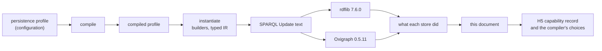
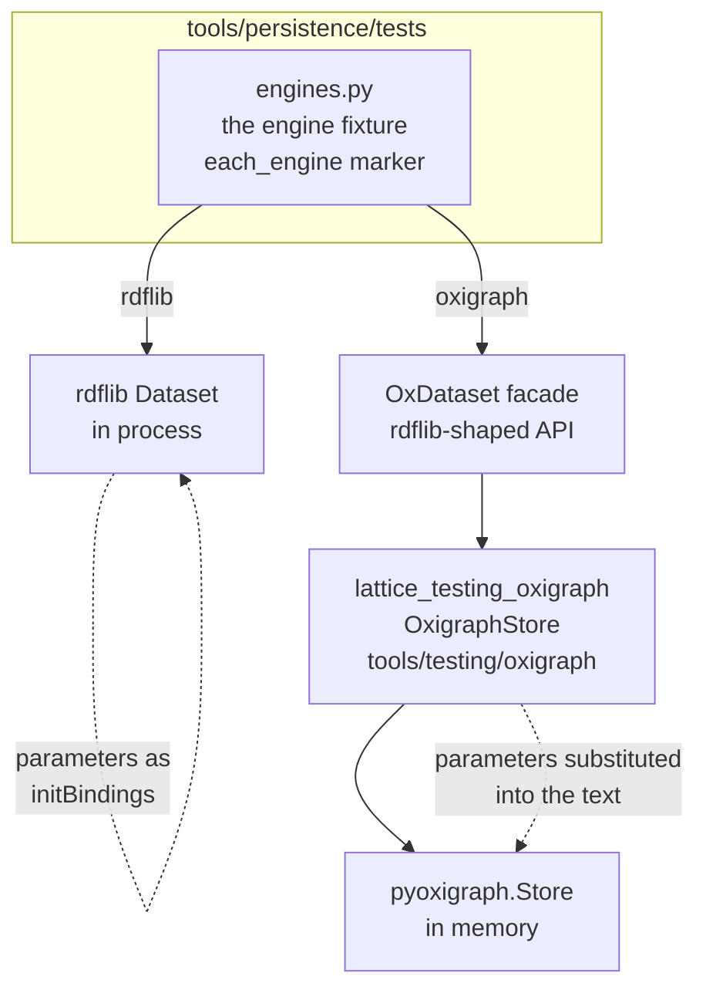
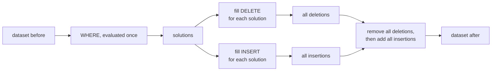
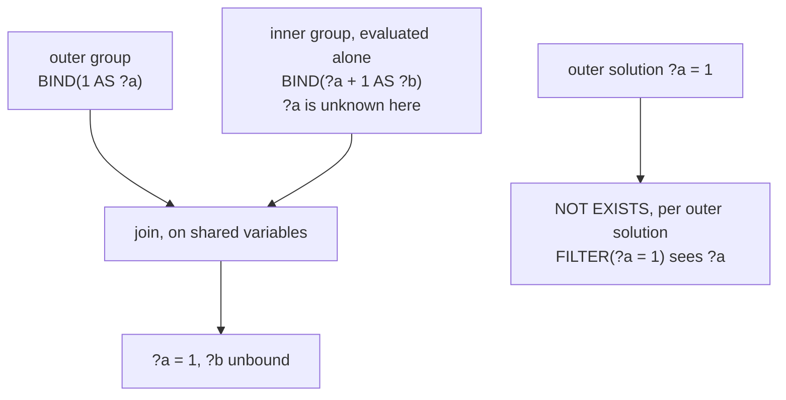
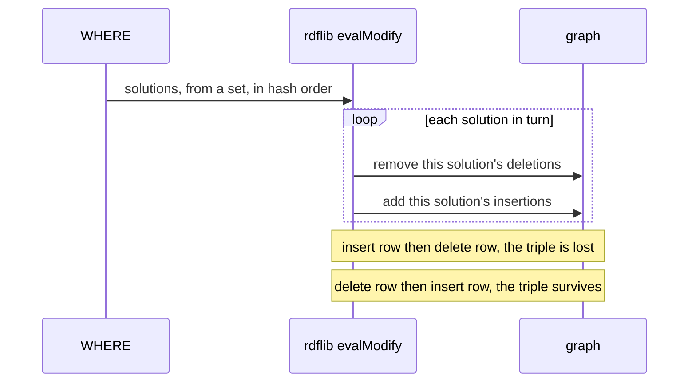
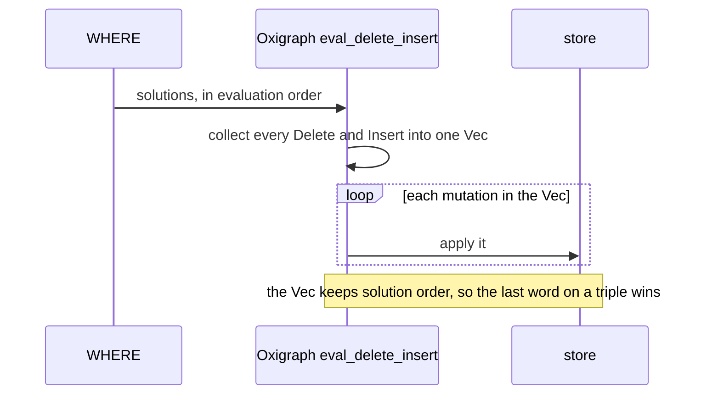
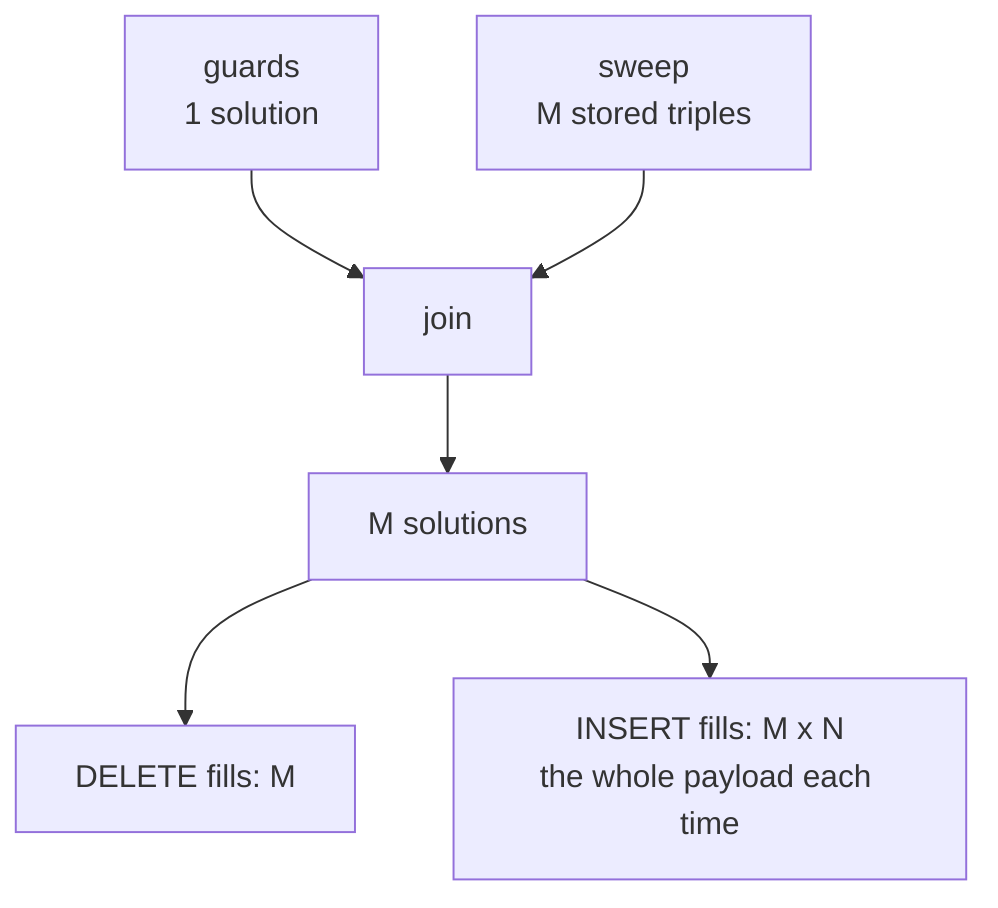
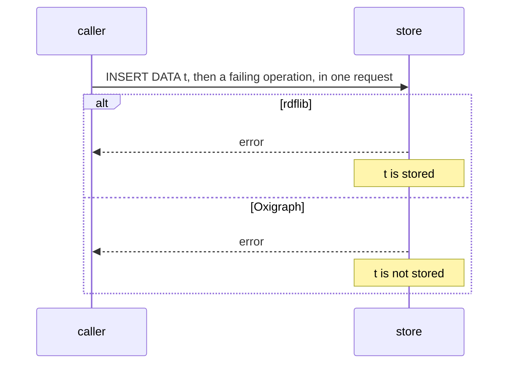
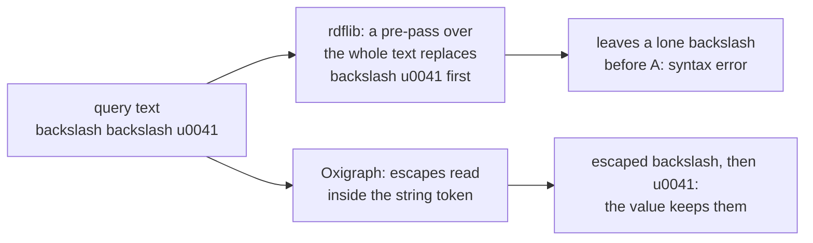
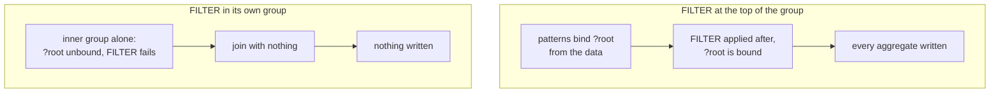

<!-- SPDX-License-Identifier: CC-BY-SA-4.0 -->

# Triple-store discovery

**What this is.** The project's record of how each triple store we run actually behaves: its features, its limits, and how it
reads the standards it implements, SPARQL 1.1 Query and Update above all. Each entry says what we were doing, how we found out,
what the store does, why, what follows for LATTICE, and how to see it again.

**Status:** a living document, begun 2026-10-13 from formal-methods Track H's persistence work (slices H2.1 to H2.4b). It is a
source of truth for the project. Read it before relying on how a store behaves, and add to it when you find something. The
skill `lattice-triple-stores` has the procedure.

**Stores covered:** rdflib 7.6.0 and Oxigraph 0.5.11 (through `pyoxigraph`). Each finding names the versions it was seen on.
A finding holds for those versions only, until it is checked again.

## Contents

1. [How to read and write this document](#1-how-to-read-and-write-this-document)
2. [Why we started looking](#2-why-we-started-looking)
3. [How we reach each store](#3-how-we-reach-each-store)
4. [A short primer on how SPARQL evaluates an update](#4-a-short-primer-on-how-sparql-evaluates-an-update)
5. [The findings at a glance](#5-the-findings-at-a-glance)
6. [The findings](#6-the-findings)
7. [Corrections, and what they taught us](#7-corrections-and-what-they-taught-us)
8. [Open questions](#8-open-questions)

## 1. How to read and write this document

Every finding has an identifier, `TSD-nn`, that other documents cite. It is never reused. A finding that turns out wrong is
corrected in place, with a dated note, and the story goes in §7.

Each finding states its evidence, as one or more of these.

| Evidence | Means | Example |
|---|---|---|
| **Source** | we read the store's code, at a named version and path | rdflib's `plugins/sparql/evaluate.py`, `evalJoin` |
| **Observed** | we ran a probe and saw the result, and the probe is a test or a script named here | `tools/persistence/tests/test_store_probes.py` |
| **Documented** | the store's own documentation says so | a page of the store's manual |
| **Reasoned** | it follows from the specification or from other findings, and is not yet observed | marked as a hypothesis until it is |

A finding is only as strong as its evidence. Source tells us the mechanism, Observed tells us it really happens on this
version, and the two together are what we aim for. A finding built only on Documented or Reasoned evidence says so in its
first line.

**A run record** goes with every Observed finding: the date, the store and its version, the Python version, and the kind of
machine, never the machine or person (ADR-A124 decision 5). Three run records appear below.

| Run | Machine | Python | Stores |
|---|---|---|---|
| **R-A** | a Linux x86_64 container, 15 GB, used by an agent for H2.4b, 2026-10-12 | 3.14.8 | rdflib 7.6.0, pyoxigraph 0.5.11 |
| **R-B** | a macOS arm64 workstation, used for the H2 reviews and for this document, 2026-10-10 to 2026-10-13 | 3.14.7 | rdflib 7.6.0, pyoxigraph 0.5.11 |
| **R-C** | a Linux x86_64 container, 15 GB, used by an agent for H2.5, 2026-10-13 | 3.14.8 | rdflib 7.6.0, pyoxigraph 0.5.11 |

**How to add a finding** is in §6.0 and in the skill. In short: say what you were testing, how you found it, the smallest
SPARQL that shows it, the result on each store you have, the reason if you can find it in the source, what it means for
LATTICE, and how to reproduce it. If reproducing it takes more than one query, write a short plan for a script.

## 2. Why we started looking

LATTICE's persistence layer (`ontology/persistence`, ADR-A78) describes how an application stores its data in an RDF store:
which graph an aggregate lives in, how two writers are kept from overwriting each other, what receipt each write leaves. The
persistence compiler (`tools/persistence`, ADR-A79) turns that description into SPARQL 1.1 Update operations, guarded writes
of the kind the [RDF and SPARQL patterns guide](rdf-sparql-patterns-guide.md) sets out. For example, a compare-and-set replace
deletes an aggregate's old state and writes its new state only if the version row still says the sequence the caller read.

Until formal-methods Track H, nothing executed those operations. Track H's plan was to prove things about them, and proving
things about a query means knowing what the query does. Three questions turned that into store discovery.

1. **Does the generated SPARQL do what the configuration intends?** Slices H2.1 to H2.4 rebuilt the compiler's output as a
   typed intermediate representation ([ADR-A123](decisions/ADR-A123-typed-operation-ir.md)), and every rule of its checker is a
   claim about SPARQL. Two of those claims were wrong when first written (§7), and only running the queries showed it.
2. **What does a write cost?** A composite aggregate's replace was suspected, then shown, to cost time or memory quadratic in
   the aggregate's size (TD-42). The cost depends on how the store applies an update, which is not fixed by the standard.
3. **What may the compiler assume about a store?** The persistence layer's later work (H5 in the [Track H
   plan](../developer/plans/formal-methods-track-h.md)) models each store's concurrency and gives the compiler a *capability
   record* to choose the right form of an operation for a store. The probes in this document are that record's first
   entries.



## 3. How we reach each store

The two stores are reached in different ways, and the difference matters to several findings.



- **rdflib** runs in the test process. An update is `Dataset.update(text, initBindings={...})`, so a request-time parameter
  such as `$root` is an *initial binding*, a value the engine starts from, and never text.
- **Oxigraph** runs through `tools/testing/oxigraph` ([ADR-A125](decisions/ADR-A125-test-support-tooling.md)), whose
  `OxigraphStore` wraps `pyoxigraph.Store`. Its `bind_parameters` writes each parameter into the query text as an encoded
  term, as a caller with no initial-binding API would. The tests reach it through `OxDataset` in
  `tools/persistence/tests/engines.py`, which offers the part of rdflib's `Dataset` API the tests use.
- **A test opts in to both engines** with `@engines.each_engine`. The Oxigraph cases carry the `oxigraph` marker and skip where
  the package is absent. `mise run check:persistence-oxigraph` installs it and runs only them.
- **The benchmark** `benchmark/persistence-composite-cost` ([ADR-A124](decisions/ADR-A124-benchmark-root.md)) runs each size in a
  child process under a memory cap, on both engines.

So "the store" in a finding means the store as reached this way. A finding that depends on initial bindings, for example,
says which mechanism it used.

## 4. A short primer on how SPARQL evaluates an update

Most findings below are about where a store departs from, or interprets, a part of SPARQL 1.1 that few people need to think
about. This section sets out those parts once.

### 4.1 `DELETE … INSERT … WHERE`, by the specification

SPARQL 1.1 Update (§3.1.3) defines `DELETE { D } INSERT { I } WHERE { P }` in three steps. Evaluate `P` once, against the
dataset as it was before the operation, giving a sequence of solutions. Fill `D` and `I` with each solution, skipping any triple
with an unbound variable. Remove every filled deletion, then add every filled insertion. The result does not depend on the order
of the solutions.



We call a store that does exactly this **snapshot**, and the capability record will carry it as `snapshotUpdateSemantics`.
A store may instead take the solutions one at a time and, for each, remove its deletions and add its insertions. Then a triple
one solution inserts can be removed by a later solution, and the order of solutions decides the result. TSD-01 is about exactly
this.

### 4.2 Groups are evaluated bottom-up

A `WHERE` clause is a group, and it may hold inner groups: `{ … }`, `OPTIONAL { … }`, a `UNION` branch, a `GRAPH g { … }`. The
specification translates the query into an algebra (§18.2) in which each inner group is evaluated on its own and then joined
with what came before it. So an inner group cannot *see* a variable bound outside it, although its result is *joined* with it.
`FILTER NOT EXISTS { … }` is the exception. It is evaluated once per outer solution, with that solution's values substituted.



This decides two things that matter here: what a `BIND` inside an inner group computes (TSD-03), and how much a `GRAPH ?g`
inside an inner group reads (TSD-04).

### 4.3 A `FILTER` applies to its whole group

A `FILTER` is not a step in a sequence. It applies to every solution of the group it is written in, after all the group's
patterns have matched, wherever in the group it is written. A filter that tests whether a variable is bound, written at the top
of a group whose patterns also bind that variable, therefore sees it bound by the data. TSD-13 shows what this did to a guard.

### 4.4 Request-time parameters: initial bindings or text

A generated operation leaves its request-time values as variables, written `$root`, `$epoch` and so on. A caller fills them in
one of two ways.

| Way | How | Example |
|---|---|---|
| initial bindings | the engine starts evaluation with the variable bound | rdflib's `initBindings`, a prepared query's parameters |
| text substitution | the caller writes the value into the query text before sending it | the SPARQL 1.1 Protocol, which has no binding parameters, and our Oxigraph adapter |

The two are not interchangeable. Some functions accept only a variable (`BOUND`), so substituted text can stop a query parsing
(TSD-11).

## 5. The findings at a glance

`✔` means the store does what SPARQL 1.1 says, `✘` that it departs from it, and a word where the specification leaves the choice
to the store or where it is a matter of capacity.

| # | Finding | Specification | rdflib 7.6.0 | Oxigraph 0.5.11 | Evidence |
|---|---|---|---|---|---|
| [TSD-01](#tsd-01-the-order-in-which-a-delete-insert-where-is-applied) | applying a `DELETE`/`INSERT` | all deletions, then all insertions | ✘ one solution at a time, in hash order | ✘ one solution at a time, in solution order | Source, Observed |
| [TSD-02](#tsd-02-what-filling-a-template-once-per-solution-costs) | filling a template once per solution | not specified | quadratic in time | quadratic in time and memory | Source, Observed |
| [TSD-03](#tsd-03-what-a-bind-inside-an-inner-group-can-see) | a `BIND` in an inner group | sees only its group | ✔ | ✔ | Observed |
| [TSD-04](#tsd-04-a-graph-variable-bound-outside-an-inner-group) | `GRAPH ?g` inside an inner group, `?g` bound outside | joined afterwards | passes the binding in, reads one graph | passes the binding in, reads one graph | Observed |
| [TSD-05](#tsd-05-a-template-quad-whose-graph-variable-is-unbound) | template quad, graph variable unbound | skipped | ✘ written to a new blank-node graph | ✔ skipped | Source (rdflib), Observed |
| [TSD-06](#tsd-06-a-request-whose-second-operation-fails-and-graph-management) | a request whose second operation fails | should be atomic | keeps the first operation | rolls the first back | Observed |
| [TSD-07](#tsd-07-numeric-datatypes-are-not-kept-by-oxigraph) | `"1"^^xsd:long` stored and read | the term is kept | ✔ kept | ✘ becomes `xsd:integer` | Observed |
| [TSD-08](#tsd-08-a-zero-length-path-from-a-term-that-is-in-no-triple) | zero-length path from a term in no triple | our reading: matches the term | matches it | matches nothing | Observed |
| [TSD-09](#tsd-09-unicode-escapes-and-an-escaped-backslash) | `\u` escapes and an escaped backslash | processed before parsing (§19.2) | whole-text pre-pass | inside string tokens | Source (rdflib), Observed |
| [TSD-10](#tsd-10-a-result-row-whose-projected-variables-are-all-unbound) | a result row with every projected variable unbound | kept | ✘ dropped | ✔ kept | Observed |
| [TSD-11](#tsd-11-bound-and-text-substitution) | `BOUND(<iri>)` after text substitution | a syntax error | syntax error | syntax error | Observed |
| [TSD-12](#tsd-12-initial-bindings-are-visible-inside-inner-groups-on-rdflib) | initial bindings inside an inner group | not specified | visible | not tested, the adapter substitutes text | Observed |
| [TSD-13](#tsd-13-a-filter-at-the-top-of-a-group-sees-what-the-groups-patterns-bound) | a top-level `FILTER(BOUND(?x))` with `?x` in the group's patterns | sees `?x` bound by the data | ✔ | ✔ | Observed |
| [TSD-14](#tsd-14-graph-management-operations-on-rdflib) | `CREATE GRAPH`, `DROP GRAPH` of an absent graph | defined | `CREATE` not implemented, `DROP` succeeds | `DROP` fails | Observed |
| [TSD-15](#tsd-15-a-sub-select-and-the-variables-around-it) | a sub-select and the variables around it | evaluated on its own, only its projections leave it | ✘ an outer binding leaks in | ✔ | Observed |
| [TSD-16](#tsd-16-min-and-max-over-iris) | `MIN` and `MAX` over IRIs | the lowest or highest IRI | ✘ a plain literal of the IRI text | ✔ an IRI | Observed |
| [TSD-17](#tsd-17-a-chain-of-additions-and-subtractions) | `a - b + c` and `a / b / c` | grouped from the left | ✔ | ✘ grouped from the right | Observed |
| [TSD-18](#tsd-18-count-distinct-over-xsdlong-and-xsdinteger-terms) | `COUNT(DISTINCT)` over `xsd:long` and `xsd:integer` | two terms, so two | counts them apart | counts them together, since it stores both as `xsd:integer` | Observed |
| [TSD-19](#tsd-19-the-order-of-group_concat) | the order of `GROUP_CONCAT` | not specified | the order the data was stored in, whatever the hash seed (this query shape) | the order of the solutions | Observed |
| [TSD-20](#tsd-20-a-filter-inside-not-exists-and-a-parameter) | a `FILTER` inside `NOT EXISTS` and a parameter or a sub-select's projection | sees them by substitution | ✔ by initial binding and by text | ✔ by text | Observed |

## 6. The findings

### 6.0 The shape of an entry

Each entry has the same parts, so a reader can find what they need.

- **Context.** What we were building or testing when it came up, and why it mattered then.
- **How we found it.** The steps, in order, and the evidence each gave.
- **What the store does.** The smallest SPARQL that shows it, and the result on each store.
- **Why.** The mechanism, from the source where we read it.
- **What it means for LATTICE.** The decisions, debt and tests it touches.
- **Reproduce it.** A query to run, or a short plan for a script when the setup has layers.

---

### TSD-01. The order in which a `DELETE`/`INSERT`/`WHERE` is applied

**Evidence:** Source and Observed, on both stores. Runs R-A and R-B. **Corrected 2026-10-13**, see §7.1.

**Context.** A composite aggregate's replace, `cas-replace-composite-property`, deletes every triple of the aggregate and inserts
the new state. A cheaper form of it (R2 in the [typed IR sketch §4.3](../developer/sketches/formal-methods-track-h-typed-ir.md#43-how-a-composite-replace-is-evaluated-and-what-it-costs))
would put the payload in `VALUES` rows beside the sweep's rows, so each payload triple is filled once. That form is right only
if the store removes every deletion before it adds any insertion, because a payload often repeats a triple the aggregate
already holds, an unchanged name for example. So we needed to know how each store applies an update.

**How we found it.**

1. *Source, rdflib.* We read `rdflib/plugins/sparql/update.py`, `evalModify`, in 7.6.0. After evaluating the `WHERE` it loops
   `for c in list(res):` and, inside the loop, does `dg -= _fillTemplate(u.delete.triples, c)` and then
   `dg += _fillTemplate(u.insert.triples, c)` (and the same for each graph's quads). So it removes and adds per solution.
2. *A first probe, H2.4b.* The probe P1 stores one triple, then runs an update whose two solutions, written as `VALUES` rows,
   respectively insert and delete that triple. Under the specification the triple survives in either row order. In run R-A
   rdflib kept it in both orders, and the slice concluded that rdflib is snapshot. That conclusion was wrong.
3. *The contradiction.* In run R-B the same probe lost the triple on rdflib. A trace of the order of solutions, and then the
   same probe run with `PYTHONHASHSEED` fixed to each of 0 to 11, showed the result changing with the seed: lost in both
   orders for 6 seeds, kept in both for 4, and dependent on the row order for 2. The probe's test, which asserted "kept", failed
   in 2 of 3 runs of `check:persistence` with no seed set.
4. *Source again.* rdflib translates the probe's `WHERE { VALUES … }` to `Join(BGP{}, ToMultiSet(Values))`, and the join is
   not marked lazy. `evaluate.py`, `evalJoin`, then does `b = set(evalPart(ctx, join.p2))`. A Python `set` of solutions iterates
   in an order that follows the hash of each solution, and string hashes change with `PYTHONHASHSEED` per process. So the order
   of solutions, and with it the result of the update, can change from one process to the next.
5. *Source, Oxigraph.* In Oxigraph 0.5.11, `lib/oxigraph/src/sparql/update.rs`, `eval_delete_insert` does
   `prepared.execute(...).collect::<Result<Vec<_>, _>>()?` to gather every computed `DeleteInsertQuad`, then
   `for mutation in mutations` applies each `Delete` or `Insert` in turn. The reads happen before any write. The order inside the
   `Vec` is the order of solutions, deletions then insertions for each, which the probe confirms.
6. *Observed, Oxigraph.* P1 on Oxigraph loses the triple when the inserting row comes first and keeps it when the deleting row
   comes first, every time.

**What the store does.**

```sparql
# stored beforehand: GRAPH <urn:g> { <urn:s> <urn:p> <urn:o> }
DELETE { GRAPH <urn:g> { ?d <urn:p> <urn:o> } }
INSERT { GRAPH <urn:g> { ?i <urn:p> <urn:o> } }
WHERE  { VALUES (?i ?d) { (<urn:s> UNDEF) (UNDEF <urn:s>) } }
```

| Store | Row order as written | Is `<urn:s> <urn:p> <urn:o>` still there? |
|---|---|---|
| specification | either | yes |
| rdflib 7.6.0 | either | depends on the process's hash seed |
| Oxigraph 0.5.11 | inserting row first | no |
| Oxigraph 0.5.11 | deleting row first | yes |





**Why.** Neither store keeps the specification's two phases. rdflib interleaves per solution, and its solution order for a
non-lazy join comes from a Python `set`. Oxigraph separates reading from writing, which protects the `WHERE` from the update's
own changes, but then applies the collected mutations in solution order rather than all deletions first.

**What it means for LATTICE.**

- **R0, the replace as shipped, stays right on both.** It puts the whole payload in the `INSERT` template, so every solution adds
  every payload triple again, and the last solution restores anything an earlier one removed. Its redundancy is what makes it
  correct here, and that redundancy is what TSD-02 measures.
- **R2, the linear form, is unsafe on both stores.** The sketch's §4.3 expected it to be safe where `snapshotUpdateSemantics`
  holds, and neither store has it. H5's capability record carries `snapshotUpdateSemantics = false` for both.
- **Any generated update must be right whatever the solution order.** On rdflib a wrong assumption would not fail reliably, it
  would fail in some processes. A test of order-dependent behaviour on rdflib must fix the hash seed or sweep it.
- **The P1 test was corrected** on 2026-10-13 (`test_store_probes.py`, H2.4b-T1 and T2). On rdflib it runs the probe in child
  processes under seeds 0 to 11 and requires both outcomes to occur. On Oxigraph it keeps the row-order expectations.

**Reproduce it.**

A script, in four steps.

1. Write a file `p1.py` that creates an rdflib `Dataset`, adds `<urn:s> <urn:p> <urn:o>` to graph `<urn:g>`, runs the update
   above with the `VALUES` rows taken from `sys.argv[1]`, and prints whether the triple is still there.
2. Run it twelve times per row order, each with a different `PYTHONHASHSEED`:

   ```bash
   for seed in 0 1 2 3 4 5 6 7 8 9 10 11; do PYTHONHASHSEED=$seed mise exec -- python p1.py '(<urn:s> UNDEF) (UNDEF <urn:s>)'; done
   ```

3. Expect a mix of `True` and `False`. A store that applied the specification's order would print `True` every time.
4. For Oxigraph, run the same update through `pyoxigraph.Store().update(...)` in both row orders. Expect `False` with the
   inserting row first and `True` with the deleting row first, whatever the seed.

To see the order itself, wrap `rdflib.plugins.sparql.update._fillTemplate` with a function that records, for each call, whether
`c.get(Variable("i"))` is bound, and then calls the original. Keep the wrapper this small. A wrapper that iterated the whole
solution gave a misleading result in one run, which we did not explain, see §7.1.

---

### TSD-02. What filling a template once per solution costs

**Evidence:** Source and Observed, on both stores. Run R-A for the benchmark, R-B for the first measurement.

**Context.** The composite replace R0 sweeps the root and every member of an aggregate in one `OPTIONAL` pattern, which gives
one solution per stored triple, M of them. Its `INSERT` template holds the N payload triples, and none of them uses a sweep
variable. So, by the definition in §4.1, the payload is filled M times before the union removes the copies. Whether a store
does that literally was the question behind TD-42.

```sparql
DELETE { GRAPH <data> { ?s ?p ?o } … }
INSERT { GRAPH <data> { …N payload triples… } … }
WHERE  {
  … the version-row guard, one solution …
  OPTIONAL { GRAPH <data> { $root <ownedPath> ?s . ?s ?p ?o } }   # M solutions
}
```



**How we found it.**

1. *Source, rdflib.* `evalModify`'s per-solution loop (TSD-01) calls `_fillTemplate` on the whole `INSERT` template for every
   solution, and `Graph.__iadd__` adds each filled triple.
2. *Observed, rdflib, R-B.* A scratch script reduced the replace to its essentials and timed it at M = N: 0.007 s at 10,
   0.077 s at 100, 5.6 s at 1000. Ten times the size took about seventy times as long.
3. *Source, Oxigraph.* `eval_delete_insert` collects every filled quad into a `Vec` before applying any (TSD-01), so the M × N
   filled quads exist in memory at once.
4. *Observed, both, R-A.* The benchmark `benchmark/persistence-composite-cost` ran M = N from 10 to 10,000, each size in a child
   process capped at 8 GB.

**What the store does.**

| M = N | rdflib 7.6.0 | Oxigraph 0.5.11 |
|---|---|---|
| 10 | 0.03 s | 0.0005 s |
| 100 | 0.17 s | 0.0056 s |
| 1,000 | 9.2 s | 0.59 s |
| 3,000 | 83 s | 14.4 s |
| 10,000 | 983 s | did not finish |
| fitted growth k, 100 and up | 1.87 | 2.26 |

At 10,000 Oxigraph tried to allocate about 7 GB and failed under the cap, and an uncapped run was killed at 14 GB on a 15 GB
machine. Separately, a run at 2,000 used 1.5 GB and one at 4,000 used 5.8 GB, so memory grows as the square of the size, and
10,000 would need about 36 GB. Every finished run left exactly the payload, the bystander aggregate untouched and the version
row at the next sequence.

**Why.** Both stores fill the template once per solution, as the specification's definition reads. rdflib pays in time,
adding the same triples again and again. Oxigraph is fast per quad but holds every filled quad at once.

**What it means for LATTICE.**

- R0 is correct and quadratic on both, in time on rdflib and in time and memory on Oxigraph (TD-42).
- R2 is unsafe on both (TSD-01). R1, two operations in one request, is safe only where a failing request rolls back (TSD-06),
  which Oxigraph does and rdflib does not. So no single linear form fits both, which is what the capability record exists to
  decide. H5 chooses.
- The benchmark fails on a wrong result and never on time or memory (ADR-A124). A run that does not finish is recorded with its
  exit status.

**Reproduce it.** `mise run check:persistence-composite-cost`, about 25 minutes, most of it rdflib at 10,000.
`COMPOSITE_COST_MAX=1000` gives a quick run. The report is written to `benchmark/persistence-composite-cost/report.md`.

---

### TSD-03. What a `BIND` inside an inner group can see

**Evidence:** Observed on both stores, R-B. rdflib is also covered by tests.

**Context.** The typed IR's checker tracks, for each point of a `WHERE`, which variables are bound in every solution, so it can
refuse a template variable tagged `Bound` that might not be (ADR-A123). Its first version let an inner group see the enclosing
group's variables. A review then "fixed" the `GRAPH` block the same way. Both were wrong, and only running queries showed it
(§7.2).

**How we found it.** We ran the same six queries on each store, each binding `?a` outside and computing `?b` from it inside.

**What the store does.**

| Query | rdflib | Oxigraph | Specification |
|---|---|---|---|
| `BIND(1 AS ?a) { BIND(?a + 1 AS ?b) }` | `?b` unbound | `?b` unbound | unbound |
| `BIND(1 AS ?a) GRAPH <g> { ?s ?p ?o BIND(?a + 1 AS ?b) }` | unbound | unbound | unbound |
| `BIND(1 AS ?a) OPTIONAL { BIND(?a + 1 AS ?b) }` | unbound | unbound | unbound |
| `BIND(1 AS ?a) { BIND(?a + 1 AS ?b) } UNION { BIND(5 AS ?b) }` | unbound and 5 | not run | unbound and 5 |
| `BIND(1 AS ?a) BIND(?a + 1 AS ?b)` | 2 | 2 | 2 |
| `BIND(1 AS ?a) FILTER NOT EXISTS { FILTER(?a = 1) }` | no row, so `?a` is seen | no row | no row |

**Why.** The algebra of §4.2. Both stores follow it.

**What it means for LATTICE.** The checker's scope starts empty in a nested group, an `OPTIONAL`, a `UNION` branch and a `GRAPH`
block, and starts from the enclosing scope only in `NOT EXISTS` (FMH-H2-1, F4, and H2.3). Tests H2.1-T29 and T29b check the rule
against rdflib.

**Reproduce it.** Each row is one `SELECT ?a ?b WHERE { … }` over any dataset with one triple in `<g>`. Select `?a` as well as
`?b`, or rdflib drops the row (TSD-10).

---

### TSD-04. A graph variable bound outside an inner group

**Evidence:** Observed on both stores, R-A and R-B.

**Context.** The named-graph replace sweeps the root's graph with `OPTIONAL { GRAPH ?g { ?s ?p ?o } }`, where `?g` is bound by a
`BIND` at the top of the `WHERE`. By §4.2 the inner group is evaluated on its own, so `GRAPH ?g` there ranges over every graph
until the join narrows it. The result is right either way. The question was the cost, and whether the typed IR should refuse
the form (H2.3-Q2).

**How we found it.**

1. *Reasoned.* rdflib's translation of the template and of the form the checker already accepted, `BIND(… AS ?g) GRAPH ?g { … }`,
   differ only in `LeftJoin` against `Join`. Both are `Extend[?g]` beside an independent `Graph[?g]`, so neither is cheaper by the
   specification.

   ```mermaid
   flowchart TB
     subgraph accepted["same group"]
       J1["Join"] --> E1["Extend ?g"]
       J1 --> G1["Graph ?g"]
     end
     subgraph template["inside OPTIONAL"]
       J2["LeftJoin"] --> E2["Extend ?g"]
       J2 --> G2["Graph ?g"]
     end
   ```

2. *Observed, rdflib, R-B.* On 50 graphs of 200 triples, both forms returned the 200 triples of the bound graph in about 10 ms,
   against 237 ms for `GRAPH ?g { ?s ?p ?o }` with nothing bound.
3. *Observed, both, R-A.* Probe P3 timed the `OPTIONAL` form over 100 graphs of 3,000 triples against 1 graph. The ratio was 1.1
   on both stores.

**What the store does.** Both pass the outer binding of `?g` into the graph pattern, so they read one graph. A store that
followed the algebra literally would read every graph and then discard most of what it read.

**Why.** Not read for either store. The timings show both pass the left side's bindings into the right side, as an engine does
when it evaluates a join lazily (rdflib has `evalLazyJoin` for that, and TSD-Q1 asks when it is used).

**What it means for LATTICE.** The scope rule accepts a `GRAPH ?g` inside an inner group when an enclosing group binds `?g` in
every solution before it (ADR-A123, second addendum). A caller-named graph, `GRAPH $g`, is available as an override for a store
that does scan (H2.3-Q2 (c)). H2.4b's T4 fails if either store starts to scan.

**Reproduce it.** Load 100 graphs of 3,000 triples, then time
`SELECT (COUNT(*) AS ?n) WHERE { BIND(<urn:g:0> AS ?g) OPTIONAL { GRAPH ?g { ?s ?p ?o } } }` against the same with one graph
loaded. Take the best of three. A ratio near 1 means the binding is passed in.

---

### TSD-05. A template quad whose graph variable is unbound

**Evidence:** Source (rdflib) and Observed, both stores, R-A and R-B.

**Context.** H2.3 tested what an unguarded `unconditional-write` does when the caller leaves out `$root`. The graph name `?g` is
computed from `$root`, so it is unbound.

**How we found it.** Test H2.3-T8 expected nothing to be written and found a new graph. A direct probe confirmed it, and probe
P4 now checks both stores.

**What the store does.**

```sparql
INSERT { GRAPH ?g { <urn:s> <urn:p> <urn:o> } } WHERE { }
```

| Store | Result |
|---|---|
| specification | skipped, since the quad has an unbound variable |
| rdflib 7.6.0 | the triple is written into a new graph named by a blank node |
| Oxigraph 0.5.11 | skipped, nothing written |

**Why.** rdflib's `evalModify` does `cg = ctx.dataset.get_context(c.get(g))` for each graph of the template (Source). With `?g`
unbound, `c.get(g)` is `None`, and the observed result is a graph with a fresh blank-node name, so `get_context(None)` must create
one. We did not read `get_context` itself.

**What it means for LATTICE.** With the parameter guards on, a missing `$root` is refused before this point. With
`--no-parameter-guards`, on rdflib, a missing `$root` leaves an orphan graph that no audit names (TD-44). The README's guards
paragraph says so.

**Reproduce it.** Run the update above on an empty `Dataset` and list `ds.graphs()` with at least one triple.

---

### TSD-06. A request whose second operation fails, and graph management

**Evidence:** Observed on both stores, R-A and R-B.

**Context.** R1, the two-operation form of the composite replace, is safe only if a request whose second operation fails leaves
no trace of its first. SPARQL 1.1 Update says a request *should* be atomic. Probe P2 asks each store.

**How we found it.** P2 sends `INSERT DATA { … } ; <a failing operation>` and reads back. Finding a failing operation took two
tries on rdflib (TSD-14).

**What the store does.**

| Store | Failing second operation | The request | The first insert |
|---|---|---|---|
| rdflib 7.6.0 | `LOAD <urn:no-such>` | fails | kept |
| Oxigraph 0.5.11 | `DROP GRAPH <urn:absent>` | fails with `RuntimeError` | rolled back |



**Why.** We did not read either store's transaction code. Oxigraph applies an update inside a transaction (TSD-01's source shows
`self.transaction`), which is consistent with the rollback.

**What it means for LATTICE.** R1 is a candidate on Oxigraph and not on rdflib. This is only the failure half of
`atomicUpdateRequest`. Its isolation half, what a concurrent writer sees between the two operations, needs concurrent writers
and is H5's.

**Reproduce it.** On each store, run the request above and then check whether `<urn:s> <urn:p> <urn:o>` is in `<urn:g>`.

---

### TSD-07. Numeric datatypes are not kept by Oxigraph

**Evidence:** Observed on both stores, R-A and R-B.

**Context.** The persistence profile pins every sequence, epoch and position to `xsd:long` (patterns guide Chapter 13), because
`"1"^^xsd:long` and `"1"^^xsd:integer` are different RDF terms and a pattern that matches by term will not match one with the
other. The parameter guard tests `DATATYPE($epoch) = xsd:long` for that reason (ADR-A123, first addendum). On Oxigraph every
guarded operation wrote nothing, and probe P5 found why.

**What the store does.**

```sparql
INSERT DATA { GRAPH <urn:g> { <urn:s> <urn:p> "1"^^<http://www.w3.org/2001/XMLSchema#long> } }
SELECT (DATATYPE(?o) AS ?d) WHERE { GRAPH <urn:g> { ?s ?p ?o } }
```

| Store | Stored object's datatype | `DATATYPE(?o)` |
|---|---|---|
| rdflib 7.6.0 | `xsd:long` | `xsd:long` |
| Oxigraph 0.5.11 | `xsd:integer` | `xsd:integer` |

**Why.** Not read. The observation is that Oxigraph stores an integer-derived literal as `xsd:integer`, and reports it so in every
expression.

**What it means for LATTICE.** The guard's first datatype test, `DATATYPE($p) = xsd:long`, could never pass on Oxigraph, so every
guarded write there wrote nothing (TD-45, FMH-H2-4b decision 1). Guard D replaced it in H2.5 with `DATATYPE($p) = DATATYPE("0"^^xsd:long)`
(ADR-A123, addendum of 2026-10-13), which compares the parameter with what the store makes of a constant. Probe P5 now asserts that
a constant, a substituted parameter, a `VALUES` row and a stored value report one datatype on each store
(`test_h2_5_t1_p5_a_long_has_one_datatype_in_every_form_on_each_engine_so_guard_d_can_pass`), and that a simple literal stays
`xsd:string` in every form. Because every number on Oxigraph is an `xsd:integer`, requests and stored rows match each other, so the
hazard the test guards against cannot arise there. What stays is that the profile's `xsd:long` pinning cannot be checked on Oxigraph.

**Reproduce it.** The two operations above, on each store.

---

### TSD-08. A zero-length path from a term that is in no triple

**Evidence:** Observed on both stores, R-A and R-B. The specification's reading is ours and is not yet checked against the text.

**Context.** The composite sweep starts with `$root <ownedPath> ?s`, and the owned path can take zero steps, so `?s` includes the
root itself. Test H2.4a-T6 asked what happens when the root is in no triple of the data graph.

**What the store does.**

```sparql
# the graph <urn:g> holds only <urn:a> <urn:p> <urn:b>
SELECT ?x WHERE { GRAPH <urn:g> { <urn:lonely> <urn:p>* ?x } }
```

| Store | `?x` |
|---|---|
| rdflib 7.6.0 | `<urn:lonely>` |
| Oxigraph 0.5.11 | no rows |

**What it means for LATTICE.** Nothing changes for the sweep, since `?s ?p ?o` must also match and a term in no triple has none.
H2.8's `payload-check` query starts a path at `$root` over the payload alone, so it must not depend on which reading a store
takes. Its tests run on both.

**Reproduce it.** The query above on each store.

---

### TSD-09. Unicode escapes and an escaped backslash

**Evidence:** Observed on both stores, R-B. Found by H2.1's property test.

**Context.** `persistence.terms.Literal.encode` escapes a backslash as `\\`. A value holding a backslash followed by `u0041`
therefore became the text `"\\u0041"`. SPARQL 1.1 §19.2 says `\u` escapes are processed before the rest of the grammar.

**What the store does.**

| Query text | rdflib 7.6.0 | Oxigraph 0.5.11 |
|---|---|---|
| `"\\u0041"` | syntax error | the five characters `A` |
| `"A"` | `A` | `A` |



**What it means for LATTICE.** `Literal.encode` now writes the `u` of such a pair, and the hex digits after it, as escapes
themselves, so neither reading changes the value (FMH-H2-1 decision 1). The literal is correct on both stores. Any code that
writes SPARQL text must assume the stricter rdflib reading.

**Reproduce it.** `INSERT DATA { GRAPH <urn:e> { <urn:s> <urn:p> "\\u0041" } }` on each store, then read the value back.

---

### TSD-10. A result row whose projected variables are all unbound

**Evidence:** Observed on both stores, R-A and R-B. Found while making H2.1-T29 pass.

**What the store does.** `SELECT ?b WHERE { BIND(1 AS ?a) { BIND(?a + 1 AS ?b) } }` has one solution, with `?b` unbound.
Oxigraph returns one row with `?b` empty. rdflib returns no rows.

**What it means for LATTICE.** A test that counts rows on rdflib must project at least one variable it knows is bound. T29
selects `?a ?b` for that reason.

---

### TSD-11. `BOUND` and text substitution

**Evidence:** Observed on both stores, R-B.

**Context.** The first parameter guard was `FILTER(BOUND($root) && …)`. A caller that substitutes text writes
`FILTER(BOUND(<urn:x>) && …)`.

**What the store does.** Both refuse it as a syntax error (rdflib `ParseException`, Oxigraph `SyntaxError`), as the grammar
requires, since `BOUND` takes a variable. A type test such as `isIRI(<urn:x>)` parses, and `isIRI(?root)` with `?root` unbound is
an error, which fails the filter.

**What it means for LATTICE.** The guard is a type test per parameter, never `BOUND` (ADR-A123, first addendum). H2.1-T28 and
H2.3-T25 run guarded operations after text substitution.

---

### TSD-12. Initial bindings are visible inside inner groups on rdflib

**Evidence:** Observed on rdflib, R-B. Oxigraph not tested, since our adapter substitutes text.

**What the store does.** With `initBindings={"root": <urn:a>}`, `{ FILTER(isIRI(?root)) }` in its own inner group passes on
rdflib, so the initial binding is seen inside the group. An engine that joined initial bindings in only at the end would make the
guard fail every time, which would fail closed.

**What it means for LATTICE.** The guard in its own group works for an initial-binding caller on rdflib and for a
text-substituting caller anywhere. Another engine's initial-binding API must be probed before it is relied on.

---

### TSD-13. A filter at the top of a group sees what the group's patterns bound

**Evidence:** Observed on both stores, R-B.

**Context.** The H2.1 review's F1. The first guard was a `FILTER` at the top of the `WHERE`, whose patterns also matched `$root`.

**What the store does.**

```sparql
# <urn:a> and <urn:b> each have <urn:seq> 0 in <urn:m>, and ?root is not bound by the caller
INSERT { GRAPH <urn:m> { ?root <urn:w> true } }
WHERE  { FILTER(BOUND(?root)) GRAPH <urn:m> { ?root <urn:seq> ?s } }
```

| Form | rdflib | Oxigraph |
|---|---|---|
| `FILTER` at the top of the group | writes both `<urn:a>` and `<urn:b>` | writes both |
| `{ FILTER(…) }` as its own group | writes nothing | writes nothing |



**What it means for LATTICE.** The guard is its own group (ADR-A123 decision 5). It runs once per request, where the top-level
form ran once per solution and cost about 60% on a 20,000-triple sweep on rdflib.

---

### TSD-14. Graph management operations on rdflib

**Evidence:** Observed, R-A.

**What the store does.** On rdflib 7.6.0, `CREATE GRAPH` is not implemented, and `DROP GRAPH` of a graph that does not exist
succeeds. On Oxigraph 0.5.11, `DROP GRAPH` of an absent graph fails, as the specification says it should without `SILENT`.

**What it means for LATTICE.** A probe or a test that needs an operation to fail at run time on rdflib uses `LOAD` of a source
that does not exist.

---

### TSD-15. A sub-select and the variables around it

**Evidence:** Observed on both stores, R-C. Answers TSD-Q9.

**Context.** The merge and quarantine operations join a sub-select, `{ SELECT ?claim ... GROUP BY ?claim HAVING ... }`, to the
patterns around it. The checker (H2.5) treats a sub-select as evaluated on its own, so it starts with nothing in scope and only its
projections leave it, and it refuses an inner variable that is also used outside without being projected (`SubSelectLeak`).

**What the store does.**

```sparql
# <urn:g2> holds three subjects, <urn:s1> to <urn:s3>
SELECT ?c WHERE { VALUES ?s { <urn:s1> } { SELECT (COUNT(*) AS ?c) WHERE { GRAPH <urn:g2> { ?s <urn:p> ?o } } } }
SELECT ?c WHERE { GRAPH <urn:g1> { { SELECT (COUNT(*) AS ?c) WHERE { ?s ?p ?o } } } }   # <urn:g1> holds two triples
```

| Query | Specification | rdflib | Oxigraph |
|---|---|---|---|
| the count with `?s` bound outside the sub-select | 3, since `?s` inside is another variable | **1**, the outer binding is let in | 3 |
| the count inside `GRAPH <urn:g1>` | 2, the sub-select reads the active graph | 2 | 2 |

**What it means for LATTICE.** A sub-select that reuses an outer variable's name without projecting it gives different results on the
two stores. The `SubSelectLeak` rule makes that a refusal, so no operation the IR builds can depend on it. A sub-select inside a `GRAPH`
block reads that graph on both, so the checker passes the enclosing graph to its patterns. Tests `test_h2_5_t12` and `test_h2_5_t13`.

**Reproduce it.** The two queries on each store.

---

### TSD-16. `MIN` and `MAX` over IRIs

**Evidence:** Observed on both stores, R-C. Answers TSD-Q6.

**Context.** Merge-rewrite picks a claim's canonical owner with `MIN(?owner)` over the owners' IRIs, then compares it with each owner
and writes a link from every other owner to it.

**What the store does.**

```sparql
INSERT DATA { GRAPH <urn:g> { <urn:c> <urn:p> <urn:o:2> , <urn:o:10> , <urn:o:1> } }
SELECT (MIN(?o) AS ?l) (MAX(?o) AS ?h) WHERE { GRAPH <urn:g> { <urn:c> <urn:p> ?o } }
```

| Store | `MIN` | `MAX` |
|---|---|---|
| rdflib 7.6.0 | the literal `"urn:o:1"` | the literal `"urn:o:2"` |
| Oxigraph 0.5.11 | the IRI `<urn:o:1>` | the IRI `<urn:o:2>` |

Both choose by the IRI's text, so `urn:o:10` sorts before `urn:o:2`. `IRI(MIN(STR(?o)))` gives the IRI on both.

**What it means for LATTICE.** The first port of merge-rewrite equalled its template, so on rdflib it wrote a plain literal as the link's object, and because
an IRI is never equal to a literal, `?other != ?canonical` also held for the canonical owner, which got a link to itself. On Oxigraph it wrote IRIs and no
self-link. Decided 2026-10-13 (FMH-H2-5, decision 1): the template and the builder project `IRI(MIN(STR(?owner)))`, which gives an IRI on both
(`test_h2_5_t30`). The `MIN` itself is still different on the two stores and `test_h2_5_t41` keeps the probe.

**Reproduce it.** The two operations above on each store.

---

### TSD-17. A chain of additions and subtractions

**Evidence:** Observed on Oxigraph, R-C, directly through `pyoxigraph`, and on rdflib.

**Context.** The gap scan compares `COUNT(DISTINCT ?seq)` with `?S - ?L + 1`. On Oxigraph every audit row for a complete stream was reported
as a gap.

**What the store does.**

```sparql
SELECT (10 - 3 + 2 AS ?x) WHERE {}      SELECT (10 - 3 - 2 AS ?x) WHERE {}      SELECT (8 / 4 / 2 AS ?x) WHERE {}
```

| Query | Specification (from the left) | rdflib | Oxigraph |
|---|---|---|---|
| `10 - 3 + 2` | 9 | 9 | **5**, as `10 - (3 + 2)` |
| `10 - 3 - 2` | 5 | 5 | **9**, as `10 - (3 - 2)` |
| `8 / 4 / 2` | 1 | 1 | **4**, as `8 / (4 / 2)` |
| `(10 - 3) + 2` | 9 | 9 | 9 |

**What it means for LATTICE.** The gap scan's template, written as a chain, counts wrongly on Oxigraph. The renderer therefore always writes the
parentheses of a nested arithmetic operand, which is correct on both. The Mustache template is unchanged until H2.9 retires it. The
equivalence harness reads a left-nested chain as the flat chain it equals, since SPARQL defines them as one expression. Test
`test_h2_5_t44`, and the harness mutation `test_h2_5_t47`.

**Reproduce it.** The three queries on each store.

---

### TSD-18. `COUNT(DISTINCT)` over `xsd:long` and `xsd:integer` terms

**Evidence:** Observed on both stores, R-C. Answers TSD-Q10 for the counts.

**What the store does.** Three triples with the objects `"1"^^xsd:long`, `"1"^^xsd:integer` and `"2"^^xsd:long`, counted with
`COUNT(DISTINCT ?o)`.

| Count | rdflib | Oxigraph |
|---|---|---|
| over the stored objects | 3 | 2, since it stores both `1`s as `xsd:integer` (TSD-07) |
| over a `VALUES` row of `"1"^^xsd:long` and `"1"^^xsd:integer` | 2 | 1 |

**What it means for LATTICE.** The gap scan counts distinct `seq` terms. A receipt whose `seq` was written with another integer type adds a
term on rdflib and none on Oxigraph, so a duplicate `seq` written that way is reported on rdflib only (`test_h2_5_t43`). Comparisons with `>=` and
`<=` work across numeric types on both. The profile pins positions to `xsd:long`, so this arises only from data written outside the
generated operations.

---

### TSD-19. The order of `GROUP_CONCAT`

**Evidence:** Observed on rdflib, R-C. Answers TSD-Q7 for the query shape of the duplicate audit.

**What the store does.** Six owners stored in a fixed order and concatenated by the duplicate audit's query, run in child processes under
`PYTHONHASHSEED` 0 to 5 (12 seeds in the exploration), gave the same string every time, in the order the owners were stored. Unlike the update of
TSD-01, this query does not go through a hash-ordered join.

**What it means for LATTICE.** The order is the store's scan order and no guarantee. A different query shape or store could differ, so the
audit tests compare owners as a set. Test `test_h2_5_t45`.

---

### TSD-20. A `FILTER` inside `NOT EXISTS` and a parameter

**Evidence:** Observed on both stores, R-C. Answers TSD-Q8.

**What the store does.** `FILTER NOT EXISTS { GRAPH <g> { ?claim <claimedBy> ?other . FILTER(?other != $owner) } }`, after a sub-select that
projects `?claim`, keeps a claim held by the owner or by nobody and drops one held by someone else. The result is the same when `$owner` is
put in the text and when it is an initial binding (rdflib).

**What it means for LATTICE.** `key-claim-write` and merge-rewrite rely on this, and it holds on both stores for both ways of binding.
Test `test_h2_5_t14`.

## 7. Corrections, and what they taught us

### 7.1 rdflib and the order of an update (TSD-01)

The typed IR sketch first said, from reading `evalModify`, that rdflib applies an update one solution at a time. H2.4b's probe
then reported that rdflib keeps the specification's order, and a dated note in the sketch said the first statement was wrong.
The first statement was right. The probe had happened to run in processes whose hash seeds put the deleting row first. While
checking, one of our own traces, which read every binding of each solution, also gave a result we did not reproduce later. We
note it rather than explain it.

What we take from it. A probe on rdflib whose answer depends on the order of solutions must fix or sweep `PYTHONHASHSEED`, or it
measures luck. A conclusion that contradicts the source needs the source re-read before it is recorded. And a trace should touch
as little of the engine's state as it can.

### 7.2 Variable scope (TSD-03)

The checker first let every inner group see the enclosing group's variables. The H2.1 review then changed the `GRAPH` block to do
the same, calling it a fix. A probe on rdflib showed the opposite: no inner group but `NOT EXISTS` sees them. Planning H2.3 then
found that a pattern's solutions *are* joined with the enclosing group, which is a different question from what a `BIND` can see.
The checker now tracks both. Each step was a claim about SPARQL written from memory, and each was settled only by running a query.
That is why every semantic rule the checker encodes now has an engine test (Track H plan §5.1).

### 7.3 The retry on rdflib

The spike `spikes/persistence-oxigraph` once reported that rdflib and Oxigraph disagreed on a retried append. The cause was two
bugs in the first scratch scripts. rdflib does materialise the solutions of a `WHERE` before it changes anything, as its
`list(res)` shows. That is a different property from applying the changes in the specification's order, which TSD-01 shows it
does not.

## 8. Open questions

| # | Question | Why it matters | Next step |
|---|---|---|---|
| TSD-Q1 | does rdflib order a lazy join's solutions deterministically | only non-lazy joins go through a `set`, so some updates may have a fixed order | read `evalLazyJoin` and probe a lazy form |
| TSD-Q2 | what Oxigraph does with initial bindings, if `pyoxigraph` offers them for updates | TSD-12 holds for rdflib only | probe it |
| TSD-Q3 | whether the specification's zero-length path includes a constant endpoint in no triple | TSD-08 names one store as right without checking the text | re-read SPARQL 1.1 §18.4 |
| TSD-Q4 | the isolation half of request atomicity, and whether inserting an identical statement conflicts | H5's models branch on both | H5, with concurrent writers |
| TSD-Q5 | why Oxigraph turns `xsd:long` into `xsd:integer` | TSD-07 is observed, not explained | read Oxigraph's literal encoding |
| TSD-Q11 | whether Oxigraph groups a chain of same-precedence operators from the right in a later version, and why in 0.5.11 | TSD-17 is observed, not explained, and the renderer works around it | read the parser, try the newer releases, and report it upstream if it still holds |
| TSD-Q12 | whether Fuseki, which `platform/semantic-dataset-fuseki` targets, shows TSD-15 to TSD-18 | they are measured on two in-process stores only | run the same probes against it |
