<!-- SPDX-License-Identifier: CC-BY-SA-4.0 -->

# LATTICE roadmap

**As of** 2026-10-21. **Read from** `main` at `a19e6dd` and every branch on the remote with commits not yet on `main`.

**What this is.** One view across every epic, unit and branch: what is done, what is in flight, what waits on what, and what the maintainer is asked to do next. It summarises and links. It decides nothing. The status record of each unit stays its one authoritative live state (skill `lattice-lifecycle`). Where this roadmap and a status record disagree, the status record is right and this page is stale.

**How it was built.** From the status records and plans under `docs/developer/`, the ADR catalogue, the remote's branches and its release tags. A unit's state on an unmerged branch is reported with the branch named, since `main` does not have it yet.

## Contents

1. [The programme at a glance](#1-the-programme-at-a-glance)
2. [How the epics depend on one another](#2-how-the-epics-depend-on-one-another)
3. [The layers, now and proposed](#3-the-layers-now-and-proposed)
4. [Active epics](#4-active-epics)
5. [Smaller units](#5-smaller-units)
6. [The platform programme](#6-the-platform-programme)
7. [Branches](#7-branches)
8. [The critical path](#8-the-critical-path)
9. [Decisions waiting](#9-decisions-waiting)
10. [The maintainer's queue](#10-the-maintainers-queue)
11. [Completed units](#11-completed-units)
12. [Observations](#12-observations)

## 1. The programme at a glance

<!-- BEGIN GENERATED work-board-glance. Written by `mise run build:roadmap` from the status records on every branch. Edit a status record, never this region. -->

Built from the status records on 18 branches, the units' own state from this tree, the newest board day 2026-11-09.

| Unit | Kind | State | Next | Slices | Moved on |
|---|---|---|---|---|---|
| [applied-insurance-reference](plans/applied-insurance-reference.md) | epic | built 2026-11-02 | AIR-3.3 | 55 planned, 10 built, 5 merged |  |
| [applied-ontology-readiness](plans/applied-ontology-readiness.md) | unit | built 2026-09-25 | AOR-1 | 18 built |  |
| [asset-class](plans/asset-class.md) | unit | built 2026-11-08 | ASC-1 | 3 built |  |
| [computable-contract-substrate](plans/computable-contract-substrate.md) | multi-slice unit | verified 2026-10-29 | CCS-0 | 18 merged, 14 planned, 7 blocked, 5 briefed, 4 tagged, 3 verified | realign/config-authoring-studio |
| [documentation-link-repair](plans/documentation-link-repair.md) | unit | planned |  | no board |  |
| [eligibility-compiler](plans/eligibility-compiler.md) | unit | built 2026-09-25 |  | no board |  |
| [ensemble](plans/ensemble.md) | unit | briefed | ES-0 | 8 planned, 2 briefed |  |
| [formal-methods-track-b](plans/formal-methods-track-b.md) | phase | building 2026-10-09 · built 2026-10-09 on realign/config-authoring-studio | FMB-1 | 5 built, 1 planned, 1 building |  |
| [formal-methods-track-c](plans/formal-methods-track-c.md) | phase | built 2026-10-27 | FMC-1 | 4 built, 3 planned |  |
| [formal-methods-track-e](plans/formal-methods-track-e.md) | phase | built 2026-10-09 | FME-0 | 6 planned, 3 built, 1 dropped |  |
| [formal-methods-track-h](plans/formal-methods-track-h.md) | phase | built 2026-11-01 | FMH-2.12 | 21 built, 15 merged, 11 planned, 6 verified, 1 briefed |  |
| [formal-methods](plans/formal-methods.md) | epic | built 2026-11-02 | FM-D0 | 8 built, 1 merged, 1 planned | ccs-trunk, ccs/board-corrections, realign/config-authoring-studio |
| [git-hooks](plans/git-hooks.md) | unit | built 2026-11-03 | GH-0 | 6 built |  |
| [identity-minting](plans/identity-minting.md) | unit | built 2026-09-24 | IM-0 | 4 built, 1 planned |  |
| [improved-ontology-documentation](plans/improved-ontology-documentation.md) | unit | built 2026-10-20 · verified 2026-10-17 on realign/config-authoring-studio | OD-0 | 10 verified, 7 built, 5 planned, 1 merged |  |
| [insurml-alignment](plans/insurml-alignment.md) | epic | planned | IMA-0.1 | 24 planned |  |
| knowledge-index | unit | building 2026-10-26 |  | no board |  |
| [lattice-tutorial](plans/lattice-tutorial.md) | multi-slice unit | building 2026-11-06 | TUT-0 | 5 built, 4 briefed, 1 verified, 1 building |  |
| [ledger](plans/ledger.md) | unit | built 2026-11-08 · merged 2026-10-27 on fix/vyd-wrapper-passthrough, fml/isabelle-layers, vyd-win, vyd-win2, vyvid-migration | LG-2 | 4 planned, 2 merged, 2 built, 1 blocked |  |
| [mork-transforms](plans/mork-transforms.md) | multi-slice unit | built 2026-10-30 |  | no board |  |
| [normative-rule-substrate](plans/normative-rule-substrate.md) | multi-slice unit | blocked | NRS-2 | 7 blocked, 4 planned, 2 dropped |  |
| [ontology-remediation](plans/ontology-remediation.md) | phase | built 2026-10-28 | OR-0 | 21 built |  |
| [ontology-semantic-versioning](plans/ontology-semantic-versioning.md) | unit | built 2026-11-03 |  | no board |  |
| [persistence-compiler-iri-sync](plans/persistence-compiler-iri-sync.md) | unit | built 2026-09-25 | PCI-1 | 6 built |  |
| [persistence-delta-replace](plans/persistence-delta-replace.md) | multi-slice unit | building 2026-11-01 | DR-1 | 3 built, 1 building |  |
| phase-0-status | unit | built 2026-10-10 | PLT-0.1.1 | 13 built, 3 planned |  |
| phase-1-status | unit | blocked 2026-09-22 |  | no board |  |
| phase-2-status | unit | planned |  | no board |  |
| phase-3-status | unit | planned |  | no board |  |
| phase-4-status | unit | planned |  | no board |  |
| [projection-maintenance](plans/projection-maintenance.md) | multi-slice unit | built 2026-11-02 | PM-0 | 6 built, 2 planned |  |
| [python-test-melting](plans/python-test-melting.md) | unit | built 2026-10-27 |  | no board |  |
| rdf-sparql-patterns-status | unit | built 2026-09-22 | RSP-1 | 2 built, 1 planned |  |
| [studio-publication](plans/studio-publication.md) | multi-slice unit in four phases | built 2026-10-31 | PB-1 | 17 built |  |
| [studio-quality](plans/studio-quality.md) | multi-slice unit | built 2026-10-31 | SQ-1 | 4 planned, 2 built |  |
| [studio-worker-liveness](plans/studio-worker-liveness.md) | multi-slice unit | built 2026-11-06 | WL-0 | 10 built |  |
| [temporal-binding-consumer-hardening](plans/temporal-binding-consumer-hardening.md) | unit | built 2026-09-25 |  | no board |  |
| [v-rig-studio](plans/v-rig-studio.md) | multi-slice unit | planned | VS-1 | 7 planned |  |
| vocabulary-temporal-binding | unit | built 2026-09-25 | VTB-1 | 2 built, 2 verified |  |
| [vyvid-migration](plans/vyvid-migration.md) | multi-slice unit | built 2026-11-09 · verified 2026-11-06 on claude/adoring-torvalds-ce7ffe, fix/vyd-wrapper-passthrough, vyd-win, vyd-win2 | VM-0 | 9 verified, 2 built |  |
| [windows-portability](plans/windows-portability.md) | unit | built 2026-11-07 | XP-0 | 8 built |  |
| [word-authoring-poc](plans/word-authoring-poc.md) | multi-slice unit | built 2026-10-10 | WA-0 | 13 built |  |
| [work-board](plans/work-board.md) | multi-slice unit | built 2026-11-04 | WB-0 | 11 built, 1 briefed |  |
| [xslt-sidecar](plans/xslt-sidecar.md) | multi-slice unit | planned |  | no board |  |

One chart per epic, or per unit outside an epic with five dated slices or more, from the first day it has to the newest, every dated slice in the state its board gives.

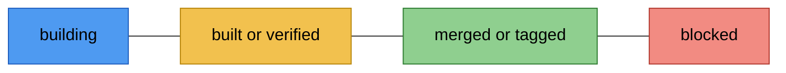

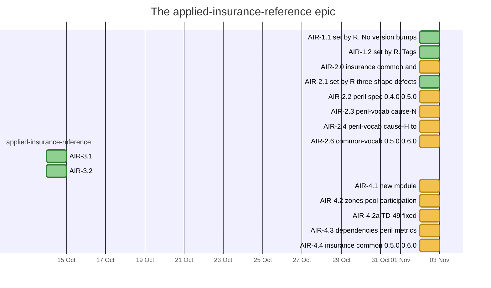

```mermaid
%%{init: {"themeVariables": {"taskBkgColor": "#f2c14e", "taskBorderColor": "#b8860b", "taskTextColor": "#000000", "activeTaskBkgColor": "#4e9af1", "activeTaskBorderColor": "#1f5fbf", "activeTaskBorderColor": "#1f5fbf", "doneTaskBkgColor": "#8fcf8f", "doneTaskBorderColor": "#2f7d32", "critBkgColor": "#f28b82", "critBorderColor": "#b23a30", "taskTextDarkColor": "#000000", "taskTextLightColor": "#000000"}}}%%
gantt
    title The formal-methods epic
    dateFormat YYYY-MM-DD
    axisFormat %d %b
    section formal-methods
    FM-0 track D the prover spike :fm0, 2026-10-06, 2026-10-07
    FM-4 :fm4, 2026-10-27, 2026-10-28
    FM-CG1 code generation from the layer :done, fmcg1, 2026-11-01, 2026-11-02
    FM-D0 environments :fmd0, 2026-10-06, 2026-10-07
    FM-D1 brief :fmd1, 2026-10-06, 2026-10-07
    FM-D2 Rocq track :fmd2, 2026-10-06, 2026-10-07
    FM-D3 Isabelle track :fmd3, 2026-10-06, 2026-10-07
    FM-D4 report :fmd4, 2026-10-10, 2026-10-11
    FM-PF1 fixes :fmpf1, 2026-10-07, 2026-10-08
    section formal-methods-track-b
    FMB-1 kernel and denotation :fmb1, 2026-10-09, 2026-10-10
    FMB-2 differential tests against the :fmb2, 2026-10-09, 2026-10-10
    FMB-2.1 harden the differential :fmb21, 2026-10-09, 2026-10-10
    FMB-2.2 verify fix the scheme-less :fmb22, 2026-10-09, 2026-10-10
    FMB-3 Surface regeneration :fmb3, 2026-10-09, 2026-10-10
    FMB-5 measured mutation score :active, fmb5, 2026-10-09, 2026-10-10
    section formal-methods-track-c
    FMC-1 Alloy skeleton :fmc1, 2026-10-08, 2026-10-09
    FMC-2 scheme composition :fmc2, 2026-10-07, 2026-10-08
    FMC-2.1 well-formedness facts re-run :fmc21, 2026-10-08, 2026-10-09
    FMC-2.2 model the composed scheme :fmc22, 2026-10-08, 2026-10-09
    FMC-2.3 model ADR-A116 own rule :fmc23, 2026-10-08, 2026-10-09
    FMC-4 a design model of ADR-A130 :fmc4, 2026-10-27, 2026-10-28
    section formal-methods-track-e
    FME-1.0 home generation tooling :fme10, 2026-10-09, 2026-10-10
    FME-1.1 the kernel for real :fme11, 2026-10-06, 2026-10-07
    FME-1.2 rounding and residual theorem :done, fme12, 2026-10-07, 2026-10-08
    FME-1.4 harden the gate and the kernel :fme14, 2026-10-09, 2026-10-10
    section formal-methods-track-h
    FMH-1.1 prefix antichain and overlap :fmh11, 2026-10-09, 2026-10-10
    FMH-1.2 :fmh12, 2026-10-09, 2026-10-10
    FMH-1.2a witness harness :fmh12a, 2026-10-09, 2026-10-10
    FMH-1.2b witnesses for the refusals and :fmh12b, 2026-10-09, 2026-10-10
    FMH-1.2c witnesses for the 13 remaining :fmh12c, 2026-10-09, 2026-10-10
    FMH-1.2d refuse a multi-valued :done, fmh12d, 2026-10-10, 2026-10-11
    FMH-1.3 static template checks S-3 and :done, fmh13, 2026-10-10, 2026-10-11
    FMH-1.4a refuse a composite boundary :done, fmh14a, 2026-10-10, 2026-10-11
    FMH-1.4b the declaration implementation :done, fmh14b, 2026-10-10, 2026-10-11
    FMH-1.4c a declaration the compiler :done, fmh14c, 2026-10-10, 2026-10-11
    FMH-1.5 stable labels :done, fmh15, 2026-10-10, 2026-10-11
    FMH-2.0 ADR-A123 :fmh20, 2026-10-10, 2026-10-11
    FMH-2.1 the typed IR and its renderer :fmh21, 2026-10-12, 2026-10-13
    FMH-2.11a the Persistence README as a :fmh211a, 2026-10-21, 2026-10-22
    FMH-2.11b the narrative the pictures :fmh211b, 2026-10-21, 2026-10-22
    FMH-2.12 the rows replace :fmh212, 2026-11-01, 2026-11-02
    FMH-2.2 equivalence harness :fmh22, 2026-10-12, 2026-10-13
    FMH-2.3 named-graph row writers :fmh23, 2026-10-12, 2026-10-13
    FMH-2.4a the composite ports :fmh24a, 2026-10-13, 2026-10-14
    FMH-2.4b Oxigraph probes benchmark :fmh24b, 2026-10-13, 2026-10-14
    FMH-2.5 key claims audits guard D :fmh25, 2026-10-23, 2026-10-24
    FMH-2.6 expected compiled profiles :fmh26, 2026-10-13, 2026-10-14
    FMH-2.6b event slots :fmh26b, 2026-10-14, 2026-10-15
    FMH-2.6c write disciplines :fmh26c, 2026-10-20, 2026-10-21
    FMH-2.6d patch log for in-place :fmh26d, 2026-10-20, 2026-10-21
    FMH-2.6e :fmh26e, 2026-10-23, 2026-10-24
    FMH-2.6f :fmh26f, 2026-10-23, 2026-10-24
    FMH-2.6g :fmh26g, 2026-10-23, 2026-10-24
    FMH-2.8a :fmh28a, 2026-10-23, 2026-10-24
    FMH-2.8b :fmh28b, 2026-10-23, 2026-10-24
    FMH-2.8c edges once faster members :fmh28c, 2026-10-20, 2026-10-21
    FMH-2.9 Mustache retired D-12 a :fmh29, 2026-10-21, 2026-10-22
    FMH-HO0 correct the ownership note and :done, fmhho0, 2026-10-10, 2026-10-11
    FMH-HO1 composite replace payload to :done, fmhho1, 2026-10-10, 2026-10-11
    FMH-HO2 draft ADR-A122 Proposed :fmhho2, 2026-10-10, 2026-10-11
    FMH-HO3 dal vocabulary 0.3.0 :done, fmhho3, 2026-10-10, 2026-10-11
    FMH-HO4 ownership tree and path :done, fmhho4, 2026-10-10, 2026-10-11
    FMH-HO5 switch the compiler to the :done, fmhho5, 2026-10-10, 2026-10-11
    FMH-HO6 ownership refusals and the :done, fmhho6, 2026-10-10, 2026-10-11
    FMH-HO7 composite create and tombstone :done, fmhho7, 2026-10-10, 2026-10-11
    FMH-HO8 injective graph naming within :done, fmhho8, 2026-10-10, 2026-10-11
    FMH-HO9 ownership documentation and :done, fmhho9, 2026-10-10, 2026-10-11
    FMH-W65 :fmhw65, 2026-10-23, 2026-10-24
```

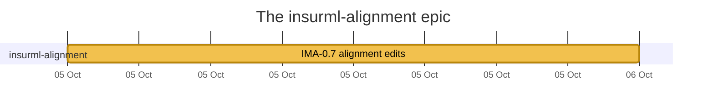

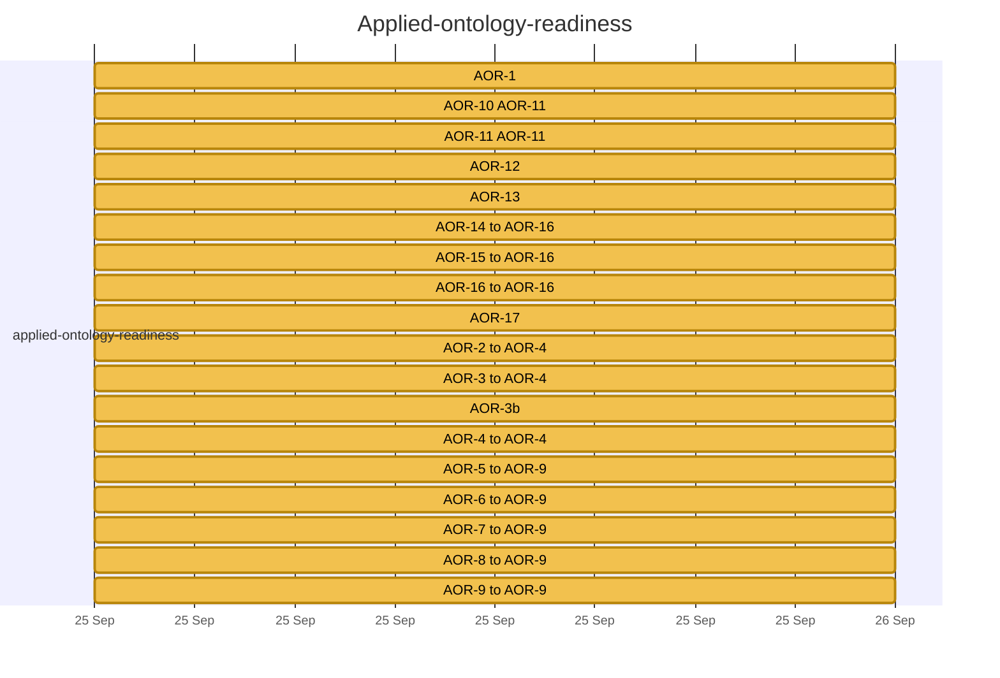

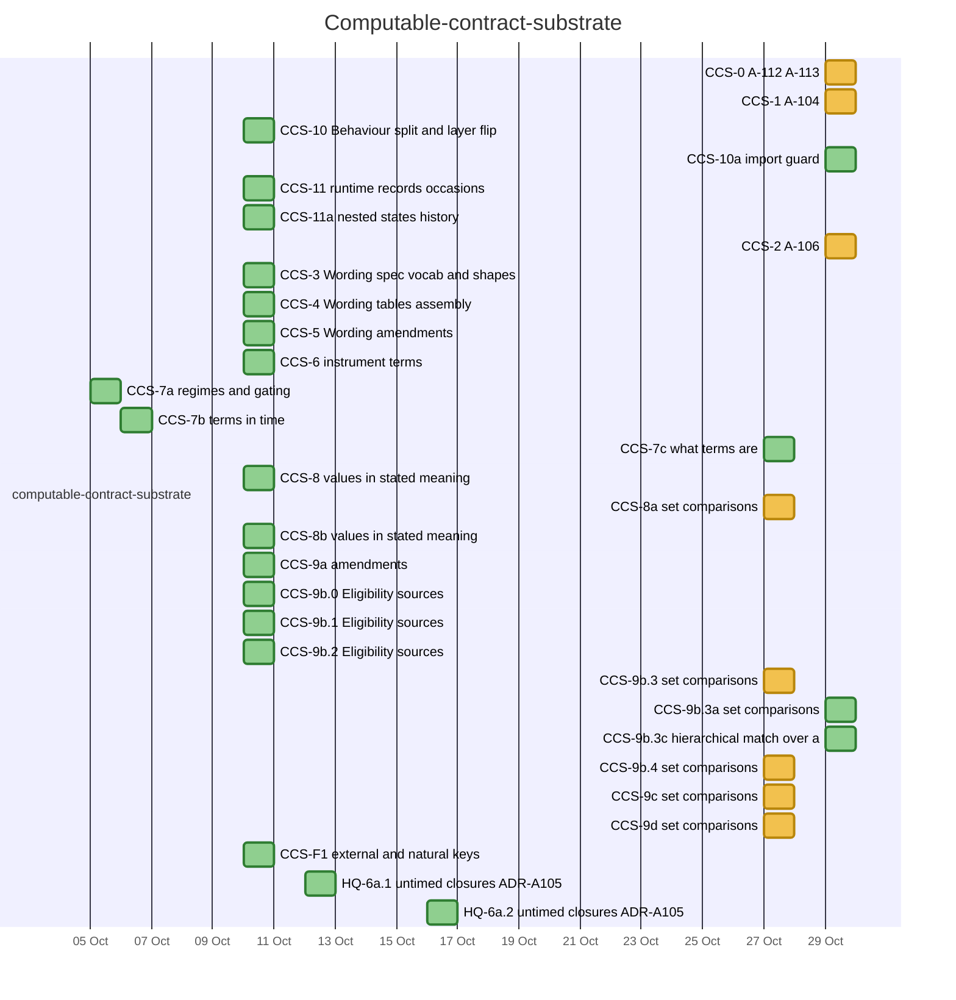

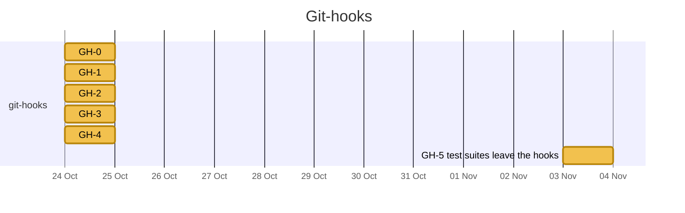

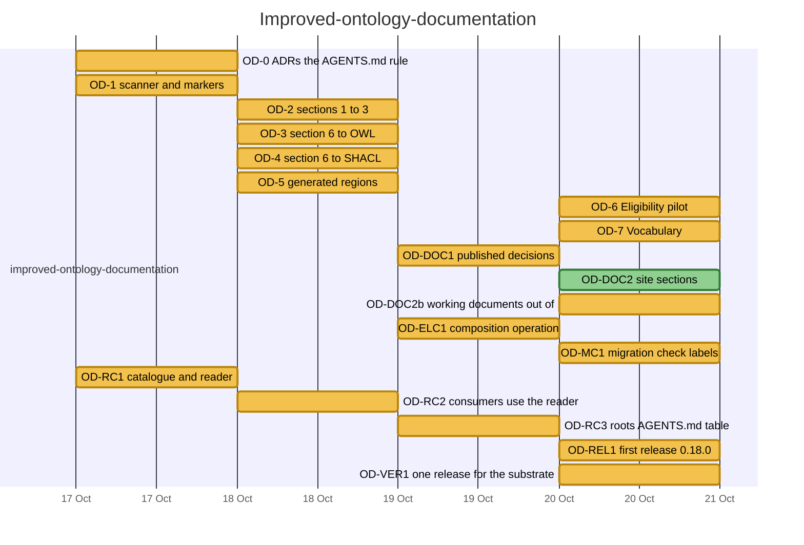

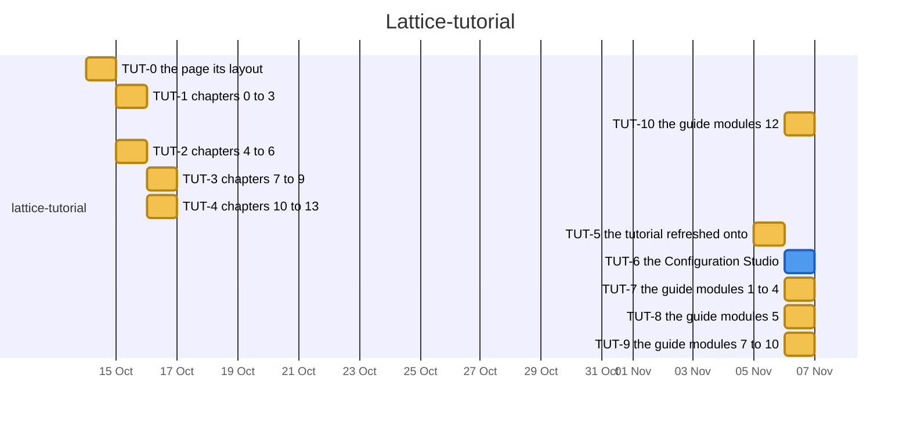

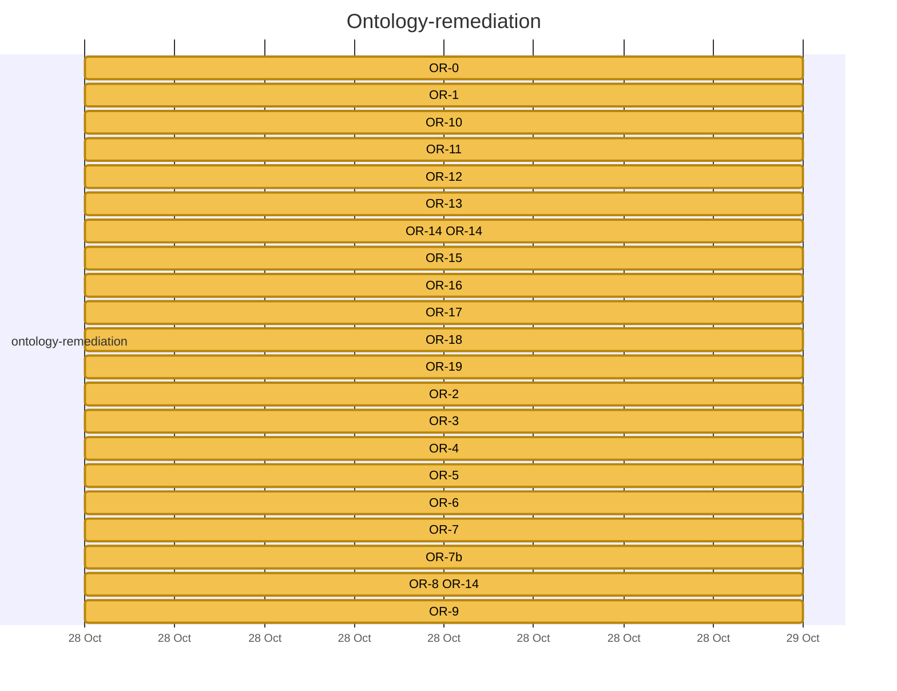

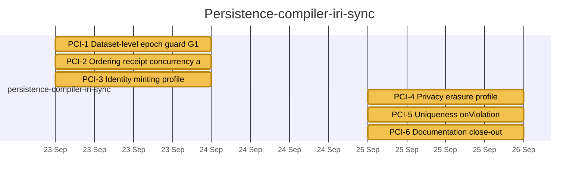

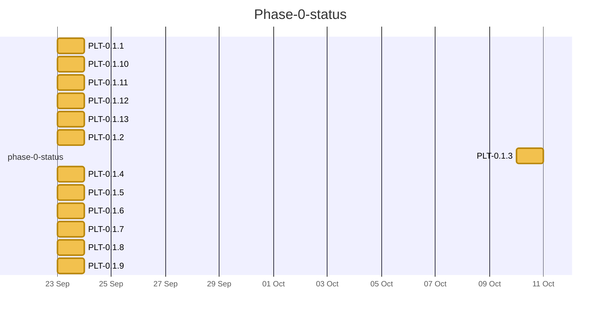

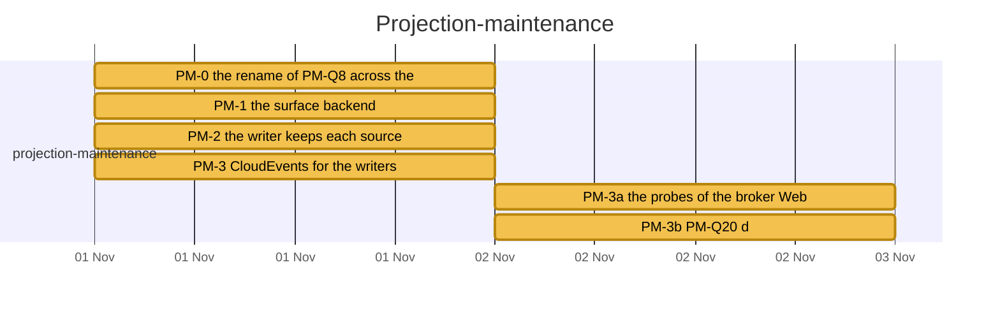

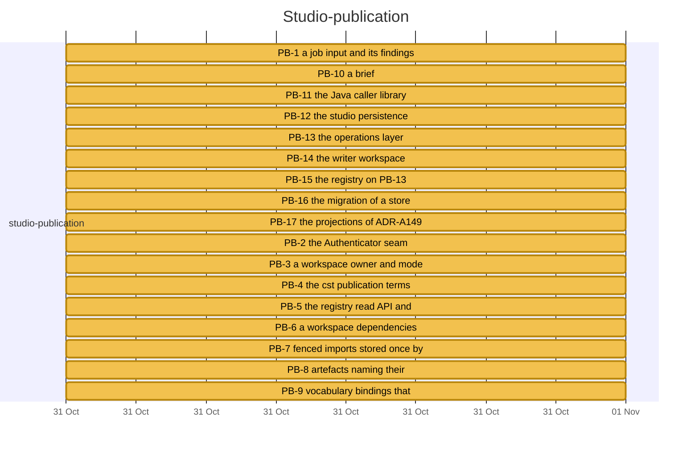

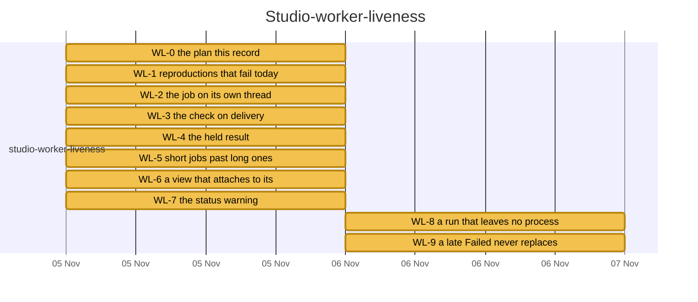

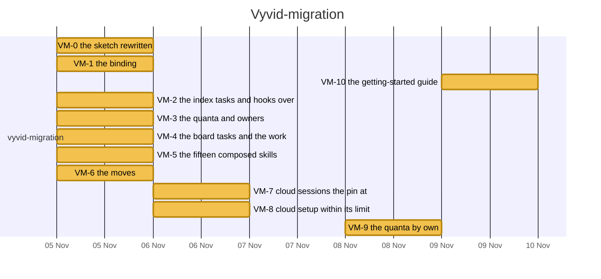

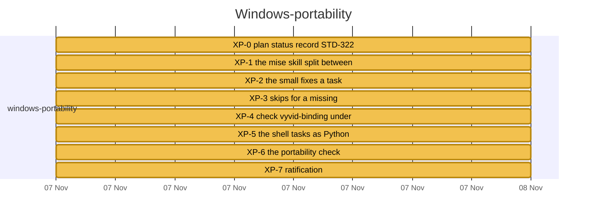

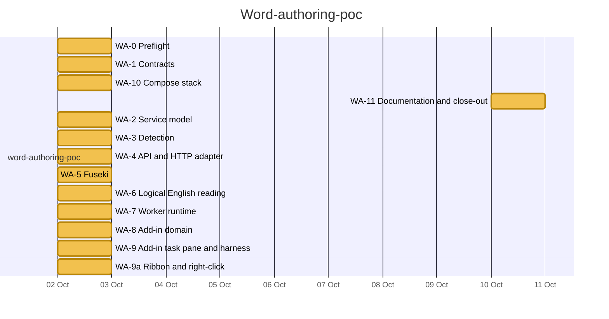

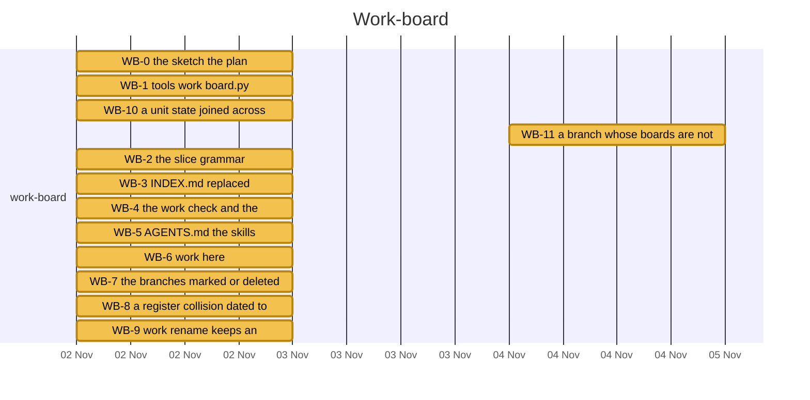

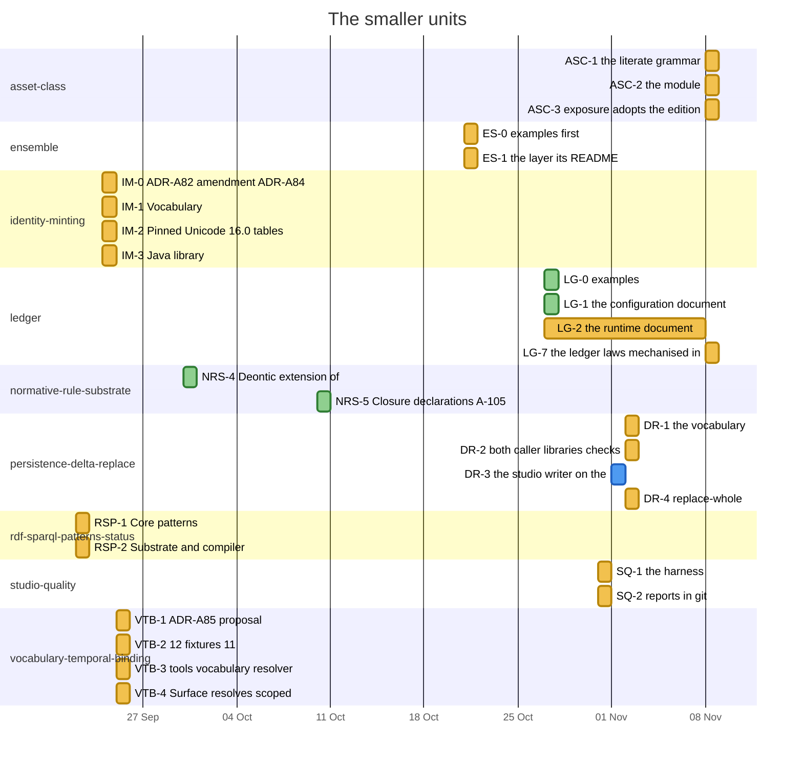

<!-- END GENERATED work-board-glance -->

## 2. How the epics depend on one another

Arrows point from the work that must come first. A dashed arrow is a dependency that is planned or not yet in force. Ledger's layer is on `main` and ADR-A131 is Accepted, so its dashed edges are the imports and slices still to come (LG-3, LG-4). Ensemble is still Proposed.

```mermaid
flowchart LR
    FM["Formal methods"]
    CCS["Computable contract substrate"]
    AIR["Applied insurance reference"]
    NRS["Normative rule substrate"]
    IMA["InsurML alignment"]
    IOD["Ontology documentation"]
    ENS["Ensemble, proposed"]
    LDG["Ledger"]
    PLAT["Platform programme"]
    TUT["Tutorial"]
    CBAA["Open CBAA, downstream"]

    FM -->|"Eligibility pass for CCS-9b.3"| CCS
    CCS -->|"HQ-6a closures for AIR-3.3"| AIR
    AIR -->|"AIR-3.3 gates CCS-13"| CCS
    CCS -->|"CCS-12 evaluator for FMB-4"| FM
    NRS -->|"NRS-1 for CCS-13 and CCS-13a"| CCS
    CCS -->|"Instrument tranche for IMA phase 3"| IMA
    AIR -->|"phases 1 to 4"| CBAA
    CBAA -.->|"integration gates AIR phase 5"| AIR
    CCS -.->|"hands over HQ-2, HQ-7, HQ-12"| ENS
    ENS -.->|"ES-4 and ES-5 for AIR-7.1"| AIR
    LDG -.->|"LG-3 gates AIR phase 5 and AIR-6.8"| AIR
    LDG -.->|"LG-3 gates CCS-12, PDD-07"| CCS
    ENS -.->|"ES-3 gates CCS-12"| CCS
    LDG -.->|"LG-4 allocation for AIR phase 7"| AIR
    IOD -->|"literate layout and one release"| CCS
    IOD -->|"literate layout and one release"| AIR
    IOD -->|"OD-DOC3 reviews it"| TUT
```

The arrow from NRS into CCS is NRS-1. CCS does its work (NQ-2, 2026-10-10) and its row stays on the NRS board, where its plan defines it. These arrows are the CCS plan's section 5, by the maintainer's decision of 2026-11-04: AIR-3.3 and NRS-1 gate CCS-13, NRS-1 gates CCS-13a, and CCS-12 waits on Ledger LG-3 and Ensemble ES-3.

## 3. The layers, now and proposed

The substrate's import order on `main` (ADR-A01 and its addenda, ADR-A106, ADR-A112). Ledger is on `main` with ADR-A131 Accepted, so it is drawn solid, and Ensemble is still proposed on `docs/placement-vehicles-structure` and drawn dashed. Where the new layers sit is taken from their plans (Ensemble imports Instrument and Behaviour's runtime, Ledger is imported by Behaviour's configuration once LG-3 migrates it, so that edge is dashed). ADR-A01's addenda of 2026-10-18 (Ensemble) and 2026-10-19 (Ledger) settle the order and both stay Proposed.

```mermaid
flowchart BT
    F["Foundation"] --> V["Vocabulary"]
    V --> Q["Quantification"]
    Q --> P["Party"]
    P --> E["Eligibility"]
    E --> W["Wording"]
    E --> BC["Behaviour configuration"]
    BC --> BR["Behaviour runtime"]
    W --> I["Instrument"]
    BC --> I
    LDG["Ledger"] -.-> BC
    I -.-> ENS["Ensemble, proposed"]
    BR -.-> ENS
    I --> APP["Applied modules"]
    ENS -.-> APP
```

Persistence, Surface and MORK sit beside the substrate. They are versioned on their own and consumed by the toolchains.

## 4. Active epics

### 4.1 Computable contract substrate (CCS)

**Documents.** [plan](plans/computable-contract-substrate.md), [status](status/computable-contract-substrate.md), [sketch](sketches/computable-contract-substrate.md). ADRs A-104, A-106, A-112 to A-115 and A-120 accepted, A-105 and A-145 published.

**Where it is.** The status record reads verified, in progress. Gate A passed on 2026-10-01 (CCS-0 to CCS-2). Tranche B (CCS-3 to CCS-5, Wording) and tranche C (CCS-10, CCS-10a, CCS-11, CCS-11a, the Behaviour split and nested states) are merged and tagged, and so is CCS-F1. In tranche D, CCS-6, CCS-7a to CCS-7c, CCS-8, CCS-8b, CCS-9a, CCS-9b.0 to CCS-9b.2, HQ-6a.1 and HQ-6a.2 (ADR-A105) are merged, and HQ-6a.2's `executable-v0.7.0` is tagged. CCS-9b.3a (set comparisons, ADR-A145) and CCS-9b.3c (the hierarchy relation) are merged and tagged in release 0.20.0 (2026-10-29), with the profile union fix and the multi-store conformance unit. CCS-9b.3 is blocked on CCS-9b.3b, aggregate bindings, which is next to brief. HQ-6b, closures over a period, follows before CCS-12.

```mermaid
flowchart LR
    subgraph A["Tranche A, decisions"]
        A1["CCS-0 to CCS-2"]
    end
    subgraph B["Tranche B, Wording"]
        B1["CCS-3 to CCS-5"]
    end
    subgraph C["Tranche C, Behaviour"]
        C1["CCS-10, CCS-10a, CCS-11, CCS-11a"]
    end
    subgraph D["Tranche D, Instrument"]
        D1["CCS-6 to CCS-8b"] --> D2["CCS-9a"] --> D3["CCS-9b.0 to CCS-9b.2"] --> D4["HQ-6a.1, HQ-6a.2"]
        D4 --> D5["CCS-9b.3a, CCS-9b.3c"] --> D5b["CCS-9b.3b"] --> D6["CCS-9b.4"]
        D6 --> D7["CCS-9d, CCS-9c, CCS-8a"]
    end
    subgraph E["Tranche E, evaluation"]
        E1["CCS-12, CCS-13"]
        E2["CCS-13a"]
    end
    subgraph F["Tranche F, close"]
        F1["CCS-16c"]
        F2["CCS-14 to CCS-17"]
    end
    A --> B --> C --> D
    D7 --> E1
    D6 --> F1
    E1 --> F2

    classDef done fill:#d8f0d8,stroke:#3a7d3a
    classDef next fill:#fff1c2,stroke:#a07800
    classDef wait fill:#eeeeee,stroke:#888888
    class A1,B1,C1,D1,D2,D3,D4 done
    class D5 next
    class D6,D7,E1,E2,F1,F2 wait
```

**What it waits on.** CCS-9b.4 waits on CCS-9b.3b, CCS-9d on CCS-9b.4, and CCS-9c on CCS-9d. CCS-12 is blocked on CCS-9c, Ledger LG-3 and Ensemble ES-3. CCS-13 is blocked on CCS-9c, AIR-3.3 and NRS-1. CCS-13a is blocked on NRS-1. CCS-14 is blocked on CCS-8a, CCS-9c and CCS-12, and CCS-15 to CCS-17 follow in turn. CCS-16c, removing Party's shares, is planned and must land before the epic closes. It follows CCS-9b.4.

**Held questions.** HQ-1 to HQ-12, in the plan, each a planned row on the board. Three are proposed for hand-over to the Ensemble unit (HQ-2's second case, HQ-7, HQ-12) once ADR-A130 is accepted. ADR-A130 is still Proposed.

### 4.2 Applied insurance reference (AIR)

**Documents.** [epic plan](plans/applied-insurance-reference.md), [status](status/applied-insurance-reference.md), [lanes](plans/applied-insurance-reference-lanes.md), [claims plan](plans/applied-insurance-reference-claims.md), [substrate plan](plans/applied-insurance-reference-substrate.md), [leftovers](plans/air-leftovers.md).

**How it runs.** Two machines (lanes §2 to §4). Machine R verifies and merges, and also builds CCS. Machine S builds the slices in one trip on one branch, which comes to R once the trip is done. S became unavailable on 2026-10-14 and R built AIR-4.2a to AIR-4.4. The epic is in round 3, the trip's commits up to AIR-4.4 are on `main`, and AIR-4.5 is next on the trip. The record's Status line still reads planned.

**Where it is.** The board rows are the state. AIR-1.1, AIR-1.2, AIR-2.1, AIR-3.1 and AIR-3.2 are merged. AIR-2.0, AIR-2.2, AIR-2.3, AIR-2.4, AIR-2.6, AIR-4.1, AIR-4.2, AIR-4.2a, AIR-4.3 and AIR-4.4 are built.

| Phase | Plan | State |
|---|---|---|
| 0 Decisions | [plan](plans/applied-insurance-reference-phase-0.md) | ✅ complete |
| 1 Module split | [plan](plans/applied-insurance-reference-phase-1.md) | ✅ AIR-1.1 and AIR-1.2 merged |
| 2 Peril vocabulary | [plan](plans/applied-insurance-reference-phase-2.md) | 🚧 AIR-2.1 merged. AIR-2.0, AIR-2.2 to AIR-2.4 and AIR-2.6 built, the cause scheme at 287 concepts in eight families. AIR-2.5 and AIR-2.7 planned, briefed |
| 3 Readings and crosswalks | [plan](plans/applied-insurance-reference-phase-3.md) | 🚧 AIR-3.1 and AIR-3.2 merged. AIR-3.3 planned, its brief blocked on AIR-3.3-Q1. AIR-3.4 and AIR-3.5 planned, briefed |
| 4 Exposure | [plan](plans/applied-insurance-reference-phase-4.md) | 🚧 AIR-4.1 to AIR-4.4 and AIR-4.2a built. AIR-4.5 and AIR-4.6 planned, briefed. AIR-4.2b planned, its change built on the Track H line and to bring across |
| 5 Contract module | [plan](plans/applied-insurance-reference-phase-5.md) | 🅿️ AIR-5.1 to AIR-5.9 planned, deferred until Open CBAA integrates phases 1 to 4 (decision D2) |
| 6 Submission, claims | [plan](plans/applied-insurance-reference-phase-6.md), [claims](plans/applied-insurance-reference-claims.md) | ⏳ AIR-6.1 planned, briefed. The claims slices AIR-6.2 to AIR-6.12 and AIR-6.W0 to AIR-6.W7 planned, none briefed |
| 7 Placement and capital | [plan](plans/applied-insurance-reference-phase-7.md) | 📝 proposed 2026-10-18. AIR-7.0 to AIR-7.10 planned, no slice briefed |

```mermaid
flowchart LR
    P0["0 Decisions"] --> P1["1 Module split"]
    P1 --> P2["2 Peril vocabulary"]
    P1 --> P4["4 Exposure"]
    P2 --> P3["3 Readings"]
    P4 --> P3
    P4 --> P6["6 Submission and claims"]
    P2 --> P5["5 Contract module"]
    P4 --> P5
    P5 -.-> P7["7 Placement and capital"]
    P6 --> P7

    classDef done fill:#d8f0d8,stroke:#3a7d3a
    classDef doing fill:#fff1c2,stroke:#a07800
    classDef parked fill:#e6e0f5,stroke:#6a55a0
    classDef todo fill:#eeeeee,stroke:#888888
    class P0,P1 done
    class P2,P3,P4 doing
    class P5 parked
    class P6,P7 todo
```

**Milestones** (epic plan §4). M1 (the reference cause scheme decides open-perils conditions) and M3 (exposure units derived on demand) are the nearest. M4 and M5 are deferred with Phase 5. M6 to M8 are the claims milestones, ending with a coverholder's bordereau lifted, reconciled and emitted again.

**Phase 7, proposed.** A programme data model (towers, layers, lines and their formation state), market responses from decline to binding quote, risk-capital vehicles, and the London market's MRC form as a specialisation. It rests on Ensemble (ADR-A130, Proposed) and Ledger (ADR-A131, Accepted). It records and evaluates programmes. It does not advise on them.

### 4.3 Formal methods (FM)

**Documents.** [epic plan](plans/formal-methods.md), [epic status](status/formal-methods.md), [lifecycle guide](formal-methods-lifecycle.md). ADR-A-FM1 to ADR-A-FM4 accepted. The prover is Isabelle/HOL, with Haskell and Scala as code-generation targets (FM-D1 and FM-D10, decided 2026-10-06).

| Track | Subject | State |
|---|---|---|
| D | prover spike | ✅ FM-D0 to FM-D4 and FM-PF1 built, two Gate D criteria open |
| A | ledger and harness | ⏳ not started, waits on Gate D and its ADR |
| B | reference semantics and oracle | 🚧 FMB-1 to FMB-3, FMB-2.1 and FMB-2.2 built. FMB-4 planned, waits on CCS-12. FMB-5 building, blocked on a package-mirror gap |
| C | design-time models | 🚧 FMC-1, FMC-2 and FMC-2.1 built. FMC-2.2, FMC-2.3 and FMC-3 planned, FMC-3 next. ADR-A116 Proposed. FMC-4, a design model of ADR-A130, is built and has its row here since 2026-11-04. |
| E | prover programme | 🚧 FME-1.0, FME-1.1 and FME-1.4 built. FME-1.2 dropped. FME-1.3 planned, waits on the overlap-rule ADR (ADR-A116). FME-2 to FME-5 planned |
| F | native tooling | ⏳ not started |
| G | instrument assurance | ⏳ waits on FMB-4 and FMC-3 |
| H | Persistence | 🚧 FMH-1.1 to FMH-1.5, FMH-HO0 to FMH-HO9 and FMH-2.0 to FMH-2.3 merged. FMH-2.4a to FMH-2.6g (except FMH-2.6d), FMH-2.8a to FMH-2.8c, FMH-2.9, FMH-2.11a, FMH-2.11b, FMH-2.12 and FMH-W65 built or verified. FMH-2.6d, FMH-2.7 and FMH-2.8 still read planned. FMH-3 to FMH-10 planned |

```mermaid
flowchart LR
    D["D prover spike"] --> A["A ledger and harness"]
    D --> E["E prover programme"]
    B["B reference semantics"] --> B4["FMB-4 evaluation context"]
    CCS12["CCS-12"] --> B4
    C["C design-time models"] --> C3["FMC-3 slot exclusivity"]
    B4 --> G["G instrument assurance"]
    C3 --> G
    F["F native tooling"]
    H["H Persistence"] --> H3["FMH-3 onward"]

    classDef done fill:#d8f0d8,stroke:#3a7d3a
    classDef doing fill:#fff1c2,stroke:#a07800
    classDef todo fill:#eeeeee,stroke:#888888
    class D done
    class B,C,E,H doing
    class A,B4,C3,G,F,H3,CCS12 todo
```

**Track H, the release.** Track H's Next action lists every planned FMH-2 slice built: FMH-2.6c to FMH-2.6g, FMH-2.7, FMH-2.8a to FMH-2.8c, FMH-2.9, FMH-2.11a and FMH-2.11b (the Persistence README in the literate layout), the test-suite work FMH-TS-1 and FMH-TS-2, a new `packages/persistence/python`, Oxigraph as the Persistence tests' default engine, and the release prepared as 0.19.0 with the applied modules re-pinned. The maintainer answered the review items Q1 to Q6 on 2026-10-21 and approved the second review's follow-ups on 2026-10-23, so nothing on the line awaits review. The tags `persistence-v0.19.0` and `ontologies-v0.19.0` exist, so the line is on `main`, although the record still lists the merge as the maintainer's and its board rows have not moved.

**Isabelle models.** `fml/isabelle-layers` carries Isabelle/HOL models of the layers' laws and a code-generation spike, with Haskell and Scala exports run and Eligibility's decision table executed. The spike is FM-CG1 on the epic's board, merged 2026-11-02, and FM-CG2, the generated Haskell as a differential oracle, is planned behind PDD-19. **A further code-generation pass on 2026-11-07** made Eligibility execute from the generated code, with ten results agreeing across Isabelle's `value`, a Haskell driver and a Scala driver. It found the generated code partial on HOL's cofinite set, where Scala warns six times and Haskell fails at run time without warning, which is TD-155 and a stated precondition the evaluator's interface owes at EV-0. **C4 gained three checks** on the same day, C4-A10 to C4-A12, isolating the premise C4-A2 rests on and showing that amount conservation does not detect an omitted step. **FM-D17 was widened on 2026-11-07** for the ledger unit's LG-7: the Python rendering of an `isabelle-spec` block is opt-in by a first-line directive, so a kernel block may hold any Isabelle definition, and the prover spike's duplicate gate was removed in favour of `tools/proofs/gate.py` (ADR-A-FM2's addendum).

### 4.4 Improved ontology documentation (IOD)

**Documents.** [plan](plans/improved-ontology-documentation.md), [status](status/improved-ontology-documentation.md). ADR-A121, ADR-A126 and ADR-A129 published, ADR-A127 accepted.

**Where it is.** The record reads verified, in progress. OD-0, OD-RC2, OD-RC3, OD-1, OD-7, OD-DOC1, OD-ELC1, OD-MC1, OD-VER1 and OD-REL1 are verified on its board, OD-RC1, OD-2 to OD-6 and OD-DOC2b are built, and OD-DOC2 is merged. `docs/literate-v2` was squash-merged into `main` on 2026-10-20 (`cf1b8eb`). That brought the repository catalogue and its reader (OD-RC1 to OD-RC3), the literate README layout and its compilers to OWL and SHACL (OD-1 to OD-5), the Eligibility and Vocabulary pilots (OD-6, OD-7), published decisions and the site sections (OD-DOC1, OD-DOC2, OD-DOC2b), and one release number for the substrate and standalone ontologies, 0.18.0 (OD-VER1, OD-REL1). `GOVERNANCE.md` and the validation and test plan were retired in the same change.

**Next.** The tag `ontologies-v0.18.0` is on the merge commit and the line has since reached `ontologies-v0.21.0`, but the board rows have not moved to merged. OD-8 onward is planned and migrates the remaining layers one at a time, after OD-7 and, for Foundation and Party, their part of TD-16. OD-RC4 to OD-RC6 are planned and extend the catalogue downstream, promote packages and fold in the XML catalogue (OD-RC6 needs a new ADR on ADR-A88). OD-DOC3 is planned and reviews the tutorial once it is merged.

### 4.5 Ensemble and Ledger, substrate layers

Ensemble is proposed on `docs/placement-vehicles-structure`, with its sketch and plan, for the maintainer's review. Its status record was created on 2026-11-04 with ES-0 and ES-1 briefed, their packs written, and ES-2 to ES-9 planned. Ledger's layer is on `main` with ADR-A131 Accepted. LG-0 (examples) and LG-1 (the configuration document) are built, verified and committed, LG-2 (the runtime document) is briefed and not started, and LG-3 to LG-5 are planned. LG-5, the benchmark, is part built ahead of LG-2.

**A design pass on 2026-11-07** briefed LG-4, ES-3 and ES-8 further and raised ES-Q10 and WPG-Q2, from an external Isabelle development of a reinsurance inurement waterfall read as background ([sketch](sketches/waterfall-proofs-and-the-generality-gap.md)). No slice changed state. LG-4 takes conservation with an explicit residual term, which settles the open half of TD-95 in an instance, the allocation axioms corrected from five to four with monotonicity dropped, the merge rule as declared data never a default, and attribution across parties as a second conservation law. ES-3 takes the separation of uniqueness from computability, the positional total order as the condition ADR-A130 decision 5's independence-of-order bullet rests on, a unit reading only its declared predecessors as load-bearing, and a conformance case for schedule completeness, since conservation cannot see a unit that never ran. ES-8 carries a withdrawal: that development bears nothing on decision 5's criterion for admitting a cyclic component, because its counterexample solves a cycle over determined values while decision 5's least fixpoint is over the information order. The ledger does not gate the ensemble as a unit, only LG-2 does, and the ensemble's own head gate is C4 (section 8). WPG-Q4 was answered the same day: an applied development's general core is rebuilt under `tools/proofs/<layer>/` and the development itself stays outside the repository, now ADR-A-FM2's addendum, with LG-7 the first slice under it.

**LG-7 was built on 2026-11-08**, on machine S. `tools/proofs/ledger/` proves sixteen ledger laws under the gate from definitions in section 10 of the ledger README, among them the four allocation axioms for the proportional and priority rules, conservation with a residual over the account tree, settlement at one position independent of the order of proposal, and exact rounding by giving the residual to the first keys in order. LG-2's laws as tests and LG-4's conservation shape can cite them. WPG-Q1 was answered the same day, (a) holds, so the uniqueness argument is general once the body is a parameter that reads only its declared predecessors.

**LG-2 was built on 2026-11-08**, on machine S, after LG-7. Ledger has a runtime document: named account instances, passes, postings at the drawn account only with an effective and a recorded position, balance records, merge records with their grants, and checkpoints. Sixteen SHACL-SPARQL shapes check recorded values against the laws LG-7 proved, among them the fold over a subtree, availability as the least balance along the path, the credit ceiling and a proportional merge's conservation, and a pass of 5,000 postings and 10,000 balance records validates in under a minute on rdflib. A periodic amount is one account per period (PDD-15). The `owl:rational` probe found no store compares the literal by value (TSD-70), so an exact share is two integers. Two questions are open for the maintainer, LG-Q9 on the running balance under post-once and LG-Q10 on a reinstatement under a capacity pool.

| | Ensemble | Ledger |
|---|---|---|
| Prefix and home | `ens:`, `ontology/ensemble/` | `ldg:`, `ontology/ledger/` |
| ADR | A-130, Proposed | A-131, Accepted |
| Holds | identities naming member instruments by role, reified relations between instruments (kinds K1 to K8), judgements across an ensemble, confidentiality between members, evaluation by composition | account definitions and their tree, postings and balance records, allocation with conservation, Behaviour's migration from allowances to accounts |
| Takes over | CCS HQ-2 (second case), HQ-7, HQ-12 | PDD-07 and the ledger part of PDD-08 |
| Serves | AIR Phase 7, AIR-6.8's cross-instrument reads | AIR Phase 7, Behaviour's threshold regimes |

### 4.6 InsurML alignment (IMA)

**Documents.** [epic plan](plans/insurml-alignment.md), [phase 0](plans/insurml-alignment-phase-0.md), [status](status/insurml-alignment.md), [vision](../architecture/insurml-alignment-vision.md).

Nothing is built, and every slice on the board is planned (IMA-0.1 to IMA-4.5). The record reads Proposed, awaiting the maintainer's review of the vision, the sketches and the plans. Nine phases are planned, from decisions (Phase 0) through the InsurML profile, lift and lower kits, Wording changes, an assembly interface, meaning over components, authoring and exchange, library ingestion, to continuous standards engagement. Phase 3 waits on Phase 2 and the Instrument tranche of CCS. One slice, IMA-3.3, moved into CCS as CCS-8b, which is merged. PDD-01 to PDD-03 hold its ownership and tooling questions.

### 4.7 Normative rule substrate (NRS)

**Documents.** [plan](plans/normative-rule-substrate.md), [status](status/normative-rule-substrate.md).

Nothing is built in this unit, and the record reads blocked. CCS took NRS-1, NRS-2, NRS-4, NRS-5 and the Behaviour part of NRS-8, and absorbed NRS-6 and NRS-8 into CCS-12 and CCS-13 (NQ-1 to NQ-4, 2026-10-10). The board still lists NRS-1 and NRS-2 here, as blocked. NRS keeps the rule-language integration work (LegalRuleML), with decisions D1, D4 and D5 open. ADR-A108 and ADR-A109 are drafted and Proposed, and A-107, A-110 and A-111 are reserved. NRS-9 changes Foundation and must wait for AIR Phase 2 to finish. The contract builder's ODRL import took NRS-12's import half on 2026-10-29 (ADR-A144, Proposed), and export, interchange and the conformance measurement stay here.

## 5. Smaller units

The units outside an epic are rows of section 1's generated table, with their state, next slice and the branches that move them, and their own charts there once they have five dated slices. Nothing is listed twice.

**More of the studio's browser journeys on the real stack, not yet a unit.** Added 2026-11-06. `mise run test:config-studio-browser` runs 23 journeys against the in-memory fake service and 3 against a real stack, so a fault in the service, the writer, the broker or the worker reaches only those 3. The first candidates are the journeys that wait on a job, among them what the `studio-worker-liveness` pack records as not driven by a browser, a view attaching to its running publication or mapping proposal, and the Build view's wait for a queued job.

## 6. The platform programme

**Documents.** [epic plan](plans/lattice-platform-agentic-development-v0.2.md), phase plans [0](plans/phase-0-plan.md) to [4](plans/phase-4-plan.md), status records [0](status/phase-0-status.md) to [4](status/phase-4-status.md), [continuation status](status/platform-continuation.md).

The first platform build (the earlier phases 0 to 6: Surface lifecycle and ledger, workers, release integration, OCI adapter, projection lowering, MORK review and governance queue) is merged and accepted, as the continuation status and the six phase handoffs record (2026-09-20), with the verification gaps each handoff lists. The new programme's phases are sequential, and none has started a code slice.

```mermaid
flowchart LR
    P0["Phase 0, decisions and foundations"] --> P1["Phase 1, graph-primary core"]
    P1 --> P2["Phase 2, ingestion and query"]
    P2 --> P3["Phase 3, operation plane"]
    P3 --> P4["Phase 4, maturity"]

    classDef doing fill:#fff1c2,stroke:#a07800
    classDef todo fill:#eeeeee,stroke:#888888
    class P0 doing
    class P1,P2,P3,P4 todo
```

**Phase 0** reads built (2026-09-23), with its decision pack drafted and pending ratification. PLT-0.1.1 to PLT-0.1.13 are built, PLT-0.1.3 on 2026-10-10 and the rest on 2026-09-23, and PLT-0.1.14 (threat model), PLT-0.1.15 (NFR catalogue) and PLT-0.2r (build skeleton) are planned. The pack drafted 17 ADRs on 2026-09-23 (A-48, A-50, A-51, A-54, A-57, A-59, A-62, A-63, A-65 to A-69, A-71, A-74, A-75, A-81). Sixteen are Proposed, and A-51 is superseded by A-82, also Proposed. A-76 (Maven or Gradle) is not drafted, the `graph-spi` and `semantic-dataset-spi` decision is open, and the A-44 and A-81 renumbering awaits the maintainer's confirmation. Milestones M0 and M1 are not demonstrated.

**Phases 1 to 4.** Phase 1 reads blocked (2026-09-22) on Phase 0's exit gate. Phases 2 and 3 are planned rolling-wave placeholders, expanded at P1.11.3 and P2.11.4 respectively. Phase 4 is planned and sized only after Phase 3's measurements.

## 7. Branches

<!-- BEGIN GENERATED work-board-branches. Written by `mise run build:roadmap` from the status records on every branch. Edit a status record, never this region. -->

Branches with a commit `main` lacks, from the same reading.

| Branch | Tip | Ahead of main | Upstream | Moves |
|---|---|---|---|---|
| `ccs-trunk` | 2026-11-04 | 54 | pushed | FM-4 |
| `ccs/board-corrections` | 2026-11-04 | 2 | pushed | FM-4 |
| `claude/adoring-torvalds-ce7ffe` | 2026-11-08 | 13 | pushed | no mark |
| `docs/placement-vehicles-structure` | 2026-11-08 | 25 | pushed | no mark |
| `fix/vyd-wrapper-passthrough` | 2026-11-06 | 2 | pushed | no mark |
| `fml/isabelle-layers` | 2026-11-04 | 33 | pushed | no mark |
| `getting-started-vyd` | 2026-11-09 | 3 | pushed | no mark |
| `persistence-mbt` | 2026-09-23 | 1 | pushed | board not on the grammar, 26 rows. Run `mise run work:normalise -- --apply` and `mise run work:rename -- --apply` there |
| `realign/config-authoring-studio` | 2026-11-03 | 167 | pushed | CCS-8a, CCS-9b.3, CCS-9b.4, CCS-9c, CCS-9d, FM-4 |
| `tutorial/studio-guide` | 2026-11-09 | 1 | pushed | no mark |
| `vyvid-migration` | 2026-11-05 | 34 | pushed | no mark |
| `vyvid-quanta-builtin` | 2026-11-08 | 3 | pushed | no mark |

<!-- END GENERATED work-board-branches -->

## 8. The critical path

The longest chain of dependencies now runs through CCS's tranche D, with Ledger LG-3 and Ensemble ES-3 beside it, into its evaluator, and from there into formal methods and AIR's later phases. AIR-3.3 and NRS-1 lead to CCS-13 and CCS-13a beside that chain.

```mermaid
flowchart LR
    Q1["AIR-3.3-Q1 decided"] --> AIR33["AIR-3.3 readings in SWRL and OWL"]
    AIR33 --> NRS1["NRS-1 condition composition acyclicity"]
    AIR33 --> CCS13["CCS-13 relation plans"]
    NRS1 --> CCS13
    NRS1 --> CCS13a["CCS-13a joint satisfiability"]
    K93["CCS-9b.3b aggregate bindings"] --> K94["CCS-9b.4 qualifying rules"]
    K94 --> REST["CCS-9d, CCS-9c"]
    REST --> CCS12["CCS-12 evaluator"]
    REST --> CCS13
    LG3C["Ledger LG-3"] --> CCS12
    ES3C["Ensemble ES-3"] --> CCS12
    K8A["CCS-8a template library"] --> CLOSE
    K94 --> K16c["CCS-16c Party shares removed"]
    CCS12 --> FMB4["FMB-4 evaluation context"]
    FMB4 --> G["FM track G instrument assurance"]
    FMC3["FMC-3 slot exclusivity"] --> G
    CCS12 --> CLOSE["CCS-14 to CCS-17, epic close"]
    K16c --> CLOSE
    REST --> IMA3["IMA phase 3"]
    VR4["v-rig built 2026-11-08,<br/>a run on a rig and its triage"] --> C4A["FM C4 Alloy model of A130"]
    C4A --> A130["ADR-A130 accepted"]
    A130 --> ES012["Ensemble ES-0 to ES-2"]
    ES012 --> ES3C
    LG2C["Ledger LG-2"] --> ES3C
    ES3C --> ES45["Ensemble ES-4 and ES-5"]
    ES45 --> AIR71["AIR-7.1 programme module"]
    LG2C --> AIR71
    LG3C --> AIR71
    CBAA["Open CBAA integrates AIR 1 to 4"] --> AIR5["AIR phase 5"]
    LG3C --> AIR5
```

**Reading it.**

- **CCS-9b.3b and CCS-9b.4** gate the most work. CCS-9b.4, CCS-9d, CCS-9c and CCS-16c, the evaluator, the epic's close, FMB-4 and FM track G, and IMA Phase 3 sit downstream. CCS-13a does not, since it is blocked on NRS-1 only.
- **AIR-3.3** is ready once AIR-3.3-Q1 is answered, since HQ-6a.2 has merged. It gates CCS-13 on the CCS board and NRS-1 on the NRS board, so relation plans wait on it twice over, and the evaluator does not.
- **Ledger LG-3 and Ensemble ES-3** gate the evaluator, CCS-12, from outside CCS. LG-3 is planned, and the ensemble gained a status record on 2026-11-04 carrying all ten of its rows.
- **The ledger does not gate the ensemble as a unit. One slice does.** Refreshed 2026-11-07. ES-3 waits on LG-2 alone, ES-4 on LG-2 with LG-Q3 and LG-Q4 answered, and LG-4 gates only ES-8, the last ensemble slice. LG-3, LG-5 and LG-6 have no ensemble dependency. Two slices move the substrate release and so cannot be concurrent, LG-2 and ES-1, which puts ES-1 behind LG-2's merge rather than behind its build.
- **C4 is the ensemble's head gate, not the ledger.** ES-0 is blocked on ADR-A130's acceptance, which the ensemble plan places after the C4 Alloy model, so ES-0 to ES-2 cannot start whatever the ledger does. C4 is briefed in the track C plan with twelve checks as of 2026-11-07. Since 2026-11-07 it waits on [v-rig](plans/v-rig.md), whose RDF projection of a verification rig's declared view is the requirements oracle for the ledger and ensemble drafts, so that ADR-A130's text settles before C4 models it rather than after. The unit was built on 2026-11-08, every slice with its Validation Pack, and on its own mini-rig the layers refuse the projection 142 times, mostly for identities and units the format does not state, and 14 of 28 competency questions have no answer, among them that no term links an instrument to the account of its limit. What stands between C4 and its start is a run on a rig and the triage of its findings into the ledger, ensemble and programme plans, which is the maintainer's.
- **ADR-A130** alone takes the three CCS held questions HQ-2 (second case), HQ-7 and HQ-12, and it is still Proposed. ADR-A131 is Accepted and Ledger's layer is on `main`, and Ledger takes PDD-07, not a CCS held question.
- **AIR-7.1** waits on Ensemble ES-4 and ES-5 and on Ledger LG-2 and LG-3, along with AIR-7.0, P7-Q5 and CCS's Instrument tranche. The ADRs are not the gate, the slices are.
- **AIR Phase 5** waits on Open CBAA's integration of phases 1 to 4 and on Ledger LG-3, which is planned. PDD-08, the evaluation context, is split and unowned per `status/ledger.md`, with its pieces going to a Quantification slice, LG-2 and PDD-13.

## 9. Decisions waiting

<!-- BEGIN GENERATED work-board-decisions. Written by `mise run build:roadmap` from the status records on every branch. Edit a status record, never this region. -->

Read from the registers in this tree: 35 Proposed decisions, 20 pending design decisions, 109 rows of [technical debt](technical-debt.md), and 40 slices named only in prose, listed by unit in the identifier exceptions baseline.

### 9.1 Proposed decisions

| Decision | Subject | Status |
|---|---|---|
| [A-48](../architecture/decisions/ADR-A48-transaction-boundary-catalogue.md) | Transaction boundary catalogue (replaces CAP framing) | Proposed |
| [A-50](../architecture/decisions/ADR-A50-role-profiled-deployment.md) | Role-profiled deployment | Proposed |
| [A-54](../architecture/decisions/ADR-A54-dataset-topology.md) | Dataset topology and named-graph layout | Proposed |
| [A-57](../architecture/decisions/ADR-A57-change-feed.md) | Change feed via write-side emission and reconciliation | Proposed |
| [A-59](../architecture/decisions/ADR-A59-partitioned-work-queue-abstraction.md) | `PartitionedWorkQueue` abstraction | Proposed |
| [A-62](../architecture/decisions/ADR-A62-spc-namespace-harmonisation.md) | SPC namespace harmonisation and integration deferral | Proposed |
| [A-63](../architecture/decisions/ADR-A63-project-vs-environment-scoping.md) | Project vs environment scoping | Proposed |
| [A-65](../architecture/decisions/ADR-A65-provenance-model.md) | Provenance model (named-graph-per-batch) | Proposed |
| [A-66](../architecture/decisions/ADR-A66-principal-model.md) | Principal model extension | Proposed |
| [A-67](../architecture/decisions/ADR-A67-bi-temporal-model.md) | Bi-temporal model | Proposed |
| [A-68](../architecture/decisions/ADR-A68-pii-and-erasure.md) | PII and erasure | Proposed |
| [A-69](../architecture/decisions/ADR-A69-pack-trust-and-safe-sparql-subset.md) | Pack trust model and safe SPARQL subset | Proposed |
| [A-71](../architecture/decisions/ADR-A71-platform-licence-and-spi-seam.md) | Platform licence (MPL-2.0) and SPI seam | Proposed |
| [A-74](../architecture/decisions/ADR-A74-graph-primary-realm-model.md) | One declared authority per kind of state | Proposed |
| [A-75](../architecture/decisions/ADR-A75-three-tier-store-spi.md) | Three-tier store SPI (Core/Extended/Native) | Proposed |
| [A-81](../architecture/decisions/ADR-A81-control-plane-http-runtime.md) | Control Plane HTTP runtime | Proposed |
| [A-82](../architecture/decisions/ADR-A82-framework-neutral-identity-pattern-selection.md) | Framework-neutral identity pattern selection | Proposed |
| [A-84](../architecture/decisions/ADR-A84-standalone-minting-libraries.md) | Standalone minting libraries | Proposed |
| [A-101](../architecture/decisions/ADR-A101-term-parameters.md) | Term parameters | Proposed |
| [A-108](../architecture/decisions/ADR-A108-multi-axis-temporal-scope.md) | Multi-axis temporal scope | Proposed |
| [A-109](../architecture/decisions/ADR-A109-importable-rule-body-fragment.md) | The importable rule-body fragment | Proposed |
| [A-116](../architecture/decisions/ADR-A116-vocabulary-scheme-composition.md) | Vocabulary scheme composition | Proposed |
| [A-118](../architecture/decisions/ADR-A118-word-authoring-proof-of-concept.md) | Word authoring proof of concept | Proposed |
| [A-119](../architecture/decisions/ADR-A119-xslt-transformation-sidecar.md) | Bidirectional XSLT transformation sidecar | Proposed |
| [A-128](../architecture/decisions/ADR-A128-efficient-queries-and-shapes.md) | Efficient queries and shapes | Proposed, 2026-10-17 |
| [A-130](../architecture/decisions/ADR-A130-ensemble-layer.md) | Ensemble, a substrate layer for relations between instruments | Proposed |
| [A-133](../architecture/decisions/ADR-A133-git-hooks.md) | Git hooks check what a change touches, never block a push, and gate the merge into `main` | Proposed, 2026-10-23 |
| [A-135](../architecture/decisions/ADR-A135-contract-first-wire-types.md) | Contract-first wire types | Proposed, 2026-10-26 |
| [A-144](../architecture/decisions/ADR-A144-odrl-import-through-mork.md) | The contract builder imports ODRL policies as proposals, through a MORK mapping | Proposed, 2026-10-29 |
| [A-147](../architecture/decisions/ADR-A147-skolem-rule-for-mapped-sources.md) | How a MORK run names a source's blank nodes: from the node that reaches each and its descr | Proposed, 2026-10-29 |
| [A-148](../architecture/decisions/ADR-A148-mork-transform-backends.md) | MORK mappings over XML and JSON compiled to an XSLT stylesheet writing N-Triples and a JOL | Proposed, 2026-10-30 |
| [A-149](../architecture/decisions/ADR-A149-publication-from-the-studio.md) | Explicit publication from the studio: each aggregate a version under ADR-A51's IRIs in a r | Proposed, 2026-10-31 |
| [A-151](../architecture/decisions/ADR-A151-the-work-board.md) | The work board: a slice's state written once on its home unit's board as a word and a day, | Proposed, 2026-11-02 |
| [A-150](../architecture/decisions/ADR-A150-performance-integration-and-load-testing.md) | Benchmark reports kept in git, components measured alone, topologies started isolated from | Proposed, 2026-10-31 |
| [A-153](../architecture/decisions/ADR-A153-verification-rig-module.md) | A standalone module for the verification rig's intermediate representation: located and di | Proposed, 2026-11-08 |

### 9.2 Pending design decisions

Every row of [pending-design-decisions.md](pending-design-decisions.md), which loses a row when a sketch, a plan or a decision settles it.

| Decision | Question |
|---|---|
| PDD-01 | Ownership, versioning and verification of InsurML components are not settled. |
| PDD-02 | Where the vocabulary and definition layers, with their SHACL rules, belong is not decided. |
| PDD-03 | How InsurML maps to InsurLE, and which tool checks that wording and code agree, is not decided. |
| PDD-04 | How one limit qualifies several relations. |
| PDD-05 | How meaning stated across several clauses is owned. |
| PDD-06 | Whether the persistence compiler gains a second IR that models SPARQL's semantics, between the configuration IR and the text. |
| PDD-08 | The rest of the evaluation context has no plan. |
| PDD-09 | A negotiation over a placement has no model. |
| PDD-10 | How LATTICE supports more than one language. |
| PDD-11 | Entry into force per holder, and the life of an offer before agreement. |
| PDD-12 | What mints a partitioned graph's IRI, and how a reader still knows its graph role. |
| PDD-13 | Whether the evaluation context gains a Datalog backend. |
| PDD-14 | Where a posting effective inside a sealed period goes. |
| PDD-15 | Whether a periodic amount is one account that resets or one account per period. |
| PDD-16 | A breaking change's release note must cite its decision (ADR-A113), and a README may cite only Accepted decisions (ADR-A127), so a note written while the decisi |
| PDD-17 | How the persistence compiler's default graph naming should answer Oxigraph reading every graph for the named-graph sweep. |
| PDD-18 | How a proposing agent, and a mapping, reach reference data the applied layers hold as `skos:Concept`s, such as an activity, a peril or a line of business. |
| PDD-19 | Whether generated code from the proofs becomes the evaluator itself, on several platforms, which PRI-47 and ADR-A-FM3 refuse as they stand. |
| PDD-20 | Where the documentation site keeps images, such as the Configuration Studio guide's screenshots. |
| PDD-21 | Whether the Configuration Studio guide's worked sample, a loan feed in JSON and XML mapped into the lending baseline, joins the studio's samples. |

<!-- END GENERATED work-board-decisions -->

## 10. The maintainer's queue

In the order that unblocks the most work, proposed by the agent at each handoff and ordered by the maintainer. Rewritten 2026-11-06.

1. **Verify and merge `fix/studio-worker-heartbeat`**, which keeps the studio worker alive through a job of minutes, so validation no longer shows Validating without end and a compilation or a proposal finishes. Run `mise run check:config-studio`, `mise run studio:liveness` and `mise run test:config-studio-browser`, and note that the studio's stack now starts a second worker for the long queue.
2. **Finish `vyvid-migration` on `main`**, squash-merged 2026-11-06 (plan [vyvid-migration](plans/vyvid-migration.md)). In the main checkout run `vyd trust` and `mise run bootstrap`, and commit the regenerated regions. The addendum of 2026-11-06 on ADR-A152, accepted, has VM-1 reopened and verified for `bootstrap:vyvid` leaving an editable install alone. The index, the board and the skills are Вивід's, and the triple-store record lives in its domain at tag `v0.1.0`. Every other branch merges `main` in before any other work.
3. **Accept or reject ADR-A151**, and the Proposed decisions section 9 lists, oldest first. **ADR-A130 is not among the ones to take now**, noted 2026-11-07: the ensemble plan gates its acceptance on the C4 Alloy model, which checks the claims it gained over four days of change, and C4 is briefed and unstarted, placed after [v-rig](plans/v-rig.md) VR-1 to VR-4 on 2026-11-07 so the rig's findings reach the text first. Accepting it earlier unblocks the whole ensemble unit and the three CCS held questions, and spends the check that was the reason to wait. The decision on ES-Q10, whether decision 5 states the positional-total-order condition its independence-of-order bullet rests on, belongs in the same text C4 checks.
4. **Review the verification rig unit** ([plan](plans/v-rig.md), [status](status/v-rig.md)), built 2026-11-08 on `docs/placement-vehicles-structure` with one commit per slice. Accept or reject ADR-A153, create the module's four tags on the commit that added their register rows, `v-rig-v0.1.0`, `v-rig-projection-v0.1.0`, `v-rig-shapes-v0.1.0` and `v-rig-vocab-v0.1.0`, and run `mise run v-rig -- --rig <rig> --extension <the rig's extension>` on a rig, whose report under `.local/v-rig/<rig digest>/` is what C4 waits for. TD-157 asks whether the deny-terms check should read every list it is given.
5. **Cut `fm/prelude-and-ledger-proofs` from `main` for machine S**, once this branch is squashed into it, with [its brief](notes/machine-s-brief-2026-11-08.md): FME-0, the prelude session every layer session parents on, then LG-8, the ledger proofs widened on HOL-Library. Isabelle work only, no benchmarks there.
6. **Remove the worktrees the squash merges came from**, `ccs-board-corrections` and the rehearsal clone `hook-profile`, and run the ours-merge on `ccs-trunk` its agent proposed.
7. **Decide `persistence-mbt`**, its sections 5.5 and 5.6 against the conformance suite.
8. **Write the board rows** section 9 counts as slices named only in prose, listed by unit in the identifier exceptions baseline.
9. **Delete `config_studio_GD`** on the remote, which holds nothing `main` lacks.
10. **Accept the tutorial and bring it onto `main`.** Read it end to end (TUT4-05), merge `main` into `tutorial/guide`, and squash-merge it with the AI disclosure trailer. The Configuration Studio guide goes on in `tutorial/studio-guide` (plan `lattice-tutorial` §9).

## 11. Completed units

<!-- BEGIN GENERATED work-board-completed. Written by `mise run build:roadmap` from the status records on every branch. Edit a status record, never this region. -->

Every unit whose Status line reads merged, tagged or dropped and that no branch moves, with its slices, and a chart per group of their merged, tagged or dropped slices with a day, whatever its age.

| Unit | Kind | State | Slices | Last day |
|---|---|---|---|---|
| DESIGN_SKETCHES_INDEX | unit | dropped 2026-09-20 | 0 | 2026-09-20 |
| [config-studio](plans/config-studio.md) | unit | merged 2026-10-30 | 0 | 2026-10-30 |
| design-sketches-validation-summary | unit | merged 2026-09-20 | 0 | 2026-09-20 |
| governance-surfaces | unit | merged 2026-09-20 | 0 | 2026-09-20 |
| implementation-handover-historical | unit | dropped 2026-09-20 | 0 | 2026-09-20 |
| iri-patterns-post-3866b21-remediation | unit | merged 2026-09-23 | 0 | 2026-09-23 |
| llm-training-mtp | unit | merged 2026-09-20 | 0 | 2026-09-20 |
| mork-package-split | unit | merged 2026-09-20 | 0 | 2026-09-20 |
| mtp-execution | unit | merged 2026-09-20 | 0 | 2026-09-20 |
| [multi-store-conformance](plans/multi-store-conformance.md) | unit | merged 2026-10-29 | 5 | 2026-10-29 |
| ontology-root-relocation | unit | merged 2026-09-20 | 0 | 2026-09-20 |
| phase-0-1-handoff | unit | merged 2026-09-20 | 0 | 2026-09-20 |
| phase-2-handoff | unit | merged 2026-09-20 | 0 | 2026-09-20 |
| phase-3-handoff | unit | merged 2026-09-20 | 0 | 2026-09-20 |
| phase-4-handoff | unit | merged 2026-09-20 | 0 | 2026-09-20 |
| phase-5-handoff | unit | merged 2026-09-20 | 0 | 2026-09-20 |
| phase-6-handoff | unit | merged 2026-09-20 | 0 | 2026-09-20 |
| platform-continuation | unit | merged 2026-09-20 | 0 | 2026-09-20 |
| [rdf-sparql-patterns-remediation](plans/rdf-sparql-patterns-remediation.md) | plan | merged 2026-09-25 | 0 | 2026-09-25 |
| repository-topology-a77 | unit | merged 2026-09-20 | 0 | 2026-09-20 |
| spc-package-split | unit | merged 2026-09-20 | 0 | 2026-09-20 |
| surface-mork-unified-projection | unit | merged 2026-09-22 | 0 | 2026-09-22 |
| surface-outstanding-items | unit | merged 2026-09-22 | 0 | 2026-09-22 |
| [toolchain-jdk25-python314](plans/toolchain-jdk25-python314.md) | unit | merged 2026-09-23 | 0 | 2026-09-23 |
| [v-rig](plans/v-rig.md) | unit | merged 2026-11-08 | 7 | 2026-11-08 |
| validation-pause-handover | unit | dropped 2026-09-20 | 0 | 2026-09-20 |
| validation-status | unit | merged 2026-09-20 | 0 | 2026-09-20 |

```mermaid
flowchart LR
    K1["building"]:::active --- K2["built or verified"]:::open --- K3["merged or tagged"]:::done --- K4["blocked"]:::crit
    classDef active fill:#4e9af1,stroke:#1f5fbf,color:#000
    classDef open fill:#f2c14e,stroke:#b8860b,color:#000
    classDef done fill:#8fcf8f,stroke:#2f7d32,color:#000
    classDef crit fill:#f28b82,stroke:#b23a30,color:#000
```

```mermaid
%%{init: {"themeVariables": {"taskBkgColor": "#f2c14e", "taskBorderColor": "#b8860b", "taskTextColor": "#000000", "activeTaskBkgColor": "#4e9af1", "activeTaskBorderColor": "#1f5fbf", "activeTaskBorderColor": "#1f5fbf", "doneTaskBkgColor": "#8fcf8f", "doneTaskBorderColor": "#2f7d32", "critBkgColor": "#f28b82", "critBorderColor": "#b23a30", "taskTextDarkColor": "#000000", "taskTextLightColor": "#000000"}}}%%
gantt
    title Multi-store-conformance
    dateFormat YYYY-MM-DD
    axisFormat %d %b
    section multi-store-conformance
    MSC-1 platform sparql-testkit :done, msc1, 2026-10-27, 2026-10-29
    MSC-2 Jena in the persistence :done, msc2, 2026-10-27, 2026-10-29
    MSC-3 Jena in the compilers :done, msc3, 2026-10-27, 2026-10-29
    MSC-4 benchmark persistence-store-p :done, msc4, 2026-10-27, 2026-10-29
    MSC-5 TSD-42 and TSD-43 on Jena :done, msc5, 2026-10-27, 2026-10-29
```

```mermaid
%%{init: {"themeVariables": {"taskBkgColor": "#f2c14e", "taskBorderColor": "#b8860b", "taskTextColor": "#000000", "activeTaskBkgColor": "#4e9af1", "activeTaskBorderColor": "#1f5fbf", "activeTaskBorderColor": "#1f5fbf", "doneTaskBkgColor": "#8fcf8f", "doneTaskBorderColor": "#2f7d32", "critBkgColor": "#f28b82", "critBorderColor": "#b23a30", "taskTextDarkColor": "#000000", "taskTextLightColor": "#000000"}}}%%
gantt
    title V-rig
    dateFormat YYYY-MM-DD
    axisFormat %d %b
    section v-rig
    VR-1 the module ontology v-rig :done, vr1, 2026-11-08, 2026-11-09
    VR-2 the synthetic mini-rig :done, vr2, 2026-11-08, 2026-11-09
    VR-3 the tracked mapping scheme and :done, vr3, 2026-11-08, 2026-11-09
    VR-4 P1 :done, vr4, 2026-11-08, 2026-11-09
    VR-5 P2 and P3 :done, vr5, 2026-11-08, 2026-11-09
    VR-6 P4 :done, vr6, 2026-11-08, 2026-11-09
    VR-7 the seam for a read case :done, vr7, 2026-11-08, 2026-11-09
```

<!-- END GENERATED work-board-completed -->

## 12. Observations

These are findings from building this roadmap, offered as hypotheses for the maintainer to check. Rewritten 2026-11-02, when sections 1, 7, 9 and 11 became generated. One added 2026-11-05.

- **A slice named only in prose is invisible to the board.** 34 remain after `work:adopt`, listed by unit in the identifier exceptions baseline, and the git log names none of them as built. The ensemble's ten gained a record on 2026-11-04 and are no longer among them.
- **A proof of a law for one domain's instance is not a proof of the law.** Added 2026-11-07. An external Isabelle development of the reinsurance inurement waterfall proves uniqueness over an acyclic dependency relation, and its argument uses only well-foundedness and the fact that a step reads its declared predecessors, so the general theorem looks to be a refactoring away. What it does not carry is Undetermined, which is the order ADR-A130 decision 5's least fixpoint is taken over, and reading one for the other had me report a decision unsound that is not. The gap worth naming is between the OWL encodings, the proofs and the runtime: a law can hold in all three and be a different law in each, and a code-generation spike found the generated code partial on a cofinite set that neither the encoding nor the proof restricts (TD-155).
- **Two branches numbered the same standards.** `docs/work-board` and `realign/config-authoring-studio` both took STD-300 upward on 2026-11-02, and both held a TD-137. `check:identifiers` dates a row by its day, so first in wins found a tie, and at the realign branch's merge of `main` the work board's rows kept their numbers and the realign rows became STD-308 to STD-316 and TD-139. A branch cannot know what another numbers until a fetch, and the board's `--fetch` is the moment to look.
- **The historic ids were the real cost.** Four of the five branch analyses asked for on 2026-11-02 were answered by content measurement in minutes, but the 34 track H ids took three passes to recognise as the packs' own spelling of boarded slices. A pack named by its slice closes that gap for new work.
- **H3.1 was not track H's H3.** The code-generation spike on `fml/isabelle-layers` was the formal-methods epic's FM-D10 decision at work, and the plan's H3 is the specification registry. It is homed as FM-CG1 and FM-CG2 on the formal-methods board since 2026-11-05. A slice that borrows a number from a plan it does not belong to is read as that plan's.
- **Most of the index tooling was never LATTICE's.** Of the 5,800 lines under `tools/knowledge/`, about 280 derive the architectural quanta, and the board's 2,400 are configuration under Вивід. The switch planned as `vyvid-migration` keeps LATTICE's rules where they are and moves the code that reads them.
- **The hand-written sections age with the epics.** Sections 2, 3, 4, 6 and 8 describe the epics' dependencies, layers, state and critical path as prose and diagrams, and each is refreshed at the events the lifecycle skill names, never by the tool. Where one disagrees with section 1, section 1 is right.
- **A durable queue outlives the names a release retires.** The studio's `lattice.studio.jobs` held messages of the kind `cst:Refresh` after a release renamed it, and the worker that met one ended and met it again at every start. The worker now rejects a job it cannot write and goes on, but a release that renames a kind, a queue or a routing key has no step that drains or migrates what a broker still holds, and `studio:up` does not say so.
