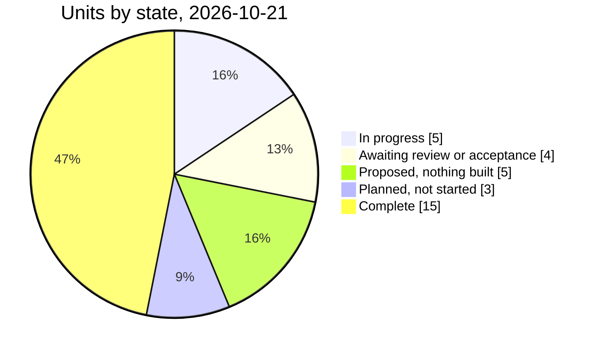
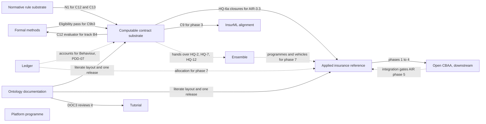
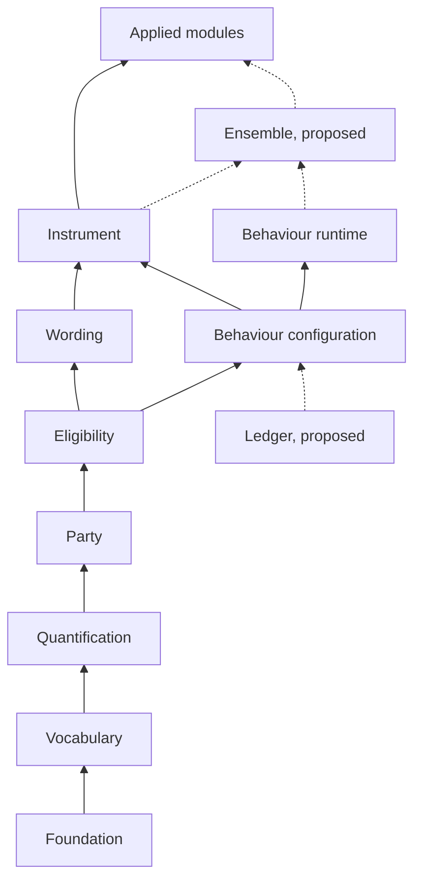
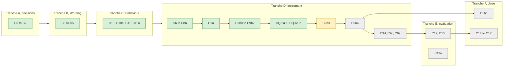
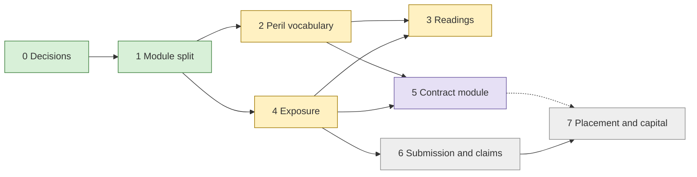
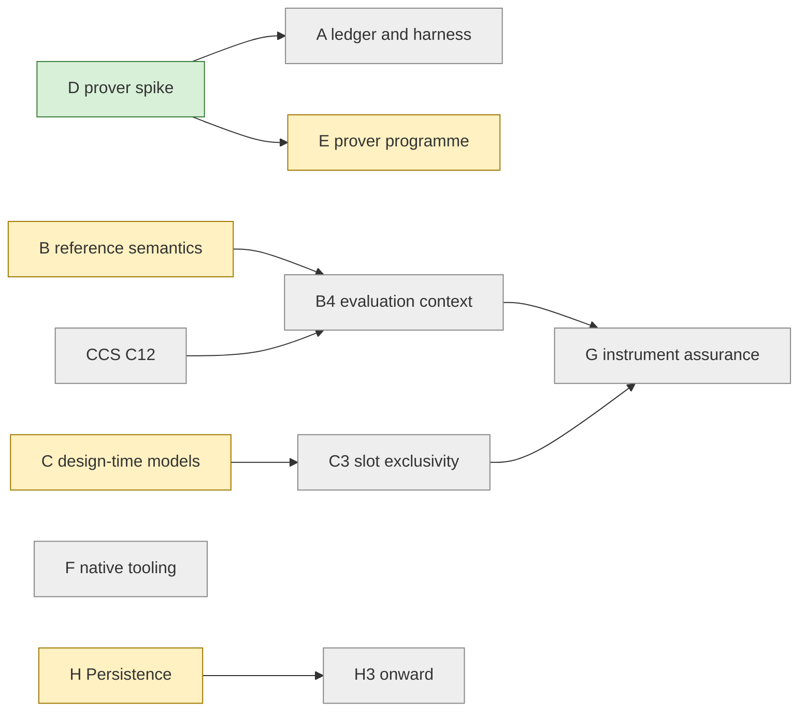
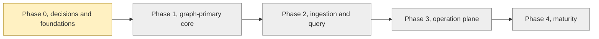
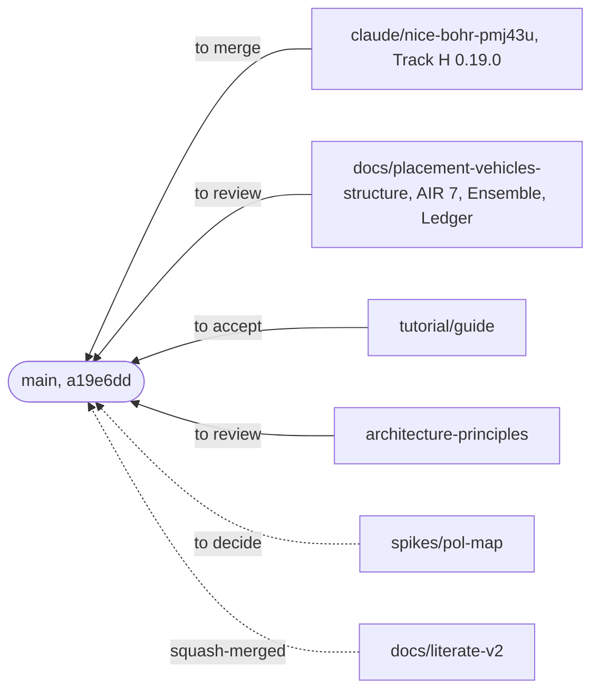
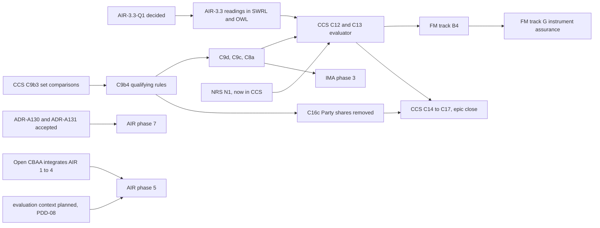

<!-- SPDX-License-Identifier: CC-BY-SA-4.0 -->

# LATTICE roadmap

**As of** 2026-10-21. **Read from** `main` at `a19e6dd` and every branch on the remote with commits
not yet on `main`.

**What this is.** One view across every epic, unit and branch: what is done, what is in flight,
what waits on what, and what the maintainer is asked to do next. It summarises and links. It
decides nothing. The status record of each unit stays its one authoritative live state (skill
`lattice-lifecycle`). Where this roadmap and a status record disagree, the status record is right
and this page is stale.

**How it was built.** From the status records and plans under `docs/developer/`, the ADR catalogue,
the remote's branches and its release tags. A unit's state on an unmerged branch is reported with
the branch named, since `main` does not have it yet.

## Contents

1. [The programme at a glance](#1-the-programme-at-a-glance)
2. [How the epics depend on one another](#2-how-the-epics-depend-on-one-another)
3. [The layers, now and proposed](#3-the-layers-now-and-proposed)
4. [Active epics](#4-active-epics)
5. [Smaller units](#5-smaller-units)
6. [The platform programme](#6-the-platform-programme)
7. [Branches](#7-branches)
8. [The critical path](#8-the-critical-path)
9. [Decisions waiting](#9-decisions-waiting)
10. [The maintainer's queue](#10-the-maintainers-queue)
11. [Completed units](#11-completed-units)
12. [Observations](#12-observations)

## 1. The programme at a glance

| Epic or unit | Kind | State | Next |
|---|---|---|---|
| [Computable contract substrate](plans/computable-contract-substrate.md) (CCS) | epic | 🚧 tranche D. C0 to C9b2 and HQ-6a merged and tagged | C9b3, then C9b4, C9d, C9c, C8a |
| [Applied insurance reference](plans/applied-insurance-reference.md) (AIR) | epic | 🚧 phases 0 and 1 done, 2 to 4 largely built, round 3 | AIR-3.3, the remaining trip slices, Phase 7 proposed on a branch |
| [Formal methods](plans/formal-methods.md) (FM) | epic | 🚧 tracks B, C, D, E in part, H well advanced | merge Track H's 0.19.0, then H3 onward |
| [Improved ontology documentation](plans/improved-ontology-documentation.md) (IOD) | unit | 🚧 most slices merged by squash 2026-10-20 | release tags for 0.18.0, OD8 onward, RC4 onward |
| Ensemble (plan on branch) | proposed unit | 📝 ADR-A130 Proposed | review of the plan and ADR |
| Ledger (plan on branch) | proposed unit | 📝 ADR-A131 Proposed | review of the plan and ADR |
| [InsurML alignment](plans/insurml-alignment.md) (IMA) | epic | 📝 proposed, nothing built | the maintainer's review and gate-0 decisions |
| [Normative rule substrate](plans/normative-rule-substrate.md) (NRS) | unit | 📝 most slices moved to CCS | the rule-language work, D1, D4, D5 |
| LATTICE tutorial (on `tutorial/guide`) | unit | 🟡 all four chapter slices written | the maintainer reads TUT-4 and accepts |
| [Identity minting](plans/identity-minting.md) | unit | 🚧 M0 to M3 done | M4, the walk-through from the specification |
| [Word authoring proof of concept](plans/word-authoring-poc.md) | unit | 🟡 WA0 to WA11 done | the manual Word checklist |
| [XSLT sidecar](plans/xslt-sidecar.md) | unit | 🔵 drafted | decisions XS-D1 to XS-D7 |
| [Documentation link repair](plans/documentation-link-repair.md) | unit | ⏳ not started | scheduling |
| [Platform programme](plans/lattice-platform-agentic-development-v0.2.md), phases 0 to 4 | epic | ⏳ Phase 0 decision pack Proposed | ratifying 17 Proposed ADRs |
| [Surface and MORK unified projection](plans/surface-mork-unified-projection-plan.md) | programme | ✅ phases 0 to 8. Phases 9 and 10 planned | not scheduled |

The counts treat each epic as one unit and include the completed units of
[section 11](#11-completed-units). In progress are CCS, AIR, FM, IOD and identity minting. Awaiting
review are the tutorial, Word authoring, the Eligibility compiler and the governance surfaces.
Proposed are Ensemble, Ledger, IMA, NRS and the platform programme. Planned are the XSLT sidecar,
documentation link repair and the housekeeping first cut.

## 2. How the epics depend on one another

Arrows point from the work that must come first. A dashed arrow is a dependency that is planned
or proposed, not yet in force.

## 3. The layers, now and proposed

The substrate's import order on `main` (ADR-A01 and its addenda, ADR-A106, ADR-A112), with the two
layers proposed on `docs/placement-vehicles-structure` drawn dashed. Where the new layers sit is
taken from their plans (Ensemble imports Instrument and Behaviour's runtime, Ledger is imported by
Behaviour's configuration). ADR-A01's addenda of 2026-10-18 and 2026-10-19 on that branch settle
the order, and both are Proposed.

Persistence, Surface and MORK sit beside the substrate. They are versioned on their own and
consumed by the toolchains.

## 4. Active epics

### 4.1 Computable contract substrate (CCS)

**Documents.** [plan](plans/computable-contract-substrate.md),
[status](status/computable-contract-substrate.md),
[sketch](sketches/computable-contract-substrate.md). ADRs A-104 to A-106 and A-112 to A-115 and
A-120 accepted.

**Where it is.** Gate A passed on 2026-10-01. Tranches B (Wording) and C (Behaviour split, nested
states) are merged and tagged. In tranche D, C6 to C9b2 and the closures work HQ-6a.1 and HQ-6a.2
(ADR-A105) are merged, and `executable-v0.7.0` is tagged. The status record's own header still
names the HQ-6a.2 merge as the next action. Its branch has no commit left that `main` lacks, so
that action is done.

**What it waits on.** C9b3 waits on HQ-6 (NRS N5, ADR-A105), and the formal-methods Eligibility
pass it named is built. C12 and C13 wait on C9, C11a, AIR-3.3 and NRS N1. C13a waits on C5 and NRS
N1. C16c, removing Party's shares, must land before the epic closes.

**Held questions.** HQ-1 to HQ-12, in the plan. Three are proposed for hand-over to the Ensemble
unit (HQ-2's second case, HQ-7, HQ-12) once ADR-A130 is accepted.

### 4.2 Applied insurance reference (AIR)

**Documents.** [epic plan](plans/applied-insurance-reference.md),
[status](status/applied-insurance-reference.md), [lanes](plans/applied-insurance-reference-lanes.md),
[claims plan](plans/applied-insurance-reference-claims.md),
[substrate plan](plans/applied-insurance-reference-substrate.md),
[leftovers](plans/air-leftovers.md).

**How it runs.** Two machines (lanes §2 to §4). Machine R verifies and merges, and also builds CCS.
Machine S builds the slices in one trip on one branch, `air/applied-reference`, which is merged
into `main`. Its only commits not on `main` are two merges and one attribution fix.

**Where it is.**

| Phase | Plan | State |
|---|---|---|
| 0 Decisions | [plan](plans/applied-insurance-reference-phase-0.md) | ✅ complete |
| 1 Module split | [plan](plans/applied-insurance-reference-phase-1.md) | ✅ AIR-1.1 and AIR-1.2 merged |
| 2 Peril vocabulary | [plan](plans/applied-insurance-reference-phase-2.md) | 🚧 AIR-2.0 to 2.4 and 2.6 built, the cause scheme at 287 concepts in eight families. 2.5 and 2.7 ready |
| 3 Readings and crosswalks | [plan](plans/applied-insurance-reference-phase-3.md) | 🚧 AIR-3.1 and 3.2 merged. 3.3 waits on AIR-3.3-Q1. 3.4 and 3.5 ready |
| 4 Exposure | [plan](plans/applied-insurance-reference-phase-4.md) | 🚧 AIR-4.1 to 4.4 built. 4.5 and 4.6 ready |
| 5 Contract module | [plan](plans/applied-insurance-reference-phase-5.md) | 🅿️ deferred until Open CBAA integrates phases 1 to 4 (decision D2) |
| 6 Submission, claims | [plan](plans/applied-insurance-reference-phase-6.md), [claims](plans/applied-insurance-reference-claims.md) | ⏳ AIR-6.1 ready |
| 7 Placement and capital | on `docs/placement-vehicles-structure` | 📝 proposed 2026-10-18, no slice briefed |

**Milestones** (epic plan §4). M1 (the reference cause scheme decides open-perils conditions) and
M3 (exposure units derived on demand) are the nearest. M4 and M5 are deferred with Phase 5. M6 to
M8 are the claims milestones, ending with a coverholder's bordereau lifted, reconciled and emitted
again.

**Phase 7, proposed.** A programme data model (towers, layers, lines and their formation state),
market responses from decline to binding quote, risk-capital vehicles, and the London market's MRC
form as a specialisation. It rests on Ensemble (ADR-A130) and Ledger (ADR-A131), both Proposed. It
records and evaluates programmes. It does not advise on them.

### 4.3 Formal methods (FM)

**Documents.** [epic plan](plans/formal-methods.md), [epic status](status/formal-methods.md),
[lifecycle guide](formal-methods-lifecycle.md). ADR-A-FM1 to ADR-A-FM4 accepted. The prover is
Isabelle/HOL, with Haskell and Scala as code-generation targets.

| Track | Subject | State |
|---|---|---|
| D | prover spike | ✅ done, two Gate D criteria open |
| A | ledger and harness | ⏳ not started, waits on Gate D and its ADR |
| B | reference semantics and oracle | 🚧 B1 to B3, B2.1, B2.2 done. B4 waits on CCS C12. B5 blocked |
| C | design-time models | 🚧 C1, C2, C2.1 done. C3 is next. ADR-A116 Proposed |
| E | prover programme | 🚧 E1.0, E1.1, E1.4 done. E1.3 waits on track C2's overlap-rule ADR |
| F | native tooling | ⏳ not started |
| G | instrument assurance | ⏳ waits on B4 and C3 |
| H | Persistence | 🚧 H1, HO0 to HO9, H2.0 to H2.6b on `main`. Every other planned H2 slice built on `claude/nice-bohr-pmj43u` |

**Track H, the release branch.** `claude/nice-bohr-pmj43u` holds 54 commits beyond `main`: H2.6c to
H2.6g, H2.7, H2.8a to H2.8c, H2.9, H2.11a and H2.11b (the Persistence README in the literate
layout), the test-suite work FMH-TS-1 and FMH-TS-2, a new `packages/persistence/python`, Oxigraph as
the Persistence tests' default engine, and the release prepared as 0.19.0 with the applied modules
re-pinned. Six review items (Q1 to Q6 in its status record) wait on the maintainer before the merge.
`claude/nice-bohr-pmj43u-wwhgle` is an earlier point of the same line, with nothing the release
branch lacks.

### 4.4 Improved ontology documentation (IOD)

**Documents.** [plan](plans/improved-ontology-documentation.md),
[status](status/improved-ontology-documentation.md). ADR-A126 and ADR-A129 published, ADR-A127
accepted.

**Where it is.** `docs/literate-v2` was squash-merged into `main` on 2026-10-20 (`cf1b8eb`). That
brought the repository catalogue and its reader (RC1 to RC3), the literate README layout and its
compilers to OWL and SHACL (OD1 to OD5), the Eligibility and Vocabulary pilots (OD6, OD7), published
decisions and the site sections (DOC1, DOC2, DOC2b), and one release number for the substrate and
standalone ontologies, 0.18.0 (VER1, OD-REL). `GOVERNANCE.md` and the validation and test plan were
retired in the same change.

**Next.** The tag `ontologies-v0.18.0` and the applied modules' ten tags do not exist on the remote
yet. OD8 onward migrates the remaining layers one at a time. RC4 to RC6 extend the catalogue
downstream, promote packages and fold in the XML catalogue (RC6 needs a new ADR on ADR-A88). DOC3
reviews the tutorial once it is merged.

### 4.5 Ensemble and Ledger, proposed substrate layers

Both are on `docs/placement-vehicles-structure`, with their sketches, for the maintainer's review.
No slice is briefed.

| | Ensemble | Ledger |
|---|---|---|
| Prefix and home | `ens:`, `ontology/ensemble/` | `ldg:`, `ontology/ledger/` |
| ADR | A-130, Proposed | A-131, Proposed |
| Holds | identities naming member instruments by role, reified relations between instruments (kinds K1 to K8), judgements across an ensemble, confidentiality between members, evaluation by composition | account definitions and their tree, postings and balance records, allocation with conservation, Behaviour's migration from allowances to accounts |
| Takes over | CCS HQ-2 (second case), HQ-7, HQ-12 | PDD-07 and the ledger part of PDD-08 |
| Serves | AIR Phase 7, AIR-6.8's cross-instrument reads | AIR Phase 7, Behaviour's threshold regimes |

### 4.6 InsurML alignment (IMA)

**Documents.** [epic plan](plans/insurml-alignment.md), [phase 0](plans/insurml-alignment-phase-0.md),
[status](status/insurml-alignment.md), [vision](../architecture/insurml-alignment-vision.md).

Nothing is built. Nine phases are planned, from decisions (Phase 0) through the InsurML profile,
lift and lower kits, Wording changes, an assembly interface, meaning over components, authoring
and exchange, library ingestion, to continuous standards engagement. Phase 3 waits on CCS C9. One
slice, IMA-3.3, already moved into CCS as C8b. PDD-01 to PDD-03 hold its ownership and tooling
questions.

### 4.7 Normative rule substrate (NRS)

**Documents.** [plan](plans/normative-rule-substrate.md), [status](status/normative-rule-substrate.md).

Nothing is built in this unit. CCS took N1, N2, N4, N5 and the Behaviour part of N8, and absorbed N6
and N8 into C12 and C13 (NQ-1 to NQ-4, 2026-10-10). NRS keeps the rule-language integration work
(LegalRuleML), with decisions D1, D4 and D5 open and ADRs A-107 to A-111 reserved, not drafted. N9
changes Foundation and must wait for AIR Phase 2 to finish.

## 5. Smaller units

| Unit | Documents | State | Next |
|---|---|---|---|
| LATTICE tutorial | `docs/developer/plans/lattice-tutorial.md` on `tutorial/guide` | TUT-0 to TUT-3 committed on the branch, TUT-4 written | the maintainer reads chapters 10 to 13 and the tutorial end to end, adds the AI disclosure trailer to the branch's commits, and pushes |
| Identity minting | [plan](plans/identity-minting.md), [status](status/identity-minting.md) | M0 to M3 complete (Python and Java libraries, anchor vectors) | M4, the specification completed and walked through by hand. ADR-A84 Proposed |
| Word authoring proof of concept | [plan](plans/word-authoring-poc.md), [status](status/word-authoring-poc.md) | WA0 to WA11 done | the manual Word checklist M1 to M14. ADR-A118 Proposed |
| XSLT sidecar | [plan](plans/xslt-sidecar.md), [status](status/xslt-sidecar.md) | drafted | XS-D1 to XS-D7. ADR-A119 Proposed |
| Documentation link repair | [plan](plans/documentation-link-repair.md), [status](status/documentation-link-repair.md) | not started. Baseline 419 broken links, 290 in ignored site output | scheduling. The IOD site work may have moved the baseline |
| Eligibility compiler | [plan](plans/eligibility-compiler.md), [status](status/eligibility-compiler.md) | implemented, awaiting validation in a networked environment | validation |
| Governance surfaces | [plan](plans/governance-surfaces-integration.md), [status](status/governance-surfaces.md) | fixture-backed UI shells | backend integration, three slices |
| Housekeeping first cut | [RDF/SPARQL phase plan](plans/rdf-sparql-patterns-phase-plan.md) slice 3 | not started | scheduling. ADR-A80 accepted |
| Policy mapping spike | `spikes/policy-mapping/` on `spikes/pol-map` | spike, two commits | the maintainer's decision whether to keep it |

## 6. The platform programme

**Documents.** [epic plan](plans/lattice-platform-agentic-development-v0.2.md), phase plans
[0](plans/phase-0-plan.md) to [4](plans/phase-4-plan.md), status records
[0](status/phase-0-status.md) to [4](status/phase-4-status.md),
[continuation status](status/platform-continuation.md).

The first platform build (the earlier phases 0 to 6: Surface lifecycle and ledger, workers, release
integration, OCI adapter, projection lowering, MORK review and governance queue) is authored and
accepted with recorded residuals. The new programme's phases are sequential, and none has started a
code slice.

Phase 0's decision pack drafted 17 ADRs on 2026-09-23 (A-48, A-50, A-51, A-54, A-57, A-59, A-62,
A-63, A-65 to A-69, A-71, A-74, A-75, A-81). All are Proposed, and A-51 is superseded by A-82, also
Proposed. Phase 1 cannot start until Phase 0's exit gate passes. Phases 2 and 3 are rolling-wave
placeholders, and Phase 4 is sized only after Phase 3's measurements.

## 7. Branches

Branches with commits that `main` does not have, as of 2026-10-21.

| Branch | Commits ahead | Behind `main` | Holds | Disposition |
|---|---|---|---|---|
| `claude/nice-bohr-pmj43u` | 54 | 0 | FM Track H, release 0.19.0 prepared | review Q1 to Q6, then merge and tag |
| `claude/nice-bohr-pmj43u-wwhgle` | 45 | 0 | an earlier point of the same line | retire after the release branch merges |
| `docs/placement-vehicles-structure` | 8 | 1 | AIR Phase 7, Ensemble and Ledger plans, ADR-A130, ADR-A131, four sketches | review |
| `docs/literate-v2` | 27 | 2 | the original commits of IOD, squash-merged as `cf1b8eb` | retire, or keep for history |
| `tutorial/guide` | 5 | 75 | the tutorial, TUT-0 to TUT-4 | acceptance, then merge |
| `air/applied-reference` | 3 | 17 | two merges and one attribution fix | merge the fix or retire |
| `spikes/pol-map` | 2 | 39 | the policy mapping spike | decide |
| `architecture-principles` | 1 and this roadmap | 17 | the draft architecture principles | review |
| `ccs/c7a-regimes` | 3 | 331 | C7a's pre-merge commits. C7a reached `main` as `c6e5853` | retire |
| `persistence-mbt` | 1 | 451 | a sketch for a model-based testing utility | decide |

About 30 further branches have no commit that `main` lacks. They are merged slice branches (the AIR
round 1 and 2 branches, the CCS slice branches, the FM branches, `test/slow-py`, `ux/auth-le`,
`poc/word-ux`, `agents/private-overlay`, `cloud-setup-apt-fix`) or older experiments, and can be
deleted when the maintainer chooses.

## 8. The critical path

The longest chain of dependencies now runs through CCS's tranche D into its evaluator, and from
there into formal methods and AIR's later phases.

**Reading it.**

- **CCS C9b3 and C9b4** gate the most work. Every CCS slice after them, the evaluator, the epic's
  close, FM tracks B4 and G, and IMA Phase 3 sit downstream.
- **AIR-3.3** is ready once AIR-3.3-Q1 is answered, since HQ-6a.2 has merged. It must land before
  CCS C12.
- **ADR-A130 and ADR-A131** gate AIR Phase 7 and the three CCS held questions they take over.
- **AIR Phase 5** waits on two things outside this repository's slices: Open CBAA's integration of
  phases 1 to 4, and a plan for the evaluation context (PDD-08), which the Ledger plan partly
  supplies.

## 9. Decisions waiting

### 9.1 Proposed ADRs

| ADRs | Subject | Raised by |
|---|---|---|
| A-48, A-50, A-54, A-57, A-59, A-62, A-63, A-65 to A-69, A-71, A-74, A-75, A-81 | the platform's Phase 0 decision pack | platform programme |
| A-82, A-84 | identity patterns and standalone minting libraries | identity minting |
| A-116 | Vocabulary scheme composition, which CCS HQ-4 and IMA-D4a wait on | FM track C |
| A-118, A-119 | Word authoring, XSLT sidecar | their units |
| A-128 | efficient queries and shapes | Track H |
| A-130, A-131, and ADR-A01's addenda of 2026-10-18 and 2026-10-19 | Ensemble and Ledger | on `docs/placement-vehicles-structure` |
| A-CAP1, A-CAP2 | capacity runtime profile and promotion criteria | applied capacity |

### 9.2 Pending design decisions

[pending-design-decisions.md](plans/pending-design-decisions.md) holds PDD-01 to PDD-10. Two are
proposed for hand-over: PDD-07 (Behaviour's allowance contract) and part of PDD-08 (the
evaluation context) to the Ledger unit. PDD-01 to PDD-03 belong with IMA. PDD-09 (negotiation over
a placement) is close to AIR Phase 7's market responses. PDD-10 (more than one language) has no
home.

### 9.3 Held questions in CCS

HQ-1 to HQ-12 in the [CCS plan](plans/computable-contract-substrate.md). Among them, HQ-4 (context
roles from several sources) waits on ADR-A116. HQ-10 (a deployment configuration layer) has no
unit yet.

### 9.4 Technical debt

[technical-debt.md](plans/technical-debt.md) lists 40 open rows on `main`. Track H's release branch
adds and closes several (TD-63 closed, TD-64 the branch's versioning rule).

## 10. The maintainer's queue

In the order that unblocks the most work.

1. **Tag release 0.18.0.** `ontologies-v0.18.0` and the applied modules' ten tags, listed by
   `mise exec -- python tools/ontology_releases.py check` on `main`.
2. **Answer Track H's review items Q1 to Q6**, then merge `claude/nice-bohr-pmj43u` and create the
   0.19.0 tags.
3. **Answer AIR-3.3-Q1**, so that AIR-3.3 can be built ahead of CCS C12.
4. **Review the Ensemble and Ledger proposals**, ADR-A130, ADR-A131 and ADR-A01's two addenda, then
   AIR Phase 7.
5. **Accept the tutorial**, TUT-4, and push `tutorial/guide`.
6. **Review the architecture principles draft** on `architecture-principles`.
7. **Ratify or reject the platform's Phase 0 ADRs**, the oldest Proposed decisions in the catalogue.
8. **Decide the small units.** The XSLT sidecar's XS-D1 to XS-D7, the Word checklist, the policy
   mapping spike, the model-based testing sketch.
9. **Retire merged branches.** Section 7 lists them.

## 11. Completed units

| Unit | Closed |
|---|---|
| [Toolchain JDK 25 and Python 3.14](status/toolchain-jdk25-python314.md) | 2026-09-23 |
| [Persistence compiler and IRI patterns sync](status/persistence-compiler-iri-sync.md) | 2026-09-25 |
| [IRI patterns post-3866b21 remediation](status/iri-patterns-post-3866b21-remediation.md) | 2026-09-23 |
| [RDF and SPARQL patterns remediation](status/rdf-sparql-patterns-remediation.md) | 2026-09-23 |
| [Vocabulary temporal binding](status/vocabulary-temporal-binding.md) | 2026-09-25 |
| [Temporal binding consumer hardening](status/temporal-binding-consumer-hardening.md) | 2026-09-25 |
| [Ontology semantic versioning](status/ontology-semantic-versioning.md) | slices 2026-09-25, ADR-A86 since accepted |
| [Applied ontology readiness](status/applied-ontology-readiness.md) | 2026-09-25 |
| [Python test speed](status/python-test-melting.md) | 2026-10-09 |
| [LLM training and the MORK Teaching Pack](status/llm-training-mtp.md) | 2026-09-20 |
| [Repository topology](status/repository-topology-a77.md), [ontology root relocation](status/ontology-root-relocation.md), [MORK split](status/mork-package-split.md), [SPC split](status/spc-package-split.md) | 2026-09-20 |
| [Surface and MORK unified projection](status/surface-mork-unified-projection.md), phases 0 to 8 | 2026-09-22 |
| Agent skills (ADR-A117) | built, with the private overlay addendum Proposed |

## 12. Observations

These are findings from building this roadmap, offered as hypotheses for the maintainer to check.

- **The coordination index is stale.** [INDEX.md](INDEX.md) was last updated on 2026-09-25 and does
  not list CCS's tranche D, Track H's progress since then, the documentation epic's merge, the
  tutorial, or the Ensemble and Ledger proposals. The lifecycle skill says it changes whenever a
  unit or slice changes state. Either it is refreshed, or this roadmap takes over its overview role
  and the index keeps only the per-unit links.
- **Several status records lag their branches.** CCS's next action names a merge that has
  happened, and IOD's record on `main` predates its own squash merge. AIR's record on `main` is
  older than its copy on the Track H branch.
- **Two branches hold the same line of work.** `claude/nice-bohr-pmj43u-wwhgle` is contained in
  `claude/nice-bohr-pmj43u`.
- **Release tags lag merges.** Release 0.18.0 is merged and untagged. Track H prepares 0.19.0 on
  top of it, so the 0.18.0 tags should exist before 0.19.0 merges, or the register's order will not
  match the tags'.
- **Machine R carries three streams.** AIR verification, CCS and, through CCS, most of NRS. CCS
  C9b3 and C9b4 are on the critical path of all three.
- **This page will go stale.** Under the lifecycle skill, `docs/developer/` holds durable guidance
  only. A roadmap is a snapshot. Options are to regenerate it from the status records with a tool,
  to keep it as a dated snapshot and replace it on each refresh, or to fold its overview into
  `INDEX.md`.
