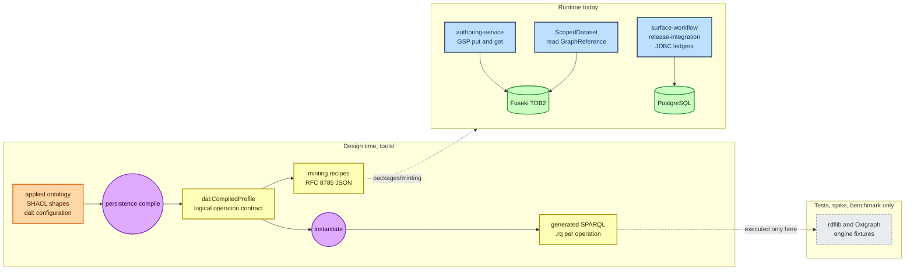
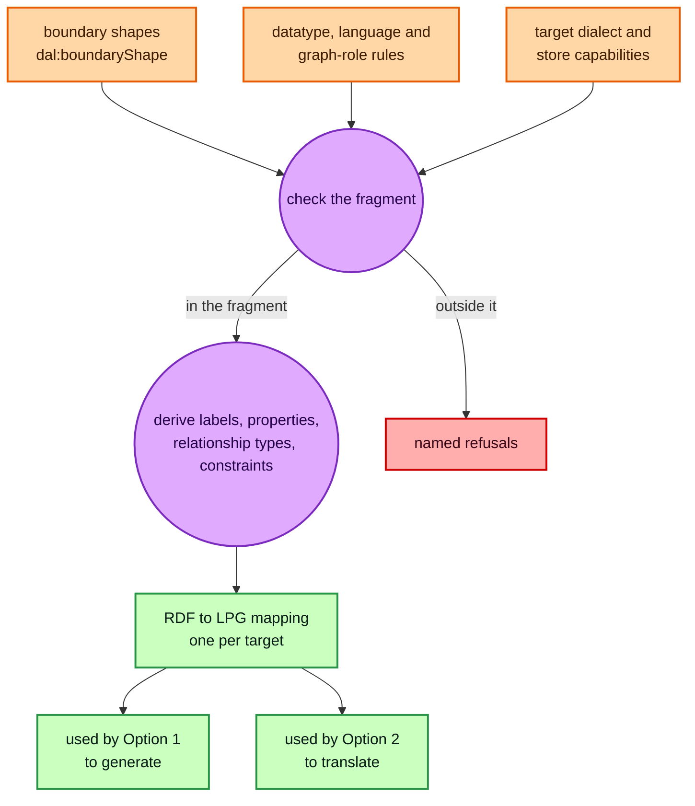
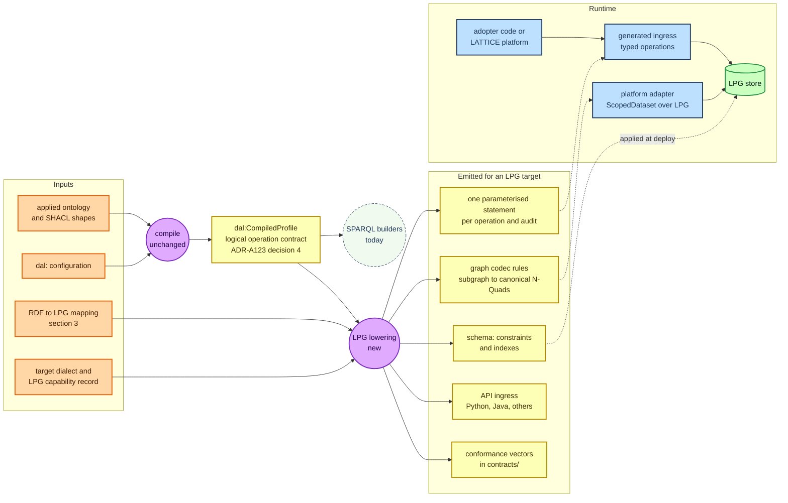
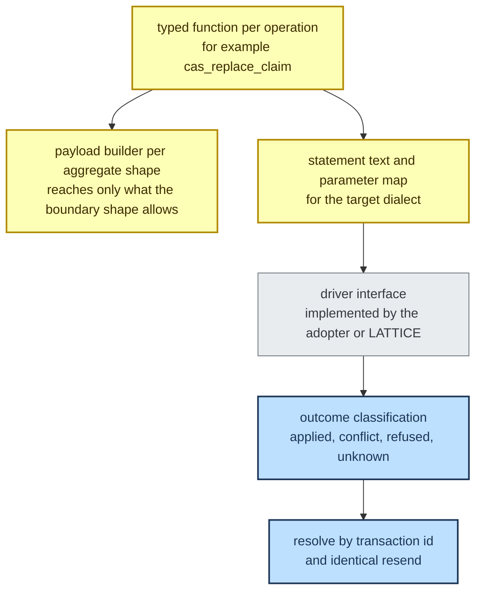
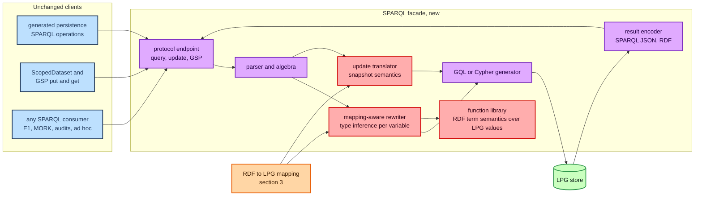
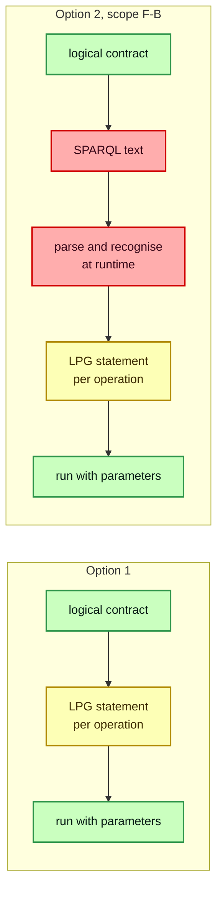
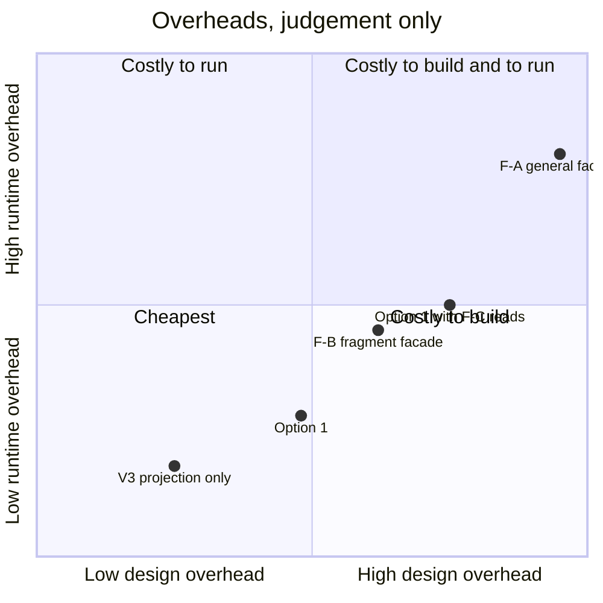
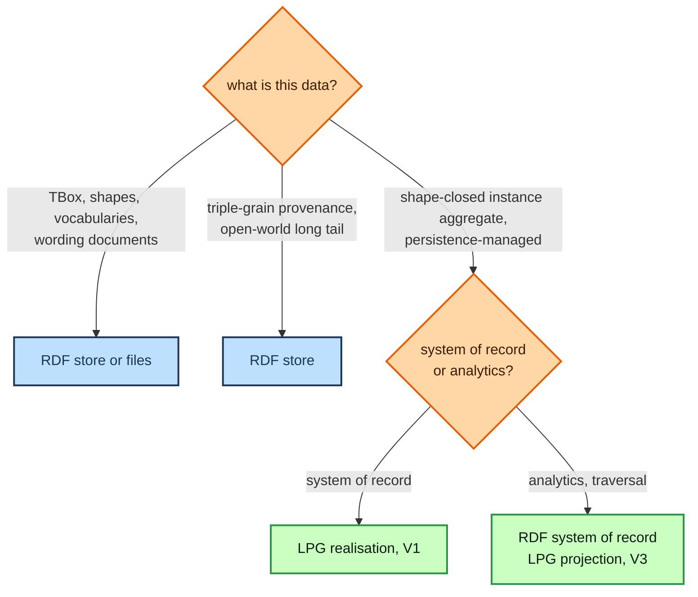

# Labelled property graph stores as a LATTICE backend: two architectures compared

**Options analysis, 2026-10-13.** Local working document. Nothing here is a LATTICE decision. A
backend of either kind would need a sketch, a plan and at least one ADR under Design First, and any
new `dal:` term is an ontology change under ADR-A86.

Grading follows the `docs/developer/notes/rdf-engine/` papers. **Fact** means a source in the
repository (cited by path) or a named external source says so. **Judgement** means a reasoned
position that a probe or measurement could overturn. *(verify)* marks a detail about an external
product or paper that was written from memory and must be checked before a decision rests on it.

## Contents

1. [Summary](#1-summary)
2. [The scene: what exists today](#2-the-scene-what-exists-today)
3. [The gap both options share: an RDF to LPG mapping](#3-the-gap-both-options-share-an-rdf-to-lpg-mapping)
4. [Option 1: a compiled, native LPG realisation](#4-option-1-a-compiled-native-lpg-realisation)
5. [Option 2: a SPARQL protocol facade over the LPG](#5-option-2-a-sparql-protocol-facade-over-the-lpg)
6. [Side by side](#6-side-by-side)
7. [Variants and hybrids](#7-variants-and-hybrids)
8. [Risks](#8-risks)
9. [Probes to run before deciding](#9-probes-to-run-before-deciding)
10. [Questions for the maintainer](#10-questions-for-the-maintainer)
11. [Leaning](#11-leaning)
- [Appendix A: one operation through both options](#appendix-a-one-operation-through-both-options)
- [Appendix B: SPARQL construct by construct](#appendix-b-sparql-construct-by-construct)
- [Appendix C: sources](#appendix-c-sources)

---

## 1. Summary

**The question.** How should LATTICE support a labelled property graph (LPG) store, queried with GQL
or Cypher, as a storage backend?

- **Option 1, compiled native realisation.** Explicit configuration in `persistence` drives a
  compiler that emits the store schema, one parameterised GQL or Cypher statement per operation, and
  generated API ingress code in Python, Java and other languages. The runtime is pure LPG.
- **Option 2, SPARQL facade.** A new layer implements the SPARQL protocol (and the Graph Store
  Protocol) over the LPG. It uses the deployment's `persistence` configuration to translate each
  incoming SPARQL request into GQL or Cypher. Everything above the facade keeps speaking SPARQL.

**Findings.**

1. **Neither option exists without an explicit RDF to LPG mapping, and `persistence` does not hold
   one today (fact).** `dal:` records *how* data is persisted (boundaries, concurrency, ordering,
   receipts, keys, identity, erasure). It does not record the *physical shape* of data in a store:
   which property becomes a node property, which an edge, how a named graph, a datatype or a
   language tag is represented. Both options need that mapping first, and it is the larger part of
   the design work in either case (§3).
2. **LATTICE's runtime uses far less SPARQL than its documentation suggests (fact).** The platform
   reads and writes whole graphs over the Graph Store Protocol and validates them in process. The
   persistence compiler's generated SPARQL is executed only by tests, a spike and a benchmark. No
   production component sends a SPARQL query or update today (§2.2). Option 2's main benefit, that
   every consumer keeps speaking SPARQL, protects little that runs.
3. **Option 2's write path meets the view-update problem (judgement, high confidence).** A general SPARQL Update over a schema-dependent mapping has no unique translation. The repository's own paper on unified SPARQL views ([distirbuted-queries.md](rdf-engine/distirbuted-queries.md) §3.4) reached the same conclusion for SQL: production virtualisation is read-only, and writes stay native. A facade restricted to the fragment the compiler emits avoids the problem, but it is then Option 1 behind a parser (§5.3).
4. **Option 1 follows the direction already accepted (fact for the decisions, judgement for the
   fit).** ADR-A123 decision 4 makes the compiled profile declare logical resources so that "a
   relational realisation reads the same declarations and can be compared with this one operation by
   operation". The patterns guide's port (Chapter 25) hides SPARQL behind `compareAndSet`. The
   client SDK sketch is the API ingress half of Option 1. An LPG realisation is a second consumer of
   the same contract.
5. **Option 1 collides with ADR-A75 as drafted (fact).** A75 defines the Core tier as "expressible
   in SPARQL 1.1 + Graph Store Protocol alone". A pure-LPG adapter cannot be a Core adapter. A75 is
   still Proposed, so amending it now is cheap. After ratification it is not.
6. **An LPG holds shape-closed instance aggregates well and RDF-native content badly (judgement).**
   The TBox, governed vocabularies, wording documents and triple-grain provenance belong in RDF.
   This is the same split `lattice-sql.md` reached for SQL, and it argues for a mixed deployment in
   which the LPG realisation is chosen per target, not per dataset.

**Leaning.** Option 1, staged, starting with the mapping vocabulary and an LPG discovery record, then
one aggregate family end to end with its graph codec and generated Python and Java ingress. Keep RDF
for RDF-native content. Hold Option 2 back, and build a read-only, fragment-bounded facade later only
if a named consumer needs SPARQL over LPG-held data (§11). Eight questions for the maintainer are in
§10, named LPG-Q1 to LPG-Q8.

---

## 2. The scene: what exists today

Every statement in this section was checked against the source named.

### 2.1 What `persistence` models, and what it does not

**What it is.** [ontology/persistence/README.md](../../../ontology/persistence/README.md) describes the layer as how "one adopter records which options they chose, per class and per deployment, and the `tools/persistence` compiler turns that record into generated, portable SPARQL and identity minting recipes". It is a cross-cutting substrate, not a layer in the dependency order, and imports nothing from Foundation through Instrument ([ontology-architecture.md](../../architecture/ontology-architecture.md) §8a).

**Its dimensions** ([ADR-A78](../../architecture/decisions/ADR-A78-persistence-profile-substrate-and-aggregate-boundaries.md), [spec/persistence.ttl](../../../ontology/persistence/spec/persistence.ttl)):

| Dimension | Class | Values |
|---|---|---|
| aggregate boundary | `dal:AggregateBoundaryProfile` | `dal:NamedGraphBoundary`, `dal:CompositePropertyBoundary`, `dal:NoBoundary` |
| concurrency | `dal:ConcurrencyProfile` | `dal:ProvidedConcurrency`, `dal:Optimistic`, `dal:AppendOnly`, `dal:LockingConcurrency` |
| ordering | `dal:OrderingProfile` | `dal:CommitGrain`, `dal:EventGrain` |
| receipts and history | `dal:ReceiptProfile` | `dal:ReceiptOnly`, `dal:PatchLog`, `dal:SnapshotPerRevision` |
| meta topology | `dal:MetaTopologyProfile` | `dal:SharedSharded`, `dal:PerAggregate` |
| uniqueness | `dal:UniquenessConstraint` | key property, scope, normalisation pipeline, claim scheme, `dal:onViolation` |
| identity | `dal:IdentityProfile` per `dal:ResourceRole` | natural key, position-derived, content-addressed, claimed surrogate |
| epoch | `dal:EpochProfile` | external high-water mark, restore-controlled, writer start refusal, store-local |
| privacy and erasure | `dal:PrivacyProfile` | `dal:PerSubjectGraphDrop`, `dal:CryptoShred`, `dal:NoErasure` |

Targets are a class plus a deployment, discovered through five scope kinds, with a fixed precedence
algorithm that refuses ambiguity rather than picking silently (ADR-A78 decisions 2 and 3).

**The store is described only by capability.** `dal:CapabilitySpec` carries `dal:providesCas`, `dal:providesReasoning`, `dal:providesCommitValidation`, `dal:providesSingleWriter` and `dal:providesStatementLevelConflictDetection` ([persistence.ttl](../../../ontology/persistence/spec/persistence.ttl) lines 289 to 311). Its comment says it shares its field shape with the patterns guide's `StoreCapabilities` record "by design, not by identity". There is no backend kind, no dialect and no physical mapping anywhere in `dal:`.

**What the compiler emits.** `compile` produces a `dal:CompiledProfile` graph and no SPARQL text. `instantiate` turns it into SPARQL, and `export-recipes` into minting recipes ([tools/persistence/README.md](../../../tools/persistence/README.md), ADR-A79). Since [ADR-A123](../../architecture/decisions/ADR-A123-typed-operation-ir.md), each operation is a typed value built by a builder and rendered by one renderer. Two details of A123 matter here.

- **Decision 4.** The compiled profile names "logical resources (the aggregate with its members, its
  version row, the transaction claim, the receipt, a key claim, a log bucket), not SPARQL graph
  roles". The builders map each logical resource to a graph role. "A relational realisation reads
  the same declarations and can be compared with this one operation by operation."
- **The IR itself is SPARQL-shaped.** [persistence/ir.py](../../../tools/persistence/src/persistence/ir.py)
  builds patterns inside a `GraphBlock` that names a `GraphRole`, and a property path holds its
  rendered SPARQL text (A123, third addendum). Another realisation reuses the logical contract, not
  the IR.

**The SPARQL fragment the operations rely on** (A123 decision 2, the [patterns guide](../../architecture/rdf-sparql-patterns-guide.md), and the generated operations): named graphs in every pattern and never the default graph, `DELETE`/`INSERT`/`WHERE`, `FILTER NOT EXISTS`, `OPTIONAL`, property paths in `WHERE` only (the composite sweep), `BIND` with `IRI`, `CONCAT`, `STRDT`, `ENCODE_FOR_URI`, `NOW()` outside guards, `VALUES`, typed literals (`xsd:long` positions), and `DATATYPE` tests in parameter guards. No blank nodes.

**A pending decision bears on both options.** [PDD-06](../plans/pending-design-decisions.md)
proposes a second IR that models SPARQL's semantics between the configuration IR and the text, and
notes that "a relational backend then needs its own path or IR". An LPG backend is in the same
position.

### 2.2 How the runtime touches the store

| Component | Store access | Source |
|---|---|---|
| `platform/semantic-dataset-spi` | `ScopedDataset` has two methods, `capabilities()` and `read(GraphReference)`, returning a `DatasetSnapshot` of canonical N-Quads and a content hash. Capabilities are `NAMED_GRAPH_READ`, `NAMED_GRAPH_WRITE`, `REVISION_EXPORT`, `TRANSACTIONS` | `ScopedDataset.java`, `DatasetCapability.java` |
| `platform/semantic-dataset-fuseki` | `RDFConnectionRemote.fetch(graphIri)`, written as N-Triples and hashed | `FusekiScopedDataset.java` line 34 |
| `platform/authoring-service` | `putGraph` and `getGraph` over the Graph Store Protocol, whole graphs only. Wording graphs are validated in process with Jena SHACL | `FusekiAuthoringStore.java` lines 95 to 107, `WordingValidator.java` |
| `platform/surface-workflow`, `platform/release-integration` | PostgreSQL ledgers through JDBC | `JdbcSurfaceRevisionRepository.java`, `JdbcReleaseLedger.java` |
| `workers/` | PostgreSQL for idempotency and MORK review state. No SPARQL client | `postgres_*_store.py` |
| `deployment/compose/authoring` | Fuseki 5.1.0 on TDB2, the only store deployed | `docker-compose.yml` |

No `platform/` or `workers/` source sends a SPARQL query or update (a repository search for query
and update execution found none). The generated persistence operations run only in
`tools/persistence/tests`, `spikes/persistence-oxigraph` and `benchmark/persistence-composite-cost`,
on rdflib and Oxigraph. ADR-A123 records that "nothing outside `tools/persistence` and its tests
calls `instantiate` or fills the slots".

The cross-runtime contract is the graph reference, not a query language ([ADR-A30](../../architecture/decisions/ADR-A30-shared-semantic-platform-cross-runtime-boundary.md)). A reference carries tenant, project, graph IRI and revision hash, and no public contract under `contracts/` exposes SPARQL.

### 2.3 SPARQL artefacts elsewhere

- **MORK compilers** emit SPARQL, SHACL and SWRL for eligibility conditions. Their SPARQL is a
  reference realisation, tested on rdflib.
- **Surface** lowers projection contracts under a `srf:ProjectionBackendPolicy`. The worker reports
  backend capabilities `sparql`, `shacl`, `swrl`, `rml` and `native_ir`
  (`workers/src/lattice_workers/projection_lowering.py`). There is no LPG backend kind.
- **ADR-A15** makes direct SPARQL one realisation profile among several (E1 for Eligibility, B-P1
  for Behaviour), all first-class, each admitted by passing "the shared semantic conformance
  corpus".

### 2.4 Decisions that constrain the design

| ADR | Status | What it requires of an LPG backend |
|---|---|---|
| A01, layer order | Accepted | nothing directly, since `dal:` and any mapping vocabulary sit outside the order. A mapping that names substrate classes must do so by IRI only |
| A15, realisation-strategy neutrality | Accepted | an LPG realisation is admitted by passing the shared semantic conformance corpus |
| A29, toolchain | Accepted | every build, test and probe runs through `mise` |
| A30, cross-runtime boundary | Accepted | graph references stay the contract, so the LPG side must produce a deterministic revision hash for a graph IRI |
| A74, graph-primary realm | **Proposed** | names the RDF store authoritative. An LPG system of record changes the wording to "graph store" or narrows it |
| A75, three-tier store SPI | **Proposed** | Core tier is "expressible in SPARQL 1.1 + Graph Store Protocol alone" and every adapter implements it in full. The central constraint is one write unit per SPARQL Update request |
| A77, repository topology | Accepted | no new root, and no new kind of directory without an ADR |
| A78, A79, A122, A123 | Accepted | configuration is canonical, the compiled profile holds no query text, values reach queries only through encoders, logical resources are the contract |
| A83, reasoning isolation | Accepted | a reasoner only in `platform/reasoning-testkit`. `dal:EquivalentClassScope` needs one at compile time, never in the store |
| A84, minting libraries | Proposed | the precedent for embedded per-language libraries under `packages/`, conformance by vectors in `contracts/` |
| A124, A125 | Accepted | measurements go under `benchmark/`, engine fixtures under `tools/testing/` |

### 2.5 Prior work that maps onto the two options

| Repository document | Status | Maps onto |
|---|---|---|
| [lattice-sql.md](rdf-engine/lattice-sql.md), compiling LATTICE to a relational model | exploration | **Option 1's analogue for SQL.** Verdict: worth building as a compiled realisation, with ontology and shapes as the single source of truth, and it "does not replace RDF" |
| [distirbuted-queries.md](rdf-engine/distirbuted-queries.md), one SPARQL view over RDF and SQL | exploration | **Option 2's analogue for SQL.** Verdict: adopt Ontop for reads. "Writes stay native", because view update is not generally solvable |
| [persistence-client-sdk.md](../sketches/persistence-client-sdk.md) | early sketch, not planned | **Option 1's API ingress.** Options S-A to S-D for typed per-operation functions and payload builders per language |
| [rdf-sparql-patterns-guide.md](../../architecture/rdf-sparql-patterns-guide.md) Chapters 25 to 27 | architecture | the `ConditionalRdfStore` port with `CasCommand`, the `StoreCapabilities` record, strategy tables, per-store wiring and the conformance TCK |
| [triple-store-discovery.md](../../architecture/triple-store-discovery.md) | living record | TSD-01 to TSD-14. Even two RDF stores depart from the specification in ways the operations had to absorb |



---

## 3. The gap both options share: an RDF to LPG mapping

Option 1 needs the mapping to generate schema, statements and the graph codec. Option 2 needs it to
translate each SPARQL request. The mapping is the same object in both, and this section is common
ground.

### 3.1 Where the two models disagree

| RDF | LPG (GQL, Cypher) | Consequence for a mapping |
|---|---|---|
| a resource is identified by an IRI, globally | a node has an internal, store-local id | an `iri` property with a uniqueness constraint on every mapped node. Identity stays with the minting recipes |
| `rdf:type`, any number of classes | a set of labels on a node | labels for asserted types. Inherited types are either materialised as extra labels or not, so a query for a superclass finds nothing unless they are |
| a literal-valued property, any multiplicity | a single-valued node property, or a homogeneous list | `sh:maxCount 1` maps to a scalar property. Unbounded multiplicity maps to a list, which adds order and allows duplicates, or to separate value nodes |
| an IRI-valued property | a relationship | direction and type follow the predicate. An inverse property becomes a reversed traversal, not a second edge |
| a triple exists or does not (set semantics) | relationships have identity, and two parallel relationships of one type are allowed | every write needs `MERGE` or a uniqueness guard to keep set semantics |
| a statement about a statement needs reification or RDF 1.2 triple terms | relationships carry properties natively | a qualified relation can become an edge with properties, but only where the mapping says so. Going back to RDF needs the reification pattern fixed in the mapping |
| a predicate is itself a resource, with its own triples | a relationship type is a name | statements about properties (`rdfs:subPropertyOf`, `fnd:utility`) stay in the TBox, outside the LPG |
| typed literals with any datatype IRI | a closed type system: integer, float, string, boolean, temporal types, duration, point, lists | per-datatype rules. `xsd:long` and `xsd:integer` both become a 64-bit integer, so `DATATYPE()` cannot tell them apart afterwards (the LPG form of TSD-07). Arbitrary-precision `xsd:integer` overflows |
| `xsd:decimal`, exact | no exact decimal in Neo4j's Cypher type system *(verify)*. GQL defines exact numeric types, with uneven support *(verify)* | money and quantities (Quantification) need a rule: scaled integer, string with a declared scale, or a float, which is wrong for money |
| `xsd:dateTime` with or without a time zone | zoned and local date-time types are distinct *(verify for each store)* | a better fit than most RDF stores, provided the mapping keeps the distinction |
| language-tagged strings | no language tag | a map `{value, lang}`, a property per language, or value nodes. Each changes how `LANGMATCHES` and per-language lookup work |
| blank nodes | nodes without an IRI | skolemise on write. A123 already forbids blank nodes in payloads. Addresses and similar structured values in other layers may still use them |
| `rdf:List` | a list property, or a chain of nodes | a list property for literals, ordered relationships for resources |
| named graphs, quads | no named graphs in one database. GQL has a catalogue of graphs, Neo4j has databases *(verify)* | a mapping rule is required (§3.3) |
| open world, absence means unknown | absence is usually read as false or null | evaluation of Eligibility's three values must not turn Undetermined into Denied through null handling (the same hazard `lattice-sql.md` §3.5 records for SQL) |

### 3.2 Two families of mapping

**Schema-independent (generic).** Every resource becomes a node, every literal becomes either a
property keyed by predicate IRI or a literal node, every triple between resources becomes an edge
whose type is the predicate IRI. It preserves all information for any graph, and it throws away
everything an LPG is good at. Queries become generic edge walks with string-typed relationship
names, and no schema constraint can be stated.

**Schema-dependent (shape-driven).** Closed SHACL shapes with bounded multiplicity determine node
labels, scalar properties and relationship types. It produces a natural LPG with native constraints,
and it applies only to data that conforms to closed shapes. `lattice-sql.md` §3.2 calls this the
"compilable fragment" for SQL. The same fragment applies here, with fewer restrictions, because an
LPG tolerates optional properties and multiple labels where SQL needs nullable columns or extra
tables.

The published work on this mapping *(verify each)*:

- Angles, Thakkar and Tomaszuk, *Mapping RDF databases to property graph databases*, IEEE Access,
  2020. Defines schema-independent and schema-dependent mappings with information preservation and
  query preservation (SPARQL to Cypher for the preserved fragment).
- Rabbani, Lissandrini, Bonifati and Hose, S3PG, SHACL-driven transformation of RDF to property
  graphs, around 2024. Closest in spirit to LATTICE's shape-first design.
- Neo4j's neosemantics (n10s) plugin imports RDF under configurable rules (how to shorten IRIs, how
  to treat multi-valued properties, types as labels or nodes, keep language tags or custom
  datatypes) and exports RDF from Cypher results. It offers no SPARQL endpoint.
- G2GML and PG-Schema on describing property graph schemas and graph-to-graph mappings.

**Judgement.** LATTICE should use a schema-dependent mapping for persistence-managed aggregates,
generated from the boundary shapes the persistence configuration already requires
(`dal:boundaryShape`, ADR-A122), with explicit refusals for what falls outside the fragment. A
generic mapping is worth having only as a fallback for small, rarely queried long-tail data, and
even then an RDF store is the simpler home for it.

### 3.3 Named graphs

The persistence operations use graph roles everywhere (payload, meta, keys, transaction, log
buckets, events, registry, and for some models deltas and snapshots), and ADR-A122 decision 8 makes
the named-graph IRI injective in the aggregate root. The runtime reads by graph IRI. A mapping has
four choices.

| Choice | How | Good for | Breaks |
|---|---|---|---|
| G1, a graph property on every node and relationship | `_g` holds the graph IRI | a faithful round trip of a graph read | one IRI that occurs as a subject in two graphs with different property values. The node is shared, its properties are not per graph |
| G2, a node per (graph, IRI) pair | node identity includes the graph | exact quad semantics | cross-graph joins on the same IRI, which every persistence guard performs (version row, keys, transaction claim) |
| G3, a database or catalogue graph per graph | one physical graph each | strong isolation, per-tenant datasets (ADR-A54) | per-aggregate graphs, which can number millions, and atomic writes across graphs |
| G4, logical resources mapped natively | the aggregate is the subgraph owned by its root, the version row is properties on the root or a `:VersionRow` node, claims are nodes with uniqueness constraints | the persistence operations, which ADR-A123 already states in logical resources | reading an arbitrary named graph by IRI, unless the codec reconstructs it |

**Judgement.** G4 for everything `persistence` manages, with a generated codec that reconstructs the
graph named by a `GraphReference` from the aggregate's subgraph and returns canonical N-Quads, so
`ScopedDataset.read` and the revision hash keep working (ADR-A30). G3 at the tenant or dataset
level only. G1 and G2 only inside a generic fallback.

### 3.4 Where the mapping lives

The mapping is configuration of the same kind as `dal:`, chosen per deployment and per target, and
it is shared in part with a relational realisation (both decide scalar versus reference, how a
datatype is stored, how a key is enforced). Three homes are plausible, and this is LPG-Q2.

| Home | For | Against |
|---|---|---|
| M-A, new terms in `dal:` | one configuration, one resolver, one precedence algorithm. `dal:` already exists "to decide how its data is stored" | `dal:` is defined as backend-neutral selection of patterns. Physical mapping is a different concern and would grow it substantially |
| M-B, a new cross-cutting module beside `persistence`, Surface and MORK, shared by SQL and LPG realisations | separates "which pattern" from "which physical shape". One mapping vocabulary serves both realisations | a new ontology module and a new kind of directory, so an ADR under A77, plus versioning under A86 |
| M-C, deployment configuration outside the ontology, for example JSON | quick to start | breaks "configuration is canonical RDF" (A78, A79), and no SHACL validates it |

### 3.5 What compiles and what is refused

Following the precedent of the minting recipes' named refusals, the mapping compiler should refuse
by name, never degrade silently.

| Refusal | Trigger |
|---|---|
| `OpenShapeNotMappable` | an owned class whose shape is not closed, so its properties are unknown |
| `UnboundedLiteralMultiplicity` | a literal property without `sh:maxCount`, unless the mapping states list or value nodes |
| `DatatypeNotMappable` | a datatype with no rule for the target dialect, for example `xsd:decimal` without a declared representation |
| `LanguageTagPolicyMissing` | an `rdf:langString` property without a language rule |
| `BlankNodeInOwnedData` | a boundary shape that admits blank nodes |
| `GraphRoleUnmapped` | a logical resource the operations need with no LPG representation |
| `PredicateAsResource` | owned data that makes statements about a property |



---

## 4. Option 1: a compiled, native LPG realisation

### 4.1 Shape

The persistence configuration, extended by the mapping of §3, is compiled once per target. The
compiled profile keeps its current role as the logical operation contract. A new lowering reads that
contract and the mapping, and emits everything the runtime needs. Nothing translates SPARQL at
runtime, because no SPARQL is produced for an LPG target.



### 4.2 What is generated

| Artefact | Content | Source of truth |
|---|---|---|
| schema | uniqueness constraints on `iri` per label, on key claims and transaction claims, property existence and type constraints where the store has them, indexes on version and position properties | mapping, uniqueness constraints, identity profiles |
| statements | one GQL or Cypher statement per operation of the compiled profile (bootstrap, create-if-absent, replace, tombstone, append, key claim write, retire, dual claim, the reconcilers, the audits), with every request-time value as a native query parameter | the logical operation contract and its parameter declarations |
| codec rules | how to rebuild the RDF graph named by a `GraphReference` from the subgraph that holds it, with datatypes, language tags and graph IRIs restored from the mapping | the mapping |
| API ingress | per language, a typed function per operation, a payload builder per aggregate shape that can only produce what the boundary shape reaches from the root, outcome classification and `resolve` | the SDK sketch §2, the payload contract PL-B of ADR-A123 decision 6 |
| conformance vectors | per operation, inputs, the expected logical outcome and the expected codec output | the compiled profile, checked against the RDF realisation |
| documentation | a data dictionary of labels, relationship types and properties, from `rdfs:label` and `rdfs:comment` | the ontology |

### 4.3 How each persistence dimension is realised

Several dimensions lose their reason to exist on a store with native transactions and constraints,
as `lattice-sql.md` §9 found for SQL. The strategy names are those of the patterns guide §25.4.

| `dal:` value | LPG realisation | Guide strategy | Note |
|---|---|---|---|
| `dal:NamedGraphBoundary` | the aggregate is the subgraph owned by its root node | — | mapping choice G4 (§3.3). The graph IRI is recovered from the root by ADR-A122 decision 8's rule |
| `dal:CompositePropertyBoundary` | owned relationship types from the classified boundary shape (ADR-A122). Members are reached by a variable-length or quantified path pattern from the root, with `DISTINCT` | — | the payload is written once, not once per sweep solution, so the replace need not be quadratic (TD-42). Judgement, to be measured |
| `dal:NoBoundary` | a value-guarded `SET` on one property | — | |
| `dal:ProvidedConcurrency` | the store's own transaction, no guard | — | |
| `dal:Optimistic` | `epoch`, `seq` and `head` on the root or on a `:VersionRow` node, checked and advanced in one transaction, with the write lock taken before the version is read | `ExplicitTransaction` | correctness depends on the store's isolation and locking (probe P-L1) |
| `dal:AppendOnly` | a per-stream counter node advanced under its lock | `InTxCounterStrategy` | |
| `dal:LockingConcurrency` | external serialisation, unchanged | `SerializingProxy` | |
| `dal:CommitGrain`, `dal:EventGrain` | position properties on receipt and event nodes, `opSeq` from the client | — | |
| `dal:ReceiptOnly` | a receipt node per write, linked to the root and the transaction claim | — | |
| `dal:PatchLog` | delta nodes holding the added and removed statements, or the store's change feed where it is dense and retained | `NativeFeedStrategy` | a change feed is store- and edition-dependent *(verify)* |
| `dal:SnapshotPerRevision` | a sealed copy of the subgraph per revision | — | storage cost as in RDF |
| `dal:SharedSharded`, `dal:PerAggregate` | collapse. The version row lives with its root, so there is no shared meta graph to shard | — | a dimension that loses meaning on this backend. The compiler should accept and report it, not refuse it |
| `dal:UniquenessConstraint`, reject | a native uniqueness constraint on the key claim node, the scope folded into a composite key | `NativeConstraintStrategy`, STRONG | which constraint kinds exist depends on store and edition *(verify)* |
| merge, quarantine | the reconciler queries in the target dialect | `ReconcilerStrategy` | always installed, as the guide requires |
| `dal:IdentityProfile` | unchanged. The minting libraries mint the IRI, which is stored in a uniquely constrained `iri` property | `DeterministicIriStrategy` | |
| `dal:EpochProfile` | unchanged in principle. The epoch lives on a dataset node | — | the restore runbook gains an LPG section |
| `dal:PerSubjectGraphDrop` | delete every node and relationship carrying the subject's partition key | — | the mapping must carry the partition key |
| `dal:CryptoShred` | unchanged | — | |

The guide's store-by-store table (§26.1) would gain a row for each LPG store, and its capability
record (§25.2) applies as it stands. Most of its fields are store properties, not SPARQL properties.

### 4.4 API ingress

The "API ingress code" of Option 1 is the client SDK of [persistence-client-sdk.md](../sketches/persistence-client-sdk.md), with a backend-specific statement and driver layer underneath.



| Choice | Option 1 position |
|---|---|
| what it reads | an exported JSON contract per target, not the RDF profile, so no RDF parser enters the SDK (the sketch's question 2, and ADR-A84 decision 3's precedent) |
| languages | Python and Java first, the pair ADR-A84 chose for minting (LPG-Q6) |
| shape | S-B of the sketch, a written runtime plus generated typed bindings, so a misspelt parameter fails at the adopter's compile time |
| home | `packages/`, which ADR-A84 decision 1 makes the place for embedded libraries. A new package still needs its own ADR |
| conformance | vectors in `contracts/`, generated by the compiler and checked independently (ADR-A84 decision 5) |
| one SDK or two | the typed functions and payload builders depend only on the logical contract. The statement and driver layer is per backend. One SDK can serve RDF and LPG targets, which is the sketch's question 3 |

Building the ingress for LPG first brings forward a design the sketch deliberately held until Track
H settles the outcome model (H5, H6). That is a cost of Option 1's timing, not of its shape.

### 4.5 The graph codec

`ScopedDataset.read(GraphReference)` must return the graph named by an IRI as canonical N-Quads with
a content hash, because the hash travels in every cross-runtime reference (ADR-A30). On an LPG
target the platform adapter rebuilds the graph from the subgraph the mapping assigns to that IRI.

Three properties must hold, and each needs a test.

1. **Round trip.** For data in the fragment, writing RDF through the mapping and reading it back
   returns the same graph.
2. **Hash agreement.** The same logical content gives the same hash on the RDF and the LPG
   realisation. This fails if the stores keep different lexical forms, for example `4200.00` in
   Fuseki and a canonical `4200.0` rebuilt from an LPG number. Either the mapping stores the lexical
   form, or both realisations canonicalise literals at write time.
3. **Determinism.** The same subgraph always gives byte-identical output, with stable ordering and no
   store-assigned ids in it.

Revisions are immutable, so a codec result can be cached by revision hash.

### 4.6 Where it lives

| Part | Home | Needs |
|---|---|---|
| mapping vocabulary | `ontology/persistence` or a new module (LPG-Q2) | an ADR if a new module, a minor version under ADR-A86 either way |
| LPG lowering and emitters | `tools/persistence`, beside the SPARQL builders, or a sibling package under `tools/` | none beyond a plan. A sibling package is an existing kind of directory |
| generated ingress runtime | `packages/` | an ADR, after ADR-A84's pattern |
| platform adapter | a new Maven module under `platform/`, implementing `ScopedDataset` and later the A75 SPI | a plan |
| engine fixture for tests | `tools/testing/` (ADR-A125) | a container runtime for most LPG stores |
| probes and findings | `spikes/` for the first probe, then a discovery record beside `triple-store-discovery.md` | the `lattice-triple-stores` skill extended, or a sibling skill |
| measurements | `benchmark/` (ADR-A124) | none |

### 4.7 Effect on decisions

| Decision | Effect |
|---|---|
| ADR-A75, Proposed | **must change.** Either the Core tier is restated as the logical port (the guide's `ConditionalRdfStore` with `read`, `compareAndSet` and `resolve`, plus graph read by reference), with SPARQL and the Graph Store Protocol as the RDF realisation of it, or LPG adapters form a second SPI family outside the three tiers. The first keeps one SPI. The second keeps A75's text and splits the platform |
| ADR-A74, Proposed | "the RDF store is authoritative" becomes "the graph store", or the decision states that meaning stays in RDF while persistence-managed families may be held in an LPG |
| ADR-A79, ADR-A123 | hold. `instantiate` gains a second target. Decision 4's logical resources become load-bearing, which is what they were designed for |
| PDD-06 | a SPARQL semantic IR does not serve an LPG target. An LPG IR would be its sibling, both lowered from the logical contract |
| ADR-A15 | the LPG realisation is admitted by the shared semantic conformance corpus |
| ADR-A84 | the precedent for the ingress packages and their vector-based conformance |
| new | one ADR for the LPG realisation (mapping home, compiler target, codec obligations, refusals), and one for the ingress packages |

### 4.8 Assurance

- **Differential testing across realisations.** The same logical operation on the RDF realisation
  (rdflib, Oxigraph, later Fuseki) and on the LPG realisation must give the same logical outcome and
  the same codec output. ADR-A123's consequences warn that two realisations generated from one
  contract share any misreading of it, so Track H's H5 models stay the independent oracle.
- **A port-level TCK.** The guide's TCK (Chapter 27) asserts behaviour, for example "exactly one
  claim" after 64 threads race on one key. Restated against the logical port instead of SPARQL text,
  it runs against every realisation.
- **Mapping laws.** Round trip, hash agreement and determinism (§4.5), as property tests over the
  fixtures of each substrate layer.
- **Injection.** Values travel as native query parameters, which is stronger than today's text
  substitution. Labels, relationship types and property keys cannot be parameters in Cypher
  *(verify for the chosen dialect and version)*, so they are compile-time constants passed through
  an identifier encoder with its own adversarial corpus, as ADR-A79 decision 5 requires for terms.

### 4.9 Consequences: design overheads

| Overhead | Size | Why |
|---|---|---|
| the mapping vocabulary and its compiler | large | the common work of §3, needed by Option 2 as well |
| a second builder per operation | medium | about seventeen operation kinds. Track H changes operations often, so each change lands twice, kept honest by differential tests |
| dialect variance | medium | Neo4j Cypher, openCypher in other stores and ISO GQL differ in locking, path syntax, constraint kinds and type systems *(verify)*. One dialect first, others by capability record |
| ingress per language | medium | the SDK sketch's design, brought forward |
| schema evolution | small to medium | constraints and indexes migrate with the mapping. An LPG tolerates additive change better than SQL, and a changed mapping still needs a data migration |
| a second mental model for adopters | small | Cypher is widely known, and `lattice-sql.md` §13 argues the same benefit for SQL |
| loss of direct SPARQL over LPG-held data | medium | Eligibility E1 and Behaviour B-P1 cannot run against those families in the store. They can run over a snapshot in process, which is how the platform already works (§2.2) |

### 4.10 Consequences: runtime overheads

| Effect | Direction | Note |
|---|---|---|
| no translation layer | better | plans are those of hand-written statements, reviewable as golden files |
| native parameters | better | no text substitution, no `DATATYPE` calibration of the kind TSD-07 forced |
| native uniqueness | better | STRONG enforcement without key-claim graphs and guards, where the edition offers it |
| composite replace | likely better | members deleted and payload written once, against TD-42's quadratic form. To be measured |
| CAS under the store's isolation | risk | a read-committed store with write locks needs the lock taken before the version is read, or two writers can both pass the guard (probe P-L1) |
| graph reads by reference | cost | rebuilding and canonicalising per read, proportional to the aggregate. Cacheable by revision |
| mixed deployments | constraint | no atomic write across an RDF store and an LPG store. Cross-store work is a saga through the outbox (guide §25.6) |
| analytical traversal | better | the reason to choose an LPG at all. Path queries and graph algorithms run natively over the instance data |

### 4.11 KISS

- **Needed now?** Only if an adopter needs an LPG as system of record for its instance aggregates. If
  the need is analytics or traversal, a projection (§7, V3) is simpler and reversible.
- **As simple as it can be?** Only with one dialect, one aggregate family and two languages first,
  and with the dimensions that collapse on this backend accepted, not reimplemented.
- **Does it model reality?** Yes. It keeps the logical contract as the single statement of what each
  operation means, and realises it natively, rather than pretending an LPG is an RDF store.

---

## 5. Option 2: a SPARQL protocol facade over the LPG

### 5.1 Shape

A service speaks the SPARQL 1.1 Protocol and the Graph Store Protocol. It parses each request into
SPARQL algebra, rewrites the algebra against the mapping, generates GQL or Cypher, runs it in one
store transaction per request, and encodes the answer as SPARQL results or RDF. Everything above it,
the persistence compiler included, is unchanged.



The red components carry the semantic risk. Appendix B goes through SPARQL construct by construct.

### 5.2 Three scopes a facade could have

| Scope | Accepts | Effect |
|---|---|---|
| F-A, general read and write | all of SPARQL 1.1 Query, Update and the Graph Store Protocol | the full promise of Option 2. Meets the view-update problem on writes (§5.3) and every semantic gap on reads (Appendix B) |
| F-B, fragment-bounded | the operations and audits the persistence compiler generates, recognised by shape, plus graph get and put for persistence-managed families | tractable, because each operation's meaning is known in advance. The facade then re-derives at runtime what `compile` already knew, so it is Option 1 with a parser in front (§5.4) |
| F-C, read-only general | SPARQL Query and graph get. Writes go through Option 1's generated operations | the Ontop pattern of `distirbuted-queries.md` applied to an LPG. Command-query separation by construction. No mature open implementation is known *(verify)* |

### 5.3 The write path and the view-update problem

A SPARQL update speaks in triples. A schema-dependent mapping stores entities. Translating a set of
triple insertions and deletions into entity changes has zero, one or several valid answers, which is
the view-update problem that `distirbuted-queries.md` §3.4 records for SQL (Bancilhon and Spyratos,
1981, Dayal and Bernstein, 1982). Concrete cases in LATTICE's data:

| SPARQL write | Mapping | Problem |
|---|---|---|
| `INSERT DATA { ex:c ex:claimedAmount 1200.00 }` on a claim that already has an amount | amount is a scalar property (`sh:maxCount 1`) | RDF now holds two amounts. The LPG can overwrite, refuse, or turn the property into a list. Only refusing preserves the mapping, and then the facade is not a SPARQL store |
| `INSERT DATA { ex:n ex:name "X" }` where `ex:n` has no node and no type yet | labels come from `rdf:type` | the node exists without a label until a later triple types it, if one ever does. Validation must wait for the end of the request |
| triples that together form a qualified relation stored as one relationship with properties | reification collapsed into an edge | each triple alone maps to nothing. The facade must reassemble the request before it can write anything |
| `DELETE { ?s ?p ?o } WHERE { ?root (ex:a\|ex:b)* ?s . ?s ?p ?o }`, the composite sweep | members are nodes, `?p` ranges over properties, labels and relationship types | a variable predicate expands into every mapped predicate, including `rdf:type` as labels. Correct only if the facade enumerates the mapping exhaustively |
| `DELETE/INSERT ... WHERE` with several solutions touching one triple | SPARQL fills both templates from one solution sequence, removes, then adds | Cypher applies clauses in order and later clauses see earlier writes *(verify)*. The facade must collect all solutions first, which costs memory proportional to the solutions, and TD-42's M by N template filling returns unless it de-duplicates before writing |
| an update naming a graph the mapping has no rule for | — | refuse, or fall back to a generic quad representation that the rest of the LPG cannot see |

**Judgement.** A general facade must either refuse writes outside a known shape, and stop being a
general SPARQL store, or accept them through a generic fallback and give up the reasons for using an
LPG. Production virtualisation systems refuse, which is why they are read-only.

### 5.4 Why the fragment-bounded facade is Option 1 in disguise

The persistence operations are a small, known set (about seventeen kinds, each a typed value with
declared parameters and derived read and write sets, ADR-A123 decisions 1 to 4). A facade that
handles only them must recognise each one from its SPARQL text and apply the LPG statement for it.
That LPG statement has to be written per operation, exactly as in Option 1. What F-B adds is a
parser and a recogniser in the request path, and a dependence on the SPARQL text staying
recognisable as Track H changes it. What it buys is a SPARQL-speaking endpoint that passes the same
TCK and satisfies ADR-A75 as drafted.



### 5.5 The read path

Appendix B lists every construct. The gaps that matter most:

- **Variable predicates.** `?s ?p ?o` must range over properties, labels and relationship types at
  once, as a union of three different access paths. LATTICE's own sweeps use it.
- **Term semantics over LPG values.** `DATATYPE`, `LANG`, `STR`, `isLiteral`, `sameTerm` and
  term-level pattern matching (`4200.00` against `4200.0`) need the RDF term, which the LPG does not
  store unless the mapping keeps lexical forms and datatypes. The persistence parameter guard,
  `DATATYPE($p) = DATATYPE("0"^^xsd:long)`, is one such test.
- **Errors versus nulls.** SPARQL removes a row whose filter errors, and `!error` is still an error.
  Cypher's null logic removes the same rows in most cases. Where it differs, for example in
  `COALESCE`, equality across types (`1 = "1"` is false in Cypher, an error by the letter in
  SPARQL), aggregates over mixed types and the ordering of mixed kinds, the facade must emulate
  SPARQL.
- **Path semantics.** SPARQL's `*` and `+` return each reachable node once. Cypher's variable-length
  patterns return paths under relationship-isomorphism, so duplicates need `DISTINCT`. An arbitrary
  regular path expression, such as the state-eliminated owned path of ADR-A122, needs quantified
  path patterns *(verify the version that supports them)*. Zero-length paths already differ between
  two RDF stores (TSD-08).
- **Named graphs.** `GRAPH ?g` must invert the mapping's graph rule. Under choice G4 that means
  inverting ADR-A122's graph IRI template, which is injective and so possible.

### 5.6 Where it lives, and its effect on decisions

| Part | Home | Effect |
|---|---|---|
| the facade | a new module under `platform/`, likely Java to reuse Jena ARQ's parser and algebra, or a separate deployable | a deployable SPARQL service is a new kind of component, so an ADR |
| the mapping | as in §3.4 | — |
| ADR-A75 | holds as drafted | the facade is a Core-tier adapter if it passes the TCK. This is Option 2's strongest architectural point |
| ADR-A74 | holds | the LPG is invisible behind an RDF interface |
| ADR-A79, ADR-A123, PDD-06 | hold | the compiler keeps one target |
| ADR-A15 | holds | E1 and B-P1 keep working against LPG-held data, within the facade's fragment |

### 5.7 Assurance

- **The W3C SPARQL 1.1 test suites** for every construct the facade claims, plus the TCK. Strong,
  standard oracles, which Option 1 lacks for its query side.
- **A discovery record** of the facade's departures from the specification, in the manner of
  `triple-store-discovery.md`, since each translation decision is a store property seen from above.
- **Differential testing against an RDF store** loaded with the same data, for every query shape the
  workload model names.
- **The burden is large.** The facade's correctness is the correctness of a SPARQL engine, where
  Option 1's is the correctness of seventeen operations and a codec.

### 5.8 Security

- A general SPARQL endpoint is a new network surface. Property paths and cross products make
  query-cost denial of service easy, so the facade needs cost limits and timeouts.
- The facade generates Cypher text from untrusted SPARQL. A translator bug becomes an injection into
  the store. Values must become native parameters, identifiers must pass an encoder, and the facade
  needs its own adversarial corpus.
- The guide (§6.1, §25.2) requires `graphLevelAccessControl` so that key-claim and transaction
  graphs stay hidden from payload readers. The facade must enforce it per request, against a
  mapping in which those graphs may not exist as graphs at all.

### 5.9 Consequences: design overheads

| Overhead | Size | Why |
|---|---|---|
| the mapping | large | as in Option 1 |
| a SPARQL to GQL or Cypher translator | very large for F-A, large for F-C, medium for F-B | the full algebra of SPARQL 1.1 §18 with RDF term semantics, over a different type system |
| an update translator | very large for F-A | view update, snapshot semantics, end-of-request validation |
| conformance | large | W3C suites plus TCK plus a discovery record that grows with every store version |
| maintenance | ongoing | each LPG release can change plans, locking or type behaviour under the translator |
| skills | high | engine-level SPARQL expertise and LPG internals, both in one team |

### 5.10 Consequences: runtime overheads

| Effect | Direction | Note |
|---|---|---|
| per-request parse and rewrite | cost | milliseconds per request *(judgement)*, small next to store latency |
| generated plans | risk | generic queries become unions over properties, labels and relationships, and the store's planner sees unfamiliar shapes |
| emulated semantics | cost | ordering, error handling and term functions computed in the facade ship data out of the store |
| snapshot updates | cost | solutions collected before any write, memory proportional to solutions |
| native constraints | lost unless recognised | a key-claim pattern arrives as triples and a `FILTER NOT EXISTS`. Using the store's uniqueness constraint means recognising the pattern, which is F-B again |
| one request, one transaction | good | the facade can make every SPARQL Update request atomic, so `atomicUpdateRequest` and `snapshotUpdateSemantics` can both be true, better than rdflib and Oxigraph today (TSD-01, TSD-06) |

### 5.11 KISS

- **Needed now?** No runtime component sends SPARQL to the store today (§2.2). F-A and F-C serve
  consumers that do not exist yet. F-B serves the persistence operations, which Option 1 serves
  without a parser.
- **As simple as it can be?** F-C is the simplest useful facade, and it presupposes Option 1 for
  writes. F-A is the most complex thing in this document.
- **Does it model reality?** It hides a different data model behind RDF semantics that the store does
  not have. Every gap in Appendix B is a place where the facade promises SPARQL and delivers an
  approximation, unless it refuses.

---

## 6. Side by side

| Criterion | Option 1, compiled native | Option 2, SPARQL facade |
|---|---|---|
| what changes above the store | callers use generated ingress, the platform adapter rebuilds graphs | nothing |
| new artefacts | mapping, LPG lowering, codec, ingress packages, adapter | mapping, translator, update translator, function library, endpoint |
| reuse | the logical contract (A123 decision 4), the SDK sketch, the guide's port, strategy tables and capability record, `lattice-sql.md`'s compiler design | Jena ARQ or another parser and algebra, the W3C test suites, the TCK as written |
| the mapping of §3 | required | required |
| ADR-A75 as drafted | conflicts. Needs the Core tier restated or a second SPI family | fits. The facade is a Core adapter if it passes the TCK |
| ADR-A123 and PDD-06 | uses the logical contract as designed. PDD-06's SPARQL IR gains an LPG sibling | untouched. The compiler keeps one target |
| ADR-A15 profiles over LPG-held data | E1 and B-P1 run over snapshots in process, not in the store | E1 and B-P1 run in the store, within the facade's fragment |
| where correctness risk sits | seventeen operations, a codec, a mapping | a SPARQL engine's worth of semantics over a foreign type system |
| write semantics | exact, operation by operation | view-update problem for F-A. Exact for F-B by recognition |
| read semantics | native queries only. SPARQL over a snapshot | approximated where Appendix B shows gaps, unless refused |
| native LPG strengths (constraints, transactions, traversal) | used directly | used only where the facade recognises a pattern |
| plan predictability | high, golden statements | low for generic queries |
| conformance oracles | differential against RDF realisation, port-level TCK, H5 models, mapping laws | W3C suites, TCK, differential against an RDF store |
| security surface | generated, parameterised statements, no general endpoint | a general query endpoint that writes Cypher from untrusted input |
| adopters without RDF experience | read native LPG data and Cypher | see RDF and SPARQL |
| LATTICE as a framework | realisation chosen per target, mixed deployments possible | one store swapped for another, all or nothing per dataset |
| roadmap | fits Track H's logical contract, the SDK sketch, `lattice-sql.md`. Brings the SDK design forward | independent of Track H. Duplicates PDD-06's concern (a semantic model of SPARQL) inside a runtime component |
| relative size | large | very large (F-A), large (F-C, on top of Option 1), medium (F-B, on top of most of Option 1) |
| reversibility | high while RDF remains the meaning-bearing store. Each family can move back through the codec | high technically. Organisationally, once consumers rely on SPARQL over LPG data, the facade becomes permanent |



---

## 7. Variants and hybrids

| Variant | Shape | When it is the right answer |
|---|---|---|
| **V1, Option 1 with the codec** | §4 as written. RDF stays the home of the TBox, vocabularies, wording documents and provenance. Persistence-managed families may be realised in an LPG, per target | an adopter needs an LPG as system of record for its instance aggregates |
| **V2, V1 plus a read-only facade (F-C)** | writes through the generated operations, reads of LPG-held data through SPARQL | a named consumer needs SPARQL over LPG-held data, in the store, not over snapshots |
| **V3, LPG as a projection target** | RDF stays system of record. A Surface projection, or a feed from the persistence receipts and the outbox, keeps an LPG copy for traversal and analytics. ADR-A74's rule 7 already names "algorithmic projection sinks", derived and reconstructible | the need is traversal, graph algorithms or visualisation, not storage |
| **V4, a multi-model store** | a store that offers SPARQL over RDF and an LPG language over its own LPG data. Amazon Neptune offers both query families, over separately loaded data *(verify)* | the operations team wants one vendor. It does not put LPG queries over the same data, so it reduces to today's RDF path |
| **V5, generic quads in an LPG behind a facade** | the schema-independent mapping of §3.2 | never. It keeps every cost of Option 2 and none of the reasons to use an LPG |
| **V6, openCypher inside PostgreSQL** | Apache AGE adds openCypher to PostgreSQL *(verify)* | if the relational realisation of `lattice-sql.md` and an LPG realisation are both wanted, one transactional store holds both, which removes the cross-store saga of §4.10 |



---

## 8. Risks

| # | Risk | Option | Likelihood | Impact | Mitigation |
|---|---|---|---|---|---|
| R1 | the mappable fragment is too narrow for real aggregates (open shapes, unbounded literals, language-tagged text) | both | medium | high | map the Instrument, Party and Quantification fixtures first, and count refusals before committing |
| R2 | CAS passes for two writers under read-committed isolation | 1, and 2 for its update translator | medium | high, silent lost updates | probe P-L1. Take the lock before the read. Port the TCK's single-key torture test |
| R3 | money and quantities lose exactness | both | high on Neo4j *(verify)* | high | a declared representation per datatype, refused when missing (§3.5) |
| R4 | codec hashes disagree with the RDF realisation, breaking graph references | 1, and 2 for graph get | medium | high | canonicalise literals at write in both realisations, or store lexical forms |
| R5 | dialect churn as stores move from Cypher towards ISO GQL | both | high | medium | one dialect per target in the capability record, golden statements per dialect |
| R6 | the RDF and LPG realisations drift as Track H changes operations | 1 | high | medium | differential tests in `check`, both builders reviewed together |
| R7 | features gated by edition or licence (constraint kinds, change feeds, clustering) | both | high | medium | the capability record names the edition, the planner refuses what it lacks. Check the licence of any store embedded in tests *(verify)* |
| R8 | the facade approximates SPARQL silently | 2 | high for F-A | high | refuse every construct outside a declared fragment, and record each departure |
| R9 | the facade becomes an injection or denial-of-service vector | 2 | medium | high | parameters for values, an identifier encoder, cost limits, an adversarial corpus |
| R10 | ADR-A75 is ratified as drafted before this decision | 1 | medium | high, Option 1 then needs a superseding ADR | decide LPG-Q4 before A75 is accepted |
| R11 | scope creeps into Surface and MORK backends | both | medium | medium | Option 1 scopes to persistence-managed families. Surface and MORK gain LPG backends only by separate decisions |
| R12 | the ingress design is fixed before H5 and H6 settle the outcome model | 1 | medium | medium | ship the typed functions first, keep outcome classification behind an interface |

---

## 9. Probes to run before deciding

Each probe records a finding in an LPG discovery record kept like [triple-store-discovery.md](../../architecture/triple-store-discovery.md), with the store, version, edition and run environment.

| Probe | Question | How | Needed by |
|---|---|---|---|
| P-L1 | does a guarded version check lose updates under the default isolation, and does taking the lock first prevent it | two concurrent transactions read `seq`, both try to advance it, with and without a write before the read | both |
| P-L2 | within one statement, do later clauses see earlier writes | a statement that deletes, then matches what it deleted | 2 (snapshot semantics), 1 (statement design) |
| P-L3 | does `MERGE` race without a uniqueness constraint, and does the constraint stop it | concurrent `MERGE` on one key | both |
| P-L4 | which constraint kinds exist in the chosen edition (unique, composite key, existence, type, relationship) | create each, then violate it | both |
| P-L5 | how variable-length and quantified path patterns treat duplicates, cycles and zero length, compared with SPARQL's ALP | the owned-path shapes of the persistence fixtures | both |
| P-L6 | numeric types: 64-bit overflow, exact decimals, float equality | round-trip `xsd:long`, large `xsd:integer`, `xsd:decimal` | both |
| P-L7 | temporal types: zoned, local, offsets, precision | round-trip the `xsd:dateTime` forms of the fixtures | both |
| P-L8 | statement and transaction atomicity: a failure part way through | force a constraint violation in the last clause | both |
| P-L9 | can a statement check its own parameter types, as the guards do | a type test on each parameter kind | 1 if guards are kept in the statement |
| P-L10 | identifier injection: escaping of labels, relationship types and property keys | an adversarial corpus through the encoder | both |
| P-L11 | export determinism for the codec | the same subgraph exported many times, in several processes | both |
| P-L12 | the cost of a composite replace at M = N from 10 to 10,000 | as `benchmark/persistence-composite-cost` | both |
| P-L13 | change feed density, ordering and retention | write, read the feed, restart, read again | 1 for `dal:PatchLog` |

---

## 10. Questions for the maintainer

**LPG-Q1. What need drives LPG support?**
(a) An LPG as system of record for some instance aggregates. (b) Traversal, graph algorithms or
visualisation over data that RDF keeps. (c) Both.
Consequence: (b) is served by V3 with far less work and no change to ADR-A75. (a) needs Option 1 or 2.
*Leaning:* ask first, because the answer can remove most of this document's scope.

**LPG-Q2. Where does the RDF to LPG mapping live?**
(M-A) new terms in `dal:`. (M-B) a new cross-cutting module beside `persistence`, Surface and MORK,
shared with a relational realisation. (M-C) deployment configuration outside the ontology.
*Leaning:* M-B, because physical mapping is a separate concern from pattern selection and SQL needs
the same module. It costs an ADR.

**LPG-Q3. Which option, and if Option 2, which scope?**
(1) Option 1. (2-A) a general facade. (2-B) a fragment-bounded facade. (2-C) Option 1 plus a
read-only facade later.
*Leaning:* (1), with (2-C) held until a consumer needs it. Reasons in §11.

**LPG-Q4. How does ADR-A75 accommodate a non-SPARQL backend?**
(a) Restate the Core tier as the logical port (read by reference, `compareAndSet`, `resolve`), with
SPARQL and the Graph Store Protocol as the RDF realisation of it. (b) LPG adapters form a second SPI
family outside the three tiers. (c) Leave A75 as drafted, and only Option 2 is possible.
*Leaning:* (a), decided before A75 is accepted, since a superseding ADR later is costlier.

**LPG-Q5. Which store and dialect first?**
(a) Neo4j and its Cypher. (b) an openCypher store such as Memgraph. (c) ISO GQL syntax wherever the
chosen store supports it. Each choice also fixes an edition and a licence for tests *(verify)*.
*Leaning:* one concrete store with mature Java and Python drivers and a container image for
`tools/testing/`, written in GQL-conformant syntax where the store allows, so a second store is a
capability-record change more than a rewrite.

**LPG-Q6. Ingress languages, form and home?**
(a) Python and Java, sketch option S-B, under `packages/`, one SDK serving RDF and LPG targets.
(b) per-backend SDKs. (c) defer ingress, ship statements and a written runtime only (S-A).
*Leaning:* (a), with outcome classification behind an interface until H5 and H6 settle it.

**LPG-Q7. Must graph-reference hashes agree across realisations?**
(a) Yes. Literals are canonicalised at write time in both realisations. ADR-A123 decision 6's
canonical N-Triples payload is a start. (b) No. A hash is per realisation, and a reference names its
realisation.
*Leaning:* (a), because a reference that changes meaning with the store breaks ADR-A30's contract.

**LPG-Q8. Is the realisation chosen per target or per deployment?**
(a) Per target, so one deployment can hold RDF families and LPG families, with cross-store work as
sagas. (b) Per deployment, one store for everything persistence manages.
*Leaning:* (a), which matches how `dal:` already resolves every other dimension per target, and
keeps RDF-native content in RDF.

---

## 11. Leaning

**Option 1, staged.** The reasons, in order of weight:

1. **The runtime does not need SPARQL over the store today.** The platform moves whole graphs by
   reference and computes in process (§2.2). Option 2's central benefit protects consumers that do
   not exist yet.
2. **The write path decides it.** A general facade cannot translate SPARQL Update faithfully over a
   mapping that makes the LPG worth having (§5.3). A facade that only accepts the compiler's
   operations is Option 1 with a parser in the request path (§5.4).
3. **The architecture already points this way.** ADR-A123 decision 4 made the logical contract the
   thing a second realisation reads. The patterns guide's port and capability record are store
   properties, not SPARQL properties. The SDK sketch is the ingress. `lattice-sql.md` worked through
   the same move for SQL and kept RDF for what RDF does best.
4. **The cost of the conflict with ADR-A75 is lowest now**, while A75 is Proposed (LPG-Q4).
5. **Assurance is bounded.** Option 1's correctness is seventeen operations, a codec and a mapping,
   checked against the RDF realisation and Track H's models. Option 2's is a SPARQL engine's.

**A staged path, each stage a decision point.**

| Stage | Content | Exit |
|---|---|---|
| 0 | answers to LPG-Q1, Q3, Q4 | if Q1 is (b), stop here and plan V3 instead |
| 1 | probes P-L1 to P-L13 on the chosen store, in `spikes/`, with a discovery record | findings recorded, R2, R3 and R7 assessed |
| 2 | sketch and ADR for the mapping (Q2), with its compiler and refusals, shared with the relational realisation | Instrument, Party and Quantification fixtures mapped, refusals counted |
| 3 | one aggregate family end to end: LPG statements for create, replace, tombstone and key claim, the codec, a `ScopedDataset` adapter, differential tests against rdflib and Oxigraph, a benchmark | the port-level TCK passes, codec laws hold |
| 4 | ingress packages for Python and Java (Q6) | vectors pass in both languages |
| 5 | only if a named consumer appears, a read-only facade (F-C) | — |

---

## Appendix A: one operation through both options

A composite replace on a claim aggregate whose boundary shape owns lines and notes. The statements
below are simplified illustrations of shape, not generated output.

**The logical contract** (ADR-A123 decision 4). Parameters `root` (Iri), `epoch` (Long),
`expectedSeq` and `nextSeq` (Position), `newRev` (Iri), `txnId` (Iri), `requestDigest` (Digest),
`payload` (Payload, ground triples reachable from `root` by owned edges). Reads the aggregate with its
members, the version row and the transaction claim. Writes the aggregate, the version row, the
transaction claim and a receipt.

**Today's SPARQL shape**, simplified:

```sparql
DELETE {
  GRAPH <urn:g:data>    { ?s ?p ?o }
  GRAPH <urn:g:meta/17> { $root pat:seq $expectedSeq ; pat:head ?oldHead }
}
INSERT {
  GRAPH <urn:g:data>    { {{{payloadTriples}}} }
  GRAPH <urn:g:meta/17> { $root pat:seq $nextSeq ; pat:head $newRev }
  GRAPH <urn:g:txn>     { $txnId pat:digest $requestDigest ; pat:revision $newRev }
}
WHERE {
  { FILTER(isIRI($root) && DATATYPE($expectedSeq) = DATATYPE("0"^^xsd:long)) }
  GRAPH <urn:g:meta/17> { $root pat:epoch $epoch ; pat:seq $expectedSeq ; pat:head ?oldHead }
  FILTER NOT EXISTS { GRAPH <urn:g:txn> { $txnId pat:digest ?anyDigest } }
  OPTIONAL { GRAPH <urn:g:data> { $root (ex:hasLine|ex:hasNote)* ?s . ?s ?p ?o } }
}
```

**Option 1, a Cypher statement of the same operation**, illustrative. The locking idiom and clause
behaviour are what probes P-L1 and P-L2 must confirm *(verify)*.

```cypher
// Parameters: $root, $epoch, $expectedSeq, $nextSeq, $newRev, $txnId, $requestDigest,
// $rootProps, $lines, $notes  (the payload, already checked against the boundary shape)
MATCH (r:Claim {iri: $root})
SET r._lock = true                               // take the write lock before reading the version
WITH r
WHERE r.epoch = $epoch AND r.seq = $expectedSeq
  AND NOT EXISTS { MATCH (:TxnClaim {id: $txnId}) }
OPTIONAL MATCH (r)-[:HAS_LINE|HAS_NOTE*1..]->(m)
WITH r, collect(DISTINCT m) AS members
FOREACH (m IN members | DETACH DELETE m)
SET r = $rootProps, r.iri = $root, r.epoch = $epoch, r.seq = $nextSeq, r.head = $newRev
FOREACH (l IN $lines | CREATE (r)-[:HAS_LINE]->(:ClaimLine {iri: l.iri, amount: l.amount}))
FOREACH (n IN $notes | CREATE (r)-[:HAS_NOTE]->(:ClaimNote {iri: n.iri, text: n.text, lang: n.lang}))
CREATE (:TxnClaim {id: $txnId, digest: $requestDigest, revision: $newRev})
CREATE (:Receipt {target: $root, seq: $nextSeq, revision: $newRev, txn: $txnId})
RETURN 1 AS applied
```

No row means the guard failed, and the generated ingress classifies the outcome by reading the
transaction claim, as the guide's `resolve` does. The uniqueness constraint on `TxnClaim.id` makes a
resend a refusal, not a second write. Labels, relationship types and property keys are compile-time
constants from the mapping. Every value is a parameter.

**Option 2, scope F-A, receiving the SPARQL above.** The facade must, at runtime:

1. parse the update and substitute nothing, since the caller already substituted text
2. evaluate the guard group over constants, emulating `DATATYPE` on an `xsd:long` literal
3. map `GRAPH <urn:g:meta/17>` to the version properties on the root node, which needs the meta graph
   role in the mapping, and recognise that `pat:seq`, `pat:head` and `pat:epoch` are properties of
   the root, not of a separate meta resource
4. map `FILTER NOT EXISTS { GRAPH <urn:g:txn> ... }` to an existence test on `TxnClaim`
5. evaluate the optional sweep, turning the path into a pattern over the owned relationship types,
   and `?s ?p ?o` into every mapped property, label and relationship of every member, as triples
6. instantiate the `DELETE` template into triple deletions, and each into a property removal, a label
   removal or a relationship deletion
7. instantiate the `INSERT` template into triple insertions, group the payload triples by subject,
   rebuild entities, choose labels from `rdf:type` triples, and decide which pairs of a deleted and
   inserted `pat:seq` triple are really one `SET`
8. check the end state against the mapping, then commit, all in one transaction

Steps 3, 6 and 7 rediscover at runtime, from triples, what the compiled profile states outright.

---

## Appendix B: SPARQL construct by construct

What a general facade (scope F-A) must emulate, against GQL or Cypher. "Gap" is the semantic
distance, judged against the SPARQL guide in `.local/sparql-guide.md` and the specification.

| SPARQL | Nearest GQL or Cypher | Gap |
|---|---|---|
| BGP with fixed predicates | `MATCH` over nodes, properties and relationships per the mapping | small for mapped predicates |
| variable predicate `?p` | a union over properties (`keys(n)`), labels and relationship types | large. Three access paths and string-typed results |
| `a` / `rdf:type` | label tests | small for asserted types. Inherited types need materialised labels or a closure |
| literal matched as a term | property equality on a value | medium. Lexical form, datatype and language tag are gone unless the mapping stores them |
| blank nodes in a pattern | anonymous pattern nodes | small |
| `FILTER`, effective boolean value | `WHERE` | medium. EBV of strings and numbers differs from Cypher truthiness |
| errors and `\|\|`, `&&` | null and three-valued logic | medium. Same rows removed in most filters, different in `COALESCE`, `IN`, equality across types |
| `OPTIONAL`, with its own filter | `OPTIONAL MATCH ... WHERE` | small to medium. Nested optionals and filters referring outward need care |
| `UNION` | `UNION ALL` with null padding to equal columns | small |
| `MINUS` | an anti-join with the shared-variable rule | medium. No direct construct |
| `EXISTS`, `NOT EXISTS` | existential subqueries | small to medium. Substitution semantics |
| `BIND` | `WITH ... AS` | small. Scope rules differ |
| `VALUES`, `UNDEF` | `UNWIND` of parameter lists with nulls | small. `UNDEF` must act as a wildcard in the join, which null does not |
| sequence, alternative, inverse paths | relationship patterns, `\|` between types, direction | small to medium. Alternatives over a property and a relationship are a union |
| `*`, `+`, `?` | variable-length or quantified path patterns | medium. Path duplicates, cycles, zero length (TSD-08), and regular expressions over sequences need quantified path patterns *(verify)* |
| negated property sets | a filter on relationship type, and on property keys | medium. Spans two access paths |
| `GRAPH <g>`, `GRAPH ?g` | the mapping's graph rule | large. Depends entirely on §3.3 |
| subqueries | `CALL { ... }` | small to medium. Projection and scope differ |
| `GROUP BY`, aggregates | implicit grouping by non-aggregated return items | medium. Empty groups, errors inside aggregates, `GROUP_CONCAT`, `SAMPLE` |
| `ORDER BY` | `ORDER BY` | medium. SPARQL fixes an order across kinds of term that Cypher does not share |
| `DISTINCT`, `REDUCED`, `LIMIT`, `OFFSET` | `DISTINCT`, `SKIP`, `LIMIT` | small |
| `ASK`, `CONSTRUCT`, `DESCRIBE` | a count, then result shaping in the facade | medium. The facade builds RDF |
| string functions with language tags | string functions on values | medium. Argument compatibility and returned language tags are emulated |
| `REGEX`, `REPLACE` | the store's regular expressions | medium. XPath and the store's regex dialect differ *(verify)* |
| date and time functions | temporal accessors | small, better than many RDF stores where zoned and local types exist |
| hashes, `ENCODE_FOR_URI`, `IRI`, `UUID`, `STRUUID` | built-ins or library procedures, varying by store *(verify)* | medium |
| casts | conversion functions | medium. Different lexical rules |
| `SERVICE` | none | out of scope |
| `INSERT DATA`, `DELETE DATA` | `CREATE`, `MERGE`, `SET`, `REMOVE`, `DELETE` per triple | large. §5.3 |
| `DELETE`/`INSERT`/`WHERE`, `DELETE WHERE` | collected bindings, then writes | large. Snapshot semantics and view update |
| `LOAD`, `CLEAR`, `CREATE`, `DROP`, `COPY`, `MOVE`, `ADD` | graph-level operations under the mapping's graph rule | large. Meaningful only for graphs the mapping can address |
| Graph Store Protocol get and put | the codec, and a whole-subgraph replace | medium. Option 1 needs the get half as well |

---

## Appendix C: sources

**In the repository**

- [ontology/persistence/README.md](../../../ontology/persistence/README.md), [ontology/persistence/spec/persistence.ttl](../../../ontology/persistence/spec/persistence.ttl)
- [tools/persistence/README.md](../../../tools/persistence/README.md), [tools/persistence/src/persistence/ir.py](../../../tools/persistence/src/persistence/ir.py)
- [docs/architecture/ontology-architecture.md](../../architecture/ontology-architecture.md) §8a
- [docs/architecture/rdf-sparql-patterns-guide.md](../../architecture/rdf-sparql-patterns-guide.md),
  Chapters 25 to 27
- [docs/architecture/triple-store-discovery.md](../../architecture/triple-store-discovery.md)
- ADRs [A15](../../architecture/decisions/ADR-A15-realisation-strategy-neutrality.md), [A30](../../architecture/decisions/ADR-A30-shared-semantic-platform-cross-runtime-boundary.md), [A74](../../architecture/decisions/ADR-A74-graph-primary-realm-model.md), [A75](../../architecture/decisions/ADR-A75-three-tier-store-spi.md), [A78](../../architecture/decisions/ADR-A78-persistence-profile-substrate-and-aggregate-boundaries.md), [A79](../../architecture/decisions/ADR-A79-persistence-compiler-toolchain.md), [A84](../../architecture/decisions/ADR-A84-standalone-minting-libraries.md), [A122](../../architecture/decisions/ADR-A122-aggregate-ownership.md), [A123](../../architecture/decisions/ADR-A123-typed-operation-ir.md)
- [docs/developer/plans/pending-design-decisions.md](../plans/pending-design-decisions.md), PDD-06
- [docs/developer/sketches/persistence-client-sdk.md](../sketches/persistence-client-sdk.md)
- [docs/developer/notes/rdf-engine/lattice-sql.md](rdf-engine/lattice-sql.md)
- [docs/developer/notes/rdf-engine/distirbuted-queries.md](rdf-engine/distirbuted-queries.md)
- `platform/semantic-dataset-spi`, `platform/semantic-dataset-fuseki`,
  `platform/authoring-service/.../store/FusekiAuthoringStore.java`, `deployment/compose/authoring`
- `.local/sparql-guide.md`, for SPARQL semantics referred to in Appendix B

**Outside the repository**, all *(verify)* before a decision rests on them

- ISO/IEC 39075:2024, GQL, and ISO/IEC 9075-16:2023, SQL/PGQ
- the openCypher specification, and the Neo4j Cypher manual on isolation, locking, constraints,
  quantified path patterns and the type system
- R. Angles, H. Thakkar, D. Tomaszuk, *Mapping RDF databases to property graph databases*, IEEE
  Access, 2020
- K. Rabbani, M. Lissandrini, A. Bonifati, K. Hose, S3PG, SHACL-based transformation of RDF to
  property graphs, around 2024
- Neo4j neosemantics (n10s) documentation, import configuration and RDF export
- F. Bancilhon, N. Spyratos, *Update semantics of relational views*, TODS, 1981, and U. Dayal,
  P. Bernstein, *On the correct translation of update operations on relational views*, TODS, 1982
- Amazon Neptune and Apache AGE documentation, for V4 and V6

