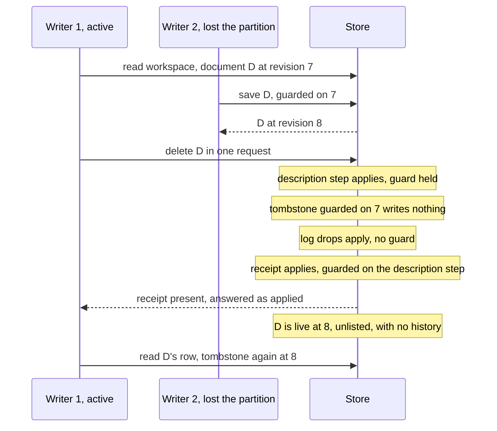
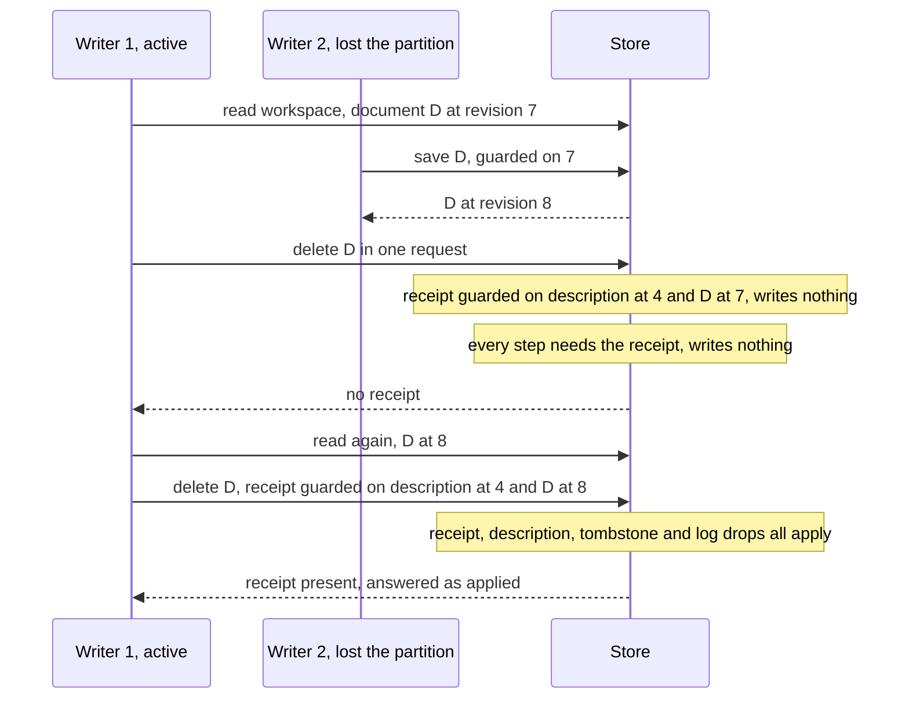
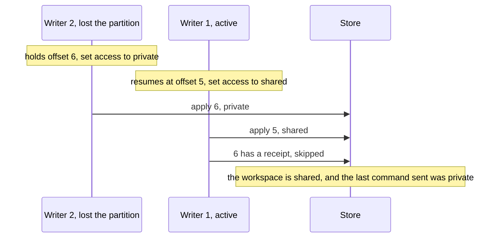

<!-- SPDX-License-Identifier: CC-BY-SA-4.0 -->

# MSA-I14: studio commands that apply whole or not at all

**Unit:** [`multi-store-architecture`](../../status/multi-store-architecture.md), slice MSA-I14 of the [plan](../../plans/multi-store-architecture.md)
**Written:** 2026-11-23, on paper, against `Writer`, `StudioOperations`, `Maintenance` and `StreamWriter` as MSA-F1 to MSA-F14 left them. Nothing was run
**Placement:** T0, public. Platform configuration, nothing domain-specific
**For:** the maintainer, who decided MSA-Q21 to MSA-Q23 and MSA-Q29 by 2026-11-25. Then whoever builds the slices of section 13
**Builds on:** [MSA-I11](MSA-I11-logical-port.md) for the unit, MSA-I9 for what a single active consumer does not give, MSA-I6 for the model, and [ADR-A149](../../../architecture/decisions/ADR-A149-publication-from-the-studio.md) decision 13 with its addendum of 2026-11-19

## 1. The question

ADR-A149 decision 13 lets a command that writes several aggregates apply in part, and orders its steps so that no reader acts on what is left. The addendum of 2026-11-19 bounds two states that follow and admits it does not remove them. TD-166 to TD-172 record what the store can then hold. We want a design in which those states cannot be reached, before more write paths are built on this one.

This note states the requirement, shows where each state comes from, compares three ways to meet it, and drafts the addendum that would replace the current one. Every recommendation is a hypothesis until machine S's model has checked it (section 11) and the maintainer has decided.

## 2. The requirement

- **R1, whole commands.** After any request commits, and after any crash, redelivery or handover, the store is in a state that some sequence of whole commands gives.
- **R2, answers agree.** A command is answered as applied if and only if all of it was applied, and a resend of it gets the same answer.
- **R3, nothing unaccounted.** Every row, graph and receipt in the store is one a command answered as applied wrote and no later one removed.
- **R4, the partition's order.** A candidate, for MSA-Q22. The sequence in R1 is the order the commands have on their partition.

R1 to R3 are the plan's requirement. R4 is separate because one option meets R1 to R3 without it.

## 3. What the writer does today

Read from the code on 2026-11-23.

- **One request for a batch.** Up to 64 commands become one SPARQL Update request, which Fuseki over TDB2 applies as one commit and rolls back whole when an operation fails (TSD-44, TSD-66).
- **Each step has its own guard.** A command runs one generated operation for each aggregate it writes, each guarded on that aggregate's version row and nothing else (`Writer.Batch.Steps.op`).
- **The receipt follows one step.** A command's `cst:Receipt` is its last operation, guarded on the claim of one step, the last one for most commands and the first for the two deletions (`Steps.commit`).
- **The plan is made from a read.** The writer reads the workspace, the rows and the stored graphs before the request, and computes each step from them. Two commands of one batch see each other through the batch's own maps. A write by anyone else between the read and the request is seen only by the guards.
- **The answer is a second read.** An update returns nothing, so the writer reads the batch's receipts by id afterwards. A command with a receipt gets the planned reply, and one without gets a reply computed from the state then (`Plan.unapplied`).
- **A deletion makes later requests.** A tombstone that lost its guard is planned again after the commit, up to three times, and on a resend (`finish`, `retiredBy`).
- **A deletion drops history without a guard.** The patch log graphs of what a deletion retires are removed by `DROP SILENT GRAPH`, which has no condition (`logDrops`).
- **Jobs are whole already, in form.** A command on a job inserts its receipt first, under its precondition, and every other operation of the command is conditional on that receipt (`mine`).
- **Promotions are derived in the request.** After a command's writes the request clears and refills the promoted graph of each source it wrote, from the source as it then is (`Maintenance.keep`).

The commands of more than one step, and what guards the receipt.

| Command | Steps, in order | Receipt guarded on |
|---|---|---|
| create | the baseline part, the description | the description |
| import | each part, each document, the description | the description |
| save-document, new or retitled | the document, the description | the description |
| delete-document | the description, the document's tombstone, the log drops | the description |
| delete-workspace | the description's tombstone, a tombstone for each part and document, the log drops, the clearing of jobs and of the workspace's receipts | the description's tombstone |
| fence | the import, the description | the description |
| publish | the version, the lineage | the lineage |

Every other command writes one aggregate and is whole today.

## 4. Where a state outside the requirement comes from

Every such state needs a write the planning writer did not see, except one.

| State | Breaks | Needs | Recorded |
|---|---|---|---|
| a deletion answered as applied while a row it deletes is live | R2 | a second writer's save between the read and the request | TD-166 |
| that row left for good after three attempts | R1, R3 | the same, three times, or no redelivery | TD-167 |
| a document id with a live unlisted row created again, the old content shown | R1, R2 | one of the two rows above first | TD-168 |
| a row moved with no receipt, for example a new document's graph written and its listing refused | R1, R3 | a second writer moving the description | TD-169 |
| a deletion's attempts reusing transaction ids across deliveries | not known | two failures after a lost tombstone | TD-171 |
| a creation answered 400 although applied | R2 | **no second writer.** A resend that puts the creation and the deletion of one workspace in one batch | TD-172 |
| a live, listed document with no patch log, after a deletion answered as refused | R1 | a second writer moving both the description and the document | TD-180, new |
| a job that succeeded overwritten as failed | R1 | a second writer's update between the read and the request | TD-181, new |
| an import or a version stored that nothing holds | R3 | a second writer moving the description or the lineage | by design, reused later |

Two were found writing this note, both read from the code and not reproduced.

- **TD-180.** `logDrops` is unconditional. Where both guards of a document's deletion fail, the command is answered "send it again" and nothing is written, but the document's patch log is gone.
- **TD-181.** `jobUpdate` drops an update that would move a succeeded job to failed, and decides that from the job as read before the request. The comment says the check cannot race because a workspace's writes are applied in order. MSAI9-01 and MSAI9-02 show two consumers with applies in flight on one partition, so it can.

**The two causes.** A command's steps are guarded apart (TD-169), and nothing stops a writer that lost its partition from writing (TD-170). The second supplies the unseen write, and the first turns it into a part-applied command. TD-172 has a third cause of its own, which section 7 takes.

The first row, as it happens.



## 5. Which guard makes a command whole, MSA-Q21

**(a) As built, with a sweep.** Keep the per-step guards, the order of decision 13 and the addendum's later requests. Add the sweep TD-167 names, which removes rows no description reaches.

**(b) One guard for each command, receipt first.** The command's first operation inserts its receipt. Its guard is the conjunction of every condition the command's steps have today, each row at the revision the plan read or absent, and the absence of the receipt itself. Every later operation of the command, the log drops and the clears included, runs only where that receipt exists. The steps keep their own guards as a second line. A command refused whole wrote nothing, so the writer reads again and plans it again. This is the form the job commands already have, with the guard widened from a precondition to every row.

**(c) The port's unit.** Wait for the logical port. A command becomes one `Unit`, lowered on SPARQL to a receipt written first under the joint guard of the unit's operations, each of which then requires the receipt, and on SQL to a transaction with a savepoint (MSA-I11 section 5). The operations cannot share one `WHERE`, since two of the four generated operations end theirs with a sweep of the stored graph and two sweeps multiply.

(b) and (c) state the same rule and, on SPARQL, the same lowering. (b) builds it in the writer, and (c) has the persistence compiler emit it and is where the studio ends up. The same deletion under (b).



For example, the guard of that deletion's receipt reads as follows, in outline and not as the generated text.

```sparql
WHERE {
  GRAPH <rows> { <description> :seq 4 . <document D> :seq 7 }
  FILTER NOT EXISTS { GRAPH <receipts> { <receipt of this command> a cst:Receipt } }
}
```

### Compared

| | (a) as built, with a sweep | (b) one guard, receipt first | (c) the port's unit |
|---|---|---|---|
| meets R1 to R3 | no. It bounds how long a state lasts | yes, as a hypothesis for the model | yes, by MSA-I11's argument |
| hard to reason about | each command needs its own argument that its order is safe, and each new command another | one rule for every command | one rule, stated by the port |
| easy to get wrong | yes. MSA-F6, MSA-F7, MSA-F9, MSA-F11 and MSA-F15 each repaired a case of it | a step left out of the guard is the error to look for, and a test can enumerate the steps | the compiler forms the guard |
| brittle under change | a new family or command reopens the argument | no | no |
| code | `finish`, `retiredBy`, the resend path and a sweep, kept | those removed. The receipt moves first, and each generated operation gains a precondition | the writer's request building is replaced by the port |
| what it waits on | nothing | a precondition slot on a generated operation. We found none under `tools/persistence/src/persistence`, so the compiler gains it (PRI-60) | MSA-I8, and a compiler that lowers a unit |
| the store must | apply a request atomically | the same | the same, or offer a transaction |

### Space and time

For a command of k steps, with p parts and d documents in a workspace.

| | (a) | (b) |
|---|---|---|
| operations in the request | k and a receipt | a receipt and k |
| guard patterns evaluated | k, one for each step, and 1 for the receipt | k for the receipt, 1 for its own absence, and 2 for each step |
| requests when nothing was unseen | 1 | 1 |
| reads when nothing was unseen | the receipts, and one read of rows after a deletion | the receipts |
| requests when a write was unseen | 1, then for a deletion 1 read and 1 request for each of up to 3 rounds | 1 refused, then a read and 1 request for each of up to 3 plans |
| triples stored | the same | the same |
| the state between requests | part-applied | whole |

A worked example, the deletion of a workspace with 8 parts written and 20 documents. k is 29, the description and 28 tombstones.

| | (a) | (b) |
|---|---|---|
| guard patterns, no unseen write | 30 | 88 |
| requests, no unseen write | 1, and 1 read of 28 rows | 1 |
| requests, one document saved by a second writer first | 2, and 2 reads of rows | 2, and 1 read of the workspace |
| what the sender is told meanwhile | applied, before it is | nothing until it is |

Each pattern has every term bound, so it is one index lookup. On Fuseki a small update costs its commit and not its work (TSD-44), so we expect the 58 more lookups to be lost in the commit. That is a hypothesis until measured. (b)'s cost crosses (a)'s only where a command loses often, which needs two writers on one partition, and section 6 removes that case.

### What (b) changes for a sender

- **A deletion still wins.** It is planned again at the revisions it finds, so the addendum's point 1 holds. Points 2 to 4 fall away, since a deletion has no later request.
- **A creation over an existing row is refused.** The guard says the row is absent, where `create-if-absent` wrote nothing and went on. That is the addendum's point 5 by construction, and MSA-F15's check stays as the reply that explains it.
- **An import or a version is stored only with what holds it.** The create that reuses existing content has no row condition, so it adds nothing to the guard and still needs the receipt.
- **A command that loses three plans is answered "the workspace changed, send it again".** The reply exists today. Under (b) it is true that nothing was written.

*Leaning (b), now, with (c) as where it goes.* Is it needed now? Yes, since MSA-I8 builds a write path and the plan holds it on this. Can it be simpler? (a) is less new code and does not meet the requirement. (c) is the same rule with more to build first.

**Answered 2026-11-24, (c) built once as (b)'s lowering.** The persistence compiler gains a unit, its receipt first under the joint guard of every row and each later operation requiring that receipt, and the writer is generated from it. A shared `WHERE` across the operations is not possible, since two of them end in a sweep of a graph and two sweeps in one pattern multiply. Both probes of the lowering pass on rdflib, Oxigraph and Jena in memory (TSD-80). Points 1 and 2 of [ADR-A149](../../../architecture/decisions/ADR-A149-publication-from-the-studio.md)'s addendum of 2026-11-25.

## 6. The partition's order and a second writer, MSA-Q22

Under (b) two writers on one partition cannot tear a command. Each request is atomic and each command is whole, so whatever order their requests land in, the store holds a sequence of whole commands, each applied once because its guard requires its own receipt to be absent. That is the hypothesis for R1 to R3 with no further mechanism.

It does not give R4. A writer that lost its partition can apply a command it holds before the active writer reaches it.



A command that carries the revision it expects is safe from this, since the late one is refused as stale. The commands that carry none are set-access, set-dependencies, fence, release, the two deletions and the job commands. MSAI9-02 measured up to 20 applies of an older sequence number after a newer one in a run.

**(a) No token.** R1 to R3 hold. R4 does not, for the commands above. A command can also lose a plan to the other writer, which is what the three plans of section 5 are for.

**(b) A writer token, checked by the store.** The store holds one row for each partition with a number. A writer that the broker makes active for a partition raises the number by a guarded write and keeps it. Every command's receipt guard gains one pattern, that the row holds the writer's number. A writer whose number is stale has every command refused whole. It sends no reply, stops, and applies nothing more until the broker makes it active again. MSA-I6's model X4 checked this shape for an authority cutover (`X4_Fenced`).

| | (a) no token | (b) a writer token |
|---|---|---|
| R4 | no | yes, as a hypothesis for the model |
| design | nothing to add. The inversion has to be explained to whoever meets it | one row and one rule. A writer must raise the number only when the broker makes it active, never on a refusal, or two writers would refuse each other in turn |
| runtime | a command can lose plans | one more lookup for each command, one write for each takeover. The active writer never loses a plan |
| storage | none | one row for each partition |
| in direct mode, with no stream | not applicable | the one writer takes the token at start |

**Two names to keep apart.** The studio's `fence` command holds an import, so this note says writer token and never fence. The token is also not `LATTICE_STUDIO_EPOCH`, which names the dataset's epoch in every revision (MSAI11-03).

*Leaning (b).* The inversion is silent and falls on the commands that change access and delete content. The cost is one lookup. It is the weaker of the two leanings, since it rests on the broker's activation signal, which MSA-I9 did not probe for lateness.

**Answered 2026-11-25, (b) with the planning read taking the batch's receipts and the token.** Models X5, X7, X8 and X9 changed the ground twice. Held to R2 as first written, the token bought nothing in any run, and the answers agreed with no token once the planning read took the receipts. Held to R2 as section 7a restates it, two writers that start from any position answer a command as not applied after it applied with no token, and never with it (`X7_AnyWholeAnswerFinal`, `X7_AnyFencedAnswerFinal`, and the same pair in X8). The token does not give R4 under such a delivery (`X7_AnyFencedAnswerOrderSets`), so R4 rests on a writer starting from the stored offset and taking the stream in order. The broker's activation signal is still not probed. Points 6 and 7 of [ADR-A149](../../../architecture/decisions/ADR-A149-publication-from-the-studio.md)'s addendum of 2026-11-25.

## 7. What a command's answer is read from, MSA-Q23

Under (b) of section 5 the receipt is the command's first operation and everything else depends on it, so a receipt is present exactly where the whole command was applied. Reading the answer from the receipt is then right by construction. One hole is left. The deletion of a workspace clears the workspace's receipt graph, in the same request, and takes with it the receipt of any command on that workspace earlier in the batch (TD-172).

**(a) Spare the batch.** The clear leaves the receipts of commands planned in this batch. They stay in the store for a workspace that is gone, with nothing to remove them.

**(b) No command removes a receipt.** A deletion leaves the workspace's receipts. Receipts are removed by retention, by age, once no resend can arrive, which is the port's `housekeep` (MSA-I11 section 3).

| | (a) spare the batch | (b) no command removes a receipt |
|---|---|---|
| R2 | yes for TD-172's case. A resend of an older command on the deleted workspace is answered 404, where its first sending was answered 200 | yes |
| R3 | a few receipts left with no owner | every receipt is kept until its age, by one rule |
| design | a special case in one command | one rule. Retention has to be built, and is not today |
| storage | none to speak of | a receipt is about 10 triples and one for each graph written. A workspace deleted after 5,000 commands leaves about 60,000 triples until retention |
| defensible history | a deleted workspace leaves no trace of who deleted what before it | the receipts say who did what and when (PRI-54). They hold the sender, the principal and graph names, and no content |

*Leaning (b).* The cost is that a principal's name outlives the workspace until retention runs. Where a deletion has to remove that too, retention for a deleted workspace is immediate once its deletion's receipt is older than the resend window, which is a setting and not a design change.

**Answered 2026-11-24, (b).** Model X7 reproduces TD-172 with one writer, finds that (a) answers a sender's resend of a creation as not applied after its deletion, and finds no error under (b). Point 8 of [ADR-A149](../../../architecture/decisions/ADR-A149-publication-from-the-studio.md)'s addendum of 2026-11-25.

## 7a. What a refused command leaves, MSA-Q29

Added 2026-11-24. Nothing is recorded for a refusal, so a change sent before the creation it needs is answered as not applied, and its resend applies once the workspace exists. One command id is then answered both ways, which R2 as written forbids (`X7_RefusedThenApplies`).

**(a) Nothing, and R2 is restated.** Only an answer of applied is final. **(b) A receipt of the refusal,** read with the others, so a resend is answered as refused. It costs a write for each refusal and is not modelled. **(c) The sender's concern,** a new attempt takes a new command id.

**Answered 2026-11-25, (a).** R2 now reads that a command answered as applied was applied, and none is answered as not applied once it has applied (`AppliedIsFinal`, `NoRefusalAfterApplied`). It holds with one writer and with the token under any delivery, and fails with two writers and no token, which is why section 6's answer keeps the token. Point 9 of [ADR-A149](../../../architecture/decisions/ADR-A149-publication-from-the-studio.md)'s addendum of 2026-11-25.

## 8. Identifiers

The ledger's sketch leans towards two identifiers for a pass, one for each attempt and one for the evaluation (BHL-Q2), and towards recording nothing for an attempt that was turned away (BHL-Q1). The studio needs less.

- **One identifier, the command's id.** It names the request, the receipt and, through `urn:txn:{command id}/{n}`, each step's transaction.
- **A refused plan leaves nothing.** Under (b) a refused command wrote no claim, so the next plan of it may use the same transaction ids. TD-171's question, whether a lost attempt leaves a claim that silences the next, cannot arise, and `-again-{round}` and `/resent/{k}` go with `finish`.
- **Nothing is recorded for a refused plan,** as BHL-Q1 leans. The writer logs it.

This is a hypothesis the model checks, as the invariant that a command with no receipt has no claim.

## 9. What stays outside one guard

- **Jobs.** They have the receipt-first form. Their guard is the job's owner, and for a submission the workspace's existence. `jobUpdate`'s rule about a succeeded job is decided from a read (TD-181). The repair is the same rule, the condition moved into the receipt's guard. Jobs stay coordination data (PRI-52) and off the port until they are a family (MSA-I11 section 6).
- **Promotion maintenance.** `Maintenance.keep` clears and refills a derived graph from its source in the same request, with no condition. Where the command applied, the promotion follows the source. Where it was refused, the refill recomputes what was there. It is a function of the source alone, so it cannot leave a state outside R1. That is read from `keep` and its bound templates were not read.
- **The log drops.** Under (b) they need the receipt, which pays TD-180.

## 10. What each option pays

| Debt | (a) with a sweep | (b) one guard | (b) with a writer token | Also needs |
|---|---|---|---|---|
| TD-166, answered before removed | open | paid | paid | |
| TD-167, a row left for good | bounded by the sweep's period | paid | paid | |
| TD-168, a deleted id created again | paid by MSA-F15 | paid by the guard and MSA-F15 | the same | |
| TD-169, steps guarded apart | open, it is the design | paid | paid | |
| TD-170, no check on a writer that lost its partition | open | open. Harmless to R1 to R3, and R4 fails | paid | |
| TD-171, transaction ids reused | open until MSA-F15's test | gone with `finish` | the same | |
| TD-172, a creation answered 400 | open | open | open | MSA-Q23 |
| TD-180, history dropped with no guard | open | paid | paid | |
| TD-181, a succeeded job overwritten | open | paid where the rule joins the guard | the stale writer is refused as well | |

## 11. The model machine S builds

One module beside `X1_SerialisedApply.tla`, on MSAI6-01's configuration. Two writers on one partition, one of which lost it, a store that applies a request atomically, per-aggregate rows, receipts, and a reader.

| Constant | Values |
|---|---|
| guard | per step, as built. One guard, receipt first |
| token | none. Checked in the guard |
| receipts | cleared by a deletion. Kept |

The commands are a deletion over two aggregates, a save of one of them, a creation, and two commands that carry no expected revision.

| Invariant | Says | Expected |
|---|---|---|
| `WholeCommands` | every command has all of its steps applied or none | violated as built, with TD-166's and TD-169's traces. Holds under one guard |
| `AnswersAgree` | a command answered as applied has a receipt and all its steps | violated as built. Violated under one guard with receipts cleared, by TD-172's trace. Holds with receipts kept |
| `NoStrayClaim` | a command with no receipt has no claim | holds under one guard |
| `PartitionOrder` | two commands with no expected revision take effect in their offsets' order | violated with no token. Holds with one |
| `EventuallyApplied` | a command the active writer holds is applied or answered | holds, with the three plans as a bound |

**The falsifier.** An option is rejected where TLC finds a reachable state that breaks an invariant the table says it holds. A result holds for the stated constants only.

## 12. The recommendation, and what would overturn it

Decided by 2026-11-25, as the answers in sections 5 to 7a say. The recommendation of 2026-11-23 follows as it was written, and differs from the answers in two ways, that the guard is the compiler's unit and not hand-written, and that R2 is restated.

One guard for each command with the receipt first (MSA-Q21 (b)), a writer token in that guard (MSA-Q22 (b)), and receipts that no command removes (MSA-Q23 (b)). Together they are meant to pay TD-166 to TD-172, TD-180 and TD-181, and to remove `finish`, `retiredBy` and the resend path of a deletion.

It is overturned where any of these holds.

- The model finds a state outside R1 to R3 under one guard.
- A store we support does not apply a multi-operation request atomically. TSD-66 covers Fuseki over TDB2. Oxigraph on disk does not make concurrent updates wait (TSD-73, TD-162), which the steps' own guards and the token are there for, and which the model does not cover.
- The compiler cannot give a generated operation a precondition without changing what PRI-60 means by a generated write path.
- The broker's activation signal can arrive after a writer has begun to apply, which would make the token late and R4 a hope.

## 13. What would follow

Not planned yet. The table is of 2026-11-23. The model row is done, on macOS and not on machine S, and the addendum is drafted. The precondition row is now the compiler's unit, which needs an addendum to ADR-A123 first.

| Slice | Is | Needs |
|---|---|---|
| the model | section 11, on machine S | this note |
| the addendum | section 14, Proposed, for the maintainer to accept | MSA-Q21 to MSA-Q23 answered |
| a precondition on a generated operation | the compiler and its contract | the addendum |
| the writer's commands, receipt first | `Writer`, with `finish` and `retiredBy` removed, and a test that enumerates each command's steps against its guard | the precondition |
| the writer token | `StreamWriter` and one row for each partition | MSA-Q22 (b) |
| receipt retention | `housekeep`, or a job until the port exists | MSA-Q23 (b) |
| the job rule in its guard | `jobUpdate` | none, it can go first |

MSA-I8 can start once the addendum is accepted, since it puts a ledger family behind the port and takes the rule, not the writer's code.

## 14. The addendum that would replace the current one, in draft

> **Proposed, for the maintainer. Reverses the addendum of 2026-11-19, a deletion wins over a write of what it deletes, except its points 1 and 5. Narrows decision 13.**
>
> 1. **A command applies whole or not at all.** A command's receipt is its first operation. It is written only where every aggregate the command writes is at the revision the command was planned from, or absent where the command creates it, and where the command has no receipt. Every other operation of the command is applied only where that receipt exists.
> 2. **A command refused is planned again.** A command whose receipt was not written wrote nothing. The writer reads again and plans it again, three times at most, and then answers that the workspace changed.
> 3. **A deletion wins,** as before, by being planned again at the revisions it finds. It is answered as applied only when everything it deletes is gone, and it makes no later request.
> 4. **An id whose row exists is never created again,** as before, and now by the guard.
> 5. **A writer holds its partition's token.** A partition has one row with a number, raised by the writer the broker makes active. Every receipt is guarded on the writer's number, so a writer that lost its partition writes nothing.
> 6. **No command removes a receipt.** Receipts are removed by retention, by age.
> 7. **The order of a command's operations no longer carries safety.** Decision 13's order stays as the order they are written in.
>
> **What it costs.** A command's receipt guard reads one row for each aggregate it writes and one for the token. A command that loses a plan costs a read and a request. A deleted workspace's receipts stay until retention.
>
> **What it admits.** Nothing outside a sequence of whole commands in the partition's order, on a store that applies a request atomically. On a store that does not, it is not offered.

Points 5 and 6 are in the draft only if MSA-Q22 and MSA-Q23 are answered (b).

**Superseded 2026-11-25.** The draft above is kept as it was written. The addendum as proposed is in [ADR-A149](../../../architecture/decisions/ADR-A149-publication-from-the-studio.md), dated 2026-11-25, with eleven points. It adds the generated unit, the planning read, the stream-order rule, the restated R2 and the patch log and job rules, and its second limit says a store that lets two concurrent updates both commit is not covered.

## 15. What was not read or run

- Nothing was run when this note was written. Since then models X5, X7, X8 and X9 were checked and the unit's lowering probed on three engines in memory (the [Validation Pack](../../validation/MSA-I14.md)). Every state in section 4 is still read from the code, and TD-168, TD-169's first case, TD-180 and TD-181 are not reproduced against it.
- The generated operations' text, the templates `Maintenance` binds, and how the broker signals activation to a single active consumer were not read.
- That a generated operation has no precondition slot is from a search of `tools/persistence/src/persistence` for the word, not from reading the compiler.
- The lookup counts are counted from the writer's code, and no time was measured.
