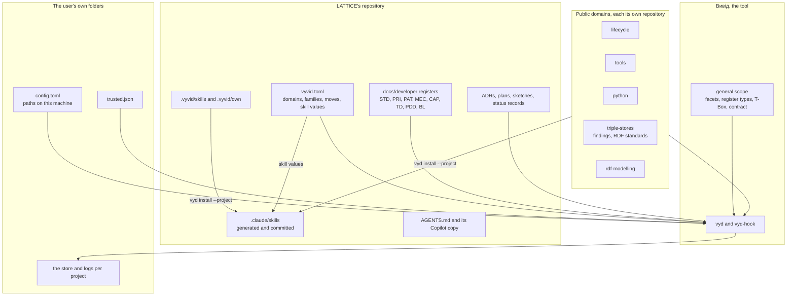
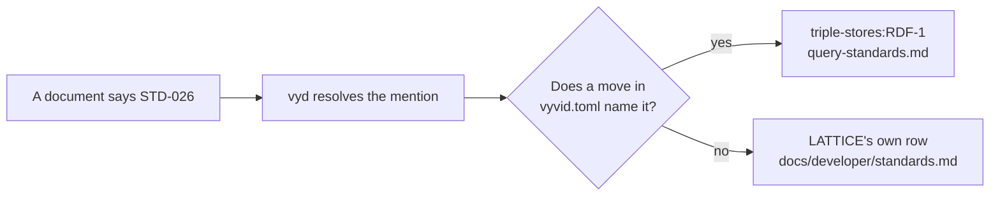
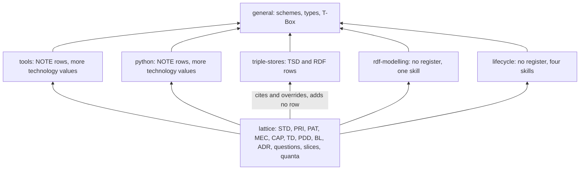
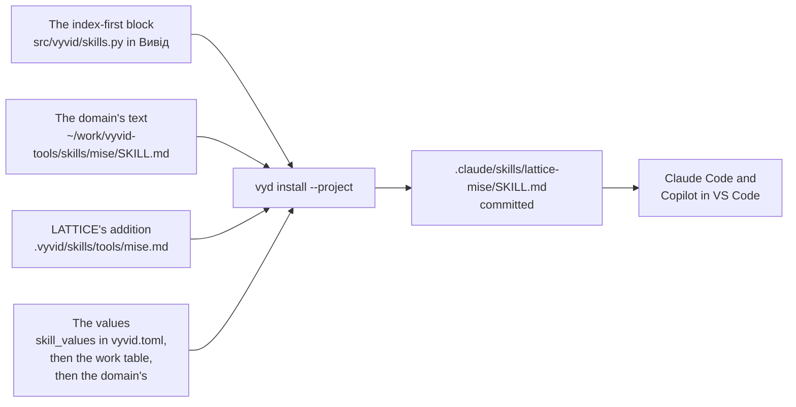
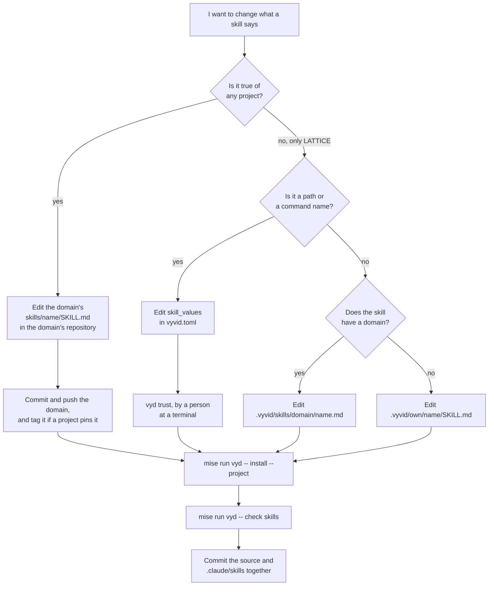
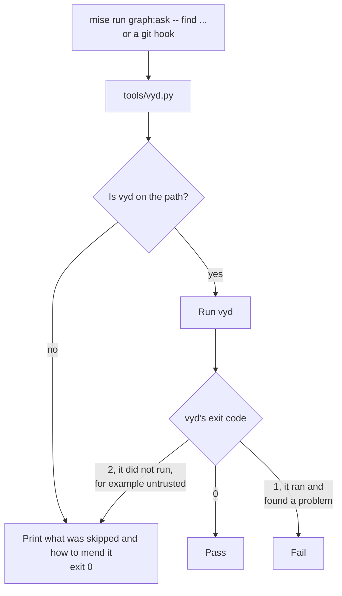
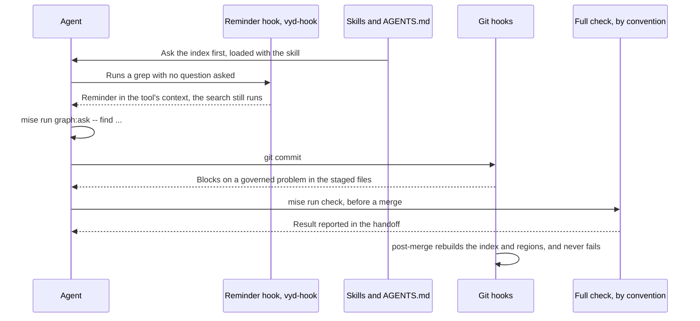
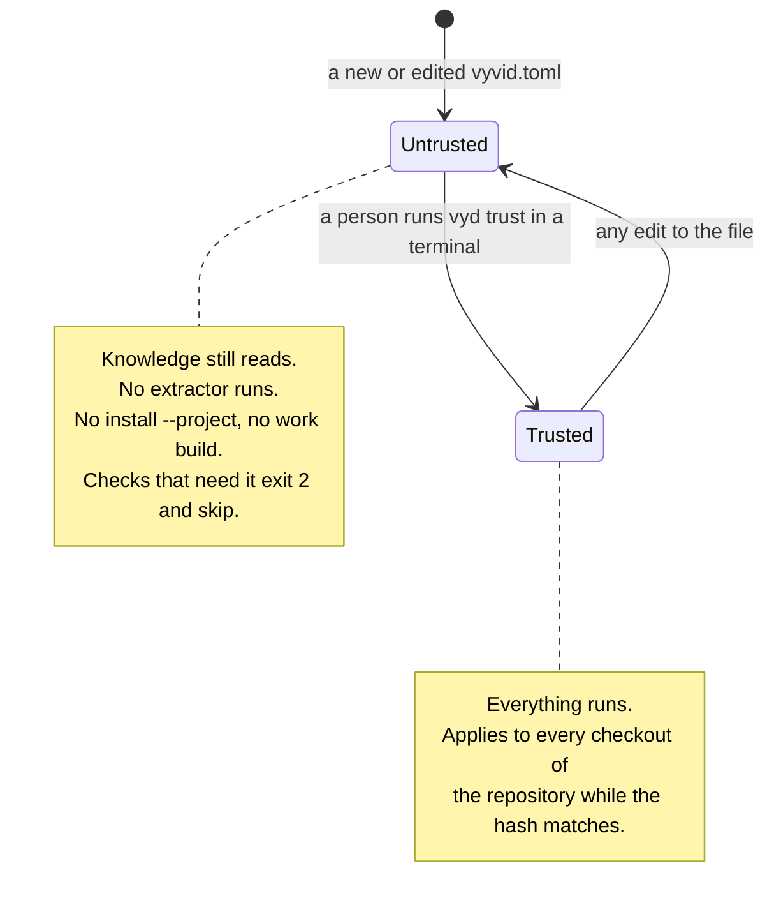

<!-- SPDX-License-Identifier: CC-BY-SA-4.0 -->

# How LATTICE works on Вивід after the migration

**What this is.** A walkthrough of where LATTICE's registers and skills live now that the knowledge index and the work board are Вивід's, how a change to either reaches an agent, and how `mise`, the checks and the hooks hold it together. It was written on 2026-11-05 on the `vyvid-migration` branch at the unit's merge into `main`, with Вивід at `v0.2.10`. [ADR-A152](../../architecture/decisions/ADR-A152-vyvid-adoption.md) and the [plan](../plans/vyvid-migration.md) hold the decisions. This note explains the result and decides nothing.

## 1. The whole picture

Four places now hold what an agent reads, and they differ in who owns them and in how a change reaches an agent.

| Place | Examples | Who owns it | How it reaches an agent |
|---|---|---|---|
| The Вивід tool, `~/work/vyvid` or a `uv` tool install | the index, the board, the facet schemes, the register types, the T-Box, the index-first block | Вивід's repository | it is the program an agent runs |
| The public domains, one repository each | the store findings, the query standards, the general text of the skills | each domain's repository | read from the clone the user's configuration names |
| LATTICE's repository | its registers, `vyvid.toml`, `.vyvid/`, the composed skills in `.claude/skills/`, `AGENTS.md` | LATTICE | it is the checkout |
| The user's own folders | the configuration, the trust record, the logs and the store, `~/.claude/rules`, personal skills | the person | loaded by the client, or read by `vyd` |



The direction of a citation matters throughout. LATTICE may cite a domain, and a domain never cites a project, so a domain stays usable by a project that has never heard of LATTICE. A domain holds text only, and code ships in `vyd`.

### The layers an agent reads

`mise run vyd -- context` prints the contract for a folder as a stack, and a later layer overrides an earlier one. For LATTICE the order is as follows.

1. general
2. domain `lifecycle`
3. domain `tools`
4. domain `python`
5. domain `triple-stores`
6. domain `rdf-modelling`
7. project `lattice`

The index is built over the whole stack, so one `find` ranks LATTICE's entries and the domains' entries together. An entry of the project shows by its bare identifier, such as `STD-101`, and an entry of a domain by its scope, such as `triple-stores:RDF-1`.

## 2. Which registers moved, and where

### What moved out of LATTICE

| What it was in LATTICE | Where it lives now | What it is called now | What LATTICE keeps |
|---|---|---|---|
| The 64 store findings, `docs/architecture/triple-store-discovery.md` | `findings.md` of `vyvid-triple-stores` | `TSD-nn`, unchanged | a page at the same path saying what each finding means for LATTICE, keyed to the domain's identifiers and linked at tag `v0.1.0` |
| The open store questions, in the same file | `findings.md` of `vyvid-triple-stores` | `TSD-Qn`, unchanged | nothing of its own |
| 30 query-writing standards, `STD-026` to `STD-054` and `STD-279` | `query-standards.md` of `vyvid-triple-stores` | `RDF-1` to `RDF-30` | the old identifiers keep working, by a move |
| The facet register, `docs/developer/facets.md` | `src/vyvid/data/facets.md` in Вивід, the general scope | the same values | nothing. All 325 rows were compared with the store with no difference, and the file was removed |
| The T-Box, `tools/knowledge/knowledge.ttl` | `src/vyvid/data/knowledge.ttl` in Вивід | the same classes and properties | nothing |
| What each register column means, inside the old extractor | `src/vyvid/data/register-types.toml` in Вивід | a declaration | nothing |

`docs/architecture/efficient-queries-and-shapes.md` stays in LATTICE as the record of what we measured, and its rules are the `RDF` rows of the domain.

### What stayed in LATTICE

These remain LATTICE's own registers, in LATTICE's repository, under `docs/developer/` and `docs/architecture/`. `vyvid.toml` declares each one as a family, so `vyd` knows where each identifier is defined and what type its rows are.

| Family | Defined in | Type | Notes |
|---|---|---|---|
| `STD` | `docs/developer/standards.md` | standard | every row except the 30 that moved |
| `PRI` | `docs/developer/principles.md` | principle | |
| `PAT` | `docs/developer/patterns.md` | pattern | |
| `MEC` | `docs/developer/mechanisms.md` | mechanism | |
| `CAP` | `docs/developer/capabilities.md` | capability | |
| `TD` | `docs/developer/technical-debt.md` | debt | removable, so a mention of a closed row is reported and never fails |
| `PDD` | `docs/developer/pending-design-decisions.md` | pending decision | removable |
| `BL` | `docs/developer/backlog.md` | backlog | removable |
| `ADR` | `docs/architecture/decisions/*.md` | decision | one entry per file, with a section per numbered decision |
| `LGQ` | the plans and sketches | question | removable, so a question is counted and never fails |
| `SL` | the Work table of `docs/developer/INDEX.md` | slice | shown by `find` only when asked for with `--kind slice` or by name |

The status records, plans and Validation Packs stay too. They are working documents, and the index holds only the questions and the slices they raise.

### How an old identifier keeps working

A move is a declaration in `vyvid.toml`. It says that a family, or some rows of it, now belong to a domain, which file they came from and at which commit.

```toml
[[project.moves]]
family = "STD"
to = "triple-stores"
source = "code:docs/developer/standards.md"
commit = "4b94c0f0"
copy_removed = true
rows = { "STD-026" = "RDF-1", "STD-279" = "RDF-30" }  # shortened, the file names all 30
```

Hundreds of existing mentions therefore stay correct with no edit. `mise run graph:ask -- read STD-026` prints `triple-stores:RDF-1`, and `check:identifiers` resolves `STD-026` to the domain. `TSD-nn` keeps its identifier, so its move needs no map of rows.



`copy_removed = true` records the end state, that LATTICE no longer holds the copy. `vyd move check` then reports `copy-removed` for that move rather than listing every entry as a difference. It still compares a branch whose source file differs, so a branch older than the move that edited a moved entry is caught, and a merge cannot silently lose that edit.

## 3. Does LATTICE add to a domain's registers?

**No LATTICE register appends rows to a domain's register.** A domain's rows are defined in the domain's repository, and a new row goes there, by a commit to that repository. LATTICE's copy of those rows has gone, and a new store finding is recorded in the domain through skill `lattice-probing`, never in LATTICE.

The relationship is a stack that is read together. These are the places where something does build on a lower layer, and they are the nearest thing to appending.

| What adds | To what | Where it is written | Effect |
|---|---|---|---|
| A domain's `facets.md`, as in `tools` and `python` | the general scope's schemes | the domain's repository | adds technology values for anyone using that domain |
| LATTICE's `facets = []` | nothing | `vyvid.toml` | LATTICE adds no facet value of its own, since the general scope already declares its schemes and a second declaration stops the build |
| `.vyvid/skills/<domain>/<skill>.md` | a domain's skill | LATTICE | joins or replaces sections in the composed skill, section 4 |
| `[project.skill_values]` | the placeholders of every skill | `vyvid.toml` | fills in LATTICE's paths and commands |
| `[[project.extractors]]` | the index | `vyvid.toml` and `tools/knowledge/extractor.py` | adds the architectural quanta and declares the catalogue's units and their folders |
| `[[project.recipes]]` | the recipes | `vyvid.toml` | adds `sparql-for-studio` |
| The page at the old discovery path | the domain's findings | LATTICE | says what each finding means here, as prose keyed to `TSD-nn`, and defines no finding |
| LATTICE's own `STD` rows | the domain's `RDF` rows | LATTICE | may cite them, as a project may cite a domain |



## 4. Where the skills live, and how they get there

### Short answer

The file an agent loads is `.claude/skills/lattice-<name>/SKILL.md`, committed in LATTICE. **It is generated, so it is never edited by hand.** Each opens with a comment saying so. Its text comes from up to four sources, and a change is made in the source.



### The fifteen skills and where each comes from

The ten old skills became fifteen. Thirteen are composed from a domain with a LATTICE addition, and two belong to LATTICE alone.

| Skill an agent loads | Domain text | LATTICE's text | Was formerly |
|---|---|---|---|
| `lattice-lifecycle` | `vyvid-lifecycle/skills/lifecycle` | `.vyvid/skills/lifecycle/lifecycle.md` | the same |
| `lattice-design` | `vyvid-lifecycle/skills/design` | `.vyvid/skills/lifecycle/design.md` | the same |
| `lattice-branching` | `vyvid-lifecycle/skills/branching` | `.vyvid/skills/lifecycle/branching.md` | the same |
| `lattice-publication-hygiene` | `vyvid-lifecycle/skills/publication-hygiene` | `.vyvid/skills/lifecycle/publication-hygiene.md` | the same |
| `lattice-mise` | `vyvid-tools/skills/mise` | `.vyvid/skills/tools/mise.md` | part of `lattice-toolchain` |
| `lattice-windows` | `vyvid-tools/skills/windows` | `.vyvid/skills/tools/windows.md` | part of `lattice-toolchain` |
| `lattice-environment-lessons` | `vyvid-tools/skills/environment-lessons` | `.vyvid/skills/tools/environment-lessons.md` | part of `lattice-toolchain` |
| `lattice-constrained-environments` | `vyvid-tools/skills/constrained-environments` | `.vyvid/skills/tools/constrained-environments.md` | the same |
| `lattice-testing` | `vyvid-python/skills/testing` | `.vyvid/skills/python/testing.md` | the same |
| `lattice-probing` | `vyvid-triple-stores/skills/probing` | `.vyvid/skills/triple-stores/probing.md` | part of `lattice-triple-stores` |
| `lattice-query-writing` | `vyvid-triple-stores/skills/query-writing` | `.vyvid/skills/triple-stores/query-writing.md` | part of `lattice-triple-stores` |
| `lattice-shacl-testing` | `vyvid-triple-stores/skills/shacl-testing` | `.vyvid/skills/triple-stores/shacl-testing.md` | part of `lattice-triple-stores` |
| `lattice-ontology-modelling` | `vyvid-rdf-modelling/skills/ontology-modelling` | `.vyvid/skills/rdf-modelling/ontology-modelling.md` | new |
| `lattice-architecture` | none | `.vyvid/own/architecture/SKILL.md` | the same |
| `lattice-ontology-authoring` | none | `.vyvid/own/ontology-authoring/SKILL.md` | the same |

### How a skill is composed

`vyd install --project`, run as `mise run vyd -- install --project`, does the following for each skill.

1. It takes the domain's `skills/<name>/SKILL.md`, or for a project's own skill the folder `skills` names, `.vyvid/own`.
2. It reads the addition at `.vyvid/skills/<domain>/<name>.md`, if there is one. Text under `## A heading` joins the domain's section of that name. Text under `## A heading (replace)` takes that section's place. A new heading goes at the end. The addition's front matter may give the skill its own `description`.
3. It fills every `{{name}}` from `[project.skill_values]`, then the `work` table, then the domain's `skill_values`, then Вивід's defaults. A value nobody gives stops that skill being written, so a skill is never published with a hole in it. `${{ }}` is left alone.
4. It names the skill with `skill_prefix`, here `lattice-`.
5. It writes the index-first block at the top, and the comment saying the file is generated.
6. It writes the result under each folder in `skill_targets`, here `.claude/skills`, ready to be committed.
7. It writes the reminder hook's registration for each client in `hook_clients`, in `.claude/settings.json` and `.github/hooks/vyvid.json`.

It writes and removes nothing while a domain the project uses is missing, and it runs only once the `vyvid.toml` is trusted.

The skills are committed for a reason. Every clone and worktree then has them with no install step, and so does a contributor who has never installed `vyd`. A composed file names no folder of one machine.

### How to change a skill



| The change | Edit here | Lapses trust? | Then |
|---|---|---|---|
| General advice any project could use | the domain's `SKILL.md`, in its own repository | no | commit the domain, then install in each project that uses it |
| LATTICE-specific text in a domain's skill | `.vyvid/skills/<domain>/<skill>.md` | no | install, commit |
| LATTICE's own skill | `.vyvid/own/<name>/SKILL.md` | no | install, commit |
| A path, command or name a skill uses | `[project.skill_values]` in `vyvid.toml` | **yes** | `vyd trust`, install, commit |
| Adding a domain or changing the prefix | `vyvid.toml` | **yes** | `vyd trust`, install, commit |
| The index-first block | `src/vyvid/skills.py` in Вивід | no | release Вивід, pin it in `mise.toml`, install in each project |

An edit to the generated file itself is caught at the next commit touching it, since `vyd check skills` compares the committed skill with what its sources compose to and fails on a difference.

An edit to a domain has a consequence to remember. The domain lives in another repository, so LATTICE's committed skills fall behind it, and the next LATTICE commit that touches `.claude/skills/`, `.vyvid/` or `vyvid.toml` will fail the `skills` check until someone reinstalls and commits.

### What else an agent loads

| File | Where it comes from | Loaded |
|---|---|---|
| `AGENTS.md` | hand-written in LATTICE, with its skill table generated by `mise run build:agent-guidance` | every session |
| `CLAUDE.md` | one line pointing at `AGENTS.md` | every session, Claude Code |
| `.github/copilot-instructions.md` | generated from `AGENTS.md` by `mise run build:agent-guidance` | every session, Copilot |
| `.claude/skills/*` | composed, as above | when a skill's description matches the task |
| `~/.claude/rules/vyvid.md` | written by `vyd install` into the user's folder | every session, Claude Code |
| The core skills, such as `vyvid-core-domain-review` | packaged with Вивід, written to the user's folders by `vyd install` | when its description matches |
| A private domain's skills | written to `~/.claude/skills` and `~/.copilot/skills` by `vyd install`, never into a checkout, since they would be committed | when a description matches |
| `~/.copilot/skills/lattice-*` | an optional link made by `mise run skills:link`, for Copilot in other projects | when a description matches |

`vyd install` with no options sets up each client whose folder exists, and is safe to run again. A public domain's skills do not go to the user's folder unless its entry says `user_skills = true`, since a client prefers a personal skill to a project's of the same name, and a personal copy would hide the composed one.

The writing rules stay in `AGENTS.md`, since anyone working without `vyd` reads them there (plan decision 19). No domain holds a copy to compare against, so TD-146 records that their consistency has no check.

## 5. How `mise` glues it together

`mise` stays the one entry point (ADR-A29). An agent and a developer run the same task names they ran before the switch, and the tasks now run `vyd` underneath. Agents are told to use the `mise` names because `skill_values` fills them into the skills, for example `{{ask}}` becomes `mise run graph:ask -- find`.

Every one of these goes through `tools/vyd.py`, a small wrapper with one job.



The wrapper keeps the promise of PRI-79, that an absent tool skips and never blocks. A contributor without `vyd` can still commit, and sees a note saying what did not run. The reverse also holds, and it matters when reading a result. **A skip is not a pass**, so a clean run on a machine without `vyd` proves nothing about the index, the board or the skills.

| Task | Runs | Purpose |
|---|---|---|
| `mise run bootstrap` | `bootstrap:vyvid`, `bootstrap:hooks` and the rest | sets up a checkout |
| `mise run bootstrap:vyvid` | `tools/bootstrap_vyvid.py` | installs `vyd` as a `uv` tool at `VYVID_VERSION` in `mise.toml`, does nothing where `vyd` already reports that version, and replaces an installed `vyd` at another version only where its `uv` receipt shows a git install, printing the command that moves to the pin for any other |
| `mise run bootstrap:hooks` | `tools/hooks.py install --bootstrap` | installs the git hooks in the shared hooks folder, which covers every worktree |
| `mise run vyd -- <args>` | `vyd <args>` | passes anything through |
| `mise run graph:ask -- <args>` | `vyd <args>` | `find`, `read`, `exists`, `misses`, `gap`, `close` |
| `mise run build:knowledge` | `vyd build` | builds the index, running both extractors |
| `mise run check:identifiers` | `vyd check identifiers` | every mention resolves, and nothing is defined twice |
| `mise run check:knowledge` | `pytest` over LATTICE's three knowledge test files | the knowledge base is consistent, and the build prints only the notes the test knows |
| `mise run check:vyvid-binding` | `pytest tools/test_vyvid_binding.py` | `vyvid.toml` parses and the binding works |
| `mise run work:board` | `vyd board` | where every unit and slice stands across every branch |
| `mise run build:work` | `vyd work build` | writes the region of `INDEX.md` from the status records |
| `mise run build:roadmap` | `vyd work roadmap` | writes the regions of `ROADMAP.md` from the branches a remote knows and the tree being built |
| `mise run work:here` | `vyd here` | who else is working in this checkout |
| `mise run work:normalise`, `work:rename`, `work:adopt` | `vyd work ...` | move a board to the grammar |
| `mise run build:agent-guidance` | `tools/agent_guidance.py build` | regenerates `AGENTS.md`'s skill table and the Copilot file |
| `mise run check:agent-guidance` | `tools/agent_guidance.py check` and its tests | those generated files, and each skill's front matter and links |
| `mise run skills:link` | `tools/agent_guidance.py link` | links the skills for Copilot elsewhere |
| `mise run check:hooks` | `pytest tools/test_hooks.py tools/test_writing_rules.py` | tests of the hooks themselves |
| `mise run check` | every `check:*` above and the rest of the repository's | the full check |

`vyd` finds its configuration in two parts. `vyvid.toml`, in the repository, says what the project is and everyone shares it. The user's `config.toml` holds what is true of one machine, namely where each domain's clone is and where the project's code folder is. Each worktree answers from its own files with a store of its own, and they share a log folder, so removing a worktree does not lose what it found.

## 6. How the checks and hooks enforce it

Three mechanisms work together. They differ in when they act and whether they can stop anything.



### Skills and `AGENTS.md`: what to do

These say how the work is done, and they are advice to an agent. Every composed skill opens with the same index-first block, held in one place in Вивід, and each ends in the commands that apply to it. Nothing mechanical makes an agent read them, which is why the two mechanisms below exist.

### The reminder hook: a nudge at the moment of a search

`vyd-hook` runs around tool calls, registered by `vyd install --project`.

| Client | Registered in | When it runs |
|---|---|---|
| Claude Code | `.claude/settings.json` | before a `Bash`, `PowerShell`, `Grep` or `Glob` call |
| Copilot | `.github/hooks/vyvid.json` | after a tool call, since its documents give a hook no way to add context before one |

It reminds an agent to ask the index when a search runs before any question in that session, or after 15 searches since the last question. **It never refuses a tool**, and a failure in it says nothing. Its text gives LATTICE's command, `mise run graph:ask -- find`. It uses the standard library alone and costs a few tens of milliseconds, since it runs on every such call. If `vyd-hook` is not installed, the registered command returns an empty answer and nothing happens.

The misses complete the loop. A question the index answers weakly is logged per project, and `mise run graph:ask -- misses --near` lists them at each handoff, so a gap in the registers reaches the maintainer. `--no-log` keeps a benchmark's questions out of that log.

### The git hooks: a floor at each commit and merge

`mise run bootstrap` installs them from `tools/hooks.py`, and they cover every worktree. Each check runs only where the change touches what it governs, so a commit stays quick. No hook runs a test suite, and a push is never refused, so a branch always reaches the maintainer.

| Moment | Hook | What runs |
|---|---|---|
| A commit | `pre-commit` | the commit checks over the staged files |
| A merge into `main` | `pre-merge-commit` | the same over every file the merge changes, plus the merge gates |
| A merge completed by `git commit`, after conflicts or a squash | `pre-commit`, which detects the merge | the same |
| After any merge | `post-merge` | `vyd build`, the `INDEX.md` region, and on `main` the `ROADMAP.md` regions, left for the maintainer to commit. It never fails a merge |

These are the checks that bear on this note.

| Check | Runs when a change touches | Over | Catches |
|---|---|---|---|
| `skills` | `.claude/skills/*`, `.vyvid/*`, `vyvid.toml` | `vyd check skills` | a hand edit to a skill, a source changed with no reinstall, a domain ahead of the committed skills |
| `identifiers` | `docs/developer/*`, the decisions, the discovery page | `vyd check identifiers` | a mention of something undefined, a number defined twice |
| `work` | the status records, `INDEX.md` | `vyd work check --staged` | a board off the grammar or the ladder, an `INDEX.md` region out of step |
| `agent-guidance` | `AGENTS.md`, `CLAUDE.md`, the Copilot file, the skills, the catalogue | `tools/agent_guidance.py check` | a Copilot file out of step, a skill's front matter or links |
| `writing`, `wrapping` | any Markdown | LATTICE's writing rules | semicolons and the like block a commit, wrapping warns |
| `deny-terms`, `links`, `catalogue`, `published-decisions`, and others | what each governs | LATTICE's own tools | as before the migration, these are unchanged |

The `vyd`-based checks go through the wrapper, so an absent `vyd` or an untrusted `vyvid.toml` gives a note and no block.

### The full check: what a hook does not do

The hooks are a floor and never a ceiling. `mise run check` runs before a merge by convention, and the suites it leaves out are listed in the handoff with their results. A passing hook is never reported as a passing check. Reading a check's output in full is part of the contract, because a command that exits zero still reports, and a filter on its output can hide a failure.

### Trust: what stops a clone running code

`vyvid.toml` can name commands that run with the user's privileges, such as LATTICE's extractor. So it is trusted by its hash, per repository, by a person at a terminal running `vyd trust`.



An edit under `.vyvid/skills` lapses nothing, since it runs nothing. `mise run vyd -- config` shows both states. `configuration trust` is about the user's own file, and a later line names the project's `vyvid.toml` and says whether it is trusted.

## 7. Worked examples

**Recording a new store finding.** Follow `lattice-probing`, and write the finding in `findings.md` of `vyvid-triple-stores`, with its next `TSD` number. Commit it there. It is in the index on the next rebuild, since the index reads the clone as it stands. If it means something for LATTICE, add a paragraph to the page at the old discovery path, and move that page's pinned tag once the domain is tagged.

**Adding a standard for LATTICE.** Add a row to `docs/developer/standards.md` in LATTICE. The next `find` rebuilds the index. If it is true of any project using triple stores, it belongs in the domain's `query-standards.md` as a new `RDF` row instead.

**Adding a sentence to the mise skill about LATTICE's studio.** Edit `.vyvid/skills/tools/mise.md`, under the heading where it belongs. Run `mise run vyd -- install --project`, then `mise run vyd -- check skills`, and commit both the source and `.claude/skills/lattice-mise/SKILL.md`.

**Improving general advice on `uv` in the mise skill.** Edit `skills/mise/SKILL.md` in `vyvid-tools` and commit it there. In each project using the domain, run the install and commit the regenerated skill. Until then, that project's `skills` check fails on its next commit touching a skill.

**Moving to a new Вивід.** Change `VYVID_VERSION` in `mise.toml`, run `mise run bootstrap:vyvid`, and run the full check. A change to `mise.toml` lapses no trust.

## 8. What is still open or worth watching

- **The index reads the domain's clone as it stands, while the page links a tag.** The `triple-stores` clone is ahead of `v0.1.0` at the time of writing, so a `find` may show text newer than the page's link. Nothing in the binding pins the index to a tag. LATTICE's page says so, and TD-148 holds the pin to a tag.
- **What a machine without the domains sees has not been run end to end.** The designed behaviour is that the committed skills still work, and that `vyd check skills` and `install --project` exit 2 and say why. Whether every moved `TSD` and `RDF` mention then resolves or skips on such a machine should be proven on a clean clone, along with the Windows run planned after the migration. It is the open item of the unit's review request, for the Windows run on machine S.
- **A domain edit makes a project's skills check fail later, on an unrelated commit.** That is intended, though it surprises whoever meets it, so the reinstall belongs with the domain change.
- **The writing rules have no consistency check,** recorded as TD-146.
- **`vyd work check --staged` reads a record's text from the working tree, not the index.** It is recorded in Вивід's register. A bad record that is staged and then fixed only in the working tree passes.
- **`vyd work roadmap` reads every remote under `refs/remotes`.** It is on Вивід's backlog as BL-2. LATTICE's remotes all point at one repository, so it does not bite here.
