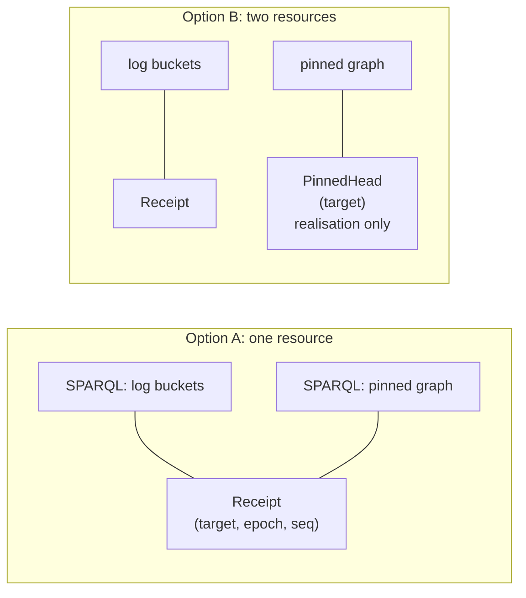
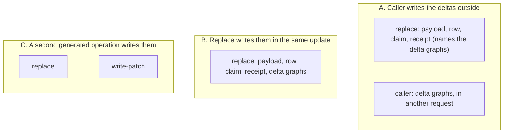

<!-- SPDX-License-Identifier: CC-BY-SA-4.0 -->

# H2.6 review: three open design questions

**Unit:** [`formal-methods-track-h`](../status/formal-methods-track-h.md), slice H2.6 ([Validation Pack](../validation/FMH-H2-6.md), questions 4 to 6). Written 2026-10-13
at the maintainer's request, who approved the slice and answered the other five questions. Each question needs an answer before H2.7 is briefed,
since H2.7 designs the vocabulary and the compiler's emission against the expected profiles.

| # | Question | Leaning |
|---|---|---|
| H2.6-RQ4 | Is the pinned head part of `Receipt`, or a resource of its own? | keep it part of `Receipt` (option A) |
| H2.6-RQ5 | What does the request digest of `append-event` cover? | declare the four event parameters as the digest's payload part (option A) |
| H2.6-RQ6 | Who writes the patch content of a patch log, and does the contract name it? | the operation writes it, in the same request (option B), decided for H2.7 and built in H2.8's slice or its own |

Answers are recorded in the plan (§4.4) and the status record's history, as the `lattice-design` skill asks.

---

## H2.6-RQ4: the pinned head

### The scene

A receipt is written into a monthly bucket of the log, and retention drops whole buckets from the oldest end. A stream written once in March and never
since has its head receipt in the March bucket, so dropping March would leave `pat:head` pointing at nothing (guide §24.2). Before each drop, the retention job
copies every receipt in the bucket that is still some target's head into `urn:g:txlog/pinned`, "with the same IRI and triples", and removes the copy once the
head has moved on. The job also advances each target's retention low-water mark, in its own transaction, before it drops (guide §24.2).

Facts that constrain the options, each checked against the source on 2026-10-13.

- **The pinned graph is a copy.** The same receipt exists in a bucket and in the pinned graph for a while, so the audits that scan receipts count distinct values
  (`COUNT(DISTINCT ?seq)`), which absorbs the duplicate (guide S3, the gap scan). H2.5 tests it (`test_h2_5_t36b`).
- **No generated operation writes it.** The retention job is not a template. Today only the audits touch the pinned graph, and the IR names it as a constant in
  a `VALUES` list next to the registry's buckets, so the graph variable `?log` ranges over the log role and the pinned graph together.
- **The protocol models will name it.** The protocol sketch lists "G. Retention and pruning: bucket rotation, registry update, low-water-mark advance, pinned
  heads" (expected to be the richest model) and "J. Infrastructure-graph writers" including the retention job, in H6 and H7. They are written against the
  protocol, not against the operation contract.
- **The paper check** found no relational counterpart. A foreign key from the version row to its head receipt keeps the receipt through a partition drop, and
  nothing is copied ([FMH-H2-6](../validation/FMH-H2-6.md), the paper check).

### The options

**A. The pinned head is part of `Receipt` (as built).** The pinned graph is how the SPARQL realisation retains a receipt. The mapping takes both the buckets
and the pinned graph as `Receipt`, and the audits' reads are `Receipt` scans.

- *Design overheads.* Smallest model. One resource, one key. The relational mapping is direct, with nothing to ignore. A future retention operation would be
  described as deleting receipts and carrying some forward, so "carry a head forward" reads as inserting a receipt, which is a no-op relationally, and a
  relational compiler has to know that.
- *Runtime overheads.* None. The IR already needs no change.
- *Change under likely growth.* Adding `PinnedHead` later is additive: a new individual and a mapping change. It regenerates the expected profiles of the
  audits and bumps their builder versions, nothing else.

**B. A resource of its own, `PinnedHead`, keyed by target, marked `dal:realisationOnly true`.** The audits read `Receipt` and `PinnedHead`, and a retention
operation, if one is ever generated, writes `PinnedHead` and `Receipt` separately.

- *Design overheads.* A relational compiler can drop every resource marked realisation-only mechanically, which is a clean rule. But the contract now holds a
  resource that the realisation it describes is meant to hide, so a second realisation reads a term that means nothing to it. The IR also needs a
  change. Today the pinned graph is a constant in a `VALUES` list, so a read of it has no graph role to map. The checker would give each `Values` item a role,
  and a graph variable would range over two roles. That is real machinery for a resource no operation writes.
- *Runtime overheads.* None at run time. At review time, every audit's expected profile grows two accesses.
- *Change under likely growth.* The same additive step as A, taken earlier.

**C. Keep one resource and tag the realisation on the access** (`dal:realisedBy dal:BucketsAndPinnedHeads`). The model is A, and a reader who wants the detail
gets it. The cost is a second axis on every access for one resource.

### KISS

Is it needed now? No operation writes the pinned graph, and the audits' reads are the same under A. If later, can it wait? Yes, and the step is additive
(A to B). The one reason to do it now, a retention operation whose contract would read oddly, does not exist yet.

### Leaning

**A**, with the question reopened when a retention job becomes a generated operation. The protocol models do not need the contract to name the pinned graph.

---

## H2.6-RQ5: the digest of `append-event`

### The scene

A transaction claim records `pat:requestDigest` so that a retry can be told from a different request that reused the id. The guide fixes the digest
(§15.2): `hex(SHA-256(enc([operationKind, target, expected, *sorted(canonical N-Triples lines of the skolemized payload and events)])))`, where `expected` is
the decimal string of the expected `seq` for a CAS "and the empty string otherwise". The contract records the four parts (operation kind, target, expected
sequence, payload) and names the parameter each comes from.

Facts that constrain the options.

- **The guide already says "payload and events".** The digest is over the content of the request, and for an append the content is the events.
- **`append-event` writes four triples per event and no more** (checked in its template and builder): `$event a $eventType`, `pat:revision` (derived by the
  query, not a parameter), `pat:opSeq $opSeq` and `pat:occurredAt $occurredAt`. It takes no payload slot and no expected sequence. As far as I can tell from
  the template an event carries no domain data, so please confirm that this is intended and not a gap. If an event is meant to carry domain triples, they are
  written by something that is not this operation.
- **The guide's own example appends three events in one request** (§10.1, "Append three events"), while the template appends one.
- **The expected profile shows both the expected-sequence part and the payload part of an append as `dal:NoSource`**, which says an append has no expected
  sequence (the guide: the empty string) and leaves the event's contribution undeclared.

### The options

**A. Declare the four event parameters as the digest's payload part.** The part's source is the set `{event, eventType, opSeq, occurredAt}`, and the contract
fixes the canonical lines: the three triples the request supplies, without the derived `pat:revision` link. `NoSource` for `expected` then means the empty
string, as the guide says, and for the payload part, no lines. The guide's formula is unchanged.

- *Design overheads.* A multi-valued `dal:partSource`, and a rule that names which triples a set of parameters stands for. That rule is operation-specific
  and lives in the contract, so it must be versioned with the builder. The contract stays honest about what the append hashes.
- *Runtime overheads.* None. A caller in any language needs N-Triples canonicalisation of three triples.
- *Brittle under change.* If an event grows another parameter, the digest changes, and a stored claim with the old digest then reads as
  `IdempotencyKeyReuse` on a legitimate retry across a deploy. The builder version bump is the signal, and a claim's TTL is the exposure window.

**B. Give the append a payload slot, like the other writes.** The events are supplied as triples (`{{{eventTriples}}}`), the query derives `opSeq` and the
revision link, and the digest's payload part is the sorted canonical lines of that slot. One rule covers all operations.

- *Design overheads.* A change to the operation, not a port (the template, the builder, the golden text and the harness), and a second payload slot to guard
  in H2.8's payload check, since a slot is outside ADR-A79's injection boundary by construction. It makes the guide's three-events example expressible and
  lets an event carry domain triples. It turns the append from a four-parameter operation into one whose position bookkeeping (`opSeq` per event) moves
  into the query, which is more to get wrong.
- *Runtime overheads.* More text substitution on the hot path of an append. Otherwise the same.
- *Brittle under change.* Less than A for event shape, more for the query.

**C. Hash the declared request parameters instead of triples**, for every operation: a tuple of the parameters that are not infrastructure, in a fixed order.

- *Design overheads.* A uniform rule that needs no N-Triples canonicalisation for an append, but it replaces the guide's formula, so §15.2 and the remediation
  record (A5) change, and it ties the digest to parameter names and order. Payload operations would then hash a parameter tuple and the payload together,
  which is two rules in one.
- *Runtime overheads.* None.
- *Brittle under change.* Renaming a parameter changes every digest.

### KISS

Is it needed now? The contract must say something, since the profile is the contract and an undeclared part is the gap the review found. A declares it with
no change to the operation. B is the larger design and belongs with the question of what an event carries. C changes an accepted guide for one operation.

### Leaning

**A**, and confirm whether an event is meant to carry only these four fields. If events are to carry domain data, B is the right slice (with H2.8's payload
check), and RQ5 then reopens.

---

## H2.6-RQ6: the patch content of a patch log

### The scene

Under `dal:PatchLog` each replace records `pat:asserts <assert graph>` and `pat:retracts <retract graph>` on the receipt, naming delta graphs of the triples
the revision added and removed, "computed client-side" and costing "roughly twice the write volume" (guide §20.2, README §7.4). The delta graphs are
"additional evidence" and the payload graph is still replaced whole.

Facts that constrain the options.

- **No operation writes the delta graphs.** `cas-replace-named-graph` takes `$assertGraph` and `$retractGraph` as IRIs and records them on the receipt. The
  triples themselves are written by something outside the operation (the caller, as far as the guide says). The contract has no resource for them.
- **They are optional in the builder and required under a patch log** in the expected profiles (H2.3-Q3, the one intended difference), so a patch-log caller
  who leaves them out gets a receipt without them, unguarded.
- **The relational note expects the operation to write them.** `lattice-sql.md` §9 reads a patch log as "a change table written by the generated operation, or
  logical decoding of the base tables".
- **A request of several operations is not atomic on every store** ([TSD-06](../../architecture/triple-store-discovery.md#tsd-06-a-request-whose-second-operation-fails-and-graph-management): a failing second operation
  leaves the first on rdflib and rolls it back on Oxigraph).
- **The delta graph names are a function of the revision** in the guide's example (`urn:g:delta/orders/1/e<epoch>/<seq>/add`), so they could be computed,
  as `?g` and the revision IRI are.

### The options

**A. Leave it to the caller (as built), and say so in the contract.** `$assertGraph` and `$retractGraph` become references the caller guarantees.

- *Design overheads.* No change. The contract records a caller obligation and an applicability label for the audits. A relational realisation has nothing to
  derive its change table from, so it must be told the shape by hand.
- *Runtime overheads.* None added. But the receipt can name a graph that was never written if the caller fails between the two requests, and nothing in the
  store says so. A new audit (receipt names an empty or absent delta graph) could detect it.
- *Brittle under change.* Every caller re-implements the same step.

**B. The replace writes the deltas in the same update.** Two more payload slots (`{{{assertTriples}}}`, `{{{retractTriples}}}`), written into the graphs
`$assertGraph` and `$retractGraph` names (or into names the query computes, which would remove the two parameters).

- *Design overheads.* A change to the operation. The contract gains a resource, say `PatchContent`, keyed by (target, epoch, seq, direction), written by Replace
  (and, in a tombstone, by whatever a tombstone retracts), and a relational compiler reads it as the change table, as §9 says. The payload contract has three
  slots, and the digest's payload part covers all of them. H2.8's payload check covers two more slots. Atomic with the write, so the dangling reference goes away.
- *Runtime overheads.* About twice the write volume, which the patch log already costs. One update, not two requests. The sweep already reads the old state, so
  the caller still computes the delta, as the guide says.
- *Brittle under change.* The delta rule is in one place. A later change of the patch format changes the builder, versioned.

**C. A second generated operation, `write-patch`, that the caller sends in the same request.** Replace keeps its shape. `write-patch` has its own contract and
kind (`PatchWrite`).

- *Design overheads.* A clean operation boundary, but it makes correctness depend on the two being sent together. On a store that is not atomic for a
  multi-operation request (rdflib, P2) a failure between them leaves the receipt without the patch. The capability record (H5) would carry the store's
  answer, and the compiler would refuse the combination on a store that fails it.
- *Runtime overheads.* Two operations to render, and a request of two.
- *Brittle under change.* Moderate. Two builders to keep in step.

**D. Compute the delta in SPARQL from the old and new state.** Listed to be rejected: it needs the old state next to the new one in the same update, which
the replace's sweep already makes quadratic (TD-42), and the guide computes it client-side for that reason.

### KISS

Is it needed now? The contract must say who writes the content, or the profile cannot support a change table. Is B as simple as it can be? It adds two slots to
one operation that already has one, against a second operation (C) or an unmanaged gap (A). A is the simplest and leaves the correctness to every caller. The
patch log is the receipt model an adopter chooses when replay matters, and replay is exactly where a dangling delta graph is costly.

### Leaning

**B**, decided now for H2.7 (the vocabulary names the resource and the slots) and built with H2.8 or in a slice of its own, since it changes an operation and
H2.8 builds the payload check. Until it is built, A is the behaviour and the profile states the caller obligation. If the maintainer prefers C, H5's
capability record must say which stores accept a two-operation request.

---

## What each answer changes

| Answer | Files and documents touched |
|---|---|
| RQ4 A | none. RQ4 B: the checker (a role per `Values` item), `resource_of`, `kinds.expected.ttl`, the expected profiles of every audit, builder versions of the audits |
| RQ5 A | `contract.py` (a payload part with several sources), the digest part in the files of `append-stream-dataset-guard`, one test. RQ5 B: the append's template, builder and golden, H2.8's payload check. RQ5 C: guide §15.2 and the remediation record |
| RQ6 A | the contract states the caller obligation, and the expected profiles gain a note on `$assertGraph` and `$retractGraph`. RQ6 B: the replace's template and builder (version 2), the contract (`PatchContent`), H2.7's vocabulary, H2.8's payload check, TD-42's measurement. RQ6 C: a new template and builder, the capability record |
