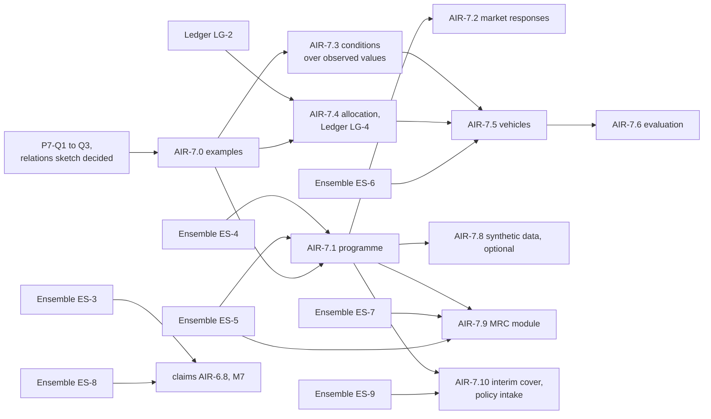

<!-- SPDX-License-Identifier: CC-BY-SA-4.0 -->

# Plan: Applied Insurance Reference — Phase 7, Placement and Capital

**Unit ID:** `applied-insurance-reference-phase-7`
**Epic:** [applied-insurance-reference](applied-insurance-reference.md)
**Status:** proposed 2026-10-18, amended to 2026-10-21 (P7-Q5 to P7-Q9, P7-7), for the maintainer's
review. No slice is briefed yet.
**Builds on:** [ADR-A130](../../architecture/decisions/ADR-A130-ensemble-layer.md) and
[ADR-A131](../../architecture/decisions/ADR-A131-ledger-layer.md) (A130 Proposed, A131 Accepted), the
[Ensemble plan](ensemble.md) and the [Ledger plan](ledger.md)
**Sketches:** [relations between instruments](../sketches/instrument-relations.md),
[risk-capital vehicles](../sketches/risk-capital-vehicles.md), the
[claims sketch](../sketches/insurance-claims-ontology.md) §10

## Scope

What has been placed, how the market responded on the way, and the capital that stands behind it:

- **a programme data model:** programmes, towers, layers, the instruments placed on each layer,
  each insurer's line and role, and each line's formation state
- **market responses:** decline, indication, non-binding quote and binding quote, with their
  commitment, precision and completeness, their provisional placing on layers, and the lifecycle
  from first response to bound
- **risk-capital vehicles:** what they are made of and what they pay ([vehicles sketch](../sketches/risk-capital-vehicles.md))
- **the market reform contract (MRC):** the London market's placing contract form, modelled
  explicitly from the London Market Group's MRC (Open Market) implementation guide, data dictionary
  and example 2, all v3.0 (2023), as a specialisation of the programme module

Out of scope, here and in the epic: analysing what a programme covers or lacks, designing or
pricing a structure, and matching capital to need. The phase records and evaluates. It does not
advise.

**Claims across a programme** stay in the [claims plan](applied-insurance-reference-claims.md)
(AIR-6.8, AIR-6.12, milestone M7). AIR-6.8 takes its cross-instrument reads from Ensemble's ES-3,
and contribution between policies covering one loss from ES-8, instead of from held question HQ-2
(ADR-A130, Proposed).

## Principles

| # | Principle | Source |
|---|---|---|
| P7-1 | A programme is recorded as the contracts and the placing record state it. Nothing in this phase's modules is computed from other contracts | phase scope |
| P7-2 | A programme and a vehicle are ensembles. A link between instruments is an Ensemble relation, never a property of one of them | ADR-A130 |
| P7-3 | A market response is checked by the same shapes as a contract (CCS HQ-1). Its commitment is formation law. Its precision and completeness are recorded as the market stated them | CCS HQ-1, C9 |
| P7-4 | A vehicle is a set of instruments with an identity of its own. It can do nothing its instruments do not say | vehicles sketch §2 |
| P7-5 | Examples first (ADR-A-C2). Every slice's examples are committed before its model | lifecycle |
| P7-6 | The phase's modules keep their own versions and pin a release of the substrate. Their READMEs cite only published decisions, so ADR-A130 and ADR-A131 are published before a module README cites them | ADR-A129 decision 4, ADR-A127 |
| P7-7 | The phase's modules add data, never evaluation code. Signing provisions are Ledger merge rules composed (priority for lines to stand, proportional for the rest), exhaustion readings and drop down are Eligibility conditions over which facts count, and what applies where the terms are silent is a normative rule. Every implementation of the evaluator then runs every programme | ADR-A130 decision 3, ADR-A131 decision 8 |

## Slices

Estimates are in tokens, for agent work, excluding review.

| Slice | Content | Depends on | Estimate |
|---|---|---|---|
| AIR-7.0 | examples first: one programme (a primary and two excess layers, one excess on two lines, a follow-form and a drop-down) placed on MRC-style contracts, with the layers as sections of one MRC, lines written per section, one line to stand, a vertical placement whose insurer agreed its own terms on its own security details pages, and a line written under a lineslip citing it. All parties and values invented. One response lifecycle (indication, non-binding quote, binding quote, bound), and three or four vehicles from the vehicles sketch §5, chosen at the slice's start | P7-Q1 to P7-Q3 answered | 200k |
| AIR-7.1 | the programme module, `ontology/applied/insurance/programme/`: programme, tower, layer, the instruments on a layer, lines with written and signed shares and a role, each line's formation state, in the form P7-Q5 chooses. The programme as an ensemble, and relations between layers as Ensemble relations | AIR-7.0, P7-Q5, Ensemble ES-4 and ES-5, Ledger LG-2 and LG-Q3, CCS C9 | 350k |
| AIR-7.2 | market responses: the four kinds, commitment, precision and completeness, a response provisionally placed on a layer, the lifecycle as regimes, and a worked view of a programme's placed capacity by commitment level | AIR-7.1, CCS HQ-1 decided, SPC for the choreography | 400k |
| AIR-7.3 | substrate: conditions over observed values (vehicles sketch §4.1, RV-1) | AIR-7.0, an ADR | 300k |
| AIR-7.4 | substrate: allocation with conservation (vehicles sketch §4.2, RV-2), built as [Ledger](ledger.md) slice LG-4 | AIR-7.0, Ledger LG-2 and LG-Q3 | in the Ledger plan |
| AIR-7.5 | the vehicle module (RV-3), a vehicle as an ensemble | AIR-7.3, Ledger LG-4, Ensemble ES-6 | 300k |
| AIR-7.6 | vehicles evaluated end to end (RV-4) | AIR-7.5, CCS C12 | 300k |
| AIR-7.7 | Capacity's future (P7-Q4), if the answer changes the module | P7-Q4 | 100k to 250k |
| AIR-7.9 | the MRC module, `ontology/applied/insurance/mrc/` (P7-Q6): the unique market reference, the MRC's sections (risk details, information, security details with each insurer's or panel's own pages, subscription agreement, fiscal and regulatory, broker remuneration and deductions) as Wording elements assembled into each line's wording, one instrument per written line (P7-Q5), order hereon, written and signed lines, lines to stand, the signing provisions as a stated rule (Ensemble ES-5), the placement, endorsement and claims roles as authorities (Ensemble ES-7), a line under a contract of delegation citing it (K1), and the security details pages' confidentiality (ADR-A130 decision 12). The guide's text is not reproduced, and no mapping of the data dictionary's fields is published | AIR-7.1, Ensemble ES-5 and ES-7 (which follows ES-6), P7-Q6 | 350k |
| AIR-7.10 | interim cover and policy intake: the concepts "interim cover" (altLabels "binder"@en-US, "policy binder"@en-US) and "binding authority" (altLabel "binder"@en-GB), each with a scope note naming the other, in the programme module's scheme. Examples: a US interim cover that lists forms with a few values, the issued policy that replaces it and adds detail, one discrepancy, one omission, and a form listed in the policy's schedule but not attached. The intake view: the ES-9 comparison as a report a broker reviews, ordered omissions first, then discrepancies, then additions. The schedule-against-attached check is a check over one instrument's wording, Wording's assembly read for listed and included elements | AIR-7.1, Ensemble ES-9, CCS C16b | 250k |
| AIR-7.8 | optional: a synthetic data generator for MORK whose ground truth targets the public applied modules (exposure, peril, programme) | AIR-7.1 | 300k |

## Milestone

| ID | Outcome | Closed by |
|---|---|---|
| M8 | a programme of a primary and two excess layers, placed with lines, recorded from its first indication to bound, and one of the example vehicles paying out from facts, each answer traced to the words | AIR-7.2 and AIR-7.6 |

## Questions P7-Q1 to P7-Q9

| ID | Question | Options | Leaning |
|---|---|---|---|
| **P7-Q1** | The programme module's name and prefix | `programme/` with `prg:`, or `placement/` with `plc:` | **Answered 2026-10-20:** `programme/` with `prg:`, since a placement is one act within a programme's life |
| **P7-Q2** | Is a layer an instrument, or a position on the loss axis that instruments are placed on | a position, with instruments placed on it (K4 portions), or the layer is the instrument | a position. One layer may be placed on several policies (HQ-7, now Ensemble ES-5). **Reopened 2026-10-20:** a position alone leaves open when a layer comes to exist (the broker's request, the market's responses, the first contract written on it), whether it holds any state, and whether it bounds the instruments placed on it, which claims across a programme need answered. Decided before AIR-7.0 is briefed. **Settled 2026-10-21:** a band of the loss axis the insured bears with no contract on it (a retention, an insured's coinsurance share, a gap left by an uncollectible or lapsed underlying policy) is never a layer. It is derived from the terms of the contracts around it and the facts **Answered 2026-10-21:** two kinds of layer. A requested layer is recorded in the request, the submission module, added to AIR-6.1's brief. A placed layer is an ensemble formed when the first contract on it is formed. It holds no state of its own: exhaustion is judged per reader, by the reader's terms, with silence filled by an outside rule. It does not bound the contracts placed on it |
| **P7-Q3** | Where a market response's commitment, precision and completeness are recorded | (a) on the response only, as a whole. (b) on each term. (c) as qualifications the market states, recorded at the scope it states them: the whole response by default, narrowed to a section or a term only where the market's words or fields scope them. Each cites its evidence (the clause, field or sentence). A term's standing is derived from the narrowest qualification covering it, and where nothing is stated it is recorded as unstated, never as exact. Completeness is only what the market states (for example "BI terms to follow"), never measured against the request | **Reopened 2026-10-21** by the maintainer, who rejected (b): markets often qualify the whole document ("indicative only", "non-binding", "subject to"), and requiring a qualification on every term forces data into a shape it rarely arrives in. **Answered 2026-10-21: (c).** Extraction proposes qualifications with their evidence for review, and infers none without a cited span |
| **P7-Q4** | Capacity's future | (a) keep it as is. (b) withdraw the execution profile (`capx`), its dependency kinds, phases and precedence, and the unauthored `cap:` network design. Their effects have source forms elsewhere: within one instrument or one scoped identity, the Ledger layer (ADR-A131: an account tree debited along its path, `min(own, parent's)` availability, credits, balances that guards and threshold regimes read). Across instruments, Ensemble. (c) as (b), but only once the ledger is built with CCS C12 | **Answered 2026-10-18: (b).** The compiled network moves out of LATTICE. AIR-7.7 withdraws the execution profile and amends the items listed |
| **P7-Q5** | How a subscription is modelled | (a) one instrument per subscribing insurer's line, formed when the line is written, the lines sharing one wording, grouped in the programme's ensemble with K4 portions and signed shares derived (Ensemble ES-5). (b) one instrument with a group of several parties | **Answered 2026-10-21, as leaned:** (a), since each subscription is a distinct contract with the insured unless the contrary is expressed (Marine Insurance Act 1906, s. 24(2)), and the reported reading of *Fennia Patria* [1983] QB 856 is that a line binds when written, to be checked against the report. MRC v3.0 confirms it for the London market: its model several liability clause reads "this contract" as contracts in the plural, and the data dictionary records the date each written line's contract was entered into. (b) stays for single agreements, such as a syndicated facility (relations sketch §10) |
| **P7-Q6** | Where the MRC is modelled | (a) its own module, `mrc/` with `mrc:`, specialising the programme module. (b) inside the programme module | **Answered 2026-10-21, as leaned:** (a). The programme module stays a model of what any market places, and another market's placing form specialises it the same way |
| **P7-Q7** | What one line's instrument covers, where a placing contract has several sections | (a1) one insurer's subscription to the placing contract, its line on each section stated as terms. (a2) one instrument per insurer per section | **Answered 2026-10-21, as leaned:** (a1). One act of writing forms one contract, and it halves the instruments in a placement where most insurers write several sections. It relies on ADR-A130 decision 5's evaluation units below the instrument (relations sketch §11, IR-Q7, answered 2026-10-21), since two such contracts on the same two layers would otherwise depend on each other at one position |
| **P7-Q8** | How a contract relates to the one it replaces for the next period, and what the modules call it | (a) a new instrument linked to the one it replaces by a succession relation, as a kind of Ensemble's K1 (derivation). (b) the same, as a property in Instrument. (c) a new version of the same instrument | **Decided 2026-10-21:** a new instrument, since a replacing contract has its own period and terms, and often its own insurer and number. The applied insurance modules do not use the word "renewal": the market uses it both for the point at which an expiring policy is approached for replacement and for the replacing policy, and Instrument §14.6 uses it for an instrument that continues. Open: (a) or (b), and the relation's name. Aligned 2026-10-21 with Ensemble's ES-Q9, which leans (b), read by Ensemble as K1 as decision 7 of ADR-A130 already does for `ins:boundUnder` and incorporation, so (a) and (b) meet. Existing uses to revisit with the slice that adds the relation: the exposure module's comments on `aeo:ExposureIdentity` ("across renewals"), `aeo-voc:NonRenewed`, and the claims sketch's loss run. Leaning: keep the IRIs and reword labels and definitions in a patch release |
| **P7-Q9** | Whether an issued policy is a new version of the interim cover's instrument, or a new instrument | (a) one instrument: the interim cover is its first version, and the policy's issuance a restatement. (b) two instruments: the interim cover is an instrument of its own, which incorporates the insurer's usual policy form where its own terms are silent, and the issued policy is a new instrument that replaces it | **Answered 2026-10-21: (b).** Researched first ([binders and issued policies](../notes/binders-and-issued-policies.md), 22 sources). The interim cover incorporates the insurer's usual policy form where its own terms are silent (Ensemble ES-Q7), and the issued policy replaces it (ES-Q9). Two conditions from the maintainer. **No redundant meaning:** both instruments bind the same forms, each stores only what differs from them, and bound meaning is generated and shared by content address (CCS C7c, C16b), so a term the policy states as the interim cover did is one node, not two. **Policy intake:** an interim cover can be far less detailed than the policy that replaces it, and brokers check one against the other. The comparison is a judgement over the two instruments (Ensemble ES-9): each term conforms, differs, is omitted from the policy, or is added by it, with its evidence. Its insurance use is AIR-7.10. **Terms:** the modules say "interim cover", with `skos:altLabel` "binder"@en-US and "policy binder"@en-US, and a scope note distinguishing the London market's binder, a binding authority, which carries `skos:altLabel` "binder"@en-GB on its own concept |

## Documentation deltas

The epic plan's phase map gains phase 7. The claims plan's AIR-6.8 names Ensemble's ES-3 and ES-8.
`docs/developer/INDEX.md` lists this plan under the epic. The CCS plan's HQ-2 (second case), HQ-7 and
HQ-12 point to the [Ensemble plan](ensemble.md), since IR-Q6 was answered on 2026-10-20.
