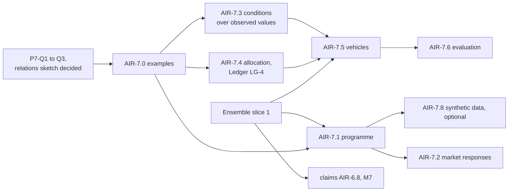

<!-- SPDX-License-Identifier: CC-BY-SA-4.0 -->

# Plan: Applied Insurance Reference — Phase 7, Placement and Capital

**Unit ID:** `applied-insurance-reference-phase-7`
**Epic:** [applied-insurance-reference](applied-insurance-reference.md)
**Status:** proposed 2026-10-18, for the maintainer's review. No slice is briefed yet.
**Sketches:** [relations between instruments](../sketches/instrument-relations.md),
[risk-capital vehicles](../sketches/risk-capital-vehicles.md), the
[claims sketch](../sketches/insurance-claims-ontology.md) §10

## Scope

What has been placed, how the market responded on the way, and the capital that stands behind it:

- **a programme data model:** programmes, towers, layers, the instruments placed on each layer,
  each insurer's line and role, and each line's formation state
- **market responses:** decline, indication, non-binding quote and binding quote, with their
  commitment, precision and completeness, their provisional placing on layers, and the lifecycle
  from first response to bound
- **risk-capital vehicles:** what they are made of and what they pay ([vehicles sketch](../sketches/risk-capital-vehicles.md))

Out of scope, here and in the epic: analysing what a programme covers or lacks, designing or
pricing a structure, and matching capital to need. The phase records and evaluates. It does not
advise.

**Claims across a programme** stay in the [claims plan](applied-insurance-reference-claims.md)
(AIR-6.8, AIR-6.12, milestone M7). Once the [relations sketch](../sketches/instrument-relations.md)
is decided, AIR-6.8 takes its cross-instrument reads from Ensemble instead of from held question
HQ-2.

## Principles

| # | Principle | Source |
|---|---|---|
| P7-1 | A programme is recorded as the contracts and the placing record state it. Nothing in this phase's modules is computed from other contracts | phase scope |
| P7-2 | A link between instruments is an Ensemble relation, never a property of one of them (K1 to K5) | relations sketch §3 |
| P7-3 | A market response is checked by the same shapes as a contract (CCS HQ-1). Its commitment is formation law. Its precision and completeness are recorded as the market stated them | CCS HQ-1, C9 |
| P7-4 | A vehicle is a set of instruments with an identity of its own. It can do nothing its instruments do not say | vehicles sketch §2 |
| P7-5 | Examples first (ADR-A-C2). Every slice's examples are committed before its model | lifecycle |

## Slices

Estimates are in tokens, for agent work, excluding review.

| Slice | Content | Depends on | Estimate |
|---|---|---|---|
| AIR-7.0 | examples first: one programme (a primary and two excess layers, one excess on two lines, a follow-form and a drop-down), one response lifecycle (indication, non-binding quote, binding quote, bound), and three or four vehicles from the vehicles sketch §5, chosen at the slice's start | P7-Q1 to P7-Q3 answered | 200k |
| AIR-7.1 | the programme module, `ontology/applied/insurance/programme/`: programme, tower, layer, the instruments on a layer, lines with written and signed shares and a role, each line's formation state. Relations between layers as Ensemble relations | AIR-7.0, Ensemble slice 1, CCS C9 | 350k |
| AIR-7.2 | market responses: the four kinds, commitment, precision and completeness, a response provisionally placed on a layer, the lifecycle as regimes, and a worked view of a programme's placed capacity by commitment level | AIR-7.1, CCS HQ-1 decided, SPC for the choreography | 400k |
| AIR-7.3 | substrate: conditions over observed values (vehicles sketch §4.1, RV-1) | AIR-7.0, an ADR | 300k |
| AIR-7.4 | substrate: allocation with conservation (vehicles sketch §4.2, RV-2), built as [Ledger](ledger.md) slice LG-4 | AIR-7.0, Ledger LG-2 | in the Ledger plan |
| AIR-7.5 | the vehicle module (RV-3) | AIR-7.3, Ledger LG-4, Ensemble slice 1 | 300k |
| AIR-7.6 | vehicles evaluated end to end (RV-4) | AIR-7.5, CCS C12 | 300k |
| AIR-7.7 | Capacity's future (P7-Q4), if the answer changes the module | P7-Q4 | 100k to 250k |
| AIR-7.8 | optional: a synthetic data generator for MORK whose ground truth targets the public applied modules (exposure, peril, programme) | AIR-7.1 | 300k |

## Milestone

| ID | Outcome | Closed by |
|---|---|---|
| M8 | a programme of a primary and two excess layers, placed with lines, recorded from its first indication to bound, and one of the example vehicles paying out from facts, each answer traced to the words | AIR-7.2 and AIR-7.6 |

## Questions P7-Q1 to P7-Q4

| ID | Question | Options | Leaning |
|---|---|---|---|
| **P7-Q1** | The programme module's name and prefix | `programme/` with `prg:`, or `placement/` with `plc:` | `programme/`, since a placement is one act within a programme's life |
| **P7-Q2** | Is a layer an instrument, or a position on the loss axis that instruments are placed on | a position, with instruments placed on it (K4 portions), or the layer is the instrument | a position. One layer may be placed on several policies (HQ-7) |
| **P7-Q3** | Where precision and completeness live | on the response as recorded attributes, or on each term of the response | on each term, with the response's completeness derived from its terms, since a market can be exact on the limit and approximate on the premium |
| **P7-Q4** | Capacity's future | (a) keep it as is. (b) withdraw the execution profile (`capx`), its dependency kinds, phases and precedence, and the unauthored `cap:` network design. Their effects have source forms elsewhere: within one instrument or one scoped identity, the Ledger layer (ADR-A131: an account tree debited along its path, `min(own, parent's)` availability, credits, balances that guards and threshold regimes read). Across instruments, Ensemble. (c) as (b), but only once the ledger is built with CCS C12 | **Answered 2026-10-18: (b).** The compiled network moves out of LATTICE. AIR-7.7 withdraws the execution profile and amends the items listed |

## Documentation deltas

The epic plan's phase map gains phase 7. The claims plan's AIR-6.8 names Ensemble once the
relations sketch is decided. `docs/developer/INDEX.md` lists this plan under the epic. The CCS
plan's HQ-2, HQ-7 and HQ-12 point to the relations sketch once IR-Q6 is answered.
