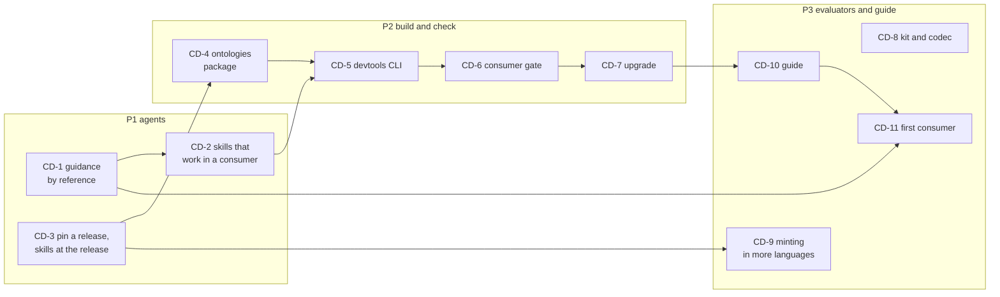

<!-- SPDX-License-Identifier: CC-BY-SA-4.0 -->

# Plan: using LATTICE from another repository

**Unit ID:** `consumer-distribution`
**Status:** proposed 2026-10-21, for the maintainer's review. No slice is briefed yet.
**Sketch:** [consumer distribution](../sketches/consumer-distribution.md), with L-1 to L-4 and
CD-Q1 to CD-Q4
**ADRs:** [ADR-A88](../../architecture/decisions/ADR-A88-ontology-import-resolution-for-consumers.md)
(import resolution for consumers), [ADR-A117](../../architecture/decisions/ADR-A117-agent-guidance-and-skill-library.md)
(agent guidance and skills), [ADR-A129](../../architecture/decisions/ADR-A129-one-release-for-the-substrate.md)
(one release for the substrate), [ADR-A29](../../architecture/decisions/ADR-A29-repository-toolchain-and-environment-boundary.md)
(`mise`)
**Reads with:** the [release bundles sketch](../sketches/release-bundles.md) (BUN-Q1 to BUN-Q7), and
the evaluator's implementation options note, for the conformance kit as a consumer artefact

## Scope

A project built on LATTICE pins one release and gets everything it needs from it into its own
environment, with nothing copied into its repository:

- **agents:** LATTICE's contract, writing rules and skills, applied in the consumer's repository
  beside the consumer's own guidance, at the pinned release
- **ontologies:** the ontology tree and its catalog, so the consumer's imports resolve offline
- **tools:** extraction, instantiation, catalog, versioning, release rows and agent guidance, run
  over the consumer's tree
- **checks:** a gate the consumer runs on its own content
- **evaluation:** the conformance kit, the codec and the minting vectors, so a consumer can build or
  certify an implementation of the evaluator in its own language

Out of scope: hosting services for consumers, and anything a consumer builds on top, which is its
own.

## Priorities

Stories are ordered by what a consumer is blocked by first. Agents come first, since a consumer's
agents follow LATTICE's rules from the first session, and a copied set of rules drifts (ADR-A117's
context).

| Priority | Stories | A consumer can then |
|---|---|---|
| P1 | CD-1 to CD-3 | work with LATTICE's contract and skills at a known release |
| P2 | CD-4 to CD-7 | import, build, check and upgrade against a pinned release, with no clone |
| P3 | CD-8 to CD-11 | build or certify its own evaluator, in any language, and follow a guide |

## Slices

Estimates are in tokens, for agent work, excluding review.

| Slice | Story | Delivers | Depends on | Validation | Estimate |
|---|---|---|---|---|---|
| **CD-1** | As a consumer's maintainer, I want my agents to follow LATTICE's contract without copying it | a consumer template `AGENTS.md` that adopts LATTICE's contract by reference and holds only what is the consumer's own. `build:agent-guidance` takes `--root` and composes a consumer's generated instructions from LATTICE's shared rules at the pin and the consumer's own file, with a check that fails when they are out of date | CD-Q6 | in a fixture consumer, a new agent session states the contract, the writing rules and the consumer's own rules, and the check fails after an edit to either source | 150k |
| **CD-2** | As a consumer's agent, I want LATTICE's skills to work in a repository that is not LATTICE | each skill's content classed as shared or LATTICE-internal. Shared skills name commands that work in a consumer (the `lattice` CLI of CD-5, or the consumer's own `mise` tasks), never LATTICE's tree. LATTICE-internal parts move to a skill that only LATTICE's own repository loads. A consumer may add its own skills beside them, and a maintainer's private user-level overlay (ADR-A117) works the same in any repository | CD-Q5 | a review of every skill against a fixture consumer finds no step that assumes LATTICE's tree | 200k |
| **CD-3** | As a consumer, I want to pin one release and know which rules, skills and ontologies I am following | the release tag a consumer pins (L-1, CD-Q1, read with ADR-A129's one release), and skills installable at that release (L-4): the plugin at a ref where the marketplace allows it, and `skills:link --ref` for Copilot. Every session can name the release its skills came from | CD-Q1 | installing at two releases gives two different, named skill sets | 120k |
| **CD-4** | As a consumer, I want LATTICE's ontologies to resolve offline from my environment | `lattice-ontologies` (L-2): the ontology tree, its catalog and `catalog_path()`, so a consumer's catalog chains to it with `nextCatalog` (ADR-A88, its fourth option) | CD-3, CD-Q2 | a fixture consumer's ontology imports Foundation and Instrument and resolves with no network and no clone | 200k |
| **CD-5** | As a consumer, I want LATTICE's tools to run over my tree | `lattice-devtools` (L-3): one `lattice` CLI with `literate extract`, `instantiate`, `catalog build` and `check`, `versions check`, `releases build` and `check`, `agents build` and `link`, each taking `--root`. Their tests run against the fixture consumer as well as LATTICE | CD-3, CD-Q3 | every command runs green over the fixture consumer from a clean `.venv` | 300k |
| **CD-6** | As a consumer, I want a gate for my own content | `lattice check` with the subset that applies to a consumer: literate freshness, catalog, versioning, published decisions where the consumer publishes its own, deny terms from the user's own list, and the import guard over the consumer's modules against LATTICE's layer order | CD-5 | an unbumped change, a stale extraction and an import that breaks the layer order each fail in the fixture consumer | 200k |
| **CD-7** | As a consumer, I want to upgrade my pin safely | `lattice upgrade <release>`: ADR-A88's procedure as one command, listing the changed IRIs that the consumer's imports reach and each change's effect class from the release notes (ADR-A113), then running the gate | CD-6 | an upgrade across two releases lists the affected imports and the gate's result | 200k |
| **CD-8** | As an implementer of the evaluator in another language, I want the contract I am held to | the conformance kit, the codec's schemas and the volume corpus as a versioned artefact of the release, with a registry where an implementation declares the kit version it passes. The codec carries the types ADR-A130 and ADR-A131 add: passed facts, the rational form and natural keys | the evaluator's stage 0, the [evaluator implementation plan](evaluator-implementation.md)'s EV-0 | an implementation outside LATTICE runs the kit from the artefact alone | 200k |
| **CD-9** | As an implementer in another language, I want to mint the same identities | the minting specification's vectors as a release artefact, and minting libraries for further languages as consumers need them, each held to the vectors (ADR-A84) | CD-3 | a new library passes every vector | 100k each |
| **CD-10** | As a new consumer, I want one guide | a section of the developer guide for consumers: pin, bootstrap, agents and skills, chain the catalog, run the gate, upgrade, and where the kit is | CD-1 to CD-7 | a reader sets up the fixture consumer from the guide alone | 80k |
| **CD-11** | As LATTICE, I want proof that a real consumer works | the first consumer moved onto CD-1 to CD-7 (CD-Q4), with its copied guidance retired | CD-1 to CD-7 | its gate runs green on a pull request at a pinned release | 150k |

## Questions CD-Q1 to CD-Q6

CD-Q1 to CD-Q4 are the sketch's.

| ID | Question | Options | Leaning |
|---|---|---|---|
| **CD-Q1** | The release tag a consumer pins | (a) a repository version independent of each ontology's. (b) the substrate's one release (ADR-A129), with packages versioned with it | revisit in the light of ADR-A129, accepted after the sketch: (b) if every package a consumer installs moves with the substrate's release, else (a) |
| **CD-Q2** | Where `lattice-ontologies` lives | `packages/ontologies/`, built by copying `ontology/` | as the sketch leans |
| **CD-Q3** | One CLI package, or commands in the root package | one package | as the sketch leans |
| **CD-Q4** | The first consumer | Open CBAA | as the sketch leans |
| **CD-Q5** | How skills serve LATTICE and its consumers | (a) one plugin, every skill written to work in either. (b) two plugins, shared and LATTICE-internal. (c) one plugin, with LATTICE-internal steps in a skill only LATTICE's repository loads | (c). One install for everyone, and LATTICE-specific steps never mislead a consumer's agent |
| **CD-Q6** | How a consumer's guidance takes LATTICE's rules | (a) an import line where the agent supports one, and a generated file where it does not. (b) always generated, by `lattice agents build` | (b). One mechanism for every agent, with a freshness check, and the source stays LATTICE's |
