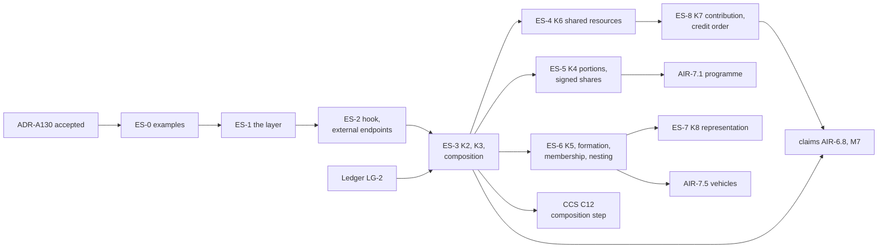

<!-- SPDX-License-Identifier: CC-BY-SA-4.0 -->

# Plan: Ensemble, relations between instruments

**Unit ID:** `ensemble`
**Status:** proposed 2026-10-20, amended 2026-10-21 (IR-Q7, evaluation below the instrument, several
implementations of the evaluator, design closure with ES-Q7 to ES-Q9), for the maintainer's review.
No slice is briefed yet.
**ADRs:** [ADR-A130](../../architecture/decisions/ADR-A130-ensemble-layer.md) and ADR-A01's 2026-10-18
addendum, both Proposed
**Sketch:** [relations between instruments](../sketches/instrument-relations.md), with §10 for the
needs added on 2026-10-20 and §11 for evaluation below the instrument
**Takes over:** HQ-2's second case, HQ-7 and HQ-12 from the
[computable contract substrate](computable-contract-substrate.md), once ADR-A130 is accepted

## Scope

A substrate layer, `ontology/ensemble/` with prefix `ens:`, importing Instrument and Behaviour's
runtime:

- **the ensemble:** an identity with versions naming its member instruments by role, which may own
  Ledger accounts and be a member of another ensemble
- **relations:** reified, with endpoints that are identities by default, versions where the relation
  is to one text, and narrowed to a term, a section or an account where the terms say so
- **kinds:** K1 to K6 and K8 (representation) by ADR-A130, and K7 (contribution) by addendum
- **judgements across an ensemble:** signed shares and a representative chosen by default
- **confidentiality:** members' terms may be hidden from one another, and composition never needs
  them (ADR-A130 decision 12)
- **evaluation by composition:** the least fixpoint semantics, evaluation units below the
  instrument, the order over units and positions (which covers cycles broken by time), the facts
  passed, and the composition step CCS C12 runs
- **the Instrument hook:** an externally supplied value recorded as a fact, and endpoints for
  instruments outside the modelled set

Out of scope:

- **Accounts and their arithmetic.** These belong to Ledger (ADR-A131). Ensemble owns accounts and
  orders draws, and never computes a balance.
- **One participant's share within one agreement.** HQ-2's first case stays with Instrument and
  Party, beside HQ-5.
- **Domain modules.** A programme, a vehicle or a syndicate's arrangements specialise the ensemble
  in applied modules.

## Principles

| # | Principle | Source |
|---|---|---|
| ES-1 | Each instrument, or part of one, is evaluated alone. What it needs of another arrives as a fact with provenance | ADR-A130 decision 5 |
| ES-2 | A relation's legal effect is stated by a term, never by the relation | ADR-A130 decision 3 |
| ES-3 | A K6 relation is derived from terms, and a shape holds it to them | ADR-A130 decision 3 |
| ES-4 | The dependency graph over evaluation units and positions is acyclic. A cycle that remains waits for an addendum with a rule that resolves it | ADR-A130 decision 5, IR-Q7 |
| ES-5 | Examples first, from at least two fields besides insurance (ADR-A-C2) | lifecycle |
| ES-6 | Several implementations of the evaluator agree byte for byte: pure entry points, read sets known before evaluation, outcomes independent of the valid order chosen, a canonical log, and no semantics an applied module adds in code | ADR-A130 decisions 3 and 5, its evaluator consequence |

## Slices

Estimates are in tokens, for agent work, excluding review.

| Slice | Content | Depends on | Estimate |
|---|---|---|---|
| ES-0 | examples, as data the model must accept or refuse. Lending: a guarantee called on the borrower's default, ranking under an intercreditor agreement, two facilities with mutual cross-default, two facilities whose junior tranches each wait on the other's senior tranche. Construction: a back-to-back subcontract and a performance bond. Insurance: an excess attaching on exhaustion of its underlying, and an MRC-style subscription, one placing contract with three layers as sections, lines written per section, one line to stand, terms one insurer agreed on its own security details pages, and two insurers each writing the primary and the excess in one contract. Refusals: a cycle that remains over parts and positions, for example two policies whose other insurance clauses each make it excess of the other (refused until ES-8), an endpoint narrowed to a section its instrument does not have | ADR-A130 accepted | 150k |
| ES-1 | the layer: the README in ADR-A126's layout with its release notes section, `ens:Ensemble`, `ens:Relation`, endpoints (identity, version, narrowing, with stable keys for sections across versions), the kinds vocabulary K1 to K6, structural shapes, the catalogue entry and `ensemble` in the root catalogue after `instrument`. The publication pass for ADR-A130 and every decision the README cites (ADR-A127). Ensemble joins the release | ES-0 | 350k |
| ES-2 | the Instrument hook: a regime's measured value or a condition's evidence supplied as a recorded fact naming its source, and an endpoint for an instrument outside the modelled set, whose state arrives only as facts (for example a statutory scheme that responds first, or senior debt held by a lender not modelled) | ES-1 | 200k |
| ES-3 | K2 and K3: dependency and priority, evaluation units below the instrument, the order over units and positions (cycles broken by time and by parts), the facts passed with their provenance, the composition step's contract for CCS C12, and the composition law stated as a least fixpoint with its conformance cases. Acyclic graphs only. The contract has three pure entry points (plan a schedule, evaluate a unit, evaluate an admitted component), the phases of a pass with the read set fetched in one batch, the canonical log order, natural keys for derived records, and the passed fact as a codec type (producing unit and version, position, read-set digest). Conformance cases include the same ensemble under two valid orders | ES-2, Ledger LG-2 | 350k |
| ES-4 | K6, shared resources: the derivation from the terms that draw on an account, the shape that holds each K6 relation to those terms, accounts owned by the ensemble, and draws ordered by the answer to LG-Q3, with the two phases at one position (propose, merge, settle, ADR-A131 decision 6) and a conformance case of parallel draws in both orders | ES-3, Ledger LG-2, LG-Q3, LG-Q4 | 250k |
| ES-5 | K4, portions and shares: several commitments, portions of one order, composed shares (HQ-12, a new operation kind with its law), and signed shares evaluated from the written shares and the signing rule the terms state (ADR-A130 decision 10), for example an oversubscribed public offer of bonds scaled by the prospectus's basis of allocation, or an MRC's signing provisions: lines to stand in full, the rest in equal proportion to the order, every line in full if placement is incomplete at inception. Signing rules are stated as compositions of Ledger merge rules (priority for lines to stand, proportional for the rest), never as code of their own, and their exactness follows LG-Q6 | ES-3, LG-Q6 | 350k |
| ES-6 | K5 and the ensemble's life: a master and its children, formation by a recorded act with its evidence, membership by rule (for example every policy of a class written in a period, every eligible receivable in a borrowing base, a framework's call-offs), with membership records outside the root's aggregate as ES-Q5 decides, and an ensemble nested in another | ES-3, ES-Q5 | 350k |
| ES-7 | K8, representation (ADR-A130 decision 11): authorities one per subject (changes to terms, claims, notices), each with its tiers, conditions and exclusions, holders chosen by default as judgements from facts, the judgement that members state the same terms up to their shares, evaluated from the terms digest (ADR-A130 decision 11), which an authority's condition may read, and authority from the members' terms or from an outside rule through the normative rule substrate. Examples: a security agent and the instructing group under an intercreditor agreement, acting across the facility, hedging and security documents, and an MRC's slip leader agreeing changes in tiers, a claims agreement party agreeing claims for the insurers on its terms, and ex gratia payments each insurer keeps for its own share | ES-6, CCS C9's consent rules (HQ-5), the terms digest (evaluator plan EV-9) | 300k |
| ES-8 | K7, contribution, by addendum to ADR-A130: several instruments answering one loss or debt, each for a rateable part, for example co-sureties' contribution, and policies covering the same loss with rateable proportion clauses. With separate orders for draws and credits under K3, since recoveries often run in the reverse of the order of loss. The first cyclic components, admitted by the same addendum where every edge is monotone and contribution resolves the cycle: policies whose other insurance clauses each make it excess of the other, and circular guarantees in a group. Only those components are evaluated by iteration | ES-4, Ledger LG-4 | 300k |

## Formal methods

Placed in the [formal-methods epic](formal-methods.md), under FM-D8 (a design model for every ADR
that adds or changes a law):

| Slice | Track | Content | When |
|---|---|---|---|
| C4 | C | an Alloy model of ADR-A130: the order over units and positions is well founded, the outcome is the same under every valid order given the two phases at a shared account, a cycle that remains is refused, a derived K6 relation agrees with the terms that draw on its account, and signed shares sum to the order | before or alongside ADR-A130's acceptance |
| B4b | B | the reference for composition: an ensemble evaluated member by member, passing facts, with a conformance kit for C12's composition step, and differential checks against evaluating every member together and against the least fixpoint on small ensembles | with ES-3 and CCS C12 |
| E4b | E | the composition law proved: for ensembles acyclic over units and positions, evaluation in order reaches the least fixpoint, the same outcomes as evaluating every member together, with the locality lemma that evaluating a part agrees with evaluating its whole instrument restricted to it | after B4b and E4 |
| C4c, E4c | C, E | only if ES-8's addendum admits cyclic components: a bounded search for terms with several fixpoints, and the chaotic iteration theorem with a monotonicity proof over the term forms such a component may use | with ES-8 |

## Done when

ES-0's examples validate and its refusals fail with the shapes that name them. The composition of
ES-3's examples gives the hand-computed outcomes, and B4b's differential check agrees on them.
`mise run check` passes, with `check:import-guard` enforcing Ensemble's imports,
`check:published-decisions` passing on its README, and `check:ontology-versioning` holding it to the
release's number.

## Effects on other units

| Unit | Change |
|---|---|
| CCS | HQ-2's second case, HQ-7 and HQ-12 point here. C12 gains the composition step and evaluates a part of an instrument an endpoint narrows to, after ES-3 |
| Ledger | accounts drawn by several instruments belong to their ensemble. LG-Q3 is answered before ES-4, and LG-Q4's positions are comparable across instruments |
| AIR claims | AIR-6.8 and M7 take their cross-instrument reads from ES-3 |
| AIR phase 7 | a programme and a vehicle are ensembles. AIR-7.1 waits on ES-5 for lines and signed shares, and AIR-7.5 on ES-6. How a subscription is modelled is P7-Q5 |
| NRS | ES-7 reads authority from an external rule through the normative rule substrate. A pass selects any outside rule by governing law before it evaluates, so the rule's version is in the read set |
| identity minting | the evaluator emits natural keys and hosts mint IRIs (ADR-A84). The minting libraries exist for Python and Java. A host in another language needs one, built against the shared test vectors |
| SPC | the passed fact is a codec type now. How passed facts travel between processes and organisations is ES-Q6 |
| formal methods | C4, B4b and E4b above |
| AIR phase 7's MRC module | AIR-7.9 waits on ES-5 for signed shares and ES-7 for the placement, endorsement and claims roles |
| [evaluator implementation](evaluator-implementation.md) | EV-0 specifies the core's interface from ES-3's contract (the three entry points, passed facts, the canonical log), and EV-9's terms digest is ES-7's evidence for members sharing the same terms |
| [consumer distribution](consumer-distribution.md) | CD-8's kit carries ES-3's conformance cases and the codec types for passed facts. CD-9's minting vectors cover the natural keys the evaluator emits |
| [interval-normal scopes](interval-normal-scopes.md) | ES-Q5's membership index is a sibling Surface index of IX-2's |

## Questions ES-Q1 to ES-Q9

The relations sketch's IR-Q3 to IR-Q5 are confirmed or revised before ES-0 is briefed. IR-Q7 is answered (2026-10-21) and taken into ADR-A130 decision 5.

| ID | Question | Options | Leaning |
|---|---|---|---|
| **ES-Q1** | Contribution's form | (a) a kind of its own, K7. (b) a variant of K3 or K4 | (a). It is neither a rank nor a portion of one order. Co-sureties and policies covering one loss share it, and the law gives a right of contribution even where the terms are silent |
| **ES-Q2** | Where a representative's authority comes from | (a) only the members' terms. (b) the terms, or a rule outside them through the normative rule substrate | **Taken into ADR-A130 decision 11 (2026-10-20), pending acceptance:** (b). In some markets, rules binding on the members give a lead its authority as well as the contract |
| **ES-Q3** | Signed shares | (a) a derived record per member, like a Ledger balance. (b) computed on each read | **Taken into ADR-A130 decision 10 (2026-10-20), pending acceptance:** (a). A signed share is a judgement from the written shares, the order and the signing rule, and other evaluations cite it |
| **ES-Q4** | Membership by rule | (a) an Eligibility profile over instruments, evaluated at a position, with the members it admits recorded as derived. (b) a list maintained by hand | (a). The rule is what the terms state, and the members follow from facts |
| **ES-Q5** | How a large membership is kept and read (ADR-A130's persistence consequence) | (a) the root lists every member, today's default. (b) each membership is a derived record naming the ensemble, held outside the root's aggregate, so the root is never traversed to its members. The aggregate boundary is set by the persistence profile (`dal:AggregateBoundaryProfile`), and reads of "members of E at position p" go through a Surface index contract. (c) members are not recorded, and the rule is evaluated on every read | (b). The semantics stay in the graph, persistence decides the boundary, and Surface serves the read, which shows Surface's use in the open. Lists formed by recorded acts, such as a placed layer's written lines, stay in the root, since they are short |
| **ES-Q6** | How passed facts travel between processes and organisations | (a) the codec type only, with transport a deployment's choice. The platform already uses AMQP (ADR-A118, A32, A33). (b) SPC carries them: each member's evaluation is a subject, passed facts and representative acts (K8) are session-typed messages, and since the messages carry only data already in the graph, conformance is checked at run time by monitors at the edges rather than fully by static typing. (c) SPC's original runtime: subjects as Erlang state machines, edges over RabbitMQ | (a) for ES-3, which needs nothing more. (b) as SPC's next step, briefed in its own unit, since it also gives K8 authorities and confidentiality (decision 12) a typed protocol. (c) is (b)'s implementation choice, decided there, weighing a further language |
| **ES-Q7** | An instrument that follows another's terms as they change, for example a guarantee incorporating the facility agreement as amended from time to time, or an excess policy following its underlying policy, where changes apply unless the excess insurer objects within 30 days of receiving them | (a) Instrument's incorporation names the identity, with a condition on which later versions it takes, evaluated per version. Ensemble reads one K1 relation to each version taken. (b) a K1 relation whose version endpoint is replaced at each change | (a). Incorporation stays in Instrument (decision 7). Which versions are taken is a term, so it is an Eligibility condition over facts such as receipt and objection, and every version taken or refused is a judgement with its evidence |
| **ES-Q8** | What a dependant reads, where its terms name the agreements beneath it, for example a second-lien facility naming the first-lien facility and its maximum, or an excess policy's schedule of underlying policies with their limits | (a) the instruments its own terms name, one K2 relation to each, with the sum or rule the terms state. A judgement compares the named instruments with the members actually present, and reports one that is named and absent, or present and unnamed. (b) the set it sits above, such as a layer, read as one | (a). The terms decide what is read (decision 3), and a schedule can name an instrument that has since been replaced. The set serves grouping and the judgement that compares, never the reading |
| **ES-Q9** | Succession: a renewal, a refinancing or a novation, where a new instrument replaces another (phase 7's P7-Q8 decided that a replacing contract is a new instrument, and left open where the link lives) | (a) a kind of K1 in Ensemble. (b) a property of Instrument, recorded with the legal act that makes the replacement and its evidence | (b), read by Ensemble as K1 wherever both instruments are members of one ensemble, as `ins:boundUnder` and incorporation already are (decision 7). A relation belongs to one ensemble (decision 3), and successive agreements are not one operation, so the link cannot wait for an ensemble to hold it. An endpoint to an identity that has a successor still names the identity, and a judgement reports it. Identity is never inferred from a contract number, since some replacements keep it, some add a suffix and some take a new one |
