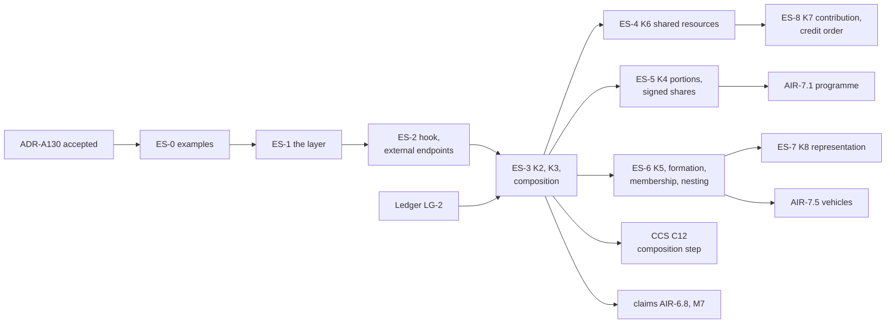

<!-- SPDX-License-Identifier: CC-BY-SA-4.0 -->

# Plan: Ensemble, relations between instruments

**Unit ID:** `ensemble`
**Status:** proposed 2026-10-20, for the maintainer's review. No slice is briefed yet.
**ADRs:** [ADR-A130](../../architecture/decisions/ADR-A130-ensemble-layer.md) and ADR-A01's 2026-10-18
addendum, both Proposed
**Sketch:** [relations between instruments](../sketches/instrument-relations.md), with §10 for the
needs added on 2026-10-20
**Takes over:** HQ-2's second case, HQ-7 and HQ-12 from the
[computable contract substrate](computable-contract-substrate.md), once ADR-A130 is accepted

## Scope

A substrate layer, `ontology/ensemble/` with prefix `ens:`, importing Instrument and Behaviour's
runtime:

- **the ensemble:** an identity with versions naming its member instruments by role, which may own
  Ledger accounts and be a member of another ensemble
- **relations:** reified, with endpoints that are identities by default, versions where the relation
  is to one text, and narrowed to a term, a section or an account where the terms say so
- **kinds:** K1 to K6 and K8 (representation) by ADR-A130, and K7 (contribution) by addendum
- **judgements across an ensemble:** signed shares and a representative chosen by default
- **confidentiality:** members' terms may be hidden from one another, and composition never needs
  them (ADR-A130 decision 12)
- **evaluation by composition:** the order, cycles broken by time, the facts passed, and the
  composition step CCS C12 runs
- **the Instrument hook:** an externally supplied value recorded as a fact, and endpoints for
  instruments outside the modelled set

Out of scope:

- **Accounts and their arithmetic.** These belong to Ledger (ADR-A131). Ensemble owns accounts and
  orders draws, and never computes a balance.
- **One participant's share within one agreement.** HQ-2's first case stays with Instrument and
  Party, beside HQ-5.
- **Domain modules.** A programme, a vehicle or a syndicate's arrangements specialise the ensemble
  in applied modules.

## Principles

| # | Principle | Source |
|---|---|---|
| ES-1 | Each instrument is evaluated alone. What it needs of another arrives as a fact with provenance | ADR-A130 decision 5 |
| ES-2 | A relation's legal effect is stated by a term, never by the relation | ADR-A130 decision 3 |
| ES-3 | A K6 relation is derived from terms, and a shape holds it to them | ADR-A130 decision 3 |
| ES-4 | A cycle is admitted only when time breaks it | ADR-A130 decision 5 |
| ES-5 | Examples first, from at least two fields besides insurance (ADR-A-C2) | lifecycle |

## Slices

Estimates are in tokens, for agent work, excluding review.

| Slice | Content | Depends on | Estimate |
|---|---|---|---|
| ES-0 | examples, as data the model must accept or refuse. Lending: a guarantee called on the borrower's default, ranking under an intercreditor agreement, two facilities with mutual cross-default. Construction: a back-to-back subcontract and a performance bond. Insurance: an excess attaching on exhaustion of its underlying, and an MRC-style subscription, one placing contract with three layers as sections, lines written per section, one line to stand, and terms one insurer agreed on its own security details pages. Refusals: a cycle whose edges all read at one position, an endpoint narrowed to a section its instrument does not have | ADR-A130 accepted | 150k |
| ES-1 | the layer: the README in ADR-A126's layout with its release notes section, `ens:Ensemble`, `ens:Relation`, endpoints (identity, version, narrowing), the kinds vocabulary K1 to K6, structural shapes, the catalogue entry and `ensemble` in the root catalogue after `instrument`. The publication pass for ADR-A130 and every decision the README cites (ADR-A127). Ensemble joins the release | ES-0 | 350k |
| ES-2 | the Instrument hook: a regime's measured value or a condition's evidence supplied as a recorded fact naming its source, and an endpoint for an instrument outside the modelled set, whose state arrives only as facts (for example a statutory scheme that responds first, or senior debt held by a lender not modelled) | ES-1 | 200k |
| ES-3 | K2 and K3: dependency and priority, the order of evaluation, the rule for cycles broken by time, the facts passed with their provenance, the composition step's contract for CCS C12, and the composition law stated with its conformance cases | ES-2, Ledger LG-2 | 350k |
| ES-4 | K6, shared resources: the derivation from the terms that draw on an account, the shape that holds each K6 relation to those terms, accounts owned by the ensemble, and draws ordered by the answer to LG-Q3 | ES-3, Ledger LG-2, LG-Q3, LG-Q4 | 250k |
| ES-5 | K4, portions and shares: several commitments, portions of one order, composed shares (HQ-12, a new operation kind with its law), and signed shares evaluated from the written shares and the signing rule the terms state (ADR-A130 decision 10), for example an oversubscribed public offer of bonds scaled by the prospectus's basis of allocation, or an MRC's signing provisions: lines to stand in full, the rest in equal proportion to the order, every line in full if placement is incomplete at inception | ES-3 | 350k |
| ES-6 | K5 and the ensemble's life: a master and its children, formation by a recorded act with its evidence, membership by rule (for example every policy of a class written in a period, every eligible receivable in a borrowing base, a framework's call-offs), and an ensemble nested in another | ES-3 | 350k |
| ES-7 | K8, representation (ADR-A130 decision 11): authorities one per subject (changes to terms, claims, notices), each with its tiers, conditions and exclusions, holders chosen by default as judgements from facts, and authority from the members' terms or from an outside rule through the normative rule substrate. Examples: a security agent and the instructing group under an intercreditor agreement, acting across the facility, hedging and security documents, and an MRC's slip leader agreeing changes in tiers, a claims agreement party agreeing claims for the insurers on its terms, and ex gratia payments each insurer keeps for its own share | ES-6, CCS C9's consent rules (HQ-5) | 300k |
| ES-8 | K7, contribution, by addendum to ADR-A130: several instruments answering one loss or debt, each for a rateable part, for example co-sureties' contribution, and policies covering the same loss with rateable proportion clauses. With separate orders for draws and credits under K3, since recoveries often run in the reverse of the order of loss | ES-4, Ledger LG-4 | 250k |

## Formal methods

Placed in the [formal-methods epic](formal-methods.md), under FM-D8 (a design model for every ADR
that adds or changes a law):

| Slice | Track | Content | When |
|---|---|---|---|
| C4 | C | an Alloy model of ADR-A130: the order is well founded under the rule for cycles broken by time, a cycle at one position is refused, a derived K6 relation agrees with the terms that draw on its account, and signed shares sum to the order | before or alongside ADR-A130's acceptance |
| B4b | B | the reference for composition: an ensemble evaluated member by member, passing facts, with a conformance kit for C12's composition step, and a differential check against evaluating every member together on small ensembles | with ES-3 and CCS C12 |
| E4b | E | the composition law proved: composed evaluation reaches the same outcomes as evaluating every member together, for ensembles whose cycles are broken by time | after B4b and E4 |

## Done when

ES-0's examples validate and its refusals fail with the shapes that name them. The composition of
ES-3's examples gives the hand-computed outcomes, and B4b's differential check agrees on them.
`mise run check` passes, with `check:import-guard` enforcing Ensemble's imports,
`check:published-decisions` passing on its README, and `check:ontology-versioning` holding it to the
release's number.

## Effects on other units

| Unit | Change |
|---|---|
| CCS | HQ-2's second case, HQ-7 and HQ-12 point here. C12 gains the composition step, after ES-3 |
| Ledger | accounts drawn by several instruments belong to their ensemble. LG-Q3 is answered before ES-4, and LG-Q4's positions are comparable across instruments |
| AIR claims | AIR-6.8 and M7 take their cross-instrument reads from ES-3 |
| AIR phase 7 | a programme and a vehicle are ensembles. AIR-7.1 waits on ES-5 for lines and signed shares, and AIR-7.5 on ES-6. How a subscription is modelled is P7-Q5 |
| NRS | ES-7 reads authority from an external rule through the normative rule substrate |
| formal methods | C4, B4b and E4b above |

## Questions ES-Q1 to ES-Q4

The relations sketch's IR-Q3 to IR-Q5 are confirmed or revised before ES-0 is briefed.

| ID | Question | Options | Leaning |
|---|---|---|---|
| **ES-Q1** | Contribution's form | (a) a kind of its own, K7. (b) a variant of K3 or K4 | (a). It is neither a rank nor a portion of one order. Co-sureties and policies covering one loss share it, and the law gives a right of contribution even where the terms are silent |
| **ES-Q2** | Where a representative's authority comes from | (a) only the members' terms. (b) the terms, or a rule outside them through the normative rule substrate | **Taken into ADR-A130 decision 11 (2026-10-20), pending acceptance:** (b). In some markets, rules binding on the members give a lead its authority as well as the contract |
| **ES-Q3** | Signed shares | (a) a derived record per member, like a Ledger balance. (b) computed on each read | **Taken into ADR-A130 decision 10 (2026-10-20), pending acceptance:** (a). A signed share is a judgement from the written shares, the order and the signing rule, and other evaluations cite it |
| **ES-Q4** | Membership by rule | (a) an Eligibility profile over instruments, evaluated at a position, with the members it admits recorded as derived. (b) a list maintained by hand | (a). The rule is what the terms state, and the members follow from facts |
