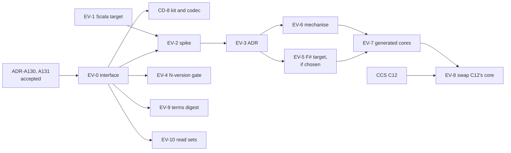

<!-- SPDX-License-Identifier: CC-BY-SA-4.0 -->

# Plan: implementing the evaluator in several languages

**Unit ID:** `evaluator-implementation`
**Source:** the evaluator implementation note, `evaluator-implementation-options.md`, held in this
branch's working area and published to `docs/developer/notes/` with the formal-methods merge. Its
§19 records changes X1 to X10 and conditions SC1 to SC6.
**Status:** proposed 2026-10-21, for the maintainer's review. No slice is briefed. Its status
record is created with EV-0.
**Reads with:** the [reference evaluator sketch](../sketches/reference-evaluator.md), the
[formal methods plan](formal-methods.md), the [CCS plan](computable-contract-substrate.md) (C12,
C13), the [Ensemble](ensemble.md) and [Ledger](ledger.md) plans, the
[consumer distribution plan](consumer-distribution.md) (CD-8, CD-9), and the
[interval-normal scopes plan](interval-normal-scopes.md).

## Scope

The evaluator as a pure core behind the codec and the conformance kit, generated for several hosts
from one model, with the N-version gate as its release check. Its stages:

| Stage | What it does |
|---|---|
| 0 | fix the interface |
| 1 | CCS C12 by its current plan |
| a spike, beside stage 1 | choose the generation stack |
| 2 | mechanise and generate |
| 3 | swap C12's core for the generated one behind the same interface |

Out of scope: the host shell (store access, persistence, authorisation), which each host writes in
its own idiom, and engines that derive from the semantics, which are a deployment's own.

## Decided

| Decision | Date | Where |
|---|---|---|
| three kinds of engine around the evaluator: semantic cores, derived engines, services | 2026-10-21 | note §19 |
| conditions SC1 to SC6 for several semantic cores, including at most one hand-written semantic core at a time, the rest generated | 2026-10-21 | note §19. This answers EV-Q1 in principle. EV-3's ADR records it |
| X1 to X10 in ADR-A130 and ADR-A131 (Proposed) | 2026-10-21 | note §19 |
| EV-Q11, the terms digest: computed once, where the RDF lives, over the RDFC-1.0 canonical form of a version's bound terms, with a declared list of term kinds left out, and carried by the codec as a string | 2026-10-21 | note §18. Built in EV-9 |

## Slices

Estimates are in tokens, for agent work, excluding review.

| Slice | Delivers | Depends on | Validation | Estimate |
|---|---|---|---|---|
| **EV-0** | the core's interface as a specification, from Ensemble ES-3's contract and Ledger LG-2's postings: the three entry points (plan a schedule, evaluate a unit, evaluate an admitted cyclic component, X1, the last exercised only from Ensemble ES-8), their codec types, the rational form (X4, owned here and used by the Ledger plan's LG-Q6), the passed-fact type (X9), natural keys out (X8). CD-8 then publishes it as an artefact | ADR-A130 and ADR-A131 accepted | the codec schemas validate the kit's existing cases. A reviewer can implement a stub host from the specification alone | 250k |
| **EV-1** | Isabelle's Scala target exercised on the Eligibility kernel (ADR-A-FM1's open check), compiled and run against the kernel's fixtures | none | every fixture matches. M5 rescored with and without the result | under 100k |
| **EV-2** | the three-way spike: Isabelle to Scala, Isabelle to Scala and a prototype F# target, and Dafny to Java, C#, JavaScript and Python. Each on one slice: the combinator algebra with Ledger's merge, allocation and rounding (RE6). Weights for measures M1 to M8 agreed before it starts | EV-0, EV-1, EV-Q4 | the kit's slice passes on the JVM, .NET, Node and Python by each stack's route. Measures scored, with a tie threshold, as ADR-A-FM1 did | 1.5M to 2.5M |
| **EV-3** | an ADR: generated code runs at runtime for the pure core only, revising formal methods §13.1 and settling FM-D6, with §13.1's reasons answered (the store interface, authorisation, concurrency and persistence stay in the host). It names the chosen stack | EV-2 | the ADR passes `check:published-decisions`. The maintainer accepts it | 150k |
| **EV-4** | the N-version gate: every registered core and the Python reference run the kit and the volume corpus, and outcomes, ledgers and logs must be byte-equal. An addendum to ADR-A28 | EV-0, two cores | the gate fails on a seeded difference in either core | 250k |
| **EV-5** | if EV-3 chooses it, the F# target in Isabelle's code generator, with its runtime glue for integers, rationals and strings, and deep recursion handled on .NET | EV-3 | the kernel and the spike's slice pass on .NET. N-version against Scala and OCaml | 300k to 800k |
| **EV-6** | the core mechanised in Isabelle, in parts: the combinators and Ledger, the macrostep, Instrument's relations, composition with its law (track E's E4b) | EV-3, formal methods track E | each part's laws proved. Adequacy against the corpus | 2M to 5M |
| **EV-7** | generated cores for the first-class hosts (EV-Q2), and bindings for hosts reached by WebAssembly, with minting libraries per host (CD-9) | EV-6 | the N-version gate green across every core | 0.5M to 1M |
| **EV-8** | C12's core replaced by the generated core behind the same interface | EV-7, C12 | C12's kit cases and probes pass unchanged | 200k |
| **EV-9** | the terms digest as a derived artefact (EV-Q11): the declared list of term kinds left out, the canonical form, the digest, its read set, its codec type | EV-0 | the digest is stable under renaming of blank nodes and reordering, and changes when a bound term changes | 150k |
| **EV-10** | read sets at the granularity of a record version (EV-Q12), confirmed or recorded as an ADR-A27 addendum | EV-0 | a regeneration test changes one record version and regenerates only what read it | 100k |

## Where the slices run

Machines and agents as the [lanes plan](applied-insurance-reference-lanes.md) §1 defines them. The
maintainer creates, pushes and merges every branch on R. Proposed, pending LN-Q1 to LN-Q4.

| Slice | Machine and agent | Branch | Why there |
|---|---|---|---|
| EV-0 | R, Claude Code | `fm/evaluator-implementation`, from `main` after this branch merges | design-heavy, depends on ADR-A130 and ADR-A131 |
| EV-1 | R, Claude Code | the same branch | Isabelle, a JDK and `scalac` |
| EV-2 | R, Claude Code, with Copilot Pro+ for long runs | `fm/evaluator-spike`, its code under `spikes/` | needs Isabelle, Dafny, the JDK, the .NET SDK, Node and Python together |
| EV-3 | R, Claude Code | `fm/evaluator-implementation` | an ADR |
| EV-4 | R, Claude Code | the same branch | CI across several runtimes |
| EV-5 | R, Claude Code | `fm/evaluator-fsharp` | Standard ML inside Isabelle, and .NET |
| EV-6 | R, Claude Code, with Copilot Pro+ for proof runs | `fm/evaluator-theory`, under `tools/proofs/` | track E's home (ADR-A-FM2) |
| EV-7, EV-8 | R, Claude Code | `fm/evaluator-cores` | every host's toolchain |
| EV-9 | R, Claude Code for the tool, S for its documentation and examples | `fm/evaluator-implementation` | a derived artefact in the toolchain |
| EV-10 | R, Claude Code | the same branch | an ADR-A27 addendum and a regeneration test |

## Sequence and the claims timeline

The interface (EV-0) and the digest (EV-9) are needed early, since every core and engine depends on
them. The spike can run beside C12. Mechanising (EV-6) is the largest item and is a 2027 item. C12
proceeds by its current plan meanwhile, held to the kit (EV-Q10), so nothing here delays the first
coverage decision on a single policy.

| Window | Slices |
|---|---|
| before 2026-12 | EV-0, EV-1, EV-9 |
| 2026-12 to 2027-02 | EV-2, EV-4 with C12 and the reference as its first two cores |
| 2027 | EV-3, EV-5, EV-6, EV-7, EV-8 |

## Questions

EV-Q1 to EV-Q11 are the note's. EV-Q1 is answered in principle by SC6 and recorded by EV-3. EV-Q11
is decided. One is added here.

| # | Question | Leaning |
|---|---|---|
| EV-Q2 | first-class hosts | JVM, .NET, Node and Python. The browser for validation. Go for services, through WebAssembly or a process boundary |
| EV-Q3 | a trusted generator with N-version checks, or a verified chain | the former, revisited if an adopter or regulator requires more |
| EV-Q4 | the spike before mechanising | yes |
| EV-Q5 | a second prover for the executable core | decided by the spike |
| EV-Q6 | Rust | with the engine decision |
| EV-Q7 | numbers | refined by X4: proportions exact, amounts in the unit of account with a stated rounding and residual |
| EV-Q8 | licences of generated code and runtime libraries (FM-D14) | per target, before the spike's code is published |
| EV-Q9 | embedded or a service | embedded by default |
| EV-Q10 | C12 until the generated core exists | the current plan, kept thin behind the codec |
| **EV-Q12** | the granularity of read sets | a record version, so regeneration is minimal (EV-10) |

## Risks

| Risk | Mitigation |
|---|---|
| the spike's slice is unrepresentative | it includes RE6, the property the reference sketch expects to fail first, and the scripted MINOR change of measure M5 |
| a second prover splits the specification | EV-Q5 decides by measurement. If two are kept, the N-version gate joins them |
| generated code too slow without data refinement | measured in EV-2. Refinement is costed in EV-6 |
| a hand-written core outlives its window | SC5 marks it behind the kit. SC6 keeps one at a time |
