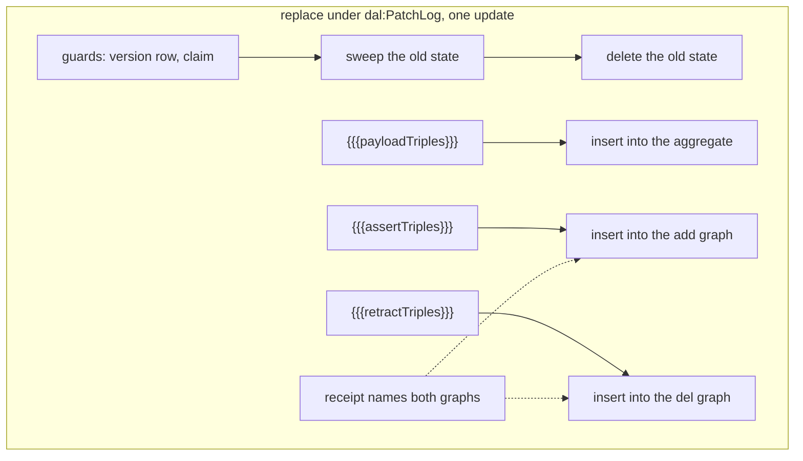
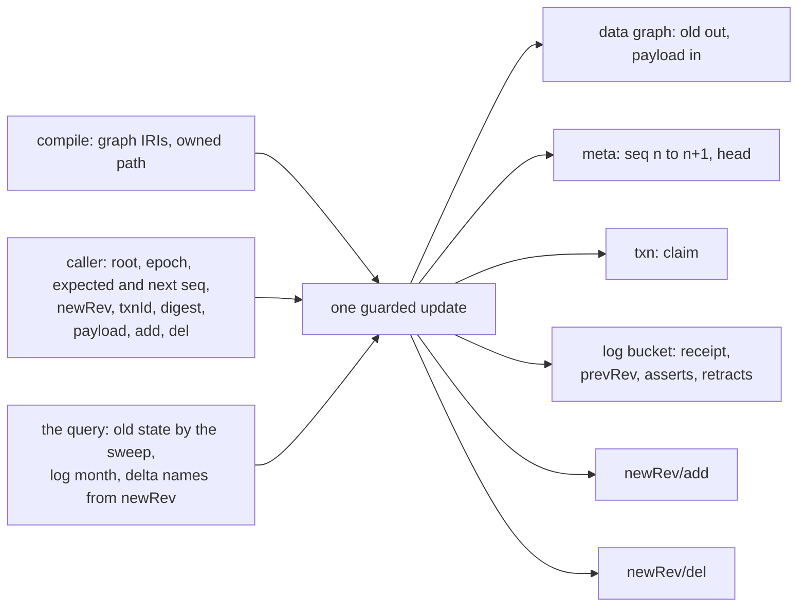
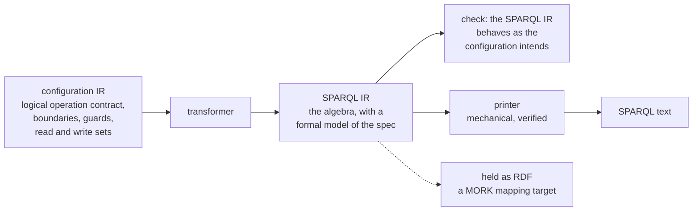

<!-- SPDX-License-Identifier: CC-BY-SA-4.0 -->

# Plan: Formal Methods, Track H: Persistence

**Unit ID:** `formal-methods-track-h`
**Unit type:** Phase (Epic Decomposition Model, `copilot-instructions.md`)
**Epic:** [formal-methods](formal-methods.md)
**Sketches:** [formal-methods-track-h.md](../sketches/formal-methods-track-h.md) (main),
[formal-methods-track-h-protocols.md](../sketches/formal-methods-track-h-protocols.md) (rung T4,
the centrepiece), [formal-methods-track-h-specification.md](../sketches/formal-methods-track-h-specification.md)
(the specification registry and the typed IR, the enabling move),
[formal-methods-track-h-typed-ir.md](../sketches/formal-methods-track-h-typed-ir.md) (H2's brief),
[persistence-aggregate-ownership.md](../sketches/persistence-aggregate-ownership.md) (aggregate
ownership, normative for the HO slices of [§3.5](#35-ho-aggregate-ownership))
**Aggregate ownership:** the exploration note [persistence-aggregate-ownership.md](../notes/persistence-aggregate-ownership.md),
its spike [`spikes/persistence-aggregate-ownership`](../../../spikes/persistence-aggregate-ownership/README.md),
and the review [persistence-aggregate-ownership-review.md](../notes/persistence-aggregate-ownership-review.md),
which holds the decisions (H-D14)
**Status record:** [formal-methods-track-h.md](../status/formal-methods-track-h.md)
**Decided by:** [ADR-A-FM4](../../architecture/decisions/ADR-A-FM4-persistence-formal-methods-home-and-scope.md)
(Accepted 2026-10-10: home and scope. Tracks A-FM2's and A-FM3's conventions for mechanised theories and
design-time models, excludes all relational/SQL work)
**Source:** [persistence-fml.md](../notes/rdf-engine/persistence-fml.md), an independent,
exhaustive review of the Persistence layer against this epic's own techniques
**Status:** In progress. H1 and the aggregate-ownership slices HO0 to HO9 are merged to `main` and
signed off (2026-10-10). H2 is briefed, ADR-A123 is accepted (2026-10-10), H2.0 to H2.3 are merged and signed off
(2026-10-12), and H2.4 is planned. The live state is in the status
record

## 1. Scope

Formal methods applied to the `dal:` configuration vocabulary, `tools/persistence`'s compiler and
its generated SPARQL, and the pluggable RDF-store backends it targets — the **RDF and SPARQL side
of Persistence only** (sketch §2). **Explicitly, permanently out of scope for this entire track:
any relational or SQL-compilation work**, which is a separate review
([sql-feedback.md](../notes/rdf-engine/sql-feedback.md)) naming its own, different formal-methods
programme, not read as this track's scope (ADR-A-FM4 decision 1).

This plan details **H1** (static hygiene: the cheapest, no-new-toolchain fixes, startable
immediately) in full, and **H2, H3** (the typed IR and the specification registry — the enabling
move) in enough detail to begin, since both are natural, low-risk follow-ons to H1 using tools
already in the repository (Python, no new install). **H4 onward stay at outline level** (§4) until
H1-H3 land, per the Epic Decomposition Model's rolling-wave rule, the same discipline every other
track in this epic already follows for its own later slices.

## 2. What this plan depends on, and what blocks it

| Dependency | State | Blocks |
|---|---|---|
| `tools/persistence`'s existing compiler, templates, shapes and examples | exist, stable (ADR-A78, ADR-A79, ADR-A80) | nothing — H1 reads and checks what exists today |
| an ADR for this track's home and scope | [ADR-A-FM4](../../architecture/decisions/ADR-A-FM4-persistence-formal-methods-home-and-scope.md), drafted 2026-10-08, **accepted 2026-10-10** (H-D1) | nothing blocking for H1 (pure analysis and additive checks, no new top-level directory needed yet); H5's protocol models should wait for ADR-A-FM4's acceptance, since they are the one place the ADR's own "marginally widens an existing convention" point (decision 3) matters |
| track E's Isabelle pattern (`tools/proofs/<layer>/`) | established (ADR-A-FM2) | H6 only — reused, not re-decided |
| track C's Alloy pattern (`tools/models/<topic>/`) | established (its own plan §4) | H5, H7 — reused, not re-decided |
| a TLA+ or Quint toolchain | **not installed, not chosen** | H5's protocol models only. H1-H4 need no new toolchain at all |
| track A (the ledger and the harness) | not started (epic status) | nothing — this track's own claims and Validation Packs are the interim record, same arrangement tracks B and C already use |
| CCS | CCS slice HQ-6b depends on this track (2026-10-10) | nothing here. HQ-6b binds ADR-A105's closures to the store: a closure's cut to the per-root sequence (AO-Q6) and its completeness to `dal:BlockingContiguityCheck`. HQ-6a holds no Persistence content |
| insurml-alignment | no direct dependency either way | nothing. Persistence's own compiler and layer are not gated by its slices |

## 3. H1: static hygiene — ready to start

The cheapest items in the review, needing no new toolchain, each tied to a specific, named finding
(review §18, priority items 1-4; §12; §7.4; §8.1).

### H1.1: the prefix antichain and overlap check

- A static check over every declared `dal:graphPrefix` and `dal:iriPrefix` value: do the declared
  prefixes form an antichain (no one a proper prefix of another) or, if a longest-prefix rule is
  intended, is it actually implemented? Reports a counterexample IRI when it is not.
- **Closes:** the main sketch's L3 gap, specifically the finding that `dal:GraphPatternScope`'s
  "unscoped fallback for instances outside any of them" is only well-defined if the declared
  prefixes form an antichain, which nothing checks today (review §6.2, finding #2).
- **Validation:** a fixture with two overlapping prefixes (for example `urn:g:lending/` and
  `urn:g:lending/behaviour/`) must fail the check with the overlapping pair named; a fixture with
  a genuine antichain must pass.

### H1.2: witness coverage for every rule, shape, warning and audit

- A harness that, for every refusal rule, warning, SHACL shape and always-on audit query in
  `tools/persistence`, requires at least one fixture that **triggers** it (a non-vacuity check,
  review §7.4) — not only a fixture that satisfies it. Missing coverage is a build failure, listed
  by rule/shape/audit name, mirroring `tools/check_formal_freshness.py`'s own existing discipline
  for Eligibility's laws.
- **Closes:** the review's own calibration-table defects D.3 A6 (a shape that could never fire)
  and D.1's `sh:prefixes` defect (a constraint that silently targeted nothing), both vacuity
  failures a non-vacuity check would have caught in seconds.
- **Validation:** seed one deliberately-vacuous rule (a refusal condition that can never be true
  given the other rules) and confirm the harness reports it as uncovered; confirm every existing
  rule, shape and audit in `tools/persistence` today either has a witness or is listed as a gap.

### H1.3: static template checks (S-3, S-4)

- Two checks over every generated SPARQL template and its parameter-binding list, run per compile:
  **S-3**, every variable in an INSERT template is bound in every solution, or is on an explicit,
  named allow-list of deliberately-optional positions; **S-4**, no blank nodes appear in any
  INSERT template at all (a SPARQL fact: blank nodes in an INSERT template are fresh per solution
  per execution, so a retry is not a no-op, and blank nodes are illegal in DELETE templates
  outright).
- **Closes:** the review's own judgement that these are "the two I would implement first," given
  their severity (a silently missing triple reintroducing a confirmation-outcome defect; a retry
  that silently inserts a second set of fresh blank nodes) and the fact that both are statically,
  fully checkable from the template text alone, today, without any new toolchain.
- **Validation:** run against every template `tools/persistence` currently generates; a template
  violating S-3 or S-4 (seeded deliberately in a copy, not the real templates, unless a real
  violation is found) must fail with the specific variable or blank node named.

### H1.4: enumerate the declaration/implementation gap, as data

- A report, generated per compile, listing every resolved `dal:` dimension whose value the
  generated SPARQL does **not** actually implement: declared shard counts not honoured,
  infrastructure graph IRIs that are compiler constants regardless of configuration, retention and
  epoch bumps delegated to housekeeping, a composite boundary that binds only the first property
  its shape reaches. Each entry names whether it is a caller obligation, a housekeeping
  obligation, or genuinely unimplemented.
- **Closes:** the main sketch's L6 gap directly — review finding #9, which treats the composite-
  boundary case specifically as a soundness bug (an unswept closure member leaves exactly the
  dangling triple whole-replace exists to prevent), not a mere limitation. **This report should
  flag that specific case as a refusal, not a documented limitation**, pending H2/H3 or a direct
  fix to the composite-boundary templates (this track reports the gap; fixing
  `tools/persistence`'s own templates is that package's own follow-up, same division of labour
  track B already uses for defects it finds in `tools/mork_compilers`).
- **Validation:** run against `tools/persistence`'s current examples; the composite-boundary gap
  must appear in the report, named, with the specific shape and property it was found against.

### H1.5: stable compiled-profile labels

- Fix blank-node labelling in compiled profiles so that re-compiling the same configuration twice
  produces byte-identical output, closing the determinism gap the review names (§16.4) that
  currently prevents compiled profiles from being committed and diffed the way generated SPARQL
  already is.
- **Validation:** compile one example twice, confirm byte-for-byte identity of the compiled
  profile (not only the rendered `.rq` files, which already have this property per `tools/
  persistence`'s own existing determinism test, if one exists — confirm it covers the compiled
  profile too, not only the final SPARQL text).

**H1's overall validation:** one command runs all five checks across every example
`tools/persistence` ships today, and the report is read by a maintainer before any of H2 onward
starts, since H1.4's gap enumeration in particular may change what H2/H3 treat as urgent.

### H1.4b and H1.5 after the aggregate-ownership review (2026-10-10)

Both proceed now (AO-Q11). They do not wait for the HO slices.

- **H1.4b** reports today's implementation, and its composite entries are these, each naming the
  register row and the HO slice that removes it: the bound property is assumed owned and nothing
  declares it (TD-35, HO5), the replace sweep is quadratic (TD-36, HO1), an inverse path is
  misread (TD-37, HO5), the payload lands in the log graph (TD-39, HO1), no composite create or
  tombstone (TD-04, HO7), named graphs named from the root's local name (TD-38, HO8), and composite
  operations that rely on the default graph against static check S-1 (TD-40, HO5). Write the
  report's test so it asserts the entries present at the time it runs. Each HO slice that closes a
  gap removes its entry from that test in the same commit, and says so in its Validation Pack.
  If H1.4b runs after HO1, omit the TD-39 and TD-36 entries.
- **H1.5** is unchanged, and waits for nothing. The maintainer's merge of the branch is the sign-off for
  every slice on it, including H1.4a (`validation/LOG.md` is retired on `main`). Stable labelling does not depend on what a
  compiled profile contains, so HO slices that change compiled output regenerate H1.5's golden
  files, if it has any, in the same commit.

## 3.5 HO: aggregate ownership

**Why.** The composite boundary does not model an aggregate correctly. The exploration note
[persistence-aggregate-ownership.md](../notes/persistence-aggregate-ownership.md) and its spike
[`spikes/persistence-aggregate-ownership`](../../../spikes/persistence-aggregate-ownership/README.md)
found it, and the review [persistence-aggregate-ownership-review.md](../notes/persistence-aggregate-ownership-review.md)
corrected and extended the findings (S1 to S6, F1 to F9). We decided AO-Q1 to AO-Q12 on
2026-10-10 (H-D14).
**What to build.** The design sketch [persistence-aggregate-ownership.md](../sketches/persistence-aggregate-ownership.md)
is normative. Every slice below cites its sections, and a slice that finds the sketch wrong stops and
asks.
**Compatibility.** None is kept (sketch header). Remove, do not deprecate.
**Order.** HO0, HO1, then HO3 to HO9 in order, end to end. HO2 is done: ADR-A122 was drafted on
2026-10-10 with the plan, and stays Proposed. The slices are built against it, and the maintainer accepts
it, with the rest of the work package, when verifying at the close. HO8 may run at any point after HO3. H1.4b and H1.5 run alongside, as above.

| Slice | Delivers | Modules | Tests | Closes | Blocked on |
|---|---|---|---|---|---|
| HO0 | the note and the spike corrected | the note, the spike | 18 spike checks | S1, S2, S5 in the documents | nothing |
| HO1 | composite replace writes the payload to the default graph and sweeps in linear time | two templates | 7 | TD-39, TD-36 | nothing |
| HO2 | ADR-A122 drafted, Proposed | documents only | none | | **done** 2026-10-10 |
| HO3 | `dal:` vocabulary 0.3.0 (`dal:ownership`, reference data), two shapes, examples | `ontology/persistence` | 8 | | HO1 |
| HO4 | ownership tree and path compiler, added beside the old walk | `boundary.py`, new `paths.py` (and one class in `terms.py`) | 10 | | HO3 |
| HO5 | the compiler switches to the tree. Several owned edges sweep correctly | `resolver.py`, `operations.py`, `validator.py`, `boundary.py` (see H-D16) | 10 | TD-03, TD-35, TD-37, TD-40 | HO4, H-D16 |
| HO6 | the refusals and the warning of sketch §5 | `validator.py` | 13 | | HO5 |
| HO7 | composite create and tombstone delete | `operations.py`, four templates | 8 | TD-04 | HO6 |
| HO8 | injective graph naming, within and across families | `operations.py`, `validator.py`, the named-graph templates | 6 | TD-38 | HO3 |
| HO9 | documentation and close-out | documents | none | | HO7, HO8 |

Every slice that adds a refusal, warning, shape or template adds its witness in the same commit, or
`mise run check:persistence` fails (H1.2, H1.3). Every slice ends with `mise run check:persistence`
passing, and reports the passed and xfailed counts it saw in its Validation Pack. Validation Packs are
`docs/developer/validation/FMH-HO<n>.md`, in the form of [FMH-H1-4a](../validation/FMH-H1-4a.md).

**Non-weakening.** HO5 deletes the H1.4a refusal, its witness, and tests H1.4a-T3, T4, T5 and T9, and
rewrites T1, T2, T6, T7, T8, T10 and T11 for the tree. Each removal is justified by ADR-A122 decision
1, and the HO5 Validation Pack lists every removed or rewritten test with its replacement, for the
maintainer to countersign at the gate.

### HO0: correct the note and the spike

**Files.** `docs/developer/notes/persistence-aggregate-ownership.md`,
`spikes/persistence-aggregate-ownership/{placement.py,test_spike.py,README.md}`.

**The note.** The header pointer to the review already exists (added 2026-10-10). Rewrite the note's
references to "the maintainer" in the team voice (`AGENTS.md`, Writing), as the rest of the repository now
is. Then:

| Where | Change to make |
|---|---|
| §1 item 1, and §3 row "Delete the outgoing triples of the root and of every owned node" | the "today" verdict describes the compiler before H1.4a. Since H1.4a the placement shape is refused as `CompositeBoundaryMultipleProperties` (review S1) |
| §3 row "Never delete a referenced entity" | Today: "a reference is swept when it is the shape's only `sh:node` (review F1, TD-35)". Verdict: "not supported, and a live hazard" |
| §4.5, the two sentences beginning "Today this is limited" | replace with "This already happens when a shape's only `sh:node` is a reference (review F1, TD-35)." |
| §4.1, "walking it gives the expected 12 nodes" | "11 nodes, since a policy is a reference (AO-Q1)" |
| §4.3 | the run-time single-owner example becomes a document owned by layers of two placements. The inbound quote example is deleted, since `Pol1` is outside the aggregate. Point to the warning `ReferenceToOwnedClass` (sketch §5) |
| §9.1 table, "ownership by construction" | append ", though a writer still needs the classified tree to decide what goes in the graph (review F6)" |
| §10 | "TD-26" becomes "TD-34". "add the payload-graph defect" becomes "TD-39, added 2026-10-10" |
| §11 heading line | add "Answered 2026-10-10. See the review §6." |

**`placement.py`.**

- `OWNED_TREE[EX.LayerContractBinding]` becomes `{EX.hasShare: EX.Quant}`.
- Remove `EX.connectsPolicy` from `FLAT_OWNED`. Add it to `REFERENCES`.
- `first_property_path`'s docstring becomes "What the compiler did before H1.4a: the first node
  property, in path order, followed with `+`. Since H1.4a the compiler refuses this shape
  (CompositeBoundaryMultipleProperties). Review S1."
- `placement_graph` gains `shared_document: bool = False`. When true, add
  `P2 a Placement ; definedProgramme T2`, `T2 a Tower ; hasLayer L9`, `L9 a Layer ; attachment DocOwned`.
  If `shared_policy` is also true, reuse the same `P2`, `T2` and `L9` nodes.

**`test_spike.py`.** Seventeen checks become eighteen.

| Test | Change |
|---|---|
| `test_the_first_property_alone_reaches_only_the_tower` | comment: "the compiler before H1.4a (review S1)". Assertion unchanged |
| `test_the_per_class_tree_takes_...` | subset `{"T","L1","L2","L3","LCB1","S1","Mc1","Mc2","DocOwned"}`. Add `"Pol1"` to the disjoint set. Add `assert len(pl.unrolled_paths(g).members) == 11` |
| `test_a_vocabulary_guard_catches_a_forgotten_vocabulary_link` | `forgot = pl.REFERENCES - {EX.marketType, EX.status, EX.connectsPolicy}` |
| `test_a_node_with_two_owners_is_found_and_an_outside_reference_is_listed` | rename to `test_a_shared_policy_is_a_reference_so_it_has_no_second_owner`. With `shared_policy=True, inbound_quote=True`, assert `pl.owners(g, [EX.P, EX.P2]) == {}` and `pl.inbound_from_outside(g, pl.unrolled_paths(g)) == set()` |
| new `test_a_document_owned_by_layers_of_two_placements_has_two_owners` | `g = pl.placement_graph(shared_document=True)`, assert `pl.owners(g, [EX.P, EX.P2]) == {EX.DocOwned: {EX.P, EX.P2}}` |

**`README.md`.** Add to "What it does not show": "A store that runs writers one at a time. On such a
store, a removal that computes its closure inside the update sees a concurrent write, and D1's orphan
does not occur (review S5)." And: "`first_property_path` simulates the compiler before H1.4a (review S1)."

**One command.** From the repository root, `python -m pytest spikes/persistence-aggregate-ownership -q`.
Pass: `18 passed`.

### HO1: fix the composite replace (TD-39, TD-36)

**Files.** `tools/persistence/src/persistence/templates/cas-replace-composite-property.mustache` and
`-dataset-guard.mustache`, a new `tools/persistence/tests/test_composite_sweep.py`,
`spikes/persistence-aggregate-ownership/test_spike.py`.

**Change.** Exactly sketch §7.1's HO1 text, in both templates, and their header comments.

**Tests** (`test_composite_sweep.py`, on rdflib's `Dataset`, using the shipped composite example and
the instantiation pattern of `test_composite_boundary.py`'s `_replace_and_count_left`).

| ID | Given / When / Then | Level | +/- |
|---|---|---|---|
| HO1-T1 | an order (root with `status "open"`, two line items) and a version row at seq 1 / replace with a payload holding `status "paid"` and the line items / `"paid"` is in the default graph and in no named graph | L5 | + |
| HO1-T2 | as T1 / after the replace / `"open"` is in no graph, and no payload triple is in any `urn:g:txlog/` graph | L5 | + |
| HO1-T3 | as T1 / after the replace / one `pat:Revision` for seq 2 is in `urn:g:txlog/<YYYY-MM>` | L5 | + |
| HO1-T4 | the dataset-guard variant, with the dataset epoch row / as T1 / as T1 | L5 | + |
| HO1-T5 | a root with 5 triples and 3 line items of 4 triples each / evaluate the update's `WHERE` as `SELECT (COUNT(*) AS ?n)` with the same bindings / `n == 17`, not 60 | L2 | + |
| HO1-T6 | as T1 with `expectedSeq` 7 / replace / the dataset is unchanged, quad for quad | L5 | − |
| HO1-T7 | both templates / `python -m persistence hygiene` over the shipped composite example / no S-3 or S-4 finding | L1 | + |

For T5, take the instantiated update text, keep everything from the line that starts `WHERE {` to
the end, and prefix the template's `PREFIX` lines and `SELECT (COUNT(*) AS ?n)`. Pass the
request-time values as `initBindings`.

**Spike.** In `test_spike.py`, rename
`test_the_composite_replace_writes_the_new_payload_to_the_log_graph_not_the_default_graph` to
`test_the_composite_replace_writes_the_new_payload_to_the_default_graph`, asserting
`list(found) == [str(rdflib.graph.DATASET_DEFAULT_GRAPH_ID)]`. Update note §2.3's last sentence to "Fixed in
HO1." Run `python spikes/persistence-oxigraph/rdflib_comparison.py` if `pyoxigraph` is installed. That run
is **not mandatory** (decided 2026-10-10): the Oxigraph spike is a second-engine cross-check, and a
slice may skip it where the package cannot be installed, saying so in its Validation Pack. If its
composite scenarios report different counts, the payload move explains it. Update their expectations
and say so in the Validation Pack.

**Existing tests.** H1.4a-T10 and T11 must pass with their assertions unchanged. They did not at first
(predicted, then seen): their helper ran the update with `templatecheck`'s stand-in for the payload
slot, which the replace now writes to the default graph. The fix is to the test input and not to the
expected results. The helper removes the stand-in from the rendered text (taken from
`templatecheck._SLOT_STAND_INS`, so it cannot drift), so the replace runs with an empty payload, as
the tests always meant. Filtering the stand-in's subject out of the result instead was rejected,
since it makes the assertion skip something. HO5 rewrites both tests for the tree.

**Register.** Remove TD-39 and TD-36, naming HO1.

**One command.** `mise run check:persistence && python -m pytest spikes/persistence-aggregate-ownership -q`.

### HO2: draft ADR-A122

**Files.** `docs/architecture/decisions/ADR-A122-aggregate-ownership.md`, the catalogue
`docs/architecture/decisions/README.md`.

**Done 2026-10-10**, while planning: [ADR-A122](../../architecture/decisions/ADR-A122-aggregate-ownership.md),
Proposed, listed in the catalogue. A122 was free on `main` and every remote branch that day. The
agent does not change its status. If a slice finds the ADR wrong, it records the deviation in
that slice's Validation Pack and in the status record, and proposes a dated addendum, rather than
editing the decision text. Before the branch merges, re-check that no other branch has taken A122.

### HO3: the vocabulary, persistence 0.3.0

**The data graph (AO-Q14, decided 2026-10-10: option a).** Also add `dal:dataGraph` (sketch §3.1),
the shape `dal:CompositePropertyBoundaryRequiresDataGraphShape` (sketch §3.3) with its witness
`shape-CompositePropertyBoundaryRequiresDataGraphShape.ttl`, and `dal:dataGraph` on every composite
example and fixture. HO5 and HO7 then wrap every composite pattern and payload in
`GRAPH {{{dataGraph}}}` (sketch §7).

**Files.** `ontology/persistence/spec/persistence.ttl`, `shapes/constraints.ttl`, `README.md`,
`docs/aggregate-boundaries.md` (the terms only, the full rewrite is HO9), `examples/*.ttl`, the
catalog, and every current-version pin found by `git grep -n "persistence/0.2.1"` (not release
history). Load skill `lattice-ontology-authoring` first.

**Change.** Sketch §3: add the terms of §3.1, remove `dal:maxTraversalDepth` (§3.2) from the spec,
the shape and every example, and add the shapes of §3.3. Add `dal:ownership dal:Owned` to the
`ex:lineItem` property shape of `composite-property-boundary-shacl.ttl`, and to the node property
of every composite witness fixture under `tools/persistence/tests/witnesses/`. Add the two shape
witnesses `shape-BoundaryOwnershipShape.ttl` and `shape-ReferenceDataShape.ttl`, each with data the
shape reports and data it accepts (H1.2c rule). Then `mise run build:ontology-catalog` and
`mise run build:ontology-releases`.

| ID | Given / When / Then | Level | +/- |
|---|---|---|---|
| HO3-T1 | a property shape with `dal:ownership ex:Other` / validate / `BoundaryOwnershipShape` reports it | L3 | − |
| HO3-T2 | a property shape with two `dal:ownership` values / validate / reported | L3 | − |
| HO3-T3 | sketch §10.1's configuration / validate / no `dal:` shape reports | L3 | + |
| HO3-T4 | a `dal:ReferenceData` without `dal:coversClass` / validate / `ReferenceDataShape` reports it | L3 | − |
| HO3-T5 | `ex:Currencies a dal:ReferenceData ; dal:coversClass ex:Currency` / validate / accepted | L3 | + |
| HO3-T6 | `dal:ownsReferenceData "yes"` / validate / `AggregateBoundaryProfileShape` reports it | L3 | − |
| HO3-T7 | the repository / `check:ontology-versioning` / passes, with 0.3.0 current | L0 | + |
| HO3-T8 | a composite profile without `dal:dataGraph` / validate / `CompositePropertyBoundaryRequiresDataGraphShape` reports it, and the same profile with one is accepted | L3 | +/− |

Put T1 to T6 and T8 in a new `tools/persistence/tests/test_ownership_vocabulary.py`.

**One command.** `mise run check:persistence && mise run check:ontology-catalog && mise run check:ontology-versioning`.
End the handoff with 🔴 RELEASE TAGS REQUIRED for `persistence/0.3.0`, as skill `lattice-lifecycle` says.

### HO4: the ownership tree and the path compiler

**Files.** `tools/persistence/src/persistence/boundary.py` (add `Step`, `Edge`, `OwnershipTree`,
`walk_ownership`. Leave `walk_boundary_shape` and `Closure` untouched), a new
`tools/persistence/src/persistence/paths.py` (sketch §6.2 and §6.3), `terms.py` (`PropertyPath`,
sketch §6.4, no change to `render.py`), and the fixtures of sketch §10:
`ontology/persistence/examples/composite-project-ownership.ttl` and
`tools/persistence/tests/fixtures/project-data.ttl`. Nothing calls the new code from the compiler yet.

| ID | Given / When / Then | Level | +/- |
|---|---|---|---|
| HO4-T1 | §10.1's shape / `walk_ownership` / `shapes == [Project, Milestone, Plan, Task, Document, Comment]` shapes, in that order | L1 | + |
| HO4-T2 | as T1 / owned edges / six: `hasMilestone`, `hasPlan`, `hasTask`, `attachment` from Task, `hasSubtask`, `^onTask` | L1 | + |
| HO4-T3 | as T1 / `member_classes()` / `{Milestone, Plan, Task, Document, Comment}` | L1 | + |
| HO4-T4 | §10.1's shape with its triples written in three different orders, and its blank nodes relabelled / walk and render / identical trees and identical path strings | L2 | + |
| HO4-T5 | §10.2's data / `SELECT ?s WHERE { ex:p1 <path> ?s }` / exactly `p1` and §10.3's 8 members | L4 | + |
| HO4-T6 | 200 random shape graphs (seeded `random.Random(n)`, n from 0 to 199, at most 5 shapes and 8 owned edges, inverse steps, self and mutual recursion, owned leaves) and random data (at most 12 nodes, 30 triples, predicates from the shapes plus one other) / members by the path, against a breadth-first search of (node, shape) pairs over owned edges / equal every time | L2 | + |
| HO4-T7 | a predicate IRI containing `>` / `PropertyPath.encode` / `SparqlTermError` | L8 | − |
| HO4-T8 | a single self-recursive owned edge / render and evaluate on `t1 hasSubtask t2 . t2 hasSubtask t3` / the string contains `)*`, and members are `t2, t3` | L1 | + |
| HO4-T9 | a shape with only value and reference properties / `owned_path()` / `None` | L1 | + |
| HO4-T10 | a property shape with a sequence path, and one without `dal:ownership` / walk / recorded in `complex_paths` and `unclassified`, nothing raised | L1 | + |

T5 also pins the rendered string as a golden value, taken from the first run and reviewed by eye
against §6.5. Put the tests in a new `tools/persistence/tests/test_ownership_tree.py`. No new
dependency. The random test uses the standard library only.

**One command.** `mise run check:persistence`.

### HO5: switch the compiler to the tree

**Files.** `resolver.py`, `operations.py`, `validator.py`, `boundary.py`, the two composite
templates, `tools/persistence/tests/test_composite_boundary.py`, `test_boundary.py`,
`test_validator.py`, `test_compiler_integration.py`, `test_template_alignment.py`, the witnesses,
`spikes/persistence-aggregate-ownership/payload_graph.py`, and
`spikes/persistence-oxigraph/{scenarios.py,rdflib_comparison.py}`.

**Change.** Sketch §4.3 and §7.1 (HO5 paragraph):

- the resolver stores `ownershipTree` and stops writing `compositeProperties`,
  `compositeEdgeProperties` and `maxTraversalDepth`
- operations bind `ownedPath` (`PropertyPath`) and `dataGraph` (`Iri`), and stop binding
  `compositeProperty`. The templates use `{{{ownedPath}}}` inside `GRAPH {{{dataGraph}}}` (sketch §7.1)
- the validator refuses a composite profile without `dal:dataGraph` as `MissingDataGraph`, with the
  witness `refusal-MissingDataGraph.ttl`, checked first among the boundary rules
- the validator's `UniquenessOutsideBoundary` reads `tree.predicates()`, `BoundaryConflict` reads
  `tree.member_classes()` at every depth, and `CompositeBoundaryMultipleProperties` is deleted with
  its witness
- `boundary.py` loses `walk_boundary_shape`, `Closure`, `reachable_properties` and
  `BoundaryCycleError`, with `refusal-BoundaryCycleError.ttl`
- until HO6, an unclassified edge is simply not followed. Neither does a reference edge

| ID | Given / When / Then | Level | +/- |
|---|---|---|---|
| HO5-T1 | §10's fixture compiled / replace with a payload equal to the current aggregate except `ex:t3 ex:status ex:InProgress` / exactly the 28 delete-set triples are removed and the payload's triples are present, and every triple of `acme, alice, docShared, InProgress, Done, TaskStatuses, report1, p2, m9` is unchanged | L5 | + |
| HO5-T2 | as T1 with an empty payload / replace / no triple has `p1` or a member as subject. Everything outside is unchanged | L5 | + |
| HO5-T3 | F1: `ex:placedBy sh:node ex:CustomerShape ; dal:ownership dal:Reference` beside an owned `lineItem` / replace / the customer's triples are unchanged | L5 | − |
| HO5-T4 | F4: the comment linked by `^onTask` / replace dropping it / `c1`'s triples, including `c1 onTask t1`, are gone | L5 | + |
| HO5-T5 | the shipped composite example / compile and replace / as H1.4a-T10 (nothing left behind) | L5 | + |
| HO5-T6 | two owned edges from the root (rewritten H1.4a-T11) / replace / both members' old triples gone | L5 | + |
| HO5-T7 | every declaration order of §10.1 (rewritten H1.4a-T7) / compile / byte-identical `ownedPath` | L2 | + |
| HO5-T8 | a uniqueness key on `ex:title` (a value property of an owned shape) / compile / accepted. A key on `ex:name` of `ex:Organisation` / compile / `UniquenessOutsideBoundary` | L3 | +/− |
| HO5-T9 | a member class at depth 3 that declares its own named-graph boundary / compile / `BoundaryConflict` | L3 | − |
| HO5-T10 | a composite profile without `dal:dataGraph` / compile / `MissingDataGraph`. And with §10.2's data also copied into the default graph / replace / the default-graph copy is untouched | L3, L5 | − |

List every removed or rewritten H1.4a test in the Validation Pack with its replacement (see
Non-weakening above). Run both spikes and update them to the new binding name. The aggregate-ownership
spike's 18 checks must still pass. Remove TD-03, TD-35, TD-37 and TD-40 from the register, naming HO5.

**One command.** `mise run check:persistence && python -m pytest spikes/persistence-aggregate-ownership -q`.

### HO6: the refusals and the warning

**Files.** `validator.py`, one witness per kind under `tools/persistence/tests/witnesses/`, a new
`tools/persistence/tests/test_ownership_refusals.py`.

**Change.** Sketch §5, rules 2 to 6 and 9 and the warning, in the order given there.

| ID | Given / When / Then | Level | +/- |
|---|---|---|---|
| HO6-T1 | an `sh:path ( ex:a ex:b )` property shape / compile / `ComplexBoundaryPath` | L3 | − |
| HO6-T2 | a node property with no `dal:ownership` / compile / `UnclassifiedBoundaryEdge`, naming the shape and the predicate | L3 | − |
| HO6-T3 | F1's shape with `placedBy` unclassified / compile / `UnclassifiedBoundaryEdge` | L3 | − |
| HO6-T4 | `dal:ownership` on an `sh:datatype` property / compile / `OwnershipOnValueProperty` | L3 | − |
| HO6-T5 | a composite shape with value and reference properties only / compile / `CompositeBoundaryWithoutOwnedEdges` | L3 | − |
| HO6-T6 | `ex:status` classified `dal:Owned` with `sh:class skos:Concept` / compile / `OwnedReferenceData` | L3 | − |
| HO6-T7 | as T6 with `dal:ownsReferenceData true` / compile / accepted | L3 | + |
| HO6-T8 | an owned edge to `ex:Currency`, declared `dal:ReferenceData`, and to a subclass of it / compile / `OwnedReferenceData` both times | L3 | − |
| HO6-T9 | two composite profiles owning `ex:Document` / compile / `OverlappingOwnership`, naming both shapes | L3 | − |
| HO6-T10 | a profile owning another composite profile's root class / compile / `BoundaryConflict`, since sketch §5 runs rule 8 before rule 9, and the same refusal on every run | L3 | − |
| HO6-T11 | §10's fixture plus `ex:InvoiceShape` with `[ sh:path ex:forMilestone ; sh:class ex:Milestone ]` / compile / warning `ReferenceToOwnedClass`, and the compile succeeds | L3 | − |
| HO6-T12 | §10's fixture / compile / no refusal and no `ReferenceToOwnedClass` warning | L4 | + |
| HO6-T13 | each new witness / the witness check / triggers exactly its own rule | L4 | + |

**One command.** `mise run check:persistence`. The witness count rises by seven: six refusals and one
warning.

### HO7: composite create and tombstone delete (TD-04)

**Files.** `operations.py`, new templates `create-if-absent-composite.mustache`,
`create-if-absent-composite-dataset-guard.mustache`, `tombstone-delete-composite.mustache`,
`tombstone-delete-composite-dataset-guard.mustache` (sketch §7.2 and §7.3), `templatecheck.py`'s
allowance list, `test_template_alignment.py`, template witnesses where no example reaches a
template, and a new `tools/persistence/tests/test_composite_lifecycle.py`.

| ID | Given / When / Then | Level | +/- |
|---|---|---|---|
| HO7-T1 | §10's configuration with `dal:firstWrite dal:AbsentRow` / compile / both create templates generated | L4 | + |
| HO7-T2 | an empty dataset / create `p1` with §10.2's `p1` aggregate as payload / the payload in the default graph, a version row at seq 1, one revision | L5 | + |
| HO7-T3 | as T2, run twice with different transaction ids / second create / changes nothing | L5 | − |
| HO7-T4 | the root has a triple in the default graph but no version row / create / changes nothing | L5 | − |
| HO7-T5 | §10's data with a version row at seq 1 / tombstone delete / the 28 delete-set triples gone, `pat:deleted true`, seq 2, a `pat:Deletion` revision, everything outside unchanged | L5 | + |
| HO7-T6 | as T5 with `expectedSeq` 7 / tombstone / nothing changes | L5 | − |
| HO7-T7 | after T5 / replace / refused by the tombstone guard (no change) | L5 | − |
| HO7-T8 | all four new templates / `hygiene` / no S-3 or S-4 finding beyond the reviewed previous-revision allowance on the tombstone | L1 | + |

Remove TD-04 from the register, and the composite `AbsentRow` limitation from
`tools/persistence/README.md`. Update the H1.4b entries.

**One command.** `mise run check:persistence`.

### HO8: injective graph naming (TD-38)

AO-Q13 was answered with option a (H-D15). Build sketch §9 with these tests. Every named-graph
template changes, so re-run every named-graph test and witness, and update any expectation that names
a graph IRI.

| ID | Given / When / Then | Level | +/- |
|---|---|---|---|
| HO8-T1 | roots `https://example.org/a/1` and `https://example.org/b/1` in one named-graph family / create both / two different graphs, each with its own payload | L5 | + |
| HO8-T2 | `dal:graphIriTemplate "urn:g:orders/{id}/data"` / create / the graph IRI ends in `/data` | L5 | + |
| HO8-T3 | a template without `{id}` / compile / `GraphIriTemplateInvalid` | L3 | − |
| HO8-T4 | a template `urn:g:orders/{id}data` (suffix with no separator) / compile / `GraphIriTemplateInvalid` | L3 | − |
| HO8-T5 | two families with templates `urn:g:{id}` and `urn:g:orders/{id}` / compile / `GraphIriTemplateOverlap`, naming both profiles | L3 | − |
| HO8-T6 | the two new witnesses / the witness check / each triggers exactly its own rule | L4 | + |

Remove TD-38 from the register. **One command.** `mise run check:persistence`.

### HO9: documentation and close-out

Rewrite `ontology/persistence/docs/aggregate-boundaries.md` and the aggregate-boundary sections of
`ontology/persistence/README.md` from the sketch (§1, §2, §5, §7, §8, §11), in the domain-neutral
terms of §10. Recommend named graphs for new deployments. Update `tools/persistence/README.md`
(subcommands, known limitations, the `ownedPath` slot), and add a pointer to ADR-A122 at the top of
the legacy sketch `docs/developer/sketches/persistence-profile-substrate.md` §4. Do not rewrite that
sketch. Close the HO rows in the status record, update `docs/developer/INDEX.md` and
`docs/traceability/matrix.csv` where they name the removed terms, and re-run H1.4b's report. Its
composite and graph-naming entries should all be gone.

## 4. H2, H3: the typed IR and the specification registry

Detailed in [their own sketch](../sketches/formal-methods-track-h-specification.md). Two slices,
H2 first (the typed IR, since it is the smaller, more self-contained change and several of H1's
own checks — S-3, S-4, the term/value divergence — become structural guarantees once it exists
rather than external checks running against untyped template text) and H3 second (the
specification registry, which generates the rules, the selection table and the README's own
tables from one source, closing the review's finding #3 drift and enabling the exhaustive
cross-axis validation H4 needs as its input).

**H2 (typed IR), briefed 2026-10-10.** The design, its questions and its slices are in the
[typed IR sketch](../sketches/formal-methods-track-h-typed-ir.md). We decided (H-D18 to H-D20):

- H2 is split into ten slices, H2.0 to H2.9 ([sketch §7](../sketches/formal-methods-track-h-typed-ir.md#7-slices)).
- Option A. Each operation is a typed value built by a builder, its SPARQL is rendered from it, and
  the Mustache templates and `chevron` are retired in H2.9.
- The typed payload is designed in full ([sketch §4](../sketches/formal-methods-track-h-typed-ir.md#4-the-typed-payload))
  and reviewed by the maintainer before H2.8 is briefed.
- H-D3 is ours to decide. We take a new ADR, A123, and a dated addendum to ADR-A79, which stays
  Accepted for the points A123 does not supersede ([sketch §6](../sketches/formal-methods-track-h-typed-ir.md#6-the-adrs)).

What H2 still delivers, as outlined before the brief: typed parameters, read and write sets (now
derived from the operation, not declared), guards tagged term or value, template variables tagged
`Bound` or `OptionalAllowed`, the `OwnershipTree` and its `PropertyPath` as IR values, the payload
check of ADR-A122 decision 6, and the required-parameter guard that closes TD-34. Its validation is
unchanged. Every hazard of the [specification sketch §3](../sketches/formal-methods-track-h-specification.md#3-the-typed-intermediate-representation)
becomes a refusal by type, and H1.3's checks pass over the new output by construction. H2-Q1 to H2-Q6
are answered ([sketch §1](../sketches/formal-methods-track-h-typed-ir.md#1-decisions-already-taken-2026-10-10)),
ADR-A123 is accepted (2026-10-10). H2.0 to H2.3 are merged and signed off (2026-10-12).

### 4.1 H2.3: the named-graph row writers (planned 2026-10-12)

**Unit:** slice H2.3 of the [typed IR sketch §7](../sketches/formal-methods-track-h-typed-ir.md#7-slices), under
ADR-A123 and its addendum of 2026-10-12. Builds on H2.2's harness, `GRAPH_ROLES` and typed bindings
([FMH-H2-2](../validation/FMH-H2-2.md)). All four questions were decided on 2026-10-12.

#### The scene, checked against the templates

The sketch assigns H2.3 eight templates. Read on 2026-10-12, they are:

| Template | Writes | Parameters | Note |
|---|---|---|---|
| `create-if-absent-named-graph` and its dataset-guard variant | the payload into `?g`, a version row at `seq 1`, the claim, the receipt | `$root`, `$epoch`, `$newRev`, `$txnId`, `$requestDigest`, the payload slot | `?g` is `BIND(IRI(CONCAT(graphPrefix, ENCODE_FOR_URI(STR($root)), graphSuffix)))`. The variant adds the dataset-epoch pattern only |
| `cas-replace-named-graph` and its variant | deletes every triple of `?g` and the old row, writes the payload, the new row, the claim, the receipt | as create, with `$expectedSeq`, `$nextSeq`, `$assertGraph`, `$retractGraph` | the sweep is `OPTIONAL { GRAPH ?g { ?s ?p ?o } }`, after the top-level `BIND` of `?g`. The variant rebases the row's epoch through `?rowEpoch` |
| `tombstone-delete-named-graph` and its variant | deletes every triple of `?g`, tombstones the row, writes the claim and a deletion receipt | as replace, with `$cause` and `$actor`, and no payload | the same sweep |
| `unconditional-write` | the payload into `?g` | `$root`, the payload slot | no version or concurrency guard, by the profile's design: `compile` selects it only for `dal:ProvidedConcurrency` or `dal:LockingConcurrency`, where concurrency is the store's or an external lock's. The port keeps that. Like every operation it has the parameter guard while guards are on, `ISIRI($root)`, which also refuses a literal `$root` that would otherwise name a graph from its text |
| `cas-replace-value-guard` | `$root <guardProperty> $newValue` | `$root`, `$oldValue`, `$newValue` | **no `GRAPH` at all.** It reads and writes the default graph, which the IR cannot express (`DefaultGraphPattern`) and static check S-1 forbids. H2.3-Q1 |

Three facts constrain the port.

1. **The sweep collides with the corrected scope rule.** After F4 an `OPTIONAL` starts with an empty scope, so
   `UnboundGraphVariable` refuses `OPTIONAL { GRAPH ?g { ... } }` when `?g` is bound outside it, and H2.1 added that very
   case as a refusal test. That was wrong in intent. F4 is right about a `BIND`, whose value is computed inside the
   group and cannot see `?g`. It is wrong about a pattern, whose solutions are joined with the enclosing group on `?g`
   afterwards, so the result holds only `?g`'s triples. The rule exists to stop a `GRAPH ?g` whose result ranges over
   every graph, and a join on an outer `?g` prevents that. H2.3-Q2.
2. **`$assertGraph` and `$retractGraph` are optional in the template and required by one receipt model.** The README
   says they are bound "for the patch-log model". The template always holds them, so under any other model they are left
   unbound and their two triples are skipped. A builder receives the bindings only, and no binding says which receipt
   model applies. H2.3-Q3.
3. **`$cause` and `$actor` are IRIs.** The patterns guide declares `pat:cause` and `pat:actor` object properties, and its
   shapes require `sh:nodeKind sh:IRI` (guide §24.0 and its shapes), so both are `Kind.IRI`.

#### Questions for the maintainer

| # | Question | Options and consequences | Leaning |
|---|---|---|---|
| H2.3-Q1 | `cas-replace-value-guard` uses the default graph | (a) **leave it unported in H2.3**, record it as TD-43, and decide where a `dal:NoBoundary` target's data lives when H2.7 changes the vocabulary, for example the profile's `dal:dataGraph` as for a composite family. Port it then, as a change. (b) Decide now that a `dal:NoBoundary` profile names a data graph, and port it in H2.3 as a change, which needs a vocabulary change before H2.7's. (c) Give the IR a default-graph role. Against ADR-A123 decision 2 and S-1, and a store's default graph differs between stores | (a). Nothing in H2.3 depends on it, and the decision belongs with H2.7's vocabulary. **Decided 2026-10-12: (a)** |
| H2.3-Q2 | a `GRAPH ?g` inside an inner group, with `?g` bound outside it | (a) **`UnboundGraphVariable` counts a graph variable as bound when any enclosing group binds it**, since the join restricts the result. The scope a `BIND` sees stays bottom-up. The H2.1 refusal case for `OPTIONAL` becomes an accepted case, with an engine test that the result holds only `?g`'s triples. The three templates port unchanged. A store that evaluates the inner group literally bottom-up scans every graph before the join, where rdflib passes the outer binding in. That is a cost, not a wrong result, and joins TD-42's measurement in H2.4. (b) Keep the refusal, and move the sweep out of the `OPTIONAL`. That is a change to three templates, not a port, and alters the operations' behaviour when `?g` is empty | (a). **Decided 2026-10-12: (a) by default, and (c) as an override the caller chooses** (steps 1, 2 and 8) |
| H2.3-Q3 | `$assertGraph` and `$retractGraph` | (a) **declare them optional, as the template treats them.** The port changes nothing, and a patch-log caller who leaves them out gets a receipt without them, unguarded, as today. H2.7 then declares requiredness per receipt model, since its parameter declarations live in the compiled profile, and the builder takes the resolved receipt model from there. (b) Pass the resolved dimensions to the builders now and make the two required under `dal:PatchLog`. A change in H2.3, and a second input to every builder | (a). **Decided 2026-10-12: (a)** |
| H2.3-Q4 | slice size | (a) **split into H2.3a and H2.3b**, about 12 test cases each. H2.3a: the Q2 rule and its engine test, `create-if-absent-named-graph` and its variant, `unconditional-write`. H2.3b: `cas-replace-named-graph` and `tombstone-delete-named-graph`, each with its variant. (b) One slice of about 25 cases, against the sizing rule | (a). **Decided 2026-10-12: (b), one slice.** The maintainer approved exceeding the slice-sizing rule (more than about 15 test cases) for H2.3, so it is built and reviewed as one slice with one Validation Pack, `FMH-H2-3`. Recorded as H-D21 |

#### Parameter kinds

| Parameter | Kind | Required | Guard |
|---|---|---|---|
| `$root`, `$newRev`, `$txnId`, `$cause`, `$actor` | `Iri` | yes | `isIRI` |
| `$epoch` | `Long` | yes | `DATATYPE = xsd:long` |
| `$expectedSeq`, `$nextSeq` | `Position` | yes | `DATATYPE = xsd:long` |
| `$requestDigest` | `Digest` | yes | `DATATYPE = xsd:string` |
| `$assertGraph`, `$retractGraph` | `Iri` | no, per H2.3-Q3 | none until H2.7 |
| `payloadTriples` | `Payload` | slot | none, the caller's (H2.8) |

#### Steps

In one slice (H2.3-Q4). The H2.3a and H2.3b headings mark the order of work only.

H2.3a:

1. Change `UnboundGraphVariable` per H2.3-Q2. Keep the bottom-up scope for `BIND` and for template variables. Move the
   H2.1 case "GRAPH ?g in an OPTIONAL after an outer BIND of ?g" from the refusal table to the accepted cases, and keep
   a refusal for a `GRAPH ?g` that nothing binds anywhere. The removed refusal is listed for countersignature under the
   non-weakening rule.
2. Add the engine test for it: on rdflib, `BIND(<g1> AS ?g) OPTIONAL { GRAPH ?g { ?s ?p ?o } }` over two graphs returns
   only `<g1>`'s triples, and the same holds in a nested group and a `UNION` branch.
3. Port `create-if-absent-named-graph`, its variant and `unconditional-write`. Add the stems to `BUILDERS`, so T1 to T6
   and T20 of H2.2 cover them.
4. Behaviour on rdflib: a create writes the payload into the root's own graph and a version row at `seq 1`. A second
   create of the same root writes nothing. A missing `$root` writes nothing. Without the guard, and while the store holds no
   version row, the expected result is a claim and a partial receipt with no row and no payload, since `NOT EXISTS` with an
   unbound `$root` finds no row and `?g` fails to bind. The test records what rdflib actually does.
   `unconditional-write` writes into the root's graph and nowhere else.

H2.3b:

5. Port `cas-replace-named-graph`, `tombstone-delete-named-graph` and their variants, with `$assertGraph` and
   `$retractGraph` as in H2.3-Q3.
6. Behaviour on rdflib: a replace leaves exactly the payload in `?g` and moves the row. A replace at the wrong
   `seq` writes nothing. The first replace after a create has a head, and the receipt chains. A replace of another root
   leaves this one's graph alone, which is the join of step 1 doing its work. A tombstone empties `?g`, marks the row
   deleted and writes a deletion receipt with cause and actor, and a later replace of it writes nothing. A retry is a
   no-op. The variant rebases the row's epoch. A missing `$root` over two stored aggregates writes nothing, where
   without the guard it writes every aggregate at that `seq`, as H2.1's T25b shows for a replace-shaped operation.
7. TD-34's row lists the ported operations, and is removed only when H2.5 ports the last.
8. **The caller-named graph, an override (H2.3-Q2 (c)).** A change after the ports, not a port. The four builders that
   name `?g` (create, replace, tombstone, each with its variant, and `unconditional-write`) take a second option,
   `graph_names`, `query` by default and `caller` on request. Under `caller` the operation declares `$g`, of kind `Iri`,
   and every `GRAPH ?g` becomes `GRAPH $g`, so a caller that substitutes text gives the store a constant graph and no
   sweep can range over other graphs. With guards on, the guard group also checks `$g` against the naming rule of
   ADR-A122 decision 8, `sameTerm($g, IRI(CONCAT(graphPrefix, ENCODE_FOR_URI(STR($root)), graphSuffix)))`, evaluated once
   per request, so a wrong `$g` writes nothing and the injectivity of graph names still holds in the query. The check is
   declared on the parameter, `Param("g", Kind.IRI, equals=<the naming expression>)`, and `ParameterGuard.derive` emits
   it after the type test, so the guard stays derived from the parameter list alone and `check` still refuses any other
   guard (R1). `check` validates every `equals` expression as a guard expression, so `ClockInGuard`, `UnknownFunction`,
   `WrongGuard` and `UndeclaredParameter` apply to it. A builder never passes guard conjuncts of its own. With guards
   off as well, naming the graph correctly is the caller's obligation alone, and the README says so. `instantiate`
   takes `--caller-graph-names` until H2.7 records the choice in the compiled profile beside the guards term. Tests:
   with the right `$g` the result equals the default form on rdflib, a wrong `$g` writes nothing under the guard and
   writes into the named graph without it, and the substituted text holds `GRAPH <iri>`. An `equals` holding `NOW()` is refused with
   `ClockInGuard`, and one naming an undeclared parameter with `UndeclaredParameter`. The builder test of the guard computes
   the `equals` conjunct from the parameter list, as it does the type tests.

#### Planned validation

One Validation Pack, `FMH-H2-3`, with one command, `mise run check:persistence`, which records the maintainer's approval to
exceed the slice-sizing rule (H-D21). Every port passes the harness with guards off, its bindings equal its template's tags, every graph
has the role `GRAPH_ROLES` gives it, and every semantic rule a builder relies on has an engine test (plan §5.1): the
join on an outer `?g` (step 2), an unbound `OPTIONAL` variable skipping only its own template triple (the head on a
first replace), `NOT EXISTS` seeing `$root` (the create guard), and the guard's name check refusing a wrong `$g` (step 8).
The caller-named form is a change, so the harness does not cover it, and its golden `.rq` diff against the default form
is listed in the Validation Pack. The adversarial probes at the gate include the
guard at the top level, a sweep without the join on `?g`, and a role swapped between `META` and `TXN`.

#### Deliberate non-coverage

- `cas-replace-value-guard`, per H2.3-Q1. TD-43.
- `$assertGraph` and `$retractGraph` required under the patch-log model, H2.7.
- The payload's own checks, H2.8.
- Oxigraph, and the cost of a literal bottom-up sweep, H2.4.
- Text-substituting callers of the default form. H2.1's T28 covers the IR, and step 8 substitutes text for the
  caller-named form.
- Recording `graph_names` in the compiled profile, H2.7, with the guards term.

#### Estimate

About 650k tokens for the one slice, against 400k in the sketch, since the sketch did not foresee H2.3-Q2 or the
caller-named override.

### 4.2 H2.4: the composite family, and what each store does (planned 2026-10-12)

**Unit:** slice H2.4 of the [typed IR sketch §7](../sketches/formal-methods-track-h-typed-ir.md#7-slices), under ADR-A123
and its two addenda of 2026-10-12. Builds on H2.2's harness and H2.3's ports. It has two parts of different kinds, the
ports of the composite family and the measurements the sketch's §4.3 and H2.3-Q2 left to it. All four questions were decided on
2026-10-12.

#### The scene, checked against the templates

| Template | Writes | Parameters | Note |
|---|---|---|---|
| `create-if-absent-composite` and its dataset-guard variant | the payload into the data graph, a version row at `seq 1`, the claim, the receipt | `$root`, `$epoch`, `$newRev`, `$txnId`, `$requestDigest`, the payload slot | guarded by no version row and by `FILTER NOT EXISTS { GRAPH {{{dataGraph}}} { $root ?anyP ?anyO } }`. It takes no path (`create_bindings` in `operations.py`) |
| `cas-replace-composite-property` and its variant | deletes the root and every member from the data graph and the old row, writes the payload, the new row, the claim, the receipt | as create, with `$expectedSeq` and `$nextSeq` | the sweep is `OPTIONAL { GRAPH {{{dataGraph}}} { $root {{{ownedPath}}} ?s . ?s ?p ?o } }`. The receipt goes to `?logGraph2`, bound by `BIND(?logGraph AS ?logGraph2)` |
| `tombstone-delete-composite` and its variant | deletes the root and every member, tombstones the row, writes the claim and a deletion receipt | as replace, with `$cause` and `$actor`, and no payload | the same sweep |

Five facts constrain the slice.

1. **The data graph is a constant.** Every composite pattern sits in `GRAPH {{{dataGraph}}}`, the profile's mandatory
   `dal:dataGraph` (ADR-A122 decision 3). There is no `?g`, so H2.3-Q2's rule does not arise and `graph_names` changes
   nothing for these operations, as T28 of H2.3 already checks for append.
2. **The owned path arrives as text.** `compile` binds `ownedPath` as a `PropertyPath` from `tree.owned_path()`, and since
   the H2.2 review `operation_context` wraps it by its declared type and `Bindings.path` reads it. The harness compares
   paths by value, and tells apart a different order of alternatives (checked 2026-10-12), so builder and template must
   give the same path, which they do, since both take the binding.
3. **The `OwnershipTree` is not in the compiled profile.** `instantiate` sees the path and not the tree. ADR-A123 decision
   4 says "the IR holds a reference to it". H2.4-Q1.
4. **`?logGraph2` has no recorded reason.** It came with the first cut of the templates (`d1b53b66`). The port keeps it,
   since a port changes nothing. Whether it can go is a change for later, with an engine test.
5. **Oxigraph is not in the check environment.** `pyoxigraph` is installed only by hand, for `spikes/persistence-oxigraph`,
   which no `mise` task runs. Version 0.5.11, the newest, has a native Python 3.14 wheel on PyPI, so it installs into this
   checkout's `.venv` (an agent's dry run and download, 2026-10-12, and a run on 3.13 in a scratch environment). The spike
   pins `pyoxigraph>=0.5.11,<0.6`, already the newest. Its README's caveat about "a Python the pyoxigraph wheels support"
   is out of date. Measuring on Oxigraph (TD-42, H2.3-Q2, TD-44) needs a home. H2.4-Q2 and H2.4-Q3.

#### What the measurements are for

Each is a property of a store that the later tranches modelling each platform will branch on, and that H5's capability
record will carry with a probe. H2.4 writes the probes and records what rdflib and Oxigraph do. It decides nothing about
which form to generate.

| Probe | What it asks | How | Feeds |
|---|---|---|---|
| P1 `snapshotUpdateSemantics` | does the store fill both templates from one solution sequence and remove before it adds | `DELETE { GRAPH <g> { ?d <p> <o> } } INSERT { GRAPH <g> { ?i <p> <o> } } WHERE { VALUES (?i ?d) { (<s> UNDEF) (UNDEF <s>) } }`, and the same with the rows swapped. The specification keeps `<s> <p> <o>` in both. A store that applies each solution in turn loses it in one order | TD-42's linear form R2 (sketch §4.3) |
| P2 request failure atomicity | does a request whose second operation fails keep its first | `INSERT DATA { ... } ; CREATE GRAPH <existing>`, then read. This is the failure half of `atomicUpdateRequest`. Its isolation half needs concurrent writers, which is H5's | R1, the two-operation form |
| P3 correlated graph join | does a `GRAPH ?g` in an inner group read only the graph an enclosing `BIND` names | time it over 1 and over 100 graphs of equal size. A store that evaluates the inner group before the join grows with the store | the cost note of H2.3-Q2, and whether `compile` should choose the caller-named form for a store |
| P4 unbound graph variable in a template | is a template triple in `GRAPH ?g` with `?g` unbound skipped | run one and look for a new graph | TD-44 |

And one benchmark, the cost of R0, the composite replace as shipped (TD-42): M stored triples and a payload of N, M = N
from 10 to 10,000, on both engines. The sketch's §4.3 says what follows: if Oxigraph shows R0 to be **wrong**, not slow,
H2.4 stops and asks.

#### Questions for the maintainer

| # | Question | Options and consequences | Leaning |
|---|---|---|---|
| H2.4-Q1 | ADR-A123 decision 4 says the IR holds a reference to the `OwnershipTree`, and `instantiate` has only the path | (a) **the compiled path is the IR's reference to the tree.** The builder takes it with `Bindings.path`, the read set marks the sweep `closure` with the path's text, and H5 reads the path. The tree stays in `persistence.boundary`, where `compile` and H2.8's payload check use it. A dated addendum corrects the wording of decision 4. (b) Carry the tree into the compiled profile, so `instantiate` can rebuild it. That needs the boundary shape in the profile, a vocabulary change, for no reader that the path does not already serve | (a). **Why it drifted, and the impact, 2026-10-12.** The sentence came from the typed IR brief (§3.1), which took the ownership sketch's "`OwnershipTree` as typed IR values" without checking where the IR is built. ADR-A79 already had `instantiate` read only the compiled profile, H2-Q5 (a) then kept the IR out of the profile, and FMH-H2-2's decision 2 put the builders in `instantiate`, so the IR can hold only what the profile holds, the path. Under (a) nothing in code changes. The read sets, H2.8's `payload-check` query and an SDK use the path. H4's C10 check and H5's models have the tree on the `compile` side, and a relational realisation reads it from the configuration. What `instantiate` cannot do is check the path against the tree, which HO4's property test and H4's C10 cover. **Decided 2026-10-12: (a)**, with H2-Q7 (A): the IR is not stored until PDD-06's ADR decides a stored IR, and the rules SI-1 to SI-6 of the [typed IR sketch §9.4](../sketches/formal-methods-track-h-typed-ir.md#94-rules-that-keep-a-clean-stored-ir-possible) keep that possible. Recorded as ADR-A123's third addendum |
| H2.4-Q2 | where Oxigraph runs | (a) an optional extra of `tools/persistence`, (b) a spike only, (c) a required test dependency | **Decided 2026-10-12: a test-support package at `tools/testing/oxigraph`**, since it is not a runtime backend or store SPI (ADR-A75) but an engine for tests and conformance. It holds the in-memory Oxigraph adapter (`update`, `select`, `quads`, and binding `$name` parameters as a caller would), depends on `pyoxigraph>=0.5.11,<0.6`, and is installed by its own `bootstrap:testing-oxigraph`. The persistence engine tests are parametrised over rdflib and Oxigraph, and the Oxigraph cases skip when the package is absent. A task `check:persistence-oxigraph` installs it and runs them. `check:persistence` and `check` are unchanged. A new kind of directory under `tools/`, so [ADR-A125](../../architecture/decisions/ADR-A125-test-support-tooling.md), accepted 2026-10-12 |
| H2.4-Q3 | where the benchmark lives | (a) a spike, (b) a `mise` task, (c) a slow test | **Decided 2026-10-12: a proper check in a new root, `benchmark/persistence-composite-cost`, run on demand.** Its task, `check:persistence-composite-cost`, is not a dependency of `check`. As a check it has a pass criterion: at every size and on both engines the replace leaves exactly the payload and the right row, and it fails on a wrong result. It writes the timings and the fitted growth per engine to a generated, git-ignored report, and it does not fail on slowness, since no budget exists before H5. The maintainer confirmed this pass criterion, and that it must not fail on time, on 2026-10-12. A new root, so [ADR-A124](../../architecture/decisions/ADR-A124-benchmark-root.md), accepted 2026-10-12 |
| H2.4-Q4 | slice size | (a) **two slices.** H2.4a ports the six templates with their behaviour and engine tests, needing no new toolchain. H2.4b adds Oxigraph per Q2, the probes P1 to P4 and the benchmark per Q3. (b) One slice, about 30 cases, beyond the sizing rule as H-D21 allowed for H2.3 | (a). The two parts are different kinds of work, H2.4a can start before Q2 and Q3 are settled, and only H2.4b can trigger the stop. **Decided 2026-10-12: (a)** |

#### Parameter kinds

As H2.3: `$root`, `$newRev`, `$txnId`, `$cause` and `$actor` are `Iri`, `$epoch` is `Long`, `$expectedSeq` and `$nextSeq`
are `Position`, `$requestDigest` is `Digest`, and `payloadTriples` is the payload slot. The composite family has no
`$assertGraph` or `$retractGraph`.

#### Steps

H2.4a, the ports:

1. Port `create-if-absent-composite`, `cas-replace-composite-property`, `tombstone-delete-composite` and their variants,
   with the path read by `Bindings.path` and the data graph by `b.graph("dataGraph")`. Add the stems to `BUILDERS`, so
   the harness, the binding check, the guard check and T20, T21 and T32 cover them.
2. The read set of a replace and a tombstone marks the sweep a `closure` read with the path's text, and its write set holds
   the data graph's `?s ?p ?o`, the payload where there is one, and the version row. A test states both, for H5.
3. Behaviour on rdflib, over the reference fixture of ADR-A122 (`test_composite_sweep.py` already loads it): a create
   writes the payload into the data graph and a row at `seq 1`, and a second create of a root that has triples there writes
   nothing. A replace leaves exactly the payload and sweeps every member reached by the owned edges, through a recursion
   and an inverse edge, and none of the references, vocabulary or other aggregates. A replace at the wrong `seq` writes
   nothing. A tombstone empties the aggregate and marks the row deleted, and a later replace writes nothing. A replay is a
   no-op. The variant rebases the row's epoch.
4. The guard, F1's case for this family: a replace with no `$root` over two stored aggregates writes nothing. Without the
   guard the expected result is worse than for a named graph, since the one payload is written once and every aggregate
   at that `seq` is swept. The test records what rdflib does.
5. **The stored-IR rules SI-1 and SI-2** (typed IR sketch §9.4) get a test: every ported operation, of every family,
   goes through a generic structural encoding and back and is equal to itself, and building it twice gives equal values.
   A value that holds anything SI-1 forbids fails it.
6. Engine tests for the semantic rules the ports rely on (plan §5.1): a zero-length step of the path reaches the root
   itself, an inverse step walks against the edge, and R0 stays right on an engine that applies an update one solution at a
   time, shown by a replace whose payload keeps a triple the aggregate already has, which must survive on rdflib.

H2.4b, the measurements:

0. **ADR-A124 and ADR-A125, accepted 2026-10-12.** [ADR-A124](../../architecture/decisions/ADR-A124-benchmark-root.md) gives
   the root `benchmark/`, and [ADR-A125](../../architecture/decisions/ADR-A125-test-support-tooling.md) gives `tools/testing/`.
   AGENTS.md, the root README, the Copilot copy and ADR-A77's addendum already name both. H2.4b creates the two directories,
   and removes the README's note that they are still to be created.
7. Oxigraph per H2.4-Q2, at `tools/testing/oxigraph`. Correct the spike README's caveat about Python versions, and the behaviour tests of step 3 and of H2.2 and H2.3 that run an update also run on Oxigraph
   where the extra is installed.
8. The probes P1 to P4 as tests that assert what each engine does today, so a change in either engine's behaviour fails a
   test, with a table of the results in the Validation Pack.
9. The benchmark per H2.4-Q3, at `benchmark/persistence-composite-cost`, both engines, with M = N from 10 to 10,000. TD-42's row gains the Oxigraph figures, and its home is unchanged (H5 selects
   R2 by `snapshotUpdateSemantics`). If R0 is wrong on Oxigraph, stop and ask.

#### Planned validation

One Validation Pack per slice, `FMH-H2-4a` and `FMH-H2-4b`, each with `mise run check:persistence` as its one command,
and for H2.4b also `mise run check:persistence-oxigraph` and `mise run check:persistence-composite-cost`, the second
run by hand. The adversarial probes at the gate include a path
with one alternative dropped (the harness fails), the sweep moved out of its `OPTIONAL` (a replace of an empty aggregate
then writes nothing), the guard at the top level (step 4 fails), and, for H2.4b, a probe that hard-codes one engine's
answer.

#### Deliberate non-coverage

- The payload check against the boundary shape, H2.8. Its generated `payload-check` query uses the same path.
- Recording the path or the read set in the compiled profile, H2.7.
- The isolation half of `atomicUpdateRequest`, and the identical-insert conflict of the ownership sketch §15, which need
  concurrent writers, H5.
- R1 and R2 themselves. H2.4 measures, and H5 chooses.
- Removing `?logGraph2`, a change for later.

#### Estimate

About 350k tokens for H2.4a and 400k for H2.4b, with ADR-A124 and the two new directories, against 400k for the whole slice in the sketch, which did not include the
probes P2 to P4.

### 4.3 H2.5: key claims, the audits, and the self-calibrating guard (planned 2026-10-13, built 2026-10-13)

**Unit:** slice H2.5 of the [typed IR sketch §7](../sketches/formal-methods-track-h-typed-ir.md#7-slices), under ADR-A123 and its four
addenda. The last ports, guard D (FMH-H2-4b decision 1), and the IR's `SELECT` rules. It runs first of the two, then H2.6 (§4.5).
**Revised** after a design review of H2.5 and H2.6,
[track-h-feedback.md](../notes/track-h-feedback.md), whose points are cited below as "review §n". Every question is decided
(2026-10-13). One slice of about 40 cases, beyond the sizing rule as H-D21 allowed for H2.3 (H-D23).

#### The scene, checked against the templates

| Template | Kind | Request-time parameters | What it needs from the IR |
|---|---|---|---|
| `key-claim-write` | update | `$claim`, `$owner` | `FILTER(?other != $owner)` inside `NOT EXISTS` inside a `GRAPH` block |
| `key-claim-write-dual` | update | `$claimCurrent`, `$claimNext`, `$owner` | the same, twice |
| `key-claim-retire` | update | `$claim`, `$owner`, `$now` | nothing new. `$now` is the caller's timestamp |
| `key-claim-quarantine` | update | none | **a sub-select** with `GROUP BY ?claim HAVING (COUNT(?owner) > 1)`, then `BIND(NOW() AS ?now)` for the record |
| `key-claim-merge-rewrite` | update | none | **a sub-select** projecting `(MIN(?owner) AS ?canonical)`, and `{{{mergeRelation}}}` as a predicate |
| `key-claim-duplicate-audit` | select | none | `COUNT`, `GROUP_CONCAT(STR(?owner); separator=" ")`, `HAVING` |
| `fork-detection-audit` | select | none | `COUNT(DISTINCT ?t)` |
| `gap-scan-audit` | select | the `logGraphs` slot | `VALUES ?log { {{{pinnedGraph}}} {{{logGraphs}}} }` and `GRAPH ?log` inside an `OPTIONAL`, `COALESCE`, value comparisons and `HAVING (COUNT(DISTINCT ?seq) != ?S - ?L + 1)` |
| `revision-multi-txn-audit` | select | the `logGraphs` slot | `VALUES ?log` with the slot, `GRAPH ?log` |
| `txn-multi-revision-audit` | select | the `logGraphs` slot | as above |

Ten facts constrain the slice, checked against the code and the templates on 2026-10-13.

1. **The IR has a top-level `SELECT`, and nothing enforces its rules.** `Select` (projection, `GROUP BY`, `HAVING`) exists since H2.1 and
   renders and parses (H2.1's audit forms in T10). But the random property test (T20) generates only updates, and the checker does not
   refuse an ungrouped projected variable or a non-group term in `HAVING` (review §1.2, B1).
2. **The IR has no sub-select.** Two templates need one (FMH-H2-1 decision 4).
3. **No new graph role is needed.** `GRAPH_ROLES` already maps `pinnedGraph`, `retentionGraph`, `keyQuarantineGraph` and `keysGraph`,
   and H2.2's T21 checks every template's graphs against it. `compile` binds `registryGraph`, but no template reads it, since the caller
   reads the bucket list from it. The review's B3 is answered except for `?log` (fact 4).
4. **`?log` ranges over the pinned graph and the log buckets.** It stays `LOG`, since the pinned head is the SPARQL realisation of receipt
   retention and not a logical resource of its own (NQ2, decided 2026-10-13, H2.6's paper check tests it as a hypothesis).
5. **Merge relations are written to the keys graph**, `GRAPH {{{keysGraph}}} { ?other <mergeRelation> ?canonical }`, so merge-rewrite
   writes outside no guard it should have. `KEYS` then holds two logical resources, key claims and merge records, which H2.6's mapping
   tells apart by predicate (NQ7, answered by the template).
6. **Quarantine is idempotent by its template**: `FILTER NOT EXISTS { GRAPH {{{keyQuarantineGraph}}} { ?claim pat:quarantinedOwner ?other } }`.
   A second run writes nothing, so its timestamp cannot repeat (review §1.5).
7. **Append writes `xsd:long`**, `STRDT(STR(?n + 1), xsd:long)`. Mixed numeric datatypes in `seq` can come only from a caller binding an
   `xsd:integer` with the guards off (review §1.6).
8. **`$now` in retire is written to `pat:retiredAt`, whose range is `xsd:dateTime`** (patterns guide, "audit only").
9. **Four scoping rules meet in these templates** (review §1.3): a `BIND` sees its own group (F4), a correlated `GRAPH ?g` is joined
   afterwards (H2.3-Q2), a `FILTER` inside `[NOT] EXISTS` sees outer bindings by substitution, and a sub-select starts empty with only its
   projections leaving it. `key-claim-write` relies on the third, and merge-rewrite on the third and fourth together.
10. **The audits' results depend on store behaviour not yet probed**: `MIN` over IRIs, `COUNT(DISTINCT)` over mixed numeric terms
    ([TSD-07](../../architecture/triple-store-discovery.md#tsd-07-numeric-datatypes-are-not-kept-by-oxigraph)), the arithmetic of
    `?S - ?L + 1`, and `GROUP_CONCAT`'s order, which on rdflib may follow the hash seed
    ([TSD-01](../../architecture/triple-store-discovery.md#tsd-01-the-order-in-which-a-delete-insert-where-is-applied)).

#### Decisions (2026-10-13)

| # | Decided |
|---|---|
| H2.5-Q1 | **One `Select` value**, used as a query operation and wrapped as a `SubSelect` pattern element, in a **closed fragment**: projection of variables and aggregates, `GROUP BY` over variables, and `HAVING`. Boundness of a projected item follows the table below, not "each group is non-empty". Four refusals are **type rules of ADR-A123**, because each is illegal SPARQL or fails silently: an aggregate outside a projection or `HAVING`, a projected variable neither grouped nor aggregated, a `HAVING` term neither a group key nor an aggregate (which drops every group with no error), and an inner variable used outside a sub-select without being projected (a false correlation). Three are **fragment limits of H2.5**, each lifted when a template needs it, with an engine test: `ORDER BY`, `LIMIT` and `OFFSET` (non-determinism, and an order that differs by store), `DISTINCT` inside a sub-select (changes counts), and nested sub-selects (cost to the checker) |
| H2.5-Q2 | **A new kind, `Literal`**, guarded by `isLiteral($p) && LANG($p) = ""`. It catches a missing value and an IRI and accepts any timestamp datatype, with no datatype test a store could disagree with. Chosen over a calibrated `xsd:dateTime` test, which would refuse `xsd:dateTimeStamp` and `xsd:date`. The asymmetry with quarantine, which uses `NOW()`, is kept by the port and recorded |
| H2.5-Q3 | **One slice, in six ordered gates** (below), with a stop condition on P5 (H-D23) |
| NQ6 | **The Python caller's check is strict**: an `xsd:long` parameter must be exactly `xsd:long`, on any store, in H2.8. The SPARQL guard is the store-calibrated backstop. Added to ADR-A123's fourth addendum |
| guard D for strings | **`Digest` and `String` keep the fixed `DATATYPE($p) = xsd:string` test.** No store we have probed turns a simple literal into another datatype, and P5 asserts it per store. If one does, the calibrated form extends to them |

Boundness of a projected item, for the checker (review §1.2):

| Projected item | Bound in every solution when |
|---|---|
| `COUNT(...)`, `COUNT(DISTINCT ...)` | always, including over an empty group, where it is 0 |
| a `GROUP BY ?k` key | `?k` is bound in every solution of the inner pattern |
| `MIN`, `MAX`, `SAMPLE`, `SUM`, `AVG`, `GROUP_CONCAT` | there is an explicit `GROUP BY`, and the argument is bound in every inner solution, and it cannot raise a type error (`SUM` and `AVG` need a numeric argument) |
| any aggregate but `COUNT`, with no `GROUP BY` | never. An implicit group over zero rows is one empty group |
| `(expr AS ?v)` | as `BIND`. It can fail |

#### Steps, in six gates

**Gate 1, guard D and P5.**
1. `_guard_expr` writes `DATATYPE($p) = DATATYPE("0"^^xsd:long)` for `Long` and `Position`, and `isLiteral($p) && LANG($p) = ""` for the
   new `Literal` kind. A parameter-free operation gets no guard group at all, which harness step 4 accepts.
2. It is a change, not a port (typed IR sketch §7.1). The Validation Pack lists the golden `.rq` diff of every operation it touches, and
   the builder guard check (H2.2-T6, H2.3-T26) expects the new conjunct form.
3. Extend P5 to assert, per store, that `"1"^^xsd:long` reports the same datatype as a constant, as a substituted parameter, as an initial
   binding (rdflib), as a `VALUES` row, and as a stored value read back in the same query, and that a simple literal stays `xsd:string`.
   **Stop and ask if a constant and a parameter diverge on any engine**, since guard D would then refuse every write there. Gates 2 to 6
   continue on rdflib meanwhile.
4. A regression test on Oxigraph: a guarded write with the guards on applies. Before guard D every such write was refused (TD-45), which
   closes with this gate except for its pinning part. Run the behaviour tests of H2.2 to H2.4 with guards on and with guards off, on both
   engines, keeping the off cases as an axis rather than deleting them, since `--no-parameter-guards` stays supported. Update TSD-07's
   consequences.

**Gate 2, `Select` and `SubSelect`**, per H2.5-Q1.
5. The `SubSelect` element, the boundness table, the four type rules and the three fragment limits, each with a refusal test.
6. Every walk enters a sub-select: the role checks (T20, T21, T32, so SI-4 holds inside), `access_sets`, the harness normaliser (rdflib
   renames aggregates internally, so a builder emits them in the template's order, or the normaliser is shown to be insensitive to it), and
   guard placement (the guard group stays first in the outer `WHERE`, never inside a sub-select).
7. The H2.1 property test (T20) also generates queries and asserts each renders and parses as exactly one query. The harness's
   non-vacuity count includes query stems.
8. Engine tests, on both engines (plan §5.1): a sub-select sees no outer variable and only its projections leave it, a sub-select inside a
   `GRAPH` block reads that graph, and a parameter and a sub-select's projection seen by a `FILTER` inside `NOT EXISTS`, bound by text
   substitution and by initial binding.

**Gate 3, roles.** Confirm fact 3 against the ported operations (T20, T21, T32), and that `?log`'s accesses are all `LOG`.

**Gate 4, the five key-claim ports.**
9. `?other != $owner` and `?other != ?canonical` declare their operands `Kind.IRI`. That `?other` is an IRI is a data invariant from the
   patterns guide's shape on `pat:claimedBy` (`sh:nodeKind sh:IRI`), recorded as an assumption on the comparison, not as a type fact.
   `mergeRelation` is read as an IRI constant in predicate position, and `constraintId` as a literal.
10. Behaviour, on both engines: a claim is written once and refused for a second owner. The dual form writes both claims, and writes
    nothing when the next claim is held by another owner and the current one is free. A retire by the owner deletes `pat:claimedBy` and
    writes `pat:retiredBy` and `pat:retiredAt`, and a retire by a non-owner writes nothing. Quarantine records every owner of a duplicated
    claim once, and a second run writes nothing (fact 6). Merge-rewrite links every non-canonical owner to the canonical one, in the keys
    graph, once. A stored literal owner is handled as the data invariant says, guards on and off.
11. Missing parameters, as for H2.3 and H2.4: write, dual and retire with each parameter left out write nothing with guards on, and with
    guards off the test records what each engine does. Retire without `$now` is the case to watch.

**Gate 5, the five audit ports.**
12. The `logGraphs` slot is a `RegistrySlot` in a `VALUES` beside the `pinnedGraph` constant, and `GRAPH ?log` in the gap scan's
    `OPTIONAL` is accepted under H2.3-Q2's rule (the gap scan is the clearest case of P3's sweep across buckets). `?seq`, `?S` and `?L` are
    compared by value and declare `Compare.VALUE`. The rule is written down: positions are compared as terms in guards and as values in
    audits.
13. Behaviour, on both engines: each audit finds the defect it names on a fixture that has it, and nothing on a clean fixture that holds
    the data it inspects, reusing H1.2's witnesses. An append followed by a replace on the same stream gives a clean gap scan. Results are
    compared as sets, never by `GROUP_CONCAT`'s order. Column names stay the templates' (the harness enforces it), since H2.6 declares them
    as the audits' result contract.

**Gate 6, findings and debt.**
14. Engine tests, and a finding in the [triple-store record](../../architecture/triple-store-discovery.md) for each difference: `MIN` over
    IRIs, `COUNT(DISTINCT ?seq)` over `xsd:long` and `xsd:integer` terms, `?S - ?L + 1` compared with a count, and `GROUP_CONCAT`'s order on
    rdflib under several hash seeds. A refusal test that `Now()` never binds the name of a declared parameter.
15. **TD-34 is closed for every operation built with its guard**, and its residual moves to TD-43: the value guard's unguarded parameters,
    and the guards-off case, which H2.8's `INFO` diagnostic reports.

#### Planned validation

One Validation Pack, `FMH-H2-5`, recording H-D23, with `mise run check:persistence` and `mise run check:persistence-oxigraph`. Adversarial
probes at the gate: the guard reverted to a fixed `xsd:long` (the Oxigraph guards-on regression fails), an aggregate projected with no
`GROUP BY` counted as bound (a refusal fires), a sub-select that leaks an inner variable (a refusal fires), `NOT EXISTS` correlation broken
(the engine test fails), an audit without its `DISTINCT` (a behaviour test fails), and `MIN` replaced by `MAX` (the merge test fails).

#### Deliberate non-coverage

- `cas-replace-value-guard` (TD-43, H2.7's vocabulary).
- The caller-side checks, including the strict `xsd:long` check (NQ6) and `logGraphs`, in H2.8. An empty `logGraphs` makes the gap scan
  check only the pinned graph and report clean, a caller obligation for H2.8 and an applicability label for H9.
- An ill-typed literal such as `"99999999999999999999"^^xsd:long`, which keeps its datatype on rdflib and passes the guard. H2.8's check.
- Binding over the SPARQL 1.1 Protocol, which no engine here offers in process.
- `COUNT(?owner)` in quarantine counts solutions, not distinct owners, which is right while one keys graph holds the claims. A review item
  for when key sharding is honoured (TD-06, TD-41).
- How the canonical owner of a merge is chosen beyond `MIN` (NQ5, after gate 6's finding). A lower IRI joining later changes the canonical
  owner, which earlier merge relations do not follow. A known property, outside the port.

#### Estimate

About 600k tokens, against 400k in the sketch, for the `SELECT` rules, the sub-select and guard D.

#### Built

Built on 2026-10-13 as planned, in six gates. What it found and the decisions it leaves are in the [Validation Pack](../validation/FMH-H2-5.md). Fact 10's
four unknowns are answered in TSD-16 to TSD-19, and a fifth difference between the stores, TSD-17, was found by running the gap scan.

### 4.4 H2.6: the expected compiled profile, examples first, and the paper check (planned 2026-10-13, built 2026-10-13)

**Unit:** slice H2.6 of the [typed IR sketch §7](../sketches/formal-methods-track-h-typed-ir.md#7-slices), §7.2 for the paper check. It
runs after H2.5 has merged (§4.5), so every operation it describes has a builder. It writes, before any vocabulary exists, what H2.7's
compiler will emit, and stops for the maintainer's review and commit of those files (examples first, the `lattice-lifecycle` skill).
**Revised** after [track-h-feedback.md](../notes/track-h-feedback.md). Every question is decided (2026-10-13).

#### What the contract holds

Per generated operation, the profile H2.7 emits carries what ADR-A123 decisions 4 and 6, H2-Q5 and H2-Q6 promise (review §2.1, B4, B5):

| Part | Holds |
|---|---|
| operation kind | an individual of a closed kind, for example Create, Bootstrap, Replace, Tombstone, Append, UnconditionalWrite, KeyClaimWrite, KeyClaimRetire, Quarantine, MergeRewrite, Audit. Today's `dal:forOperation` string becomes this, and `dal:templateId` stays as the builder's identity |
| builder version | `dal:templateVersion`, bumped by any change that alters the operation's golden `.rq`, which the golden check enforces |
| parameters | each request-time parameter's name, kind and whether it is required. A caller-named graph's `equals` refers structurally to `dal:graphIriTemplate` (prefix, `ENCODE_FOR_URI` of the root, suffix), never as SPARQL text. A `RegistryList` parameter states that it is sourced from the family's `dal:registryGraph`, a caller obligation |
| digest contract | for an operation that takes `$requestDigest`: what is hashed (the operation kind, the target, the expected `seq`, the sorted canonical N-Triples lines of the payload) and how, so a caller in another language can compute it, as a minting recipe allows for identities (NQ3) |
| accesses | one per logical resource the operation touches, each with its **mode** (`PointRead`, `AbsenceRead`, `ScanRead`, `WholeAggregateRead`, `Insert`, `Delete`) and its **logical key**, the root, the stream, the transaction id, (target, epoch, seq), the claim, or none for a scan. Absence reads are what write skew turns on, so they are named |
| payload contract | for an operation with a payload: the boundary shape, or its absence stated explicitly, the root parameter and the encoding `dal:GroundNTriples` |
| result contract | for an audit: each projected column's name, kind and encoding, for example `GROUP_CONCAT`'s separator |
| guard status | per operation, since an audit has no guard, the value guard has none generated, and the run may turn guards off |
| graph naming | who names a named graph, as the run chose |
| provenance | `dal:declarationSource`, derived from a builder or `dal:HandDeclared` (the value guard, H2.6-Q3) |

Logical resources, as individuals of a closed kind (`dal:VersionRow a dal:LogicalResourceKind`), never classes, so the vocabulary stays
OWL-light and the kinds closed (review §2.2):

| Kind (proposed) | Logical key | SPARQL realisation | Touched by |
|---|---|---|---|
| `Aggregate` | the root | the data graph through the owned path, or the root's named graph | create, replace, tombstone, unconditional write |
| `VersionRow` | the root or stream | the meta graph | the guarded writes, bootstrap, append |
| `TransactionClaim` | the transaction id | the transaction graph | every operation that takes `$txnId` |
| `Receipt` | (target, epoch, seq) | a log bucket, and the pinned graph for retained heads | the guarded writes, the log audits |
| `Event` | (stream, seq) | an event bucket | append |
| `KeyClaim` | the claim | the keys graph, `pat:claimedBy`, `pat:retiredBy` | key-claim write, dual, retire, the duplicate audit |
| `MergeRecord` | the owner | the keys graph, the merge relation | merge-rewrite |
| `KeyQuarantine` | (claim, owner) | the quarantine graph | quarantine |
| `DatasetEpoch` | the dataset | the dataset graph | the dataset-guard variants |
| `RetentionMark` | the target | the retention graph | the gap scan |
| `PropertyValue` | (root, property) | the default graph today (TD-43) | the value guard |

#### Decisions (2026-10-13)

| # | Decided |
|---|---|
| H2.6-Q1 | **`ontology/persistence/test/expected-profiles/`**, the layer's own test directory, which the layer layout names and Behaviour uses. Before writing, confirm that no check over the layer flags undeclared `dal:` terms, that the catalogue and release tooling ignore `test/` (the versioning check covers `spec/`, `vocab/`, `shapes/` and `projection/` only, and exempts test fixtures), and that nothing globs `ontology/*/test/` as SHACL suites. Persistence's README gains the directory |
| H2.6-Q2 | **The eight examples** (each `<example>.expected.ttl`): `baseline-single-class`, `epoch-dataset-level-guard`, `composite-project-ownership`, `append-stream-dataset-guard`, `uniqueness-merge-policy`, `uniqueness-quarantine-policy`, `claim-scheme-dual-rotation` and `value-based-cas`, **plus one variant**, `baseline-single-class.caller-named.expected.ttl`, with guards off and caller-named graphs. The patch-log parameters are shown required, as H2.7 designs, and a missing boundary shape is shown explicitly. Only the composite dataset-guard variants are uncovered, and the agreement test asserts they differ by the dataset read alone |
| H2.6-Q3 | **The value guard is hand-declared**, marked `dal:declarationSource dal:HandDeclared`, with its guard status recorded per operation. Its agreement with the template's `$` variables uses the H-D11 convention, removed with TD-43 |
| H2.6-Q4 | **The model is proposed now and the names are settled at review.** The Validation Pack shows the model as a class diagram with the proposed names |
| NQ1, NQ2 | **The pinned head is a realisation of receipt retention**, so `?log` stays `LOG` and the pinned graph is part of `Receipt`'s realisation. The paper check tests it |
| NQ3 | **The profile declares the digest contract** |
| NQ4 | **Declaration nodes get minted IRIs**, derived from the target, the `templateId` and the parameter name or access index, for example `<…/compiled/LoanApplication/cas-replace-named-graph#param-root>`. No blank node and no order-dependent id in the new parts |

Two rules hold for every value in the contract (review §2.6), and an H2.7 shape enforces them later: **no blank nodes** in the new parts,
and **no SPARQL text**, so kinds, modes and resources are individuals, a caller-named graph's rule refers to `dal:graphIriTemplate`, and the
owned path stays in the `ownedPath` binding (SI-5 of the typed IR sketch §9.4, enforced for the contract from H2.6 on).

#### Steps

0. **The structure is fixed before the files** (review §2.10): the decisions above settle the `?log` and pinned-head treatment, the digest
   contract, minted IRIs and the result contract. Draft the model as a class diagram first.
1. **The mapping in production code** (review §2.8). A data table beside `GRAPH_ROLES` in `builders.py` maps each graph role, and where a
   role holds two resources the predicate or the subject's type, to a logical resource kind. `access_sets` gains each access's mode and
   logical key. Check each role against the templates. `KEYS` is known to hold two resources (H2.5 fact 5), and `META` is checked for the
   append counter. Any other role found holding two is a finding for the review.
2. **Write the nine expected profiles**: today's compiled profile for the example, plus the contract above, without `dal:templatePath`. The
   derived parts come from the builders through the table of step 1. Only the value guard is written by hand.
3. **Five tests in `tools/persistence/tests`**, under `mise run check:persistence`:
   - *parse*: every expected profile parses
   - *agreement*, with three outcomes (review §2.8): equal, an **intended difference** listed in a reviewed table with its reason and the
     slice that closes it (for example "H2.7: `$assertGraph` and `$retractGraph` required under `dal:PatchLog`"), or a failure. H2.7 empties
     the table. Every builder exists, since H2.5 has merged, so there is no "skipped"
   - *base profile*: an expected profile, without the new terms, is byte-identical to today's `compile` output without `dal:templatePath`,
     which H1.5's stable labels make possible. A change to compile output regenerates the expected files in the same commit
   - *names*: every operation's declared parameter names equal the `$` names of its golden `.rq`, and for the value guard, of its template
   - *minted IRIs*: two compiles give the same node IRIs
4. **The paper check** of [typed IR sketch §7.2](../sketches/formal-methods-track-h-typed-ir.md#72-the-paper-check-of-the-logical-resources-h26),
   against [lattice-sql.md](../notes/rdf-engine/lattice-sql.md) §9, extended (review §2.9): per resource, whether the logical key matches a
   relational key, whether each access mode has a relational reading (an absence read as a unique index or `SELECT … FOR UPDATE`, a
   whole-aggregate delete as a cascade, M37), and the atomicity scope per operation kind. Both directions: every §9 operation touches only
   named resources, and every operation kind has a §9 counterpart or is marked as having none. Three outcomes per row, *logical*,
   *realisation only*, or *gap*. Expected and recorded as hypotheses for the maintainer: the pinned head is *realisation only*, the
   transaction claim is *logical* and §9's silence on it is a gap in §9 (a relational realisation needs an idempotency-key table), and the
   retention mark and dataset epoch are *logical*.
5. **Stop** for the maintainer's review of the model, the names and the paper check, and commit of the expected profiles. H2.7 is briefed
   against them.

#### Planned validation

One Validation Pack, `FMH-H2-6`, with `mise run check:persistence` as its one command, the expected profiles and the class diagram as its
artefacts, the paper-check table, the list of proposed names, and the table of intended differences. Adversarial probes at the gate: a
parameter dropped from one expected file (agreement fails), an undeclared `$` added to a golden `.rq` (the names test fails), an example's
configuration changed without regenerating its expected profile (the base-profile test fails), and a blank node introduced into a
declaration (the minted-IRI test fails).

#### Deliberate non-coverage

- The vocabulary itself, its shapes and the compiler's emission, H2.7.
- The composite dataset-guard variants, beyond the agreement test's assertion.
- The relational realisation, which is checked on paper only (ADR-A-FM4 decision 1).
- The digest algorithm beyond its declaration, H2.8, and isolation semantics, H5.

#### Estimate

About 300k tokens, against 150k in the sketch, for the mapping in production code, the extended contract and the five tests.

#### Built

Built on 2026-10-13 and approved by the maintainer the same day. Review outcome: H-D24 to H-D28 (below), and three questions open in [the write-up](../notes/track-h-h26-review-questions.md) (H2.6-RQ4 to RQ6) that H2.7 waits for. Stopped for review, as step 5 says. The [Validation Pack](../validation/FMH-H2-6.md) lists three differences from this plan: ten files and not nine (the
enumerations are declared in a tenth), the base-profile test compares by isomorphism and not by bytes (parsing relabels a blank node), and the contract is
derived in `persistence.contract`, with the checker giving each access a mode, so that H2.7 reads the same code.

### 4.5 Order: H2.5, then H2.6, then H2.7, one at a time on the cloud agent

**Decided 2026-10-13 (H-D22).** The two slices run one after the other on the cloud agent, not in parallel. **H2.5 goes first.**

| Reason | Effect |
|---|---|
| with H2.5 merged, every operation has a builder | H2.6 derives every operation's declarations and accesses from code, with no hand-written entries for H2.5's ten, no "skipped" outcome, and no slice editing the other's files |
| H2.6 adds the role-to-resource mapping and the access modes and keys in `builders.py` | it does so after H2.5's builders exist, so it covers them in one pass, and no precursor commit is needed |
| the audits' column names are fixed by H2.5's ports | H2.6 declares them as the result contract from what H2.5 shipped |
| H2.6 stops for the maintainer's commit of its examples | H2.7 starts from reviewed examples |

Each slice starts from `main` after the previous one merges, reads this plan section, its status record's next action and
[track-h-feedback.md](../notes/track-h-feedback.md), and ends with its Validation Pack and a stop for the maintainer's review.

**Extended 2026-10-14.** After H2.6, the order continues **H2.6b (§4.6), H2.7 (§4.7), H2.8 (§4.8)**, one at a time on the cloud agent, each from
`main` after the previous one merges. H2.6b comes before H2.7 because it changes two operations and adds slots, so the vocabulary is published
once, at 0.4.0, against the final slots, and the approved expected profiles are regenerated once. H2.9 (retiring Mustache) follows H2.8.

### 4.6 H2.6b: the event and patch-content slots (planned 2026-10-14)

**Unit:** a slice added on 2026-10-14 by two decisions on H2.6's review questions: H-D30 (H2.6-RQ5 B, an event carries domain triples) and
H-D31 (H2.6-RQ6 B, a replace writes its patch content in the same update), with the
[write-up](../notes/track-h-h26-review-questions.md). It changes operations, so it is not a port. It runs after H2.6 and before H2.7
(§4.5), so the vocabulary is designed once, against the final slots. Questions H2.6b-Q1 to Q5 are for the maintainer before a branch.

**Split 2026-10-14 (H-D33).** Discussing the patch log showed that persistence keeps history without reference to Foundation's versioning,
and that a composite replace deletes an old version that ADR-A67 says stays queryable. H2.6b ships the event half only: the event slot
(Q4 (c)), the digest parts for payload and event (Q5), and `ReceiptModelNotHonoured` for **both** `dal:PatchLog` and
`dal:SnapshotPerRevision`, since neither is honoured (confirmed by the maintainer 2026-10-14). The patch-log half (steps 2, the patch parts of 4 and 5, the delta names of 6, and
Q1 and Q2's decisions) is held for the sketch [persistence: history, versions and the receipt models](../sketches/persistence-history-and-versioning.md),
VH-Q1 to VH-Q7. H2.10 is held with it.

#### The scene, checked against the source on 2026-10-14

1. **An event carries no data today.** `append-event` writes `$event a $eventType`, `pat:revision`, `pat:opSeq` and `pat:occurredAt`, and nothing
   else, one event per request. The guide's §10.1 example appends three events in one request.
2. **The patch log is declared, validated and mostly not honoured** (TD-46, new). `dal:PatchLog` is "asserts/retracts delta graphs alongside
   each receipt", the validator *requires* at least it for every composite family (`CompositeBoundaryReceiptOnly`), and every example with a
   payload uses it. Yet only `cas-replace-named-graph` names delta graphs (`$assertGraph`, `$retractGraph`), and it never fills them. The
   composite replace, both tombstones and both creates record nothing. Under H1.4c's rule a declaration the compiler cannot honour is a
   warning or a refusal, never silent.
3. **`dal:SnapshotPerRevision` is never honoured** by any template, and nothing warns (TD-46).
4. **The guide names delta graphs from the receipt** (§20.2): `urn:g:delta/orders/1/e<epoch>/<seq>/add` and `…/del`, computed client-side from
   the old and new state, "because it read the aggregate before the CAS".
5. **A request of several operations is not atomic on every store**, and on Virtuoso possibly not even one operation (TSD-06, TSD-Q13). So the
   patch content goes in the same update as the guarded write (RQ6 B), which needs only one operation to be atomic.
6. **The digest formula** (guide §15.2) hashes "the sorted canonical N-Triples lines of the skolemized payload and events". With several slots,
   one sorted list cannot tell an asserted triple from a payload triple.

The replace under a patch log, for the held half:



#### Questions for the maintainer

| # | Question | Options and consequences | Leaning |
|---|---|---|---|
| H2.6b-Q1 | which writes record patch content under `dal:PatchLog` | (a) **every write that changes an aggregate**: a create's add graph holds its payload (the query reuses the payload slot), a replace's add and del graphs hold what the caller computed, a tombstone's del graph holds the swept old state, which the query copies from its own sweep at no caller cost. Both families. (b) the replaces only, both families. (c) the named-graph replace only, as named today | (a). The validator demands a patch log for composites so that what changed can be audited, and (b) leaves creates and deletes unaudited. A tombstone's retract costs one more template line and no caller input **Decided 2026-10-14: (a).** Held with the patch-log half (H-D33) |
| H2.6b-Q2 | who names the delta graphs | (a) **the query, from the receipt**: `IRI(CONCAT(STR($newRev), "/add"))` and `"/del"`, the guide's form, so `$assertGraph` and `$retractGraph` go and a caller cannot name them wrongly. The contract states the rule structurally, as it does a graph name. (b) the caller, as today, with the two parameters required under a patch log | (a), for the same reason the query names `?g` **Decided 2026-10-14: (a).** Held with the patch-log half (H-D33) |
| H2.6b-Q3 | `dal:SnapshotPerRevision` | (a) **a compile warning, `ReceiptModelNotHonoured`, as `ShardingNotHonoured` is**, and TD-46 keeps the snapshot. (b) a refusal until it is built. (c) build it here | (a), which H1.4c's rule allows and which keeps every example compiling **Decided 2026-10-14: (a)**, and building the snapshot model is put on the roadmap as H2.10 (§5). |
| H2.6b-Q4 | events per request, and what bounds an event's triples. Revised 2026-10-14 after reading guide §10.1, which answers it, see "Consistency and cost" below | (a) **one event per request**, its domain triples in `{{{eventTriples}}}`. A business fact of k events takes k requests and k receipts, and a failure part-way leaves some of them written. (b) k events in one request, each with its own seq. One update cannot mint k distinct ordinals (guide §10.1), and caller-supplied seqs would break the dense chain (G2). (c) **the guide's batch**: one request, one seq step, one receipt, the events given as `VALUES (?event ?eventType ?opSeq)` rows with `opSeq` from the caller, so an event's position is (epoch, seq, opSeq), the shape of Neptune Streams' (commitNum, opNum). Their domain triples share one `{{{eventTriples}}}` slot, every subject an event of the batch or a node the slot reaches from one, which H2.8 checks | (c). It is what the guide already specifies, k = 1 costs the same as (a), and nothing depends on solution order (TSD-01) because each row carries its own `opSeq`. The earlier leaning (a) rested on the wrong claim that several events need ordered rows **Decided 2026-10-14: (c).** |
| H2.6b-Q5 | the digest over several slots | (a) **one part per slot, in a fixed order** (payload, add, del, or event), each the sorted canonical N-Triples of its slot, so a triple's role is part of what is hashed. Guide §15.2 gains a dated note. (b) one sorted list over every slot, as the guide's words read, which hashes `{t}` in the payload and `{t}` in the add graph alike | (a) **Decided 2026-10-14: (a).** With the patch log held, the parts are payload and event |

#### Consistency and cost (for the held half)

What a patch must satisfy, for the state before, S(n−1), and after, S(n):

1. `del ⊆ S(n−1)`, nothing retracted that was not there
2. `add ∩ S(n−1) = ∅`, nothing asserted that was already there
3. `add ∩ del = ∅`
4. `S(n) = (S(n−1) − del) ∪ add`, written in the same operation as the seq guard

The caller computes the delta, because it read the aggregate before the CAS (guide §20.2). H2.8's caller check verifies rules 1 to 4
before submission, and a later replay audit (H9) can verify them from the log alone. The seq guard decides a race, and the losing
update writes nothing, its delta graphs included. The rule "one operation" holds on every store we have probed, and on Virtuoso it
depends on the logging mode (TSD-06, TSD-Q13).



Space, for an aggregate of N = 200 triples, a change of c = 10 (5 added, 5 removed), over 10,000 revisions. A receipt and its claim are
9 triples, and 11 with `asserts` and `retracts`.

| Model | Per revision | 10,000 revisions | Reading revision r |
|---|---|---|---|
| receipt only | 9 | 90,000 | not possible |
| patch log | 11 + c = 21 | 210,000 | replay c per step from the head, or from a checkpoint |
| snapshot per revision (H2.10) | 9 + N = 209 | 2,090,000 | read N directly |

The patch log costs c per revision and the snapshot N, so the ratio is N/c. A write that rewrites the whole aggregate logs 2N (all of it
removed, all of it added), more than a snapshot's N. That is the case for checkpoints in H2.10.

Time, in template fills per replace, with M = 200 stored triples, so M sweep solutions (TD-42).

| Write | Fills | For the numbers above |
|---|---|---|
| replace today | M × N | 40,000 |
| replace with ground add and del slots | M × (N + c) | 42,000, 5% more |
| replace with a snapshot copy | M × 2N | 80,000, twice |
| replace after TD-42 is fixed | M + N + c | 410 |
| tombstone, del copied from the sweep | M | 200 |
| create, add from the payload slot, no sweep | N | 200 |
| append of k events with p domain triples each, (c) | 9 + k × (4 + p) | 51 for k = 3, p = 10, against 69 and 3 requests under (a) |

The patch log adds little to TD-42's quadratic cost and does not change its order. Fixing TD-42 is what changes the order.

#### Steps, the event half

1. **Several events per append (Q4 (c)).** `append-event` and its dataset-guard variant take their events as a request-time slot,
   `{{{eventRows}}}`, which the caller renders as the rows of `VALUES (?event ?eventType ?opSeq ?occurredAt)`, as guide §10.1's example
   does. The slot replaces the parameters `$event`, `$eventType`, `$opSeq` and `$occurredAt`. One request still increments the seq once
   and writes one receipt and one claim. Each event's `pat:revision` is that receipt, so its position is (epoch, seq, opSeq). Every
   solution writes the same version row, claim and receipt, so k rows leave one of each on a store that applies per solution (TSD-01)
   and on one that collects first. Template and builder change together, so the harness still compares them, and the golden `.rq` diff
   is listed in the Validation Pack.
2. **Event data (H-D30).** A second slot, `{{{eventTriples}}}`, is written into the event bucket beside the events' own triples. Each
   solution writes the same ground triples, so k rows cost k × |eventTriples| fills over one set. The Validation Pack records this
   against TD-42.
3. **The warning (Q3, for both models).** `compile` warns `ReceiptModelNotHonoured`, naming the model, for every target whose resolved
   receipt model is `dal:PatchLog` or `dal:SnapshotPerRevision`, as it warns `ShardingNotHonoured`, with a witness for each model (the
   H1.2 harness needs one per rule). `CompositeBoundaryReceiptOnly` is unchanged, so every example still compiles, with the warning.
4. **The contract.** `persistence.contract` gains the two slots and the digest parts of Q5, in order: the payload part for an operation
   with a payload, the event part for an append. Each part is the sorted canonical N-Triples of what the request asserts. The event part
   is each row's `?event a ?eventType`, `pat:opSeq` and `pat:occurredAt` triples, as the rows give them, with the event triples, and
   leaves out `pat:revision`, which the store mints. This slice declares the parts. H2.8 computes them. Regenerate the expected profiles
   that change and list each for the maintainer's re-approval, since they were approved as data.
5. **Behaviour on both engines.** A three-row append increments the seq once and writes one receipt, one claim and three events, each
   with its `opSeq` and the same `pat:revision`, under several hash seeds on rdflib (TSD-01). A retry with the same transaction id
   writes nothing. Event triples land in the same bucket, and an empty `eventTriples` writes the events only. A one-row append writes
   the triples today's form writes. An empty `eventRows` gives no solution and writes nothing, which H2.8's caller check refuses before
   sending.
6. **Documents.** ADR-A123 gains a dated addendum, drafted for the maintainer: the two slots and the digest parts. Guide §15.2 gains a
   dated note on the parts. The README's append section and the operation table follow the new slots. TD-46 records that the warning
   now reports both models. Anything a store does that the record lacks goes into the triple-store record first (skill
   `lattice-triple-stores`).

#### Planned validation

One Validation Pack, `FMH-H2-6b`, with `mise run check:persistence` and `mise run check:persistence-oxigraph`. Probes at the gate: the
`VALUES` block moved into its own group, so it no longer joins the counter (the three-row test fails), the digest parts declared in the
other order (the contract test fails), and a patch-log profile that compiles without the warning (the warning's witness fails).

#### Deliberate non-coverage

- Checks on the slots' content: subjects bounded to the batch's events (H2.8-Q2), distinct `opSeq` values, a non-empty `eventRows`
  (H2.8).
- The parameter guards no longer see `opSeq` or `occurredAt`, which become row values. H2.8's caller check covers them.
- The held half below, and snapshot receipts (H-D33, TD-46).

#### Held (H-D33): the patch-log half

Kept as planned on 2026-10-14, for when the [history and versioning sketch](../sketches/persistence-history-and-versioning.md) is
answered. Under `dal:PatchLog`, `compile` selects patch-log variants of create, replace and tombstone for both families, per Q1 and Q2.
Each writes its delta graphs in the same update and records `pat:asserts` and `pat:retracts`. The contract gains a `PatchContent`
resource keyed by (target, epoch, seq, direction), and add and del digest parts. Behaviour: a replace's graphs hold exactly the caller's
delta, a tombstone's del graph the old aggregate, a create's add graph its payload. The ADR addendum covers the delta names. The
consistency rules and costs above apply to it.

#### Estimate

About 250k tokens for the event half. The held half was about 200k of the original 450k.

### 4.7 H2.7: the vocabulary and the compiler's emission (planned 2026-10-14)

**Unit:** slice H2.7 of the [typed IR sketch §7](../sketches/formal-methods-track-h-typed-ir.md#7-slices). It turns the reviewed expected profiles
of H2.6, as H2.6b leaves them, into vocabulary, shapes and `compile` output. Questions H2.7-Q1 to Q4 are for the maintainer before a branch.

#### The scene

- The model, its names and its enumerations are approved as data (H-D24 to H-D29) in `ontology/persistence/test/expected-profiles/`, including
  `kinds.expected.ttl`. `persistence.contract` already derives every part of it from the builders.
- `compile` emits none of it yet, and still emits `dal:templatePath`. `dal:templateId` keeps a `.mustache` suffix, which H-D25 drops.
- The run choices, guards and graph naming, are `instantiate` flags (`--no-parameter-guards`, `--caller-graph-names`), so a profile cannot
  say which it was rendered with.
- `cas-replace-value-guard` reads and writes the default graph and is hand-declared (TD-43). H2.3-Q1 put its settlement here.
- Every new shape needs a witness fixture, or the H1.2 witness harness fails.

#### Questions for the maintainer

| # | Question | Options and consequences | Leaning |
|---|---|---|---|
| H2.7-Q1 | where a `dal:NoBoundary` target's data lives (TD-43) | (a) **a mandatory `dal:dataGraph`, as for a composite family**, refused without one (`MissingDataGraph`), and the value guard ported with every pattern in that graph, a change and not a port. (b) the target's own named graph through `dal:graphIriTemplate`, which makes each value its own aggregate graph. (c) leave TD-43 open and keep the hand declaration | (a). It is the composite precedent (AO-Q14), one graph per family, and it ends the last default-graph pattern and the last hand declaration |
| H2.7-Q2 | where the run choices live | (a) **`compile` takes `--no-parameter-guards` and `--caller-graph-names`, records them in the profile (`dal:guardStatus`, `dal:graphNaming`), and `instantiate` follows the profile**, with its flags removed, since no compatibility is owed (H-D14). (b) keep the `instantiate` flags as an override, which lets a rendering disagree with its profile | (a) |
| H2.7-Q3 | whether the payload check is a generated operation | (a) **yes, one `payload-check` operation per family that has a payload, of kind `PayloadCheck`, with its result columns**, so a caller in another language gets the query from `instantiate` (ADR-A123 decision 6). H2.7 adds the kind, H2.8 emits it. (b) no, a caller derives it from the payload contract | (a) |
| H2.7-Q4 | how strictly the profile is compared once it is emitted | (a) **byte equality of `compile` output with the expected files**, replacing H2.6's base-profile and agreement tests, so the files become the golden output (H1.5's stable labels allow it). (b) isomorphism | (a) |

#### Steps

1. **The vocabulary**, in `ontology/persistence/spec/persistence.ttl`: the classes and properties of the model, and the enumerations moved from
   `kinds.expected.ttl` into the spec as individuals. `dal:templatePath` removed. `persistence` and its shapes at **0.4.0** (ADR-A86).
2. **The shapes**, in `shapes/constraints.ttl`: the structure of a generated operation's contract, every enumeration value closed, no blank node
   in a declaration and no SPARQL text in a value (SI-5), a required parameter guarded unless `dal:guardStatus` says otherwise. The expected
   profiles are their positive fixtures, and each rule gets a negative witness.
3. **The emission.** `compile` writes `contract_of` for every operation, with minted IRIs (NQ4), and the run choices of Q2. `dal:templateId` is
   the operation id without the suffix (H-D25), and `instantiate` finds the builder by it.
4. **TD-43** per Q1: the value guard's data graph, its builder and its guard, the hand declaration removed, and `HAND_DECLARED` emptied.
5. **The tests.** Byte equality with the expected files (Q4). The intended-differences table is empty and the test that keeps it non-stale is
   removed (FMH-H2-6 T5), which is listed for countersignature. Every witness.
6. **Documents.** Both READMEs, ADR-A79's addendum (`dal:templatePath` gone, as ADR-A123 decision 10 said), the catalogue's release table
   (`mise run build:ontology-releases`), and 🔴 release tags owed for `persistence` and `persistence-shapes` 0.4.0.

#### Planned validation

One Validation Pack, `FMH-H2-7`, with `mise run check:persistence`, `mise run check:persistence-oxigraph`, `mise run check:ontology-versioning`
and the ontology checks of the `lattice-ontology-authoring` skill. Probes at the gate: an operation with a blank-node declaration (a shape fails),
an enumeration value outside its kind (a shape fails), a profile emitted without its run choices (byte equality fails), and the value guard's
pattern moved back to the default graph (`DefaultGraphPattern`).

#### Deliberate non-coverage

- The payload's checks and the `payload-check` operation's emission, H2.8. Retiring Mustache, H2.9.

#### Estimate

About 600k tokens, with the ontology work and TD-43.

### 4.8 H2.8: the typed payload and the caller-side checks (planned 2026-10-14)

**Unit:** slice H2.8 of the [typed IR sketch §7](../sketches/formal-methods-track-h-typed-ir.md#7-slices), building the decisions of the sketch's §4
(PL-B, H2-Q1 to Q3), H2-Q4 (c)'s caller check, ADR-A123's first and fourth addenda, and §7.3's witnesses, over every slot H2.6b leaves. Questions
H2.8-Q1 to Q3 are for the maintainer before a branch.

#### The scene

- Each slot's contract is emitted by H2.7: the payload, the event rows and event triples, and `logGraphs`. The add and del graphs are held
  with H2.6b's patch-log half (H-D33), and their checks with them.
- The digest contract and its parts are declared (H2.6, H2.6b-Q5) and nothing computes them.
- Nothing checks a payload's subjects against the boundary shape, and a payload is trusted text, outside ADR-A79's injection boundary.
- The diagnostics have `WARNING` and `ERROR` only. H2-Q2 and the first addendum each need an `INFO` diagnostic, and the witness harness
  records only `WARNING` diagnostics (§7.3).

#### Questions for the maintainer

| # | Question | Options and consequences | Leaning |
|---|---|---|---|
| H2.8-Q1 | where the caller-side code lives | (a) **`persistence.payload` and `persistence.caller` in `tools/persistence`, as a reference implementation** the tests and the README use, not a published library. (b) a new package under `packages/`, the SDK sketch's option S-A, which needs its own ADR (ADR-A84's precedent) | (a). The SDK is held for the end of Track H |
| H2.8-Q2 | what bounds an event's triples | (a) **every subject is an event of the batch or a node the slot reaches from one by any predicate**, the connected part, as H2.6b-Q4 (c) says. (b) an event shape per event type, which adopters would have to declare | (a), with (b) left for when a deployment asks for it |
| H2.8-Q3 | an empty `logGraphs` | (a) **the caller check refuses it**, since an audit over the pinned graph alone reports clean (FMH-H2-5, non-coverage). (b) allow it with a warning | (a) |

#### Steps

1. **The `Payload` type** (sketch §4.2, PL-B): ground triples, each term through `persistence.terms`, rendered as sorted canonical N-Triples, no
   blank node, and the slot's text built from it. One type serves every slot.
2. **The digest**, from the digest contract: its parts in order, each the sorted canonical N-Triples of its slot (H2.6b-Q5), hashed as guide §15.2
   says, with test vectors in `contracts/` that an independent tool verifies (ADR-A84 decision 5's precedent).
3. **The payload checks.** For the payload slot, every subject is the root or reached from it by the owned
   path within the slot. For the event slots, Q2, each row's `opSeq` an `xsd:long`, distinct within the batch, and at least one row. `instantiate` emits a `payload-check` query per family (H2.7-Q3) that runs over a local graph
   and returns the subjects outside the bound. The Python type runs the same query.
4. **The caller check** (H2-Q4 (c), NQ6): every declared parameter present and of its kind, a `Long` or `Position` exactly `xsd:long` on any
   store, a `Literal` not an IRI, `logGraphs` non-empty (Q3) and every member an IRI, a caller-named `$g` equal to the naming rule. It refuses
   before sending and says why, since a failed guard reads as a lost race.
5. **`INFO` diagnostics** (H2-Q2, the first addendum): a named-graph family with payload operations and no boundary shape, raised to a warning by
   `compile --warn-unbounded-payload`, and a run with guards off, naming the caller's obligation. The witness harness gains the `INFO` family
   and three witnesses (§7.3), and one more for guards off.
6. **Documents.** The README's "Using the generated SPARQL directly" rewritten around the caller check and the payload type, the typed IR sketch
   §4, TD-34's residual and TD-44 (both now reported by the guards-off diagnostic).

#### Planned validation

One Validation Pack, `FMH-H2-8`, with `mise run check:persistence` and `mise run check:persistence-oxigraph`. Probes at the gate: a payload with a
subject outside the aggregate (the check refuses), a literal holding `} } ; DROP ALL` (it stays a literal), a digest over a merged list (the vector
test fails), an `xsd:integer` epoch on Oxigraph (the strict caller check refuses where the store's guard would pass), and an empty `logGraphs`.

#### Deliberate non-coverage

- PL-C, SHACL conformance of a payload to the domain shapes. A published SDK. Retiring Mustache, H2.9.

#### Estimate

About 500k tokens.

**H3 (specification registry), outline:**
- One machine-readable registry (syntax not yet chosen, specification sketch §2) generating:
  `shapes/constraints.ttl`'s cross-axis rules, the compiler's own validation predicate and
  selection table, the README's own rule tables, a new obligation-set field per generated
  operation (review's PV-D2), a new laws-held field per compiled target (PV-D5).
- **Validation:** the generated shapes and the generated compiler predicate are checked against
  each other for agreement (closing finding #3's drift, review §7.3's V2/V3), and against the
  pre-existing hand-written versions for a one-time migration diff, reviewed by a maintainer before
  the hand-written versions are retired.
- **From aggregate ownership:** the boundary rules of the ownership sketch §5 and HO8's two
  graph-naming rules join the rule inventory as structural rules, recorded as their own kind, not as
  cross-axis predicates. The selection table gains composite create and composite tombstone delete,
  so the L5 totality check covers them ([ownership sketch §15](../sketches/persistence-aggregate-ownership.md#15-effect-on-the-later-track-h-slices)).
- Also an **ADR-A79 addendum** when detailed, per ADR-A-FM4 decision 4.

## 5. H4 onward, outline only

| Slice | Delivers | Rung | Depends on |
|---|---|---|---|
| H4 | exhaustive cross-axis validation (BDD/SMT) over the registry's own rule data: V1-V10 (review §7.3), most valuably V2 (no shape/compiler disagreement, checked universally) and V10 (every guarantee-forfeiting combination is warned, naming the law). **From aggregate ownership** (ownership sketch §15): C10 path-language equality by automata over the shape graph, graph-IRI-template injectivity across families (Z3 strings, review F11), C14's request bound with the largest aggregate, and the source review's `ClosuresDisjoint` Alloy model restated over classified edges | T3 | H3 |
| H5 | **the capability-record extension** (full `StoreCapabilities`, three-valued, `unknown` pessimistic, bound to a TCK report digest — review's PV-D1), **the TLA+/Quint toolchain spike**, and **protocol models A-D** (guarded CAS, append form, first-write/create race, key claim) — the main sketch's matrix idea, first four cells. **From aggregate ownership** (ownership sketch §15): model A parametrised by boundary strategy (the composite delete set is read at execution), model C covering composite create, and a capability field for whether inserting an identical statement is a write-write conflict | T4 (first use anywhere in this epic) | H2 (read/write sets from the IR), nothing else |
| H6 | Isabelle theories: `Resolution.thy` (determinism, locality, winner dominance, the capability-monotonicity-fails negative lemma), `Positions.thy` (order agreement of zero-padded positions, injectivity of revision IRIs), `Encoding.thy` (injectivity of the request-digest encoding, with the canonicalisation gap named as an explicit hypothesis, not assumed away), `Outcomes.thy` (totality, disjointness and soundness of the confirmation procedure, relative to an abstract history predicate H5's models discharge). **From aggregate ownership** (ownership sketch §15): `Encoding.thy` gains graph-IRI injectivity, `prefix · enc(r) · suffix`, under review F11's two rules | T5 | H1 (resolver as currently specified), H5 (for `Outcomes.thy`'s history predicate) |
| H7 | protocol models E-J (outcome classification, epoch bump/restore, retention/pruning, global read, fencing, infrastructure-graph writers — expected to be the single richest source of new findings, nothing there is guarded today) | T4 | H5, H6 |
| (deferred) | protocol model O, aggregate units: the removal rule, the parent-level create rule and the invariant row of the [ownership sketch §11](../sketches/persistence-aggregate-ownership.md#11-deferred-units-and-level-operations), seeded from the spike's `concurrency_model.py`. Built only if units are revived (AO-Q5) | T4 | H5 |
| H8 | protocol models K-N (erasure, multi-aggregate writes, bulk load/cutover, shard migration), plus grounding every model built so far against at least one real MVCC-style backend (isolation probes, history checking, predicted-anomaly reproduction). **From aggregate ownership** (ownership sketch §15): K's store list includes composite members, L adds references across aggregates under the roots-only rule, M adds an out-of-band load that makes a node a member of two aggregates | T4/T7 | H7 |
| H9 | detection-coverage closure: generate the nine missing audits the review names (L11's gap) from the same invariants H4's registry states, Alloy detection-completeness/soundness obligations per invariant, applicability labelling so a not-applicable audit cannot be read as "clean". **From aggregate ownership** (ownership sketch §15): four more audits, instance overlap, orphan member, reference into a member, and payload outside the tree for named-graph families with a boundary shape | T2/T0 | H3, H4 |
| H10 | runtime monitors from the same invariants (T7): housekeeping evidence, capability drift, declaration drift, an erasure audit, a position-reuse audit, feeding track A's ledger once it exists. The four ownership audits of H9 become monitors with the rest | T7 | H9 |
| H2.10 | **the snapshot receipt model** (`dal:SnapshotPerRevision`, TD-46): a sealed snapshot graph per revision, written in the same update as the guarded write (as H2.6b does for the patch log), named from the receipt, with its retention and its cost measured against the patch log. Until then `compile` warns `ReceiptModelNotHonoured` (H2.6b-Q3). Added to the roadmap 2026-10-14 at the maintainer's request. **Held** for the history and versioning sketch (H-D33), which may make the snapshot the root version's manifest | T1 | H2.6b, H2.8, the sketch's answers |

### 5.1 Later: a SPARQL semantic IR (PDD-06, raised 2026-10-12)

The maintainer's direction, to be patched into a later phase so H2 keeps its pace. Today `persistence.ir` is one
typed syntax tree that carries both what the configuration means and how SPARQL writes it. Its checker encodes SPARQL's
rules (scope, boundness, where a guard is evaluated) as claims written by hand. Two of them were wrong in H2.1, the
guard's position (F1) and inner-group scope (F4), and both were found only by running queries on rdflib.



- **Two IRs.** The first, the output of the compiler's first stage, says how things are used and where their
  boundaries are. The second models SPARQL's semantics, so the transformer's output can be checked against what the
  first says, and the printer from it to text is mechanical and verified.
- **What it moves.** ADR-A123 decisions 1 and 9 (one `Operation` value per builder, audited through golden files),
  H2-Q5's declined option (b) if the SPARQL IR is held as RDF, and the Track H sketch's non-goal of mechanising SPARQL,
  narrowed to the fragment the builders use. A later ADR records it.
- **What it costs.** A relational backend needs its own path, or its own IR and code generation. The logical
  operation contract of H2-Q6 stays the input both would share.
- **What it gives.** The checker's rules follow from a model of the specification instead of from memory, the model is
  a way for the maintainer and the agents to read SPARQL's semantics directly, and a MORK mapping could be lowered to
  SPARQL through the same IR.
- **Where it sits.** After H2, whose builders define the fragment to model, and with or before H6, which sets up the
  Isabelle theories. Not scheduled. The open options are in PDD-06.
- **Until then.** Each semantic rule the checker encodes gets an engine test, as T29 does for scope, so a misreading
  is found by a test and not by a later review. The H2.2 to H2.5 builders follow that rule.

## 6. Milestones

| # | Outcome | Slice |
|---|---|---|
| FMH1 | every rule, shape, warning and audit in `tools/persistence` has a witness fixture or is listed as a gap; S-3/S-4 pass on every shipped template; the declaration/implementation gap is enumerated as data, not prose | H1 |
| FMH2 | the compiler's emitter cannot produce an untyped, unbound-variable, blank-node-bearing or term/value-confused operation, by construction | H2 |
| FMH3 | the cross-axis rules exist in exactly one hand-written place, with the shapes, the compiler and the README all generated from it and checked to agree | H3 |
| FMH4 | the first capability × strategy matrix cell exists, generated by a protocol model, not hand-written, with a named counterexample for at least one known-unsafe baseline | H5 |
| FMH5 | the resolver's capability-monotonicity-fails negative lemma is proved, mirroring Eligibility's own De Morgan negative lemma | H6 |
| FMH6 | at least one real backend has been grounded against a model's prediction, with a reproduced or a model-correcting result | H8 |
| FMH7 | every invariant the review names has a detector, with applicability correctly labelled | H9 |
| FMH-O | the composite strategy deletes exactly the declared aggregate: on the reference fixture (HO5), by the path property test (HO4), and by the automata check once H4 lands. No reference or reference data is ever swept | HO, H4 |

## 7. Metrics and abandonment conditions

Following the epic's own §6 discipline, declared now rather than discovered mid-track:

| Metric | Measures |
|---|---|
| vacancy rate closed | the fraction of H1.2's witness-coverage gaps closed per slice |
| matrix cells populated | how many (strategy, capability-profile) cells have a generated, grounded guarantee, out of the total the compiler's own strategy/profile space implies |
| grounding agreement rate | the fraction of a model's predicted counterexamples that reproduce on a real backend, versus corrections needed to the model |
| static-check false-positive rate | for H1-H4's checks specifically, since a check too eager to refuse a legitimate configuration is as costly as one that misses a real defect |

| Signal | Action |
|---|---|
| the TLA+/Quint spike (H5) cannot carry model A to a result (pass or counterexample) within a budget comparable to track D's own prover spike | do not proceed past models A-D. H1-H4, H6 and H9-H10 do not depend on protocol models at all and continue regardless |
| grounding (H8) finds a model's prediction does not reproduce on any real backend across two consecutive attempts | the model's own assumptions are wrong; revise or retire that specific model before building on it further, do not accumulate unverified models |
| the witness-coverage check (H1.2) finds more than half of `tools/persistence`'s existing rules lack a witness | this is itself the finding, not a reason to stop — it means H1 is doing its job |

## 8. Decisions for the maintainer

None of these is taken without the maintainer.

| # | Decision | Recommendation | State |
|---|---|---|---|
| H-D1 | accept, revise or reject [ADR-A-FM4](../../architecture/decisions/ADR-A-FM4-persistence-formal-methods-home-and-scope.md) | accept, including its point 3 (TLA+/Quint models share `tools/models/` with Alloy) | **decided 2026-10-10**: accepted as recommended |
| H-D2 | TLA+ or Quint, for protocol models | undecided; H5's own toolchain spike decides it on measured evidence, the same discipline track D used for Rocq vs Isabelle | open, deferred to H5 |
| H-D3 | whether the specification registry's and typed IR's design (H2, H3) are recorded as an ADR-A79 addendum or a fresh ADR | recommend an addendum, dated, per ADR-A-FM4 decision 4 and this repository's own practice for a decision found while building | **decided 2026-10-10 for H2**, left to us by the maintainer: a new ADR-A123 and a dated addendum to ADR-A79, since H2 replaces ADR-A79's template layer rather than refining it. H3's is decided when H3 is briefed |
| H-D4 | whether the composite-boundary soundness gap (H1.4's flagged finding) is fixed immediately as a `tools/persistence` defect, or left as a documented, refused combination until H2's typed IR makes the fix structural | recommend: refuse the combination now (cheap, one line in the existing validation predicate), fix properly once H2 lands | **decided 2026-10-09**: left as a documented, refused combination until H2's typed IR makes the fix structural. H1.4 carries the refusal |
| H-D5 | whether track H's claims feed track A's ledger once it exists, or keep their own interim Validation-Pack record permanently | recommend: feed track A once it starts, per ADR-A-FM4 decision 7 | open, not urgent |

Decisions H-D6 to H-D10 were taken as H1 progressed and are recorded, with their reasons, in the
[status record](../status/formal-methods-track-h.md). Two, H-D11 and H-D12, are explained in
[§13](#13-walkthrough-the-two-assumptions-behind-check-s-3-h-d11-and-h-d12). H-D13 to H-D16 come
from H1.4a and the aggregate-ownership review, H-D17 from tracing that design through the later
phases ([ownership sketch §15](../sketches/persistence-aggregate-ownership.md#15-effect-on-the-later-track-h-slices)).
H-D18 to H-D20 and H2-Q1 to H2-Q6 come from H2's brief ([typed IR sketch](../sketches/formal-methods-track-h-typed-ir.md)).

| # | Decision | State |
|---|---|---|
| H-D11 | how check S-3 knows which variables the caller supplies | **decided 2026-10-09**: keep option A (the `$name` convention) and let H2's typed IR settle it. Walkthrough in §13.3 |
| H-D12 | whether a `BIND` counts as giving its variable a value | **decided 2026-10-09**: keep option A, record the limitation in this plan and in TD-34, and take option D (a required-parameter guard) in H2. Walkthrough in §13.4 |
| H-D13 | what H1.4a binds for a shape with one node property, and whether the closure is walked in path order ([H1.4a Validation Pack](../validation/FMH-H1-4a.md)) | **decided 2026-10-10**: Option 1 (C1, C2 and C3), as a stop-gap. Its precondition, that the bound property is owned, is unchecked (review F1, TD-35) and is listed in H1.4b's report. HO5 replaces C1 and C2. C3's path order carries into the tree walk |
| H-D14 | the aggregate-ownership questions AO-Q1 to AO-Q12 | **decided 2026-10-10**, by agreeing with every leaning in the [review §6](../notes/persistence-aggregate-ownership-review.md#6-the-twelve-questions-answered). Built by the HO slices ([§3.5](#35-ho-aggregate-ownership)) from the [sketch](../sketches/persistence-aggregate-ownership.md). Also decided: no compatibility is kept, since nobody else uses `persistence` |
| H-D15 | AO-Q13, how a named graph is named from its root ([review §7](../notes/persistence-aggregate-ownership-review.md#7-one-new-question-ao-q13)) | **decided 2026-10-10**: option a, `ENCODE_FOR_URI` of the whole root IRI, since no standard limits IRI length, minted roots are short ASCII (about 1.2 times longer once encoded), and an over-long IRI would fail loudly where option c fails silently ([review §7](../notes/persistence-aggregate-ownership-review.md#7-one-new-question-ao-q13)) |
| H-D16 | HO5 touches four Python modules (`resolver`, `operations`, `validator`, `boundary`) and HO4 three, more than the slice-sizing rule allows when read per file | **decided 2026-10-10: option A**, accept HO4 and HO5 as planned, one slice each. The resolver's extras, the operations' binding and the validator's checks read one structure, and most of the change is deletion. A split into two slices of two modules each is possible, with a temporary shim in the resolver that the second slice deletes. HO4 also touches three Python files (`boundary`, `paths`, `terms`), so the same question applies to it |
| H-D17 | AO-Q14, which graph a composite aggregate lives in ([review §7.1](../notes/persistence-aggregate-ownership-review.md#71-a-further-question-ao-q14), F10) | **decided 2026-10-10: option a**, a mandatory named data graph (`dal:dataGraph`). LATTICE's patterns guide already requires every graph to be named (S-1), SPARQL leaves the default graph's contents to the store, and holding application data in named graphs is ordinary practice |
| H-D18 | how many slices H2 is split into | **decided 2026-10-10**: as many as it needs. Ten are proposed, H2.0 to H2.9 ([typed IR sketch §7](../sketches/formal-methods-track-h-typed-ir.md#7-slices)) |
| H-D19 | whether the IR replaces the Mustache templates (option A) or adds typed declarations checked against them (option B) | **decided 2026-10-10: option A** |
| H-D20 | how far the payload is typed | **decided 2026-10-10**: designed in full in the [typed IR sketch §4](../sketches/formal-methods-track-h-typed-ir.md#4-the-typed-payload), weighed by the configuration it asks of a user, and reviewed by the maintainer. Its own questions are H2-Q1 to H2-Q3 |
| H-D21 | whether H2.3 is split to respect the slice-sizing rule (H2.3-Q4) | **decided 2026-10-12**: one slice of about 25 test cases. The maintainer approved exceeding the rule for H2.3, so that the named-graph row writers are ported and reviewed together |
| H-D22 | whether H2.5 and H2.6 run in parallel | **decided 2026-10-13**: one after the other, on the cloud agent, H2.5 first (§4.5). The parallel rules and the precursor commit the design review proposed are dropped |
| H-D23 | whether H2.5 is split to respect the slice-sizing rule | **decided 2026-10-13**: one slice of about 40 cases in six ordered gates (§4.3), as H-D21 allowed for H2.3 |
| H-D24 | the names of the new `dal:` terms of the expected profiles (H2.6 review question 1) | **decided 2026-10-13**: the proposed names are fine. H2.7 settles any change when it writes the vocabulary |
| H-D25 | whether `dal:templateId` keeps the `.mustache` suffix (H2.6 review question 2) | **decided 2026-10-13**: drop it. The builder's identity is the operation id. The expected profiles already show it, and the base-profile test allows that one change to today's `compile` output. H2.7 emits it, and H2.9 retires the files |
| H-D26 | whether `Event`, `MergeRecord` and `KeyQuarantine` are folded into another resource (H2.6 review question 3) | **decided 2026-10-13**: kept apart, since each has its own key in both realisations |
| H-D27 | whether the gaps of the paper check are recorded in the relational note (H2.6 review question 7) | **decided 2026-10-13**: yes, as [lattice-sql.md §9.1](../notes/rdf-engine/lattice-sql.md#91-gaps-found-by-the-paper-check-of-formal-methods-h26-2026-10-13) |
| H-D28 | the type of `$oldValue` and `$newValue` of the value guard (H2.6 review question 8) | **decided 2026-10-13**: `IriOrLiteral` for now. TD-43 settles it |
| H-D29 | H2.6-RQ4, the pinned head | **decided 2026-10-14: A**, part of `Receipt`, as built. Reopened if a retention job becomes a generated operation |
| H-D30 | H2.6-RQ5, the digest of `append-event` | **decided 2026-10-14: B.** An event carries domain triples, so the append gains a payload slot of event triples, and the digest's payload part covers that slot like any other write. A change to the operation, in its own slice with H2.8's payload check (see the [write-up](../notes/track-h-h26-review-questions.md#h26-rq5-the-digest-of-append-event)). Its open points: one event or several per request (the guide's example appends three), what bounds an event's triples (its subject, or a shape), and where `opSeq` comes from when the query assigns it |
| H-D31 | H2.6-RQ6, the patch content of a patch log | **decided 2026-10-14: B**, the write records its delta graphs in the same update, since request atomicity varies by store and by configuration (TSD-06, TSD-Q13). Built in H2.6b (§4.6), whose questions settle which writes and who names the graphs |
| H-D32 | the order of the remaining H2 slices | **decided 2026-10-14**: H2.6b, then H2.7, then H2.8, on the cloud agent (§4.5) |
| H-D33 | H2.6b's patch-log half, and H2.10 | **decided 2026-10-14**: held for the sketch [persistence: history, versions and the receipt models](../sketches/persistence-history-and-versioning.md), VH-Q1 to VH-Q7. H2.6b ships the event half, with `ReceiptModelNotHonoured` for both receipt models (§4.6) |
| H2-Q1 to H2-Q6 | the typed payload, a named-graph family with no boundary shape, closed-shape payloads, where the parameter guard runs, what the compiled profile carries, logical or SPARQL declarations ([sketch §5](../sketches/formal-methods-track-h-typed-ir.md#5-questions-for-the-maintainer)) | **answered 2026-10-10**: PL-B, with PL-D later as an SDK ([sketch](../sketches/persistence-client-sdk.md)), (a) and (b), (a), (c), and (a) on condition it keeps the relational realisation open. H2-Q6, that condition, **answered 2026-10-10: (a)**, a logical operation contract. Our reading of H2-Q2 confirmed ([typed IR sketch §1](../sketches/formal-methods-track-h-typed-ir.md#1-decisions-already-taken-2026-10-10)) |

## 9. Alignment with other work

| Unit | Item | Relationship |
|---|---|---|
| this epic, track A | the ledger and the harness | track H's claims feed it once it exists (H-D5); until then, Validation Packs are the interim record |
| this epic, track B | the reference semantics and the oracle | no direct dependency; track H does not need a Python reference oracle in track B's sense (there is no independent "meaning" of `dal:` configuration beyond the compiler itself, unlike Eligibility's laws). B2.1's hardening work (seed a compiler-side fault) is a methodological sibling to H1.2's witness-coverage work, not a dependency |
| this epic, track C | the design-time models | H5/H7's protocol models reuse track C's `tools/models/` home (ADR-A-FM4 decision 3) and its "bounded scope, never read as a proof" discipline directly |
| this epic, track E | the prover programme | H6 reuses track E's `tools/proofs/` home (ADR-A-FM2) and gate discipline unchanged, including the hardening items E1.4 queues (digest transitive definitions, characterising lemmas) — H6's own Isabelle work should apply E1.4's fixes from the start, not repeat the gaps it found |
| CCS | HQ-6b, the store binding of ADR-A105 closures | CCS depends on this track. A closure's cut binds to the per-root sequence and receipt stream (AO-Q6), and its completeness to the blocking contiguity audit. This track owns both, and a change to either is agreed with HQ-6b first |
| insurml-alignment | — | no direct dependency either way |
| the platform, `workers/` | housekeeping jobs, the outbox, the store SPI | H9/H10's generated monitors extend `tools/persistence`'s own existing housekeeping boundary (ADR-A80), not a new runtime |

## 10. Risks

- **The cross-axis rule space (1.3×10⁸ combinations) may strain a naive BDD encoding** before
  one-hot consistency constraints and shard-count/identity-role multiplicities are added (review
  §7.2's own caveat). H4's own first action is a size check before committing to exhaustive
  checking as stated.
- **TLA+/Quint authoring cost for a protocol as detailed as the guarded-write path (model A) may
  exceed the toolchain spike's own budget**, the same risk track D's prover spike carried for
  Isabelle/Rocq. The spike's own abandonment condition (§7) is stated for exactly this reason.
- **Grounding (H8) needs a real MVCC-style backend available to this project's own CI/development
  environment.** If none is practically available, grounding stays a manual, off-CI activity,
  recorded as such rather than silently skipped.
- **The declaration/implementation gap (H1.4) may be larger than this sketch assumes** once
  enumerated — if so, that is itself the most important finding this track could produce, not a
  reason to narrow its scope.

## 11. Out of scope

Everything named in the sketch's §2 and §6: any relational/SQL-compilation work, full SPARQL or
store-engine mechanisation, verifying third-party engines, replacing `tools/persistence`'s Python
compiler wholesale, any ontology change ahead of a specific slice's own ADR, building a second TCK
from scratch (the existing one is extended, not replaced).

## 12. Documentation deltas

At each HO slice's gate, as listed in [§3.5](#35-ho-aggregate-ownership): the register rows it
closes, `ontology/persistence` (HO3, HO9), `tools/persistence/README.md` (HO7, HO9), the ADR
catalogue (HO2). At H1's gate: `tools/persistence/README.md` (the new checks and how to run them),
`docs/developer/plans/formal-methods.md` and `docs/developer/status/formal-methods.md` (track H
added to the track board). At H5's gate: root `README.md` (the new TLA+/Quint toolchain, if a
native install or image route is added), `mise.toml` (new `check:persistence-formal-*` tasks),
`docs/architecture/ontology-architecture.md` (the capability-matrix idea, once it has its first
populated row). At H9/H10's gate: `docs/architecture/semantic-platform.md` (new monitor job
families), the ADR catalogue (the ADR-A79 addenda from H2/H3, if taken).


## 13. Walkthrough: the two assumptions behind check S-3 (H-D11 and H-D12)

This section is for a reader who has not worked in `tools/persistence`. It explains what check S-3
([H1.3](../validation/FMH-H1-3.md)) does, then the two assumptions it makes that the maintainer is asked
to confirm. Everything marked "demonstrated" was run against the real generated templates on
2026-10-09. The code is `tools/persistence/src/persistence/templatecheck.py`.

### 13.1 Five facts about a generated update

The compiler generates SPARQL updates from templates. Each looks like this, with a real, shortened
example below it.

```sparql
INSERT { GRAPH <g> { ?doc pat:title ?title .  ?doc pat:author ?author } }
WHERE  { ?doc a pat:Doc .  ?doc pat:title ?title .
         OPTIONAL { ?doc pat:author ?author } }
```

1. The database finds every **solution** of the `WHERE` clause. A solution is one assignment of
   values to the variables, for example one document with its title and perhaps its author.
2. For each solution it fills in the `INSERT` template and writes the triples.
3. **If a variable in an `INSERT` triple has no value in that solution, that one triple is skipped.
   There is no error.** In the example, a document with no author gets its title triple and no author
   triple. This is how the SPARQL 1.1 Update specification describes it and how the demonstration
   in §13.4 behaves.
4. `?x` and `$x` are the same variable to the database. The `$` is only a hint from the author of
   the template that the **caller** fills this one in before running the update, for example `$root`,
   the aggregate being changed. The compiler cannot know such values, so they are not part of the
   generated text.
5. `BIND(expression AS ?v)` gives `?v` a value. If the expression raises an error, for example
   `STR` of a variable that has no value, `?v` is left without one, the solution is kept, and
   fact 3 then applies to every triple that uses `?v`.

Fact 3 is the hazard. A field can go missing from a record that the system treats as complete, and
nothing reports it. The review behind this track ([§12](../notes/rdf-engine/persistence-fml.md))
ranked a check for it first (S-3).

### 13.2 What check S-3 does

For every generated update, the check does the following (`analyse`, `templatecheck.py:207`).

1. Fill in the values the compiler knows, as `python -m persistence instantiate` does. Replace the
   two request-time slots (`payloadTriples`, `logGraphs`) with harmless stand-ins so the text parses.
2. Parse it with rdflib into its algebra, a tree describing the `WHERE` clause.
3. List the variables used in the `INSERT` template.
4. Work out which variables have a value in **every** solution (`definitely_bound`, line 131).
5. Report any `INSERT` variable that is neither in that set, nor a `$parameter`, nor excused by a
   reviewed allowance in `OPTIONAL_INSERT_VARIABLES`.

How step 4 decides:

| Part of the `WHERE` clause | Variables counted as having a value |
|---|---|
| a triple pattern | every variable in it |
| two patterns joined | those of both |
| `OPTIONAL { ... }` | only those of the part outside it |
| `UNION` | only those present in **both** branches |
| `VALUES` | those given in every row (an `UNDEF` row does not count) |
| `FILTER`, `MINUS` | no change to what the main pattern gave |
| `BIND(e AS ?v)` | `?v`, **if every variable in `e` already counts** (this is H-D12) |
| a group-by sub-select | its grouping keys and aggregates |
| anything else | the check reports that it cannot analyse it, and never passes it |

Step 5's `$parameter` exemption is H-D11. On the real templates the check finds one thing, the
previous revision, left unbound on the first write to a row or stream. That is correct behaviour and
is recorded as eight allowances. The check finds no defect in the shipped templates.

### 13.3 H-D11: how does the check know which variables the caller supplies?

**The question.** The check must not flag `$root` as "unbound", because the caller supplies it. What
should define "a variable the caller supplies"?

**What it does today.** It reads the template text, removes comments, strings and IRIs, and treats
every name written with a `$` as a caller parameter (`_PARAMETER`, line 74, used at line 220).

**Why the text.** The compiled profile does list parameter bindings, but every one of them is a
compile-time value already substituted into the text (for example `metaGraphPrefix` or `txnGraph`).
Nothing in the compiled output says which names are left for the caller. The `$` is the only record.

**What the convention covers in practice.** Demonstrated: 17 of the 24 templates use at least one
`$parameter`, and the 7 that use none are the five audits and two key-claim reconcilers.

| Template family | Request-time parameters |
|---|---|
| `cas-replace-named-graph` and its dataset-guard variant | `$root $epoch $expectedSeq $nextSeq $newRev $txnId $requestDigest $assertGraph $retractGraph` |
| `cas-replace-composite-property` and its variant | the same, without the two graph parameters |
| `cas-replace-value-guard`, `unconditional-write` | `$root $oldValue $newValue`, and `$root` |
| `append-event` and its variant | `$stream $epoch $event $eventType $opSeq $occurredAt $txnId $requestDigest $revBase` |
| `tombstone-delete-named-graph` and its variant | the CAS set without the graphs, plus `$actor $cause` |
| `create-if-absent-named-graph` and its variant | `$root $epoch $newRev $txnId $requestDigest` |
| `bootstrap-version-row` and its variant | `$target $epoch` |
| `key-claim-write`, `-write-dual`, `-retire` | `$claim $owner` (and `$now`, or the two claim names) |

**The two ways the convention can be wrong.**

| The author writes | Meaning intended | What the check does | Consequence |
|---|---|---|---|
| `?x` | a caller parameter | reports it as unbound | safe, because it is loud |
| `$x` | a variable the `WHERE` clause should bind | **exempts it** | silent, the defect S-3 exists to catch |

The second row is real. Demonstrated: in the real `cas-replace` update, writing `$prevRev` in place
of `?prevRev` in the `INSERT` makes the finding disappear.

**Options.**

| Option | What it means | Consequence |
|---|---|---|
| **A. Keep the `$` convention** (current) | Read the parameters from the text | No change to compiler output. Has the second row above |
| **B. The compiler lists them** | Emit each operation's request-time parameters into the compiled profile, and have the check require the text's `$` names to equal that list | Closes the second row, and gives readers an explicit caller obligation list. Needs a new term in the `dal:` compiled-profile vocabulary under `ontology/persistence`, so a modelling decision and probably an ADR-A79 addendum |
| **C. Keep `$`, add a guard** | Also refuse a `$` name that a `BIND` assigns or a sub-select projects | Cheap, catches nonsense like `BIND(... AS $x)`, but does not catch the realistic row-two slip above |

**Recommendation, as a hypothesis.** Keep A for now and let the typed IR of H2 settle it. H2 gives
every generated operation a declared parameter list in its intermediate representation
([§4](#4-h2-h3-the-typed-ir-and-the-specification-registry)), which is option B arriving as part of
work already planned, without a separate ontology change today. The row-two risk is narrow while the
library is 24 reviewed files edited by the maintainers. It would grow if templates were authored
outside this repository, and that would change the recommendation to B.

**To try it yourself.** Edit a copy of a template so an `INSERT` variable becomes `$name`, then run
`python -m persistence hygiene ontology/persistence/spec/persistence.ttl ontology/persistence/examples/baseline-single-class.ttl`
against a build that reads your copy. The unit test `test_h1_3_t3` shows the exemption and
`test_h1_3_t2` shows the loud case.

### 13.4 H-D12: does a `BIND` count as giving its variable a value?

**The question.** `BIND(expression AS ?v)` can fail (fact 5). When the check sees one, should it
assume `?v` has a value?

**What it does today.** It assumes yes, provided every variable inside the expression itself
counts as having a value (`templatecheck.py:147-149`). Without that assumption, nearly every template
would be reported.

**What the real templates contain.** Demonstrated: 13 distinct `BIND` shapes across the 24
templates. Ignoring four that are artefacts of how rdflib rewrites aggregates and aliases, they fall
into three groups.

| Group | `BIND` | Can it fail? |
|---|---|---|
| No inputs | `?now` from `NOW()`, `?month`, `?logGraph` from `NOW()`, and values built from them (21 uses across templates) | Not by design |
| Inputs are caller parameters only | `?txnKey` from `STR($txnId)` (10 templates), `?g` from `$root` (7) | Yes, if the caller omits or mis-types the parameter |
| Inputs include stored data | `?n1` from the stored sequence counter (2 templates), `?rev` from `$revBase` and `?n1` (2) | Yes, if the parameter is missing, **or** if the stored counter is not a number |

**What a failure looks like. Demonstrated** with the real `append-event` update on a small
in-memory dataset. It was run on rdflib and on Oxigraph 0.5.11, an independent engine, and
the two agree. The code is in [`spikes/persistence-oxigraph`](../../../spikes/persistence-oxigraph/README.md).

| Request | Result |
|---|---|
| every `$parameter` supplied | 15 triples. The counter advances to 1, the event, the transaction claim, the revision record and the head pointer are all written |
| the caller forgets `$revBase` | 6 triples. **The counter still advances to 1** and the event is partly written, the transaction claim is recorded with its digest, but there is **no revision record, no head pointer, and the claim has no `pat:rev`** |
| then the caller retries with the same transaction id and every parameter | The transaction guard does not stop it, because it looks for a claim with a `pat:rev`. The counter advances to **2** and one revision record is written, for sequence 2. **Sequence 1 has no revision record, permanently** |

No error was raised at any step. The gap scan audit would report the missing receipt for sequence 1
afterwards (its witness shows it fires on a version row with receipts missing), so the damage is
detectable but not prevented.
This is a caller error, and it is recorded as TD-34 (numbered TD-26 until 2026-10-10) because the template offers no all-or-nothing
protection against it.

**What this means for the check.** S-3 counted `?rev` as having a value. That holds only while the
caller supplies `$revBase`. The two decisions are therefore one underlying trust:
**the check assumes the caller honours the parameter list**. H-D11 decides how the list is known.
H-D12 decides how far the assumption extends into computed values.

**Options.**

| Option | Rule | Consequence |
|---|---|---|
| **A. Trust a `BIND` over bound inputs** (current) | counts as having a value | Quiet. Misses the failure shown above |
| **B. Distrust any `BIND` with inputs** | counts only a `BIND` that has none | Rough trial: about half the templates (12 of 24) would be reported, mostly noise, because every template that uses `?txnKey` or `?g` is caller-dependent. The trial also counted a few values derived from `NOW()` through a middle variable, so read 12 as an upper bound |
| **C. Trust caller-dependent, distrust data-dependent** | a `BIND` over `$parameters` or constants counts. One over stored data does not | Reports the two append templates (`?n1`, `?rev`). The same trial also flagged three other templates through aggregate and alias artefacts that a real implementation would not. It is a defensible line (the caller contract is a separate obligation, stored data going wrong is an integrity hazard) but it needs an allowance or a guard to pass |
| **D. Fix the templates, not the check** | add a required-parameter guard so a missing parameter writes **nothing** | The real remedy for the demonstration above. Belongs to H2, where each parameter is declared and a guard can be generated |

**Recommendation, as a hypothesis.** Keep A for now, record the limitation here and in TD-34, and
take D in H2. Option C is the one to pick if you want the stored-counter case surfaced before H2.

**To try it yourself.** `python spikes/persistence-oxigraph/run.py` prints this table, after
`pip install -r spikes/persistence-oxigraph/requirements.txt`. `rdflib_comparison.py` in the same
folder runs it on both engines and compares.

### 13.5 Outcome

Both decisions were taken on 2026-10-09 in favour of option A, with the remedy deferred to H2.

| Decision | Outcome | What it commits H2 to |
|---|---|---|
| **H-D11** | Keep the `$name` convention. The check reads the caller's parameters from the template text | The typed IR declares each operation's request-time parameters. When it does, the lexical convention is replaced by the declared list, and the check reads that |
| **H-D12** | Keep trusting a `BIND` over bound inputs. The limitation is recorded here and as TD-34 | The typed IR declares required parameters and generates a guard so that an update with a missing parameter writes **nothing**, which is option D. TD-34 closes then |

**The limitation stands until H2.** Check S-3 does not detect an update run with a missing
parameter, a stored counter that is not a number, or a template author who writes `$x` where the
`WHERE` clause should bind `?x`. The first two are caller or data faults, and the third is a review
matter while the library is 24 maintained files. The assumptions are also stated at the top of
`persistence/templatecheck.py`.
