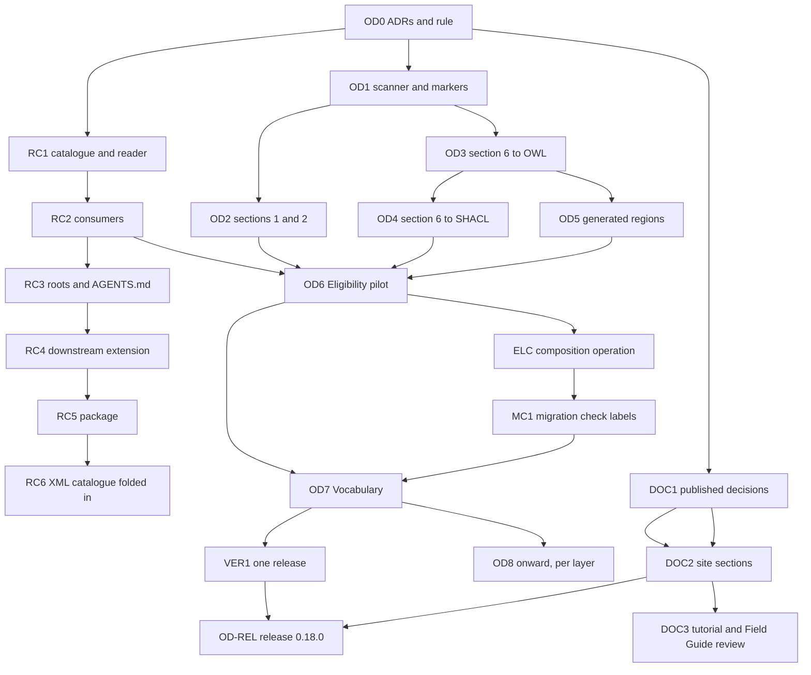

<!-- SPDX-License-Identifier: CC-BY-SA-4.0 -->

# Plan: Literate specifications, the repository catalogue, and published documentation

**Unit ID:** `improved-ontology-documentation` (slice prefixes `OD`, `RC` and `DOC`, questions `OD-Qn`)
**Status:** Planned, rewritten 2026-10-16 after the design discussion of 2026-10-15 and 2026-10-16. Not
started. Every design question is answered.
**Branch:** `docs/literate-v2`
**Sketches:** [improved-ontology-documentation.md](../sketches/improved-ontology-documentation.md),
[repository-catalogue.md](../sketches/repository-catalogue.md), which this unit absorbs
**Status record:** [improved-ontology-documentation.md](../status/improved-ontology-documentation.md)
**ADRs to draft as Proposed (OD0):** A121 *Repository catalogue*, A126 *Literate specification layout and
grammar* (with an addendum to ADR-A120), A127 *Published architecture decisions*. A121 is the number the
catalogue sketch reserved. Every number is re-checked against the
[catalogue](../../architecture/decisions/README.md) before filing. The last slice needs a further ADR that
supersedes part of ADR-A88.
**Constraints kept:** ADR-A86 and the versioning policy are unchanged (generated Turtle stays tracked and
versioned). Examples stay hand-written and committed first (ADR-A-C2).

## What we are building

1. **One layout for every module README**, whose normative sections are compiled to Turtle and SHACL from a
   markdown grammar, so a term's axioms are written once. `turtle-spec` blocks remain only for what the grammar
   cannot say.
2. **The repository catalogue**, with each module's entry in its own README (section 3) and one root file for
   the rest, read by one module that every tool uses.
3. **A sources discipline for user-facing documentation, and a site built from declared sections.**
   READMEs, generated Turtle and user guides never refer to working documents, and cite only published ADRs.

## Decisions

Decided by the maintainer on 2026-10-15 and 2026-10-16. The status record's log holds the history.

| # | Decision |
|---|---|
| OD-D1 | Generated Turtle stays tracked in git. Untracking it is dropped |
| OD-D2 | Every module README takes the layout below. A normative section binds, and where it disagrees with a non-normative one, it wins. Overview and Detailed Design never introduce an axiom. A layer adds no top-level section of its own. Non-normative material goes into a subsection of Detailed Design or Open Issues |
| OD-D3 | Section 6 entries are the only source of a term's axioms. The Axiom Index and the Overview's class diagram are generated into the README and kept current by `--check` |
| OD-D4 | A restriction row states where it is asserted: OWL and SHACL (the default), OWL only, or SHACL only |
| OD-D5 | One name, `output-file`, in two forms: the `# @output-file` line of a fenced block (ADR-A120) and a JSON key in an HTML comment |
| OD-D6 | Examples stay hand-written files and never move into READMEs |
| OD-D7 | Dublin Core terms are declared locally as annotation properties with the `dct:` prefix, as MORK does, never imported. Section 1 becomes the ontology's `dct:description` |
| OD-D8 | Alignments hold normative axioms. They move into section 6 before the rest becomes Dependencies |
| OD-D9 | Each layer's first regeneration is one PATCH bump and release, checked by graph isomorphism against the current Turtle except for recorded reconciliations |
| OD-D10 | The 76 restrictions asserted in OWL with no shape today migrate as OWL only. No shape is added by migration |
| OD-D11 | HTML comment markers do four things: exclude text, hide a fenced block, set `output-file` for a region, and mark a region the extractor generates |
| OD-D12 | An extra annotation is a further labelled paragraph, for example `**Scope note.**` for `skos:scopeNote` |
| OD-D13 | Creators and contributors are identified by IRI, an ORCID iD where the person has one, their GitHub profile otherwise. No legal name appears in the repository or a generated artefact without that person's express permission. The table sits in section 2 |
| OD-D14 | Section 3 carries the module's catalogue entry (RC-Q1 option C). Modules that are not literate get one too, and should become literate in the mid to long term |
| OD-D15 | Every class expression is OWL Manchester syntax with CURIEs. SHACL is generated only for a restriction row's flat forms. A nested expression must be marked OWL only |
| OD-D16 | Literals use Turtle's forms. `rdfs:label` comes only from a `**Label.**` line |
| OD-D17 | Extracted markdown becomes plain text. Links become their text and an absolute URL at the release tag derived from the section 2 version |
| OD-D18 | Generated Turtle is sorted by subject, then by a fixed predicate order |
| OD-D19 | Sections are found by title. A numeral that differs from the layout is a warning, printed in yellow. An empty subsection keeps its heading and says "None." |
| OD-D20 | The shared conventions live in `docs/architecture/literate-specifications.md`, which every README's section 3 and the tool documents link to |
| OD-D21 | User-facing documents (READMEs, generated Turtle, user guides) never refer to developer documents (sketches, plans, status records, review requests, Validation Packs) and cite only published ADRs. An agent rule in AGENTS.md and ADR A127 state it |
| OD-D22 | Narrative sections draw on published ADRs, the architecture documents and the layers' own docs. Content moves, and the old place keeps a link |
| OD-D23 | Migration order: Eligibility (the pilot), Vocabulary (with its TD-16 reconciliation), Quantification, Surface, Behaviour, Wording, then Foundation and Party after their part of TD-16. TD-20 runs when convenient, since a migrated README states each term once |
| RC-Q1, Q2 | Option C, TOML read with `tomllib` |
| RC-Q3 | Option C: locations, structural facts (extraction contracts, versioned roles) and the layer import order, flexible enough for any mix of imports in an applied ontology |
| RC-Q4 | Option A: roles and directories, with named extras |
| RC-Q5 | Option C: a module in `tools/` now, promoted to a package later. It works inside each worktree's own `.venv`, and the promoted package can be pinned to different versions on different branches of a downstream project |
| RC-Q6 | AGENTS.md's "Where things are" table is generated from the root file |
| RC-Q7 | Downstream projects can extend the catalogue |
| RC-Q8 | `repository-catalogue.md` at the root, fence tag `` ```toml repository-catalogue ``, package `lattice-repo-catalogue` (module `lattice_repo_catalogue`). The documentation keeps it distinct from ADR-A88's XML catalogue, which a last slice may fold into it |
| OD-D24 | Two ADRs for layout and catalogue (A126, A121), and a third for published decisions (A127) |
| OD-D25 | A published ADR keeps its developer references only in a closing "Provenance" section, which the sources check ignores. Every other published artefact carries none (OD-Q14) |
| OD-D26 | Release Notes are checked, not extracted. Every version named in section 2, and every released version, has an entry. Notes say what changed and cite only published ADRs, never a slice. Existing notes are rewritten as each layer migrates (OD-Q16) |
| OD-D27 | Section numbers are fixed. An absent optional section keeps its heading and says "Not applicable.", as an empty subsection says "None." (OD-Q16) |
| OD-D28 | Durable developer guidance (for example `getting-started.md`, `formal-methods-lifecycle.md`) may be linked from user-facing documents. It stays under `docs/developer/`, where a reader of the repository looks for it. The sources rule of OD-D21 forbids working documents only. Its check reads every line of a user-facing document, HTML comments and hidden blocks included, since a reader of the file on GitHub sees them and a hidden block's Turtle reaches a generated file |
| OD-D29 | The root catalogue declares the site's sections, each with a title, a page, a layout, an order and its sources. A `mise` task copies sources from outside `docs/` into `docs/_includes/<section>/`, tracked and checked (OD-Q15a option A). Moving to a Pages workflow later is TD-50 |
| OD-D30 | The site publishes declared sections only. Working documents are excluded in `_config.yml`, Proposed ADRs carry `published: false` until A127 publishes them, and durable developer guidance forms a Contributing section (OD-Q15b option c) |
| OD-D31 | Sections: Home, Tutorial, Field Guide, Theory, Layer specifications, Architecture, Decisions, Operations, Glossary, Contributing. Every page in a section takes its layout through Jekyll `defaults`. Once the tutorial merges, it is reviewed against the Field Guide, which may become an operations guide (setting up services and databases, using the design-time and runtime tools) while the tutorial explains what everything is (DOC3) |
| OD-D32 | This branch is merged into `main` before the pilot, and work continues on it once it sits on `main`'s commit (B-Q1) |
| OD-D33 | A reusable task proves a migration leaves each generated file the same graph as at a git ref (OD6-Q1) |
| OD-D34 | Enumeration, Manchester's `{ a, b }`, joins the grammar. In OWL it is an enumerated class (`[ a owl:Class ; owl:oneOf ( a b ) ]`, for example in `**Equivalent to.**`) or, for literals, an enumerated data range. In SHACL, `only { a, b }` maps to `sh:in`. Eligibility's two `sh:in` shapes migrate as rows checked in SHACL only, so no OWL axiom is added (OD6-Q2) |
| OD-D35 | An individual needing more than the 6.4 table's columns is written whole in a section 6.6 `turtle-vocab` block (OD6-Q3) |
| OD-D36 | Eligibility's creators and contributors table names the maintainer's GitHub profile, `https://github.com/hyperthunk`, with the display name "T. R. Watson", given with the maintainer's express permission on 2026-10-18. The display name stays in the README and is never written to a generated file (OD6-Q4) |
| OD-D37 | Unpublished ADRs are hidden from the site by a Jekyll `defaults` entry setting `published: false` for the decisions directory, and each published ADR says `published: true`. Most directories of `docs/` should be unpublished unless the site uses them, recorded as technical debt for a website sketch (DOC1-Q1) |
| OD-D38 | DOC1 prepares and publishes only the ADRs the migrated Eligibility README cites. The rest are published as each layer migrates (DOC1-Q2) |
| OD-D39 | A published ADR names the architecture documents that describe it in a `**Described in:**` header field. Moving ADR metadata from header fields to a table is technical debt (DOC1-Q3) |
| OD-D40 | AGENTS.md's "Where things are" table keeps its columns, Root and Owns, and is generated from the root file (RC3-Q1) |
| OD-D41 | The bypass scan's known exceptions are a text file beside the reader, `tools/lattice_repo_catalogue_exceptions.txt`, each with a reason, in a list that may only shrink. One technical debt row names the file and gives its count, which the scan checks (RC3-Q2, option b) |
| OD-D42 | A migrated layer's terms each have a definition. Where a term has none today, we draft it from what the README already says, the maintainer reviews it, and the migration check lists the new `rdfs:comment` as an approved reconciliation (OD6-Q5, option a) |
| OD-D43 | Versions are not bumped or re-pinned per migration. On this branch, migrated layers' documents change without new version IRIs and their importers stay pinned to the old ones, so the branch's versions are knowingly inconsistent. Before the merge into `main`, one release slice bumps every changed document once, re-pins every importer once, and adds the release rows and notes (OD6-Q6, option b) |
| OD-D44 | `elg:CompatibilityOperation` becomes `elg:CompositionOperation`, and `elg:compatibilityOperation` becomes `elg:compositionOperation`. It is declared on admission profiles only, where it says how a profile combines its conditions' outcomes, and no longer on every condition, where it had no effect. L2 and `elg:ConditionShape` change to match (OD6-Q7a, option c, and OD6-Q7b) |
| OD-D45 | `elg:DimensionConsistent` is retired, with the operational profile `elg:E6` that tested it. It was meant to check that conditions on different dimensions are compatible before they are combined, which is a precondition, not a way of composing outcomes. It has no evaluable definition and every compiler refuses it. A downstream ontology that needs such a check adds its own operation, as ADR-A05 allows (OD6-Q7c) |
| OD-D46 | A shape refuses a composition operation on a condition that is not an `elg:AdmissionProfile`, and a match strategy or wildcard policy on a profile. L1 and L3 apply to conditions that are not profiles, L2 to profiles. No new class names a condition that is not a profile (ELC-Q1, ELC-Q2) |
| OD-D47 | A published ADR may cite an Accepted one. Its link then points at the ADR on GitHub at the release tag, since the site hides unpublished ADRs. READMEs and site pages still cite only published ADRs. ADR-A127 decision 4 is amended (DOC1-Q4, option a) |
| OD-D48 | A layer README counts as an architecture document in a published ADR's Described in field (DOC1-Q5) |
| OD-D49 | A published ADR's status line reads `**Status:** Published, YYYY-MM-DD. Accepted YYYY-MM-DD.`, and an ADR written with a Status section moves to the header form when published (DOC1-Q6) |
| OD-D50 | We prepare the ADRs to publish, and the maintainer approves the list. For DOC1 the maintainer approved in advance on 2026-10-19, subject to review before the branch is pushed (DOC1-Q7, option a) |
| OD-D51 | The bypass scan covers tools under `tools/` and not their tests until after RC4. ADR-A121 decision 5 is clarified to say so (RC3-Q3, option c) |
| OD-D52 | Each `roots` and `docs` entry in the root file carries its row's text for AGENTS.md and an optional group. The table is generated between region markers in AGENTS.md, and `build:agent-guidance` then writes Copilot's file as before (RC3-Q4) |
| OD-D53 | The `generated` block lists paths a check may find missing, for example `.build/`, `docs/_site/` and the reasoner jar. Files a README generates stay under `extract` (RC3-Q5) |
| OD-D54 | The branch is cut after MC1, OD7, VER1, DOC2 and OD-REL, and merged into `main`. The other layers migrate on later branches (NX-Q1, option a) |
| OD-D55 | One release for the substrate's ontologies: every versioned document and every shape and projection directory of the substrate carries the release's number, and a change anywhere is a new release of all of them. Each release note classes every change by its effect on a graph valid under the previous release (no effect, may invalidate, changes meaning). A "changes meaning" change ships a migration once an adopter holds production data. Supersedes ADR-A86's per-document versions, by a new ADR (REL-Q1, option C with D's classification, REL-Q6) |
| OD-D56 | The applied ontologies are not in the substrate's release and pin a substrate release (REL-Q2, option b). Whether the standalone modules join it is REL-Q2a, open, since MORK, Surface and Persistence import or use substrate terms today |
| OD-D57 | Imports name the same release's version IRIs, rewritten by the release task, so a document says what it was released with and the import guard keeps working (REL-Q3) |
| OD-D58 | The first release is 0.18.0, past every document's own version (REL-Q4) |
| OD-D59 | The `.version` files of shape and projection directories go, and the release number is read from one place, the repository catalogue's conventions (REL-Q5) |
| OD-D60 | Vocabulary's README takes its spec file's graph where the two disagree: the ontology header, `rdf:Property a owl:Class`, the order of one disjointness list and the direction of one `disjointWith` (NX-Q3) |
| OD-D61 | Later migrations, on later branches, take the order Foundation, Party (closing TD-16), Quantification, Wording, Behaviour, then Instrument in two slices, one per spec document. Each includes the publication pass for the ADRs its README cites. Surface and the other literate standalone modules follow. Amends OD-D23's order (NX-Q4) |
| OD-D62 | MC1, OD7, VER1, DOC2 and OD-REL are built autonomously with local commits, using Sonnet sub-agents where a slice is mechanical or separate (NX-Q5) |
| OD-D63 | MORK, SPC, Surface and Persistence join the substrate's release, since they are tested at the same commit. MORK's `Executable.ttl` imports Eligibility explicitly, rather than using its terms undeclared (REL-Q2a, option a) |

## The README layout

| § | Section | Required | Extracted to |
|---|---|---|---|
| 1 | Purpose and Scope | yes | the ontology's `dct:description` |
| 2 | Namespace and Prefixes | yes | prefixes, the ontology header (IRI, version, imports) from a table, `dct:creator` and `dct:contributor` from the contributors table, the Dublin Core declarations |
| 3 | Extraction Contract | yes | the module's catalogue entry (a TOML block). Prose says only what is specific to the module and links to the conventions document |
| 4 | Overview | yes | nothing. Holds the generated class diagram |
| 5 | Detailed Design | yes | nothing |
| 6 | Description Logic Encoding | yes | spec and vocab documents. 6.1 Classes, 6.2 Object Properties, 6.3 Datatype Properties, 6.4 Individuals, 6.5 Disjointness and Keys, 6.6 Other Axioms, 6.7 Axiom Index (generated) |
| 7 | Shapes | yes | shape files. The structural file is generated from section 6, the others come from blocks here |
| 8 | Examples | yes | nothing. Narrative and links to the example files |
| 9 | Canonicalisation | optional | nothing. Normative prose |
| 10 | Formalisation | optional | `isabelle-spec` blocks to `tools/proofs/<layer>/Kernel.thy`, and their `fun` clauses to `_kernel_defs.py` |
| 11 | Dependencies | yes | nothing |
| 12 | Release Notes | yes | nothing. Checked against section 2 and the release register (OD-D26) |
| 13 | Open Issues | yes | nothing |

Normative sections are 1, 2, 3, 6, 7, 9, 10 and 12. An absent optional section keeps its number (OD-D27).

## The section 6 grammar

Everything is line-based so the extractor stays standard-library only. An entry is a `####` heading holding
one CURIE, followed by labelled paragraphs and tables. An unknown label is an error.

| Label | Applies to | Produces |
|---|---|---|
| `**Definition.**` | every term, required | `rdfs:comment` |
| `**Utility.**` | every term | `fnd:utility` |
| `**Label.**` | every term | `rdfs:label` |
| `**Subclass of.**` | class | `rdfs:subClassOf`, one per comma-separated Manchester expression |
| `**Equivalent to.**` | class | `owl:equivalentClass`, one Manchester expression |
| `**Key.**` | class | `owl:hasKey` |
| `**Restrictions.**` | class | the restriction table below |
| `**Domain.**`, `**Range.**` | property | `rdfs:domain`, `rdfs:range`, Manchester expressions (`A or B` gives a union) |
| `**Characteristics.**` | property | functional, inverse functional, transitive, symmetric |
| `**Inverse of.**`, `**Subproperty of.**` | property | `owl:inverseOf`, `rdfs:subPropertyOf` |
| `**Scope note.**` and further labels | any term | the matching annotation property (OD-D12) |

The restriction table has the columns Property, Values, Asserted in and Message. Values is the body of a
Manchester restriction:

| Values | OWL | SHACL, when asserted there |
|---|---|---|
| `exactly n`, `min n`, `max n` | `owl:cardinality`, `minCardinality`, `maxCardinality` | `sh:minCount`, `sh:maxCount` |
| `exactly n C`, `min n C`, `max n C` | the qualified forms with `owl:onClass` | `sh:qualifiedValueShape [ sh:class C ]` with the qualified counts |
| `only C` | `owl:allValuesFrom` | `sh:class` or `sh:datatype` |
| `some C` | `owl:someValuesFrom` | a qualified minimum of 1 |
| `value v` | `owl:hasValue` | `sh:hasValue` |
| anything nested | the expression | refused unless the row says OWL only |

A blank Asserted in cell means OWL and SHACL. Generated SHACL goes into one `<Class>Shape` per class in the
module's structural shapes file. Section 6.4 lists individuals in a table per class (Individual, Type, Label,
Definition). Section 6.6 holds `turtle-spec` blocks, hidden or not, for what the grammar does not carry. Today that
is four property chains and four `owl:AllDifferent` axioms.

### Markers

Regions open with `<!-- start: {...} -->` and close with `<!-- end -->`, which closes the innermost open
region. A hidden block is one comment wrapped around a fence, `<!-- hidden` or `<!-- hidden: {...}`, closed
by `-->`. Keys are `exclude` (boolean), `output-file` (a path in the module) and `generated` (the name of a
generated region). Unknown keys are errors. A marker inside any fenced block is text. The extractor refuses a
hidden block with both `output-file` forms, a hidden block containing `-->`, and a hidden mermaid block.

## Constraints found in the review

- **TD-16.** Foundation, Vocabulary and Party are not the source of their documents today. Vocabulary's
  `spec/vocabulary.ttl` is in Protégé's layout and differs by 8 and 13 triples.
- **The scanner is not fence-aware.** `parse_blocks` knows only its own fence tags, and
  `check_formal_freshness.py` imports `parse_blocks` and `plan`.
- **Definitions are written twice today and have drifted**, for example `fnd:Version`'s Utility paragraph and
  its `fnd:utility` string.
- **Practice differs by layer.** Instrument checks 91 counts in SHACL with no OWL restriction, and
  Quantification asserts 50 in OWL with no shape.
- **CCS C6 has already merged** (2026-10-04, Instrument 0.9.0) without markers. Its plan's note that markers
  wait for this plan is now moot. The Instrument README (6,322 lines) migrates in this unit. CCS slices still
  planned that touch migrated READMEs (C9b3 and C9b4 on Eligibility, C8a, C9c and C9d on Instrument, C16c on
  Party) are coordinated in the status record. Whichever lands second adopts the other's format.
- **Release notes** exist in six layers. Party, SPC, Vocabulary and Surface have none. Existing notes cite
  developer slices (for example "CCS C9b2"), which OD-D21 forbids.

## Slices

Each slice delivers a Validation Pack and its documentation change. Levels follow the lifecycle skill.
Estimates are in tokens.

| Slice | Scope | Modules | Levels | Estimate |
|---|---|---|---|---|
| OD0 | Draft A121, A126 and A127 as Proposed. The AGENTS.md rule of OD-D21, regenerated with `build:agent-guidance`. `literate-specifications.md` started | `docs/`, AGENTS.md | L0 | 60k |
| RC1 | Root `repository-catalogue.md` (conventions, modules, import order), the reader `tools/lattice_repo_catalogue.py`, a section 3 entry for every module, literate or not, and the check that entries match the tree | `tools/`, module READMEs (section 3 only) | L1, L3 | 80k |
| RC2 | Consumers move to the reader: `literate_extract.py` reads its contract from section 3 (no `--shapes`), the per-layer tests, `import_guard.py`, `ontology_version_check.py`, `check_formal_freshness.py` | `tools/` | L1, L4 | 70k |
| RC3 | Roots, tool packages, docs and generated outputs in the root file, AGENTS.md's table generated from it, and the bypass scan, report-only. Brief below Built 2026-10-19, [Validation Pack](../validation/RC3.md) | `tools/`, AGENTS.md | L1, L3 | 60k |
| OD1 | A fence-aware scanner, sections by title with the numeral warning, markers and hidden blocks, both `output-file` forms. Every current README extracts byte for byte as before | `tools/` | L1, L3 | 60k |
| OD2 | Section 1 and 2: the header and prefix tables, the contributors table, the Dublin Core declarations, `dct:description` rendered as plain text with tag links, and the layout check's rule that a migrated README's catalogue entry sits in section 3 (RC1-C5) | `tools/` | L1, L2 | 50k |
| OD3 | Section 6 to OWL: entries, labels, a Manchester parser for the subset in use, sorted output | `tools/` | L1, L2, L3 | 90k |
| OD4 | Section 6 to SHACL: restriction rows into the structural shapes file, OWL only and SHACL only | `tools/` | L1, L3 | 50k |
| OD5 | Generated regions: the Axiom Index and the Overview's class diagram (ORM verbalisation, no composition arrows), written in place and checked | `tools/` | L1, L4 | 50k |
| OD6 | Pilot: Eligibility migrated to the layout and grammar, with the migration check and the grammar's enumeration. Brief below | `ontology/eligibility`, `tools/` | L3, L4, L5 | 110k |
| OD7 | Vocabulary migrated, with its TD-16 reconciliation listed and approved, and release notes rebuilt from git history, plans and status records | `ontology/vocabulary` | L4, L5 | 80k |
| OD8 onward | One slice per layer in the order of OD-D23. A layer with no release notes gets them rebuilt from history in its slice (Party, SPC, Surface). Instrument is split into two or three slices | one module each | L4, L5 | 50k to 150k each |
| DOC1 | Published decisions (A127): the Published status, the generated list, the sources check, unpublished ADRs hidden from the site, and the ADRs Eligibility cites published. Brief below Built 2026-10-19, [Validation Pack](../validation/DOC1.md) | `docs/`, `tools/` | L1, L3 | 80k |
| DOC2 | Site sections (OD-D29 to OD-D31): the `site` block in the root catalogue, the copy task and its check, `_config.yml` exclusions and `defaults`, `published: false` on Proposed ADRs, the tutorial spine's authoring note repointed from its plan to the conventions document, and the stray working notes in `docs/` moved or retired with the maintainer's say on each | `docs/`, `tools/` | L1, L3 | 70k |
| DOC3 | Tutorial and Field Guide review, after `lattice-tutorial` merges: overlap mapped chapter by chapter, and options put to the maintainer, including the Field Guide as an operations guide | `docs/` | L0 | 40k |
| RC4 | Downstream extension (RC-Q7): qualified names and an `extends` chain, tried against Open CBAA's layout. Then the extractor reads the catalogue for every extraction and fails when the files a README generates differ from its entry (RC2-C2 option b, deferred to here) | `tools/` | L1, L4 | 60k |
| RC5 | Promotion to the `lattice-repo-catalogue` package, installable into each worktree's `.venv` and pinnable by version per branch downstream | `packages/`, `tools/` | L0, L4 | 50k |
| RC6 | The XML catalogue (ADR-A88) folded into the repository catalogue, under a new ADR, with release and version management read from the same place | `tools/`, `ontology/` | L3, L4 | 80k |
| ELC | The composition operation (OD-D44, OD-D45). Built 2026-10-19, [Validation Pack](../validation/ELC.md). Brief below | `ontology/eligibility`, `ontology/instrument`, other modules' examples, `tools/mork_compilers`, `test/` | L3, L4 | 70k |
| MC1 | The migration check labels each blank node by its own subtree (TD-55), so a reconciliation lists only what changed. Brief below Built 2026-10-19, [Validation Pack](../validation/MC1.md) | `tools/` | L1 | 20k |
| VER1 | One release for the substrate (OD-D55 to OD-D59): the ADR, the release number in the catalogue, the versioning check and the release register by release, the release task that rewrites the number, the `.version` files removed, and release notes with each change's data class. Brief below | `tools/`, `docs/architecture/`, `repository-catalogue.md` | L1, L3 | 90k |
| OD-REL | The first release, 0.18.0, made with VER1's task (OD-D43, OD-D55). Every substrate document takes 0.18.0, the applied modules re-pin to it, release notes per layer with each change's data class, Eligibility's laws L1 to L8 gain `elg:lawRegister elg:StaticConstraint`, and every check passes again. The maintainer creates the tag. Brief below | every substrate module, the applied modules | L3, L4 | 60k |



DOC1 runs before the migrations reach their narrative sections, since OD-D21 and OD-D22 decide what those
sections may cite. Slice sizing follows the lifecycle rule. A slice that grows past about 15 tests or two
modules splits.

## Briefs for MC1, OD7, VER1, DOC2 and OD-REL (2026-10-19)

The order is MC1, OD7, VER1 and OD-REL, with DOC2 alongside in its own worktree. The branch is then merged into
`main` (OD-D54). The [release model sketch](../sketches/ontology-release-model.md) and the
[release bundles sketch](../sketches/release-bundles.md) explain VER1 and what follows it.

### MC1, blank nodes labelled by their subtree

**Scope.** `tools/literate_migration_check.py` labels each blank node by a digest of its own subtree, the triples
reachable from it, rather than by `to_isomorphic`'s whole-graph labels. A change to one shape then leaves every
other blank node's label alone (TD-55, closed). ELC's reconciliation file is regenerated and shrinks to what
ELC changed.
**Validation.** A test adding one shape to a file of several shows only that shape's triples. OD6-T6 and OD6-T7
still pass. A blank node shared by two subjects keeps one label.

### OD7, Vocabulary

**Scope.** Vocabulary's README in the layout, as Eligibility's (OD6). Its graph is the spec file's (OD-D60).
Its three shape files come from the README: structural shapes from the §6 tables where they fit, and the rest,
with `rules.ttl`'s comment-only body, as hidden §7 blocks naming their files. The catalogue entry gains the
shapes. Its 11 terms all have definitions. It cites one ADR, ADR-A121, which is published. Release notes are
rebuilt from git history, plans and status records, without slice references.
**Validation.** The migration check against the commit before OD7, with the reconciliations listed, Vocabulary's
tests and examples, the sources check failing on nothing, and `--check` for the layer added to the per-layer
extraction test.

### VER1, one release for the substrate

**Scope.**

1. **An ADR**, Proposed, superseding ADR-A86's per-document versioning and amending ADR-A113 to apply to the set
   (OD-D55 to OD-D59). The maintainer accepts it.
2. **The release number** in the catalogue's conventions, read through the reader. The substrate's modules are
   the release's members. The standalone modules MORK, SPC, Surface and Persistence are members too (OD-D63), and `Executable.ttl` gains its import of Eligibility.
3. **`tools/ontology_version_check.py`** fails when any member's content changed and the release number did not,
   and when a member's version IRI or import names another number.
4. **`tools/ontology_releases.py`** writes one register row per release with its documents. The existing rows
   stay as history.
5. **A release task**, `mise run release:prepare -- <version>`, rewrites every member's version IRIs and imports,
   the READMEs' section 2 tables, and the applied modules' imports of the substrate, in one substitution, then
   regenerates the catalogs. It prints the tag for the maintainer to create.
6. **The `.version` files** of the substrate's shape and projection directories are removed, and the checks read
   the release number instead.
7. **Release notes** gain the data class column (no effect, may invalidate, changes meaning), and the conventions
   document says so.

**Validation.** A rehearsal on a copy of the tree: the release task at 0.18.0, then every check passing. Tests
for the versioning check (a changed member without a new number fails, a stray number fails) and for the task.

### DOC2, site sections

As its row says (OD-D29 to OD-D31), plus the decisions index page linking only published ADRs. It touches
`docs/`, the root catalogue's site block and a copy task, and runs in a Sonnet sub-agent's worktree cut from
this branch.

### OD-REL, the first release

**Scope.** VER1's task at 0.18.0 over the substrate. Eligibility's L1 to L8 gain their register. Each layer's
release notes gain an entry for 0.18.0 with every change since its last release and each change's data class.
ELC's rename is a "changes meaning" change, whose migration is the rewrite script ELC used, kept with the
release. The applied modules re-pin to 0.18.0. The versioning, catalogue and published decisions checks pass,
and the full sweep with them.
**Not covered.** Bundles, until the release bundles sketch is answered. The tag, which is the maintainer's.

## Briefs for OD6, DOC1 and RC3 (2026-10-18)

The order is OD6, then DOC1 and RC3 in either order. This branch is merged into `main` first (OD-D32).

### OD6, the Eligibility pilot

**Scope.**

1. **The migration check (OD-D33).** `tools/literate_migration_check.py` and `mise run check:literate-migration
   -- <module> <git ref>`. For every file the module's catalogue entry says its README generates, it parses the
   file in the working tree and at the ref and compares them with `rdflib.compare.isomorphic`, reporting each
   difference as triples only in one or the other. A listed reconciliation, a file of expected differences
   beside the module's Validation Pack, turns a difference into a pass. It is reused by every later migration.
2. **Enumeration in the grammar (OD-D34).** Manchester's `{ a, b }` in the parser:
   - individuals give `[ a owl:Class ; owl:oneOf ( a b ) ]`, so `**Equivalent to.** { ex:One, ex:Two }` states
     an enumerated class
   - literals give `[ a rdfs:Datatype ; owl:oneOf ( ... ) ]`
   - `only { a, b }` maps to `sh:in ( a b )` in SHACL
   - the Axiom Index writes it back as `{ a, b }`, and the diagram as "one of a, b"
   - comma splitting in labels respects braces as it respects parentheses

   This removes `oneOf` from the unplanned backlog.
3. **The migration of `ontology/eligibility/README.md`** into the 13 sections:
   - **§2 and §3:** the header, prefix and contributors tables (OD-D36), and the catalogue entry in §3.
   - **Overview:** today's Core Model introduction, with the generated class diagram replacing the hand-drawn
     one.
   - **Detailed Design:** today's Strategy Algebra, the parts of the Core Model and the closures as
     subsections.
   - **§6:** every class and property as an entry, the restriction tables (the two `sh:in` rows checked in
     SHACL only), and L1 to L8 in a 6.4 table. L9 onwards, and anything else the grammar cannot state, go in
     6.6 blocks (OD-D35).
   - **Shapes:** constraints and rules as hidden blocks that name their files, and structural generated.
   - **Canonicalisation, Formalisation (its `isabelle-spec` block), Dependencies, Release Notes and Open
     Issues** follow.
   - **Release notes** are rewritten to say what changed and cite ADRs, with no slice references.
4. **Versions (OD-D43).** No bump on this branch. Eligibility's documents change without new version IRIs, and
   `check:ontology-versioning` reports them until the release slice OD-REL. The 32 terms with no definition gain
   one each (OD-D42), drafted from the README and reviewed by the maintainer.

**Validation.**

- **The migration check:** `check:literate-migration -- eligibility <the merge commit>` passes, with any
  reconciliation listed and approved.
- **Existing tests:** Eligibility's README test, the freshness check (its Kernel), the reference semantics and
  the example tests pass unchanged.
- **New tests:** grammar tests for enumeration (OWL classes and data ranges, SHACL `sh:in`, the views, the
  refusals), and tests of the migration check (an identical graph passes, a changed triple fails naming it, a
  listed reconciliation passes).
- **Probe:** change one restriction row in the migrated README and show the migration check fail.

**Not covered.** Vocabulary's migration (OD7), and TD-20's rename.

### ELC, the composition operation (2026-10-19)

**Scope.**

1. **Eligibility's README.** `elg:CompositionOperation` and `elg:compositionOperation` replace the old names,
   with definitions saying how an admission profile combines its conditions' outcomes. The restriction
   `compositionOperation exactly 1` moves from `elg:Condition` to `elg:AdmissionProfile`. L2 is restated for
   profiles. `elg:DimensionConsistent` and `elg:E6` are removed, and §5's prose and diagrams follow. ADR-A05 is
   amended, and ADR-A03 gains an addendum for L2.
2. **Every graph that names the old terms.** Examples and tests in Eligibility, Instrument, the applied
   modules, Surface, Wording, MORK and `test/`: profiles rename the property, and leaf conditions drop it.
3. **The compilers.** `tools/mork_compilers` reads `elg:compositionOperation` from a profile, writes
   `exe:usesCompositionOperation`, and loses the `DimensionConsistent` refusal and its test. The reference
   semantics follows.
4. **Docs.** The glossary and the remaining architecture mentions.

**Versions.** None on this branch (OD-D43). The change is breaking, and OD-REL releases it with the migration.

**Validation.** The migration check against OD6's commit, with the renamed and removed triples as reconciliations,
every Eligibility, Instrument and compiler suite, and `check:full-sweep` with only OD-D43's unbumped files
failing.

ELC-Q1 and ELC-Q2 are answered as OD-D46, so a profile also stops declaring a match strategy and a wildcard
policy, and L1 and L3 are restated for conditions that are not profiles.

### DOC1, published decisions

**Scope.**

1. **The Published status (ADR-A127 decision 1).** The catalogue's convention paragraph already lists it.
   A published ADR's Status line reads `Published, YYYY-MM-DD`, and its header gains `**Described in:**` (OD-D39).
2. **The generated list.** `tools/published_decisions.py` writes `docs/architecture/published-architecture-
   decisions.md` from the Status and Described in lines, with a `--check` mode in `mise run check`.
3. **Hiding unpublished ADRs (OD-D37).** A `defaults` entry in `docs/_config.yml` sets `published: false` for
   `architecture/decisions/`, and each published ADR carries `published: true` front matter.
4. **The sources check (ADR-A127 decision 4).** `tools/sources_check.py` reads every line of every user-facing
   document (layer READMEs, generated ontology documents, published ADRs outside their Provenance section). It
   fails on a reference to a working document, and on a citation of an unpublished ADR in a migrated README.
   It reports, without failing, a citation of an Accepted ADR in an unmigrated README, which is the transition.
5. **The first publication pass (OD-D38).** The ADRs the migrated Eligibility README cites are prepared: their
   references to working documents move into Provenance, and their Described in is filled. The maintainer
   publishes each one.

**Validation.**

- **The list generator:** writes the list, then finds no drift.
- **The sources check:** a working-document link in a README fails, the same link in a published ADR's
  Provenance passes, an unpublished citation in a migrated README fails, and the same in an unmigrated one is
  reported.
- **The site:** a local `serve:jekyll` build hides an unpublished ADR and shows a published one.

**Not covered.** Site sections and the wider exclusion of working documents (DOC2, and the website sketch of
TD-53). Publishing ADRs no migrated README cites.

### RC3, the rest of the catalogue

**Scope.**

1. **The root file's other blocks.**
   - `roots`: each root, what it owns and its ADRs
   - `tools`: each tool package's path, import name and the paths it reaches outside its own tree
   - `docs`: the documentation areas
   - `generated`: generated outputs marked so no check depends on them

   The reader and its schema take them.
2. **AGENTS.md's table (OD-D40).** "Where things are" is generated from `roots` by `build:agent-guidance`, with
   its columns unchanged, and `check:agent-guidance` fails when it is stale.
3. **The bypass scan, report-only.** It flags Python under `tools/` that builds a path to a catalogued root
   itself. Known exceptions are listed with a reason each, in a list that may only shrink. The list is a text
   file beside the reader, with one technical debt row giving its count, which the scan checks (OD-D41).

**Validation.**

- **The schema:** refusals for the new blocks.
- **The generated table:** equal to today's table, and failing when stale.
- **The scan:** a planted bypass found, an exception listed, a fixed exception failing until removed from the
  list, and a technical debt row whose count is wrong failing.

**Not covered.** The scan failing rather than reporting, which comes once tools have moved. Downstream
extension (RC4).

## Validation

- **No migration changes meaning.** Each migrated layer's generated graph is isomorphic to its current one
  (`rdflib.compare`), except for listed reconciliations the maintainer approves.
- **No output change before migration.** OD1 to OD5 leave every current README's extraction byte for byte
  unchanged.
- **Determinism.** Extraction is idempotent, and the output does not depend on the order of entries in a
  README.
- **Negative cases first.** Each slice's tests include refusals: an unknown label or key, an unterminated
  region, a nested expression asserted in SHACL, a hidden block holding `-->`, a contract that disagrees with
  the tree, a citation of an unpublished ADR or a developer document.
- **Non-weakening.** The per-layer `--check` tests are kept until RC2 replaces their arguments, and then
  test the same property.
- **Commands.** Every command runs through mise, for example
  `mise exec -- python -m pytest tools/test_literate_extract.py`. Each Validation Pack gives its one command
  and what a pass looks like.

## Open questions

None. Every question was answered by 2026-10-16.

## Unplanned backlog

Work this unit found and does not plan. Each is a small addition when a layer needs it, and until then a
layer can state it in a `turtle-spec` block in section 6.6.

| Item | From | Note |
|---|---|---|
| A union of datatypes in a property's range | OD3, decision 10 | today it would be written as a class union. Needs `rdfs:Datatype` with `owl:unionOf` |
| The property characteristics asymmetric, reflexive and irreflexive | OD3, decision 10 | no layer uses them |

## Deliberate non-coverage

- Untracking generated Turtle (OD-D1).
- Converting diagrams to Turtle. A Turtle-to-mermaid generator beyond OD5's class diagram would need its own
  sketch.
- Making Persistence, MORK, the applied modules and Governance literate. They get catalogue entries only.
- Closing TD-16 and TD-20, beyond Vocabulary's reconciliation in OD7.

## Token estimate

About 1.8M tokens across the unit: about 570k for OD0 to OD5 and RC1 to RC3, about 170k for the two
pilots, about 700k for the remaining migrations, and about 370k for DOC1 to DOC3 and RC4 to RC6.
