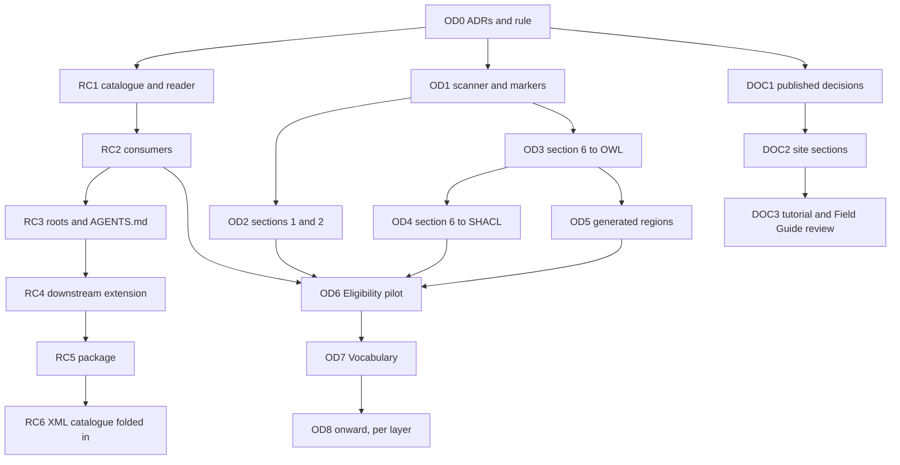

<!-- SPDX-License-Identifier: CC-BY-SA-4.0 -->

# Plan: Literate specifications, the repository catalogue, and published documentation

**Unit ID:** `improved-ontology-documentation` (slice prefixes `OD`, `RC` and `DOC`, questions `OD-Qn`)
**Status:** Planned, rewritten 2026-10-16 after the design discussion of 2026-10-15 and 2026-10-16. Not
started. Every design question is answered.
**Branch:** `docs/literate-v2`
**Sketches:** [improved-ontology-documentation.md](../sketches/improved-ontology-documentation.md),
[repository-catalogue.md](../sketches/repository-catalogue.md), which this unit absorbs
**Status record:** [improved-ontology-documentation.md](../status/improved-ontology-documentation.md)
**ADRs to draft as Proposed (OD0):** A121 *Repository catalogue*, A126 *Literate specification layout and
grammar* (with an addendum to ADR-A120), A127 *Published architecture decisions*. A121 is the number the
catalogue sketch reserved. Every number is re-checked against the
[catalogue](../../architecture/decisions/README.md) before filing. The last slice needs a further ADR that
supersedes part of ADR-A88.
**Constraints kept:** ADR-A86 and the versioning policy are unchanged (generated Turtle stays tracked and
versioned). Examples stay hand-written and committed first (ADR-A-C2).

## What we are building

1. **One layout for every module README**, whose normative sections are compiled to Turtle and SHACL from a
   markdown grammar, so a term's axioms are written once. `turtle-spec` blocks remain only for what the grammar
   cannot say.
2. **The repository catalogue**, with each module's entry in its own README (section 3) and one root file for
   the rest, read by one module that every tool uses.
3. **A sources discipline for user-facing documentation, and a site built from declared sections.**
   READMEs, generated Turtle and user guides never refer to working documents, and cite only published ADRs.

## Decisions

Decided by the maintainer on 2026-10-15 and 2026-10-16. The status record's log holds the history.

| # | Decision |
|---|---|
| OD-D1 | Generated Turtle stays tracked in git. Untracking it is dropped |
| OD-D2 | Every module README takes the layout below. A normative section binds, and where it disagrees with a non-normative one, it wins. Overview and Detailed Design never introduce an axiom. A layer adds no top-level section of its own. Non-normative material goes into a subsection of Detailed Design or Open Issues |
| OD-D3 | Section 6 entries are the only source of a term's axioms. The Axiom Index and the Overview's class diagram are generated into the README and kept current by `--check` |
| OD-D4 | A restriction row states where it is asserted: OWL and SHACL (the default), OWL only, or SHACL only |
| OD-D5 | One name, `output-file`, in two forms: the `# @output-file` line of a fenced block (ADR-A120) and a JSON key in an HTML comment |
| OD-D6 | Examples stay hand-written files and never move into READMEs |
| OD-D7 | Dublin Core terms are declared locally as annotation properties with the `dct:` prefix, as MORK does, never imported. Section 1 becomes the ontology's `dct:description` |
| OD-D8 | Alignments hold normative axioms. They move into section 6 before the rest becomes Dependencies |
| OD-D9 | Each layer's first regeneration is one PATCH bump and release, checked by graph isomorphism against the current Turtle except for recorded reconciliations |
| OD-D10 | The 76 restrictions asserted in OWL with no shape today migrate as OWL only. No shape is added by migration |
| OD-D11 | HTML comment markers do four things: exclude text, hide a fenced block, set `output-file` for a region, and mark a region the extractor generates |
| OD-D12 | An extra annotation is a further labelled paragraph, for example `**Scope note.**` for `skos:scopeNote` |
| OD-D13 | Creators and contributors are identified by IRI, an ORCID iD where the person has one, their GitHub profile otherwise. No legal name appears in the repository or a generated artefact without that person's express permission. The table sits in section 2 |
| OD-D14 | Section 3 carries the module's catalogue entry (RC-Q1 option C). Modules that are not literate get one too, and should become literate in the mid to long term |
| OD-D15 | Every class expression is OWL Manchester syntax with CURIEs. SHACL is generated only for a restriction row's flat forms. A nested expression must be marked OWL only |
| OD-D16 | Literals use Turtle's forms. `rdfs:label` comes only from a `**Label.**` line |
| OD-D17 | Extracted markdown becomes plain text. Links become their text and an absolute URL at the release tag derived from the section 2 version |
| OD-D18 | Generated Turtle is sorted by subject, then by a fixed predicate order |
| OD-D19 | Sections are found by title. A numeral that differs from the layout is a warning, printed in yellow. An empty subsection keeps its heading and says "None." |
| OD-D20 | The shared conventions live in `docs/architecture/literate-specifications.md`, which every README's section 3 and the tool documents link to |
| OD-D21 | User-facing documents (READMEs, generated Turtle, user guides) never refer to developer documents (sketches, plans, status records, review requests, Validation Packs) and cite only published ADRs. An agent rule in AGENTS.md and ADR A127 state it |
| OD-D22 | Narrative sections draw on published ADRs, the architecture documents and the layers' own docs. Content moves, and the old place keeps a link |
| OD-D23 | Migration order: Eligibility (the pilot), Vocabulary (with its TD-16 reconciliation), Quantification, Surface, Behaviour, Wording, then Foundation and Party after their part of TD-16. TD-20 runs when convenient, since a migrated README states each term once |
| RC-Q1, Q2 | Option C, TOML read with `tomllib` |
| RC-Q3 | Option C: locations, structural facts (extraction contracts, versioned roles) and the layer import order, flexible enough for any mix of imports in an applied ontology |
| RC-Q4 | Option A: roles and directories, with named extras |
| RC-Q5 | Option C: a module in `tools/` now, promoted to a package later. It works inside each worktree's own `.venv`, and the promoted package can be pinned to different versions on different branches of a downstream project |
| RC-Q6 | AGENTS.md's "Where things are" table is generated from the root file |
| RC-Q7 | Downstream projects can extend the catalogue |
| RC-Q8 | `repository-catalogue.md` at the root, fence tag `` ```toml repository-catalogue ``, package `lattice-repo-catalogue` (module `lattice_repo_catalogue`). The documentation keeps it distinct from ADR-A88's XML catalogue, which a last slice may fold into it |
| OD-D24 | Two ADRs for layout and catalogue (A126, A121), and a third for published decisions (A127) |
| OD-D25 | A published ADR keeps its developer references only in a closing "Provenance" section, which the sources check ignores. Every other published artefact carries none (OD-Q14) |
| OD-D26 | Release Notes are checked, not extracted. Every version named in section 2, and every released version, has an entry. Notes say what changed and cite only published ADRs, never a slice. Existing notes are rewritten as each layer migrates (OD-Q16) |
| OD-D27 | Section numbers are fixed. An absent optional section keeps its heading and says "Not applicable.", as an empty subsection says "None." (OD-Q16) |
| OD-D28 | Durable developer guidance (for example `getting-started.md`, `formal-methods-lifecycle.md`) may be linked from user-facing documents. It stays under `docs/developer/`, where a reader of the repository looks for it. The sources rule of OD-D21 forbids working documents only. Its check reads every line of a user-facing document, HTML comments and hidden blocks included, since a reader of the file on GitHub sees them and a hidden block's Turtle reaches a generated file |
| OD-D29 | The root catalogue declares the site's sections, each with a title, a page, a layout, an order and its sources. A `mise` task copies sources from outside `docs/` into `docs/_includes/<section>/`, tracked and checked (OD-Q15a option A). Moving to a Pages workflow later is TD-50 |
| OD-D30 | The site publishes declared sections only. Working documents are excluded in `_config.yml`, Proposed ADRs carry `published: false` until A127 publishes them, and durable developer guidance forms a Contributing section (OD-Q15b option c) |
| OD-D31 | Sections: Home, Tutorial, Field Guide, Theory, Layer specifications, Architecture, Decisions, Operations, Glossary, Contributing. Every page in a section takes its layout through Jekyll `defaults`. Once the tutorial merges, it is reviewed against the Field Guide, which may become an operations guide (setting up services and databases, using the design-time and runtime tools) while the tutorial explains what everything is (DOC3) |

## The README layout

| § | Section | Required | Extracted to |
|---|---|---|---|
| 1 | Purpose and Scope | yes | the ontology's `dct:description` |
| 2 | Namespace and Prefixes | yes | prefixes, the ontology header (IRI, version, imports) from a table, `dct:creator` and `dct:contributor` from the contributors table, the Dublin Core declarations |
| 3 | Extraction Contract | yes | the module's catalogue entry (a TOML block). Prose says only what is specific to the module and links to the conventions document |
| 4 | Overview | yes | nothing. Holds the generated class diagram |
| 5 | Detailed Design | yes | nothing |
| 6 | Description Logic Encoding | yes | spec and vocab documents. 6.1 Classes, 6.2 Object Properties, 6.3 Datatype Properties, 6.4 Individuals, 6.5 Disjointness and Keys, 6.6 Other Axioms, 6.7 Axiom Index (generated) |
| 7 | Shapes | yes | shape files. The structural file is generated from section 6, the others come from blocks here |
| 8 | Examples | yes | nothing. Narrative and links to the example files |
| 9 | Canonicalisation | optional | nothing. Normative prose |
| 10 | Formalisation | optional | `isabelle-spec` blocks to `tools/proofs/<layer>/Kernel.thy`, and their `fun` clauses to `_kernel_defs.py` |
| 11 | Dependencies | yes | nothing |
| 12 | Release Notes | yes | nothing. Checked against section 2 and the release register (OD-D26) |
| 13 | Open Issues | yes | nothing |

Normative sections are 1, 2, 3, 6, 7, 9, 10 and 12. An absent optional section keeps its number (OD-D27).

## The section 6 grammar

Everything is line-based so the extractor stays standard-library only. An entry is a `####` heading holding
one CURIE, followed by labelled paragraphs and tables. An unknown label is an error.

| Label | Applies to | Produces |
|---|---|---|
| `**Definition.**` | every term, required | `rdfs:comment` |
| `**Utility.**` | every term | `fnd:utility` |
| `**Label.**` | every term | `rdfs:label` |
| `**Subclass of.**` | class | `rdfs:subClassOf`, one per comma-separated Manchester expression |
| `**Equivalent to.**` | class | `owl:equivalentClass`, one Manchester expression |
| `**Key.**` | class | `owl:hasKey` |
| `**Restrictions.**` | class | the restriction table below |
| `**Domain.**`, `**Range.**` | property | `rdfs:domain`, `rdfs:range`, Manchester expressions (`A or B` gives a union) |
| `**Characteristics.**` | property | functional, inverse functional, transitive, symmetric |
| `**Inverse of.**`, `**Subproperty of.**` | property | `owl:inverseOf`, `rdfs:subPropertyOf` |
| `**Scope note.**` and further labels | any term | the matching annotation property (OD-D12) |

The restriction table has the columns Property, Values, Asserted in and Message. Values is the body of a
Manchester restriction:

| Values | OWL | SHACL, when asserted there |
|---|---|---|
| `exactly n`, `min n`, `max n` | `owl:cardinality`, `minCardinality`, `maxCardinality` | `sh:minCount`, `sh:maxCount` |
| `exactly n C`, `min n C`, `max n C` | the qualified forms with `owl:onClass` | `sh:qualifiedValueShape [ sh:class C ]` with the qualified counts |
| `only C` | `owl:allValuesFrom` | `sh:class` or `sh:datatype` |
| `some C` | `owl:someValuesFrom` | a qualified minimum of 1 |
| `value v` | `owl:hasValue` | `sh:hasValue` |
| anything nested | the expression | refused unless the row says OWL only |

A blank Asserted in cell means OWL and SHACL. Generated SHACL goes into one `<Class>Shape` per class in the
module's structural shapes file. Section 6.4 lists individuals in a table per class (Individual, Type, Label,
Definition). Section 6.6 holds `turtle-spec` blocks, hidden or not, for what the grammar does not carry. Today that
is four property chains and four `owl:AllDifferent` axioms.

### Markers

Regions open with `<!-- start: {...} -->` and close with `<!-- end -->`, which closes the innermost open
region. A hidden block is one comment wrapped around a fence, `<!-- hidden` or `<!-- hidden: {...}`, closed
by `-->`. Keys are `exclude` (boolean), `output-file` (a path in the module) and `generated` (the name of a
generated region). Unknown keys are errors. A marker inside any fenced block is text. The extractor refuses a
hidden block with both `output-file` forms, a hidden block containing `-->`, and a hidden mermaid block.

## Constraints found in the review

- **TD-16.** Foundation, Vocabulary and Party are not the source of their documents today. Vocabulary's
  `spec/vocabulary.ttl` is in Protégé's layout and differs by 8 and 13 triples.
- **The scanner is not fence-aware.** `parse_blocks` knows only its own fence tags, and
  `check_formal_freshness.py` imports `parse_blocks` and `plan`.
- **Definitions are written twice today and have drifted**, for example `fnd:Version`'s Utility paragraph and
  its `fnd:utility` string.
- **Practice differs by layer.** Instrument checks 91 counts in SHACL with no OWL restriction, and
  Quantification asserts 50 in OWL with no shape.
- **CCS C6 has already merged** (2026-10-04, Instrument 0.9.0) without markers. Its plan's note that markers
  wait for this plan is now moot. The Instrument README (6,322 lines) migrates in this unit. CCS slices still
  planned that touch migrated READMEs (C9b3 and C9b4 on Eligibility, C8a, C9c and C9d on Instrument, C16c on
  Party) are coordinated in the status record. Whichever lands second adopts the other's format.
- **Release notes** exist in six layers. Party, SPC, Vocabulary and Surface have none. Existing notes cite
  developer slices (for example "CCS C9b2"), which OD-D21 forbids.

## Slices

Each slice delivers a Validation Pack and its documentation change. Levels follow the lifecycle skill.
Estimates are in tokens.

| Slice | Scope | Modules | Levels | Estimate |
|---|---|---|---|---|
| OD0 | Draft A121, A126 and A127 as Proposed. The AGENTS.md rule of OD-D21, regenerated with `build:agent-guidance`. `literate-specifications.md` started | `docs/`, AGENTS.md | L0 | 60k |
| RC1 | Root `repository-catalogue.md` (conventions, modules, import order), the reader `tools/lattice_repo_catalogue.py`, a section 3 entry for every module, literate or not, and the check that entries match the tree | `tools/`, module READMEs (section 3 only) | L1, L3 | 80k |
| RC2 | Consumers move to the reader: `literate_extract.py` reads its contract from section 3 (no `--shapes`), the per-layer tests, `import_guard.py`, `ontology_version_check.py`, `check_formal_freshness.py` | `tools/` | L1, L4 | 70k |
| RC3 | Roots, tool packages, docs and generated outputs in the root file. AGENTS.md's table generated from it (RC-Q6). The bypass scan | `tools/`, AGENTS.md | L1, L3 | 60k |
| OD1 | A fence-aware scanner, sections by title with the numeral warning, markers and hidden blocks, both `output-file` forms. Every current README extracts byte for byte as before | `tools/` | L1, L3 | 60k |
| OD2 | Section 1 and 2: the header and prefix tables, the contributors table, the Dublin Core declarations, `dct:description` rendered as plain text with tag links, and the layout check's rule that a migrated README's catalogue entry sits in section 3 (RC1-C5) | `tools/` | L1, L2 | 50k |
| OD3 | Section 6 to OWL: entries, labels, a Manchester parser for the subset in use, sorted output | `tools/` | L1, L2, L3 | 90k |
| OD4 | Section 6 to SHACL: restriction rows into the structural shapes file, OWL only and SHACL only | `tools/` | L1, L3 | 50k |
| OD5 | Generated regions: the Axiom Index and the Overview's class diagram (ORM verbalisation, no composition arrows), written in place and checked | `tools/` | L1, L4 | 50k |
| OD6 | Pilot: Eligibility migrated to the layout and grammar. Same graph as before (OD-D9), PATCH bumps, release rows. Lessons fed back into the conventions document | `ontology/eligibility`, `tools/` | L4, L5 | 90k |
| OD7 | Vocabulary migrated, with its TD-16 reconciliation listed and approved, and release notes rebuilt from git history, plans and status records | `ontology/vocabulary` | L4, L5 | 80k |
| OD8 onward | One slice per layer in the order of OD-D23. A layer with no release notes gets them rebuilt from history in its slice (Party, SPC, Surface). Instrument is split into two or three slices | one module each | L4, L5 | 50k to 150k each |
| DOC1 | Published decisions (A127): the status family, `published-architecture-decisions.md` on the site, and a check that user-facing documents cite only published ADRs and no developer document | `docs/`, `tools/` | L1, L3 | 70k |
| DOC2 | Site sections (OD-D29 to OD-D31): the `site` block in the root catalogue, the copy task and its check, `_config.yml` exclusions and `defaults`, `published: false` on Proposed ADRs, the tutorial spine's authoring note repointed from its plan to the conventions document, and the stray working notes in `docs/` moved or retired with the maintainer's say on each | `docs/`, `tools/` | L1, L3 | 70k |
| DOC3 | Tutorial and Field Guide review, after `lattice-tutorial` merges: overlap mapped chapter by chapter, and options put to the maintainer, including the Field Guide as an operations guide | `docs/` | L0 | 40k |
| RC4 | Downstream extension (RC-Q7): qualified names and an `extends` chain, tried against Open CBAA's layout. Then the extractor reads the catalogue for every extraction and fails when the files a README generates differ from its entry (RC2-C2 option b, deferred to here) | `tools/` | L1, L4 | 60k |
| RC5 | Promotion to the `lattice-repo-catalogue` package, installable into each worktree's `.venv` and pinnable by version per branch downstream | `packages/`, `tools/` | L0, L4 | 50k |
| RC6 | The XML catalogue (ADR-A88) folded into the repository catalogue, under a new ADR, with release and version management read from the same place | `tools/`, `ontology/` | L3, L4 | 80k |



DOC1 runs before the migrations reach their narrative sections, since OD-D21 and OD-D22 decide what those
sections may cite. Slice sizing follows the lifecycle rule. A slice that grows past about 15 tests or two
modules splits.

## Validation

- **No migration changes meaning.** Each migrated layer's generated graph is isomorphic to its current one
  (`rdflib.compare`), except for listed reconciliations the maintainer approves.
- **No output change before migration.** OD1 to OD5 leave every current README's extraction byte for byte
  unchanged.
- **Determinism.** Extraction is idempotent, and the output does not depend on the order of entries in a
  README.
- **Negative cases first.** Each slice's tests include refusals: an unknown label or key, an unterminated
  region, a nested expression asserted in SHACL, a hidden block holding `-->`, a contract that disagrees with
  the tree, a citation of an unpublished ADR or a developer document.
- **Non-weakening.** The per-layer `--check` tests are kept until RC2 replaces their arguments, and then
  test the same property.
- **Commands.** Every command runs through mise, for example
  `mise exec -- python -m pytest tools/test_literate_extract.py`. Each Validation Pack gives its one command
  and what a pass looks like.

## Open questions

None. Every question was answered by 2026-10-16.

## Deliberate non-coverage

- Untracking generated Turtle (OD-D1).
- Converting diagrams to Turtle. A Turtle-to-mermaid generator beyond OD5's class diagram would need its own
  sketch.
- Making Persistence, MORK, the applied modules and Governance literate. They get catalogue entries only.
- Closing TD-16 and TD-20, beyond Vocabulary's reconciliation in OD7.

## Token estimate

About 1.8M tokens across the unit: about 570k for OD0 to OD5 and RC1 to RC3, about 170k for the two
pilots, about 700k for the remaining migrations, and about 370k for DOC1 to DOC3 and RC4 to RC6.
