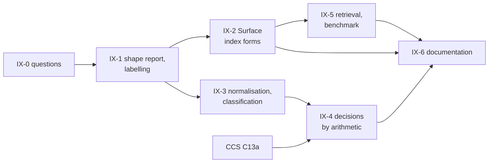

<!-- SPDX-License-Identifier: CC-BY-SA-4.0 -->

# Plan: interval-normal scopes

**Unit ID:** `interval-normal-scopes`
**Sketch:** [interval-normal-scopes.md](../sketches/interval-normal-scopes.md)
**Status:** proposed 2026-10-21, for the maintainer's review. No slice is briefed. Its status
record is created with IX-1.
**Layers touched:** Surface (two index forms), Eligibility (documentation only), the toolchain
(`tools/surface`, `tools/mork_compilers`). No evaluation semantics changes.

## Scope

Interval labels and closure bitsets as Surface index forms, the interval-normal fragment derived by
the toolchain, and design-time decisions by arithmetic on it: joint satisfiability, entailment and
coverage, with the reasoner kept for everything outside the fragment and as differential partner.

Out of scope: any change to how a condition is evaluated, and conditions outside the fragment.

## Slices

Estimates are in tokens, for agent work, excluding review.

| Slice | Delivers | Depends on | Validation | Estimate |
|---|---|---|---|---|
| **IX-0** | the sketch's questions IX-Q1 to IX-Q7 answered | the maintainer | answers recorded in the sketch | none |
| **IX-1** | the shape report per scheme edition: tree or polyhierarchy, with the concepts that make it one. The labelling algorithms (pre and post order, closure bitsets) in `tools/surface`, with property tests for IX-L1 | IX-0 | every scheme in `ontology/` reported. IX-L1 holds over generated trees and the cause scheme | 150k |
| **IX-2** | Surface's two index forms (MINOR): vocabulary, shapes, generator, regeneration on a new edition. Examples from lending and from insurance | IX-1 | IX-L2 regeneration tests. Surface's existing tests unchanged | 250k |
| **IX-3** | normalisation of Eligibility conditions and profiles into interval unions and boxes, and fragment classification as a derived artefact with its reasons and read set | IX-1 | IX-L5 property tests. Every condition in the corpus classified, with reasons when outside | 250k |
| **IX-4** | joint satisfiability, entailment and coverage by arithmetic, with counterexample cells and a bound per job. Wired as C13a's first path and NRS N3's overlap check | IX-3, CCS C13a briefed | IX-L3 differential against the reasoner, IX-L6 for counterexamples, IX-L4 against `tools/reference/eligibility/` | 300k |
| **IX-5** | retrieval templates over labels, following ADR-A128, and a benchmark against walks up `skos:broader` | IX-2 | the benchmark fails only on a wrong result, never on time (ADR-A124) | 150k |
| **IX-6** | documentation: Surface and Eligibility README sections, a worked example from licensing (territory and medium), the developer guide's tool entries | IX-2 to IX-5 | literate extraction and link checks pass | 100k |

About 1.2M tokens in all.

## Where the slices run

Machines and agents as the [lanes plan](applied-insurance-reference-lanes.md) §1 defines them. The
maintainer creates, pushes and merges every branch on R. Proposed, pending LN-Q1 to LN-Q4.

| Slice | Machine and agent | Branch | Why there |
|---|---|---|---|
| IX-0 | the maintainer | none | decisions |
| IX-1 | R, Claude Code | `ix/interval-normal-scopes`, from `main` | toolchain code and an Isabelle lemma |
| IX-2 | S, Copilot Business | the same branch, handed back as a bundle | vocabulary, shapes, examples and generator tests, S's usual work |
| IX-3, IX-4 | R, Claude Code | the same branch | compiler code in `tools/mork_compilers`, differential tests against the reasoner |
| IX-5 | R, Copilot Pro+ | the same branch | benchmark runs |
| IX-6 | S, Copilot Business | the same branch | README sections and the guide |

The branch merges once, after IX-6, into `main`. It does not wait for `docs/placement-vehicles-structure`.

## Formal methods

| Law | Assurance level |
|---|---|
| IX-L1 | proved: a short Isabelle lemma, track E, beside the Eligibility kernel in `tools/proofs/` |
| IX-L2, IX-L5, IX-L6 | property-tested |
| IX-L3, IX-L4 | differential, against the reasoner and the reference evaluator |

## Alignment

| With | Effect |
|---|---|
| CCS C13a | IX-4 gives the common case without a reasoner, consumer-runnable. C13a keeps the reasoner for the rest |
| NRS N3 | the overlap check uses IX-4 where both scopes are interval-normal |
| Ensemble ES-Q5 | its membership index for rule-defined membership is a sibling Surface index. Both show Surface's capability on the same branch |
| the evaluator (C12) | unchanged. Labels serve design time and retrieval |

## Risks

| Risk | Mitigation |
|---|---|
| a scheme thought to be a tree gains a second parent in a new edition | IX-1 reports every edition. Bitsets take over without a change of contract |
| coverage cells grow past use | the bound per job (IX-Q4), reported as "not decided within the bound" |
| normalisation misreads a condition | IX-L5, and IX-L3 against the reasoner |
