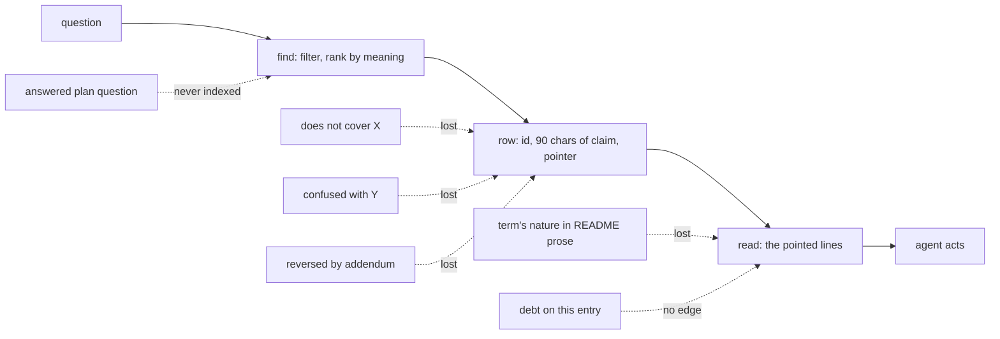

# Signposting design nuances in the knowledge index

**Status:** built on `main` 2026-10-28, uncommitted, for the maintainer's review. SP-Q1 to SP-Q4 answered as leaned. M1 to M8 are built, recorded as ADR-A134 decisions 28 to 32, approved 2026-10-28, and STD-281 to STD-283, ratified 2026-10-28. M5's terms are searched only with `--kind term`, as the maintainer chose over a bias, since no bias served both kinds of question (decision 31 holds the measurements). **Placement:** T0 tooling and process, generic, nothing domain-specific.

## 1. The problem, from one week of use

The index answers the question an agent asks. What it loses is the qualification that sits beside the answer: the case the entry does not cover, the neighbouring rule the title reads against, the addendum that reversed the section returned, the property's nature stated three paragraphs from its definition. An agent that reads only the index acts on the entry and not on its boundary, and the maintainer finds out in review.

Four losses from the PDD-14 and PDD-15 work, each one the cloud agent or the review caught by reading rather than by asking.

| # | What was lost | Where the nuance lived | Why the index did not carry it |
|---|---|---|---|
| L1 | The period key is derived by `binOf` at write, so it is not a second key dimension. The agent offered "a composite key or a second property" | `ontology/ledger/README.md`, the prose around `ldg:keyDimension`, "derived on the first draw naming it" | A declared term is findable by name only (`exists keyDimension` gives a Turtle pointer and no definition). The README prose is tier 3 and never embedded |
| L2 | LG-Q7 answers the unkeyed parent over keyed children and nothing else, so a keyed child under a keyed parent had no rule | `docs/developer/plans/ledger.md`, the answer to LG-Q7 | Plans are never indexed (ADR-A134, AGENTS.md). A question answered in a plan is a decision with no entry, and STD-087 says to record answers in the plan |
| L3 | STD-280's title "a period's amount is never restored" read against the reinstatement credit, which restores within a period | The standard register, the row itself | A claim is one sentence and the table shows its first 90 characters. The boundary sat after the cut, and nothing linked STD-280 to the rule it is confused with |
| L4 | `ldg:keyDimension`'s OWL range disagrees with its shape and prose (now TD-98) | Three places in one layer | No register row had the three statements of one rule as one entry, and a debt row has no edge to the entry or term it qualifies (0 of 64 debt rows carry any edge) |

What the tooling itself does today, measured on this checkout on 2026-10-28.

| Observation | Measurement | Consequence |
|---|---|---|
| `find` prints a claim cut at 90 characters | `show()` caps every column at 90, a claim may be 200 | the second half of a claim, where a qualification is usually written, is never seen |
| `read <ID>` prints the pointed lines and nothing else | `read STD-280` printed the whole pending-decisions register, 41 lines of 1,000-character rows, since its pointer is a bare path | an agent reading one entry gets no neighbours, no refines, no supports, no debt |
| Declared edges exist on some kinds only | Standard 117 of 280, Principle 39 of 74, Decision 99 of 124, Mechanism 21 of 83, Pattern 3 of 54, Capability 0 of 85, Debt 0 of 64, Discovery 0 of 41 | the "linked to the top answers" table is empty for most answers, and a debt or a finding can never point at what it qualifies |
| `ki:supersedes` and `ki:supersededBy` are declared in the T-Box and derived from nothing | 0 edges, 2 decisions with status Superseded, 498 sections with no status at all | a numbered decision an addendum reversed is returned as live. ADR-A131 decision 4 and ADR-A134 decision 8 are both reversed by addenda. In two trials the addendum outscored the reversed section, by meaning alone, and nothing marks the section if it does not |
| `ki:Question` and `ki:answers` are declared and never populated | 0 question nodes, 15 bold question leads in plans and sketches, the `question-or-decision-point` identifier family is counted | LG-Q7's answer is invisible to `find` by design |
| The miss log records only questions whose best score is under 0.69 | 25 distinct misses, none from the PDD-15 work | a question answered confidently and incompletely leaves no trace, which is the failure here |
| The pending-decisions register's Options known and Waits for columns are unmapped | human-only by design | the closure text of PDD-12 and PDD-14, where the rules were actually written, is not embedded, so a question in the words of the rule finds the ADR addendum only if that addendum restates it |

The common shape. The index is built to return **the entry**, and the entry is the right one. What is lost is the **entry's edge**: what it does not cover, what it is confused with, what qualified or reversed it, what term it is really about.

## 2. What a fix must satisfy

- **Derived facts only, each with one source** (ADR-A134 decision 2). Every signpost is authored once, in Markdown, in the place that already owns the fact. No fact lives only in the graph.
- **Authored as a table row or a heading**, never as Turtle (decision 10). A contributor adds a column value.
- **Shown where the agent already looks.** A signpost that needs a third command is not read. It must appear in the `find` row or the `read` output, inside the token budget the sketch set (a query about 1.2k tokens, a read about 3k).
- **Checked.** A signpost that can decay silently is the half-tagged corpus ADR-A134 names as its main risk. Each measure carries the check that fails when it rots.
- **Cheap to backfill.** Forward-only first, by demand, the miss log deciding depth, as the registers were.

## 3. Options

Three ways to carry a nuance, and they are not exclusive. The recommendation uses all three where each fits.

| Carrier | What it holds | Authored where | Found by | Cost per nuance | Fails how |
|---|---|---|---|---|---|
| **(A) text on the entry**, a column such as Does not cover | the boundary in the author's words, embedded with the claim | the register row | `find` by meaning, shown in the row | one cell, 120 characters | prose drifts, nothing checks it against the other entry |
| **(B) a typed edge** between entries, such as distinguished from, qualified by, superseded by | that two entries bear on each other and how | the register row's id column, a decision heading, an addendum lead | the linked table and `read`, exact | one id, checked for existence | the other entry must exist, so a boundary with no entry on the far side has no carrier |
| **(C) a new node kind** for what is not indexed today, terms by meaning and answered questions | the thing itself, so it can be found | the README's term block, the plan's question lead | `find --kind term` or `question` | vectors and build time, measured below | the "never plans" rule of ADR-A134 moves |

(A) alone fixes L3 and most of L2's first half, the agent would have seen "covers an unkeyed parent only". (B) alone fixes L3 and L4, not L2 or L1. (C) alone fixes L1 and L2, not L3. So the measures below take (A) for boundaries, (B) for confusions, reversals and defects, and (C) for the two populations the index does not hold.

A fourth option, rejected: **a nuance register** of its own, rows of "note that". It violates one-source, since every row restates a fact owned elsewhere, and it is the hand-maintained index that drifted before.

## 4. The measures

Each is a slice. Files, the check, the estimate and what done looks like. Estimates are in lines of change and maintainer hours, and the build costs are extrapolated from the figures ADR-A134's addenda record (498 sections cost 25 s of cold build and nothing warm).

### M1. Show the whole claim, and show the neighbours on read

The cheapest and the one that pays most. No new fact.

- `find` prints each row's claim in full on a second line under the row when the result has eight rows or fewer, which is the default. The table keeps its 90-character column for scanning, the full line is what an agent reads. Cost per query about 8 × 200 characters, under 500 tokens.
- `find` gains a flags column before the claim. `!` the entry has a Does not cover (M2), `~` the pointer is a section an addendum superseded (M3), `TD` an open debt bears on it (M2), `?` Proposed. One to three characters, so the width never pushes the claim out. Precedent, the `+` facet marks on the score.
- `read <ID>` prints, before the text, the entry's own row fields that `find` does not show (Problem shape, Does not cover, Refines, Supports, Unchecked because, Cost), then one line per declared edge in either direction with the neighbour's id and claim, then the pointed text. The neighbour query is the one `linked()` already runs.
- `read` refuses a bare-path pointer that resolves to more than 200 lines and says so, printing the entry's row instead. A standard whose pointer is a whole register is a pointer defect, and M7 checks it.

Files `tools/knowledge/ask.py` (about 60 lines), `tools/knowledge/test_embed.py` or a new `test_ask.py` for the two renderings. Check, a test that `read STD-280` prints its refines and the standard it is distinguished from. Estimate 2 hours, no maintainer ratification needed. Done when `find` on the PDD-15 question shows STD-280's second sentence without a `read`.

### M2. Three columns, two new edge kinds

**Does not cover** on the standard, principle, pattern and mechanism registers. Text, at most 120 characters, the case the entry does not decide, in the author's words. It is embedded with the claim and problem shape, so a question about the uncovered case still finds the entry and the flag says it does not answer. Example, LG-Q7 as a mechanism row would carry "a keyed child under a keyed parent", and the agent's question would have returned it flagged `!`.

**Distinguished from** on the same four registers. Ids, symmetric, `ki:distinguishedFrom`. The pair a reader confuses, as the facet register already does for its values with `skos:related` and a scope note. STD-280 would name the reinstatement-credit rule and the revolving-commitment mechanism. Shown in the linked table with via "distinguished from", so the confusable neighbour arrives with the answer.

**Bears on** on the debt, pending-decision, capability and discovery registers. Ids, `ki:bearsOn`, range `ki:Node`, and a term IRI is admitted so TD-98 can name `ldg:keyDimension`. Today Likely home and Waits for are human-only text. An agent reading the standard on keyed accounts then sees TD-98 in its neighbours, and `find` flags the entry `TD`.

T-Box, two properties with the comment that earns them (decision 6), one new text property. `extract.py` COLUMNS gains three headers, CONTROLLED is untouched. `embed.py` `text_of` appends Does not cover. The registers gain the columns empty, filled forward-only, with a first pass over the entries the PDD-14 and PDD-15 work touched, about 15 rows.

Check, `check:knowledge` fails on a Distinguished from or Bears on id that resolves to nothing, and on a Does not cover over 120 characters. Estimate 4 hours tooling, 2 hours maintainer for the first 15 rows and ratifying the columns. Done when L3 and L4 reproduce as index answers.

### M3. Sections carry supersession

An addendum that reverses or narrows a numbered decision says so in a form the extractor reads. Two grammars, both already in use informally.

- A bold lead in the addendum's first paragraph, `**Reverses decision 4.**` or `**Narrows decision 3.**`, one or several, comma-separated.
- The decision header's existing `**Superseded by:**` line, which `extract.py` reads for the status and not for the edge.

The extractor writes `ki:supersededBy` from section to section and from decision to decision, and `ki:narrowedBy` as a second, weaker edge. `find`, when a superseded section wins the score, keeps the row, marks it `~`, and prints the superseding section's pointer beside the original so the agent lands on the live text. A decision-level supersession lowers the decision's rank by a fixed amount, measured, since the superseded ADR-A51 placed third on a question about keyed instances.

Backfill, the 68 addenda, read once for the verbs "reverses", "replaces", "narrows", "refines decision", about 2 hours of an agent's time and 1 hour of the maintainer's. Check, every `**Reverses decision n.**` names a numbered item that exists. Estimate 4 hours tooling. Done when ADR-A131 decision 4 and ADR-A134 decision 8 both come back marked `~` with their addenda beside them.

### M4. Answered questions are entries

The one measure that moves an ADR-A134 rule. "The index holds the decisions and the registers, never the plans or the status records" was decided because a plan's state churns. A question's **answer** does not churn, it is a decision taken in a plan, and the identifier family `question-or-decision-point` is already counted. So the extractor derives `ki:Question` nodes from plans and sketches, from the lead the design skill already prescribes, `**LG-Q7. <question> Answered 2026-10-19, (a).** <answer>`. Status answered or open from the presence of "Answered". Claim, the question sentence and the first 200 characters of the answer, embedded. Pointer, the paragraph. `find --kind question` filters to them, and with no kind filter they rank with everything else.

Two consequences to decide. **(i)** Open questions are included, because an agent about to design what an open question already asks should find it, and `find --kind pending-decision,question` becomes the roadmap query the design skill already tells an agent to run. **(ii)** The lifecycle gains a step at handoff. An answered question whose answer states a rule a later slice must obey is promoted, in the same change, to a standard, mechanism or ADR addendum, and the question's lead then names the entry, `**LG-Q7. … Answered 2026-10-19, (a), now MEC-nn.**` The extractor writes `ki:answers` from entry to question. A question answered more than 30 days ago with a rule-shaped answer and no promotion is reported by the check, never failed.

The alternative is (ii) alone, the promotion rule without indexing questions. It is cheaper and it is the discipline ADR-A134 names as the main risk, so it will be partial and nothing will say so. Deriving the questions makes the gap visible, which is what the miss log does for the vocabulary.

Cost, 15 bold question leads today and perhaps 150 once the grammar is applied to the ledger, persistence and CCS plans, about 150 vectors, under 10 s of cold build. Files `extract.py`, `identifiers.py` (the family becomes resolvable), `ask.py` KINDS, an ADR-A134 addendum, the design and lifecycle skills. Estimate 6 hours tooling, 3 hours backfill over the plans an agent is working in, maintainer 1 hour on the addendum. Done when LG-Q7 returns for "a child account finds its parent instance" and its row shows what it does not cover.

### M5. Terms by meaning

`exists` matches a term's name as a substring. L1 was lost because the fact about `ldg:keyDimension` is in the sentence that defines it, and no sentence of a README is embedded. ADR-A126's grammar makes each declared term's definition block a known range in its literate README, and the extractor already reads the term's name, kind, module and pointer into `ki:terms`.

Embed, for each declared term, its label, its `rdfs:comment` or the literate definition's first 300 characters, and the restriction lines the README states for it (functional, max 1, range). A new kind `term` in `find`, filterable, and ranked with the rest when no kind is given. The row shows the term, its layer and the definition's first line.

Cost, 3,049 terms, of which 563 carry a label and perhaps 1,200 have a literate definition. At the measured rate, 498 sections cost 25 s cold, so 1,200 terms cost about a minute cold and nothing warm. Vectors from 1,315 to about 2,500, store under 100,000 quads, within TSD-38's envelope by a factor of ten.

What it does not fix. The nuance in L1 was in the prose between the definition of `ldg:keyDimension` and the paragraph on first-draw derivation. The definition block carries "named by the first draw", which is enough to have told the agent a key dimension is supplied. A nuance stated two paragraphs away is still tier 3. Sketch §9.1 measured that a term summary is necessary and not sufficient before embeddings existed, and this measure re-tests that finding under decision 20, with the same question set.

Files `extract.py` (the term loader gains the definition), `embed.py`, `ask.py`. Estimate 5 hours, plus 1 hour re-running the 47-question benchmark with terms in the candidate set to confirm they do not crowd register entries out of the top five. If they do, a bias of about 0.02 against terms is the lever, as the addendum on sections anticipated.

### M6. Log every question, and let an agent record a gap as it finds it

The miss log is the only evidence the index keeps about itself, and it keeps it only below 0.69. Two changes.

- Every `find` and `read` appends to `.build/knowledge/asks.log` with its best score and the ids it showed. `misses` reads both and gains `--near` for questions answered between 0.69 and 0.74, which is where a confident wrong answer lives.
- A new subcommand, `graph:ask -- gap "<what was found by reading>" [ID] [path:line]`, writes one line to the same log, tagged gap. STD-272 already requires the agent to report such a finding at handoff. Recording it at the moment of finding, with the entry it qualifies and the line it was read from, is what makes the handoff report a query rather than a memory, and it is the raw material for a Does not cover cell or a Bears on id.

The lifecycle skill's handoff step changes from "list the misses" to "list the misses, the near answers and the gaps, and say which column or edge would have carried each". Estimate 2 hours. No ratification beyond the skill edit.

### M7. The claim-writing rule, and the checks

A standard, drafted Proposed. **A claim whose rule has a neighbour it could be read against names its boundary in its first sentence, and the Distinguished from column names the neighbour.** STD-280 is the instance. Unchecked because the judgement of what a reader would confuse is the author's, with Distinguished from as the evidence that the judgement was made.

Four checks in `check:knowledge`, all atomic and triggered.

| Check | Catches |
|---|---|
| no entry's pointer is a bare path to a register or a file over 200 lines | the whole-file read of STD-280 |
| every Distinguished from and Bears on id resolves | a signpost to nothing |
| every `**Reverses decision n.**` names an item that exists, and a Superseded decision has a `ki:supersededBy` | a reversal the index does not carry |
| an answered question with "must", "never" or "only" in its answer and no promotion, after 30 days | a durable rule living in a plan, reported not failed |

### M8. Guidance

AGENTS.md's "Asking the knowledge index" gains one bullet. **Read the flags and the second line.** A `!` says the entry has a stated boundary, `~` that the text returned was reversed, `TD` that a defect is recorded against it, and the full claim under the row is where the boundary is written. The skills say the same in their own place. No other guidance grows.

## 5. Order, and what each costs

```mermaid
gantt
  dateFormat X
  axisFormat %s
  section no ratification
  M1 output            :m1, 0, 2
  M6 logging and gap   :m6, 2, 4
  section columns and edges
  M2 three columns     :m2, 4, 10
  M7 rule and checks   :m7, 10, 13
  M3 supersession      :m3, 13, 19
  section new node kinds
  M4 questions         :m4, 19, 29
  M5 terms             :m5, 29, 35
```

| Measure | Fixes | Tooling | Maintainer | Build cost | Needs |
|---|---|---|---|---|---|
| M1 | L3 half, every read | 2 h | 0 | none | nothing |
| M6 | the evidence for everything after | 2 h | 0 | none | a skill edit |
| M2 | L3, L4, L2's visibility | 4 h | 2 h | none | two T-Box terms, three columns ratified |
| M7 | decay of M2 and M3 | 3 h | 0.5 h | none | one Proposed standard |
| M3 | reversed sections | 4 h, 2 h backfill | 1 h | none | an addendum grammar |
| M4 | L2 | 6 h, 3 h backfill | 1 h | under 10 s cold | an ADR-A134 addendum |
| M5 | L1 | 5 h, 1 h measuring | 0.5 h | about 60 s cold | a benchmark re-run |

Total about 32 hours of agent time and 5 of the maintainer's. M1 and M6 in the first slice, since they change no fact and M6 starts collecting the evidence the rest is sized by. M2 and M7 together, since the checks are what make the columns safe. M3, M4 and M5 each on their own, each with its measurement.

## 6. What this does not do

- It does not make an agent read. M1 puts the boundary on the line under the row, and an agent that reads the id column only still misses it. The maintainer's instruction to read all of the index's output stands, and M6 is what shows whether it was followed, since a gap recorded against an entry whose Does not cover already said it is a reading failure, not an index failure.
- It does not index narrative. L1's deeper nuance, the paragraph on first-draw derivation, stays tier 3. M5 reaches the definition sentence and no further. Embedding README paragraphs was measured worse in ADR-A134's addendum and is not proposed.
- It does not add vectors to the miss log's decision, which decision 20 already took.
- It does not touch the pending-decisions register's narrative columns. Their closure text is written into an ADR addendum when the entry closes, and M3 makes that addendum reach the reader.

## 7. Questions for the maintainer

- **SP-Q1.** M4 moves "never the plans". Index answered and open questions as entries, or only require promotion at handoff? Leaning, index them, since the promotion rule alone is the discipline risk ADR-A134 names.
- **SP-Q2.** M2's Does not cover, one column on four registers, or one column on standards only with mechanisms using Reuse note? Leaning, four registers, because the LG-Q7 case was a mechanism.
- **SP-Q3.** M3's `~` handling, keep the superseded row and print the successor beside it, or replace the row with the successor? Leaning, keep and mark, because the question may genuinely be about the history.
- **SP-Q4.** Whether `ki:bearsOn` may name a term IRI. Leaning yes, since TD-98 is about a term and no entry.

## 8. Index misses during this plan

Asked 2026-10-28. Three questions answered weakly or beside the point, each a gap this plan would close.

| Question | Best answer | What would have answered |
|---|---|---|
| a rule has a stated exception or applies in one case only, how an entry records what it does not cover | ADR-A106 at 0.72, unrelated | nothing exists. M2's column and M7's standard |
| a later addendum reverses an earlier numbered decision, how a superseded decision is marked | STD-089 at 0.71, the ADR shape | nothing exists. M3's grammar as a standard |
| a question answered in a plan decides a durable rule, where does the answer go | STD-087 at 0.64, "record answers in the plan" | STD-087 is the rule that caused L2. M4's promotion step amends it |
| a shared parent above keyed accounts, how a child account finds its parent instance | PAT-41 at 0.71, IRI naming | LG-Q7, which no kind holds. M4 |

🔴 PLAN FIRST. M2, M3 and M4 each add a fact the registers or the decisions carry, and M4 amends ADR-A134, so the maintainer rules on SP-Q1 to SP-Q4 before a branch.
