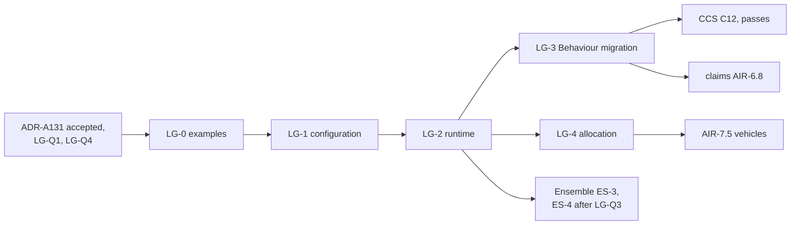
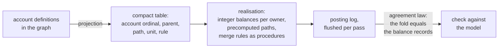

<!-- SPDX-License-Identifier: CC-BY-SA-4.0 -->

# Plan: Ledger, amounts consumed and restored over time

**Unit ID:** `ledger`
**Status:** proposed 2026-10-19, amended 2026-10-21 (two phases, exactness, LG-Q6 to LG-Q8). LG-Q1 to
LG-Q8 answered 2026-10-21. LG-0 to LG-2 briefed below. ADR-A131 awaits the maintainer's acceptance.
**ADRs:** [ADR-A131](../../architecture/decisions/ADR-A131-ledger-layer.md) and ADR-A01's 2026-10-19
addendum, both Proposed
**Sketches:** [evaluation context](../sketches/evaluation-context.md) §5 (the ledger in outline),
[contract amounts](../sketches/contract-amounts.md) (the requirements), the
[history and versioning sketch](../sketches/persistence-history-and-versioning.md) §6.1 (the account
record's keying)
**Takes over:** PDD-07 (the repair of Behaviour's allowance contract) and the ledger part of PDD-08,
from the [pending design decisions](pending-design-decisions.md)

## Scope

A substrate layer, `ontology/ledger/` with prefix `ldg:`, imported by Behaviour's configuration:

- **configuration:** account definitions, the tree of "part of and not in addition to", the kinds of
  owner an account admits, merge rules, reset periods
- **runtime:** postings and balance records, each a derived artefact keyed by account, owner and
  position
- **Behaviour's migration:** effects draw, credit and accrue onto accounts, threshold regimes read
  balances, and the allowance terms become a deprecated shorthand
- **allocation with conservation:** one amount split into postings by a merge rule, the parts summing
  to the whole (vehicles sketch §4.2, previously AIR-7.4)

Out of scope:

- **Combinators.** Pure operations over amounts are evaluation-context EC-Q1, leaning towards
  Quantification.
- **Environments.** How effects in one pass compose is fixed by the evaluation context's model and its
  conformance cases (ADR-A131 decision 9), and run by CCS C12. Draws at one position follow
  decision 6's two phases, which LG-2 states.
- **Order between instruments.** That is Ensemble's (ADR-A130).

## Principles

| # | Principle | Source |
|---|---|---|
| LG-1 | A balance is derived from postings, never authored | ADR-A131 decision 4, the modelling rules |
| LG-2 | A draw on a path succeeds or fails whole | ADR-A131 decision 3 |
| LG-3 | An account belongs to a persistent identity, and outlives its owner's versions | ADR-A131 decision 5, ADR-A106 decision 5 |
| LG-4 | Ledger names no term of Party, Eligibility, Wording, Instrument or Behaviour | ADR-A01, 2026-10-19 addendum |
| LG-5 | Examples first, from at least two fields besides insurance (ADR-A-C2) | lifecycle |

## Slices

Estimates are in tokens, for agent work, excluding review.

| Slice | Content | Depends on | Estimate |
|---|---|---|---|
| LG-0 | examples, as data the model must accept or refuse. Software licensing: a seat quota with an annual reset. Lending: a revolving facility, drawn and repaid. Grants: a grant with sub-budgets, and unspent funds returned. Delegated authority: an aggregate over every contract bound under an authority. Insurance: an aggregate with sections and a sublimit, a recovery credited, a reinstatement, a limit for one class of insured in addition to a shared aggregate. Keyed accounts (LG-Q7): seats per site, and a sublimit per borrower. Another value space (LG-Q8): a multicurrency facility's drawings against its base-currency commitment. Refusals: a cycle in the tree, a debit beyond availability under the refuse rule | ADR-A131 accepted, LG-Q1, LG-Q4, LG-Q7, LG-Q8 | 180k |
| LG-1 | the configuration document: the README in ADR-A126's layout, with its release notes section, account definitions, the tree, owner kinds, the merge rule scheme, reset periods, keyed account definitions (LG-Q7), shapes (no cycle, one value space along a path, the parent edge stated). The catalogue entry in the README, `ledger` in the root catalogue after `quantification`, and the import guard. The publication pass for ADR-A131 and every decision the README cites (ADR-A127). Ledger joins the release | LG-0 | 340k |
| LG-2 | the runtime document: postings, balance records, their keys and PROV, persistence's record families, the two phases at one position (propose, merge, settle), conversion on a posting (LG-Q8), and the laws as tests (a draw debits the path, availability is the least along the path, a credit never exceeds the stated amount, a pass commits whole, draws at one position give the same postings in any order) | LG-1, LG-Q2, LG-Q5, LG-Q6 | 350k |
| LG-3 | Behaviour's migration: the import, effects onto accounts, threshold regimes over a balance, the allowance terms deprecated with a normalisation to a one-account ledger, insure-o and the other users moved, the applied modules and examples pinned to the new release. Behaviour's release notes class the deprecation. Repairs the allowance contract, formerly PDD-07 | LG-2 | 350k |
| LG-5 | a benchmark under `benchmark/ledger/` (ADR-A124): a generated corpus of account trees and draws at the volumes in the performance section, run against the model's records and against any realisation, failing only on a wrong result, with times recorded per run | LG-2 | 150k |
| LG-4 | allocation with conservation: one amount split into postings on several accounts by a merge rule, the conservation law as a shape and a test, with examples from lending (pro rata sharing), insolvency (a waterfall) and a pool | LG-2, LG-Q3 | 250k |

## Slices in detail

Written 2026-10-21, once LG-Q1 to LG-Q8 were answered, so that each slice can be built without a
design decision. A builder that meets a question the brief does not answer stops at that point,
records it in the slice's Validation Pack and the status record, and goes on with what does not
depend on it. The skills to load are `lattice-ontology-authoring`, `lattice-toolchain`,
`lattice-testing` and `lattice-publication-hygiene`.

### The vocabulary, for LG-0 to LG-2

Prefix `ldg:`, namespace `https://www.nebularis.org/neuro-semantic/lattice/ledger#`. Ledger names
no term of Party, Eligibility, Wording, Instrument or Behaviour (LG-4). Owners are any
`fnd:PersistentIdentity`.

**Configuration** (`ontology/ledger/spec/ledger.ttl`):

| Term | Kind | Domain, range, cardinality | Meaning |
|---|---|---|---|
| `ldg:AccountDefinition` | class | ⊑ `fnd:Identified` | an amount consumed and restored, as the terms state it |
| `ldg:statedAmount` | object property | AccountDefinition to `qnt:Quantity`, exactly 1 | the amount when fresh |
| `ldg:unitOfAccount` | object property | AccountDefinition to `qnt:ValueSpace`, exactly 1 | the value space every posting on it is in |
| `ldg:partOf` | object property | AccountDefinition to AccountDefinition, at most 1 | "part of and not in addition to". Absent means in addition to every other account |
| `ldg:admitsOwnerKind` | object property | AccountDefinition to `rdfs:Class`, at least 1 | the kinds of owner it admits, named by the layer above |
| `ldg:mergeRule` | object property | AccountDefinition to `skos:Concept` in `ldg:MergeRules`, exactly 1 | what happens when draws at one position together exceed availability |
| `ldg:roundingMethod` | object property | AccountDefinition to `skos:Concept` in `ldg:RoundingMethods`, at most 1 | required when the merge rule is proportional |
| `ldg:residualAllocation` | object property | AccountDefinition to `skos:Concept` in `ldg:ResidualAllocations`, at most 1 | required when the merge rule is proportional |
| `ldg:resetRecurrence` | object property | AccountDefinition to `qnt:Recurrence`, at most 1 | when the account returns to its stated amount |
| `ldg:keyDimension` | object property | AccountDefinition to `skos:ConceptScheme` or `qnt:ValueSpace`, at most 1 | LG-Q7: one account per key value |
| `ldg:countsPurpose` | object property | AccountDefinition to `skos:Concept`, any | LG-Q2: draws naming this purpose also debit this account |
| `ldg:creditCeiling` | object property | AccountDefinition to `qnt:Quantity`, at most 1 | the most a credit restores to. The stated amount when absent |
| `ldg:conversionMethod` | object property | AccountDefinition to `qnt:ConversionContext`, at most 1 | LG-Q8: how a draw in another value space is converted |

**Vocabulary** (`ontology/ledger/vocab/ledger-vocab.ttl`), each a `skos:ConceptScheme` with its
concepts:

| Scheme | Concepts |
|---|---|
| `ldg:MergeRules` | `ldg:InPriorityOrder`, `ldg:Proportional`, `ldg:Refuse` |
| `ldg:PostingDirections` | `ldg:Debit`, `ldg:Credit` |
| `ldg:RoundingMethods` | `ldg:HalfEven`, `ldg:HalfUp`, `ldg:TowardZero` |
| `ldg:ResidualAllocations` | `ldg:LargestRemainder` (ties broken by the total order of account keys), `ldg:ToFirstInOrder` |

**Runtime** (`ontology/ledger/spec/ledger-runtime.ttl`), each record a `fnd:DerivedArtefact`:

| Term | Kind | Domain, range, cardinality | Meaning |
|---|---|---|---|
| `ldg:Posting` | class | ⊑ `fnd:DerivedArtefact` | one draw or credit on one account |
| `ldg:BalanceRecord` | class | ⊑ `fnd:DerivedArtefact` | an account's remaining balance and availability at a position |
| `ldg:MergeRecord` | class | ⊑ `fnd:DerivedArtefact` | the merge of several proposals at one account and position |
| `ldg:Grant` | class | ⊑ `fnd:Identified` | one proposal's request and what the merge granted it |
| `ldg:onAccount` | object property | Posting, BalanceRecord, MergeRecord to AccountDefinition, exactly 1 | the account's definition |
| `ldg:forOwner` | object property | the same, to `fnd:PersistentIdentity`, exactly 1 | the account's owner |
| `ldg:accountKey` | object property | the same, to `skos:Concept` or `qnt:Value`, at most 1 | the key, for a keyed account |
| `ldg:atPosition`, `ldg:atMicroPosition` | datatype properties | the same, to `xsd:integer`, exactly 1 each | LG-Q4's ordered pair |
| `ldg:direction` | object property | Posting to a concept in `ldg:PostingDirections`, exactly 1 | debit or credit |
| `ldg:amountValue` | datatype property | Posting to `xsd:decimal`, exactly 1 | the amount, in the account's unit of account |
| `ldg:forPurpose` | object property | Posting to `skos:Concept`, at most 1 | LG-Q2 |
| `ldg:amountAsDrawn` | object property | Posting to `qnt:Quantity`, at most 1 | LG-Q8, with `ldg:conversionUsed` |
| `ldg:conversionUsed` | object property | Posting to `qnt:ConversionContext`, at most 1 | the rate's source and date |
| `ldg:remainingValue`, `ldg:availableValue` | datatype properties | BalanceRecord to `xsd:decimal`, exactly 1 each | the remaining balance, and the least along the path |
| `ldg:grant` | object property | MergeRecord to Grant, at least 2 | the proposals merged |
| `ldg:requestedValue`, `ldg:grantedValue` | datatype properties | Grant to `xsd:decimal`, exactly 1 each | in the account's unit, after rounding |
| `ldg:grantedProportion` | datatype property | Grant to the rational form LG-2's probe chooses, at most 1 | exact, for a proportional merge |
| `ldg:forProposal` | object property | Grant to `fnd:Identified`, exactly 1 | the evaluation that proposed it, named by the layer above |
| `ldg:refusalReason` | object property | MergeRecord to `skos:Concept`, at most 1 | under `ldg:Refuse`, why nothing was granted |

Every record's read set is `prov:wasDerivedFrom`. Natural keys follow ADR-A114: a posting by
(account, owner, key, position, micro-position, direction, proposal), a balance record by (account,
owner, key, position, micro-position), a merge record by (account, owner, key, position). No blank
nodes in records.

### LG-0 in detail: examples first

**Machine:** R or S, as the maintainer assigns. **Branch:** `ledger/lg-0-examples`, from `main`
after this branch merges. **Commits are the maintainer's.**
**Validation Pack:** [ledger-lg-0](../validation/ledger-lg-0.md).
**Decisions:** ADR-A131 (decisions 3 to 6), LG-Q1 to LG-Q8.

**Invariant:** the model accepts every arrangement below and refuses each refusal, before any term is
written into a spec.

Each file is in `ontology/ledger/examples/`, uses only the vocabulary above and `fnd:`, `qnt:`,
`skos:`, `prov:` and `ex:` terms, invents every party and value, and carries a comment block with
its hand-computed table of postings and balances. Configuration and runtime records are in one file
per example.

| File | Shows | Decisions |
|---|---|---|
| `licence-seats.ttl` | Licensing. 500 seats a year, keyed per site (two sites), an annual reset, a draw at each site, a reset restoring both | 3 (keyed), LG-Q7 |
| `revolving-facility.ttl` | Lending. A 20M sterling commitment, a euro drawing converted at a stated spot rate with its context recorded, a repayment credited, a revaluation posting at a stated date | 3, 4, LG-Q8 |
| `research-grant.ttl` | Grants. A budget with staff and equipment sub-budgets, spending, and unspent funds returned as a credit that stops at the ceiling | 3, credit ceiling |
| `authority-aggregate.ttl` | Delegated authority. An aggregate owned by an authority, drawn at one position by three proposals that together exceed it, merged proportionally with half-even rounding and largest-remainder residual, one merge record and three postings | 6, LG-Q3, LG-Q6 |
| `insurance-aggregate.ttl` | Insurance. An aggregate of 10M with two sections and a 1M sublimit in one, a further limit for one class of beneficiary in addition to the aggregate, a flood purpose counted against a flood aggregate outside the path, a loss, a recovery credited, a reinstatement as an ancestor account of twice the limit | 3, LG-Q2 |
| `refusal-cycle.ttl` | Refused: two definitions each `ldg:partOf` the other | shape |
| `refusal-unit.ttl` | Refused: a child account in a different unit of account from its parent | shape |
| `refusal-overdraw.ttl` | Under `ldg:Refuse`, two proposals exceeding availability: a merge record with no grant and a reason, and no posting | 6 |
| `refusal-proportional-unrounded.ttl` | Refused: a proportional account with no rounding method | shape |

| ID | Given / When / Then | Level | +/- |
|---|---|---|---|
| LG0-01 | each example / parsed with rdflib / it parses | L0 | + |
| LG0-02 | each accepted example / its comment table / postings and balances agree with the records, by hand | paper | + |
| LG0-03 | the examples / read / at least two fields besides insurance precede the insurance example in the README's order (ADR-A-C2) | paper | + |
| LG0-04 | the examples / grep / no `ins:`, `bhv:`, `elg:`, `pty:` or `wrd:` term | L1 | + |
| LG0-05 | the refusals / read / each names the shape or rule that will refuse it | paper | - |
| LG0-06 | the changed files / prose check / no semicolons, no client names | L1 | + |

### LG-1 in detail: the configuration document

**Machine:** R or S. **Branch:** `ledger/lg-1-configuration`. **Validation Pack:**
[ledger-lg-1](../validation/ledger-lg-1.md). **Decisions:** ADR-A131 decisions 1 to 3, 5, 6 and 8,
LG-Q1, LG-Q2, LG-Q6, LG-Q7, LG-Q8.

**Invariant:** account definitions, their tree, owner kinds, merge rules, rounding, reset, keys,
purposes, ceilings and conversion are stated as configuration, and shapes refuse every malformed
tree, before any runtime record exists.

1. `ontology/ledger/README.md` in ADR-A126's layout, literate, with the catalogue entry (kind
   `substrate`, imports Foundation, Vocabulary, Quantification) and a release notes section. It cites
   only published decisions (ADR-A127), so the publication pass for ADR-A131 and the decisions it
   cites runs in this slice.
2. The configuration terms and the vocabulary above, extracted from the README.
3. Shapes (`ontology/ledger/shapes/`): cardinalities as in the table, no cycle through `ldg:partOf`
   (SHACL-SPARQL, following ADR-A128's rules), a child's unit of account equal to its parent's, a
   proportional rule with a rounding method and a residual allocation, a credit ceiling not below the
   stated amount, a key dimension that is a scheme or a value space.
4. `ledger` in the root catalogue after `quantification`, so `check:import-guard` enforces its imports.
   The ontology architecture document and the root README show the layer.
5. `tools/test_ledger.py`, added to the root Python check's list, with the rows below.
6. Ledger joins the substrate's release (`release:prepare`), its notes classing everything as no effect.

| ID | Given / When / Then | Level | +/- |
|---|---|---|---|
| LG1-01 | the README / literate extraction / the spec and vocab equal the committed Turtle | L1 | + |
| LG1-02 | LG-0's accepted examples, configuration part / validated / conform | L3 | + |
| LG1-03 | `refusal-cycle.ttl` / validated / fails the cycle shape, by name | L3 | - |
| LG1-04 | `refusal-unit.ttl` / validated / fails the unit shape | L3 | - |
| LG1-05 | `refusal-proportional-unrounded.ttl` / validated / fails the rounding shape | L3 | - |
| LG1-06 | the import guard / run / Ledger imports only Foundation, Vocabulary and Quantification | L1 | + |
| LG1-07 | the spec / grep / no term of Party, Eligibility, Wording, Instrument or Behaviour | L1 | + |
| LG1-08 | the README / `check:published-decisions` / passes | L1 | + |
| LG1-09 | the cycle shape on a generated tree of 10,000 definitions / validated / finishes, its time recorded | L7 | + |
| LG1-10 | the release / `check:ontology-versioning` / Ledger is at the release's number | L1 | + |

**One command:** `mise run check`.

### LG-2 in detail: the runtime document

**Machine:** R. **Branch:** `ledger/lg-2-runtime`. **Validation Pack:**
[ledger-lg-2](../validation/ledger-lg-2.md). **Decisions:** ADR-A131 decisions 4 and 6, LG-Q3 to
LG-Q8.

**Invariant:** postings, balance records and merge records are derived artefacts with natural keys,
and their recorded values satisfy Ledger's laws, checked as shapes over the records. Computing them
is the evaluator's (CCS C12, B4a), not this slice's.

1. **The rational probe first** (LG-Q6). Record in
   [triple-store-discovery.md](../../architecture/triple-store-discovery.md) how rdflib and Oxigraph
   parse, compare and round-trip `owl:rational` literals, for example `"1/3"^^owl:rational`, following
   `lattice-triple-stores`. If both handle it, `ldg:grantedProportion` takes `owl:rational`.
   Otherwise it is two `xsd:integer` properties, numerator and denominator, and the README says why.
2. The runtime terms above, in the README, extracted.
3. Persistence's record families for postings, balance records and merge records, append-only.
4. Shapes over records, each a law:
   - a posting's owner is of a kind its account admits
   - a balance record's remaining value equals the stated amount less debits plus credits up to its
     position, for its account, owner and key, never above the credit ceiling (L1, L3)
   - its available value equals the least remaining value along its path at that position (L2)
   - a merge record's granted values sum to no more than the availability before the merge, and
     under a proportional rule to exactly that availability where the requests exceed it, after
     rounding and residual (L6)
   - each posting from a merged draw cites its merge record in its read set
   - conversion fields appear together or not at all
   - natural keys are unique
5. The runtime parts of LG-0's examples validate, and the refusal under `ldg:Refuse` is checked.

| ID | Given / When / Then | Level | +/- |
|---|---|---|---|
| LG2-01 | the probe / run on rdflib and Oxigraph / its findings recorded with the test that shows them | L3 | + |
| LG2-02 | LG-0's accepted examples, runtime part / validated / conform | L3 | + |
| LG2-03 | a balance record altered by one minor unit / validated / fails L1 | L3 | - |
| LG2-04 | an available value above an ancestor's remaining / validated / fails L2 | L3 | - |
| LG2-05 | a credit taking a balance above its ceiling / validated / fails L3 | L3 | - |
| LG2-06 | a proportional merge whose grants sum one unit short / validated / fails L6 | L3 | - |
| LG2-07 | `refusal-overdraw.ttl` / validated / conforms, with no posting and a refusal reason | L3 | + |
| LG2-08 | a posting whose owner's kind the account does not admit / validated / fails | L3 | - |
| LG2-09 | two postings with one natural key / validated / fails | L3 | - |
| LG2-10 | a generated pass of 5,000 postings and 10,000 balance records / validated / finishes, time recorded | L7 | + |
| LG2-11 | the README / literate extraction, published decisions / pass | L1 | + |

**One command:** `mise run check`.

**Not covered:** computing postings from draws and the two phases' order independence, which are
B4a's reference and CCS C12's. Behaviour's migration (LG-3). Allocation across several accounts
(LG-4). Throughput (LG-5).

## Performance and runtime realisation

Added 2026-10-21 at the maintainer's request: every choice is checked for its cost at runtime, since a
ledger that is expressive but slow is no use to a system that must compute changes quickly. The model
in ADR-A131 is the one published for conceptual modelling. A deployment may realise it in faster
forms, held to it by an agreement law. No realisation is planned here.

**Choices made for speed in the model itself.**

| Choice | Effect |
|---|---|
| a posting's amount is a decimal literal in the account's unit of account | about 8 triples a posting rather than 11, and no join to read an amount |
| an account is identified by its definition, its owner and its key, with no account node | no node created per owner, and no lookup to find one |
| positions are two integer literals on the posting | ordering is a comparison of literals |
| balance records materialised once per pass, holding the remaining balance and the availability (LG-Q5) | a read is one lookup, never a sum over postings or a walk up the path |
| keyed accounts derived on the first draw that names a key (LG-Q7) | no account is written for a key nobody draws on |
| a pass writes its postings, merge records and balance records in one batch | one store round trip a pass, never one a draw (ADR-A130's evaluator consequence) |
| proportions exact, postings in minor units (LG-Q6) | integer arithmetic on the hot path. Rationals appear only in merge records |

**Costs.** Estimates, to be measured by LG-5.

| Operation | Model in the graph | A compiled realisation |
|---|---|---|
| one draw on a path of depth *d* | 1 posting and *d* balance records, about 8(*d*+1) triples, written once per pass | *d* integer subtractions with a check, one log entry |
| availability of an account | one lookup on a materialised record | one array read |
| a pass with *p* draws over *n* accounts | one batch of about 8(*p*+*n*) triples | *p*·*d* operations, one flush |
| a catastrophe event of 5,000 losses, each drawing on a section and an aggregate (*d* = 2) | about 5,000 postings and up to 10,000 balance records per pass, about 120,000 triples | about 10,000 operations |
| two-phase merge at one account and position with *k* proposals | one merge record of about 4*k* triples | *k* proposals sorted once, order *k* log *k* |

So the model in the graph is fit for the records an insurer or lender keeps of what happened, at the
rate passes happen. A system that evaluates thousands of hypothetical passes, for example scenario
analysis over an event set, uses a realisation and writes nothing per hypothetical pass.

**A realisation pattern, for later.** Not planned. Recorded so the model leaves room for it.

| Rule | Why |
|---|---|
| a realisation adds no semantics (ADR-A131 decision 8) | every implementation agrees |
| it is populated from the configuration by a projection, never authored | the configuration stays the one source |
| its agreement law is checked by sampling, as for every derived engine | a faster form never silently diverges |
| several realisations may exist, each for a use (live records, scenario runs, a browser view) | each is a derived engine of the evaluator note's three kinds |

## Formal methods

Placed in the [formal-methods epic](formal-methods.md), under FM-D8:

| Slice | Track | Content | When |
|---|---|---|---|
| C5 | C | an Alloy model of ADR-A131: a draw on a path succeeds or fails whole, availability is the least along the path, a credit never exceeds the stated amount, the tree has no cycle, each merge rule conserves the amount it shares, after rounding with its residual rule, and draws at one position give the same postings in any order of proposal | before or alongside ADR-A131's acceptance |
| B4a | B | the Ledger reference within the evaluation context's reference (B4), with conformance cases for C12's draws | with LG-2 and CCS C12 |
| E4a | E | the same laws mechanised from B4a, within E4 | after B4a |

## Releases

Ledger is a member of the substrate's release (ADR-A129). Each slice that changes a member is a new
release: `mise run release:prepare -- <X.Y.Z>`, release notes in every changed layer classing each
change by its effect on existing data, and a tag the maintainer creates. LG-1 and LG-2 add terms
only, so their notes class them as no effect. LG-3's deprecation is no effect, and the later removal
of the allowance terms changes meaning. That removal owes a migration if an adopter holds production
data under the allowance terms by then, so it is timed before that or ships with one.

Behaviour's README migrates to ADR-A126's layout in a later unit (`improved-ontology-documentation`,
OD-D61). Whichever of LG-3 and that migration lands second adopts the other's format, as that plan
already arranges for CCS slices.

## Done when

The five examples of LG-0 validate. Their postings and balances match a hand-computed table. The
refusals fail with the shape that names them. Behaviour's tests and insure-o's cases pass on the
migrated model. `mise run check` passes, with `check:import-guard` enforcing Ledger's imports,
`check:published-decisions` passing on Ledger's README, and `check:ontology-versioning` holding Ledger
to the release's number.

## Effects on other units

| Unit | Change |
|---|---|
| CCS | C12 runs draws and credits as postings, sequential environment first. C12 waits on LG-3 |
| Ensemble (ADR-A130) | ES-3's K2 examples read exhaustion from a balance record, so ES-3 waits on LG-2. An account drawn by several instruments belongs to their ensemble, and the K6 relation is derived from the terms that draw on it. LG-Q3 and LG-Q4 are settled before ES-4 is briefed |
| AIR phase 7 | AIR-7.4 becomes LG-4. AIR-7.5 depends on LG-4 |
| AIR claims | AIR-6.8's programme erosion uses programme-owned accounts, after LG-3 |
| AIR phase 5 | term parameters (limits, retentions, aggregates, reinstatements) state accounts. Phase 5 waits on LG-3 |
| Capacity | the withdrawn execution profile (P7-Q4) leaves no second model of a consumed amount |

## Questions LG-Q1 to LG-Q8

| ID | Question | Options | Leaning |
|---|---|---|---|
| **LG-Q1** | The word for an account (PDD-08) | account, budget, allowance, tally | **Answered 2026-10-21, as leaned:** account. It is the ledger's own unit in accounting and in computing, and has no market meaning. "Budget" suggests planning, and "allowance" is the term being deprecated |
| **LG-Q2** | Shared limits that are not a tree (EC-Q3) | (a) an account with two parents. (b) one account with several draw purposes, keeping the tree. (c) across instruments, two accounts and an Ensemble relation | **Answered 2026-10-21, as leaned:** (b) within one owner, and (c) across owners. A tree keeps the path debit and its proof simple. Whether a limit is part of its parent or in addition to it is stated on the account, never inferred, since policies state both, for example a sublimit that is part of a section's limit beside a further limit for one class of insured in addition to a shared aggregate |
| **LG-Q3** | An account shared by several instruments, such as an authority's aggregate, drawn by their separate evaluations | (a) the draws are ordered by Ensemble K3 rank, each evaluation reading the balance the one before it left. (b) the draws are proposals merged by the account's merge rule at the owner's pass. (c) (a) where a rank is stated, (b) otherwise | **Answered 2026-10-21, as leaned:** (c), refined 2026-10-20. A stated priority is the law's answer where there is one. Otherwise draws at different positions fall in the order of their positions, and the merge rule decides only between draws at one position, with "refuse" as the default. Draws at one position run in two phases: propose, merge by the owner, settle (ADR-A131 decision 6, added 2026-10-21), so the result never depends on which evaluation ran first |
| **LG-Q4** | How a posting names its position without naming Behaviour | (a) Ledger's own ordered pair, position and micro-position, supplied by whatever posts. (b) only `prov:wasGeneratedBy` to the run, with the order read from the run | **Answered 2026-10-21, as leaned:** (a). A balance at a position is then read without joining the runtime records of another layer. Behaviour supplies its stimulus log positions. Since an ensemble's account is drawn from several instruments' logs, their positions must be comparable, so the account's owner supplies one order for its account (added 2026-10-20) |
| **LG-Q5** | Balance records materialised per pass, or derived on read | (a) materialised once per pass for each affected account. (b) derived from postings on each read | **Answered 2026-10-21, as leaned:** (a), with postings authoritative. A read then costs one lookup, against a sum over every posting on the account and its descendants |
| **LG-Q6** | How a derived proportion that no decimal states exactly is kept, for example a share signed down by a third, or a proportional merge (ADR-A131 decision 6) | (a) exact rationals in records and in the codec, with `owl:rational` in RDF where stores support it, or a numerator and denominator pair where they do not. (b) rounded to a precision the rule declares, with the residual allocated by the rule. (c) (a) for proportions, and (b) for amounts posted to an account, which are always in its unit of account | **Answered 2026-10-21, as leaned:** (c). A proportion is a judgement other evaluations cite, so it stays exact. A posting is money, so it is in the account's unit, rounded by the rule's stated method with the residual allocated so the parts sum. Before ES-5 and LG-4, a probe records how rdflib and Oxigraph treat `owl:rational` literals (parse, compare, round-trip) in the triple-store discovery record, and the codec gains a rational form, for example `"1/3"` with its value space |
| **LG-Q7** | Amounts that apply per key, for example seats per site, a sublimit per borrower, an aggregate per location (ADR-A131 decision 3) | (a) an account definition states a key dimension, a concept scheme or a value space, and one account per key value is derived on the first draw that names it, its natural key being the definition, the owner and the key value. (b) one authored account per key. (c) an account per member, owned by an ensemble | **Answered 2026-10-21, as leaned:** (a). The terms state one rule, and the accounts follow from facts. Authoring one account per site or location repeats the rule and misses keys nobody foresaw. A shared parent above the keyed accounts, such as a policy aggregate over every location's aggregate, is an ordinary parent edge |
| **LG-Q8** | A draw in another value space than the account's, for example a drawing in euros against a facility committed in sterling (ADR-A131 decision 3) | (a) refused, so every draw arrives in the account's unit. (b) converted on the posting: it records the amount drawn, the converted amount and the conversion's context (the rate's source and date) as a Quantification context value (ADR-A115), by the method the terms state, or where they are silent by an outside rule, or else Undetermined. (c) an account holding a balance per value space | **Answered 2026-10-21, as leaned:** (b). Agreements state the method, such as the spot rate on the drawing date, and the posting is then evidence of it. Where terms also revalue outstanding amounts at stated dates, the revaluation is a further posting by the same method. (c) would leave availability against the commitment undefined |
