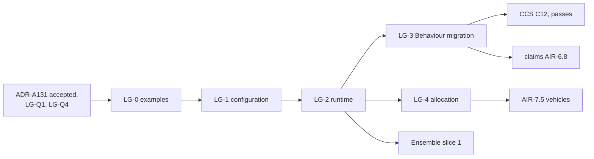

<!-- SPDX-License-Identifier: CC-BY-SA-4.0 -->

# Plan: Ledger, amounts consumed and restored over time

**Unit ID:** `ledger`
**Status:** proposed 2026-10-19, for the maintainer's review. No slice is briefed yet.
**ADRs:** [ADR-A131](../../architecture/decisions/ADR-A131-ledger-layer.md) and ADR-A01's 2026-10-19
addendum, both Proposed
**Sketches:** [evaluation context](../sketches/evaluation-context.md) §5 (the ledger in outline),
[contract amounts](../sketches/contract-amounts.md) (the requirements), the
[history and versioning sketch](../sketches/persistence-history-and-versioning.md) §6.1 (the account
record's keying)
**Takes over:** PDD-07 (the repair of Behaviour's allowance contract) and the ledger part of PDD-08,
from the [pending design decisions](pending-design-decisions.md)

## Scope

A substrate layer, `ontology/ledger/` with prefix `ldg:`, imported by Behaviour's configuration:

- **configuration:** account definitions, the tree of "part of and not in addition to", the kinds of
  owner an account admits, merge rules, reset periods
- **runtime:** postings and balance records, each a derived artefact keyed by account, owner and
  position
- **Behaviour's migration:** effects draw, credit and accrue onto accounts, threshold regimes read
  balances, and the allowance terms become a deprecated shorthand
- **allocation with conservation:** one amount split into postings by a merge rule, the parts summing
  to the whole (vehicles sketch §4.2, previously AIR-7.4)

Out of scope:

- **Combinators.** Pure operations over amounts are evaluation-context EC-Q1, leaning towards
  Quantification.
- **Environments.** How effects in one pass compose belongs to the evaluator, in CCS C12.
- **Order between instruments.** That is Ensemble's (ADR-A130).

## Principles

| # | Principle | Source |
|---|---|---|
| LG-1 | A balance is derived from postings, never authored | ADR-A131 decision 4, the modelling rules |
| LG-2 | A draw on a path succeeds or fails whole | ADR-A131 decision 3 |
| LG-3 | An account belongs to a persistent identity, and outlives its owner's versions | ADR-A131 decision 5, ADR-A106 decision 5 |
| LG-4 | Ledger names no term of Party, Eligibility, Wording, Instrument or Behaviour | ADR-A01, 2026-10-19 addendum |
| LG-5 | Examples first, from at least two fields besides insurance (ADR-A-C2) | lifecycle |

## Slices

Estimates are in tokens, for agent work, excluding review.

| Slice | Content | Depends on | Estimate |
|---|---|---|---|
| LG-0 | examples, as data the model must accept or refuse. Software licensing: a seat quota with an annual reset. Lending: a revolving facility, drawn and repaid. Grants: a grant with sub-budgets, and unspent funds returned. Delegated authority: an aggregate over every contract bound under an authority. Insurance: an aggregate with sections and a sublimit, a recovery credited, a reinstatement. Refusals: a cycle in the tree, a debit beyond availability under the refuse rule | ADR-A131 accepted, LG-Q1, LG-Q4 | 150k |
| LG-1 | the configuration document: the README in ADR-A126's layout, with its release notes section, account definitions, the tree, owner kinds, the merge rule scheme, reset periods, shapes (no cycle, one value space along a path). The catalogue entry in the README, `ledger` in the root catalogue after `quantification`, and the import guard. The publication pass for ADR-A131 and every decision the README cites (ADR-A127). Ledger joins the release | LG-0 | 340k |
| LG-2 | the runtime document: postings, balance records, their keys and PROV, persistence's record families, and the laws as tests (a draw debits the path, availability is the least along the path, a credit never exceeds the stated amount, a pass commits whole) | LG-1, LG-Q2, LG-Q5 | 300k |
| LG-3 | Behaviour's migration: the import, effects onto accounts, threshold regimes over a balance, the allowance terms deprecated with a normalisation to a one-account ledger, insure-o and the other users moved, the applied modules and examples pinned to the new release. Behaviour's release notes class the deprecation. Repairs the allowance contract, formerly PDD-07 | LG-2 | 350k |
| LG-4 | allocation with conservation: one amount split into postings on several accounts by a merge rule, the conservation law as a shape and a test, with examples from lending (pro rata sharing), insolvency (a waterfall) and a pool | LG-2, LG-Q3 | 250k |

## Formal methods

Placed in the [formal-methods epic](formal-methods.md), under FM-D8:

| Slice | Track | Content | When |
|---|---|---|---|
| C5 | C | an Alloy model of ADR-A131: a draw on a path succeeds or fails whole, availability is the least along the path, a credit never exceeds the stated amount, the tree has no cycle, each merge rule conserves the amount it shares | before or alongside ADR-A131's acceptance |
| B4a | B | the Ledger reference within the evaluation context's reference (B4), with conformance cases for C12's draws | with LG-2 and CCS C12 |
| E4a | E | the same laws mechanised from B4a, within E4 | after B4a |

## Releases

Ledger is a member of the substrate's release (ADR-A129). Each slice that changes a member is a new
release: `mise run release:prepare -- <X.Y.Z>`, release notes in every changed layer classing each
change by its effect on existing data, and a tag the maintainer creates. LG-1 and LG-2 add terms
only, so their notes class them as no effect. LG-3's deprecation is no effect, and the later removal
of the allowance terms changes meaning. That removal owes a migration if an adopter holds production
data under the allowance terms by then, so it is timed before that or ships with one.

Behaviour's README migrates to ADR-A126's layout in a later unit (`improved-ontology-documentation`,
OD-D61). Whichever of LG-3 and that migration lands second adopts the other's format, as that plan
already arranges for CCS slices.

## Done when

The five examples of LG-0 validate. Their postings and balances match a hand-computed table. The
refusals fail with the shape that names them. Behaviour's tests and insure-o's cases pass on the
migrated model. `mise run check` passes, with `check:import-guard` enforcing Ledger's imports,
`check:published-decisions` passing on Ledger's README, and `check:ontology-versioning` holding Ledger
to the release's number.

## Effects on other units

| Unit | Change |
|---|---|
| CCS | C12 runs draws and credits as postings, sequential environment first. C12 waits on LG-3 |
| Ensemble (ADR-A130) | ES-3's K2 examples read exhaustion from a balance record, so ES-3 waits on LG-2. An account drawn by several instruments belongs to their ensemble, and the K6 relation is derived from the terms that draw on it. LG-Q3 and LG-Q4 are settled before ES-4 is briefed |
| AIR phase 7 | AIR-7.4 becomes LG-4. AIR-7.5 depends on LG-4 |
| AIR claims | AIR-6.8's programme erosion uses programme-owned accounts, after LG-3 |
| AIR phase 5 | term parameters (limits, retentions, aggregates, reinstatements) state accounts. Phase 5 waits on LG-3 |
| Capacity | the withdrawn execution profile (P7-Q4) leaves no second model of a consumed amount |

## Questions LG-Q1 to LG-Q5

| ID | Question | Options | Leaning |
|---|---|---|---|
| **LG-Q1** | The word for an account (PDD-08) | account, budget, allowance, tally | account. It is the ledger's own unit in accounting and in computing, and has no market meaning. "Budget" suggests planning, and "allowance" is the term being deprecated |
| **LG-Q2** | Shared limits that are not a tree (EC-Q3) | (a) an account with two parents. (b) one account with several draw purposes, keeping the tree. (c) across instruments, two accounts and an Ensemble relation | (b) within one owner, and (c) across owners. A tree keeps the path debit and its proof simple |
| **LG-Q3** | An account shared by several instruments, such as an authority's aggregate, drawn by their separate evaluations | (a) the draws are ordered by Ensemble K3 rank, each evaluation reading the balance the one before it left. (b) the draws are proposals merged by the account's merge rule at the owner's pass. (c) (a) where a rank is stated, (b) otherwise | (c), refined 2026-10-20. A stated priority is the law's answer where there is one. Otherwise draws at different positions fall in the order of their positions, and the merge rule decides only between draws at one position, with "refuse" as the default |
| **LG-Q4** | How a posting names its position without naming Behaviour | (a) Ledger's own ordered pair, position and micro-position, supplied by whatever posts. (b) only `prov:wasGeneratedBy` to the run, with the order read from the run | (a). A balance at a position is then read without joining the runtime records of another layer. Behaviour supplies its stimulus log positions. Since an ensemble's account is drawn from several instruments' logs, their positions must be comparable, so the account's owner supplies one order for its account (added 2026-10-20) |
| **LG-Q5** | Balance records materialised per pass, or derived on read | (a) materialised once per pass for each affected account. (b) derived from postings on each read | (a), with postings authoritative. A read then costs one lookup, against a sum over every posting on the account and its descendants |
