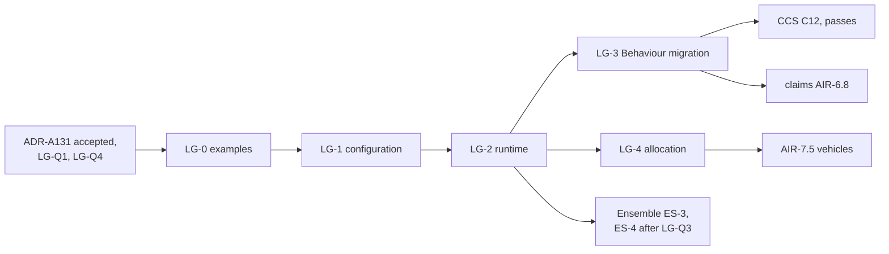
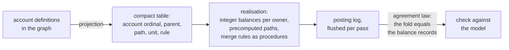

<!-- SPDX-License-Identifier: CC-BY-SA-4.0 -->

# Plan: Ledger, amounts consumed and restored over time

**Unit ID:** `ledger`
**Prefix:** LG
**Status:** proposed 2026-10-19, amended 2026-10-21 (two phases, exactness, LG-Q6 to LG-Q8). LG-Q1 to LG-Q8 answered 2026-10-21. LG-0 to LG-2 briefed below. ADR-A131 and ADR-A01's 2026-10-19 addendum accepted 2026-10-21, ADR-A131 published 2026-10-26. Amended 2026-10-27: LG-0 and LG-1 built, LG-5 part built ahead of its dependency, and the runtime questions LF-Q17 to LF-Q22 answered, so LG-2 is unblocked. An ADR-A131 addendum is owed for LF-Q19's reversal of decision 4 and for the two orderings.
**ADRs:** [ADR-A131](../../architecture/decisions/ADR-A131-ledger-layer.md) and ADR-A01's 2026-10-19
addendum, both Accepted 2026-10-21
**Sketches:** [evaluation context](../sketches/evaluation-context.md) §5 (the ledger in outline),
[contract amounts](../sketches/contract-amounts.md) (the requirements), the
[history and versioning sketch](../sketches/persistence-history-and-versioning.md) §6.1 (the account
record's keying)
**Takes over:** PDD-07 (the repair of Behaviour's allowance contract) and the ledger part of PDD-08,
from the [pending design decisions](../pending-design-decisions.md)

## Scope

A substrate layer, `ontology/ledger/` with prefix `ldg:`, imported by Behaviour's configuration:

- **configuration:** account definitions, the tree of "part of and not in addition to", the kinds of
  owner an account admits, merge rules, reset periods
- **runtime:** postings and balance records, each a derived artefact keyed by account, owner and
  position
- **Behaviour's migration:** effects draw, credit and accrue onto accounts, threshold regimes read
  balances, and the allowance terms become a deprecated shorthand
- **allocation with conservation:** one amount split into postings by a merge rule, the parts summing
  to the whole (vehicles sketch §4.2, previously AIR-7.4)

Out of scope:

- **Combinators.** Pure operations over amounts are evaluation-context EC-Q1, leaning towards
  Quantification.
- **Environments.** How effects in one pass compose is fixed by the evaluation context's model and its
  conformance cases (ADR-A131 decision 9), and run by CCS C12. Draws at one position follow
  decision 6's two phases, which LG-2 states.
- **Order between instruments.** That is Ensemble's (ADR-A130).

## What Ledger is for, and what it is not

Added 2026-10-21 at the maintainer's question: does Ledger also track observed values, such as a
stock price, a temperature anomaly, a renewable share or a ground station's wind speed?

**No.** Ledger holds amounts that are **consumed and restored**, and so **conserved**. Every balance
is the stated amount less what was drawn plus what was restored. That law is what makes balances
cheap (a fold of postings), provable (path debit, conservation) and parallel (two phases). It holds
only for quantities whose parts add up to the whole, which Quantification calls extensive, and which
permit sum and difference. The unit of account need not be money. Seats, support hours, megawatt
hours, tonnes of emissions allowed under a carbon budget and certificates surrendered are all
extensive.

An observed value is a different thing. A temperature, a percentage share, a wind speed or a price is
intensive: two readings do not add, nothing draws on them, and nothing restores them. A later reading
replaces nothing either, it is another fact at another time, and providers revise readings, so the
history matters.

| Thing | Example | Where it lives | Its law |
|---|---|---|---|
| a consumed and restored amount | a limit, a commitment, a seat quota, a carbon budget | Ledger (an account) | conservation: the balance is the fold of its postings |
| an observed value | warming above a baseline, a renewable share, a wind speed at a station, an index level | an outside fact with its source and time (ADR-A130's Instrument hook, IR-Q4), in a Quantification value space | none to conserve. A reading is evidence, and a revised reading supersedes it with both kept |
| a condition over observed values | above 1.5 degrees for a year, a share at or above a target, a gust above a speed within 72 hours | Eligibility, with the vehicles sketch's forms over time (count in a window, sustained for a duration, sequence) | three-valued, a missing reading is Undetermined |
| a state over time | a transition instrument's phases, a threshold regime partitioning a reading or a balance | Behaviour | its transition laws |
| what the instrument pays | a graduated payout by wind speed, a step-up in margin | combinators over values, then a draw on a Ledger account | the payout is computed, then posted |

So a climate transition instrument uses all of them. Its trigger (a degree of warming, a renewable
share meeting a target) is a condition over observed facts, possibly through a Behaviour regime. What
it pays or adjusts is computed, and where an amount is drawn against a limit or a budget, that is a
Ledger posting. A parametric wind cover works the same way, with the station's reading as the fact
and the policy limit as the account.

**One abstraction each, no overlap.** The performance choice of ADR-A131 decision 4, a value carried
as a literal in a value space its definition declares, applies to observed facts in the same way and
is not Ledger's own: it is a pattern for any record of a value. How observed facts are recorded is
ES-2's Instrument hook, and its conditions over time are the vehicles sketch's RV-1 (phase 7's
AIR-7.3).

## Principles

| # | Principle | Source |
|---|---|---|
| LG-1 | A balance is derived from postings, never authored | ADR-A131 decision 4, the modelling rules |
| LG-2 | A draw on a path succeeds or fails whole | ADR-A131 decision 3 |
| LG-3 | An account belongs to a persistent identity, and outlives its owner's versions | ADR-A131 decision 5, ADR-A106 decision 5 |
| LG-4 | Ledger names no term of Party, Eligibility, Wording, Instrument or Behaviour | ADR-A01, 2026-10-19 addendum |
| LG-5 | Examples first, from at least two fields besides insurance (ADR-A-C2) | lifecycle |

## Slices

Estimates are in tokens, for agent work, excluding review.

| Slice | Content | Depends on | Estimate |
|---|---|---|---|
| LG-0 | examples, as data the model must accept or refuse. Software licensing: a seat quota with an annual reset. Lending: a revolving facility, drawn and repaid. Grants: a grant with sub-budgets, and unspent funds returned. Delegated authority: an aggregate over every contract bound under an authority. Insurance: an aggregate with sections and a sublimit, a recovery credited, a reinstatement, a limit for one class of insured in addition to a shared aggregate. Keyed accounts (LG-Q7): seats per site, and a sublimit per borrower. Another value space (LG-Q8): a multicurrency facility's drawings against its base-currency commitment. Refusals: a cycle in the tree, a debit beyond availability under the refuse rule | ADR-A131 accepted, LG-Q1, LG-Q4, LG-Q7, LG-Q8 | 180k |
| LG-1 | the configuration document: the README in ADR-A126's layout, with its release notes section, account definitions, the tree, owner kinds, the merge rule scheme, reset periods, keyed account definitions (LG-Q7), shapes (no cycle, one value space along a path, the parent edge stated). The catalogue entry in the README, `ledger` in the root catalogue after `quantification`, and the import guard. The publication pass for ADR-A131 and every decision the README cites (ADR-A127). Ledger joins the release | LG-0 | 340k |
| LG-2 | the runtime document: postings, balance records, their keys and PROV, persistence's record families, the two phases at one position (propose, merge, settle), conversion on a posting (LG-Q8), and the laws as tests (a draw debits the path, availability is the least along the path, a credit never exceeds the stated amount, a pass commits whole, draws at one position give the same postings in any order) | LG-1, LG-Q2, LG-Q5, LG-Q6 | 350k | **Briefed further 2026-10-27, from ADR-A131's second addendum.** The runtime vocabulary carries the effective position and the recorded position as separate properties, and a shape compares a posting's effective position with its pass's recorded position, refusing a forward-dated posting (STD-294). A period's unit of partition, its close and its checkpoints are keyed on the recorded axis (STD-277), and a generated read as of an effective position folds rather than reading a checkpoint (STD-278). The log's grain folded in here from PDD-08 is what an evaluation records about itself beyond its postings, the two orderings and the pass stamp having answered the rest. **Depends on PDD-15, decided (a) 2026-10-28.** The account instance's natural key gains the derived period key, `binOf(recurrence, effective position)`, computed at write and never supplied by a draw, so the runtime vocabulary must carry it before the keys and PROV of this slice are written. One period recurrence holds along a path and a keyed child's instance is part of the parent's with the same bin key. A draw whose effective position cannot be binned is Undetermined with the reason `binOf` gives, which is this slice's only new refusal.
| LG-3 | Behaviour's migration: the import, effects onto accounts, threshold regimes over a balance, the allowance terms deprecated with a normalisation to a one-account ledger, insure-o and the other users moved, the applied modules and examples pinned to the new release. Behaviour's release notes class the deprecation. Repairs the allowance contract, formerly PDD-07 | LG-2 | 350k | **Depends on PDD-15, decided (a) 2026-10-28.** ADR-A131 decision 7's "firing of a reset on an occasion" goes away, since no reset fires: the first draw naming a new bin derives that period's account. The normalisation this slice writes therefore maps a Behaviour allowance with a reset recurrence onto one account per period rather than onto a one-account ledger with a reset, and `ldg:resetRecurrence` is renamed in the same change.
| LG-5 | a benchmark (ADR-A124): a generated corpus of account trees and draws at the volumes in the performance section, run against the model's records and against any realisation, failing only on a wrong result, with times recorded per run. **Partly built ahead of LG-2, 2026-10-24 to 2026-10-27**, as two modules rather than the one `benchmark/ledger/` this row first named: [`benchmark/ledger-posting-cost`](../../../benchmark/ledger-posting-cost/README.md) (the corpus, five strategies, the partition sweep, CAP-84) and [`benchmark/ledger-store-comparison`](../../../benchmark/ledger-store-comparison/README.md) (the same shape on Jena TDB2, CAP-85). They answered MS-Q1, MS-Q8 and MS-Q9 and fed §5.2 of the history sketch. **What LG-5 still owes:** a run against the layer's own records rather than a generated model, which needs LG-2, and balance records, which the built corpus does not write. The directories keep their names, since the two measure different questions and the mise tasks and capability rows name them | LG-2 | 150k, part spent |
| LG-4 | allocation with conservation: one amount split into postings on several accounts by a merge rule, the conservation law as a shape and a test, with examples from lending (pro rata sharing), insolvency (a waterfall) and a pool. **Briefed further 2026-10-27, from TD-95 and TD-96.** The conservation law must state what it does with the residual a binding ceiling leaves, since where a ceiling binds the postings do not sum to the amount drawn and the remainder reverts to the drawer, so an equality over the postings alone would refuse a correct ledger. It must also be exactly conservative under rounding: a proportional split with half-even rounding does not sum back, because three equal shares of a unit-granular amount leave a residual, so the rule allocates that residual deterministically rather than leaving it to the rounding mode. Both want a refusal example and a test at a granularity where the residual is non-zero. **Briefed further 2026-11-07, from the [waterfall proofs sketch](../sketches/waterfall-proofs-and-the-generality-gap.md) §5.1.** Five corrections and additions. (1) Conservation with an explicit residual term is the form to take, now established as a general theorem in an external development rather than left open as TD-95 recorded it, so the shape states recoveries plus residual equal the amount drawn rather than an equality over the postings alone. (2) The allocation axioms are **four**, not the five this row first listed: exactness, boundedness by each part's own amount, non-negativity, and allocating the whole returns the whole. Zero at zero follows and is not assumed. **Monotonicity is dropped**, since no law in that development needed it, and LG-4 adds it back only if one of its own laws does, naming that law in the Validation Pack. (3) The merge rule is declared data with an identity and never a default: two rules satisfying every axiom move different money on one arrangement, so a shape refuses an account drawable by two evaluations with no declared merge rule. This is why LG-Q3's "refuse as the default" is load-bearing and not cautious. (4) Attribution across parties conserves as a **second law with its own shape**, a share matrix with non-negative entries whose rows sum to one, not folded into amount conservation. It is shared with ES-5's K4. (5) Nothing above the ledger may assume a balance is monotone in its input, since a franchise makes the residual fall as the input rises, so no index or short-cut in LG-4 or the restatement read may rely on it | LG-2, LG-Q3 | 250k |
| LG-7 | the ledger laws mechanised, `tools/proofs/ledger/`, ahead of LG-2: the kernel in the README's `isabelle-spec` block, the four allocation axioms with the two lawful rules, conservation with an explicit residual, attribution conservation, the draw laws over the tree, order independence at one position, rounding with a residual, each a claim under the gate. Track E's E4a, pulled forward so LG-2, LG-4 and C5 cite theorems rather than restate the laws. Briefed 2026-11-07 below | LG-1, ADR-A131 accepted | 200k |
| LG-8 | the proofs widened on HOL-Library: LO1 restated over multisets, LR3 to LR5 for `ldg:LargestRemainder`, the integer rules and the refinement, LC3 for every step, LM1 once LG-Q11 says how a merge refuses, each a claim under the gate, the session reaching the library as LG-Q14 decides. Planned 2026-11-08 below | LG-7, track E's FME-0, and LG-Q11 for LM1 | 150k |
| LG-9 | the proofs' second widening: LR2 over multisets, an executable path so the kernel evaluates, the running balance stepwise against the one-cap fold, a merge at one position over whole units, a merge that refuses (LM1, LG-Q11 decided), and then, each only where its question is decided, `ldg:ToFirstInOrder` among keys of positive weight (LG-Q15), a signed residual (LG-Q16), a purpose on an allocated amount (LG-Q13) and an allocation that commits whole (LG-Q12). Planned 2026-11-09 below | LG-8, and each question for its part | 250k |
| LG-10 | the residual rule's published definition corrected: `ldg:ToFirstInOrder` gives the residual one unit at a time to the first proposals in order, as the kernel and the laws' prose state it, where the vocabulary's definition gave the whole residual to one proposal, which is unlawful even on positive weights ([sketch on the residual to the first in order](../sketches/ledger-residual-to-first-in-order.md) §3). It leaves a key of zero weight to LG-Q15 | none | 5k |
| LG-11 | conversion leaves the ledger, as ADR-A131's addendum of 2026-11-09 states: `ldg:conversionMethod`, `ldg:conversionUsed`, `ldg:amountAsDrawn` and `ldg:ConversionTogetherShape` removed from the README, its extracted documents and shapes, `revolving-facility.ttl` drawn in the facility's unit with its conversion cited as a record outside the ledger, and the conversion mutation in `tools/test_ledger.py` removed. The shape refusing an incompatible draw is LG-12's | none | 30k |
| LG-12 | which draws an account accepts, as LG-Q20 decided (a): a shape refusing a draw whose value space and unit are not the account's, or whose amount is not representable by the space's density and datatype, with the reason Quantification gives, and its tests | LG-11 | 30k |
| LG-13 | the insurance example's cap named for what it is: `reinstatement-pool` becomes `annual-cap` in `insurance-aggregate.ttl` and the README's worked reading, since a pool is a different kind of thing in insurance and a cap is not one (STD-325) | none | 5k |
| LG-14 | a benchmark of the credit kinds' read cost, `benchmark/ledger-credit-kinds/`: an ancestor's balance read under post-once with period graphs, as a plain fold, with a filter on credit kind, and as a fold applying each account's ceiling step by step, against a model, on every backend the repository runs, failing only on a wrong result (ADR-A124) | LG-Q10 decided | 60k |
| LG-15 | LG-14's gaps closed: a native Jena caller, in memory and on TDB2 on disk, with the stepwise fold in Java, reads from checkpoints at closings, the ceiling clamped at the drawn account as well as the ancestor, the stepwise loop timed apart from its sort and transfer, and the shortcut measured, a filtered sum checked against the stated amount with the stepwise fold only where the check fails | LG-14 | 80k |
| LG-16 | the cut the writer records, measured in `benchmark/ledger-credit-kinds/`: a second corpus with credits at two levels of a path, where an ancestor's ceiling binds, the cut stored with the credit, and an ancestor read as a sum less its cuts beside the stepwise and kind-filtered folds, on rdflib, Oxigraph and Jena, from the start and from a checkpoint. For LG-Q23 (d), the [balances sketch](../sketches/ledger-balances-under-post-once.md) §4.8 | LG-15 | 150k |
| LG-17 | LG-16's gaps closed, in three parts run one after another. **One, reads and storage:** the plain fold, the shortcut and a kind-filtered read in the same query form on the two-level corpus, a cut that copies its position, a ceiling above a stated amount, and the balances sketch's four-step tree loaded into each engine. **Two, writes:** the cost of settling and writing a posting with its cuts on a live store, concurrent writers on Oxigraph, and late postings. A write is one guarded update on the revision of the owner's ledger, the aggregate of ADR-A131 decision 5, so a stale writer writes nothing and tries again, and the committed revision is the posting's recorded position. A fixed interleaving shows the guard refuses a stale write and that an unguarded writer records a wrong cut or overdraws, and a run of 2, 4 and 8 writers counts commits, lost races and retries. The same guard protects a draw's availability check, which reads before it writes as the cut does. For late postings the writer settles in recorded order, which is the law's order (LF-Q17 (b), LG-Q9 (a)), and the benchmark reports, without judging, how a read as of an effective position, summed from the amounts and cuts as recorded, differs from a replay of the same postings in recorded and in effective order. **Three, the native Jena caller:** the two-level corpus, the sum less the cuts and the concurrent writers on Jena in memory and on TDB2, from Java. Whether one revision per owner's ledger is too coarse a guard, and what a read as of an effective position means under a ceiling, are questions its figures inform and it does not decide | LG-16 | 300k |
| LG-18 | LG-17's follow-ups measured, in two parts written on machine R and run in a cloud session. **One, a single writer per ledger:** producers hand their requests to one writer through a queue, where LG-17's writers each read, write under the guard and try again. Three writers are compared with the guarded writers on the same stores, preloads and request lists: one that reads its path for every posting, one that keeps the balances it has settled and reads nothing, and one that also commits several postings in one request. Each run's records are audited against the replay of its commits. It reports commits a second and the time a request waits, on Oxigraph in memory and on disk and on Jena in memory and on TDB2 from Java. A store that takes concurrent writers and needs the guard stays served by LG-17's writer, so the report sets the two side by side and decides nothing. **Two, the readings of LG-Q26:** on LG-17's late corpus, a balance by effective day as known at a recording, by the recorded amounts (A), by settling again in effective order (B), and as flows with no balance (C). It checks that a reading as known at a recording is unchanged by what is recorded later, counts the readings no account held and those that disagree with the ledger at the head, measures how far a later recording moves an earlier day's figure, and times each read from the start of history and from the checkpoint before the day, which STD-294 allows for A and C | LG-17 | 150k |

## Slices in detail

Written 2026-10-21, once LG-Q1 to LG-Q8 were answered, so that each slice can be built without a design decision. A builder that meets a question the brief does not answer stops at that point, records it in the slice's Validation Pack and the status record, and goes on with what does not depend on it. The skills to load are `lattice-ontology-authoring`, `lattice-mise`, `lattice-testing` and `lattice-publication-hygiene`.

### The vocabulary, for LG-0 to LG-2

Prefix `ldg:`, namespace `https://www.nebularis.org/neuro-semantic/lattice/ledger#`. Ledger names
no term of Party, Eligibility, Wording, Instrument or Behaviour (LG-4). Owners are any
`fnd:PersistentIdentity`.

**Configuration** (`ontology/ledger/spec/ledger.ttl`):

| Term | Kind | Domain, range, cardinality | Meaning |
|---|---|---|---|
| `ldg:AccountDefinition` | class | none: part of the terms that state it, as `bhv:AllowanceDefinition` is | an amount consumed and restored, as the terms state it |
| `ldg:statedAmount` | object property | AccountDefinition to `qnt:Quantity`, exactly 1 | the amount when fresh |
| `ldg:unitOfAccount` | object property | AccountDefinition to `qnt:ValueSpace`, exactly 1 | the value space every posting on it is in |
| `ldg:partOf` | object property | AccountDefinition to AccountDefinition, at most 1 | "part of and not in addition to". Absent means in addition to every other account |
| `ldg:admitsOwnerKind` | object property | AccountDefinition to `rdfs:Class`, at least 1 | the kinds of owner it admits, named by the layer above |
| `ldg:mergeRule` | object property | AccountDefinition to `skos:Concept` in `ldg:MergeRules`, exactly 1 | what happens when draws at one position together exceed availability |
| `ldg:roundingMethod` | object property | AccountDefinition to `skos:Concept` in `ldg:RoundingMethods`, at most 1 | required when the merge rule is proportional |
| `ldg:residualAllocation` | object property | AccountDefinition to `skos:Concept` in `ldg:ResidualAllocations`, at most 1 | required when the merge rule is proportional |
| `ldg:resetRecurrence` | object property | AccountDefinition to `qnt:Recurrence`, at most 1 | when the account returns to its stated amount |
| `ldg:keyDimension` | object property | AccountDefinition to `skos:ConceptScheme` or `qnt:ValueSpace`, at most 1 | LG-Q7: one account per key value |
| `ldg:countsPurpose` | object property | AccountDefinition to `skos:Concept`, any | LG-Q2: draws naming this purpose also debit this account |
| `ldg:creditCeiling` | object property | AccountDefinition to `qnt:Quantity`, at most 1 | the most a credit restores to. The stated amount when absent |
| `ldg:conversionMethod` | object property | AccountDefinition to `qnt:ConversionContext`, at most 1 | LG-Q8: how a draw in another value space is converted |

**Vocabulary** (`ontology/ledger/vocab/ledger-vocab.ttl`), each a `skos:ConceptScheme` with its
concepts:

| Scheme | Concepts |
|---|---|
| `ldg:MergeRules` | `ldg:InPriorityOrder`, `ldg:Proportional`, `ldg:Refuse` |
| `ldg:PostingDirections` | `ldg:Debit`, `ldg:Credit` |
| `ldg:RoundingMethods` | `ldg:HalfEven`, `ldg:HalfUp`, `ldg:TowardZero` |
| `ldg:ResidualAllocations` | `ldg:LargestRemainder` (ties broken by the total order of account keys), `ldg:ToFirstInOrder` |

**Runtime** (`ontology/ledger/spec/ledger-runtime.ttl`), each record a `fnd:DerivedArtefact`:

| Term | Kind | Domain, range, cardinality | Meaning |
|---|---|---|---|
| `ldg:Posting` | class | ⊑ `fnd:DerivedArtefact` | one draw or credit on one account |
| `ldg:BalanceRecord` | class | ⊑ `fnd:DerivedArtefact` | an account's remaining balance and availability at a position |
| `ldg:MergeRecord` | class | ⊑ `fnd:DerivedArtefact` | the merge of several proposals at one account and position |
| `ldg:Grant` | class | none: part of its merge record | one proposal's request and what the merge granted it |
| `ldg:onAccount` | object property | Posting, BalanceRecord, MergeRecord to AccountDefinition, exactly 1 | the account's definition |
| `ldg:forOwner` | object property | the same, to `fnd:PersistentIdentity`, exactly 1 | the account's owner |
| `ldg:accountKey` | object property | the same, to `skos:Concept` or `qnt:Value`, at most 1 | the key, for a keyed account |
| `ldg:atPosition`, `ldg:atMicroPosition` | datatype properties | the same, to `xsd:integer`, exactly 1 each | LG-Q4's ordered pair |
| `ldg:direction` | object property | Posting to a concept in `ldg:PostingDirections`, exactly 1 | debit or credit |
| `ldg:amountValue` | datatype property | Posting to `xsd:decimal`, exactly 1 | the amount, in the account's unit of account |
| `ldg:forPurpose` | object property | Posting to `skos:Concept`, at most 1 | LG-Q2 |
| `ldg:amountAsDrawn` | object property | Posting to `qnt:Quantity`, at most 1 | LG-Q8, with `ldg:conversionUsed` |
| `ldg:conversionUsed` | object property | Posting to `qnt:ConversionContext`, at most 1 | the rate's source and date |
| `ldg:remainingValue`, `ldg:availableValue` | datatype properties | BalanceRecord to `xsd:decimal`, exactly 1 each | the remaining balance, and the least along the path |
| `ldg:grant` | object property | MergeRecord to Grant, at least 2 | the proposals merged |
| `ldg:requestedValue`, `ldg:grantedValue` | datatype properties | Grant to `xsd:decimal`, exactly 1 each | in the account's unit, after rounding |
| `ldg:grantedProportion` | datatype property | Grant to the rational form LG-2's probe chooses, at most 1 | exact, for a proportional merge |
| `ldg:forProposal` | object property | Grant to the evaluation that proposed it, exactly 1, with no range, since the layer above names it (LG-4) | the evaluation that proposed it, named by the layer above |
| `ldg:refusalReason` | object property | MergeRecord to `skos:Concept`, at most 1 | under `ldg:Refuse`, why nothing was granted |

Every record's read set is `prov:wasDerivedFrom`. Natural keys follow ADR-A114: a posting by
(account, owner, key, position, micro-position, direction, proposal), a balance record by (account,
owner, key, position, micro-position), a merge record by (account, owner, key, position). No blank
nodes in records.

### LG-0 in detail: examples first

**Machine:** R or S, as the maintainer assigns. **Branch:** `ledger/lg-0-examples`, from `main`
after this branch merges. **Commits are the maintainer's.**
**Validation Pack:** [ledger-lg-0](../validation/LG-0.md).
**Decisions:** ADR-A131 (decisions 3 to 6), LG-Q1 to LG-Q8.

**Invariant:** the model accepts every arrangement below and refuses each refusal, before any term is
written into a spec.

Each file is in `ontology/ledger/examples/`, uses only the vocabulary above and `fnd:`, `qnt:`,
`skos:`, `prov:` and `ex:` terms, invents every party and value, and carries a comment block with
its hand-computed table of postings and balances. Configuration and runtime records are in one file
per example.

| File | Shows | Decisions |
|---|---|---|
| `licence-seats.ttl` | Licensing. 500 seats a year, keyed per site (two sites), an annual reset, a draw at each site, a reset restoring both | 3 (keyed), LG-Q7 |
| `revolving-facility.ttl` | Lending. A 20M sterling commitment, a euro drawing converted at a stated spot rate with its context recorded, a repayment credited, a revaluation posting at a stated date | 3, 4, LG-Q8 |
| `research-grant.ttl` | Grants. A budget with staff and equipment sub-budgets, spending, and unspent funds returned as a credit that stops at the ceiling | 3, credit ceiling |
| `authority-aggregate.ttl` | Delegated authority. An aggregate owned by an authority, drawn at one position by three proposals that together exceed it, merged proportionally with half-even rounding and largest-remainder residual, one merge record and three postings | 6, LG-Q3, LG-Q6 |
| `insurance-aggregate.ttl` | Insurance. An aggregate of 10M with two sections and a 1M sublimit in one, a further limit for one class of beneficiary in addition to the aggregate, a flood purpose counted against a flood aggregate outside the path, a loss, a recovery credited, a reinstatement as an ancestor account of twice the limit | 3, LG-Q2 |
| `refusal-cycle.ttl` | Refused: two definitions each `ldg:partOf` the other | shape |
| `refusal-unit.ttl` | Refused: a child account in a different unit of account from its parent | shape |
| `refusal-overdraw.ttl` | Under `ldg:Refuse`, two proposals exceeding availability: a merge record with no grant and a reason, and no posting | 6 |
| `refusal-proportional-unrounded.ttl` | Refused: a proportional account with no rounding method | shape |
| `refusal-intensive-unit.ttl` | Refused: an account whose unit of account is a temperature, an intensive value space | shape |

| ID | Given / When / Then | Level | +/- |
|---|---|---|---|
| LG0-01 | each example / parsed with rdflib / it parses | L0 | + |
| LG0-02 | each accepted example / its comment table / postings and balances agree with the records, by hand | paper | + |
| LG0-03 | the examples / read / at least two fields besides insurance precede the insurance example in the README's order (ADR-A-C2) | paper | + |
| LG0-04 | the examples / grep / no `ins:`, `bhv:`, `elg:`, `pty:` or `wrd:` term | L1 | + |
| LG0-05 | the refusals / read / each names the shape or rule that will refuse it | paper | - |
| LG0-06 | the changed files / prose check / no semicolons, no client names | L1 | + |

### LG-1 in detail: the configuration document

**Machine:** R or S. **Branch:** `ledger/lg-1-configuration`. **Validation Pack:**
[ledger-lg-1](../validation/LG-1.md). **Decisions:** ADR-A131 decisions 1 to 3, 5, 6 and 8,
LG-Q1, LG-Q2, LG-Q6, LG-Q7, LG-Q8.

**Invariant:** account definitions, their tree, owner kinds, merge rules, rounding, reset, keys,
purposes, ceilings and conversion are stated as configuration, and shapes refuse every malformed
tree, before any runtime record exists.

1. `ontology/ledger/README.md` in ADR-A126's layout, literate, with the catalogue entry (kind
   `substrate`, imports Foundation, Vocabulary, Quantification) and a release notes section. It cites
   only published decisions (ADR-A127), so the publication pass for ADR-A131 and the decisions it
   cites runs in this slice.
2. The configuration terms and the vocabulary above, extracted from the README.
3. Shapes (`ontology/ledger/shapes/`): cardinalities as in the table, no cycle through `ldg:partOf`
   (SHACL-SPARQL, following ADR-A128's rules), a child's unit of account equal to its parent's, a unit of
   account whose additivity is `qnt:Extensive` and whose operation capabilities include `qnt:Sum` and
   `qnt:Difference` ("What Ledger is for"), a
   proportional rule with a rounding method and a residual allocation, a credit ceiling not below the
   stated amount, a key dimension that is a scheme or a value space.
4. `ledger` in the root catalogue after `quantification`, so `check:import-guard` enforces its imports.
   The ontology architecture document and the root README show the layer.
5. `tools/test_ledger.py`, added to the root Python check's list, with the rows below.
6. Ledger joins the substrate's release (`release:prepare`), its notes classing everything as no effect.

| ID | Given / When / Then | Level | +/- |
|---|---|---|---|
| LG1-01 | the README / literate extraction / the spec and vocab equal the committed Turtle | L1 | + |
| LG1-02 | LG-0's accepted examples, configuration part / validated / conform | L3 | + |
| LG1-03 | `refusal-cycle.ttl` / validated / fails the cycle shape, by name | L3 | - |
| LG1-04 | `refusal-unit.ttl` / validated / fails the unit shape | L3 | - |
| LG1-05 | `refusal-proportional-unrounded.ttl` / validated / fails the rounding shape | L3 | - |
| LG1-05b | an account definition in an intensive value space, for example a temperature / validated / fails the additivity shape | L3 | - |
| LG1-06 | the import guard / run / Ledger imports only Foundation, Vocabulary and Quantification | L1 | + |
| LG1-07 | the spec / grep / no term of Party, Eligibility, Wording, Instrument or Behaviour | L1 | + |
| LG1-08 | the README / `check:published-decisions` / passes | L1 | + |
| LG1-09 | the cycle shape on a generated tree of 1,000 definitions in `check`, and every shape on 10,000 in `benchmark/ledger-posting-cost/test_shape_scale.py` with its time recorded (STD-155) / validated / finishes | L7 | + |
| LG1-10 | the release / `check:ontology-versioning` / Ledger is at the release's number | L1 | + |

**One command:** `mise run check`.

### LG-2 in detail: the runtime document

**Machine:** R. **Branch:** `ledger/lg-2-runtime`. **Validation Pack:**
[ledger-lg-2](../validation/LG-2.md). **Decisions:** ADR-A131 decisions 4 and 6, LG-Q3 to
LG-Q8.

**Invariant:** postings, balance records and merge records are derived artefacts with natural keys,
and their recorded values satisfy Ledger's laws, checked as shapes over the records. Computing them
is the evaluator's (CCS C12, B4a), not this slice's.

1. **The rational probe first** (LG-Q6). Record in [triple-store-discovery.md](../../architecture/triple-store-discovery.md) how rdflib and Oxigraph parse, compare and round-trip `owl:rational` literals, for example `"1/3"^^owl:rational`, following `lattice-probing`. If both handle it, `ldg:grantedProportion` takes `owl:rational`. Otherwise it is two `xsd:integer` properties, numerator and denominator, and the README says why.
2. The runtime terms above, in the README, extracted.
3. Persistence's record families for postings, balance records and merge records, append-only.
4. Shapes over records, each a law:
   - a posting's owner is of a kind its account admits
   - a balance record's remaining value equals the stated amount less debits plus credits up to its
     position, for its account, owner and key, never above the credit ceiling (L1, L3)
   - its available value equals the least remaining value along its path at that position (L2)
   - a merge record's granted values sum to no more than the availability before the merge, and
     under a proportional rule to exactly that availability where the requests exceed it, after
     rounding and residual (L6)
   - each posting from a merged draw cites its merge record in its read set
   - conversion fields appear together or not at all
   - natural keys are unique
5. The runtime parts of LG-0's examples validate, and the refusal under `ldg:Refuse` is checked.

| ID | Given / When / Then | Level | +/- |
|---|---|---|---|
| LG2-01 | the probe / run on rdflib and Oxigraph / its findings recorded with the test that shows them | L3 | + |
| LG2-02 | LG-0's accepted examples, runtime part / validated / conform | L3 | + |
| LG2-03 | a balance record altered by one minor unit / validated / fails L1 | L3 | - |
| LG2-04 | an available value above an ancestor's remaining / validated / fails L2 | L3 | - |
| LG2-05 | a credit taking a balance above its ceiling / validated / fails L3 | L3 | - |
| LG2-06 | a proportional merge whose grants sum one unit short / validated / fails L6 | L3 | - |
| LG2-07 | `refusal-overdraw.ttl` / validated / conforms, with no posting and a refusal reason | L3 | + |
| LG2-08 | a posting whose owner's kind the account does not admit / validated / fails | L3 | - |
| LG2-09 | two postings with one natural key / validated / fails | L3 | - |
| LG2-10 | a generated pass of 200 leaves in `check`, and of 5,000 postings and 10,000 balance records in `benchmark/ledger-posting-cost/test_shape_scale.py` with its times recorded (STD-155) / validated / finishes, and a broken record is found | L7 | + |
| LG2-11 | the README / literate extraction, published decisions / pass | L1 | + |

**One command:** `mise run check`.

**Not covered:** computing postings from draws and the two phases' order independence, which are
B4a's reference and CCS C12's. Behaviour's migration (LG-3). Allocation across several accounts
(LG-4). Throughput (LG-5).

**LG-7, the ledger laws mechanised.** Briefed 2026-11-07, for a machine the maintainer assigns, with its [Validation Pack](../validation/LG-7.md). The maintainer decided on 2026-11-07 that this slice runs ahead of LG-2, and that it builds on the domain-neutral core of an external Isabelle development of ours that the [waterfall proofs sketch](../sketches/waterfall-proofs-and-the-generality-gap.md) reads, on the terms below.

*What it is.* One Isabelle session, `tools/proofs/ledger/`, `session Ledger = HOL +`, over HOL alone with no `HOL-Library` as built, which LG-8 widens under LG-Q14, `document = false`, `quick_and_dirty = false`, beside `tools/proofs/eligibility/` and in its conventions, a `Kernel.thy` extracted from the layer README, theories with `(* GATE:BEGIN <id> *)` and `(* GATE:END *)` markers, one claim record per theorem under `claims/` in the eligibility session's JSON shape, built and gated by `mise run check:proofs -- ledger` and tied to the README by `mise run check:formal-freshness`. A session README states what is proved, what is assumed and the provenance.

*The kernel, in the README.* The ledger README gains a Laws section whose `isabelle-spec` block states, once, the definitions every theorem uses, and `tools/literate_extract.py --proofs-root tools/proofs` writes `Kernel.thy` from it, never by hand. A block without the `(* @reference-table *)` directive is written verbatim, so `fun` and `primrec` definitions belong in it as much as `definition` does (FM-D17, widened 2026-11-07). The definitions are an amount vector over a finite key set, as the development states it and as a posting per key needs it, a rule of type amount vector to amount to amount vector with the four axioms of `alloc_ok` under ledger names (exact, bounded by each key's own amount, non-negative, the whole returns the whole), an account tree as a parent function with its paths, remaining balance, availability as the least along the path, a draw and a credit along a path, a purpose as a second path, and a position with a key order. Exact amounts are `rat`, as ADR-A131 d6's exactness and LG-Q6 lean, and the rounding theorems are over `int` minor units with a refinement lemma joining the two where it comes cheaply (LR2). Nothing in the block names a domain.

*What it reuses, and on what terms.* The maintainer authorises reuse of the development's domain-neutral core, the amount vector, the allocator type and its four axioms, the pro rata and priority allocators and their axiom proofs, conservation with residual in pointwise and total forms, and the attribution share matrix, renamed to the ledger's terms and re-proved in this session, so that the proofs are not rewritten from nothing. The session README records this as the sketch does, an external development of ours, read as background, whose general core we rebuilt here, and never as a proof of ours imported. Nothing reinsurance-specific crosses, not the cover constructors and their features, the step function, the fold over contracts, the inurement order, the claim universes, the worked examples or the counterexamples. `spikes/isabelle-layers/Ledger.thy` is ours and public, and its draws, settlement, order independence by key and the pro rata split with residual bounds are taken as they stand and generalised from a flat balance map to the tree.

*The claims*, LA1 to LA4, LC1 to LC4, LD1 to LD4, LO1, LR1, LR2, LN1, LG1 and LG2, are the pack's test table, each a row with the law it protects. Two are negative instances kept on purpose, LA4, two lawful rules moving different amounts on one arrangement, which is why a merge rule is declared data (LG-Q3), and LN1, a threshold making the residual fall as the drawn amount rises, which is why nothing above the ledger may assume monotonicity (sketch L5). Monotonicity is not among the axioms, and the pack says it may be added only by naming the law that needs it (sketch L2).

*What it leaves out.* Uniqueness of a solution and the least fixpoint, which are ADR-A130 decision 5's and E4b's, after that decision is accepted. The runtime terms, which LG-2 writes against these theorems and whose laws-as-tests then cite a claim id. Conversion between value spaces (LG-Q8), a hypothesis on the amount. One account per key value (LG-Q7). Any insurance structure, which waits on WPG-Q4 for a home.

*How to work.* Examples first, the three positive and two negative instances of the pack as `value` checks before any theorem. One Isabelle build at a time on a shared machine. Read every `***` line, and report the Isabelle version, the elapsed build time and the gate's law report in full. The README change is documentation and adds no term, and the builder reports what `mise run check:ontology-versioning -- --base-ref main` says about it rather than bumping anything mid-branch. Where a definition in the block would need a term the README does not yet have, stop and record the question as LG-Q9 rather than invent the term.

**LG-8, the proofs widened on HOL-Library.** Planned 2026-11-08, after `HOL-Library` built on machine R under a memory limit, a 2.5 GB Poly/ML heap and a 1 GB JVM set in the user's Isabelle settings and never in the repository. The [sketch on balances under post-once](../sketches/ledger-balances-under-post-once.md) §6 states and sizes each claim. Its Validation Pack is written when LG-Q14 is answered, and nothing under `tools/proofs/` changes before then.

*What it is.* The six claims of that table, in `tools/proofs/ledger/` under LG-7's conventions. LO1 restated as `mset ps = mset ps'` over `HOL-Library.Multiset`, a reviewed restatement whose claim record moves with it. LR3, `ldg:LargestRemainder` sums exactly to the total and is a function of its inputs alone, which the reference evaluator sketch's RE-Q4 leans to as the default and LG-7 left unproved. LR4, the two integer rules lawful in the integer sense. LR5, the refinement beyond one part, which needs an integer `spread` in the kernel, a README change extracted to `Kernel.thy`. LC3 for every step and not the first only, replacing its second conclusion as a reviewed restatement. LM1, a refused merge grants nothing and changes nothing, once LG-Q11 says how a merge refuses. Each is a theorem between gate markers with a claim record, built and gated by `mise run check:proofs -- ledger`, and the session README's what-is-proved and what-is-not-covered sections move with them.

*How the session reaches the library.* LG-Q14 decided (d). The `ROOT` becomes `session Ledger = LatticeBase +`, the prelude session of track E's FME-0, whose heap holds the library theories every layer's proofs reach for, so no machine builds the `HOL-Library` heap and the one built on machine R serves its editor. The kernel keeps `imports Complex_Main`, and a library theory is imported by the theorem theories alone, so the README's block and its extraction do not move for the library's sake. FME-0 records the prelude's build time, and the ledger session's own stays seconds.

*What it leaves out.* Code export of `spread` and `draw` through `HOL-Library.Code_Target_Numeral`, which the isabelle-layers spike shows works from source, until a consumer asks for an oracle, the reference evaluator or the rig's test vectors. The fold shapes LG-Q9's rework changes, which are LG-2's. The composition law, which stays with E4b.

**LG-9, the proofs' second widening.** Planned 2026-11-09, after LG-8 reached `main` and its review, for machine S on one branch with its [brief](../notes/machine-s-brief-2026-11-09.md). Its Validation Pack is written by the slice, as LG-8's was. It is in two halves, seven parts that wait on nothing, the decided LG-Q16 part, and two that are each built only where the plan's question row reads decided on the day the part is reached.

*The parts that wait on nothing, in this order.*

- **LK, the order as a declared input**, first, since every rule part after it uses it. The three rules stay as rules, and the order they read is passed in, resolved from the wording, the law or a rule imposed on the account, as `ldg:InPriorityOrder` already says a stated priority order is. The kernel takes it as an argument, a list of the proposals' keys without repeats, and never the keys' own order, so `'k::linorder` leaves `in_priority`, `to_first` and `largest_remainder`, and `ahead` reads the declared list. Every law that holds for every key order is restated to hold for every declared order, the order independence theorems stay about the order of the proposal list, and the README's definitions of `ldg:InPriorityOrder`, `ldg:ToFirstInOrder` and `ldg:LargestRemainder` say the order is declared, never the identifiers', which moves the vocabulary held by BL-19 (TD-161). One new law makes the point checkable: renaming the keys by any bijection that carries the declared order with it leaves every rule's result the same up to that renaming, so no rule can read anything from a key but its place in the declared order.
- **LS, two kinds of split**, as LG-Q19 decided. `lawful` stays rationing's four axioms, and the residual rules in rationing give a unit only to a claim below its amount. A second predicate states apportionment's three laws without the bound, the residual rules are proved lawful under it for every declared order, and LC4's attribution is restated as an apportionment. The vocabulary terms for the two kinds are proposed in the README for review, by the law's names.
- **LR2 over multisets.** `to_first_is_the_same_in_every_order` restated as `mset ps = mset ps'`, as LR3's third theorem already is, a reviewed restatement whose claim record moves with it.
- **LX1, an executable path.** `path` is a set defined by a transitive closure, so nothing that reads it evaluates, which LG-8 named as what blocks code export. A function listing an account's path by following `parent`, terminating through `HOL-Library.While_Combinator` or a bound taken from the tree's size, proved under `tree A parent` to list exactly `path parent a`, and code equations for `available` and what is built on it, so `value` and `code_simp` evaluate `draw`, `settle_at` and `spread_int` on the examples. No `export_code` in this slice. PDD-19 was decided on 2026-11-09 for a generated evaluator, and where its code is exported, on which hosts and how its performance is measured belongs to the evaluator implementation plan's EV-3.
- **LB1 and LB2, the running balance.** A balance stepped along a list of an account's postings, a debit subtracted and a credit added then stopped at the ceiling, stated in the README's block. LB1, the step agrees with the kernel's `debit` and `credit` on that account. LB1n, a negative instance kept on purpose, the four-step history of the [sketch on balances under post-once](../sketches/ledger-balances-under-post-once.md) §3, where the ceiling applied once to the whole fold gives 100 and the stepped balance 70. LB2, a list of recorded balances is right exactly when each satisfies the step from the one before it, which is the law a per-posting shape checks and holds whichever reading LG-Q9 takes.
- **LM2, a merge at one position over whole units.** `merge` takes a rule over exact amounts, so LG-8 left the rounded merge out, and LG-2's merge shape and LG-4 both need it. An integer merge and settlement in the README's block, the requests granted whole where they fit and split by an integer rule where they do not. With `largest_remainder`: the grants sum to the lesser of what was asked and what was available, each grant is within its request and not negative, the path is debited by exactly what was granted and no balance goes below zero, the result is the same for every list of proposals with the same multiset, and each grant is within one unit of the exact proportional grant.
- **LM1, a merge that refuses**, as LG-Q11 decided on 2026-11-09, (b) with (a)'s result. The kernel's `merge` gains an explicit result, grants or a refusal with its reason, a guard before the rule that refuses where the declared policy is `ldg:Refuse` and the requests exceed availability, or for an order check the account declares up front, and a rule may itself refuse for a reason it states, such as a tie its declared order does not break, only where the case arises (LG-Q11 widened twice, the rulings on scenario C2), and LM1: a refused merge grants nothing and changes no balance, a merge that proceeds is the rule's split as LO1 and LC1 state it, and the result is the same for every list of proposals with the same multiset. LM2's merge over whole units returns the same result, so it is built after LM1 or restated with it.

*The parts that wait on a question.* For each, read the question's row in this plan when the part is reached. Where it reads decided, build what it decided. Where it reads open, leave the part out and say so in the handoff.

- **LG-Q15, decided 2026-11-09, with nothing to build for it alone.** The keys of a split are those the stated meaning names, so no rule filters them. What follows for the second axiom waits on LG-Q19. The text below was the plan for the leaning (b) before the decision, kept for LG-Q19's reading: under (b), `to_first` takes the first keys in order among those of positive weight, in the README's block and in the vocabulary table's definition of `ldg:ToFirstInOrder`. LR2 is re-proved, LR4 loses its positive-weight hypothesis, LR5's split across accounts is proved for both rules, LM2 is stated for both, and the zero-weight instance becomes a positive one. Under (a) the rule and LR2 leave the kernel.
- **LG-Q16, decided (c) by default, (a) or (b) where the wording states them.** The README's constraints gain a shape refusing `ldg:HalfEven` or `ldg:HalfUp` beside a residual rule unless the account states how the overshoot is treated, with vocabulary terms for the two treatments proposed for review. The kernel gains rounding to the nearest and a signed residual taken back by the declared order, or from the shares rounded up most with ties by the declared order, each proved to sum exactly and to stay within one unit of the exact share. `authority-aggregate.ttl` declares half-even with largest remainder and no treatment, so under the default it would be refused. The maintainer chose on 2026-11-09 that its rounding method becomes `ldg:TowardZero`, keeping `ldg:LargestRemainder`, which is the split LR3 and LR5 prove.
- **LG-Q13.** Under (a), `spread` and `spread_int` debit `reach`, and LC1 to LC3 and LR5 are restated over it.
- **LG-Q12.** Under (a), an allocation across accounts that commits whole or changes nothing, as LD1 states for a draw.

*What it leaves out.* The fold shapes and the runtime document, which are LG-2's rework after LG-Q9. Code export. The composition law, E4b's. Any benchmark.

## Performance and runtime realisation

Added 2026-10-21 at the maintainer's request: every choice is checked for its cost at runtime, since a
ledger that is expressive but slow is no use to a system that must compute changes quickly. The model
in ADR-A131 is the one published for conceptual modelling. A deployment may realise it in faster
forms, held to it by an agreement law. No realisation is planned here.

**Choices made for speed in the model itself.**

| Choice | Effect |
|---|---|
| a posting's amount is a decimal literal in the account's unit of account | about 8 triples a posting rather than 11, and no join to read an amount |
| an account is identified by its definition, its owner and its key, with no account node | no node created per owner, and no lookup to find one |
| positions are two integer literals on the posting | ordering is a comparison of literals |
| balance records materialised once per pass, holding the remaining balance and the availability (LG-Q5) | a read is one lookup, never a sum over postings or a walk up the path |
| keyed accounts derived on the first draw that names a key (LG-Q7) | no account is written for a key nobody draws on |
| a pass writes its postings, merge records and balance records in one batch | one store round trip a pass, never one a draw (ADR-A130's evaluator consequence) |
| proportions exact, postings in minor units (LG-Q6) | integer arithmetic on the hot path. Rationals appear only in merge records |

**Costs.** Estimates, to be measured by LG-5.

| Operation | Model in the graph | A compiled realisation |
|---|---|---|
| one draw on a path of depth *d* | 1 posting and *d* balance records, about 8(*d*+1) triples, written once per pass | *d* integer subtractions with a check, one log entry |
| availability of an account | one lookup on a materialised record | one array read |
| a pass with *p* draws over *n* accounts | one batch of about 8(*p*+*n*) triples | *p*·*d* operations, one flush |
| a catastrophe event of 5,000 losses, each drawing on a section and an aggregate (*d* = 2) | about 5,000 postings and up to 10,000 balance records per pass, about 120,000 triples | about 10,000 operations |
| two-phase merge at one account and position with *k* proposals | one merge record of about 4*k* triples | *k* proposals sorted once, order *k* log *k* |

So the model in the graph is fit for the records an insurer or lender keeps of what happened, at the
rate passes happen. A system that evaluates thousands of hypothetical passes, for example scenario
analysis over an event set, uses a realisation and writes nothing per hypothetical pass.

**A realisation pattern, for later.** Not planned. Recorded so the model leaves room for it.

| Rule | Why |
|---|---|
| a realisation adds no semantics (ADR-A131 decision 8) | every implementation agrees |
| it is populated from the configuration by a projection, never authored | the configuration stays the one source |
| its agreement law is checked by sampling, as for every derived engine | a faster form never silently diverges |
| several realisations may exist, each for a use (live records, scenario runs, a browser view) | each is a derived engine of the evaluator note's three kinds |

## Formal methods

Placed in the [formal-methods epic](formal-methods.md), under FM-D8:

| Slice | Track | Content | When |
|---|---|---|---|
| C5 | C | an Alloy model of ADR-A131: a draw on a path succeeds or fails whole, availability is the least along the path, a credit never exceeds the stated amount, the tree has no cycle, each merge rule conserves the amount it shares, after rounding with its residual rule, and draws at one position give the same postings in any order of proposal | before or alongside ADR-A131's acceptance |
| B4a | B | the Ledger reference within the evaluation context's reference (B4), with conformance cases for C12's draws | with LG-2 and CCS C12 |
| E4a | E | the same laws mechanised from B4a, within E4. **Started as LG-7 on 2026-11-07, ahead of B4a and LG-2**, since ADR-A131 is accepted and its laws are stable, and one proved text for LG-2's tests, LG-4's shapes and C5's model is worth more than the lifecycle's usual order. What B4a adds later is the conformance cases against C12's draws. LG-8 widens the claims with `HOL-Library` theories, LG-Q14 deciding how the session reaches them | LG-7 first, LG-8 after LG-Q14, then after B4a |

## Releases

Ledger is a member of the substrate's release (ADR-A129). Each slice that changes a member is a new
release: `mise run release:prepare -- <X.Y.Z>`, release notes in every changed layer classing each
change by its effect on existing data, and a tag the maintainer creates. LG-1 and LG-2 add terms
only, so their notes class them as no effect. LG-3's deprecation is no effect, and the later removal
of the allowance terms changes meaning. That removal owes a migration if an adopter holds production
data under the allowance terms by then, so it is timed before that or ships with one.

Behaviour's README migrates to ADR-A126's layout in a later unit (`improved-ontology-documentation`,
OD-D61). Whichever of LG-3 and that migration lands second adopts the other's format, as that plan
already arranges for CCS slices.

## Done when

The five examples of LG-0 validate. Their postings and balances match a hand-computed table. The
refusals fail with the shape that names them. Behaviour's tests and insure-o's cases pass on the
migrated model. `mise run check` passes, with `check:import-guard` enforcing Ledger's imports,
`check:published-decisions` passing on Ledger's README, and `check:ontology-versioning` holding Ledger
to the release's number.

## Effects on other units

| Unit | Change |
|---|---|
| CCS | C12 runs draws and credits as postings, sequential environment first. C12 waits on LG-3 |
| Ensemble (ADR-A130) | ES-3's K2 examples read exhaustion from a balance record, so ES-3 waits on LG-2. An account drawn by several instruments belongs to their ensemble, and the K6 relation is derived from the terms that draw on it. LG-Q3 and LG-Q4 are settled before ES-4 is briefed |
| AIR phase 7 | AIR-7.4 becomes LG-4. AIR-7.5 depends on LG-4 |
| AIR claims | AIR-6.8's programme erosion uses programme-owned accounts, after LG-3 |
| AIR phase 5 | term parameters (limits, retentions, aggregates, reinstatements) state accounts. Phase 5 waits on LG-3 |
| Capacity | the withdrawn execution profile (P7-Q4) leaves no second model of a consumed amount |
| Improved ontology documentation | **OD-DOC4, the layer interactions record, is picked up as soon as this unit's design is settled**, which is when the scenarios note is ruled through, LG-Q23 is decided and machine S's brief is written. Its brief keeps the list of inputs, and STD-326 adds to it until then |

## Questions LG-Q1 to LG-Q25

LG-Q9 and LG-Q10 were raised on 2026-11-08 by LG-2's build and are open. LG-Q11 to LG-Q13 were raised the same day at the verification of LG-7 and LG-2, from the [sketch on balances under post-once](../sketches/ledger-balances-under-post-once.md) §5, and are open. LG-Q14 was raised the same day, when `HOL-Library` built on machine R under a memory limit, and decided (d) the same day. LG-Q11 was decided on 2026-11-09. LG-Q17 was raised the same day, at that decision. LG-Q15 and LG-Q16 were raised on 2026-11-09 from LG-8's first finding, in the [sketch on the residual to the first in order](../sketches/ledger-residual-to-first-in-order.md), and are open. LG-Q24 and LG-Q25 were raised on 2026-11-12, when the maintainer decided LG-Q21 as a derivation through Surface and ruled scenario E2.

| ID | Question | Options | Leaning |
|---|---|---|---|
| **LG-Q1** | The word for an account (PDD-08) | account, budget, allowance, tally | **Answered 2026-10-21, as leaned:** account. It is the ledger's own unit in accounting and in computing, and has no market meaning. "Budget" suggests planning, and "allowance" is the term being deprecated |
| **LG-Q2** | Shared limits that are not a tree (EC-Q3) | (a) an account with two parents. (b) one account with several draw purposes, keeping the tree. (c) across instruments, two accounts and an Ensemble relation | **Answered 2026-10-21, as leaned:** (b) within one owner, and (c) across owners. A tree keeps the path debit and its proof simple. Whether a limit is part of its parent or in addition to it is stated on the account, never inferred, since policies state both, for example a sublimit that is part of a section's limit beside a further limit for one class of insured in addition to a shared aggregate |
| **LG-Q3** | An account shared by several instruments, such as an authority's aggregate, drawn by their separate evaluations | (a) the draws are ordered by Ensemble K3 rank, each evaluation reading the balance the one before it left. (b) the draws are proposals merged by the account's merge rule at the owner's pass. (c) (a) where a rank is stated, (b) otherwise | **Answered 2026-10-21, as leaned:** (c), refined 2026-10-20. A stated priority is the law's answer where there is one. Otherwise draws at different positions fall in the order of their positions, and the merge rule decides only between draws at one position, with "refuse" as the default. Draws at one position run in two phases: propose, merge by the owner, settle (ADR-A131 decision 6, added 2026-10-21), so the result never depends on which evaluation ran first |
| **LG-Q4** | How a posting names its position without naming Behaviour | (a) Ledger's own ordered pair, position and micro-position, supplied by whatever posts. (b) only `prov:wasGeneratedBy` to the run, with the order read from the run | **Answered 2026-10-21, as leaned:** (a). A balance at a position is then read without joining the runtime records of another layer. Behaviour supplies its stimulus log positions. Since an ensemble's account is drawn from several instruments' logs, their positions must be comparable, so the account's owner supplies one order for its account (added 2026-10-20) |
| **LG-Q5** | Balance records materialised per pass, or derived on read | (a) materialised once per pass for each affected account. (b) derived from postings on each read | **Answered 2026-10-21, as leaned:** (a), with postings authoritative. A read then costs one lookup, against a sum over every posting on the account and its descendants |
| **LG-Q6** | How a derived proportion that no decimal states exactly is kept, for example a share signed down by a third, or a proportional merge (ADR-A131 decision 6) | (a) exact rationals in records and in the codec, with `owl:rational` in RDF where stores support it, or a numerator and denominator pair where they do not. (b) rounded to a precision the rule declares, with the residual allocated by the rule. (c) (a) for proportions, and (b) for amounts posted to an account, which are always in its unit of account | **Answered 2026-10-21, as leaned:** (c). A proportion is a judgement other evaluations cite, so it stays exact. A posting is money, so it is in the account's unit, rounded by the rule's stated method with the residual allocated so the parts sum. Before ES-5 and LG-4, a probe records how rdflib, Oxigraph and Jena treat `owl:rational` literals (parse, compare, round-trip) in the triple-store discovery record, and the codec gains a rational form, for example `"1/3"` with its value space. **Jena added 2026-11-07**, since the store comparison already runs on TDB2 (CAP-85) and a rational literal the ledger stores must survive every engine we measure on, not only the two the answer first named |
| **LG-Q7** | Amounts that apply per key, for example seats per site, a sublimit per borrower, an aggregate per location (ADR-A131 decision 3) | (a) an account definition states a key dimension, a concept scheme or a value space, and one account per key value is derived on the first draw that names it, its natural key being the definition, the owner and the key value. (b) one authored account per key. (c) an account per member, owned by an ensemble | **Answered 2026-10-21, as leaned:** (a). The terms state one rule, and the accounts follow from facts. Authoring one account per site or location repeats the rule and misses keys nobody foresaw. A shared parent above the keyed accounts, such as a policy aggregate over every location's aggregate, is an ordinary parent edge |
| **LG-Q8** | A draw in another value space than the account's, for example a drawing in euros against a facility committed in sterling (ADR-A131 decision 3) | (a) refused, so every draw arrives in the account's unit. (b) converted on the posting: it records the amount drawn, the converted amount and the conversion's context (the rate's source and date) as a Quantification context value (ADR-A115), by the method the terms state, or where they are silent by an outside rule, or else Undetermined. (c) an account holding a balance per value space | **Answered 2026-10-21, as leaned:** (b). Agreements state the method, such as the spot rate on the drawing date, and the posting is then evidence of it. Where terms also revalue outstanding amounts at stated dates, the revaluation is a further posting by the same method. (c) would leave availability against the commitment undefined **Reversed to (a) by the maintainer on 2026-11-09**, ruling on scenario C4 of the posting scenarios: every draw arrives in its account's unit, the ledger never converts, and a conversion is logged and its rate recorded where it is performed, before the draw. ADR-A131's addendum of that date, proposed, and LG-11 carry it out |
| **LG-Q9** | Which balance a posting's running balance states, now that a draw is posted at the drawn account only (LF-Q17 answered (b), LF-Q18 answered (c)) | (a) the balance of the posting's account, its subtree included, at the posting, which needs every descendant's postings ordered against the account's own sequence. (b) a running sum of the account's own postings only, which is not its balance where it has descendants. (c) a running balance on postings at a leaf account only, with balance records for every other account | **Decided (a), 2026-11-09.** The maintainer stands by the design agreed and benchmarked, a running balance on the posting at the drawn account, which keeps storage low and the hot path's reads fast while keeping the law. Order within a pass is pass position then micro-position. LG-2's balance record per account per pass leaves the runtime document and the checkpoint at a close stays ([sketch on balances under post-once](../sketches/ledger-balances-under-post-once.md) §2.2). A past state the hot path does not read is answered from history when asked (PRI-81). Whichever reading is taken rewrites `ldg:BalanceFoldShape` and `ldg:CheckpointFoldShape`, so TD-158, their sum that errors on a strict engine, is paid by the same rework and not before (agreed 2026-11-08) |
| **LG-Q10** | How a pool that caps total capacity across an aggregate's reinstatements is built, now that a credit to the aggregate rolls up to the pool | (a) the reinstatement is also debited at the pool, as `insurance-aggregate.ttl` now does. (b) the pool is not an ancestor, but an account a reinstatement draws on by purpose. (c) a credit ceiling on the pool's subtree fold | Open. (a) keeps the example's arithmetic and needs nothing new, but it posts at an ancestor, the exception LF-Q18 (c) allows only for purposes | **Revised 2026-11-10**, after the maintainer showed (e) encodes the tree in the posting: proposed instead, the credit states its real-world kind from a bound scheme, and each account declares the kinds that restore it, all by default ([sketch on balances under post-once](../sketches/ledger-balances-under-post-once.md) §4.5). **Decided 2026-11-10 as proposed:** a credit carries its kind from a scheme whose contract Ledger declares and an applied module binds, each account declares the kinds that restore it, all by default, an ancestor folds the credits whose kind it accepts, and a guard refuses as Undetermined a credit with no kind on a path where an account restricts kinds. Whether recovery, reinstatement and write-back suffice for insurance is the applied module's, extensible by its binding |
| **LG-Q11** | How a merge refuses. ADR-A131 decision 6 names a refuse rule that leaves the draws Undetermined with a reason, and LG-7's kernel has no form for it, since `merge` cuts the requests to availability whenever they exceed it, so LG-2's `ldg:RefusedMergeShape` cites LD1, a draw's refusal, and no theorem covers a merge's | (a) a merge result that is either grants or a refusal with its reason, with a theorem LM1 that a refused merge grants nothing and changes nothing. (b) refusal decided before the rule runs, as a guard on the pass, so a rule is only ever applied to a merge that proceeds. (c) refusal is the runtime's and never the kernel's | **Decided 2026-11-09, (b) with (a)'s result.** A refusal is decided before any rule runs, by the account's declared `ldg:Refuse` policy alone, when the requests at one position exceed availability. The merge returns an explicit result, the grants or a refusal with its reason, never a refusal encoded as zero grants, so LM1 is stated over it. `ldg:Refuse` is not a lawful rule, since a refusal shares nothing and the first axiom says the parts sum to the amount shared, and every rule keeps the four axioms with no hypothesis. A rule that refuses for its own reasons is not supported, and the explicit result keeps it addable later as a further case without restating a law. A bundle paid whole or not at all is `ldg:Refuse` itself, since a merge at one position already sees every request at that position together. A request that must be granted whole or not at all is a grant of zero with a residual, LG-Q17. **Widened 2026-11-09**, by the maintainer's ruling on scenario C2: the guard has a second reason, that the rule needs an order and the declared order does not rank every proposal it would choose between, for example tied largest remainders with no tie-breaker, when the outcome is Undetermined and the merge is refused with that reason. Both reasons are decided before any rule runs, so every rule keeps the four axioms with no hypothesis. **Widened again 2026-11-09, both mechanisms.** A tie is known only once a rule has computed its remainders, so a pre-check that the declared order ranks every proposal refuses even where no tie arises, which the maintainer judged wrong as the only choice. So a refusal may come from either place. A guard refuses before any rule, from the inputs alone, for the refuse policy, or for an order check an account declares it wants up front. A rule may itself refuse, for a reason it states, for example a tie its declared order does not break, and only where that case arises. The merge's explicit result carries either. Each rule's laws hold for every result that grants, and LM1 states what a refusal from either place grants and changes, nothing |
| **LG-Q12** | Whether an allocation across several accounts commits whole, and whether the order of its accounts is declared. `spread` debits account by account, so LD1's atomicity does not cover a pass that allocates one amount over several accounts, and its result depends on the order of the accounts as a waterfall should, so two orders move different money as two rules do in LA4 | (a) a pass commits whole as a runtime law with a shape and a theorem, and the account order is declared data with an identity, never a default, with a shape refusing an allocation that has none. (b) the order is the account tree's own, so nothing is declared. (c) atomicity is the pass's and order is the rule's, both outside the kernel | **The order half decided 2026-11-09:** a proposal's identifier never decides any order. Every rule that needs an order, in priority, either residual rule and an allocation across accounts, takes it as a declared input, supplied by law, by the wording or by a rule imposed on the account (TD-161, PRI-82). Atomicity is open, leaning (a). The maintainer ruled on 2026-11-09 that the order is contractual data, the order of notification or of size as the wording states it, and that an order chosen to leave the least residual is no rule a contract states ([posting scenarios](../notes/ledger-posting-scenarios.md) A2). The law also supplies an order where the wording states none, for liability insurance the order in which liability is ascertained (the same scenario's ruling), so the declared order is a criterion with a default, and key identifiers never decide it |
| **LG-Q13** | Whether an allocated amount with a purpose debits the purpose-counting accounts. `draw` debits `reach`, the path and every path of an account counting the purpose, and `spread` debits `path` only | (a) allocation takes `reach`, so a purpose on an allocated amount counts as it does on a draw. (b) a purpose is a draw's and never an allocation's, stated as a law. (c) a purpose on an allocation is Undetermined | Open. (a), unless LG-4 finds a reason a waterfall never names a purpose |
| **LG-Q14** | How the proof session reaches `HOL-Library`, now that the library builds on machine R under a memory limit and machine S has moved to other work | (a) `session Ledger = HOL +` with `sessions "HOL-Library"`, the theories named loaded from source, so the session builds on every machine and in the formal-methods workflow without the heap, slower per build by those theories' own load, the local heap serving the editor alone. (b) `session Ledger = "HOL-Library" +`, fast where the heap exists and a heap build of some minutes under a memory cap wherever it does not, machine S, the workflow and a cloud session included, with a cache to keep. (c) two sessions, the core on HOL and the widened claims on the library, each with its gate (d) a prelude session over `HOL` with `sessions "HOL-Library"`, importing the library theories every layer's proofs reach for, built once per machine into a heap that every layer session parents on | **Decided (d), 2026-11-08**, after the [HOL sessions survey](../sketches/hol-sessions-survey.md). The theories the proof areas want are few and shared, so (a) would check them again in every session and (b) would put a heap on every builder, where (d) checks them once per machine and leaves no machine building the library. The prelude is track E's FME-0, and LG-8 parents on it |
| **LG-Q15** | How `ldg:ToFirstInOrder` treats a key of zero weight. As the kernel states it, a residual unit goes to the first keys in order whatever their weight, so a key that asked for nothing can be granted a unit, which breaks decision 6's second axiom (LG-8, `to_first_can_exceed_a_zero_weight`). Zero weights arise by construction in an amount drawn across accounts in turn | (a) retire the rule, leaving `ldg:LargestRemainder`. (b) redefine it as one unit at a time to the first keys in order among those of positive weight, lawful on every non-negative weight and equal to today's rule wherever that was lawful. (c) keep it with a positive-weight precondition, as LG-8 proved it, usable at one position and never across accounts. (d) keep it and have every caller drop zero-weight keys first | **Decided 2026-11-09, none of (a) to (d) as framed.** The keys in a split are the ones the stated meaning names, never what a rule filters. A fee shared among lenders by their outstanding loans names only lenders with an outstanding loan, so a lender with none is not a key and takes nothing. A fee shared among all the lenders of the syndicate names every lender, so one with nothing outstanding is a key and takes the odd unit where the declared order puts it first (the maintainer's ruling on scenario C2). That second case is a share of a benefit, where no part is bounded by its own amount, so it falls outside the second axiom, and LG-Q19 asks whether the ledger has two kinds of split. The vocabulary table's wording, the whole residual to the first proposal, was corrected by LG-10 |
| **LG-Q16** | What a rounding method means beside a residual rule. The kernel rounds by floor only, so its residual is never negative, where `ldg:HalfEven` and `ldg:HalfUp` can round the shares to more than the total and leave a unit to take back, which neither residual rule defines. `authority-aggregate.ttl` declares half-even with largest remainder | (a) the allocation is always floor then residual, and the rounding method governs only how a single exact share is shown, so the two are not independent choices and the vocabulary says so. (b) a signed residual is defined, units taken from the keys rounded up the most or the last in order, with its own theorems. (c) half-even and half-up are refused beside a residual rule | **Decided 2026-11-09, (c) by default.** The treatment is the wording's, the contract every participant signs. Where the wording states none, rounding to the nearest beside a residual rule is refused, so the configuration is invalid. Where it does state one, it may say the rounding method governs only how a share is shown and the split is floor then residual, (a), or that units rounded over are taken back, (b), from the last in the declared order or from the shares rounded up most with ties broken by the declared order, never by the keys (TD-161). The maintainer's ruling on scenario C3 of the posting scenarios |
| **LG-Q17** | Whether a rule may leave part of the amount unallocated, as an explicit residual, where the requests cannot be met exactly. The first axiom says the parts sum to the amount shared, so a rule over requests each granted whole or not at all is unlawful wherever no subset fills availability, for example availability 7 and requests of 5 and 4, where the right answer grants 5, refuses the 4 and leaves 2 | (a) a second family of rules, lawful with a residual: the parts sum to at most the amount, each within its request, the rest an explicit residual, with conservation as LC1 already states it with a residual. (b) indivisible requests are a guard per request before the rule, dropping those that cannot fit, and the rule stays exact over the rest. (c) not supported | Open. Agreed with the maintainer on 2026-11-09 to be a separate and smaller question than a rule that refuses. To settle with LG-4 |
| **LG-Q18** | How an order reaches the ledger, now that keys never decide one. The law may supply it, for example the order in which liability is ascertained, which a jurisdiction's Behaviour state machine asserts on the event stream (PRI-82). The wording may state it, for example the order of notification or of size, and a rule imposed on the account may | (a) a rank on each request, a datatype the evaluator writes from whichever source applies, read by the merge rule. (b) the account declares the criterion, an order kind such as ascertainment, notification or size, and the merge rule reads the fact the criterion names on each request. (c) both, the criterion declared on the account and the rank derived from it on each request, so the merge record shows what decided the order | Open. Raised by the maintainer's ruling on scenario C1. The kernel's form is the same under all three, an order given to the rule as an input |
| **LG-Q19** | Whether the ledger has two kinds of split, raised by the ruling on LG-Q15. Rationing divides what is available among requests, and no grant may exceed its request, which is decision 6's second axiom, so a request of zero takes nothing. Apportionment divides an amount among the members the wording names by a basis, for example a fee by outstanding loans, and no part is bounded by its basis, so a member whose basis is zero may take a residual unit the declared order gives it. The kernel's four axioms are rationing's | (a) two kinds of split, rationing under the four axioms and apportionment under exactness, non-negativity and the whole returning the whole, without the bound, with the residual rules lawful in each. (b) one kind, rationing, and apportionment stated as rationing with each member's request set to the amount, so the bound holds trivially. (c) apportionment is not the ledger's, and a fee shared among members is computed by the instrument and reaches the ledger as grants | **Decided (a), 2026-11-09.** Two kinds of split, each named as the law uses the word, the larger configuration surface accepted since (b) is harder to reason about. **Rationing** divides what is available among claims that exceed it, each cut and none granted more than it claims, which is what the law calls abatement where a fund falls short, as general legacies abate rateably and creditors of one rank share pari passu. Its laws are decision 6's four axioms, and a residual unit goes only to a claim not yet met in full, so a claim of nothing takes nothing. **Apportionment** divides an amount into proper shares among those the wording names as entitled, by a stated basis, as the Apportionment Act 1870 divides a periodical payment by time and a fee is shared by outstanding loans. Its laws are exactness, non-negativity and the whole returning the whole, without the bound, so a member whose basis is zero may take a residual unit the declared order gives it. A merge at one position, an allocation across accounts and an insolvent estate's dividend within a rank are rationing. A fee or a benefit shared among members, and the attribution of LC4, are apportionment. The names of the two in the vocabulary are LG-9's to propose for review |
| **LG-Q20** | Which draws an account accepts, now that a draw in another value space is barred (ADR-A131's addendum of 2026-11-09). A pool of 10 licences drawn by 50% is fine, and by 33% is 3.3 licences, which must be refused. Quantification already states density, datatype, unit contracts, exact and contextual conversions and proportions over a named base | (a) only the account's space and unit, with the amount representable, every conversion and every proportion resolved before the ledger. (b) as (a), with exact, non-contextual unit changes such as pence to pounds checked by the ledger. (c) as (b), with a proportion resolved by the ledger against a base the account declares | **Decided (a), 2026-11-09.** An account accepts a draw only in its own value space and unit, with the amount representable by the space's density and datatype. Every conversion, exact or contextual, and every proportion's resolution to an amount happen before the ledger, where they can be recorded, and an unrepresentable amount is refused, never rounded ([sketch on compatible value spaces](../sketches/ledger-compatible-value-spaces.md)) |
| **LG-Q21** | Who derives an account definition from an instrument's bound meaning. No layer or plan says it, and every field has a source in the contract, a referenced rule or the law ([sketch on accounts from instruments](../sketches/ledger-accounts-from-instruments.md) §3) | (a) a mapping stated once per kind of limit, applied by instantiation, reaching Ledger through Behaviour. (b) Behaviour's configuration states each instrument's accounts by hand. (c) the mapping of (a) written in MORK and compiled | **Decided 2026-11-12, as a fourth reading.** It is a derivation, stated once per kind of qualifier as a Surface projection contract that lowers into a MORK mapping, naming both layers' terms without either importing the other. A field's value comes from the instrument's clauses, a document it refers to, a rule the deployment imposes, or Ledger's documented default, and where all are silent the derivation refuses. Authored definitions stay legal (PRI-01, LG-Q25). A derived definition's name is Ledger's, by content, and a version a record cites is kept. Not built in the current slices ([sketch](../sketches/ledger-accounts-from-instruments.md) §9) |
| **LG-Q22** | How a credit kind's scheme edition is fixed for a historical read, since a meaning-bearing dependency of a versioned thing must itself be versioned (ADR-A142) and a binding resolved afresh could give today's edition | (a) each account definition version pins the edition its restoring kinds were resolved against, which needs TD-102 paid. (b) each credit records the edition it was resolved against | Open, leaning (a): one reference per definition version, and TD-102 is needed for historical reads of the amount and ceiling anyway. The pin sits on the derivation's record, with the definition versioned and named by content ([sketch](../sketches/ledger-accounts-from-instruments.md) §9), agreed 2026-11-12, with the three rules for a derived definition's name: the definition versioned (TD-102), named by Ledger's rule from its content, and every version a record cites kept |
| **LG-Q23** | Whether a credit records the amount it was applied at, clamped at the account it is posted to when it is written, so an ancestor's balance is a sum. LG-15 found that with credits clamped where they are posted, no ancestor's ceiling binds wherever every ceiling equals its account's stated amount, so the ordered read of TSD-72 is needed only where a ceiling stands above it ([LG-15's pack](../validation/LG-15.md)) | (a) the credit posting's amount is the applied amount, the writer clamping it from the path balances it already holds under LG-Q9 (a), with the amount offered kept on the request or merge record. (b) the posting keeps the offered amount and records the applied amount beside it. (c) neither, and every read that a ceiling could affect is an ordered read | Open, leaning (a), with a ceiling above the stated amount either refused beside an ancestor whose fold is a sum, or read in order where it is declared. **Amended 2026-11-12.** LG-15's finding holds for credits posted on leaves only. A reinstatement at an aggregate followed by a recovery below it binds the aggregate's ceiling with every ceiling equal to its stated amount, so (a) alone gives a wrong sum there. A clamp along the whole path was examined and not taken, since it loses a recovery the annual cap should count. Option (d) is added: the writer records on the credit a cut at each accepting ancestor that had less room, and every ancestor's balance is a sum less its cuts ([balances sketch](../sketches/ledger-balances-under-post-once.md) §4.8). Open, leaning (a) with (d), which no configuration defeats. The maintainer is comfortable with it on 2026-11-12 and asked for its read cost measured first. **Measured 2026-11-12 by LG-16** ([pack](../validation/LG-16.md)): the sum less the cuts equals the stepwise balance everywhere, at 3 triples a cut, and reads at about the cost of the kind-filtered sum on three engines, with no ordered read. **Measured again 2026-11-12 by LG-17** ([pack](../validation/LG-17.md)), which closed LG-16's gaps. Against a kind-filtered read in the same query form the sum less the cuts costs 1.01 to 1.12 from the start of history and 1.12 to 1.35 from a checkpoint on three engines through Python, and 0.91 to 1.09 from the start on Jena called from Java, so LG-16's "cheaper" was the query form. A cut that copies its position adds 1.2% to the store and does not pay. A ceiling above a stated amount changes neither the result nor the cost. A write costs its path reads, which are 93 to 99% of it on every store but TDB2, where a durable commit takes 84 to 98 ms, and adds 3 triples a cut. Under concurrent writers the cuts stay equal to the replay wherever the store applies updates one at a time, which Oxigraph in memory, Jena in memory and TDB2 do and Oxigraph on disk does not (TSD-73, TSD-74, TD-162), and the guard of one revision per owner loses throughput as writers are added. A read as of an effective position, summed from the cuts as recorded, equals neither replay once a ceiling has cut a credit, which bears on PDD-14 and is not decided here. The decision is the maintainer's |
| **LG-Q24** | What the ledger profile holds and where it is declared. **Decided 2026-11-12 that it exists and is the deployment's**, one of the rules a deployment sets for every ledger it runs. It says whether a ceiling above a stated amount is admitted, off by default, so a design-time shape refuses such a configuration, and it takes the dials that tune cost and change no meaning, the closing recurrence first | (a) a versioned profile node the deployment authors, which each owner's ledger names, as Surface and Persistence profiles are. (b) settings on the root account definition of each tree. (c) a deployment rule of the kind LG-Q21's third source describes, with no node of Ledger's own | **Decided (a), 2026-11-12**, for consistency with the profiles Surface and Persistence already have. Moving `ldg:closingRecurrence` off the account definition changes a published term, so it is batched with the next substrate change |
| **LG-Q25** | Which definition holds where an authored account definition and a derived one answer the same qualifier, since both are legal (PRI-01) | (a) refused as a conflict, and the author removes one. (b) the authored one holds, as an override the derivation's record names. (c) the derived one holds, and an authored definition is legal only where no derivation answers | **Decided (a), 2026-11-12.** The conflict is refused, since a silent override is a second source of truth |
| **LG-Q26** | What a read as of an effective day shows once a ceiling has cut a credit. The writer settles in recorded order (PDD-14, LG-Q9 (a)), so an applied amount or a cut is a fact of that order, and LG-17 found that the same amounts placed on their effective days give a balance no account held at 2 to 7 of 27 reads ([balances sketch](../sketches/ledger-balances-under-post-once.md) §4.9, [LG-17's pack](../validation/LG-17.md)). It is a reporting read (STD-278) and nothing on the decision path waits on it | (A) the recorded amounts placed on their effective days. (B) every posting settled again in effective order, as a restatement. (C) flows by effective day, what was drawn and offered, with a balance stated only as of a recorded position. (D) later cuts rewritten when a late posting arrives, refused with PDD-14 | Open, raised 2026-11-12, leaning (C) with (B) on request and (A) refused, as a hypothesis. The sketch's four tests come first: practice in two fields, the questions readers ask added to the scenarios note, a stability property checked on LG-17's late corpus and stated for the proofs, and the cost of the flows read. Whichever is taken, the amount offered stays reachable beside the amount applied, which bears on LG-Q23 (a)'s wording. The sketch's two diagrams go to the ledger README once LG-Q23 and this question are decided |
