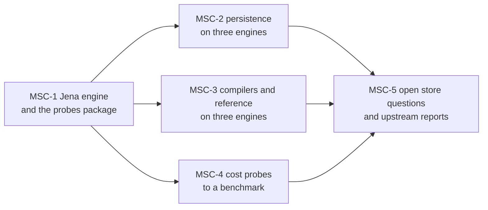

<!-- SPDX-License-Identifier: CC-BY-SA-4.0 -->

# Multi-store conformance: plan

**Unit ID:** `multi-store-conformance` (slice prefix MSC)
**Status record:** [multi-store-conformance.md](../status/multi-store-conformance.md)
**Decisions it builds on:** ADR-A124 (benchmarks measure, never fail on time), ADR-A125 and its 2026-10-21 addendum (test-support packages, Oxigraph the default engine, conformance before a merge, "each engine added later, for example Jena, joins this run and adds nothing to `check`"), ADR-A83 (the reasoning test kit, the precedent for a Java engine driven from Python tests), ADR-A128 (efficient queries and shapes), STD-153, STD-173, STD-176, STD-274, the replacement for STD-279 and R9 (2026-10-27).
**Placement:** open. Test support, engine findings and benchmarks, nothing domain-specific.

## Why

Our generated SPARQL is tested on Oxigraph by default and on rdflib before a merge. Two engines are not enough to tell a defect in our SPARQL from one engine's reading of the specification. In October 2026 they disagreed on aggregates over a row with no value (TSD-41, TSD-43), on `COUNT(expr)`, and Oxigraph 0.5.13 changed the cost of a left join into `GRAPH ?g` (TSD-42). A third engine, Apache Jena ARQ, measured once by hand for TSD-43, agreed with the specification where both of the others departed from it in different cells. This unit makes Jena a standing engine of every conformance run, moves cost assertions out of `check` into benchmarks, and answers the open store questions a third engine can answer.

## Outcome

- `tools/testing/jena`, a test-support package that runs SPARQL queries and updates on an in-memory Jena dataset through the same interface as `tools/testing/oxigraph`.
- Every engine-parametrised suite runs on rdflib, Oxigraph and Jena in its conformance task: persistence, the MORK compilers, Eligibility's reference differential tests, and the engine probes.
- A home for engine probes that are not about one tool, `tools/testing/sparql_probes`, holding the aggregate matrix (moved from `tools/mork_compilers`) and run on all three engines, with Jena executed rather than recorded.
- No timing assertion in any `check` task. Cost probes live in `benchmark/`, report a ratio per engine, and fail only on a wrong result.
- Findings for every divergence the third engine exposes, in the store-discovery record, with upstream reports drafted where an engine departs from the specification.

## Out of scope

- Changing any default engine of a `check` task. Jena joins conformance runs only (ADR-A125 addendum, decision 2).
- Fuseki as a server, unless MSC-Q1 chooses it. TSD-Q12 asks about Fuseki and stays open otherwise.
- Fixing a generated query whose meaning is under design in another unit. Report it to that unit's status record and the maintainer. In particular the profile read set's dependence on `?decision` (aggregate-errors Validation Pack, audit items 4 to 6) belongs to CCS slice C9b3b.
- GraphDB, RDFox, Virtuoso, Neptune. The interface built here should make each a later addition of one entry.

## Where it runs, and keeping it isolated

- **Base.** The unit starts from `ccs-trunk` at the commit that adds this plan, since it needs TSD-41 to TSD-43, the aggregate matrix and `check:mork-compilers`' engine switch, which are not yet on `main`. It has its own integration branch, `multi-store-conformance` (see the operating rule under Answers). `multi-store-conformance` merges into `main` only after `ccs-trunk` has, and takes `main` back in before it does.
- **Files shared with other work.** Keep edits to these small, and append rather than rewrite: `mise.toml` (new tasks, and the engine lists of existing conformance tasks), `tools/persistence/tests/engines.py` (one registry entry and one branch in `dataset`), `tools/mork_compilers/src/mork_compilers/engines.py` (the same), `docs/architecture/triple-store-discovery.md` (new entries and rows only), `docs/architecture/efficient-queries-and-shapes.md`, `repository-catalogue.md`, the registers.
- **Reserved identifiers,** so this unit and the CCS unit never collide: store findings numbered 50 to 69 and their open questions 30 to 39, run records lettered S to Z (the CCS unit stays below S), debt rows 100 to 109, standards 290 to 299, capabilities 90 to 99, pending decisions 30 to 34. CAP-90 is registered with this plan.

## Rules for whoever builds it

- Read `AGENTS.md` and the skills it names, `lattice-triple-stores`, `lattice-testing`, `lattice-toolchain`, `lattice-lifecycle` and `lattice-publication-hygiene` above all, and follow any private overlay `AGENTS.md` describes.
- Ask the knowledge index before every design, query or test decision, more than once, with `--kind discovery`, `--kind standard --activity query-writing` and `--tech sparql,jena` among the questions. Start with `read` on TSD-04, TSD-10, TSD-18, TSD-40, TSD-41, TSD-42, TSD-43, STD-153, STD-173, STD-176, STD-274 and the STD-279 replacement, CAP-55, CAP-85, CAP-90. Report misses at each handoff and add what the fallback found to its register (STD-272).
- Every command through `mise run` or `mise exec --`. Java 25 and Maven 3.9 come from mise.
- One Validation Pack per slice, `docs/developer/validation/multi-store-conformance-msc<n>.md`, with test ids, exact commands, real results and an adversarial probe (break a pattern, never `FILTER(false)`). About 15 tests or more than two modules means split the slice.
- A divergence is never silenced. Each is triaged as one of: our SPARQL relies on one engine's reading (fix it under the STD-279 replacement, or record it as debt with its owner), an engine departs from the specification (a TSD finding, an expectation per engine in the test, a drafted upstream report under `.local/upstream/`), or the harness is wrong (fix it). A test that cannot pass on one engine is marked for that engine with the finding's id, strictly, so a fix upstream shows.
- Pause for the maintainer at every design question the answers below do not settle.

## Design questions, answered before the unit starts

Each with options and consequences. The maintainer's answers are recorded under "Answers".

**MSC-Q1. How Jena runs under Python tests.**

| Option | Design | Runtime |
|---|---|---|
| (a) a Java test kit driven over standard input and output, as `platform/reasoning-testkit`'s `serve` is (ADR-A83): one JVM per test session holding an in-memory `DatasetGraph`, a line per request (load, query, update, reset), results as SPARQL JSON | one small Maven module and a Python wrapper. No server, port or new Python dependency. Reuses the JVM start-up work the reasoning kit already did (a class-data archive) | one JVM start per session, about 1 s, then a pipe round trip per call. In process with the data, so cost probes measure the engine, not HTTP |
| (b) Fuseki as a server, started per session, reached over HTTP | uses `platform/semantic-dataset-fuseki`'s Jena and answers TSD-Q12 on the way. A port, a process to manage and a dataset reset per test | HTTP and serialisation per call, which a cost probe would measure |
| (c) Jena in process through JPype | a new Python dependency with native parts, against ADR-A125's preference for packages that install cleanly everywhere | fastest calls, fragile installs |

Leaning (a). The Maven module sits beside the reasoning kit, `platform/sparql-testkit`, test-only like it, and the Python wrapper is `tools/testing/jena`. (b) can be added later as a fourth engine for Fuseki itself.

**MSC-Q2. Which Jena.** The platform parent POM and `benchmark/ledger-store-comparison` both use 5.1.0. Leaning 5.1.0, from the parent POM, so the repository holds one Jena.

**MSC-Q3. Where the aggregate matrix and other engine probes live.** Leaning `tools/testing/sparql_probes`, a test-support package (ADR-A125) with its own conformance task, holding `aggregate_error_cases.py`, `aggregate_error_expected.py` and `test_aggregate_errors.py`, moved from `tools/mork_compilers/src/mork_compilers/`, where they are test-only code in a shipped package. The recorded Jena column becomes an executed one, and the recorded expectations stay as the expected results per engine.

**MSC-Q4. What happens to timing assertions.** P3 in `tools/persistence/tests/test_store_probes.py` is the only timing assertion in a check suite (2026-10-27), now a strict expected failure on Oxigraph 0.5.13 (TSD-42, countersigned). Leaning: move it to a benchmark, `benchmark/persistence-store-probes`, that prints the ratio per engine and version and fails only on a wrong count, and remove it from `check:persistence`. TSD-Q22 is then answered by running that benchmark on each new Oxigraph release.

**MSC-Q5. When the three engines run.** Leaning: in each suite's existing conformance task, on demand and before a merge (ADR-A125), plus one task, `check:conformance`, that runs every conformance task in turn, so one command checks every engine before a merge into `main`.

## Slices

| Slice | Delivers | Planned validation |
|---|---|---|
| MSC-1 | `platform/sparql-testkit` (Maven module, `serve` over standard input and output, an in-memory dataset, requests load, query, update, reset, results as SPARQL JSON) and `tools/testing/jena` (Python, the same methods and result conversion as `tools/testing/oxigraph`, `available()` false when the jar is missing). `mise run bootstrap:sparql-testkit`, a catalogue entry for each, a README each. `tools/testing/sparql_probes` with the aggregate matrix moved into it and run on rdflib, Oxigraph and Jena by `check:sparql-probes-conformance` | the wrapper's own tests: load, query, update, reset, a query error surfacing as an exception, literal datatypes and language tags, blank nodes, named graphs, an update's atomicity on error. The matrix's 22 tests pass on all three engines, Jena now executed. The kit's start-up and per-call cost recorded |
| MSC-2 | `jena` in `tools/persistence/tests/engines.py`'s registry, and `check:persistence-conformance` naming `rdflib,oxigraph,jena`. Every failing test triaged as above | the conformance run's result per engine. A finding, a fix or a debt row for each divergence. No change to `check:persistence` |
| MSC-3 | `jena` in `tools/mork_compilers`' engine registry, the conformance task running rdflib and Jena (a task per engine, or a list the module reads, decided in the slice's brief), and Eligibility's reference differential tests on Jena where they execute SPARQL. The profile read set's `?decision` divergence probed on Jena and reported to CCS, not fixed | both conformance runs green or each failure triaged. The read-set probe's result per engine |
| MSC-4 | `benchmark/persistence-store-probes` with P3 and TSD-42's four forms per engine, P3 removed from `check:persistence`, TSD-40's path forms added for Jena, `check:persistence-store-probes` as an on-demand task (ADR-A124) | the benchmark's report on each engine. It fails on a wrong count and never on time |
| MSC-5 | TSD-42 and TSD-43 rerun on Jena, TSD-Q18, Q19, Q21 (`MAX`) and Q23 answered or narrowed with Jena's evidence, and upstream reports drafted under `.local/upstream/` for each engine departure, none filed | the store-discovery record's open questions table, each touched row dated |

## Answers

Decided by us on 2026-10-27, under the maintainer's mandate to complete the plan autonomously, for the maintainer's review before `main`.

- **MSC-Q1 (a).** A Java test kit, `platform/sparql-testkit`, driven over standard input and output as the reasoning kit is, and its Python wrapper `tools/testing/jena`.
- **MSC-Q2.** Jena 5.1.0, from the platform parent POM.
- **MSC-Q3.** `tools/testing/sparql_probes`, holding the aggregate matrix moved from `tools/mork_compilers`.
- **MSC-Q4.** P3 moves to `benchmark/persistence-store-probes` and leaves `check:persistence`.
- **MSC-Q5.** Each suite's conformance task, plus `check:conformance` running them all.

**Operating rule for this unit.** Commits go to the `multi-store-conformance` branch only, which stands in for `msc-trunk`. Sub-agents work in worktrees detached from it and never commit, and we bring their changes onto the branch after review.
