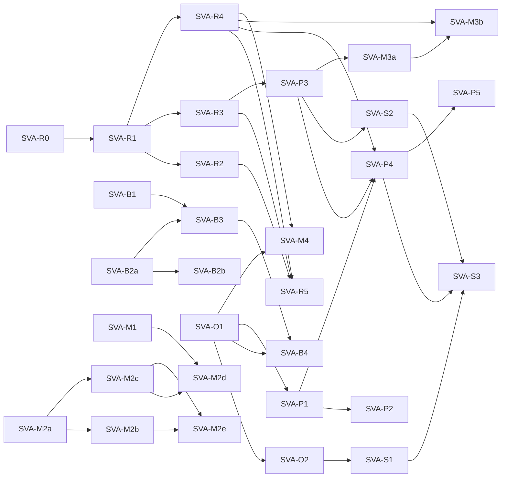

<!-- SPDX-License-Identifier: CC-BY-SA-4.0 -->

# Plan: baseline management, canvases and run panes for the Configuration Studio

**Unit ID:** `studio-visual-authoring`
**Prefix:** SVA
**Unit type:** multi-slice unit, validation gate per slice
**Status:** planned 2026-11-12 from the [sketch](../sketches/studio-visual-authoring.md). SVA-Q1 to SVA-Q16 answered, SVA-Q3 on 2026-11-13 and the rest on 2026-11-12. The maintainer asked on 2026-11-12 for the unit to be built autonomously
**Sketch:** [studio-visual-authoring.md](../sketches/studio-visual-authoring.md)
**Status record:** [studio-visual-authoring.md](../status/studio-visual-authoring.md)
**Builds on:** the [Configuration Studio](../../architecture/configuration-studio.md) ([ADR-A136](../../architecture/decisions/ADR-A136-configuration-studio.md) and its amendments, [ADR-A149](../../architecture/decisions/ADR-A149-publication-from-the-studio.md)), its [contract](../../../contracts/config-studio/README.md), [ADR-A88](../../architecture/decisions/ADR-A88-ontology-import-resolution-for-consumers.md), [ADR-A148](../../architecture/decisions/ADR-A148-mork-transform-backends.md), and the events of [projection-maintenance](projection-maintenance.md) PM-3b
**Depends on:** nothing in flight

## 1. Goal and acceptance

An author imports an ontology with its imports resolved from a catalog and sees what is missing, reads any element's axioms in a form, sees the ontology drawn, edits persistence and surface configuration on a canvas, steps a simulator that shows what a write does to the graph and what it maintains, and runs a chosen compiled mapping over a sample on demand and reads its output as a drawing, a table or text. Accepted when each phase's demonstration of section 7 runs live in the studio on the facility sample, every slice's Validation Pack passes, and the run protocol's failure cases of the sketch's section 4.3 each have a test on the real stack.

## 2. Principles

| | Principle | Source |
|---|---|---|
| 1 | A run stores nothing and is a deterministic function of its compile job, its input and a stated time, tested with a permutation and a repeat | the sketch's section 4.2, PRI-56, PRI-58 |
| 2 | No request waits for a worker where the tab has events. The request that does wait, for a tab without them, is the same run collected by the service | SVA-Q1 |
| 3 | Who may hear a run is decided at delivery, from the graph as it is then | PM3-T5, the events sketch |
| 4 | A simulator's state is the tab's. No worker holds a session | SVA-Q3 |
| 5 | A canvas edit is the form's edit, through the model's one edit function, so it is undone, validated and saved like any other | ux-design.md section 3 |
| 6 | Every view is derived from the graphs and the compile job's artefacts. Positions on a canvas stay in the browser and never enter a graph | `MappingCanvas.tsx` |
| 7 | Each component checks what it receives, the run worker included | PRI-75, STD-298 |
| 8 | Nothing is fetched from the web to resolve an import unless a later decision allows it | SVA-Q5 |
| 9 | What waits on other work is shown and marked with what it waits on, as the RML form is | ux-design.md section 3 |

## 3. Decisions

The sketch's section 12 holds SVA-Q1 to SVA-Q16 and their answers. SVA-R1 drafts a decision record, Proposed, for what changes the studio's architecture: runs and their frames, content in a run's frames, the run worker and its engine, and the deprecation of the transforms route. SVA-M2a drafts the addition to MORK. Their numbers are taken from the catalogue when they are drafted.

## 4. What it touches on the roadmap

| Item | How |
|---|---|
| `v-rig-studio` (planned) | its views can use the shell of SVA-R4 and the canvas kit of SVA-O1. Neither waits on the other |
| `studio-quality` SQ-3 to SQ-6 (planned) | the run protocol is one more flow for its model and its load runs. SVA-R5 adds the scenarios to the harness SQ-1 built |
| `projection-maintenance` PM-3c, PM-Q19, PM-Q21, PM-Q22 (open) | frames travel as events do, so a proxy run carries them unchanged. A frame is larger than a status event, which SVA-R0 probes through the broker and PM-3c would probe through a proxy |
| ADR-A148 (Proposed) | SVA-R3 changes the worker it describes, so the decision record of SVA-R1 names it |
| TD-151 | bears on the compiled form picker of SVA-M3b, which shows RML per scheme |
| BL-08, BL-10, BL-11, BL-13, BL-20 to BL-24 | left out, as the sketch's section 11 says |
| PDD-18 | not touched. Template cards do not change how a mapping reaches reference data |

## 5. Slices

A slice's documents change in the slice. Estimates are in tokens.

### Phase R, runs

| Slice | What | Modules | Done when | Waits on | Estimate |
|---|---|---|---|---|---|
| SVA-R0 | probes of the broker for content frames: the largest MQTT packet, what a slow QoS 0 subscriber loses, and order through one consumer | `tools/testing/studio_harness` | each finding is recorded with what was run and on which version, and the limits of rule 9 are confirmed or changed | nothing | 80k |
| SVA-R1 | the decision record, Proposed. The contract's Runs section, the `cst:` terms of a run and a frame, the two queues in the topology, and the fake service's runs | `contracts/config-studio`, `apps/config-studio/e2e` | the contract states every rule of the sketch's section 4.2, and the fake service answers a run with frames | SVA-R0 | 150k |
| SVA-R2 | the service: `POST …/runs`, pending entries with their deadline, the relay's run sink with its check at delivery, the waiting sink, the limits | `platform/config-studio-service`, `platform/config-studio-core` | a run accepted by one of two instances reaches its tab once and in order, a locked workspace withholds, and a fifth pending run answers `429` | SVA-R1 | 220k |
| SVA-R3 | the run worker, from the transforms worker: two queues, a bounded number of requests at once, the deadline, the redelivery rule, frames. XSLT and JOLT run as runs, and the transforms route is answered by the same code | `platform/config-studio-transforms` | a transform's result as a run equals its result by the old route, and a run redelivered gives one failed frame | SVA-R1 | 220k |
| SVA-R4 | the browser: `runs.ts`, which numbers a pane's runs, keeps the first frame per `seq`, holds the deadline and falls back to the waiting request. The dock's run pane, controls left and displays right | `apps/config-studio` | property tests pass frames duplicated, reordered and missing, and the pane shows running, complete, incomplete and failed | SVA-R1 | 200k |
| SVA-R5 | the failure cases of the sketch's section 4.3 on the real stack, in the harness and the liveness suite | `tools/testing/studio_harness`, `apps/config-studio/e2e-stack` | each of the five cases has a test that fails when its rule is broken | SVA-R2, SVA-R3, SVA-R4 | 180k |

### Phase B, the baseline

| Slice | What | Modules | Done when | Waits on | Estimate |
|---|---|---|---|---|---|
| SVA-B1 | `rdf/catalog.ts` and `rdf/imports.ts`: reading an XML catalog with `nextCatalog`, a document's ontology header in Turtle and RDF/XML, the closure with its cycles, and the plan | `apps/config-studio` | LATTICE's own catalog resolves every import of the substrate from a dropped copy of `ontology/`, and a removed file is reported missing | nothing | 160k |
| SVA-B2a | the contract, the service and the writer: several jobs in one imports command, and the ontology IRI and version IRI on a held import | `contracts/config-studio`, `platform/config-studio-core` and its two users | a closure of several documents is held by one write, and a failed guard leaves none of it named | nothing | 180k |
| SVA-B2b | LATTICE's documents staged with their catalog and served by IRI, and the validation warning for an import with no held document | `tools/config_studio_stage.py`, `workers` | a baseline importing a substrate layer resolves it with no file dropped, and a missing import is a warning on its statement | SVA-B2a | 150k |
| SVA-B3 | the Baseline view: the left list of ontologies and imports, the import dialog with its plan, what is missing, and Replace resolving again | `apps/config-studio` | the journey imports a folder with a catalog, shows one import missing, and holds the rest after the author confirms | SVA-B1, SVA-B2a | 200k |
| SVA-B4 | the import graph, with imports, binds and uses terms of | `apps/config-studio` | the facility sample draws its ontology, its imports and its schemes with the three kinds of edge | SVA-B3, SVA-O1 | 110k |

### Phase O, the ontology

| Slice | What | Modules | Done when | Waits on | Estimate |
|---|---|---|---|---|---|
| SVA-O1 | the canvas kit taken out of `MappingCanvas.tsx`, with our own layered layout behind one function, and the mapping canvas moved onto it. The time to lay out 100, 500 and 2,000 nodes measured | `apps/config-studio` | the mapping canvas's tests pass unchanged, and the timings are in the status record | nothing | 220k |
| SVA-O2 | the views of classes and object properties and of the class hierarchy, the toggle between domain and range and shapes, and the neighbourhood of a class | `apps/config-studio` | on the facility sample the toggle adds exactly the edges its shapes state, each naming its shape | SVA-O1 | 200k |
| SVA-O3 | `rdf/axioms.ts` and the element forms | `apps/config-studio` | each OWL construct of the sketch's section 6 has a unit test, and a triple the form does not recognise appears in its table | nothing | 220k |

### Phase P, persistence

| Slice | What | Modules | Done when | Waits on | Estimate |
|---|---|---|---|---|---|
| SVA-P1 | a compile job's description of each target's landing places, and the exploded view with its scope picker, read-only | `workers`, `apps/config-studio` | each lens draws the facility sample's aggregate with every graph its operations name | SVA-O1 | 240k |
| SVA-P2 | edits on the canvas, the set fixed against the `dal:` shapes in the slice's brief | `apps/config-studio` | each gesture makes the triples its form field makes, and one undo removes them | SVA-P1 | 200k |
| SVA-P3 | the simulation executor in the run worker: the sample world loaded, the request checked and bound with the caller library, the update run, the delta by landing place, the outcome | `platform/config-studio-transforms`, `packages/persistence/java` | create, replace, delete and a stale replace on the facility sample give the deltas the persistence conformance suite expects, the same on a repeat and under permuted input | SVA-R3 | 300k |
| SVA-P4 | the simulator pane: the sample world, the object form, an uploaded object, the operations, as another writer, step back, and the four displays | `apps/config-studio` | the journey creates a facility, changes it, loses a race as another writer and steps back, with the canvas lighting each landing place | SVA-R4, SVA-P1, SVA-P3 | 260k |
| SVA-P5 | an object generated from the aggregate's boundary shape, one of each owned node the shape requires, with values of each property's datatype | `apps/config-studio` | a generated facility passes its boundary shape and is created in the simulator | SVA-P4 | 120k |

### Phase S, surface

| Slice | What | Modules | Done when | Waits on | Estimate |
|---|---|---|---|---|---|
| SVA-S1 | the surface canvas, with a read path built by clicking from class to class | `apps/config-studio` | a path built on the canvas writes the triples the hop-by-hop control writes | SVA-O2 | 240k |
| SVA-S2 | the executor: the clear and the fills of a source's family, a projection's compiled queries, the rows before and after, and the contracts whose read set an edit touched | `platform/config-studio-transforms`, `workers` | the rows equal those the surface compiler's own rebuild gives for the same world | SVA-P3 | 260k |
| SVA-S3 | the simulator pane, on the shared sample world | `apps/config-studio` | one edit in the persistence simulator shows the rows it retracts and asserts in the surface simulator | SVA-S1, SVA-S2, SVA-P4 | 200k |

### Phase M, mapping

| Slice | What | Modules | Done when | Waits on | Estimate |
|---|---|---|---|---|---|
| SVA-M1 | the mapping schemes listed on the left, with their counts and review state | `apps/config-studio` | a workspace with three schemes lists them, and the select is gone | nothing | 90k |
| SVA-M2a | MORK's template library: the examples first, then the class, the text of README section 5.5, the shapes, and `mork_rdf` resolving a library's template | `ontology/mork`, `tools/mork_rdf` | a scheme instantiating from a library compiles to the queries it gives with the template copied in | nothing | 260k |
| SVA-M2b | `mork2rml` and `mork_transforms` resolving a library's template, and MCN reading and writing a library with its annotations | `tools/mork`, `tools/mork_transforms` | the three backends agree on the library example, and a library round-trips through MCN | SVA-M2a | 240k |
| SVA-M2c | the studio's contract and worker: a library as a publishable unit, and a compile that reads the libraries a scheme can read | `contracts/config-studio`, `workers` | a scheme compiles against a library held as a dependency, pinned when it is published | SVA-M2a | 180k |
| SVA-M2d | the Libraries section: a library on the canvas, its prefixes, and its annotations as fields | `apps/config-studio` | the journey builds a library, annotates a template and instantiates it from another scheme | SVA-M1, SVA-M2c | 200k |
| SVA-M2e | template cards, as a tool of the proposer and of the MCP server | `workers`, `platform/config-studio-service` | a proposal over the sample source instantiates a library's template | SVA-M2b, SVA-M2c | 160k |
| SVA-M3a | a mapping's CONSTRUCT queries over an RDF sample, by stratum, as a run | `platform/config-studio-transforms` | the run's output equals the dry-run job's for the ODRL sample | SVA-P3 | 150k |
| SVA-M3b | the sample pane: the scheme, the compiled form with whether it has a runtime, the sample, Run, and marks on what is out of date. The automatic rerun goes | `apps/config-studio` | nothing runs until Run is pressed, and an RML form is shown as waiting on BL-20 | SVA-R4, SVA-M3a | 200k |
| SVA-M4 | the output explorer: RDF as a graph on the canvas kit, JSON and XML as a tree, text with Turtle the default for RDF, and a table | `apps/config-studio` | a run's output opens in each rendering, and the simulators use the same component | SVA-O1, SVA-R4 | 220k |

### The order

SVA-R0, SVA-B1, SVA-O1, SVA-O3, SVA-M1 and SVA-M2a wait on no other slice, so they are the first wave once their questions are answered. The total is about 6.0 million tokens.

## 6. Planned validation

| Concern | Level | How |
|---|---|---|
| a run is deterministic | L2 | the executor on a repeat and on permuted input, for each kind of run |
| the browser assembles frames | L2 | property tests over duplicated, reordered and missing frames |
| the contract | L3 | the fake service and the real one answer the same run with the same frames |
| one relay, in order, across instances | L4 | two service instances in the harness |
| the five failure cases | L5 | the harness stops a worker, stops an instance, drops a tab's connection and locks a workspace during a run |
| a simulated write agrees with the store | L4 | the executor's delta against the persistence conformance suite's expectation for the same operation |
| journeys | L6 | the browser suites on the fake service, then on the real stack |
| limits | L7 | a result at the frame limit, and a fifth pending run |
| who hears a run | L8 | another principal's tab, another tab of the same principal, and a workspace locked during the run |

`mise run check:config-studio` and `mise run test:config-studio` cover a slice of the application. `mise run test:config-studio-browser` and `mise run studio:liveness` run before a merge, by convention, and SVA-M2a and SVA-M2b add `mise run check:persistence-conformance` only if they touch a generated query, which they are not expected to.

## 7. Demonstrations

| Phase | Demonstration |
|---|---|
| R | an XML sample transformed as a run, with the worker stopped mid run in a second pass |
| B | a folder with a catalog imported, one import removed first and reported missing |
| O | the facility ontology drawn with and without shapes, and a class with a restriction read in its form |
| P | a facility created and changed in the simulator, then a lost race as another writer |
| S | the same edit followed into the rows a promotion keeps |
| M | a library built and annotated, a scheme instantiating from it, and Run on a chosen compiled form with its output as a graph, a table and Turtle |

## 8. Not in this unit

Cost estimates at size (BL-10), generated data and sizing (BL-11), samples stored with the workspace (BL-08), an RML runtime (BL-20), Oxigraph as a second simulation engine (BL-21), a catalog directory a deployment configures (BL-22), `elkjs` and `dagre` as layouts (BL-23), boundary edits on the persistence canvas (BL-24), other notifiers (BL-13), editing a baseline's axioms unless SVA-Q9 says otherwise, and the verification rig's views (`v-rig-studio`).
