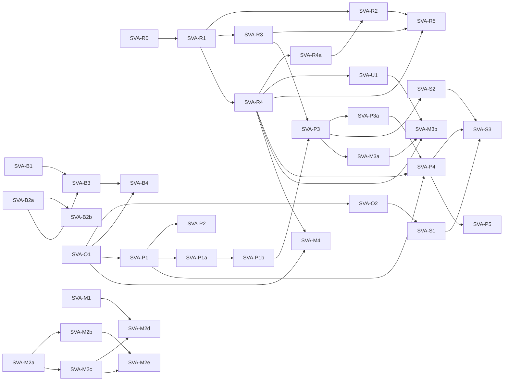

<!-- SPDX-License-Identifier: CC-BY-SA-4.0 -->

# Plan: baseline management, canvases and run panes for the Configuration Studio

**Unit ID:** `studio-visual-authoring`
**Prefix:** SVA
**Unit type:** multi-slice unit, validation gate per slice
**Status:** planned 2026-11-12 from the [sketch](../sketches/studio-visual-authoring.md). SVA-Q1 to SVA-Q16 answered 2026-11-12. The maintainer asked on 2026-11-12 for the unit to be built autonomously
**Sketch:** [studio-visual-authoring.md](../sketches/studio-visual-authoring.md)
**Status record:** [studio-visual-authoring.md](../status/studio-visual-authoring.md)
**Builds on:** the [Configuration Studio](../../architecture/configuration-studio.md) ([ADR-A136](../../architecture/decisions/ADR-A136-configuration-studio.md) and its amendments, [ADR-A149](../../architecture/decisions/ADR-A149-publication-from-the-studio.md)), its [contract](../../../contracts/config-studio/README.md), [ADR-A88](../../architecture/decisions/ADR-A88-ontology-import-resolution-for-consumers.md), [ADR-A148](../../architecture/decisions/ADR-A148-mork-transform-backends.md), and the events of [projection-maintenance](projection-maintenance.md) PM-3b
**Depends on:** nothing in flight

## 1. Goal and acceptance

An author imports an ontology with its imports resolved from a catalog and sees what is missing, reads any element's axioms in a form, sees the ontology drawn, edits persistence and surface configuration on a canvas, steps a simulator that shows what a write does to the graph and what it maintains, and runs a chosen compiled mapping over a sample on demand and reads its output as a drawing, a table or text. Accepted when each phase's demonstration of section 7 runs live in the studio on the facility sample, every slice's Validation Pack passes, the run protocol's failure cases of the sketch's section 4.3 each have a test on the real stack, and every capability the unit built can be demonstrated from sample documents in known locations, which one README lists with where each resides and how to demonstrate against it (SVA-D1).

## 2. Principles

| | Principle | Source |
|---|---|---|
| 1 | A run stores nothing and is a deterministic function of its compile job, its input and a stated time, tested with a permutation and a repeat | the sketch's section 4.2, PRI-56, PRI-58 |
| 2 | No request waits for a worker where the tab has events. The request that does wait, for a tab without them, is the same run collected by the service | SVA-Q1 |
| 3 | Who may hear a run is decided at delivery, from the graph as it is then | PM3-T5, the events sketch |
| 4 | A simulator's state is the tab's. No worker holds a session | SVA-Q3 |
| 5 | A canvas edit is the form's edit, through the model's one edit function, so it is undone, validated and saved like any other | ux-design.md section 3 |
| 6 | Every view is derived from the graphs and the compile job's artefacts. Positions on a canvas stay in the browser and never enter a graph | `MappingCanvas.tsx` |
| 7 | Each component checks what it receives, the run worker included | PRI-75, STD-298 |
| 8 | Nothing is fetched from the web to resolve an import unless a later decision allows it | SVA-Q5 |
| 9 | What waits on other work is shown and marked with what it waits on, as the RML form is | ux-design.md section 3 |
| 10 | Every capability has sample documents in a known location to propose, build, compile, run and demonstrate it against. A slice that adds a capability adds its samples and its entry in the examples README, and a test fails when an entry names a file that is not there or a sample that does not load | the maintainer, 2026-11-23 |

## 3. Decisions

The sketch's section 12 holds SVA-Q1 to SVA-Q16 and their answers. SVA-R1 drafts a decision record, Proposed, for what changes the studio's architecture: runs and their frames, content in a run's frames, the run worker and its engine, and the deprecation of the transforms route. SVA-M2a drafts the addition to MORK. Their numbers are taken from the catalogue when they are drafted.

## 4. What it touches on the roadmap

| Item | How |
|---|---|
| `v-rig-studio` (planned) | its views can use the shell of SVA-R4 and the canvas kit of SVA-O1. Neither waits on the other |
| `studio-quality` SQ-3 to SQ-6 (planned) | the run protocol is one more flow for its model and its load runs. SVA-R5 adds the scenarios to the harness SQ-1 built |
| `projection-maintenance` PM-3c, PM-Q19, PM-Q21, PM-Q22 (open) | frames travel as events do, so a proxy run carries them unchanged. A frame is larger than a status event, which SVA-R0 probes through the broker and PM-3c would probe through a proxy |
| ADR-A148 (Proposed) | SVA-R3 changes the worker it describes, so the decision record of SVA-R1 names it |
| TD-151 | bears on the compiled form picker of SVA-M3b, which shows RML per scheme |
| BL-08, BL-10, BL-11, BL-13, BL-22 to BL-26 | left out, as the sketch's section 11 says |
| PDD-18 | not touched. Template cards do not change how a mapping reaches reference data |

## 5. Slices

A slice's documents change in the slice. Estimates are in tokens.

### Phase R, runs

| Slice | What | Modules | Done when | Waits on | Estimate |
|---|---|---|---|---|---|
| SVA-R0 | probes of the broker for content frames: the largest MQTT packet, what a slow QoS 0 subscriber loses, and order through one consumer | `tools/testing/studio_harness` | each finding is recorded with what was run and on which version, and the limits of rule 9 are confirmed or changed | nothing | 80k |
| SVA-R1 | the decision record, Proposed. The contract's Runs section, the `cst:` terms of a run and a frame, the two queues in the topology, and the fake service's runs | `contracts/config-studio`, `apps/config-studio/e2e` | the contract states every rule of the sketch's section 4.2, and the fake service answers a run with frames | SVA-R0 | 150k |
| SVA-R2 | the service: `POST …/runs`, pending entries with their deadline, the relay's run sink with its check at delivery, the waiting sink, the limits | `platform/config-studio-service`, `platform/config-studio-core` | a run accepted by one of two instances reaches its tab once and in order, a locked workspace withholds, and a fifth pending run answers `429` | SVA-R1 | 220k |
| SVA-R3 | the run worker, from the transforms worker: two queues, a bounded number of requests at once, the deadline, the redelivery rule, frames. XSLT and JOLT run as runs, and the transforms route is answered by the same code | `platform/config-studio-transforms` | a transform's result as a run equals its result by the old route, and a run redelivered gives one failed frame | SVA-R1 | 220k |
| SVA-R4 | the browser: `runs.ts`, which numbers a pane's runs, keeps the first frame per `seq`, holds the deadline and falls back to the waiting request. The dock's run pane, controls left and displays right | `apps/config-studio` | property tests pass frames duplicated, reordered and missing, and the pane shows running, complete, incomplete and failed | SVA-R1 | 200k |
| SVA-R4a | the runs contract corrected from what its first client found, and the client brought into line: the tab's event states its JSON shape with the frame as its data, a client leaves the deadline to the service and allows a grace after it before it calls a run incomplete, so the service's own failed frame at the deadline is seen, `more` is said to be advisory since a frame with no part continues the current one, and what a client shows when a frame was lost before the deadline's failed frame is stated | `contracts/config-studio`, `apps/config-studio` | the contract says each, the schema and its tests agree, and the controller's tests hold the grace and the omitted deadline | SVA-R4 | 110k |
| SVA-U1 | columns the author collapses and resizes: the mode navigation, the mode's list column and the right-hand dock each collapse to a rail and come back, the boundaries beside the middle column are dragged or moved with the arrow keys, and each column's state and width are kept in the browser. The dock no longer widens itself for the Sample tab or starts closed on a narrow window | `apps/config-studio` | with the Sample tab open the mapping tree is not clipped once a column is collapsed, a width and a collapsed column are kept after a reload, and each toggle and handle works from the keyboard, each held by a browser test | SVA-R4 | 150k |
| SVA-R5 | the failure cases of the sketch's section 4.3 on the real stack, in the harness and the liveness suite | `tools/testing/studio_harness`, `apps/config-studio/e2e-stack` | each of the five cases has a test that fails when its rule is broken | SVA-R2, SVA-R3, SVA-R4 | 180k |

### Phase B, the baseline

| Slice | What | Modules | Done when | Waits on | Estimate |
|---|---|---|---|---|---|
| SVA-B1 | `rdf/catalog.ts` and `rdf/imports.ts`: reading an XML catalog with `nextCatalog`, a document's ontology header in Turtle and RDF/XML, the closure with its cycles, and the plan | `apps/config-studio` | LATTICE's own catalog resolves every import of the substrate from a dropped copy of `ontology/`, and a removed file is reported missing | nothing | 160k |
| SVA-B2a | the contract, the service and the writer: several jobs in one imports command, and the ontology IRI and version IRI on a held import | `contracts/config-studio`, `platform/config-studio-core` and its two users | a closure of several documents is held by one write, and a failed guard leaves none of it named | nothing | 180k |
| SVA-B2b | LATTICE's documents staged with their catalog and served by IRI, and the validation warning for an import with no held document | `tools/config_studio_stage.py`, `workers` | a baseline importing a substrate layer resolves it with no file dropped, and a missing import is a warning on its statement | SVA-B2a | 150k |
| SVA-B2c | the browser's live validation takes the baseline, so the warning for an import that is not held reaches the problems drawer, and runs again when the held imports change | `apps/config-studio` | a baseline with an import that is not held shows the warning in the problems drawer, and it goes when the import is held | SVA-B2b | 110k |
| SVA-B2d | the writer reads an import's content from its fence job in the store, so a fence command carries no content, and the older form of the command that names no job goes from the contract (TD-164) | `platform/config-studio-core`, `platform/config-studio-service` | a fence command cannot store a graph the job did not digest, and the tests that sent the older form send the new one | SVA-B2a | 150k |
| SVA-B3 | the Baseline view: the left list of ontologies and imports, the import dialog with its plan, what is missing, and Replace resolving again | `apps/config-studio` | the journey imports a folder with a catalog, shows one import missing, and holds the rest after the author confirms | SVA-B1, SVA-B2a | 200k |
| SVA-B4 | the import graph, with imports, binds and uses terms of | `apps/config-studio` | the facility sample draws its ontology and its six schemes with the binds edges its contracts state, a workspace with imports draws the held and the missing ones, and the derived edge is held by unit tests | SVA-B3, SVA-O1 | 110k |
| SVA-B5 | a sample workspace whose baseline imports ontologies and binds schemes, so the import graph draws all three kinds of edge and the derived one can be seen. The import dialog's drop area, with each dropped file's relative path. The dependencies' graphs kept apart in the studio's state, so the import graph fetches nothing itself, with a browser test that holds a dependency. The baseline's validation shown as the parts' is where SVA-B2c left it out: a validation that is running or could not run in the workspace's state pill, and its issues in the Overview's count | `contracts/config-studio`, `apps/config-studio` | the sample's import graph shows a stated import, a binds edge and a derived edge, seen in a screenshot, and a folder dropped on the dialog resolves as one chosen through the input | SVA-B4 | 180k |

### Phase O, the ontology

| Slice | What | Modules | Done when | Waits on | Estimate |
|---|---|---|---|---|---|
| SVA-O1 | the canvas kit taken out of `MappingCanvas.tsx`, with our own layered layout behind one function, and the mapping canvas moved onto it. The time to lay out 100, 500 and 2,000 nodes measured | `apps/config-studio` | the mapping canvas's tests pass unchanged, and the timings are in the status record | nothing | 220k |
| SVA-O2 | the views of classes and object properties and of the class hierarchy, the toggle between domain and range and shapes, and the neighbourhood of a class | `apps/config-studio` | on the facility sample the four links its shapes state each name their shape, and a shape stating a link no domain and range states adds exactly that edge, dashed | SVA-O1 | 200k |
| SVA-O2a | edge labels placed so they do not cover one another or a node, and an edge that runs against the layout's direction leaving and entering by the sides that face, for every canvas of the kit that asks for routing | `apps/config-studio` | on the facility sample's drawing no two labels overlap and none covers a class, held by a unit test over the placement and seen in a screenshot | SVA-O2 | 120k |
| SVA-O3 | `rdf/axioms.ts` and the element forms | `apps/config-studio` | each OWL construct of the sketch's section 6 has a unit test, and a triple the form does not recognise appears in its table | nothing | 220k |
| SVA-O4 | the canvas kit's routing finished: an edge that spans several ranks bent around the nodes between its ends, the edges of one side to different nodes attached apart so their labels do not bunch, a drawing fitted to its pane on opening whatever its size, and a node with no link in a view placed beside the drawing and not in a last column of its own | `apps/config-studio` | on the facility sample no edge crosses a class it does not join, the import graph opens with every scheme in view, and both are seen in screenshots | SVA-O2a | 200k |
| SVA-O5 | the kit's behaviour held in a browser: a dragged node's edges and labels follow it, its position is kept after a reload, a link dropped on a node joins it, and each menu item does what it says. The mapping canvas moved onto the kit's routing | `apps/config-studio` | each has a browser test that fails when the behaviour is broken | SVA-O4 | 150k |
| SVA-O6 | `rdf/shapes.ts` gives a shape's name and reads `sh:node`, and the ontology drawing reads shapes through it, so the rule is written once | `apps/config-studio` | the drawing's own shape reader is gone and its tests pass unchanged | SVA-O2 | 80k |
| SVA-O7 | two faults SVA-O5 found in the kit: a node added by an edit can be laid exactly on a node that kept its place, where it cannot be clicked, and an edge shorter than its label is hidden by it. A new node takes the nearest free place, and a label on a short edge sits beside it | `apps/config-studio` | a child added under a detached mapping is drawn clear of every other node, and the template edge between two stacked mappings shows its line, each held by a test | SVA-O5 | 110k |

### Phase P, persistence

| Slice | What | Modules | Done when | Waits on | Estimate |
|---|---|---|---|---|---|
| SVA-P1 | a compile job's description of each target's landing places, and the exploded view with its scope picker, read-only | `workers`, `apps/config-studio` | each lens draws the facility sample's aggregate with every graph its operations name | SVA-O1 | 240k |
| SVA-P1a | the compiled profile states where a target's data lands, as the [sketch](../sketches/compiled-landing-places.md) proposes: each write access linked to a place with its graph role and its graph or graph template, the constraint of a key claim, the scopes that match the target and the scope each value won through, in the persistence README and shapes, emitted by the compiler, with its fixtures regenerated | `ontology/persistence`, `tools/persistence` | every compiled example links each write access to one place, the shapes hold it, and the persistence suite and its conformance across engines pass | SVA-P1 | 200k |
| SVA-P1b | the studio reads the compiled profile for where data lands: the worker's landing code and `landing-places.json` gone, the canvas reading `compiled-profile.ttl` | `workers`, `contracts/config-studio`, `apps/config-studio` | the canvas draws the facility sample as SVA-P1 does, from the compiled profile alone | SVA-P1a | 120k |
| SVA-P2 | edits on the canvas, the set fixed against the `dal:` shapes in the slice's brief | `apps/config-studio` | each gesture makes the triples its form field makes, and one undo removes them | SVA-P1 | 200k |
| SVA-P3 | the simulation executor in the run worker: the sample world loaded, the request checked and bound with the caller library, the update run, the delta by landing place, the outcome | `platform/config-studio-transforms`, `packages/persistence/java` | create, replace, delete and a stale replace on the facility sample give the deltas the persistence conformance suite expects, the same on a repeat and under permuted input | SVA-R3 | 300k |
| SVA-P3a | the caller libraries' confirmation read: after a write, the read that classifies its outcome as applied, refused or a lost race with its cause, specified once with shared vectors, in the Python and Java caller libraries, and used by the studio's simulator in place of its own (a debt row, since closed) | `packages/persistence`, `contracts/persistence`, `platform/config-studio-transforms` | both libraries classify every vector alike, the simulator's outcome comes from the Java library, and `PersistenceStep.confirm` is gone | SVA-P3 | 200k |
| SVA-P1c | `dal:LandingPlace`, a general class of landing place above `dal:GraphPlace` (named by the maintainer on 2026-11-19), so a profile compiled for another realisation can state where its writes land: the range of `dal:landsIn` and the class `ResourceAccessShape` requires, its comment saying a place is where a realisation keeps a resource and never that it is derived from SPARQL, `dal:GraphPlace` its subclass with `GraphPlaceShape` unchanged, and validation shown to accept a graph place where the general class is required. Asked for by the multi-store unit and agreed by the maintainer on 2026-11-19, before the persistence module's next version, after which it would break | `ontology/persistence`, `tools/persistence` | every expected profile validates, a write access whose place is of another subclass passes the access's shape, and the persistence suite passes | SVA-P1a | 60k |
| SVA-P4 | the simulator pane: the sample world, the object form, an uploaded object, the operations, as another writer, step back, and the four displays | `apps/config-studio` | the journey creates a facility, changes it, loses a race as another writer and steps back, with the canvas lighting each landing place | SVA-R4, SVA-P1, SVA-P3a | 260k |
| SVA-P5 | an object generated from the aggregate's boundary shape, one of each owned node the shape requires, with values of each property's datatype | `apps/config-studio` | a generated facility passes its boundary shape and is created in the simulator | SVA-P4 | 120k |

### Phase S, surface

| Slice | What | Modules | Done when | Waits on | Estimate |
|---|---|---|---|---|---|
| SVA-S1 | the surface canvas, with a read path built by clicking from class to class | `apps/config-studio` | a path built on the canvas writes the triples the hop-by-hop control writes | SVA-O2 | 240k |
| SVA-S2 | the executor: the clear and the fills of a source's family, a projection's compiled queries, the rows before and after, and the contracts whose read set an edit touched | `platform/config-studio-transforms`, `workers` | the rows equal those the surface compiler's own rebuild gives for the same world | SVA-P3 | 260k |
| SVA-S3 | the simulator pane, on the shared sample world, sending a surface step's projection run beside its surface run and showing the parts of both | `apps/config-studio` | one edit in the persistence simulator shows the rows it retracts and asserts in the surface simulator | SVA-S1, SVA-S2, SVA-P4 | 200k |

| SVA-S2a | a promotion kept by the surface compiler's rule, which the maintainer chose on 2026-11-23: the writer's clear and fills read the merged world a read path crosses, so a path that follows a reference into another aggregate's graph keeps its rows, and a carrier typed by a subclass is matched, in the writer and so in the simulator, with each write also clearing and refilling every source whose rows its change reaches, found by a reverse lookup along the read path, within the same request, which the workspace's one writer keeps free of contention (the maintainer's choice of 2026-11-23, with the tier 2 maintainer's way left to `projection-maintenance` PM-5), with a facility sample whose borrowers sit in their own graphs as the profile places them | `tools/surface`, `platform/config-studio-core`, `platform/config-studio-writer`, `platform/config-studio-transforms` | the writer's rows equal the compiler's rebuild on a sample whose read path crosses graphs, and the writer's and the simulator's tests pass | SVA-S2 | 160k |
| SVA-S2b | the surface compiler's invalidation records a carrier class with no instance yet, so the first instance of a class is a change that names the contracts it touches | `tools/surface`, `platform/config-studio-transforms` | adding the first instance of a class names its contracts, in the compiler and in the simulator | SVA-S2 | 60k |
| SVA-S2d | a sketch of a projection backend, which the maintainer asked for on 2026-11-23 before projections run in a step: how a lowered projection becomes a MORK mapping scheme `mork_rdf` compiles, the derivations and expressions it needs, where the compiled form runs, the samples it needs, and the decisions it amends, with questions for the maintainer and the slices that build it | `docs/developer/sketches` | the maintainer answers the sketch's questions and its slices are planned | SVA-S2 | 80k |
| SVA-S2e | the projection backend's expression vocabulary in Surface and MORK, the arithmetic, a typed literal, rounding and a choice on a comparison, with shapes and the laws' checks, the ARR example stating its operation, the lowering carrying a derivation into a scheme with a source-node root, and the addenda to ADR-A18 and ADR-A23 drafted, as the [projection backend sketch](../sketches/projection-backend.md) answers it | `ontology/surface`, `ontology/mork`, `tools/surface` | the ARR contract lowers to a scheme MORK's shapes accept, deterministically | SVA-S2d | 160k |
| SVA-S2f | `mork_rdf` compiles a derivation: value expressions, the source-node identity and the check for a missing operand | `tools/mork_rdf` | the ARR scheme compiles to the sketch's query and runs to the expected values over a sample | SVA-S2e | 160k |
| SVA-S2g | graph construction projections from contract to compiled scheme, its case added to the sketch first, with an example | `ontology/surface`, `tools/surface`, `tools/mork_rdf` | an example's projection compiles and runs to its expected graph | SVA-S2f | 150k |
| SVA-S2h | join projections, its case added to the sketch first, the mapping review recorded as a finding, with an example | `ontology/surface`, `tools/surface`, `tools/mork_rdf` | an example's join compiles and runs to its expected rows | SVA-S2f | 180k |
| SVA-S2i | expansion projections, its case added to the sketch first, the engineering review recorded as a finding, with an example | `ontology/surface`, `tools/surface`, `tools/mork_rdf` | an example's expansion compiles and runs to its expected rows | SVA-S2f | 180k |
| SVA-S2j | expansion combined with graph construction, a node constructed for each member of an expansion with the identity SVA-Q32 decides, as the maintainer asked on 2026-11-24 | `ontology/surface`, `tools/surface`, `tools/mork_rdf` | an example's expansion constructs a node for each member and runs to its expected graph | SVA-S2i | 150k |
| SVA-S2c | projections lowered and compiled in the surface compile job, the facility sample gaining every kind, and a step's projection part run as a second run of the Python worker with `mork_rdf`'s driver, as the projection backend sketch's SVA-Q29 decides | `workers`, `platform/config-studio-service`, `platform/config-studio-transforms`, `tools/mork_rdf`, `contracts/config-studio` | a step over the sample shows each projection's rows, equal to its compiled scheme run over the world after. The pane that sends the projection run beside the surface run is SVA-S3's | SVA-S2g, SVA-S2h, SVA-S2i, SVA-S2j | 200k |

### Phase M, mapping

| Slice | What | Modules | Done when | Waits on | Estimate |
|---|---|---|---|---|---|
| SVA-M1 | the mapping schemes listed on the left, with their counts and review state | `apps/config-studio` | a workspace with three schemes lists them, and the select is gone | nothing | 90k |
| SVA-M2a | MORK's template library: the examples first, then the class, the text of README section 5.5, the shapes, and `mork_rdf` resolving a library's template | `ontology/mork`, `tools/mork_rdf` | a scheme instantiating from a library compiles to the queries it gives with the template copied in | nothing | 260k |
| SVA-M2b | `mork2rml` and `mork_transforms` resolving a library's template, and MCN reading and writing a library with its annotations | `tools/mork`, `tools/mork_transforms` | the three backends agree on the library example, and a library round-trips through MCN | SVA-M2a | 240k |
| SVA-M2c | the studio's contract and worker: a library as a publishable unit, and a compile that reads the libraries a scheme can read | `contracts/config-studio`, `workers` | a scheme compiles against a library held as a dependency, pinned when it is published | SVA-M2a | 180k |
| SVA-M2d | the Libraries section: a library on the canvas, its prefixes, and its annotations as fields | `apps/config-studio` | the journey builds a library, annotates a template and instantiates it from another scheme | SVA-M1, SVA-M2c | 200k |
| SVA-M2e | template cards, as a tool of the proposer and of the MCP server | `workers`, `platform/config-studio-service` | a proposal over the sample source instantiates a library's template | SVA-M2b, SVA-M2c | 160k |
| SVA-M3a | a mapping's run over an RDF sample answered by the studio's Python worker with `mork_rdf`'s driver, as ADR-A154's addendum of 2026-11-20 decides: a consumer on a queue of its own with the frames, deadline, redelivery and bounds every run keeps, the service routing a `sample` run by its input's media type, and the output naming `mork_rdf` on Oxigraph | `workers`, `platform/config-studio-service`, `contracts/config-studio` | the run's output equals the dry-run job's for the ODRL sample, the Python worker's frames pass the contract's examples, and an XML or JSON sample still reaches the run worker | SVA-P3 | 150k |
| SVA-M3b | the sample pane: the scheme, the compiled form with whether it has a runtime, the sample, Run, and marks on what is out of date. The automatic rerun goes | `apps/config-studio` | nothing runs until Run is pressed, and an RML form is shown as waiting on BL-25 | SVA-R4, SVA-M3a | 200k |
| SVA-M4 | the output explorer: RDF as a graph on the canvas kit, JSON and XML as a tree, text with Turtle the default for RDF, and a table. A canvas keeps the pan and zoom its author set when its pane is resized, which SVA-U1's refit resets | `apps/config-studio` | a run's output opens in each rendering, and the simulators use the same component | SVA-O1, SVA-R4 | 220k |

### Closing

| Slice | What | Modules | Done when | Waits on | Estimate |
|---|---|---|---|---|---|
| SVA-H1 | the studio stack keeps every secret in one owner-only folder and out of the broker's configuration file, a task prints the stack's and the broker's settings with secrets redacted, and a guard refuses a tool's read of that folder | `tools/config_studio_stack.py`, `.claude/settings.json` | the generated `rabbitmq.conf` holds no secret and the broker still authenticates, `mise run studio:config` prints no secret, and the guard refuses each way of reading the folder that its tests try | nothing | 150k |
| SVA-X1 | the register rows this unit numbered that `main` has since numbered for other rows renumbered past every branch's highest, the rows this unit numbered for the RML runtime, the Oxigraph engine and secrets in a tool's output, with every reference in the unit's documents, AGENTS.md and the generated guidance, by the register's renumbering procedure (skill `lattice-branching`), and checked again before a merge is asked for | `docs/developer`, `AGENTS.md` | `mise run check:identifiers` passes and no number this unit added is defined on `main`, `docs/placement-vehicles-structure` or `spi/multi-store-architecture` | nothing | 40k |
| SVA-X2 | the unit's user-facing text brought under the standard `main` added on 2026-11-19 on naming decisions in user-facing documents: a README names a decision only in its Design decisions section or a release note, as a link, and elsewhere states the constraint. Seven added lines in `contracts/config-studio/README.md`, `apps/config-studio/README.md` and `platform/config-studio-transforms/README.md` | `contracts/config-studio`, `apps/config-studio`, `platform/config-studio-transforms` | no line this unit added to a user-facing document names a decision outside those places | nothing | 30k |
| SVA-X3 | the run queues moved onto the topology contract of `spi/multi-store-architecture` (MSA-F4) once it reaches `main`: each queue's `bindsTo` and `deadLettersTo` in place of this unit's `bindTo` and `deadLetter`, the two run queues dead-lettering nowhere since an expired run is answered by the service and never replayed, each binding to an exchange the contract declares, which the multi-store branch's MSA-F13 will refuse otherwise, and this unit's binding code in `Topology.java` and the worker's topology reader dropped for the contract-driven declaration | `contracts/config-studio`, `platform/config-studio-core`, `workers` | the service, the writer, the worker and the run worker declare the same queues from the contract, and the runs' real-stack tests pass | MSA-F4 on `main` | 80k |
| SVA-X4 | this unit's debt rows renumbered past every branch's highest, since other branches have numbered debt rows with the same numbers, moved to TD-250 and upwards, by the register's renumbering procedure, with every reference, and checked again before a merge is asked for | `docs/developer` | no debt number this unit defines is defined on another branch, and `mise run check:identifiers` passes | nothing | 40k |
| SVA-D1 | sample documents enough to demonstrate everything the unit built, and `contracts/config-studio/samples/README.md` listing every example: what it demonstrates, where each of its documents resides, which studio sample offers it, and the steps to demonstrate against it. It starts from an inventory of the capabilities built and the documents each needs, and fills the gaps known on 2026-11-23: a folder with an ontology whose imports a catalog resolves, one to a file of an unrelated name and one left missing, for phase B's demonstration, which today only the journeys build inline. An RDF mapping with strata and a closure offered as a studio sample, which today lives only among `mork_rdf`'s test fixtures. A sample source for each mapping pack, ODRL's in Turtle beside its JSON-LD, and LegalRuleML instance documents with the RDF its pack reads: the OASIS example `ex5-section29new-compact.lrml` copied with the notice the pack's `rdfs/` copies carry, and a clean-room LegalRuleML document of our own that expresses insurance terms, such as a cover, an exclusion and a condition, written from generic meaning, each with its provenance recorded. CSV and YAML sources beside the policies sample's XML and JSON, so the RML form's waiting state is shown for every format. The simulator steps of each kind of write and the surface steps, named in the README where the journeys' fixtures hold them. A test that every file the README names exists and every studio sample it names loads | `contracts/config-studio/samples`, `tools/mork_transforms/tests/examples`, `tools/mork_rdf/tests/fixtures`, `tools/test_config_studio_stage.py` | each demonstration of section 7 and each capability in the inventory can be run from the README alone, and the README's test passes | every slice that adds a capability | 120k |
| SVA-V1 | the suites no slice ran: `mise run test:config-studio-browser`, with the import dialog's journey added to the real-stack run, `mise run studio:liveness`, and `mise run check`, each on the unit's branch before a merge is asked for. Before a merge is asked for: the persistence module's minor version moved from what `main` holds then (0.23.0 on 2026-11-19), the release notes under Unreleased merged with the event key change of `spi/multi-store-architecture` where it has landed, the expected profiles regenerated, and the real-stack suites run with `mise run bootstrap:erlang` from `main` where Erlang is missing | `apps/config-studio/e2e-stack` | each is run and its result is in the status record, and a failure is fixed or recorded with the maintainer's answer | every other slice, SVA-D1 | 150k |

### The order

SVA-R0, SVA-B1, SVA-O1, SVA-O3, SVA-M1 and SVA-M2a wait on no other slice, so they are the first wave once their questions are answered. The total is about 6.0 million tokens.

## 6. Planned validation

| Concern | Level | How |
|---|---|---|
| a run is deterministic | L2 | the executor on a repeat and on permuted input, for each kind of run |
| the browser assembles frames | L2 | property tests over duplicated, reordered and missing frames |
| the contract | L3 | the fake service and the real one answer the same run with the same frames |
| one relay, in order, across instances | L4 | two service instances in the harness |
| the five failure cases | L5 | the harness stops a worker, stops an instance, drops a tab's connection and locks a workspace during a run |
| a simulated write agrees with the store | L4 | the executor's delta against the persistence conformance suite's expectation for the same operation |
| journeys | L6 | the browser suites on the fake service, then on the real stack |
| limits | L7 | a result at the frame limit, and a fifth pending run |
| who hears a run | L8 | another principal's tab, another tab of the same principal, and a workspace locked during the run |

`mise run check:config-studio` and `mise run test:config-studio` cover a slice of the application. `mise run test:config-studio-browser` and `mise run studio:liveness` run before a merge, by convention, and SVA-M2a and SVA-M2b add `mise run check:persistence-conformance` only if they touch a generated query, which they are not expected to.

## 7. Demonstrations

| Phase | Demonstration |
|---|---|
| R | an XML sample transformed as a run, with the worker stopped mid run in a second pass |
| B | a folder with a catalog imported, one import removed first and reported missing |
| O | the facility ontology drawn with and without shapes, and a class with a restriction read in its form |
| P | a facility created and changed in the simulator, then a lost race as another writer |
| S | the same edit followed into the rows a promotion keeps |
| M | a library built and annotated, a scheme instantiating from it, and Run on a chosen compiled form with its output as a graph, a table and Turtle |

## 8. Not in this unit

Cost estimates at size (BL-10), generated data and sizing (BL-11), samples stored with the workspace (BL-08), an RML runtime (BL-25), Oxigraph as a second simulation engine (BL-26), a catalog directory a deployment configures (BL-22), `elkjs` and `dagre` as layouts (BL-23), boundary edits on the persistence canvas (BL-24), other notifiers (BL-13), editing a baseline's axioms unless SVA-Q9 says otherwise, and the verification rig's views (`v-rig-studio`).
