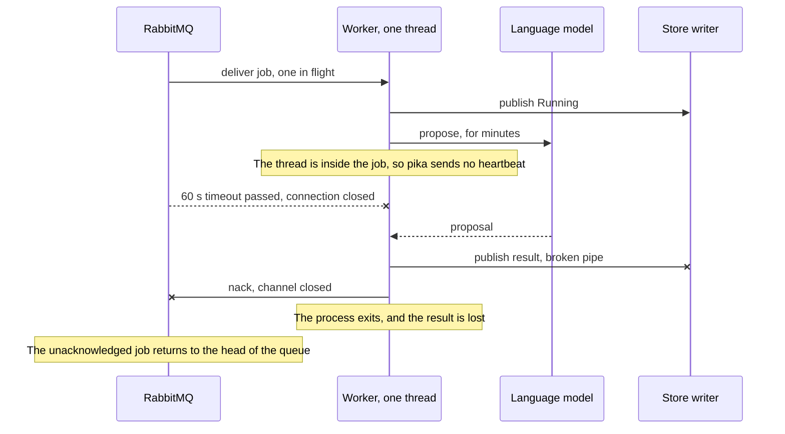
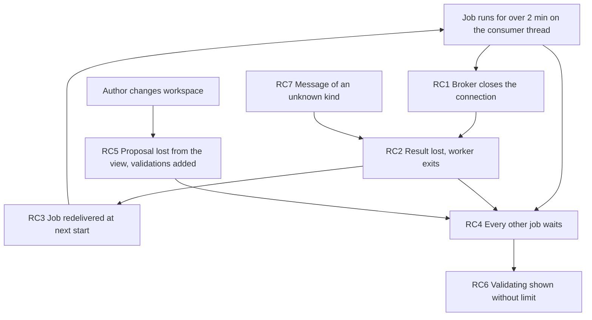
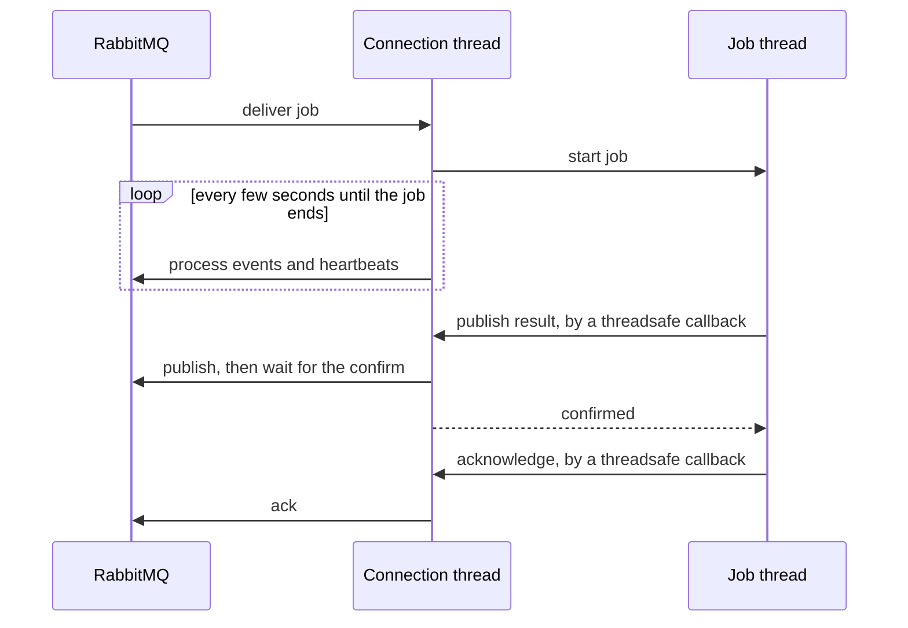
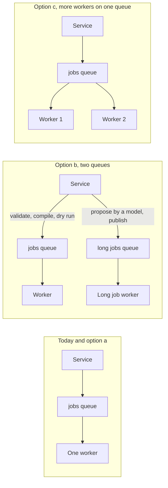

<!-- SPDX-License-Identifier: CC-BY-SA-4.0 -->

# Plan: the studio worker stays alive through a long job

**Unit ID:** `studio-worker-liveness`
**Unit type:** multi-slice unit, one worker, its queue contract and the views that wait on it
**Prefix:** WL
**Status record:** [studio-worker-liveness.md](../status/studio-worker-liveness.md)
**ADR:** an addendum to [ADR-A136](../../architecture/decisions/ADR-A136-configuration-studio.md), drafted in WL-7, accepted 2026-11-06
**Status:** accepted 2026-11-05. The maintainer answered WL-Q1 to WL-Q6 the same day, each answer recorded under its question. TD-131 and TD-141 left the debt register in the commit that records them.

## Scope

A job that takes minutes, above all a language model's proposal, must finish, and the jobs behind it must not wait on it. Today it kills the worker, and the same job kills it again at every start. This takes on TD-141, whose symptom this is, and TD-131, whose remedy is part of it. Each row leaves the debt register in the commit that accepts this plan.

Out of scope: cancelling a running job, a deadline per job kind, and the transforms worker, whose connection stayed up throughout the incident below.

## What happened

The record below comes from one run of the stack from `main`, read from `.build/config-studio/run/` and the broker's own log.

| Time | Broker log | Fuseki log | Meaning |
|---|---|---|---|
| 14:33:14 | | the worker reads job `045142a1`, its baseline and its input, then writes `Running` | the job starts, and those reads are the path a proposal takes |
| 14:35:54 | closes the worker's connection, `missed heartbeats from client, timeout: 60s` | | 2 min 40 s into the job |
| 14:39:14 | the browser's event connection closes and reopens | six new job ids appear by 14:40 | the page reloads or moves, and its validations queue behind the job |
| 15:00:02 | connection closed again at 15:03:02 | job `045142a1` read again | a new start, the same job redelivered |
| 16:39:39 | connection closed again at 16:42:39 | job `045142a1` read again | a third start, the same job |
| 16:41 to 16:46 | | job `b293998b` polled from another workspace, and neither it nor those after it is ever read by the worker | every other job waits, in every workspace |
| 16:43:23 | | | `worker.log` ends. The job ran for at least 3 min 44 s and could not publish its result |

`worker.log` holds the same two errors three times, `StreamLostError: Broken pipe` from the publish of the job's result, then `ChannelWrongStateError: Channel is closed` from the requeue. It holds no time and no job id, so the job's kind is inferred from what it read and from the maintainer's recollection of a proposal in progress. The store can confirm it, since the job's graph names its kind.

## Root causes

Each is a separate defect. Fixing only the first leaves the others to fail in another way.

| # | Cause | Where | Evidence |
|---|---|---|---|
| RC1 | the job runs on the thread that services the connection, so a job longer than the broker's timeout ends the connection | `config_studio_main.py`, `channel.start_consuming`, with `_on_message` running the job | the broker log, three times, and pika's blocking adapter |
| RC2 | a lost connection ends the process and discards a finished result, because the result is published on the consumer's connection and the requeue raises in turn | `RabbitMqConfigStudioWorker.handle`, `_Publisher`, TD-131 | `worker.log` |
| RC3 | nothing notices a job delivered again, so it runs from the start. A job that cannot finish blocks the queue for good, and a run of a proposal that reaches the model spends its tokens again | `ConfigStudioWorker.handle` | the same job read at each of three starts. The provider's usage shows about 1.5 million tokens in each of the 14:00 and 15:00 hours, matching the first two runs, and nothing in the 16:00 hour, so the third run's spend is unexplained. The second ODRL trial used about 107,000 tokens, so this job's cost per run may be far above that figure |
| RC4 | one consumer, one message in flight and one queue, so any long job stalls every other job from every workspace | `basic_qos(prefetch_count=1)`, `JOBS_QUEUE` | job `b293998b` and the jobs after it |
| RC5 | a waiting view holds its job in a closure of a component that a change of workspace remounts. Nothing brings the job back on return, the old closure goes on polling, and each mount submits new validations | `<Workspace key=...>`, `awaitJob` with no signal at `MappingView`'s proposal and `useValidation` | the code, and polling of jobs from the old workspace continuing at 16:45. The fate of the old closure's edit is not yet tested |
| RC6 | a dead worker is silent. The worker logs no job, `studio:status` says only `not started here`, and a view waits without limit | `config_studio_stack.py`, `awaitJob`, `useValidation` | the view showing Validating |
| RC7 | a job whose kind the worker no longer knows and that names no workspace raises outside the job's own error handling, so it takes the path of RC2 and RC3 | `WriterStore.put_graph`, called for `Running` before the `try` in `handle` | an independent reproduction on an upgrade across the rename of `cst:Refresh` to `cst:Rebuild`, and the code. It did not occur in this run, whose logs never show the error |

A change of workspace is not the cause of the crash. The second and third crashes follow a redelivery that needs no browser, and the first comes from the job's length alone. It explains what the author sees instead: a proposal that seems to vanish, and validation that never ends.

## Facts that constrain the options

- RabbitMQ's heartbeat here is its default, and the broker closed a silent client between 2 min 40 s and 3 min after the job began.
- A proposal has no upper bound in practice. The Anthropic provider's request timeout is 600 s and the mapping proposer allows 40 rounds, so 6.7 hours is the limit by configuration. The ODRL trial's second run took 136 s of model time and this one at least 224 s.
- A job's message is its IRI alone and the store holds its state ([MEC-95](../../architecture/configuration-studio.md)), so a worker can tell from the store what became of a job it is handed.
- `lattice.studio.jobs` is a durable classic queue with a dead-letter exchange. Declaring it again with other arguments fails with `PRECONDITION_FAILED`, so a change of queue type needs a migration on every existing broker.
- `_record` and `_promotions` live on the `ConfigStudioWorker` instance, so one instance runs one job at a time.
- A writes command carries an id whose receipt makes a repeated publish apply once, so a held result can be published again safely.

## Questions

**WL-Q1. How does the worker keep its connection alive through a job of any length?**

**Answered 2026-11-05: (a), run the job on its own thread, with every AMQP call on the connection's thread.**

| Option | Change | Design overhead | Runtime overhead | Survives a 6.7 h job |
|---|---|---|---|---|
| (a) run the job on a thread, and keep every AMQP call on the connection's thread, through `add_callback_threadsafe` | about 60 lines in `config_studio_main.py`, with the publisher waiting on its confirm across threads | one rule to keep, that only one thread touches pika. This is pika's documented pattern | one thread per job. A CPU-bound validation still yields the GIL about every 5 ms | yes |
| (b) turn heartbeats off, `heartbeat=0` | one URI parameter | none | a dead broker or a half-open socket goes unseen until TCP gives up, which can be hours | yes, but RC2 stays for any real loss |
| (c) a long heartbeat, say 600 s | one URI parameter | a number to tune as jobs grow | loss takes 20 min to notice | no |
| (d) acknowledge on receipt, with the store as the only record, and a sweep that requeues a stale `Running` job | the delivery guarantee moves into a new sweep, with a lease or a clock | high, since it adds a second way a job comes back and a choice of lease length | one lease write per interval per job | yes |
| (e) run each job in a child process | a process per job, and passing inputs and results across | medium, but it brings a hard stop and memory isolation | the imports of rdflib and pySHACL at every job, seconds each, against a validation that takes under 9 s | yes |

Leaning (a). It is the smallest change that cures RC1 with no limit on length, and it keeps dead-peer detection. (e) is the natural next step if a deadline or cancellation is ever wanted, and (a) does not make it harder.

**WL-Q2. What does the worker do with a job it is handed that has already started or finished?** Every option acknowledges a job already `Succeeded` or `Failed` without running it, since that is what a repeated delivery of a finished job means. Each costs one read, which `handle` already makes.

**Answered 2026-11-05: (a), mark a job found `Running` as `Failed` and ignore one already finished.**

| Option | A job found `Running` | Queue change | A validation, seconds, after a loss | A proposal, 107,000 tokens, after a loss | A job that kills the process every time |
|---|---|---|---|---|---|
| (a) fail it, with a message saying the worker stopped while it ran | written `Failed` and acknowledged | none | fails, and the next edit submits it again | fails, and the author decides whether to spend again | one crash, then `Failed` |
| (b) retry up to N times with `x-delivery-limit`, then dead-letter | run again | a quorum queue, so a migration | runs again | spends up to N times, up to about 1.5 million tokens a run, going by hourly usage | N crashes |
| (c) by cost, rerun what is cheap and fail what calls a model | depends on kind | none | runs again | fails | endless for a cheap kind, unless a count is added to the job's graph |

Leaning (a). It holds the store as the only state, needs no migration and spends no one's tokens silently. Its cost is that a broker restart fails what was in flight, which the author sees and can repeat. A rebuild writes no `Running`, is waited for by the service alone and stays as it is. A job that cannot run at all, RC7, is treated the same way, written `Failed` where it names a workspace and otherwise rejected to `lattice.studio.dead`.

**WL-Q3. How do short jobs get past a long one?**

**Answered 2026-11-05: (b), a separate queue and worker for long jobs. The topology may need to be revisited later to split things up further.**

| Option | Two proposals at once | Change | Memory, processes |
|---|---|---|---|
| (a) one queue, serial, telling the author they are waiting | every validation waits for both | none beyond WL-Q6 | 1 |
| (b) a queue for long kinds, with its own consumer | validations are unaffected, and the second proposal waits for the first | the service routes by kind, the topology gains a queue, `studio:up` starts a second process, and the set of long kinds is one more thing to keep | 2 |
| (c) two or more workers on one queue | validations stall again once every worker holds a proposal | a count of processes, and no contract change | N |
| (d) a thread pool in one worker, `prefetch` above 1 | bounded by the pool | `_record` and `_promotions` move off the instance, and a CPU-bound validation contends for the GIL | 1 |

Leaning (b), since it is the only option that gives short jobs a guarantee. (c) is the simple fallback if a second kind of queue seems too much for now. It would help to measure a worker's idle memory before deciding, which WL-1 reports.

**WL-Q4. What does the worker do when its connection is lost with a job in hand?**

**Answered 2026-11-05: (b), keep the result, reconnect and publish it.**

| Option | The finished result | In `studio:up` | In a container |
|---|---|---|---|
| (a) exit at once and leave restarting to a supervisor | lost, and with WL-Q2 (a) the job is then `Failed` | stays down, since nothing restarts it | restarted |
| (b) hold the result, reconnect with a backoff, publish it, and let the redelivered message be acknowledged by WL-Q2's check | kept, and its command id makes a repeat harmless | recovers | recovers |
| (c) (a), with a supervisor added to `studio:up` | lost | restarted | restarted |

Leaning (b), TD-131's own remedy. It keeps a result that may have cost a great deal, and the service's start already reconnects with a backoff.

**WL-Q5. How does a long job survive the author changing workspace or reloading the page?**

**Answered 2026-11-05: (a), re-read the workspace's unfinished jobs from the store when the view opens.**

| Option | Back in the workspace | Reload | Change |
|---|---|---|---|
| (a) read the workspace's unfinished jobs from the store on mount and attach to each | the view shows it running, and applies its result when it ends | same | a new read in `contracts/`, generated types, and each long-job view attaching on mount |
| (b) keep the running jobs in a module above `<Workspace>` | same | lost | client only, about one small module |
| (c) cancel the job on unmount | nothing to resume, and the spend is lost | cancelled too | needs a cancellation path, which is out of scope |

Leaning (a), since the store already holds the job and a reload is as likely as a switch. Every option passes an abort signal to `awaitJob`, ends the old closure's polling on unmount, and deletes a validation still queued when its view goes, so views stop stacking jobs. A queued job deleted this way already reaches `lattice.studio.dead` as `job graph not found`, and whether that is too noisy is checked in the slice.

**WL-Q6. How does the author and the operator learn that the worker is down or busy?**

**Answered 2026-11-05: (a), the service checks the queue's consumer count and warns, and the worker logs each job.**

| Option | Author sees | Operator sees | Cost |
|---|---|---|---|
| (a) the service checks the queue's consumer count, by a passive declare, and adds a warning to `/status`. The view says Queued, and how long, apart from Running | "the worker is not running" within one check | the same, and `studio:status` reports an exited process with its log's last line | one passive declare per interval |
| (b) the worker writes a heartbeat into the store | the same, later | the same | a write every interval, for no answer (a) cannot give |
| (c) a timeout on the view's wait | an error on a job that may be fine | nothing | wrong for a job of no fixed length |

Leaning (a), with the worker logging each job's start and end, its kind and its duration, whichever is chosen. Neither (b) nor (c) is needed if (a) holds.

## Slices

Built in order, each with its Validation Pack. WL-5 and WL-6 could change places. Estimates are in tokens.

| Slice | Deliverable | Answers | Estimate |
|---|---|---|---|
| WL-0 | this plan, its status record, the board | | written |
| WL-1 | reproductions that fail today: a real broker with `?heartbeat=2` and a job that sleeps past it, a redelivered `Running` job, and an unknown kind. The view's fate on remount is tested and recorded, and a worker's idle memory measured | RC1, RC3, RC5, RC7 | 40k |
| WL-2 | the job on its own thread, and the publisher and acknowledgement across threads | WL-Q1 | 60k |
| WL-3 | the check on delivery, a job that cannot run marked `Failed`, and each job's start and end logged | WL-Q2, RC6, RC7 | 40k |
| WL-4 | the held result, reconnecting with a backoff | WL-Q4 | 60k |
| WL-5 | short jobs past long ones, with the topology and `studio:up` as the answer needs | WL-Q3 | 80k |
| WL-6 | a view that attaches to its running job, an abort signal on `awaitJob`, and no stacked validations | WL-Q5 | 80k |
| WL-7 | the `/status` warning, `studio:status`, the operations guide's outcome table and recovery steps, the worker's README, the ADR addendum, and MEC-95 | WL-Q6 | 40k |
| WL-8 | a run that leaves no process behind when its test process is killed, found running WL-1's suite | | 15k |
| WL-9 | a late `Failed` never replaces a `Succeeded`, the race WL-3 recorded, in the writer | | 10k |

## Validation

- **One command per slice,** as its pack names, with `workers/tests/test_config_studio_worker.py` for the unit level and the studio harness for a real broker.
- **The acceptance test.** Under a real broker with its heartbeat at 2 s, submit a job that takes 10 s. It reaches `Succeeded`, the worker's connection never closes, and a validation submitted behind it finishes first if WL-Q3 chose a separate queue.
- **Recovery.** Kill the worker mid-job and restart it. The job ends `Failed`, with its message, and the queue moves on.
- **Non-weakening.** `test_acks_after_final_write_and_requeues_on_store_error` asserts today's requeue. Whichever change retires it says so in its pack.

## Recovery until this is built

A worker started with a poisoned job at the head of its queue runs it again at every start. With a language model configured, that can spend its tokens each time. Starting the stack with no `LATTICE_PROPOSER_MODEL` should make that job fail at once, be acknowledged and clear the queue. This is read from the code and not yet tried. Otherwise purge `lattice.studio.jobs` with `rabbitmqctl` once the broker is up.
