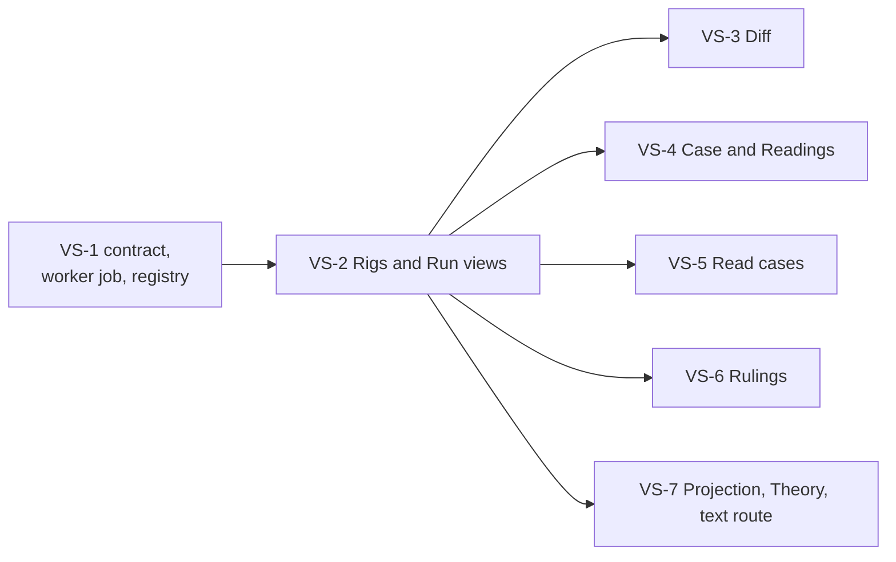

<!-- SPDX-License-Identifier: CC-BY-SA-4.0 -->

# Plan: a studio module for the verification rig

**Unit ID:** `v-rig-studio`
**Prefix:** VS
**Unit type:** multi-slice unit, validation gate per slice
**Status:** planned 2026-11-08 from the [sketch](../sketches/v-rig-studio.md), for a team other than the one that built the rig tool. VS-Q1 to VS-Q6 open, each with a leaning. Nothing started.
**Sketch:** [v-rig-studio.md](../sketches/v-rig-studio.md)
**Status record:** [v-rig-studio.md](../status/v-rig-studio.md)
**Builds on:** [v-rig](v-rig.md), built 2026-11-08, the [Configuration Studio](../../architecture/configuration-studio.md) ([ADR-A136](../../architecture/decisions/ADR-A136-configuration-studio.md) and its amendments), the studio's contract [`contracts/config-studio`](../../../contracts/config-studio/README.md), the worker ([`workers/`](../../../workers/README.md)) and the browser application ([`apps/config-studio`](../../../apps/config-studio/README.md))
**Depends on:** nothing in flight. The rig tool is built, and its outputs are the module's inputs

## 1. Goal and acceptance

A user of the studio runs a registered rig from the browser, reads the run's findings by kind, document and locator, sees what a revision of the rig resolved and added, sees each case drawn as its tower under each reading it states with the three fact states told apart, drops in a read case and sees its disagreements, and records a ruling on each finding that outlives the run. Accepted when each slice's demonstration runs live in the studio against the mini-rig, registered as a rig, and every slice's Validation Pack is written.

## 2. Principles

| Principle | | Source |
|---|---|---|
| principle 1 | A message to the worker names a rig and its extensions by registered names, never by a path | the studio's worker rule, VS-Q1 |
| principle 2 | No line of a rig's text enters the store, a job graph or an export. The store holds findings, run records, competency answers, vectors and theories, which carry ids, locators, keys and generic messages | the v-rig plan's principle 10, VS-Q2 |
| principle 3 | A view is a function of the tool's outputs under their tracked contracts, the findings graph under `ontology/v-rig`, the vectors under `contracts/v-rig/vectors.schema.json`, and never of the tool's internals | the v-rig plan's principle 8 |
| principle 4 | A ruling is keyed by a finding's identifier, so it survives a revision that leaves the finding in place and is shown settled when the finding goes | the v-rig plan's principle 11, VR-Q1 |
| principle 5 | Two readings of one case are two drawings, never one | the v-rig plan's principle 4 |
| principle 6 | The module changes nothing in `tools/v_rig`. A need it finds there is a request to the v-rig unit | the design standards |

## 3. Slices

Estimates are in tokens, for agent work, excluding review.

| Slice | Content | Depends on | Estimate |
|---|---|---|---|
| VS-1 | the contract and the worker: a `rig-run` job kind, the worker's rig registry, the job's artefacts | | 120k |
| VS-2 | the Rigs and Run views: run a rig, follow the job, the findings table by kind, document, layer and key | VS-1 | 150k |
| VS-3 | the Diff view: two runs by finding identifier | VS-2 | 60k |
| VS-4 | the Case and Readings views: the tower drawn from a vector, one drawing per reading | VS-2 | 160k |
| VS-5 | the Read cases view: a read case dropped in, validated, its disagreements shown | VS-2 | 80k |
| VS-6 | the Rulings part and view: a ruling per finding, by kind and by plan, exported as Turtle | VS-2 | 120k |
| VS-7 | the Projection and Theory views, and the local-only text route behind a locator, off by default | VS-2, VS-Q3 | 110k |

## 4. Slices in detail

**VS-1.** The contract gains a job kind `rig-run` with its parameters, the rig's registered name, the names of the extensions and read cases to include, and whether to skip the reasoner, and its artefacts, the run record as JSON, the findings graph as Turtle, the competency answers as JSON, each vector as JSON and the theory as text, each a `cst:artefact` of the job as a compile job's artefacts are. The worker gains a registry read from its settings, each entry a name, a directory and its extension and read-case files, and a handler that resolves the names, runs `mise run v-rig` with the paths, reads the outputs under `.local/v-rig/<rig digest>/`, and writes the artefacts and the run's identifying lines into the job graph, Failed with the tool's message where it refused. The mini-rig is the registry's one entry in the test stack. Tests assert that a message carrying a path is refused, that no artefact carries a line of the mini-rig's body text, and that two runs give the same artefacts.

**VS-2.** The Rigs view lists the registry with each rig's last run, and runs one. The Run view shows the identifying lines first, the counts by kind, and the findings as a table read from the findings graph, filtered by kind, document, layer and key and grouped by document as the report is, each row showing the locator's position and opening the ruling of VS-6 where it exists. The problems drawer and `⌘K` reach the findings as they reach a workspace's. Tests render the mini-rig's run and assert the counts the tool reports.

**VS-3.** Two runs of one rig chosen from their job graphs, the findings only the earlier has, only the later has, and both, by identifier, each with its ruling. Tests use two runs of the mini-rig with one line of a document changed in a copy, as the tool's own tests do.

**VS-4.** The Case view reads one vector and draws the tower, each layer a band from its attachment to attachment plus limit, split by placements' shares, with a formula limit dotted and an unknown attachment open at the bottom, the contracts beside it with their own limit, attachment and layer share, and each event's inputs in their three states. The Readings view shows the same case under each reading side by side. The drawing is a function of the vector under its schema and is tested on the mini-rig's three vectors, including that a stated, an unknown and an absent input are three different marks.

**VS-5.** A read case dropped on the view is sent as a job parameter by name only where the registry holds it, or saved as a workspace document and named to the worker as one, decided in the slice, validated by the tool, and its disagreements shown against the declared facts they concern, each opening both. Tests use the tracked read case over the mini-rig.

**VS-6.** A workspace part `rig-rulings`, each ruling a finding identifier with a decision from a small closed set, a requirement for a named plan, a mapping to fix, a thing the layers are not meant to say, or open, and a note, saved as parts are and exported as Turtle. The Run and Diff views show each finding's ruling and let the user set it. A ruling whose finding the latest run no longer has is shown settled. Tests save, reload and export rulings and carry them across the two runs of VS-3.

**VS-7.** The Projection view shows each layer's shape report, the competency questions with their answers or the finding each left, and the compiled queries. The Theory view shows the generated theory and the build log where one exists. The local-only route of the service, under VS-Q3's answer, reads the lines behind a locator from `.local/` when the stack runs on the user's machine and a setting turns it on, and the views show the text beside a finding and never store it. Tests assert the route is off by default and refuses any path outside the run's directory.

## 5. Done when

- Each slice's demonstration runs live in the studio against the registered mini-rig.
- No job graph, export or test holds a line of the mini-rig's body text, checked by the deny list the tool writes for it.
- A ruling made on one run is shown on the next run of the same rig, and shown settled when its finding is gone.
- Two readings of one case are two drawings.
- `tools/v_rig` is unchanged by the unit.

## 6. Effects on other units

- **v-rig.** Requests only, under principle 6. The first is likely a `--json` summary of a run's identifying lines, which `run.json` already is.
- **config-studio.** A new job kind, a new part and new views, each behind the presence of a registered rig, so a studio with none shows nothing of this module.
- **publication hygiene.** The worker's registry and the local text route are the two places a rig's content could leak, and each slice that touches them names the check that holds the line.

## 7. Questions

VS-Q1 to VS-Q6 are in the [sketch](../sketches/v-rig-studio.md) §6, each with a leaning, and are answered there and in the status record's history.
