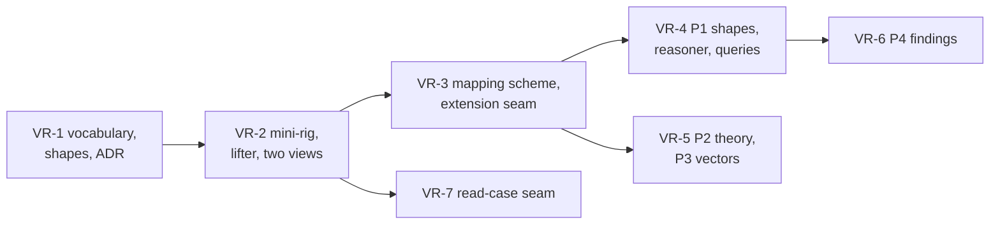

<!-- SPDX-License-Identifier: CC-BY-SA-4.0 -->

# Plan: the verification rig

**Unit ID:** `v-rig`
**Prefix:** VR
**Status:** proposed 2026-11-07 and approved by the maintainer the same day, from a design briefed in chat and the answers to VR-Q1 to VR-Q11. Built 2026-11-08, VR-1 to VR-7, each with its Validation Pack, awaiting review.
**ADRs:** [ADR-A153](../../architecture/decisions/ADR-A153-verification-rig-module.md), Proposed 2026-11-08, for the standalone module `ontology/v-rig/` ([ADR-A77](../../architecture/decisions/ADR-A77-repository-topology-and-documentation-governance.md) decision 1, [ADR-A129](../../architecture/decisions/ADR-A129-one-release-for-the-substrate.md)'s addendum of 2026-10-26, [ADR-A121](../../architecture/decisions/ADR-A121-repository-catalogue.md)'s addendum of 2026-10-21)
**Builds on:** the Wording layer ([ADR-A112](../../architecture/decisions/ADR-A112-wording-layer.md)), MORK mappings over RDF sources ([`tools/mork_rdf`](../../../tools/mork_rdf/README.md), CAP-99, MEC-92), the formal-methods tracks ([lifecycle](../formal-methods-lifecycle.md)), and the [phase 7 plan](applied-insurance-reference-phase-7.md)'s programme model, AIR-7.0 and AIR-7.1

## Scope

A **verification rig** is a directory of wholly invented documents, written as Markdown with YAML front matter, with programme files and an events file in YAML, in a stated format with a version. A rig is held outside this repository, is named at run time, and is never copied into it. More than one rig may exist and a rig changes over time. This unit builds the tooling that reads a rig of that format and produces what two evaluations need.

- **(a) The layers.** Whether the OWL encodings of the layers can state what the documents say, whether what they state is consistent, and where there is no class or property to say a thing.
- **(b) Per-contract evaluation.** Whether the evaluation of one contract from stated facts, reading what a related instrument supplied, with attachment, exhaustion and allocation, behaves lawfully on realistic structures, and whether independent implementations agree.

The tooling is one **intermediate representation** of a case, an RDF graph under a small vocabulary of its own, `vrig:`, validated by SHACL, and four **generated projections** of it.

| Projection | Consumer | Answers |
|---|---|---|
| P1, RDF over the layers | the layers' shapes, a reasoner, competency queries | (a) |
| P2, a generated Isabelle theory | `value` over the layer models | (b), and feeds the proofs |
| P3, test vectors | the reference semantics and each compiled implementation | (b) |
| P4, findings | the maintainer, and a consumer that triages by id | (a) |

**Out of scope.** Analysing what a programme covers or lacks, a programme-wide graph assembled from several contracts, and simulation over synthesised sequences, as in the [phase 7 plan](applied-insurance-reference-phase-7.md)'s scope. Reading clause text into layer statements, which is stage 3 below and has only a seam here. Any content of a rig, in any tracked file, test, fixture, comment, commit message or log.

## Principles

| Principle | | Source |
|---|---|---|
| principle 1 | A rig's location is a runtime input, never written in a tracked file. The tool refuses to start without one and never writes inside a rig | the format contract |
| principle 2 | Everything derived from a rig is written under a path `git check-ignore` reports as ignored, by default `.local/v-rig/<rig digest>/` in the worktree, and the tool refuses any other kind of path | PRI-48, CAP-82 |
| principle 3 | A fact has three states, stated with a value, stated as not known, and not stated, and no projection collapses the last two into false or zero | PRI-08 |
| principle 4 | A reading of a legal concept is a value with a locator, interpreted by a mapping and never by code, and two readings on one structure give two layer graphs, never merged | [ADR-A103](../../architecture/decisions/ADR-A103-eligibility-set-readings.md), phase 7's P7-7 |
| principle 5 | Every node carries a locator, a document id and a position in it, and a digest over normalised text that the tool computes itself | the format contract |
| principle 6 | The set of keys and tokens is open. Every key is carried as a fact and every token as an uninterpreted literal, and adding a key to a rig adds a mapping row, never code | the format contract |
| principle 7 | Front matter and body are two views of one document, declared and blind. Neither prevails, each view is faithful to its source, and a disagreement is a finding | VR-Q1 |
| principle 8 | Every projection is generated from the representation. Nothing downstream is written by hand | design standards |
| principle 9 | The repository's own tests run on a synthetic mini-rig written from generic premises, the only place an expected output is ever stated | the format contract, [ADR-A-C2](../../architecture/decisions/ADR-A-C2-clean-room-authoring-procedure.md) |
| principle 10 | Logs name document ids and locators, never clause text, and a deny list the tool generates from a rig is fed to the deny-terms check so no rig text reaches a staged line | skill `lattice-publication-hygiene` |
| principle 11 | Outputs are stable across runs of one rig revision, comparable across revisions, independent of where the tool ran, and addressable by case digest and reading, so a consumer outside this repository can pin the vocabulary at a tag and diff two runs by id | [ADR-A147](../../architecture/decisions/ADR-A147-skolem-rule-for-mapped-sources.md) |

## Slices

Estimates are in tokens, for agent work, excluding review.

| Slice | Content | Depends on | Estimate |
|---|---|---|---|
| VR-1 | the module `ontology/v-rig/`, its vocabulary and shapes, its Proposed ADR and catalogue entry | | 90k |
| VR-2 | the synthetic mini-rig, then the lifter with the declared and blind views, with tests | VR-1 | 180k |
| VR-3 | the tracked mapping scheme and the extension seam, compiled and run by `tools/mork_rdf` | VR-2 | 170k |
| VR-4 | P1, the layer graph against shapes, reasoner and competency queries | VR-3 | 150k |
| VR-5 | P2 and P3, the generated theory and the test vectors | VR-3 | 160k |
| VR-6 | P4, findings as RDF with stable ids and the report rendered from them | VR-4 | 100k |
| VR-7 | the seam for a read case, a representation graph from outside taken as a case | VR-2 | 40k |

## Slices in detail

**VR-1.** A standalone module `ontology/v-rig/`, prefix `vrig:`, released on its own under ADR-A129's addendum, with a catalogue entry naming its imports, which are none unless a range needs Wording. The vocabulary holds a document with its format version, an element with a locator and a digest, a fact with its key, its view and exactly one of a value and an unknown marker, a reading, a formula with its named inputs, a reference resolved or unresolved, a placement of a contract on a layer with a share, a defined term with its scope, a prose-only marker, and a finding with its kind. The shapes refuse a fact with neither value nor unknown marker, a node without a locator, and a finding without a kind, document and locator. The ADR states why the module exists, what it imports, and that it models no domain. Examples first, three small graphs the shapes accept and three they refuse, committed before the vocabulary.

**VR-2.** The mini-rig first, under the tool's tests, in the stated format, written from generic premises and from AIR-7.0's public brief, a primary and two excess layers, a follow form, a drop-down and one line to stand, with one document in two renderings, one unresolved reference, one limit stated as a formula, one reading token, and an events file with a fact stated, a fact stated as not known and a fact absent. Then the lifter, `tools/v_rig/`, reading a rig read only from its manifest, checking the format version and refusing an unsupported one by key and value, lifting front matter and programme files to one fact per key with the provenance key dropped at the gate, lifting the body to Wording nodes with locators and digests, lifting each rendering under its own view, and producing the blind view by reducing front matter to the id. Tests assert the three fact states, the two views, the digest of every rig file unchanged after a run, and no clause text in any log line.

**VR-3.** A MORK mapping scheme, tracked, from `vrig:` and `wrd:` to Instrument, Party, Wording, Quantification, Ledger and the common insurance module, mapping the format's keys to structure and the unknown marker to Undetermined. One or more extension schemes named at run time, run after it, carry the mapping of a rig's own tokens to concepts, which the tracked scheme never enumerates. The mini-rig's extension is tracked beside it. Compiled and run by `tools/mork_rdf` on Oxigraph, with its check SELECTs and the unmapped keys as the first findings.

**VR-4.** The layer graph validated by each layer's shapes with pySHACL, checked for consistency through the reasoning test kit ([ADR-A83](../../architecture/decisions/ADR-A83-test-only-reasoning-engine-isolation.md)), and asked the competency queries, tracked, one file per layer, written against the layer and never against a rig. Each query that returns nothing because the encoding has no way to say the fact is a finding.

**VR-5.** P2, a generated theory importing the layer models with one `value` per case and reading, `value` output only, with a lemma per case left for the time the layer theories are stable, and unified with tracks E4a and E4b when they start. P3, JSON vectors keyed by case digest and reading, carrying the vector schema's version, with the three fact states as three JSON shapes.

**VR-6.** Findings as `vrig:Finding` nodes in Turtle, each with an IRI formed from a versioned deterministic rule over its kind, document id, locator and key, in the manner of ADR-A147, so two runs of one revision give the same ids and a resolved finding disappears from a diff by id. The Markdown report is rendered from that graph, sorted by document id and locator. Both are byte-stable for a rig revision. Every run prints the rig digest, the checkout's commit and substrate release, and the versions of the vocabulary and the vector schema, as its first lines.

**VR-7.** The lifter accepts a Turtle file in the `vrig:` vocabulary from outside, validates it against the shapes, and treats it as a read case, so a reader that lives outside the repository can write one and the comparison of a read case with the declared case runs unchanged.

## Formal methods

| Projection | Track | How |
|---|---|---|
| P1 | C, as evidence | a gap P1 finds becomes a sketch, then a design-time model before an ADR, as the lifecycle says. A rig is evidence for a decision and never a specification |
| P2 | E | the generated theory is unified with the mechanised layer theories when E4a and E4b start, so that a case's `value` runs against the proved laws |
| P3 | B | the vectors are the differential tests' inputs, against the hand-written reference and each compiled implementation (PRI-42) |

## Done when

- On the mini-rig the tool runs end to end and its tests pass.
- Pointed at a rig, it runs with no line of rig content in a tracked file, a tracked test or a commit, and the deny-terms check fails on a staged line that carries one.
- Adding a key, a token or a reading to a rig needs no code change to carry it through, only a mapping row to give it meaning.
- A fact that is unknown, a fact that is negative and a fact that is absent give three different outputs in every projection.
- The findings of one rig revision regenerate byte for byte, and two runs give the same finding ids.
- Swapping one rig for another of the same format needs no change to the tool.

## Effects on other units

- **ensemble** and **ledger.** P1's findings against their drafts are the requirements ADR-A130's text settles before C4 models it, which is why this unit runs before C4.
- **applied-insurance-reference, phase 7.** The mini-rig follows AIR-7.0's brief, and P1's findings about programmes, layers, lines and bindings are AIR-7.1's requirements. The mapping scheme gains the programme module as a target when it exists.
- **formal-methods.** P2 unifies with E4a and E4b, P3 feeds track B.
- **the repository catalogue and the release register.** A new standalone module, released on its own.
- **publication hygiene.** The deny-terms check gains a generated list as one of its sources at run time, with no change to the check.

## Questions VR-Q1 to VR-Q11

Each was answered on 2026-11-07, by the maintainer and by the consumer that reads this tool's outputs, and the answers are in force.

**VR-Q1. Body or front matter prevails when they disagree.** Answered 2026-11-07, neither, now principle 7. The rig's owner keeps the rulings on disagreements, so the tool only emits them with stable ids.

**VR-Q2. Where outputs live.** Answered 2026-11-07, `.local/v-rig/<rig digest>/` in the worktree by default, with `--out` as an override, both refused where not ignored or under the rig, now principle 2.

**VR-Q3. The rig read in place or from a copy.** Answered 2026-11-07, in place, read only, with the write guard of principle 1.

**VR-Q4. The layers before per-contract evaluation.** Answered 2026-11-07, yes. P1 before P2 and P3, since the ledger runtime (LG-2) that per-contract evaluation needs is briefed and not started.

**VR-Q5. The blind view in the first iteration.** Answered 2026-11-07, yes, folded into VR-2, since it is one flag on the lifter and one comparison query.

**VR-Q6. P2's scope.** Answered 2026-11-07, `value` output only, unified with the layer theories later.

**VR-Q7. Where a generic finding lands.** Answered 2026-11-07, a backlog or technical-debt row in generic words naming the layer and the missing term, or a line in an unbuilt module's plan brief where it is a requirement for it. Not every finding comes back as a request, and silence is not a withdrawal.

**VR-Q8. Whether the mapping scheme's key vocabulary is tracked.** Answered 2026-11-07, keys tracked, values not. The keys are the format contract. A rig's tokens map to concepts in extension schemes loaded from outside.

**VR-Q9. The name.** Answered 2026-11-07, `v-rig`, for verification rig.

**VR-Q10. The reinsurance waterfall development.** Answered 2026-11-07, no dependency in the first six slices, and its placement is WPG-Q4's.

**VR-Q11. Where the vocabulary lives, given that a consumer pins it at a tag.** Answered 2026-11-07, a standalone module `ontology/v-rig/`, released on its own, with its ADR drafted in VR-1.
