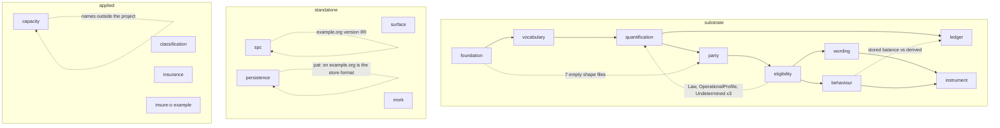

<!-- SPDX-License-Identifier: CC-BY-SA-4.0 -->

# Review: the ontology designs, 2026-10-28

**Unit:** `ontology-remediation`
**Plan:** [ontology-remediation.md](../plans/ontology-remediation.md)
**Date:** 2026-10-28
**Status:** a design review of every ontology document as it stood, whose findings the plan above remediates. Nothing was changed by the review itself.

## 0. What was reviewed and how

- **Read whole, 56 files, 44,144 lines.** Every layer README, every document under `ontology/*/docs/`, the applied and example READMEs, and the 19 architecture documents that govern the ontologies (identity, versioning, releases, literate specifications, conformance, MORK and Surface). We read each file whole, writing notes per file before collating them here.
- **Verified.** Every claim in §2 was checked against the tree or by a command. Term statistics were computed over every `spec/*.ttl` with rdflib. Four cheap static checks ran and passed as run: `check:import-guard` (0 violations), `check:identifiers` (864 resolvable identifiers, all resolve), `check:ontology-versioning` (49 documents, no unbumped change), `check:formal-freshness` (2 artefacts consistent). Not run: `check:ontology-catalog`, `check:persistence`, `check:mork-compilers`, `check:proofs`, `check:full-sweep`.
- **Asked the index first**, 14 questions over both tasks. Its misses and the register gaps it exposed are in §8.
- **Not read whole.** The ADRs (124, reached through the index), the Turtle beyond spot checks, the test suites, `docs/architecture/rdf-sparql-patterns-guide.md` (3,572 lines) and `triple-store-discovery.md`. A finding that depends on one of those says so.

Line numbers are of the files as they stand on `docs/placement-vehicles-structure` at `8bc6c090`.

## 1. The verdict

**The core designs are sound and several are excellent.** Derived balances over immutable postings, three-valued decisions with strong Kleene composition and a machine-checked kernel, per-dimension persistence resolution where a tie is a refusal, scheme contracts with scoped bindings, read-set staleness as one hash comparison, keys that are never identities, a typed operation contract with minting recipes that need no LATTICE code. These are the right shapes and they are stated with their reasons.

**The corpus around them is not trustworthy as a whole.** Three kinds of hazard, in order of urgency.

| Kind | What it is | Count | Reversible |
|---|---|---|---|
| **A. Irreversible publication** | names and material outside what the project names in the public tree, placeholder and third-party namespaces under released version IRIs, a person named as creator, an AI vendor model in a normative example | 5 findings | no, history keeps it |
| **B. Wrong judgements** | designs that let a past judgement change meaning, a balance disagree with its history, or two implementations disagree on an identity or a verdict | 11 findings | yes, by design change before adoption |
| **C. Drift that misleads** | version numbers, counts, namespaces and status claims that disagree across documents, empty shape files published as checks, one name for three things, stale architecture and deprecated documents still linked from normative text | many, the worst 14 listed | yes, mechanical |

The single most useful fact for prioritising: **every finding of kind A is already on the public remote** (`github.com/nebularis/lattice`, the capacity analysis since 2026-09-19), so the decision is about history, not about a pending commit.

## 2. Potentially disastrous

Ranked. Each gives what, where, why, and the smallest move that stops the harm.

### 2.1 Names, material and reasons outside what the project names are in the public tree

- **Where.** `docs/architecture/capacity-domain-analysis-and-design.md` L7-10, L68-82, L213, L229-246, L368, L967-996, L1292-1311, L1397-1440, L1485. Its partly reworded copy `ontology/applied/capacity/docs/architecture-overview.md` L174, L190-210, L329, L854, L926-960, L1255-1270. `ontology/surface/docs/OUTSTANDING-ITEMS.md` L40, L63, L135-150, L170, L194. `ontology/surface/docs/x6SignatureScopeDecisionAnalysis.md` L20-340. `ontology/surface/docs/surface-projection-design-sketch.md` L17-60. `ontology/surface/docs/current_plan.md` L322, L360, L372. `ontology/examples/insure-o/README.md` L21-28. `docs/architecture/decisions/ADR-A-CAP1-...md` and `docs/architecture/ingestion-vision.md`, plus eight developer sketches, notes and status records. Measured with `git grep` over tracked files: one name outside the project in 14 files, 70 hits, and four related names in 2 to 7 files each.
- **What is said.** Not only the names. The capacity analysis lists work that is not in this repository as what is held back, attributes one item's ownership to a third party, and schedules a study outside the repository. The Surface sketch records that the layer was derived from an instance outside the repository and describes that instance's mechanism step by step, beside a README that says it was not paraphrased. The example README lists constructs outside the repository as exclusions, which names them.
- **Why disastrous.** Publication is irreversible and history keeps it. The public-repository rule in `AGENTS.md` admits nothing that identifies a person or a client outside what the project itself names and keeps layer documentation domain-neutral. The text explains changes by reasons the repository does not hold, records provenance questions, and gives a reader the shape of what is not published.
- **Move.** We decided on 2026-10-28 to remove or reword by ordinary commits. Which files are removed and which reworded, and whether the Surface derivation record stays, are the maintainer's. The deprecated `surface/docs` files have published successors under `docs/developer/` and `docs/operator/`, so deletion is cheap there. The `insure-o` exclusion list becomes one sentence, "excludes constructs the public substrate does not define".

### 2.2 Released version IRIs on domains that are not ours

- **Where.** SPC: `ontology/spc/spec/spc.ttl` L3-4, L31 (`http://example.org/spc#`, version IRI `http://example.org/spc/0.19.0`), `ontology-releases.md` L252-253 (released at 0.2.0 and 0.19.0 under tags). `ontology/spc/docs/architecture.md` L217-218 uses a third namespace on a host that is not the project's. Persistence: the store-resident vocabulary `pat:` is `https://example.org/lattice/patterns#` (`rdf-sparql-patterns-guide.md` L181 calls it illustrative), and it is written into every deployment's meta graph, receipts and key claims (`persistence/README.md` L1625, L2300-2560, L5260-5340, `contracts/persistence/vectors.json` L687-693, `benchmark/persistence-composite-cost/check.py` L35), defined in no ontology file (`spec/persistence.ttl` mentions it in five comments). Infrastructure graphs are fixed `urn:g:*` constants (README L930, open issue L7423).
- **Why disastrous.** An adopter who stores data under `pat:` or imports `spc` at a tag has IRIs that can never be harmonised without re-keying the store or renaming every term. The document that says SPC was harmonised (`ontology-architecture.md` L40) is wrong, and the one that says it is a placeholder (L154, `deferred-scope-and-boundaries.md` L60) is right. That host is somebody else's domain.
- **Move.** Decide the real namespaces now, before any adopter. SPC is outside the dependency graph, so its rename costs nothing yet. `pat:` must become a `dal:` or a new published vocabulary before the first production store, and that is a design decision (a new ontology document inside Persistence, or Persistence's own namespace). Record both as debt today.

### 2.3 A judgement's inputs are mutable under a versioned owner

Four instances of one defect. A versioned thing points at unversioned parts whose edit changes every past judgement that used the owner.

| Where | The versioned owner | The mutable part | What changes silently |
|---|---|---|---|
| `eligibility/README.md` L514-523, L553, L586 | `elg:AdmissionProfile` is a `fnd:Version` | `elg:Condition` nodes are plain and shared | every past decision on the profile |
| `behaviour/README.md` L97, L105, L113-115 | `bhv:TransitionDefinition` is a Version | trigger, guard and effect definitions are plain | which guard fired for a recorded execution |
| `ledger/README.md` L14, L20, L141-142 | nothing, `ldg:AccountDefinition` is a plain class | `statedAmount`, `creditCeiling`, `mergeRule` | every historical balance, since balance is a fold against the definition |
| `vocabulary/README.md` L249, L251 | `voc:SchemeBinding` is only TemporallyScoped | `validTo` written on the existing node | which scheme resolved for a past record |

To these add the in-place writes on `fnd:Version` nodes that Foundation itself invites: `fnd:hasGovernanceState` "update it as review status changes" (`foundation/README.md` L426) on classes that are both Version and Governable, and the occupancy pattern where `pty:occupiedBy` is added later to an existing `RoleOccupancy` (`party/README.md` L108, L365-367, repeated in `ontology-architecture.md` L623) which loses "unfilled until T" in the layer that carries obligor identity.

- **Why disastrous.** The project's own principle is that a judgement is evaluated from facts and reproducible. Each row makes a reproduced judgement depend on the current state of a node that was not part of the judgement's version. The ledger row contradicts its own headline, "conservation holds by construction", which is true of postings and false of the definition they are folded against. PDD-15 has just made the account instance a minted, keyed thing, so this is the moment to make the definition versioned too.
- **Move.** One rule, recorded once: a node that a versioned thing's meaning depends on is either a Version itself, content-addressed, or copied into the owner's version. Then four slices. Ledger's is the cheapest and the most urgent, since LG-2 is briefed.

### 2.4 Canonical bytes are defined four ways and Surface does not define its own

- **Where.** Surface hashes are untyped strings with no algorithm (`surface/README.md` 6.9, L228, §8 `digest(v)`), implemented by rdflib's canonical graph (`surface/execution/README (1).md` L3). MCN defines sorted N-Triples (`mork-compact-notation.md` §12.4). Persistence uses RDFC-1.0 and RFC 8785 with SHA-256 (`persistence/README.md` L4446-4470, L5300, L5328). `iri-identity-patterns.md` L426 fixes RDFC-1.0. `semantic-platform.md` L9 hashes a serialisation. `quantification/README.md` L725 makes `qnt:spaceHash` mandatory with no algorithm and L2172 says no content-hash contract exists.
- **Why disastrous.** Surface's determinism law R1 and "interchangeable surfaces" cannot be reproduced outside rdflib. A `spaceHash` is an opaque label in every example. Two implementations will disagree on whether one declaration is the same declaration, and caches keyed on these hashes are unreliable.
- **Move.** One canonicalisation decision for the substrate, RDFC-1.0 plus a named digest, with Surface and Quantification stating which triples form the content. Persistence already has the vocabulary (`dal:digestFunction`, width, encoding), so the others adopt it.

### 2.5 Persistence's defaults jointly give the weakest guarantee

- **Where.** Baseline concurrency `dal:ProvidedConcurrency` generates an unconditional write (`persistence/README.md` L1330, L5136) although 5.1 shows the lost update it causes. No capability spec means the compiler "assumes the most any backend could provide" (L1989). The baseline epoch guard is the discouraged row-level one (L2470, L5090). The worked personal-data example compiles with one warning on that default (L2470). Uniqueness is overclaimed, "refuses the second claim when it is written" (L2154) against "decided by the store's isolation" (L2785) with the closing patterns P3, P5, P6 not generated.
- **Why disastrous.** An unconfigured class is unsafe by default and compiles clean. A personal-data deployment can resurrect erased data on restore, with a warning every baseline user learns to ignore. The layer that is otherwise the most honest in the corpus has its one dangerous property in the defaults.
- **Move.** Flip the baselines or make the absence of a concurrency level a refusal for any class with more than one writer. A one-row change to the resolution table, plus the compile refusal.

### 2.6 Laws that nothing realises, relied on by the layer above

- **Where.** Quantification Q8, non-negativity by truncated subtraction (L1901), has no `TruncatedDifference` operation (L1667-1682) and no zero-floor property, while Behaviour's absorption and depletion are listed as depending on it (L1931-1932). Q13 checks the base only where a proportion space names a `baseRole` (L1859, L1920), and no shape requires it, so shares of different wholes sum silently, the exact error the design exists to stop (L122). Law individuals Q1 to Q13 do not exist as IRIs, so a `LawDischarge` has nothing to point at (L1551-1553, L2228, confirmed by the examples inventing `ex:` law individuals, `examples.md` L563-577). Surface's static shapes claim to discharge semantic laws X5 and X6 (L1440-1500) against the register's own rule at L229. SPC documents `owl:hasKey` as enforcing uniqueness four times (`spc/README.md` L363, L567, L678, L1372) when it infers `owl:sameAs` and merges, which Foundation states correctly (L576-578).
- **Why disastrous.** A non-negative balance, a sum of shares, a conservativity property and a protocol's branch identity are each asserted by prose in a document that reads as a specification. SPC's case silently merges two receive branches with equal labels and different bodies.
- **Move.** A register row per law that has no mechanism, Unchecked because stated, and a shape or an operation for each of Q8 and Q13 before Ledger relies on them. SPC's four sentences are reworded and a SHACL uniqueness shape added.

### 2.7 Runtime trust of unvalidated data at the MORK boundary

- **Where.** `ontology/spc/docs/architecture.md` L830, L1215, L1217, L1353, L1674-1688. A `morked` flag per label makes the state machine skip SHACL at runtime, justified by a "Mork Completeness Theorem (informal)" that a mapping passing SHACL on a sample guarantees every produced individual satisfies the predicate. The flag is not tied to a mapping version (L1683 relies on discipline). `mork/README.md` says the guarantees "should be proven theorems" (L314) and "all formally proven" (L651), its convergence formula gives a vocabulary-sized value for a fraction at t=0 and contradicts its own table (L281, L285, L291-298), and three different resolved-without-AI figures are given (L373, L456, L509). `ontology-architecture.md` L579-580 repeats the figures and the formula as headline facts.
- **Why disastrous.** A finite sample proves nothing about all inputs. In the worked domain the unchecked payload is a quote status or a bind confirmation. A decision-maker reading "all formally proven" and "90 to 98 per cent" over-trusts the automation that feeds governed artefacts.
- **Move.** Remove the theorem and the flag's runtime effect from the SPC document, or mark the whole document as a paper's companion that decides nothing. Reconcile MORK's README to one set of figures with their measurement or none.

### 2.8 Three-way inconsistency in supersession, and a cycle nobody checks

- **Where.** `fnd:supersededBy` is asymmetric and irreflexive, neither functional nor acyclic (`foundation/README.md` L328-333), and "follow it until none points onward" (L325) loops on a three-cycle, which `iri-identity-patterns.md` L221 names as a hazard and then forbids using the property for content revisions at all (L221, L530). Instrument asserts element versions are content-addressed under ADR-A51 (L3525-3527, L3783), which is superseded by ADR-A82, and Wording defines no hash on elements. The same-identity check on supersession is "not built" in Foundation and is realised one layer up in Instrument (`derivation-and-validation.md` L14 vs `ontology-architecture.md` L249).
- **Why disastrous.** A "find latest" implementation that takes the README literally hangs. Three documents give three accounts of what a version chain is, with no mapping between a `fnd:Version` chain, a digest revision and an `owl:versionIRI`.
- **Move.** An acyclicity shape in Foundation (the pattern Ledger already uses for `partOf`), one paragraph in Foundation saying what a `fnd:Version` is relative to the identity guide, and the two Instrument sentences corrected.

### 2.9 A stored balance beside a derived one, both released

- **Where.** `behaviour-runtime.ttl` L42, L70, `bhv:availableBalance` is a single functional quantity overwritten in place on an Evidenced-only node (`behaviour/README.md` L293-297, L324). `ledger/README.md` L14, L24 says a balance is always derived and storing one is the defect. Both carry `resetRecurrence`. Both are in 0.19.0, and Behaviour "does not yet import Ledger (LG-3)" (L1557).
- **Why disastrous.** Until LG-3 lands, an adopter can choose the mechanism that produces a balance no history justifies, in the release that also ships its replacement. PDD-15 has now decided the reset semantics against Behaviour's model as well.
- **Move.** Deprecate `bhv:AllowanceAccount` and `bhv:AllowanceDefinition` in the next release note with a shape warning, as `AcceptanceRecord` was (L242-246), rather than waiting for LG-3.

### 2.10 Identity-bearing normalisation with holes

- **Where.** `identity-minting-specification.md`: natural keys keep `.` unreserved and encode only `/`, so a key component `..` becomes a path segment that RFC 3986 normalisation collapses (L137). Under the uppercase and lowercase pipelines zero-width characters survive, so visually identical keys mint different IRIs and a key of only invisible characters mints one (L259). A caller-supplied surrogate is checked only against the recipe's own pattern, so `.+` lets `/`, `#` and `?` into a minted IRI (L144). A null scope and an empty scope encode identically (L125, L146). Position width overflow has no named error (L155, L201). Only NFKC pipelines exist although the patterns guide offers NFC for wider alphabets (L72-78 vs `iri-identity-patterns.md` L347-349), and NFKC merges compatibility-distinct keys by design (L64).
- **Why disastrous.** Each is an identity collision or an identity escape in the one specification whose purpose is byte-exact identity across implementations. The worked example and anchors are right (verified with openssl by the reader), the edge rules are not.
- **Move.** Five rules and five vectors. Reject or encode dot segments, strip or refuse format characters in every pipeline, restrict caller-supplied surrogate patterns to the unreserved set, distinguish null from empty scope, name the width error.

### 2.11 Validity time with no zone rule and estimated mandatory dates

- **Where.** `fnd:validFrom` and `validTo` are `xsd:dateTime` with no timezone rule and no statement of inclusive or exclusive ends (`foundation/README.md` L380, L401-414). `validFrom` is mandatory and authors are told to "use the best available estimate" (L401, L408) with no way to mark an estimate. Vocabulary assumes half-open intervals (L179, L189, L505-506). Quantification's temporal positions have the zone question open (L747, L2199) and month-end arithmetic stated only for recurrence bins, not for position plus extent (L652, L923-924, L1726).
- **Why disastrous.** Comparison of zoned and unzoned `xsd:dateTime` is a partial order, so a validity decision is not reproducible across engines. A judgement "as of" a date can rest on a fabricated date that nothing marks. "31 January plus one month" returns different dates from conforming implementations in ordinary clauses.
- **Move.** Three sentences in Foundation (zone required, half-open, an `estimated` marker or an optional `validFrom` with a stated default) and one law in Quantification for month arithmetic on positions, with a conformance row.

### 2.12 A platform that keeps authority outside the graph, and says so three ways

- **Where.** `data-architecture.md` L23, L79-81 (PostgreSQL authoritative, RDF provenance derived from it), L131 (workers read and write Fuseki directly), L141 and L151 against L36 and L78 on who writes. `surface-workflow.md` L38-42, L88 (approval ledger in PostgreSQL with no principal or cause). `semantic-platform.md` L9 (serialised content hash as the immutable revision hash), L60 (no capability fallback). `solution-design-specification.md` L58 (not multi-tenant) against tenant identifiers on every record, L250-255 (four non-atomic writes in the release flow, admitted as an expected alert at L585), L435-439 and L609 (prompt residue), L650-654 (candidate ADR numbers that collide with existing ADRs).
- **Why disastrous.** The guardrails in AGENTS.md (PRI-51, 52, 54, 55, 56) are contradicted by the architecture documents that describe the platform, so a builder following the documents violates the principles. Approvals cannot be shown against the state they approved (`data-architecture.md` L34, L157). A release can be recorded with no provenance graph.
- **Move.** These are platform rather than ontology, and TD-85 already says the guardrails are unenforced. The ontology-side action is to stop `ontology/` documents citing them as settled (`surface/README.md` L7 links a deprecated one).

## 3. Bad now, by theme

### 3.1 Identity roots and release numbers disagree

- **Three roots per module.** Ontology IRI `.../neuro-semantic/foundation`, namespace `.../neuro-semantic/lattice/foundation#`, version IRI `.../lattice/foundation/0.19.0` (`foundation/README.md` L40, L51, L53, the same pattern in vocabulary, quantification, surface, `literate-specifications.md` L56-61, L72). The ontology IRI dereferences to nothing (`ontology-versioning-policy.md` L232) while `ontology-architecture.md` L129 promises one retrieval per layer. Vocabulary individuals live in another document with another ontology IRI (`foundation-vocab.ttl` L10, `wording/README.md` L686 a third root for individuals).
- **Three namespace families.** `.../lattice/`, `.../insurance/` without the lattice segment (`applied/README.md` L38-40), `http://www.nebularis.org/ontologies/Mork#` over http (`Mork.ttl` L1, releases L216-218). MORK's executable ontology is under `lattice/executable#`.
- **Versions.** `ontology-versioning-policy.md` describes two regimes without marking which sections are superseded (L20-29 vs L43-51, L215-217, L209-228). `ontology-architecture.md` L143-150 is five releases stale on every layer. `wording/README.md` L21 says 0.7.0, `instrument/README.md` L17 says 0.16.0 and L5644 0.15.0, `applied/capacity/README.md` L26 says 0.10.0, all at 0.19.0 or 0.17.0 in their headers. `ontology-releases.md` has no ledger row although `ledger/README.md` L594 claims a 0.18.0 release, registers the unified bundle as one row with IRI "none" (L221-222) so per-document version IRIs have no row, and releases MORK, SPC, Surface and Persistence twice at 0.19.0 (L218, L237, L253, L260 beside L221-222). Numbers jump from 0.3.0 or 0.5.0 to 0.19.0 with no marker that it was a renumbering.
- **Tags.** `<name>-vX.Y.Z` and `ontologies-vX.Y.Z` are two families (policy L28 vs L236-239), the name derivation is not injective, and `literate-specifications.md` L337 makes generated links absolute at a per-module tag that the substrate no longer has.

### 3.2 One name, several things

52 local names are declared in more than one module (rdflib over every spec). The ones inside the substrate and standalone modules, with what was checked:

| Name | Modules | Checked |
|---|---|---|
| `Law`, `LawRegister`, `LawDischarge`, `SemanticLaw`, `StaticConstraint` | eligibility, quantification, surface | three unrelated classes, no subclass or equivalence, two registers in one layer and three in the next |
| `OperationalProfile` | behaviour, eligibility, quantification | three meanings. Behaviour's is a Version with test categories B-P1, B-P2, Eligibility's is test categories E1 to E5, Quantification's is implementation and version |
| `Undetermined` | eligibility, quantification, and Behaviour's pass outcome, and capacity's draw status | separate individuals, no mapping |
| `resetRecurrence` | behaviour, ledger | both range `qnt:Recurrence`, PDD-15 renames Ledger's |
| `forCase` | behaviour, instrument | duplicate |
| `Amendment`, `classification`, `expressedIn` | instrument, wording | duplicate names across the two layers that share the clause |
| `Property` | eligibility, surface, vocabulary | `rdf:Property` redeclared as an `owl:Class` in each (`vocabulary/README.md` L366, `eligibility/README.md` L865, L1034, `surface/README.md` L350-351) |
| `TemporalScope`, `DerivedArtefact` | foundation with mork, foundation with surface | the standalone redeclares a Foundation term |
| `Template`, `Diagnostic`, `ParameterBinding`, `paramName`, `paramType`, `paramValue`, `operationKind`, `priority` | persistence with instrument, mork, quantification, behaviour, capacity | persistence's own vocabulary reuses names of layers it does not import |
| `Value`, `Variable`, `hasBinding`, `hasParticipant`, `memberOf`, `elementType` | spc or mork with quantification, wording, party | standalone modules shadow substrate names |

Not every duplicate is wrong, since the IRIs differ. The ones that are wrong are the three-way `Law` and `OperationalProfile` families and the three `Undetermined`s, because each is one concept the substrate should define once, and the project's naming rule says a thing is named by the term the repository already uses. The `rdf:Property` and `rdfs:Datatype` redeclarations (`quantification/README.md` L1260) need an OWL 2 DL profile run, which has not been done.

### 3.3 Published checks that check nothing

- Seven shape files are 0 bytes and published in every release: `foundation/shapes/{structural,rules}.ttl`, `party/shapes/{constraints,rules,structural}.ttl`, `quantification/shapes/{structural,rules}.ttl` (`ontology-releases.md` L133-134, L221-229). So nothing checks that a Version has an identity, that Evidence supports something, that TemporalScope has `validFrom`, that shares sum to one (`party/README.md` L266, L272), that a delegation runs from Accountable to Performing (`ontology-architecture.md` L406 states it as fact). Vocabulary restates Foundation's mixin checks because Foundation's are empty (L391-393), so the same rule is duplicated per layer.
- Quantification states twelve obligations and realises twelve shapes that cover few of them (README L1979-1990 vs L2007-2148). `examples.md` L587-609 expects declaration failures no shipped shape produces.
- Surface's S5, S7, S8 live in a hand-written `surface-parity.ttl` outside the extraction contract (L268) while the README says they are in `ontology/governance/parity/`, which does not exist (§10 intro, L229, L240, `governance/README.md`). The `DefinitionAndMaterialised` loophole against X6 (L1425-1470 vs L219), no uniqueness check on `srf:contractKey` though every minted IRI depends on it (§8), and `IndexContract` requiring a population that `DirectProperty` does not need (L403 vs L181).
- Eligibility's four condition subclasses commit to no strategy (L269-272 vs L525-547), its rule `UndeterminedWhenNoCandidateInput` can add a second value to a functional `decisionValue` (L1358-1374, L803), its decision table and example 8.3 disagree on a coarse candidate (L232-239 vs L1445-1466), and it has no `owl:AllDifferent` over its closed sets so a reasoner merges `Permitted` and `Denied` on one decision (Foundation L553 recommends exactly this).
- Wording's slot-coverage shapes sample with `COALESCE(?grain, 1)` and `?e1 + ?step`, which is wrong for decimals and errors for dates, and the error drops the point so the check passes (L1379, L1410, L1430-1445).
- Persistence's `SharedClassProfileWarningShape` compares `STRBEFORE(STR(x), "#")`, empty for slash IRIs, so it never fires (L6230-6231). Its `PersistenceKeyedClassShape` runs a transitive path from every class with a subclass statement, against ADR-A128 cited three hundred lines earlier.
- Instrument's I6, I7 and I10 are cited as facts (L909, L1828, L2263, Behaviour L581) and "arrive with the slices that build their terms" (L5697-5698). TD-27 already records that Eligibility's registers do not match its README.

### 3.4 Under-specified semantics at the core

- **Quantification.** Q4a, Q4b and Q5 are mis-stated, the law registered and the property the vocabulary claims are different statements (L1897-1899, L1691, L596-598). Cyclic ranges cannot be met or unioned since `RangeSet` holds `Range` and `CyclicRange` is disjoint from it (L1215, L1335-1337). Ordinal order has no rank property anywhere (L770, `examples.md` L274-279). `precisionPolicy` and `roundingPolicy` are free literals that decide True or Undetermined (L1401-1409). Obligations 11 and 12 refer to authority levels and major versions that no vocabulary has (L1989-1990). The "mandatory floor" SPARQL in the examples is not containment (`examples.md` L410-419).
- **Ledger.** `ldg:Credit` is defined as reducing a draw (L390) and `HalfUp` as away-from-zero (L397), both wrong and both become `rdfs:comment`. `mergeRule`, `roundingMethod`, `residualAllocation` accept any concept (L257, L270, L285). Amount comparisons ignore space and unit (L533-548). The parent account of a keyed child was undefined until PDD-15's ruling this morning. The ordering key for proposals in a batch is never named (L281, L404).
- **Behaviour.** Stimuli have no position in either spec document although the pass is "per positioned stimulus" (L547) and Q11 is a stated prerequisite. A tie takes no transition and writes no record (L554). Three representations of "ended" with no law (L311, L322, the scope end). Triggers are empty shells (L113, L163). The pass loops with no bound and the cycle check is in tooling (L557, L566-567).
- **Instrument.** `Prohibition` sits under `Obligation` while the prose says it is maintenance and `Obligation` achievement (L433-463, L2037). A correction regenerates meaning without an amendment, against I18 (L1517-1518 vs L116-118). Closure is "not yet drafted" while Eligibility shipped it (L3403 vs Eligibility L439-454). Counts of relations and triggers are wrong (L11, L2006, L905, L2244 vs L3284). The shipped `ContextRolesBinding` is scopeless and dated, so any other adopter's scopeless binding conflicts and nothing resolves before 2026-10-05 (L4126-4129 against Vocabulary L486-509). `ins:Exclusion` may except a prohibition (L4284-4286 vs L556-559).
- **Party.** Imports Quantification and uses nothing from it, so shares are bare decimals and Quantification's `baseRole` safety is bypassed (L13, L31-32, L262-272). No nested groups, since `occupiedBy` ranges over `Actor` and groups are disjoint from it (L197, L211). `Delegation` is not a Version while occupancies and groups are (L175, L179).
- **Wording.** Edition dates have no home, since `DocumentObject` and `ExternalDocument` are Versions but not TemporallyScoped (L288, L313, L319, L322). `VariableValue` is "part of its assembled wording" and shared by several (L582 vs L550-554). Element types are concepts under contracts that nothing checks membership of (L194, L201, L883-884). Rank keys are strings with no alphabet or growth rule (L169-176).
- **Vocabulary.** `FallbackAgreementShape` forbids the handover pattern the README recommends (L470-484 vs L249). `requiresGovernanceState` is unchecked (L279-287). Incomparable scope sets conflict at resolve time with no static detection (L129, L418-425).
- **Surface.** `producedAt` and `dischargedAt` are mandatory on every derived artefact, so `artefactHash` cannot be byte-stable unless the spec says which bytes it covers, which it does not (L538, L586, R1, R3). `local(v)` is undefined for URNs and trailing slashes (§8). Population budget is a post-hoc shape with literals (L1550, L1565).

### 3.5 Domain neutrality and coined terms

Measured over substrate READMEs plus spec and vocab: insurance market words in instrument 60 (coverage 11, insurer 10, insured 9, reinsurance 8), behaviour 11, eligibility 6, ledger 2, the rest 0 or 1. The specs themselves are nearly clean (instrument spec 2 hits). The defects are elsewhere.

- Instrument ships 24 activities and 10 state kinds as a baseline vocabulary (L3984-4112) while `vocabulary/README.md` L14 and `ontology-architecture.md` L121 say business vocabularies never appear. Behaviour hard-codes the legal occasion lifecycle and breach, exercise, deeming and acceptance records in a layer that claims to name nothing above it (L225-246, L662-697, laws I7 and I11 at L223, L334, L581). A second applied domain inherits "breach".
- Coined market terms as technical names: `wrd-voc:Endorsement` (L750-754), "reinstatement" in Ledger prose and the example file name (L88, L152-159, `examples/insurance-aggregate.ttl`), "Eligibility overlap reinstatement" as a strategy name in Quantification (L1930) for a strategy Eligibility does not have, "subscription line" and "syndicate" in Party (L62, L326), a claims lifecycle in Behaviour §10.6 (L1347-1349, L1388-1391) that the maintainer should check against the placement line.
- "Binder" and "binding" name the instantiated tier throughout Instrument (`tools/instrument_binder.py` at L6287, `ins:boundIn`, §16.3) against the project's own rule, and the README says so at L1357 and then does not follow it.
- The prefix `ins:` reads as insurance. Changing it at major version zero is cheap. Leaving it means every example reads as insurance-specific whatever the words.
- `ontology/examples/insure-o` and `ontology/applied/insurance` express insurance twice with overlapping scope and no statement of which is which (insure-o README, applied README L47-51).

### 3.6 Persistence, beyond the defaults

- Declared-but-ignored vocabulary ships: shard counts, `SnapshotPerRevision`, `LockingConcurrency`, `HandDeclared`, `CryptoShred`, `WatermarkedRead` (L5160, L5256, L5339, L7420-7425).
- `dal:Quarantine` is one IRI in two closed enumerations (L5213, L7394). Stringly typed fields beside closed sets (`paramType`, `diagnosticSeverity`, `verdict`, digest encodings, L4614 and around). Skolemise versus refuse contradiction (L5277 vs L3048).
- Sections 9 and 10, canonicalisation and formalisation, say "not applicable" (L7334, L7338) in the layer that defines RFC 8785 recipes and RDFC-1.0 digests.
- Normative shapes sit in HTML comments that no renderer shows (L6079, L6764, L6895), so a reviewer of the page sees seven of about ninety.
- Payload slots are text substituted into SPARQL (L2400-2520, L3040), which PRI-55 forbids for platform code. The caller library is the only defence.
- Composite replace costs M times N triples (L3006, TSD-02) while `aggregate-boundaries.md` calls the sweep linear. The test aggregate has 28 triples.
- `beh:` is used for Behaviour's `bhv:` (L4123, L7166, `precedence-and-resolution.md` L24).

### 3.7 Documents that mislead

- **`ontology-architecture.md` is stale in both directions.** Tools empty (L125, L159, L590), MORK independent of LATTICE (L38, L484) while `Mork.ttl` imports Foundation and `Executable.ttl` imports Eligibility, governance subdirectories that do not exist (L123, L474), persistence with six dimensions and eleven templates (L152-153, L604) against eighteen rows and builders, Party's group rule contradicting itself (L379, L393 vs L408-426), `GovernanceState` individuals "not declared anywhere" (L248, L781) while `foundation-vocab.ttl` declares them, a party spec path that does not exist (L458), an AI-generation notice at L5. It calls itself the section to read before any change (L139). It should be retired or regenerated from the catalogue and the READMEs.
- **Deprecated and historical documents still linked from normative text.** `surface/README.md` L7 links a DEPRECATED file. All eleven files under `surface/docs/` are deprecated or historical and have successors, three cite `ontology/mork/docs/*.md` which does not exist, and `MorkEnhancements.md` is a 2,022-line AI conversation transcript with first-person residue, edited after its own deprecation date (L950). Stray copies `OUTSTANDING-ITEMS 2.md` and `execution/README (1).md`.
- **Working documents and slice codes in public text.** About 65 internal codes and six sketch links in Instrument (L86, L2074, L2555, L2589, L2820, L3179), sketch citations inside published `fnd:utility` strings in Behaviour (L141, L153, L158, L314) and inside extracted spec and shape text in Surface (L755, L872, L1346), test names and slice codes throughout Persistence 5.13-5.14 while its release note L7355 says they were removed, plans and sketches linked from every applied README and `insurance/domain-README.md` L6-8, L14-16, L45-50, `mork-teaching-pack.md` L25. Quantification's README (L2236-2238) describes work and a review process that are not in this repository.
- **Prompt and chat residue.** `solution-design-specification.md` L54-62, L435-439, L609, `x6SignatureScopeDecisionAnalysis.md` written to "you", `MorkEnhancements.md` throughout.
- **Duplicates.** `capacity-model-performance-addendum.md` is `applied/capacity/docs/perf.md` plus two header lines. The capacity overview is the capacity analysis after a regex that replaced "insurance" with "domain" and left "domain-domain concepts" (L176), "an domain-specific" (L895), and a nested `ontology/examples/` in the package layout (L307).
- **A person and a vendor.** `dct:creator` names a person and a GitHub handle in Persistence and Vocabulary (persistence L36-38, vocabulary L32-34). The handle is the project's own upstream remote, so it may be "what the project itself names", but `literate-specifications.md` L80-81 says a display name needs express permission. `mork-compact-notation.md` puts a vendor model id in a normative example (L898, L1204) and the handle in an IRI (L1215).
- **Capacity.** The module is released at 0.17.0 with its source ontology "designed, not authored" (README L25), `capx:` ranges over classes no document declares (L28-29), two Proposed ADRs as its basis (L34-35, L70), a `_Version2` suffix frozen into released file names, and an acceptance condition of its own, two non-insurance examples passing, that is unmet (analysis L878-880). Draw status is authored data that duplicates derivable numbers (constraints 11 and 12). A financial runtime with a mutable `availableAmount` in an RDF node and no concurrency control (`perf.md` L172-176) does not mention Persistence.

## 4. Will be bad later

Designs that hold at today's scale or with one domain and one engine.

- **Growth.** Group versioning stores n times k memberships (`party/README.md` L124, L241). Behaviour writes d occupancies with scope, evidence, execution and stimulus per composite entry and never retires them (B6, L573). Instrument restates every relation in full per instrument version and regenerates per amendment, sharing deferred to C16b (L1663-1665, L3575). Wording's W8 and W1 are quadratic in references and roots (L1194-1197, L1454-1460). Eligibility's well-foundedness shape walks the scheme closure once per condition (L1335-1356). Vocabulary's equal-specificity shape is quadratic per contract (L486-509). Persistence's patch log doubles write volume with no budget vocabulary (L2020, L2560). The release register grows by an 80-link row per release and is already about 60,000 tokens.
- **A second domain.** Behaviour's occasion machine, Instrument's activity baseline and Conformance levels L5 and L6 (`conformance-levels.md` L12-16) are framed by one domain. Classification's three properties have no domain so meaning can leak back under "territory".
- **A second engine.** Surface's hashes, Quantification's `spaceHash`, and MCN's canonical bytes are each engine or implementation specific (§2.4). `test_the_gerund` style tests exist for the index but not for these.
- **Long histories.** TD-47 and TD-48 already say history grows without bound and the as-of read replays forward. Ledger's as-of reading is by position only (L16) and the date-to-position mapping is unwritten. Alias resolution at read time in the identity guide has no compaction rule (L623-629).
- **A rename.** Moving an applied module up a sharing level changes its namespace with no alias vocabulary (`applied/README.md` L20). Renaming a carrier class renames every Surface IRI (§8). Changing a position width is "two schemes" and a re-key (persistence L1850). Any Unicode bump is a re-key with no migration (minting L50, L62).
- **An implementer taking the text literally.** The supersession loop (§2.8). "Update the governance state as review status changes" (foundation L426). The `morked` flag (§2.7). The examples' containment SPARQL as the mandatory floor (`examples.md` L410-419). "Use the best available estimate" for a mandatory date (foundation L408).
- **Versioning at major version zero.** A breaking change is a minor number with no machine-readable flag (`ontology-versioning-policy.md` L86-98), and under one release number the flag applies to layers that did not break. Any typo fix anywhere re-pins every adopter (L26). Generated links are dead until the maintainer tags (`literate-specifications.md` L337, policy L249).

## 5. Good, and worth protecting

The reader's ten and mine agree. Keep these as they are and build the fixes above around them.

1. **Ledger's conservation by construction over immutable postings, with a pure merge of a whole batch** (`ledger/README.md` L14-32), now with the two orderings and the keyed, minted instance from this week's rulings. The one gap is the unversioned definition (§2.3).
2. **Eligibility's strong Kleene kernel**, machine-checked connectives, closure before absence decides anything, and a refusal that is a tooling fact rather than a semantic claim (L439-454, L501-508, L1519-1587).
3. **Persistence's per-dimension resolution with a refusal on a tie**, the refusal and warning table with reasons, contracts as data and minting recipes with vectors that need no LATTICE code (5.5.3, 5.8.1, 5.10, L4446-4470), and the most honest open-issues section in the corpus (L7414-7428).
4. **Keys are not identities** and the property chain that infers only `externalKey` (`foundation/README.md` L455-461, L523-529), with the correct account of `owl:hasKey`.
5. **Vocabulary's scheme contracts and scoped bindings**, a population names a contract and never a scheme, and SHACL rules refuse to pick a winner (L127, L129, L534-555).
6. **Surface's read-set staleness, authority ceiling and conservativity**, positional read steps because blank-node paths do not survive canonicalisation, resolution instant as an explicit input (L218-229, L301, R1).
7. **Quantification's declared operation capability**, extensive and intensive quantities with a shape for Q12, three-valued comparison with closed reasons, granularity distinct from unresolvedness (L108, L110, L122, L616-643).
8. **Instrument's separation of structure from state and of fact from effect**, bitemporal amendments and assents, and the recorded reasoner pitfall with `sh:in` (DP6, L1750-1758, L1827-1830, L2784-2814).
9. **The identity guide's position-derived hazard, epoch rules and erasure beats immutability** (`iri-identity-patterns.md` L256, L538-555, L641-659), and the byte-exact minting specification with independently verified anchors.
10. **Honest status writing** where it occurs: declared-and-rejected forms with shapes that fail loudly (Surface L1384-1415, Behaviour L699-714), Capacity's README admitting its overview predates ADR-A106, the clean-room statement of the example package.
11. **Wording's references by identity with the version chosen by the holding wording**, and static versus ambulatory reliance as two properties (L243, L290-309).
12. **The literate contract itself** (ADR-A126) where it is applied. Eleven of fifteen substrate and standalone READMEs now carry an extraction contract, against two a month ago, and `--check` holds them.

## 6. Scorecard

| Module | README lines | Literate | Shapes real | Examples | Proofs | Worst defect | Verdict |
|---|---|---|---|---|---|---|---|
| foundation | 909 | yes, two of four files | 1 of 3 files empty-free | 1 | no | supersession cycle, in-place governance state, mandatory estimated dates | sound core, hazardous edges |
| vocabulary | 608 | yes | yes | 12 | no | fallback shape forbids the recommended handover, binding not versioned | good, two defects |
| quantification | 2,286 | no | 1 of 3 files | 3 | no | laws without mechanisms, undefined `spaceHash`, 12 obligations unrealised | ambitious, under-realised |
| ledger | 611 | yes | yes | 10 | no | unversioned definition rewrites history | best new design, one hole |
| party | 403 | partly | 0 of 3 files | 0 | no | occupancy mutated in place, unused import | thin and unchecked |
| eligibility | 1,633 | yes | yes | 9 | yes | unversioned conditions, conflicting rule, no AllDifferent | strong kernel, weak edges |
| behaviour | 1,559 | partly, laws outside README | yes, hand-written | 12 | no | stored balance, unordered stimuli, layer inversion | overtaken by Ledger in part |
| wording | 1,621 | yes | yes | 6 | no | silent meaning drift through identity references, date slot checks pass vacuously | good design, two traps |
| instrument | 6,342 | yes | yes, heavy | 24 | no | no record of who encoded a clause, content addressing asserted without support | rich and over-long, needs a prune |
| surface | 1,734 | yes, except parity | yes plus hand-written | 6 | no | undefined hashes, X6 loophole, dead links | good laws, unspecified bytes |
| mork | 669 | no | 1 file | 5 | no | formula and figures wrong, no SPDX, technique content | a narrative, not a specification |
| persistence | 7,428 | yes | yes, hidden | 36 | no | unsafe defaults, placeholder store namespace | best engineering, worst defaults |
| spc | 1,405 | yes | 3 files, content unknown | 0 | no | example.org and third-party namespaces, hasKey misread | outside the graph, keep it there |
| applied/capacity | 108 | no | in spec | 0 | no | released without its source ontology, names outside the project in its docs | should not be released |
| applied/classification | 55 | no | n/a | n/a | no | working-document links | fine |
| applied/insurance | 51 index | yes (3) | per module | per module | no | provenance of the peril and exposure vocabularies unrecorded | needs its provenance recorded |
| examples/insure-o | 68 | no | yes | cases | no | exclusion list names constructs outside the project | reword one paragraph |

## 7. What to do, in order

Not a plan. The order in which the findings should be taken, each a decision or a slice of its own.

1. **The maintainer rules on §2.1** (removal and rewording, the derivation record) and on the provenance questions (the host in SPC's architecture document, the peril and exposure vocabularies, the ownership sentence in the capacity analysis). Nothing else in this review is urgent in the same way.
2. **Freeze the namespaces.** One decision for SPC, `pat:`, MORK's http root, the applied insurance root and the three-roots-per-module pattern. Cheapest while no adopter exists.
3. **Record the debt.** Every finding in §2 and §3 that has no register row gets one in `technical-debt.md` (§8 lists them). The index cannot find what the registers do not hold.
4. **One rule on mutable parts of versioned wholes** (§2.3), then Ledger's definition in LG-2, then Eligibility's conditions, Behaviour's components, Vocabulary's bindings.
5. **One canonicalisation decision** (§2.4) adopting Persistence's digest vocabulary everywhere.
6. **Flip Persistence's baselines** (§2.5). A table row and a refusal.
7. **Fill or delete the seven empty shape files** and realise Quantification's obligations as shapes, or mark each Unchecked because.
8. **Run an OWL 2 DL profile check** over every spec, since four layers redeclare reserved vocabulary and SPC uses a class as a predicate.
9. **Deduplicate the three-way names** (`Law`, `OperationalProfile`, `Undetermined`) by an ADR that places each once.
10. **Retire or regenerate `ontology-architecture.md`**, delete the eleven deprecated `surface/docs` files and the two stray copies, and run the publication-hygiene scan for working-document links in READMEs and extracted strings.
11. **Prune Instrument** (§4 essay, PREFIX blocks, counts) and finish the binder rename.

## 8. The index, and the register gaps this review found

Questions answered weakly or beside the point, from this review's own asking:

| Question | Best answer | Gap |
|---|---|---|
| two layers model the same concept differently, overlap or duplication between layers | ADR-A-FM2 at 0.75 | no entry on cross-layer duplication. The 52-name table in §3.2 |
| shapes not run against the examples, a layer with no example or no check | CAP-42 at 0.67 (a Word add-in check) | no entry says which shape files any check loads, and nothing records that seven are empty |
| an empty shapes file is published and the README's rules are unchecked | STD-047 at 0.66 | same |
| two layers store a balance differently, derived versus overwritten | ADR-A131 at 0.75, the right decision, no debt row | the coexistence of `bhv:availableBalance` with Ledger in 0.19.0 is unrecorded |
| a layer namespace on a placeholder domain released under a version IRI | STD-069 at 0.78, domain neutrality | nothing records SPC's or `pat:`'s namespace as debt |
| a law stated in a README that no proof or test checks | ADR-A-FM3 at 0.72 | no row per unrealised law. TD-27 covers Eligibility's registers only |

Register rows to add, each a gap STD-272 says to report: SPC and `pat:` namespaces (§2.2), the mutable-parts rule and its four instances (§2.3), four canonicalisation schemes (§2.4), Persistence baselines (§2.5), Q8, Q13 and the missing law IRIs (§2.6), `fnd:supersededBy` acyclicity (§2.8), Behaviour's stored balance (§2.9), the minting edge cases (§2.10), the time rules (§2.11), the seven empty shape files (§3.3), the three-way names (§3.2), the stale architecture document (§3.7), capacity's release state (§3.7). The debts already recorded that this review confirms: TD-11, TD-16, TD-20, TD-26, TD-27, TD-32, TD-46, TD-47, TD-48, TD-51, TD-64, TD-65, TD-66, TD-67, TD-74, TD-85, TD-95, TD-131, TD-132, TD-98.

🔴 PLAN FIRST. Item 1 of §7 is the maintainer's alone, and items 2, 4, 5 and 9 are design decisions that change accepted ADRs.

---

## Addendum A, 2026-10-28. Landing the remediations against the live branches

We decided on 2026-10-28 to remove and reword the §2.1 text by ordinary commits. The question this addendum answers is whether a branch that carries the index remediation and then this review's remediation can be merged into every paused branch without rework. Measured in the main checkout on 2026-10-28 with `git merge-tree --write-tree` against a commit made from main's working tree (`git stash create`, which touches nothing), so "conflicts with the index remediation" is the uncommitted work on `main` as it stood. **Corrected the same day.** The first version read ancestry and listed FML track H, `docs/literate-v2` and `py-test-xtra` as live. Branches are usually squash-merged here, so ancestry says nothing. Measured by content (for each file a branch changed, whether its lines are in `main` today), all three are merged, and the live branches are the first four rows.

### A.1 What each live branch holds

| Branch | Unit | Ahead / behind `main` | Files vs `main` | Conflicts with the index remediation | Files in this review's footprint | Register rows added | Highest STD / TD |
|---|---|---|---|---|---|---|---|
| `docs/placement-vehicles-structure` (remote) | ledger, cloud agent, paused | 108 / 3 | 41 | 11, of which 6 under `tools/knowledge/`, plus `AGENTS.md`, Copilot's copy, ADR-A134, standards, technical-debt | 0 ontology files, 4 registers | 22 | 280 / 98 |
| `claude/jolly-turing-lttm91` (remote) | Oxigraph, one commit | 1 / 0 | 14 | 0 | pending-design-decisions only | 1 | 278 / 93 |
| `ccs-trunk` (holds `ccs/c9b3a-set-comparisons` and `multi-store-conformance`) | CCS, paused on C9b3b | 47 / 0 | 135 | 3, standards, technical-debt, `knowledge.ttl` | `eligibility/{README, spec, shapes x2}`, `mork/spec/Executable.ttl`, the catalogue, 2 registers | 18 | 290 / 105 |
| `claude/config-authoring-studio` and its four sub-branches | studio, active | 27 / 0 | 194 | 1, standards | `surface/README.md`, the catalogue, 3 registers | 13 | 279 / 99 |
| `claude/nice-bohr-pmj43u` (worktree `fml-track-h`) | FML track H | on `main` by content, squash commit `04f6f9ae` of 2026-10-23 | 372, of which 310 identical to `main` and every added line present | the 43 are `main` moving on after the squash, not unmerged work | none | none | merged |
| `docs/literate-v2` | literate rewrite | on `main` by content, squash commit `cf1b8eb3` of 2026-10-20 | 249, of which 119 identical and every added line present | the 96 are `main` moving on after the squash | none | none | merged |
| `py-test-xtra` | test speed | on `main` by content | 43, of which 41 identical and every added line present | the 5 are `main` moving on | none | none | merged |
| `air/applied-reference` | AIR | 3 / 25 | 1 | 0 | `peril/README.md` | 0 | n/a |
| `air/claims-reference`, `fm/*` | AIR, FML earlier tracks | 0 ahead | 0 | 0 | none | 0 | merged |

Two facts behind the numbers.

- The ledger branch is 108 ahead because it carries its own copies of the 57 `[knowledge]` commits whose content reached `main` through the merge `97b3c1cc`. `git cherry` sees none of them as applied, since the patches differ, but the two `tools/knowledge/` trees differ by 161 lines. Its 11 conflicts are small and mechanical. A merge of `main` into it is an hour, and the merge commit will look larger than it is.
- No live branch rewrites the ontology wholesale. The live footprint on `ontology/` is CCS trunk (the eligibility spec, its two shapes, its README and `mork/spec/Executable.ttl`) and the studio (`surface/README.md`). The ledger branch changes no ontology file.

### A.2 The register identifiers collide, and the check does not see it

Every branch numbers its own rows from the highest it can see. The same identifier now means a different thing on four trees.

| ID | `main` working tree | ledger branch | `ccs-trunk` | studio |
|---|---|---|---|---|
| STD-298 | the index remediation's own rows run 279 to 283 | a record is never effective later than it was recorded | say what a row with no value means | a service validates what it receives |
| TD-130 | the index remediation's own rows run 94 to 100 | the period partition costs more on TDB2 and nobody knows why | two static shapes read `skos:broader` | the `dal:` shapes do not check a multi-dimension profile |

`check:identifiers` checks that every identifier a document cites resolves to a row. It does not check that a row's identifier is unique, so a tree with two STD-298 rows passes it. The extractor keys a node by its identifier, so two rows become one node with two claims (not tested, read from `extract.py`). The register header already records a renumbering on 2026-10-10 for exactly this, when `main` and track H had both assigned TD-26 and TD-32, with the rule that `main` keeps its numbers. That rule is the one to keep, and the renumbering touches every citation of the moved row on the branch, which `check:identifiers` then finds.

Until a rule stops it recurring, every merge of `main` into a branch, and of a branch into `main`, renumbers. Three options, a design question for the maintainer and not decided here.

1. **Number at merge.** A branch writes `STD-new-<slug>` and `TD-new-<slug>`, the merge into `main` assigns the number, and `check:identifiers` accepts the provisional form only off `main`. No reservation, one rule, one check change.
2. **Reserve ranges.** Each unit takes a block (CCS 290 to 319, ledger 320 to 349). Simple, and runs out.
3. **A uniqueness check only.** `check:identifiers` fails on a duplicate. It stops the silent merge but not the renumbering.

### A.3 Recommendation

**Yes, with the ontology work split in two.**

1. **Commit the index remediation on `main`, then merge `main` into each live branch now**, while they are paused. Merge, never rebase, since every one is pushed and some are held by a cloud agent. Order by cost: Oxigraph (0 conflicts), studio (1, then its four sub-branches from it), CCS trunk (3), ledger (11). At each, the branch's rows are renumbered above `main`'s, and a `knowledge.ttl` conflict is resolved by taking `main`'s file and re-adding the branch's own relation rows. About three hours in all.
2. **Split this review's remediation** so that the part that can land everywhere lands first.
   - **R1, mechanical.** The §2.1 removal and rewording by ordinary commits, the eleven deprecated `surface/docs` files and two stray copies deleted, `ontology-architecture.md` retired or regenerated, the seven empty shape files filled or deleted, the working-document links in READMEs removed, and the register rows of Addendum B. It conflicts with no live branch.
   - **R2, design.** Namespaces (§2.2), mutable parts (§2.3), canonicalisation (§2.4), baselines (§2.5), laws (§2.6), supersession (§2.8), the three-way names (§3.2). Each changes spec files and READMEs in several layers. Merged into CCS trunk it conflicts on `eligibility.ttl`, its two shapes and `Executable.ttl`. Merged into the studio it conflicts on `surface/README.md`.
3. **Order the R2 slices that touch Eligibility, MORK's executable spec and Surface after CCS trunk and the studio have merged to `main`**, or accept that those two take them by rework. The rest of R2 lands when its decision is taken.
4. **So the answer to the question.** A new branch from `main` after the index fixes, carrying R1, merges into every live branch with register renumbering as the only recurring cost. R2 merges cleanly into the ledger and Oxigraph branches, and into CCS trunk and the studio only for the slices that do not touch their files.

Not verified. `merge-tree` reports textual conflicts only. A branch that changes a term R2 renames, in a file R2 does not touch, merges clean and breaks. The sweep tasks on the merged tree are the check, and none ran here.

---

## Addendum B, 2026-10-28. Draft technical-debt rows for the register gaps

Drafted for `docs/developer/technical-debt.md` in its column order (`#`, `Debt`, `Spotted`, `Cost while it stays`, `Likely home`, `Bears on`). Each is written by its public rule only. The bold lead is the claim the index shows, kept under the 200 characters `check:knowledge` allows (TD-100). The numbers assume the rows land on `main` after the index remediation, whose last row is TD-100. On any other branch they are renumbered at the merge, by the rule in A.2. Nothing here is in the register yet.

| # | Debt | Spotted | Cost while it stays | Likely home | Bears on |
|---|---|---|---|---|---|
| TD-101 | **SPC and the Persistence store vocabulary `pat:` are released under `example.org` IRIs, and SPC's architecture document uses a hostname that is not the project's.** SPC's spec declares `http://example.org/spc#` with the version IRI `http://example.org/spc/0.19.0`, released under tags at 0.2.0 and 0.19.0. `pat:` is `https://example.org/lattice/patterns#`, defined in no ontology file, called illustrative by the patterns guide, and written into every deployment's meta graph, receipts and key claims. Infrastructure graphs are fixed `urn:g:*` constants. `ontology-architecture.md` says SPC was harmonised, which is wrong. | 2026-10-28, ontology design review | an adopter who imports SPC at a tag or stores data under `pat:` has IRIs that cannot be harmonised without re-keying the store or renaming every term, and the cost grows with every store written | one namespace decision for SPC, `pat:`, MORK's http root and the applied insurance root, then `spc.ttl`, Persistence's README and vectors, and a published vocabulary for `pat:` inside Persistence or beside it | STD-069, ADR-A129 |
| TD-102 | **A versioned owner points at mutable parts in four layers, so an edit to a part changes every past judgement made with the owner.** `elg:AdmissionProfile` is a Version over plain shared `elg:Condition` nodes. `bhv:TransitionDefinition` is a Version over plain trigger, guard and effect definitions. `ldg:AccountDefinition` is a plain class whose `statedAmount`, `creditCeiling` and `mergeRule` every historical balance folds against. `voc:SchemeBinding` takes `validTo` in place. Foundation invites in-place writes of `fnd:hasGovernanceState`, and Party adds `pty:occupiedBy` later to an existing occupancy. | 2026-10-28, ontology design review | a reproduced judgement depends on the current state of a node that was not part of its version, against the rule that judgements are evaluated from facts. Ledger's conservation by construction holds for postings and not for the definition they fold against | one rule in Foundation (a node a Version's meaning depends on is itself a Version, content-addressed, or copied into the owner's version), then Ledger's definition in LG-2, Eligibility's conditions, Behaviour's components and Vocabulary's bindings | ADR-A131, PDD-15, STD-280, TD-95 |
| TD-103 | **Canonical bytes are defined four ways across the substrate, and Surface and Quantification each name a hash with no algorithm.** Surface hashes are untyped strings computed by rdflib's canonical graph. MCN defines sorted N-Triples. Persistence uses RDFC-1.0 and RFC 8785 with SHA-256. The identity guide fixes RDFC-1.0. `qnt:spaceHash` is mandatory with no algorithm, and the README says no content-hash contract exists. | 2026-10-28, ontology design review | Surface's determinism law and interchangeable surfaces cannot be reproduced outside rdflib, a `spaceHash` is an opaque label in every example, two implementations disagree on whether two declarations are the same, and caches keyed on these hashes are unreliable | one canonicalisation decision adopting Persistence's digest vocabulary (`dal:digestFunction`, width, encoding) in Surface, Quantification and MCN, each stating which triples form the content | ADR-A82 |
| TD-104 | **Persistence's baselines jointly give the weakest guarantee, and an unconfigured class compiles clean to an unconditional write.** Baseline concurrency `dal:ProvidedConcurrency` generates the lost update that §5.1 of the README shows. No capability spec means the compiler assumes the most any backend could provide. The baseline epoch guard is the discouraged row-level one. Uniqueness is stated both as refused at write and as decided by the store's isolation, with the closing patterns P3, P5 and P6 not generated. | 2026-10-28, ontology design review | a personal-data deployment on defaults can resurrect erased data on restore, with one warning every baseline user learns to ignore | Persistence's resolution table (flip the baselines) and a compile refusal for a class with more than one writer and no concurrency level | PRI-59, PRI-60, TD-85 |
| TD-120 | **Laws that no shape, operation or proof realises are relied on by the layer above, and the law individuals Q1 to Q13 have no IRIs.** Q8 (non-negativity by truncated subtraction) has no operation and no zero-floor property, while Behaviour's absorption and depletion depend on it. Q13 checks the base only where a proportion space names a `baseRole`, which no shape requires, so shares of different wholes sum silently. A `LawDischarge` has nothing to point at, and the examples invent `ex:` law individuals. Surface's static shapes claim to discharge semantic laws X5 and X6 against the register's own rule. SPC documents `owl:hasKey` as enforcing uniqueness four times. | 2026-10-28, ontology design review | a non-negative balance, a sum of shares and a protocol branch identity are asserted by prose that reads as specification, and SPC silently merges two receive branches with equal labels and different bodies | a register row per law with Unchecked because, a shape or an operation for Q8 and Q13 before Ledger relies on them, law individuals declared in Quantification's vocab, SPC's four sentences reworded with a SHACL uniqueness shape | TD-27, ADR-A-FM3 |
| TD-106 | **`fnd:supersededBy` admits cycles that the README's own "follow it until none points onward" loops on, and three documents give three accounts of a version chain.** The property is asymmetric and irreflexive, neither functional nor acyclic. The identity guide names the cycle as a hazard and forbids the property for content revisions. Instrument asserts content-addressed element versions under ADR-A51, which ADR-A82 superseded, and Wording defines no hash on elements. The same-identity check on supersession is "not built" in Foundation and realised in Instrument. | 2026-10-28, ontology design review | a find-latest implementation that takes the README literally hangs, and nothing maps a `fnd:Version` chain to a digest revision or an `owl:versionIRI` | an acyclicity shape in Foundation on the `partOf` pattern Ledger uses, one paragraph in Foundation on what a Version is relative to the identity guide, and two Instrument sentences corrected | ADR-A51, ADR-A82 |
| TD-107 | **Behaviour's `bhv:availableBalance` is a stored balance overwritten in place, released in 0.19.0 beside Ledger's derived one.** `behaviour-runtime.ttl` defines a single functional quantity on an Evidenced-only node, with its own `resetRecurrence`. Ledger says a balance is always derived and storing one is the defect. Behaviour does not yet import Ledger (LG-3). | 2026-10-28, ontology design review | an adopter can choose the mechanism that produces a balance no history justifies, in the release that also ships its replacement, and PDD-15 has decided reset semantics against Behaviour's model | deprecate `bhv:AllowanceAccount` and `bhv:AllowanceDefinition` in the next release note with a shape warning, as `AcceptanceRecord` was, without waiting for LG-3 | ADR-A131, PDD-15, TD-95 |
| TD-108 | **The identity minting specification normalises with holes that collide or escape identities.** Natural keys keep `.` unreserved and encode only `/`, so a component `..` becomes a path segment that RFC 3986 normalisation collapses. Zero-width characters survive the case pipelines, so visually identical keys mint different IRIs and a key of only invisible characters mints one. A caller-supplied surrogate pattern such as `.+` lets `/`, `#` and `?` into a minted IRI. A null scope and an empty scope encode identically. Position width overflow has no named error. Only NFKC pipelines exist. | 2026-10-28, ontology design review | each is an identity collision or an identity escape in the one specification whose purpose is byte-exact identity across implementations | five rules and five vectors in the minting specification (reject or encode dot segments, strip or refuse format characters in every pipeline, restrict surrogate patterns to the unreserved set, distinguish null from empty scope, name the width error) | ADR-A114 |
| TD-109 | **Validity time has no zone rule, no statement of inclusive or exclusive ends, a mandatory `validFrom` that may be an unmarked estimate, and no month arithmetic for positions.** `fnd:validFrom` and `validTo` are `xsd:dateTime` with no timezone rule. Authors are told to use the best available estimate with no way to mark one. Vocabulary assumes half-open intervals. Quantification leaves the zone question open and states month-end arithmetic for recurrence bins only. | 2026-10-28, ontology design review | comparison of zoned and unzoned `xsd:dateTime` is a partial order, so a validity decision is not reproducible across engines, an as-of judgement can rest on a fabricated date nothing marks, and a month added to 31 January differs across conforming implementations | three sentences in Foundation (zone required, half-open, an estimated marker or an optional `validFrom` with a stated default) and one law in Quantification for month arithmetic on positions, with a conformance row | PRI-56 |
| TD-110 | **Seven published shape files are 0 bytes, and Quantification realises few of its twelve stated obligations.** `foundation/shapes/{structural,rules}.ttl`, `party/shapes/{constraints,rules,structural}.ttl` and `quantification/shapes/{structural,rules}.ttl` are empty in every release, so nothing checks that a Version has an identity, that Evidence supports something, that a TemporalScope has `validFrom`, or that shares sum to one. Vocabulary restates Foundation's mixin checks because Foundation's are empty. `examples.md` expects declaration failures no shipped shape produces. Surface's S5, S7 and S8 live in a hand-written file outside the extraction contract, while the README points at a directory that does not exist. | 2026-10-28, ontology design review | rules the READMEs state as checked are unchecked, and the same rule is duplicated per layer | each empty file filled from its README's rules or deleted with the README's claim marked Unchecked because, Quantification's obligations as shapes, Surface's parity shapes moved under the contract | STD-047, ADR-A129, TD-27 |
| TD-111 | **52 local names are declared in more than one module, and `Law`, `OperationalProfile` and `Undetermined` each mean three unrelated things.** `Law`, `LawRegister`, `LawDischarge`, `SemanticLaw` and `StaticConstraint` are declared in eligibility, quantification and surface with no subclass or equivalence. `OperationalProfile` is a Version in Behaviour, test categories in Eligibility and implementation-and-version in Quantification. `Undetermined` is separate individuals in Eligibility, Quantification, Behaviour's pass outcome and Capacity's draw status. `rdf:Property` is redeclared as an `owl:Class` in three layers and `rdfs:Datatype` in one. | 2026-10-28, ontology design review | one concept the substrate should define once is defined three times, against the naming rule, and the redeclarations have had no OWL 2 DL profile run | an ADR that places each of the three families once, an OWL 2 DL profile check over every spec in the sweep, and the duplicate-name count kept as a measure until it falls | STD-069 |
| TD-112 | **`ontology-architecture.md` is stale in both directions and calls itself the section to read first, and eleven deprecated Surface documents remain, one linked from the normative README.** The overview says tools are empty, that MORK is independent of LATTICE while its spec imports Foundation and Eligibility, that governance subdirectories exist which do not, that persistence has six dimensions and eleven templates against eighteen, and that `GovernanceState` individuals are undeclared while `foundation-vocab.ttl` declares them. `surface/README.md` links a deprecated file, three Surface documents cite `ontology/mork/docs/` which does not exist, and `OUTSTANDING-ITEMS 2.md` and `execution/README (1).md` are stray copies. About 65 slice codes and six sketch links sit in Instrument, and sketch citations sit inside extracted `fnd:utility`, spec and shape strings in Behaviour and Surface. | 2026-10-28, ontology design review | a reader following the document the repository tells them to read first is misled, and published text cites working documents against ADR-A127 | retire the overview or regenerate it from the catalogue and the READMEs, delete the eleven files and the two copies, and a publication-hygiene scan over READMEs and extracted strings | ADR-A127, ADR-A121 |
| TD-113 | **Capacity is released at 0.17.0 with its source ontology unauthored, `capx:` ranging over undeclared classes, two Proposed ADRs as its basis and a mutable `availableAmount` with no concurrency control.** A `_Version2` suffix is frozen into released file names. Its own acceptance condition, two non-insurance examples passing, is unmet. Draw status is authored data that duplicates derivable numbers. The performance note describes a mutable amount in an RDF node without mentioning Persistence. | 2026-10-28, ontology design review | a release tag points at a module that does not meet its own gate, and an adopter who pins it inherits the mutable amount | withdraw the module from the release register until its source ontology exists and its examples pass, or mark it pre-release in `ontology-releases.md`, rename the files at the next version, and route its runtime through Persistence | ADR-A106, ADR-A-CAP1 |

Not in this table, by design. §2.1 is handled by hand. §2.7 (MORK's flag and figures) and §2.12 (platform authority outside the graph) are covered by TD-85 and by the MORK rows the review confirms, and the growth hazards of §4 are TD-47 and TD-48.

