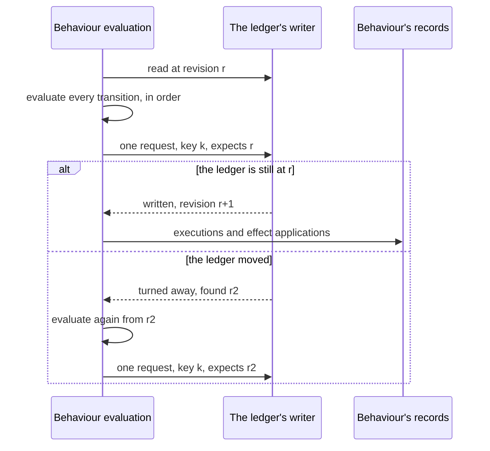
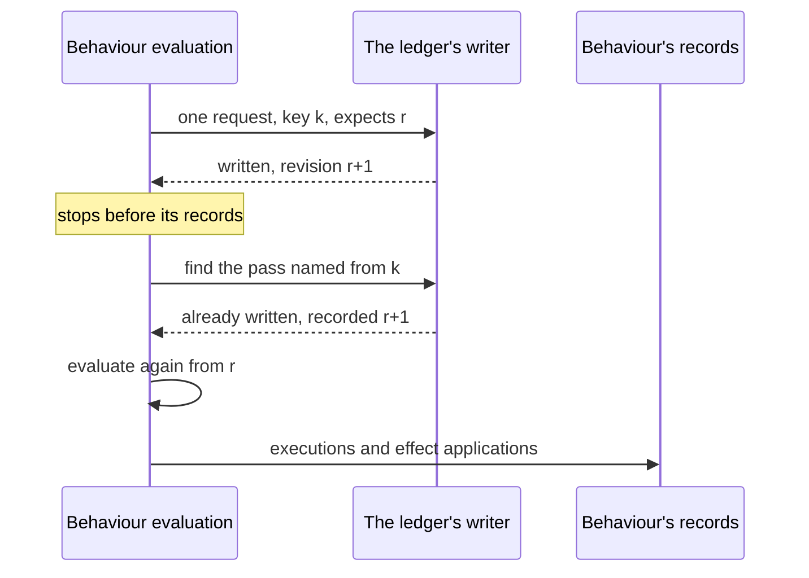

<!-- SPDX-License-Identifier: CC-BY-SA-4.0 -->

# Behaviour on the ledger, a brief for LG-3

**Unit:** `ledger`, prefix LG ([plan](../plans/ledger.md), [status](../status/ledger.md)). **Questions:** BHL-Q1 to BHL-Q7, numbered here and moved into the plan once the vocabulary rework has landed. **Status:** sketched 2026-11-19, while the rework (LG-11, LG-25 to LG-28, LG-12) is built. Nothing here is built, and no question is answered.

**How it names things.** It cites the decision behind each rule and never the name of a term the rework has not yet built, since a name can still move. Behaviour's own published terms are named as they stand. It is read again against the rework when that work returns.

## 1. Why now

LG-3 is Behaviour's migration onto the ledger. The computable contract substrate's draws, the applied insurance reference's term parameters and its claims all wait on it. Its row in the plan was last written on 2026-10-28, and most of what the ledger now decides came after. This sketch gathers what is decided, states what Behaviour holds today, and asks the questions the decisions leave to Behaviour.

## 2. What is decided

| Matter | Decision | Where |
|---|---|---|
| who owns the mechanism | Behaviour uses the ledger and defines none. It keeps effects that draw, credit or accrue onto an account, and regimes whose states partition a balance | [ADR-A131](../../architecture/decisions/ADR-A131-ledger-layer.md) decision 7, EC-Q2, PRI-83 |
| the direction of the import | Behaviour imports Ledger. Ledger names no term of Behaviour | ADR-A01's addendum of 2026-10-19, EC-Q7 |
| a periodic amount | one account for each period, keyed by the bin the effective position falls in, with no reset credit and no reset fired | PDD-15 |
| a draw in another unit | refused. The ledger never converts. The request is converted where it arrives, with a record of the rate, and the draw is then made in the account's unit | ADR-A131's addendum of 2026-11-09 |
| what restores an account | a credit states its kind, and an account says which kinds restore it | LG-Q10, ADR-A131's addendum of 2026-11-16 |
| competing draws | what an account declares for a merge is a versioned policy that its definition names | ADR-A131's addendum of 2026-11-17 |
| the account definition | versioned. It has a persistent identity, and a posting folds against the version in force when it took effect | LG-Q40, the [sketch on accounts from instruments](ledger-accounts-from-instruments.md) §9 |
| where a definition comes from | derived from an instrument's meaning by a projection, or authored directly. Both are legal | LG-Q21, LG-Q25 |
| the unit that is consistent | the owner's ledger, with one writer at a time and one revision | ADR-A131's third addendum of 2026-11-16 and its addendum of 2026-11-18 |
| a pass | evaluated from one revision of a ledger and written as one request, which is turned away when the ledger has moved from that revision. The evaluation is then made again | LG-Q45, ADR-A131's second addendum of 2026-11-19 |
| a pass's name | derived from its ledger and a key the caller gives for the evaluation, so the same evaluation written twice is one node | LG-Q46, the same addendum |
| who states the rest | Behaviour states its half when it imports Ledger, and the plan that builds the logical port states the port's half | PDD-22 |

**An input from the multi-store unit.** Its [plan](../plans/multi-store-architecture.md) carries the port's half in the section "Decided by the maintainer, 2026-11-19", which reaches this branch at the next merge. A write on the port names the revision it expects. It returns the revision it produced or, where it is turned away, the revision it found. BHL-Q1 and BHL-Q2 decide what the slice that builds the port has to accept from a caller.

**What the second addendum of 2026-11-19 leaves to the layer above.** What that layer records when its request is turned away or its evaluation is made again, and how a caller forms the key. Those are BHL-Q1 and BHL-Q2.

## 3. What Behaviour holds today

Checked against the layer's documents on 2026-11-19.

| | Today |
|---|---|
| imports | Foundation, Vocabulary, Quantification, Party and Eligibility. Not Ledger |
| configuration terms | `bhv:AllowanceDefinition`, `bhv:allowanceSpace`, `bhv:absorptionPolicy` with `bhv:Sequential` and `bhv:Proportional`, `bhv:resetRecurrence`, and on an effect `bhv:targetsAllowance`, `bhv:usesAllowance`, `bhv:consumesAmount` and the target kind `bhv:AllowanceTarget` |
| runtime terms | `bhv:AllowanceAccount`, `bhv:tracksAllowance`, `bhv:availableBalance`, a balance stored and overwritten |
| already deprecated | `bhv:AllowanceDefinition`, `bhv:AllowanceAccount` and `bhv:availableBalance`, in 0.20.0, reported by warning shapes. The release note says they are removed when Behaviour imports Ledger |
| a guard on a balance | not stated in data. In [`ordered-draws.ttl`](../../../ontology/behaviour/examples/ordered-draws.ttl) each guard requires an admission profile whose only content is a comment, for example "The seat bundle's balance is at least 1" |
| the owner of an account | not stated. The example's accounts track an allowance and name no owner |
| what one evaluation leaves | records that name their stimulus, transition executions and effect applications |

**Who uses the allowance terms.** About 34 files. 16 are under the insure-o example, 10 are Behaviour's own, and the rest are one MORK target, one document of the applied capacity module, one conformance case with its expected result, one gate query with its data, and two tool tests.

## 4. A pass, seen from Behaviour

One stimulus for one subject is evaluated from one revision of each ledger it reads. Under one writer for a ledger the request is turned away only when another writer got in, after a failover for example, so it is the rare path.

The second diagram is the replay the addendum decides. The evaluation made again reads the revision before the one the pass recorded, so it reaches the same result and writes Behaviour's records once.

## 5. Questions for the maintainer

Each is compared on what it costs to design with and what it costs at runtime. Every leaning is a hypothesis until answered.

**BHL-Q1. What Behaviour records when its request is turned away.**

| | Option | Design | Runtime |
|---|---|---|---|
| (a) | nothing. Only the evaluation that was written leaves records | a record stays a finding from facts. A turned-away attempt found nothing that holds | no write on the turned-away path |
| (b) | a record for each attempt, with the revision it read and the revision found | a reader of Behaviour's records has to tell an attempt from a finding, in every query | one node of about four statements for each attempt, written while the ledger is contended |
| (c) | nothing in the graph, a count in the runtime's own telemetry | as (a), and an operator can still see contention | none in the graph |

*Leaning (a) with (c).* A turned-away attempt is the runtime's event and no fact of the domain, and a question about it is answered from the log when it is asked (PRI-81). The cost is that the graph alone cannot say how often a ledger was contended.

**BHL-Q2. How a caller forms the key that names a pass.**

| | Option | Holds when | Fails when |
|---|---|---|---|
| (a) | derived from the stimulus and the subject it is evaluated for | a stimulus is evaluated once for each subject, and a later fact arrives as a stimulus of its own | one stimulus is evaluated twice for one subject on purpose |
| (b) | the stimulus alone | every stimulus has one subject | one stimulus moves two subjects that draw on one ledger, a programme's account for example. Both passes get one name |
| (c) | minted by the runtime for each evaluation and kept in a receipt of its own | always, at the cost of the receipt | a crash before the receipt is written leaves a replay with no key, so it needs a write before the pass |
| (d) | the command's id on the port | a command is one evaluation and is sent once | see below |

*Leaning (a).* It is derived from facts already recorded (PAT-01), it costs no write, and a replay after a crash forms the same key from the same stimulus. It rests on a rule this sketch proposes and does not find stated. Behaviour never evaluates an old stimulus again to rewrite what it found, since postings are append-only and a late fact is a new stimulus at an earlier effective position.

**Whether the key is the command's id.** We think it is not, as a hypothesis for the multi-store unit to confirm against its own code. A command's id resent with a different body is refused there. An evaluation made again after a turned-away request has the same key and, in general, a different body. So the key names the evaluation across its attempts, and a command's id names one attempt. A command's id formed from the key and the revisions the request expects would make a resent attempt one command and an evaluation made again a new one. If the port keeps no claim for a write it turned away, the two could be the same thing, and that is the port's to say.

**BHL-Q3. How a guard states a condition on a balance.** Today it is a comment, so no evaluator can run the example from its data.

| | Option | Design | Runtime |
|---|---|---|---|
| (a) | a guard names the account definition it reads, and requires an Eligibility interval condition whose candidate value is what that account has available | reuses a condition Eligibility already has. Behaviour adds one property, legal once it imports Ledger | one read of what is available, which is the least along the account's path, so d balance reads for a path of depth d |
| (b) | bands declared on the account definition in Ledger, which a state space then reads | Ledger gains a term whose only use is a regime, close to modelling a state in the ledger, which PRI-83 keeps apart | as (a) |
| (c) | left to the applied layer, the comment stays | nothing to build. The example stays unrunnable, and each applied layer invents its own | unknown |

*Leaning (a).* Two points need stating with it. A guard reads what is available, the least along the path, and not the account's own balance. And in the sequential environment a later guard sees the earlier draws of its own pass, which is what the example's table shows.

**BHL-Q4. Whether an effect names an account definition by its identity or by one version.** The definition is versioned, and a transition definition is versioned too.

| | Option | Consequence |
|---|---|---|
| (a) | by persistent identity. The version is the one in force at the draw's effective position | a new version of the account definition needs no new version of every transition that draws on it. The ledger already picks the version this way for a posting |
| (b) | by version | a change of stated amount forces a new version of each transition definition that names it, and the two can disagree with what the posting folds against |

*Leaning (a).* The account instance, its owner and its period key are then derived at evaluation, from the subject and the effective position, and never authored on the effect. Which owner an effect reaches when it is not the subject's own, a programme's account for example, is not settled here and is asked as BHL-Q5.

**BHL-Q5. How an effect reaches an account whose owner is not the subject.** The applied insurance reference's programme erosion draws on accounts a programme owns.

| | Option | Consequence |
|---|---|---|
| (a) | the owner is the subject's identity unless the effect states a path to another, in terms Behaviour already has for naming a party or a target | one default, one declared exception. The path's terms have to be found or added |
| (b) | every effect states its owner | no default to get wrong. Every simple example carries a statement that says nothing new |
| (c) | the account instance is bound when the instrument is instantiated, and the effect names the binding | the owner is settled once. It adds a record at instantiation that Behaviour would have to read |

*No leaning yet.* It needs Instrument's terms for a programme read first, and it is the question most likely to change the size of LG-3.

**BHL-Q6. Whether the allowance terms are removed at the import or kept as a shorthand.** Two texts disagree. ADR-A131 decision 7 and LG-3's row keep `bhv:AllowanceDefinition` as a deprecated shorthand with a normalisation to accounts, removed in a later release. Behaviour's release note for 0.20.0 says the three deprecated terms are removed when Behaviour imports Ledger.

| | Option | Consequence |
|---|---|---|
| (a) | removed at the import. Every user is moved in LG-3 | no normalisation is written or tested. About 34 files move in one slice. It needs an addendum that narrows decision 7 |
| (b) | kept as a shorthand with a normalisation, removed later | two ways to say one thing for a release. The normalisation has to map a reset onto one account for each period (PDD-15), a kind for each credit and a merge policy, and is thrown away at the removal |

*Leaning (a).* No adopter holds data on the shorthand, which is the case decision 7 kept it for, and the terms have warned since 0.20.0.

**BHL-Q7. Whether Behaviour states anything about conversion.** The addendum of 2026-11-09 has a request converted "where it arrives".

| | Option | Consequence |
|---|---|---|
| (a) | nothing. A shape refuses an effect whose amount is not on the account's unit, and conversion is done before the stimulus reaches Behaviour | Behaviour stays free of rates. The applied layer or the runtime owns the conversion record |
| (b) | Behaviour gains a conversion record that a posting may cite | a home for the record in the substrate. Behaviour takes on a duty the ledger gave up for its segregation |

*Leaning (a),* and the shape belongs with the one LG-12 writes for which draws an account accepts.

## 6. What LG-3 builds once these are answered

It is larger than one slice by the lifecycle's sizing. Five parts, in order, each with its own Validation Pack. They get rows on the ledger's board when the rework has landed.

1. **Examples first.** `ordered-draws.ttl` and one case each from lending and grants, restated as data the migrated model must accept or refuse, with the accounts' owner stated.
2. **The import and the effects.** Behaviour imports Ledger, and an effect draws, credits or accrues onto an account, with the absorption policy giving way to the merge policy the account definition names.
3. **Guards on a balance,** as BHL-Q3 is answered.
4. **Behaviour's half of a pass,** as BHL-Q1 and BHL-Q2 are answered, stated in Behaviour's README.
5. **The users moved and the terms removed or kept,** as BHL-Q6 is answered, with Behaviour's release notes and the applied modules' pins.

## 7. What this leaves out

- **Allocation over several accounts,** which is LG-4.
- **An evaluation that writes two ledgers.** The second addendum of 2026-11-19 does not decide it, and the multi-store unit models it.
- **A read over a set of ledgers,** PDD-23.
- **The projection that derives an account definition from an instrument,** which is Surface's and is not in the ledger's slices.
