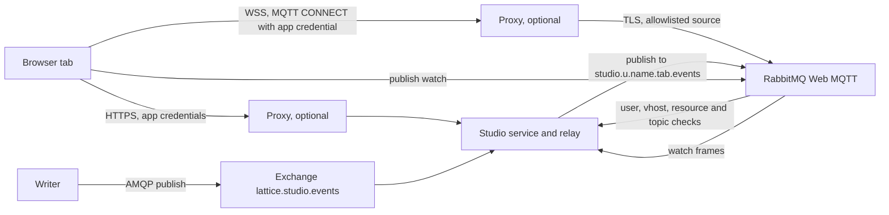
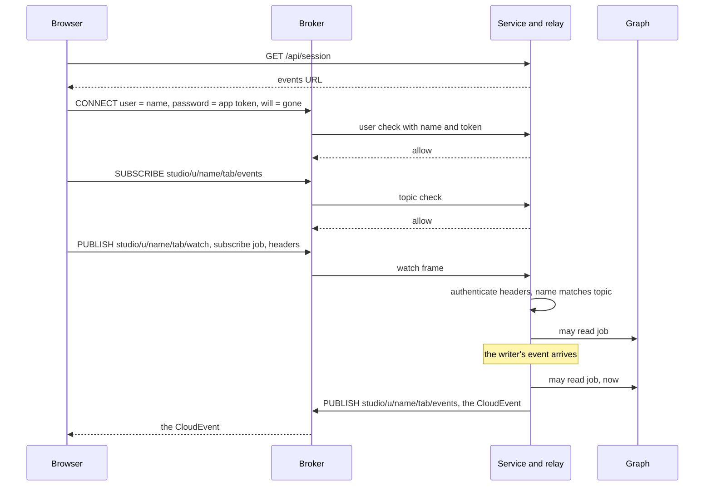

<!-- SPDX-License-Identifier: CC-BY-SA-4.0 -->

# Sketch: browser events over the broker's Web MQTT, with or without a proxy

**Unit:** `projection-maintenance` (PM), a rework of PM3 raised by the maintainer on 2026-11-02
**Status:** sketch. PM-Q18 and PM-Q20 answered 2026-11-02, PM-Q19, PM-Q21 and PM-Q22 open. PM3a and PM3b built 2026-11-02 with the leanings of PM-Q19 and PM-Q21, [Validation Pack](../validation/PM3b.md)
**Status record:** [projection-maintenance.md](../status/projection-maintenance.md)
**Builds on:** ADR-A30 (CloudEvents through the outbox), ADR-A149 decision 8 (authenticators), PM-Q10 to PM-Q12 in the [plan](../plans/projection-maintenance.md)

## 1. The scene

PM3 built a WebSocket of our own at `/api/events` on the studio service. A browser authenticates with its first frame, subscribes to a job by a subscribe frame, and receives the job's CloudEvents. The service refuses an upgrade from another origin, bounds a session's subjects and frame size, and checks that the subscriber may read the job at subscription and again at each delivery (PM3-T5). The service's `EventConsumer` feeds the notifier from the exchange `lattice.studio.events`.

All of that is a protocol we own. TLS, authentication, origin checking, limits and every new kind of subscription are ours to build, review and keep, and each is a place to get security wrong. RabbitMQ, which we already run, ships the same capability as a standard protocol, MQTT over WebSockets, with its own TLS and topic authorisation, and MQTT suits clients on the edge as well as browsers. The hypothesis of this sketch is that the broker should carry browser events and the service should keep only the decision of who may read what.

## 2. What the broker offers

From RabbitMQ 4.4's documentation, read on 2026-11-02. What PM3a's probes found is recorded in the status record.

- **Web MQTT.** The `rabbitmq_web_mqtt` plugin serves MQTT over WebSockets, by default on port 15675 at `/ws`. TLS is configured under `web_mqtt.ssl` (port, certificate, key and CA files, versions and ciphers). `web_mqtt.proxy_protocol = true` accepts the PROXY protocol, so the broker sees the client's address behind a proxy.
- **Topics.** MQTT topics route through one topic exchange, `mqtt.exchange` (`amq.topic` by default). A topic's `/` becomes `.` in the routing key, `+` becomes `*`, and a topic should hold no `.`.
- **Tokens.** With the OAuth 2 backend a client presents a JWT as its password. When the token expires, the broker disconnects an MQTT client with reason code 160, and MQTT has no token renewal on an open connection.
- **A service that decides.** The HTTP auth backend asks a service of ours whether a user may connect (`user_path`), use a virtual host (`vhost_path`), use a queue or exchange (`resource_path`) and read or write a topic (`topic_path`, with the routing key). Its answer is `allow` or `deny`. RabbitMQ recommends its cache backend in front of it.
- **Caching of checks.** Access checks may be cached for each connection, so a change of permission may take effect only when the client reconnects.

## 3. The constraint that places the checks

A browser cannot set a header on a WebSocket upgrade. PM3 authenticates by its first frame for that reason. So a proxy such as nginx or a corporate API gateway cannot check the app's bearer token on the broker's socket, unless the deployment carries its session in a cookie, for example through an OAuth proxy. The credential has to travel inside the protocol, which for MQTT is the CONNECT packet's password, and only the broker reads it there.

The design therefore rests on one rule. **The broker checks every connection and every subscription itself, and a proxy only adds checks.** Then a deployment with a proxy and one without have the same security, and the proxy is defence in depth, never the only gate.

## 4. Who sees what

### 4.1 Three designs that keep a copy of the permission in the broker

- **(a) Token scopes.** A token lists the workspace topics the principal may read, and the broker checks a subscription against them. The broker never calls us.
- **(b) The HTTP auth backend.** The broker asks the service at each subscription whether the principal may read the workspace's topic.
- **(c) A queue for each principal.** The service binds each principal's queue to the topics it may read, and unbinds on a change, through the management API.

Each keeps a copy of a permission the graph holds, a token's scopes, a cached answer or a binding. The graph and the broker cannot commit together, so the copy lags the graph by the time it takes to change, and a failure on the way leaves it stale.

- **(a) fails open.** An issued token is accepted until it expires. Revocation within its lifetime rests on a second call, closing the principal's connections through the management API, succeeding. Lost to a netsplit, that call leaves the principal reading until expiry. Nothing makes (a) fail closed short of a denylist checked at every connection, which is (b).
- **(b) has the cache's window.** A subscription's answer is cached for the connection and by the cache backend, so a revocation reaches it only when the client reconnects or the cache expires.
- **(c) fails open without a bound.**
  1. An unbind lost to a netsplit leaves the binding until a reconciler finds it, and with no reconciler for ever. Under (a) the token's expiry at least ends the window.
  2. An unbind stops new routing and does not recall the events already queued or in flight to the socket. A purge after it narrows that and races with deliveries under way.
  3. The lock is a commit in the graph and the unbind a change in the broker, and nothing makes them one step, so an event published between them is delivered. Unbinding before the commit fails closed, and then a broker that cannot be reached blocks an administrator from locking a workspace.
  4. The Web MQTT plugin creates a queue of its own for each session and binds it to the topics the client subscribes, so a queue the service declares is not one a Web MQTT client reads. The service would bind the plugin's session queues and permissions would forbid the client's own subscriptions, which PM3a would have to probe.

Testing any of them means modelling the broker's copy, its failures and its repair, beside the graph.

### 4.2 (d) Identity in the broker, the decision in a relay

**The broker checks identity only, and a relay of the service decides what each principal reads, at delivery, from the graph as it is then.**

- **Topics of one's own.** A principal may write only `studio/u/<name>/<tab>/watch` and read only `studio/u/<name>/<tab>/events`, where `<name>` is the principal's name in unpadded base64url, so a topic holds no `.`, `/`, `+` or `#`, and `<tab>` is a random identifier of the browser tab. The rule depends only on who connected, never on a workspace, so it never changes when a permission does.
- **The broker asks the service who connected.** The CONNECT packet carries the principal's name as the user and the app's own credential as the password, an OIDC access token, or `local` for the local authenticator, since the broker refuses an empty password. The broker's HTTP backend asks the service's `user_path`, which authenticates it with the deployment's authenticator (ADR-A149 decision 8) and allows it only when it names the user. `vhost_path`, `resource_path` and `topic_path` answer the fixed rule above, and allow the session's own MQTT queue and the MQTT exchange, nothing else.
- **The relay keeps who watches what.** It consumes `lattice.studio.events` as `EventConsumer` does today, and every `watch` topic. A watch frame is `{"type":"subscribe","subject":...,"headers":{...}}`, `unsubscribe` or `gone`, where `headers` are those an HTTP request of the browser carries, so the relay knows the principal and whether it administers. A subscribe is refused when its principal is not the topic's.
- **The check is at delivery.** For each event the relay asks `StudioApi.mayRead` for each watcher of its subject, as PM3's notifier does, and publishes to the events topic of each it allows.
- **Revocation is one commit.** Locking a workspace commits to the graph, and the next event is withheld because the check reads that commit. No management call, no binding, no token to revoke.
- **A netsplit fails closed.** A relay that cannot read the graph delivers nothing, and the browser falls back to polling, as it does today.
- **A tab that goes.** A tab's MQTT will message, published by the broker when the connection drops uncleanly, is `gone` on its watch topic, and a tab that closes cleanly sends `gone` itself. Either way the relay forgets the tab's watches.

What it keeps of PM3 is the notifier's core, the watchers, the check and the fan-out. What moves to the broker is TLS, the socket, authentication of the connection, framing, limits and the origin question, the parts that make a protocol of our own costly to keep. PM3-T5 holds unchanged, so there is no weakening to countersign.

Two windows remain, and neither depends on a second system. Between the check and the publish, as in PM3, microseconds. And identity, checked at CONNECT as PM3 checked it at the first frame, so a principal whose provider account is disabled keeps its connection until it closes, though it hears only what the graph lets it read.

## 5. The design

### 5.1 Components

Without a proxy the browser reaches the service and the broker directly, and both serve TLS. With one, the proxy terminates the browser's TLS, opens TLS of its own to each upstream, lets through only the API paths and the broker's `/ws`, and may check Origin and rate. The broker accepts Web MQTT only from the proxy's addresses, its management port is never routed, and neither is the service's broker check route.

### 5.2 Connecting and watching

The events URL is configuration, the proxy's public address or the broker's own, and the service names it in `/api/session` and in its Content-Security-Policy's `connect-src`, so the browser is the same in both deployments. Events stay structured CloudEvents in JSON in the message body, which needs no MQTT 5 user properties (PM-Q12 holds). The writer and its exchange do not change.

### 5.3 What carries over from PM3

| PM3 | Under (d) |
|---|---|
| first-frame auth | the CONNECT user and password, checked by the service through the broker. Each subscribe frame carries the headers again |
| Origin check on the service | a foreign page has no credential to give CONNECT, and a proxy may check Origin as well |
| `subscribed` frame | dropped. A refused or lost watch costs one fallback read |
| 200 subjects, 16 KiB frames | kept in the relay, with 20 tabs a principal, and the broker's own frame limit |
| events not durable | a clean session at QoS 0 |
| a job one may not read answers as absent | the relay ignores the watch |
| check at delivery (PM3-T5) | kept |

The service loses the WebSocket listener and `helidon-webserver-websocket`, and gains four broker check routes and the relay's MQTT side. The browser's `events.ts` keeps its interface, `watch` and `connected`, over the `mqtt` client library, and polling stays its fallback. When the relay restarts it forgets every watch, and a tab's waits fall back to polling until it watches again, a cost of five seconds at most a wait.

## 6. Costs

For one tab watching w jobs, with e events a second for those jobs:

| | (a) scopes | (b) HTTP backend | (c) queue a principal | (d) relay |
|---|---|---|---|---|
| broker calls to the service at connect | 0 | 1 | 0 | about 4 |
| broker calls a subscription | 0 | 1, less the cache | 0 | 1 |
| relay work an event | 0 | 0 | 0 | one `mayRead` and one publish a watcher |
| revocation window | the close, else the token's life | the cache | the unbind, else unbounded | the check to the publish |
| fails | open | open, for the cache's life | open | closed |
| state outside the graph | a signing key | none | queues and bindings | watches in the relay's memory, resent by the tabs |

A worked example, 50 authors with two tabs each, each tab watching 3 jobs, one event a job every 2 seconds while it runs:

| | (d) |
|---|---|
| broker connections | 100 |
| broker checks at connect, once | about 400 |
| events a second reaching the relay | 150 |
| `mayRead` calls a second | 150, each a read of the job's graph and its workspace |
| publishes a second | 150, of about 400 bytes |

`mayRead` reads the store twice an event and watcher, so at 150 a second it is 300 small reads a second on Fuseki, which a cache of the job's workspace would halve. That cost grows with watchers, not with principals' permissions, and is measured before it is optimised.

## 7. Testing both deployments

The studio harness starts RabbitMQ as a local process and as a container (its `processes` and `compose` runners), and the compose stack already runs Caddy as an HTTPS proxy for the Word add-in. The browser gate runs the real-stack suite:

1. **Direct.** The broker serves Web MQTT over TLS with a certificate made for the run, and the browser connects to it.
2. **Through a proxy.** A proxy used only by tests terminates TLS, forwards the API and `/ws` over TLS to the service and the broker, checks Origin, and sends the PROXY protocol. The broker accepts Web MQTT only from it (PM-Q22).

The negative cases, each on both runs where it applies:

- a CONNECT with no credential, or a credential of another principal, is refused
- a principal cannot subscribe to another's events topic, or publish to another's watch topic
- a watch frame whose headers name another principal is ignored
- locking a workspace withholds the next event from a reviewer watching its job
- a foreign Origin is refused at the proxy

## 8. Questions

**PM-Q18. Do we replace the service's WebSocket with the broker's Web MQTT?** (a) Yes, and remove the socket and its dependency. (b) Yes, and keep the service's socket as a second transport. (c) No. **Answered 2026-11-02, (a).**

**PM-Q19. What credential does a browser give the broker?** (a) A token the service signs for the broker, with a key of its own. (b) A token from the deployment's identity provider by token exchange. (c) The app's own credential, which the broker's HTTP backend asks the service to check. (a) adds a signing key to rotate, and (b) works only where the provider supports token exchange. (c) adds no key and no token, and costs a check at the service for each connection. Under (d) the broker holds no permission, so a token's scopes have nothing to carry. Leaning (c), which PM3b builds meanwhile.

**PM-Q20. How does the broker enforce who reads which topic?** (a) Token scopes. (b) The HTTP backend at each subscription. (c) A queue for each principal. (d) Identity only, with a relay of the service deciding at delivery. §4 compares them. **Answered 2026-11-02, (d).**

**PM-Q21. Is an identity checked at CONNECT enough?** (a) Yes, as PM3 checked it at the first frame, since every event is still checked against the graph at delivery. (b) The relay also refuses a subscribe frame whose headers no longer authenticate, which (d) does anyway since each frame carries them. (c) The service also closes a principal's connections when its provider disables it. (c) is the management call that §4.1 found fails open, here only for a disabled account. Leaning (a) with (b), which PM3b builds meanwhile.

**PM-Q22. How is the proxy deployment tested?** (a) A proxy as a container in the `compose` runner. (b) A proxy as a local process installed by mise, so both runs use the `processes` runner and the merge gate needs no Docker. (c) The direct run alone, with the proxy's configuration checked statically. The proxy may be Caddy, which the compose stack already runs, or nginx, which a corporate deployment is likelier to run. Leaning (b) with Caddy, a single binary, if mise installs it on every platform, else (a). Not built until answered.

## 9. Slices

| Slice | What | Done when |
|---|---|---|
| PM3a | probe the HTTP backend's calls for an MQTT client, the session queue's name, the will message, and TLS on Web MQTT, and enable Web MQTT in the stack and the harness | the probes are recorded |
| PM3b | the broker check routes, the relay, `events.ts` over MQTT, TLS in the real-stack run, and the removal of the WebSocket | PM3's tests are carried over to the relay, and the direct run passes with every negative case |
| PM3c | the proxy run of PM-Q22 in the browser gate | the proxy run passes with every negative case |

PM4's commit events go to the same exchange, so these slices come before it.
