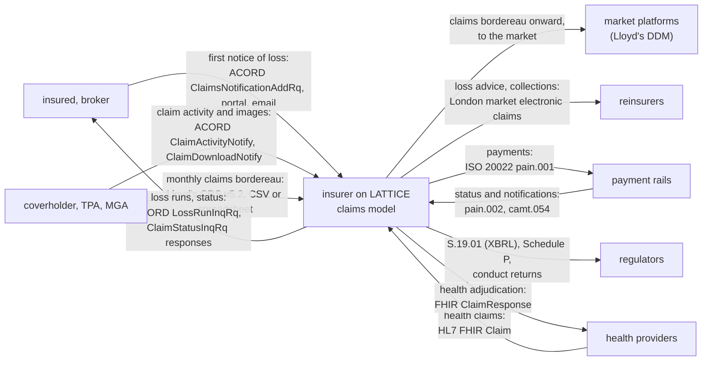
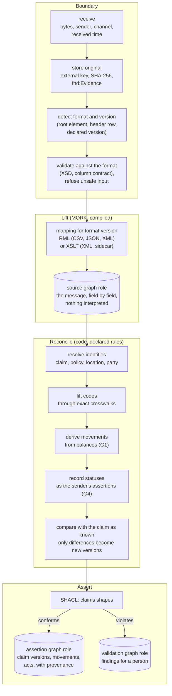
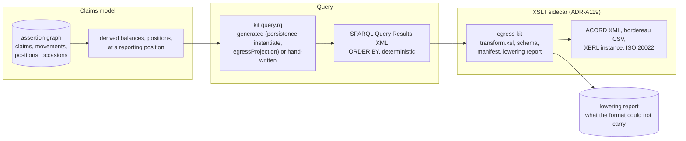

<!-- SPDX-License-Identifier: CC-BY-SA-4.0 -->

# Claims wire formats: ingress and egress through MORK and the XSLT sidecar

Version 0.1, draft for review, 2026-10-16. How claims data moves in and out of LATTICE's claims
model through the industry's formats: ACORD's P&C claims messages, the Lloyd's claims bordereau,
the London market's reinsurance claims messaging, ISO 20022 payments, HL7 FHIR for health claims and
the regulatory reporting formats. It assumes MORK for every mapping between a format and the model,
and the proposed XSLT sidecar ([ADR-A119](../../architecture/decisions/ADR-A119-xslt-transformation-sidecar.md),
Proposed) for XML transforms in either direction. It explores the gaps that open when real formats
meet the model, and how to close them. Nothing here is ratified.

**Reads with:** [insurance-claims-ontology.md](insurance-claims-ontology.md) (the claims sketch) and
its companion [claims-sketch-references.md](claims-sketch-references.md), whose §6 and §7 crosswalk
ACORD and the Lloyd's bordereau field by field. Also [mork-bridge.md](mork-bridge.md) (principles
B1 to B6, §6), [xslt-sidecar.md](xslt-sidecar.md), [xml-egress-and-transformation-kits.md](xml-egress-and-transformation-kits.md),
the [MORK README](../../../ontology/mork/README.md), [ADR-A13](../../architecture/decisions/ADR-A13-dataset-graph-role-model.md)
(graph roles and progressive commitment) and [ADR-A114](../../architecture/decisions/ADR-A114-external-and-natural-keys.md) (keys).

---

## Contents

1. [Summary](#1-summary)
2. [Who sends what to whom](#2-who-sends-what-to-whom)
3. [What exists today](#3-what-exists-today)
4. [The ingress pipeline](#4-the-ingress-pipeline)
5. [The egress pipeline](#5-the-egress-pipeline)
6. [Format by format](#6-format-by-format)
7. [Gaps, and how to close them](#7-gaps-and-how-to-close-them)
8. [Identity, idempotency and replay](#8-identity-idempotency-and-replay)
9. [Security and privacy on the wire](#9-security-and-privacy-on-the-wire)
10. [Governance of mappings and kits](#10-governance-of-mappings-and-kits)
11. [Questions for the maintainer](#11-questions-for-the-maintainer)
12. [Slices](#12-slices)
13. [Sources](#13-sources)

---

## 1. Summary

The industry's claims formats were designed to report, not to mean. A bordereau row is a monthly
snapshot of a claim's balances. An ACORD message carries one cause code, one status that mixes three
kinds of state, and contract terms restated on the claim. The claims model keeps facts, legal acts
and judgements apart, money as movements, a cause chain per loss, and one fact base for several
instruments. Bringing the two together is mostly a problem of **reconciliation**, not of syntax.

The design:

| # | Idea | Where |
|---|---|---|
| W1 | **Two stages on the way in.** A MORK mapping lifts a message into the **source** graph role, faithfully and with nothing interpreted. A reconciler then derives **assertions** in the claims model: identities resolved, codes lifted through crosswalks, movements inferred from balances, statuses kept as the sender's assertions. This is ADR-A13's source and assertion split and its progressive commitment, applied to claims | §4 |
| W2 | **One mapping language, two compilers.** MORK mapping graphs are the source of truth. `mork2rml` compiles them for CSV, JSON and XML through an RML processor. `mork2xslt` (proposed by the sidecar sketch) compiles XML-sourced mappings to XSLT for the sidecar | §4.3 |
| W3 | **Egress is a query and a stylesheet.** A SPARQL query over the claims model (derived balances, positions, positioned at a reporting date) returns SPARQL Results XML, and a published sidecar kit turns it into ACORD XML, a bordereau CSV, an XBRL instance or anything a recipient asks for | §5 |
| W4 | **Snapshots in, movements derived.** A bordereau's balances are kept as the source's snapshot, and movements are derived from consecutive snapshots as derived artefacts citing both. On the way out, balances are derived from movements | §7, G1 |
| W5 | **A status from outside is the sender's assertion,** never the model's state. A disagreement between the sender's status and the evaluated state is a finding for a person | §7, G4 |
| W6 | **Lowering never invents** (MORK bridge §4.2). What a format cannot carry is reported in the kit's lowering report, so a recipient knows what it did not receive | §7, G12 |
| W7 | **Every message is evidence.** The original bytes are stored outside the graph, cited by external key and hash, so any ingestion can be replayed and any derived fact traced to the field it came from | §8 |

---

## 2. Who sends what to whom

| Flow | Direction | Format | Frequency | Volume shape |
|---|---|---|---|---|
| first notice of loss | in | ACORD XML, portal forms, email | per event | a burst after a catastrophe (claims sketch §14.3, 2 to 3 a second at peak) |
| delegated claim activity | in | ACORD XML | per change | steady |
| claims bordereau | in, and out to the market | Lloyd's CRS v5.2, CSV or spreadsheet | monthly | every open claim, every month |
| reinsurance claims | out, and in for collections | the London market's electronic claims messaging (ACORD GRLC family) | per advice | per large claim and per event |
| payments | out, and statuses in | ISO 20022 | per payment | steady, bursts after events |
| health claims | in and out | HL7 FHIR | per encounter | high in health lines |
| regulatory returns | out | EIOPA XBRL, NAIC statement, conduct returns | quarterly, annual | portfolio aggregates |
| loss runs | out | ACORD XML, spreadsheet | at renewal | per insured |

---

## 3. What exists today

Measured, not assumed, on 2026-10-16.

| Piece | State |
|---|---|
| MORK mapping vocabulary (`ontology/mork`), including `mork:Lookup` and `mork:referenceDataPath` for code lookups | exists |
| `tools/mork2rml.py`, MORK mapping graph to RML | exists, one file, not yet factored into a shared walk |
| an RML processor in the toolchain | **none.** Nothing executes RML today (no RMLMapper, morph-kgc or pyrml dependency) |
| `mork:egressProjection` and `mork:TransformMapping`'s egress reading | declared in the vocabulary. **No compiler** emits an egress query from them |
| `tools/mork2xslt` | **does not exist.** Proposed by the sidecar sketch (XS-D5) |
| the XSLT sidecar and its kits (`contracts/xml/`) | **Proposed** (ADR-A119). No Saxon in the code, no `contracts/xml/` directory |
| `persistence instantiate` | exists: generated SPARQL for a compiled profile, a grounding for egress queries (sidecar §3) |
| Surface and the Surface-to-MORK lowering | phases 0 to 8 complete |
| crosswalks and lifting (AIR-3.4) | briefed and planned on the AIR branch |
| the claims model | sketch only |

So every egress kit and every XML ingress kit in this sketch waits on the sidecar, and every RML
ingress waits on an RML processor joining the toolchain (WF-Q3).

---

## 4. The ingress pipeline

### 4.1 Stages

| Stage | Owner | Output | Commitment (ADR-A13) |
|---|---|---|---|
| receive and store | a deployment's gateway | the original bytes as evidence | captured |
| detect and validate | the gateway, the sidecar for XML (§9) | accept, or refuse with a reason to the sender | identified |
| lift | a compiled MORK mapping | the source graph: the message's fields as typed triples, each citing the evidence and the mapping | partially mapped |
| reconcile | declared reconciliation rules, executed by code (§4.4) | candidate assertions, each a derived artefact citing the source triples it read | semantically classified |
| validate and assert | SHACL, then the store's write path | assertions, or findings | validated for a stated use, then operationally admitted |

**Mapping never destroys the source assertion** (ADR-A13). The source graph keeps what the sender
said, in the sender's terms, so a dispute about "what the coverholder reported in March" is answered
from the source role, and a corrected mapping can be re-run over it.

### 4.2 What the source graph holds

The source graph is the message, typed but not interpreted. Its vocabulary is the format's own,
declared once per format version as a MORK `RepresentationScheme`: a bordereau row is a resource
with one property per CRS field, an ACORD message a tree of resources following its aggregates. It
is never the claims vocabulary. That keeps lifting a pure, total, reviewable mapping (one field to
one property), and puts every judgement in reconciliation, where it is visible.

### 4.3 Which compiler

| Source | Compiler | Executor | Why |
|---|---|---|---|
| CSV (bordereaux) | `mork2rml` | an RML processor | RML's general case |
| spreadsheet bordereaux | a declared, lossless conversion to CSV (one sheet, one table), then as CSV | an RML processor | RML processors read tables, not workbooks. The conversion is a recorded step with its own evidence (G20) |
| JSON (FHIR, partner APIs) | `mork2rml` | an RML processor | RML's JSONPath iterator |
| XML (ACORD, market messages) | `mork2xslt`, or `mork2rml` | the sidecar, or an RML processor | the sidecar sketch's rule (§7): XSLT only where the source is XML and Saxon is already hosted. Both from one mapping graph, so they cannot disagree |

### 4.4 Reconciliation is declared, then executed

Reconciliation is where formats meet the model's meaning, so it must be reviewable. Each rule is
declared as data (a MORK mapping with a derivation kind, or a SPARQL `CONSTRUCT` held in the
mapping's artefact set), executed by code, and recorded as a `fnd:DerivationRun` (layers state, code
executes).

| Rule family | Example | Declared as |
|---|---|---|
| identity | a row whose UMR, certificate and claim reference match an existing claim identity is the same claim | a key match on `fnd:naturalKey` (ADR-A114), with the key schemes per format |
| code lifting | a CRS cause of loss code lifts to a reference cause only through an exact crosswalk mapping | AIR-3.4's crosswalk and `aeo:liftedPeril` |
| movement derivation | a change in "Previously Paid" plus "Paid This Month" across two rows is a payment movement | G1 |
| status | a CRS Claim Status value becomes an asserted status with its source | G4 |
| differences | an ACORD claim image becomes new facts only where it differs from the claim as known | G2, G17 |

---

## 5. The egress pipeline

| Step | Rule |
|---|---|
| position | every egress names a reporting position: a valid time and a record time. A March bordereau is "as booked by 31 March, about claims as they stood on 31 March" (G11) |
| query | prefers a generated query (sidecar XS-D3), hand-written where none covers the target, checked against the claims shapes as the kit's test oracle |
| transform | a published, versioned sidecar kit. `xsl:output method="text"` for CSV bordereaux, XML for ACORD and XBRL |
| lowering report | every value the kit could not carry, or carried inexactly (a crosswalk that was not exact, a cause chain reduced to one code), listed beside the output (W6) |
| evidence | the output's hash and the query, kit and position it came from, recorded as a derived artefact, so a recipient's question about a past submission is answered by regenerating it |

**Two hops for market formats.** The egress sketch's §13 suggested emitting LATTICE's own schema
first and publishing a second XML-to-XML stylesheet to the market format, which a market body could
own. For claims that is attractive where a market body will maintain the second hop, and a
needless second step otherwise. WF-Q4.

---

## 6. Format by format

### 6.1 The Lloyd's claims bordereau (CRS v5.2)

| Aspect | Ingress | Egress |
|---|---|---|
| unit | one row per claim per reporting month | the same, per binding authority and section |
| keys | UMR (CR0005), agreement (CR0006), section (CR0007), certificate (CR0029), claim reference (CR0104) | the same keys, from the claim and instrument identities |
| money | cumulative and period balances by head, original and settlement currency with a rate | derived balances from movements, by cost class (G1, G7, G8) |
| status and dates | asserted statuses and dates (G4, G6) | derived from governance state, occasions, positions |
| codes | the coverholder's cause of loss, nature of claim, catastrophe codes, crosswalked (G5) | lowered to the market's lists, inexact values reported (G12) |
| personal data | claimant name | minimised to what the recipient needs (G10) |
| format | CSV, often a spreadsheet | CSV through a text-output kit, or the recipient's spreadsheet template |
| destination | the insurer | the market's Delegated Data Manager, or the insurer's own systems |

### 6.2 ACORD P&C claims messages

| Message | Direction | Model |
|---|---|---|
| `ClaimsNotificationAddRq` | in | a notification, a claim, a loss and the parties it names. A claims-made indicator and retroactive date are checked against the instrument, never stored as claim facts (references §6.2) |
| `ClaimActivityNotify` | in | each activity becomes the act or fact it describes |
| `ClaimDownloadNotify` | in, and out to a partner that wants images | a full image of one claim. Ingress keeps it as source and asserts only the differences (G2) |
| `ClaimStatusInqRq` | in (request), out (response) | a query for derived balances at a position |
| `LossRunInqRq` | in (request), out (response) | the derived loss run (claims sketch §13.3) |

ACORD messages expect a response with a status and errors. Ingress returns the result of validation
and the first stage of reconciliation (accepted, accepted with warnings, rejected with reasons) in
the format's response message, so a sender's errors reach it in its own terms (G13).

### 6.3 London market reinsurance claims

The London market's electronic claims messaging belongs to the ACORD Global Reinsurance and Large
Commercial family (Recalled, references §3). It is treated as another ACORD XML family: mapping
graphs per message version, sidecar kits for egress. Its access terms decide whether its mappings
can be published (G15). A loss advice is a notification under the reinsurance, `ins:forCase` the
same claim (claims sketch §10.3).

### 6.4 Payments: ISO 20022

| Message | Direction | Model |
|---|---|---|
| `pain.001` customer credit transfer initiation | out | one instruction per payment movement (or batch), from the movement, payee and screening outcome. A payment whose payee has no screening run is not lowered (claims sketch §11.3) |
| `pain.002` payment status report | in | the bank's status for an instruction, a fact on the movement's evidence |
| `camt.054` debit and credit notification | in | the booked debit, which confirms the movement's valid time, and receipts for recoveries |

A payment movement exists when the insurer decides to pay. Its execution on the rail is a separate
fact. A returned payment is a reversing movement citing the bank's report.

### 6.5 Health claims: HL7 FHIR

FHIR's financial module is the open standard closest to the claims model's meaning (references §3).
A FHIR `Claim` lifts to a claim with loss items per line, its `Coverage` resolves the response, and
the adjudication returns as a `ClaimResponse` lowered from the response's occasions and quanta. FHIR
is JSON or XML, so `mork2rml` (JSON) or the sidecar (XML) applies. Health data is special category
on arrival (§9).

### 6.6 Regulatory reporting

| Report | Route |
|---|---|
| Solvency II S.19.01, in the EIOPA XBRL taxonomy | a SPARQL query of triangle cells by line and development period, and a sidecar kit producing the xBRL-XML instance |
| NAIC Schedule P | a query of the US statutory lines' triangles, and the filer's own submission tool |
| conduct returns | a query over occasions of regulatory duties (claims sketch §11.4) |

Taxonomies change yearly, so each is a kit version per taxonomy version.

### 6.7 Documents

Documents travel beside messages (ACORD `FileAttachmentInfo`, market document repositories). They
are stored outside the graph and cited as evidence by external key and hash. A document announced
as "forthcoming" is an open information request, which the submission sketch's gap function (AIR-6.1)
already models.

---

## 7. Gaps, and how to close them

Each gap: what it is, why it matters, how we would close it, and a leaning where a choice is open.

### G1. Balances in, movements wanted

**What.** A bordereau reports, per claim and month, previously paid, paid this month, reserve,
change this month and total incurred, by head. The model keeps movements (claims sketch §9).

**Close it** by deriving movements from consecutive snapshots of one claim:

| Snapshot | Indemnity previously paid | paid this month | reserve |
|---|---|---|---|
| January row | 0 | 10,000 | 90,000 |
| February row | 10,000 | 25,000 | 60,000 |

| Derived movement | Valid time | Amount | Derived from |
|---|---|---|---|
| reserve set | January (first row) | 100,000 | January row: paid 10,000 plus reserve 90,000 |
| payment | January | 10,000 | January row, paid this month |
| payment | February | 25,000 | February row, paid this month |
| reserve change | February | −5,000 | the rows' incurred, 100,000 then 95,000 |

The convention is the bordereau's: reserve movements set and change the incurred estimate, and a payment moves an amount from outstanding to paid without changing incurred. Each derived movement is a `fnd:DerivedArtefact` citing the two source rows. A row whose previously
paid differs from the earlier row's previously paid plus paid this month is an **inconsistency**,
reported, and the later row's figures win for its own month (the coverholder has restated). That
turns the bordereau's internal arithmetic into a data quality check, which today is done by hand.

**This qualifies the claims sketch's CL6.** A movement may be asserted (the insurer's own payments
system recorded it) or derived (inferred from a source's balances). Both are movements. The derived
kind carries its derivation. WF-Q2.

**Space, quantified.** For a binding authority with 4,200 open claims, reported monthly for a year,
with seven money heads (indemnity, fees and five expense heads) and four figures each:

| Option | What is stored | Triples a year, order of |
|---|---|---|
| (a) every row triplified in the source graph, movements derived | 4,200 × 12 rows, each about 28 amounts as quantities (four triples each) plus about 25 other fields | 4,200 × 12 × 137 ≈ 6.9M |
| (b) original files as evidence outside the graph, the latest row per claim triplified, movements derived | 4,200 latest rows, and the derived movements (say half a non-zero head change per claim per month, about ten triples each) | 4,200 × 137 + 25,200 × 10 ≈ 0.83M |
| (c) as (a), compacted to changed values only | changed amounts per row | about 1.5M to 2M, depending on churn |

Option (b) stores about an eighth of (a) and loses nothing, because a re-ingestion of the stored
files reproduces every row (§8). **Leaning: (b).** (a) is worth it only for a deployment that queries
historical rows often, and it can choose it per format.

### G2. Images in, facts wanted

**What.** ACORD's `ClaimDownloadNotify` and many partner feeds send the whole claim each time.

**Close it** by comparing the image with the claim as known (the latest version) and asserting only
the differences, as a new claim version citing the image. An image that omits something the model
holds (a cause link added by a handler) is not a deletion: absence in a partial format is not
evidence of absence (claims sketch CL8). A format that declares itself complete for a field may
license absence there, through a closure declaration (ADR-A105).

### G3. One row, many instruments

**What.** A bordereau row is the coverholder's claim under one section. The insurers behind the
section hold several shares, and the model wants a response per instrument and per insurer group.

**Close it** by landing the row on the response for the section's insurer group, and deriving
per-insurer figures by `split` over the group's shares (evaluation context §4) when an egress asks
for them. Nothing is stored per insurer that the shares can derive.

### G4. Status codes that mix three states

**What.** ACORD's `ClaimStatusCd` and the CRS Claim Status mix the record's governance state (open,
closed, reopened), the legal state of the insurer's duties (paid, denied), and handling stages.

**Close it.**

- **Ingress:** a status is recorded as the sender's assertion (`fnd:assertedBy` the sender, valid at
  its status date), in the sender's code list. A crosswalk maps each sender status to what it implies
  in the model, for example "Closed" implies governance state closed, "Denied" implies a coverage
  position of kind declinature. An implication that contradicts the evaluated state (the sender says
  closed, an occasion is still Arisen with a reserve outstanding) is a finding for a person.
- **Egress:** a declared rule per format derives the status from governance state, occasions and the
  latest position, recorded in the kit's manifest.

WF-Q6 asks where the rules live.

### G5. One cause code, flat lists

**What.** Both formats carry one cause of loss code from the sender's list. The model wants a cause
chain with characteristics, in the contract's operative scheme.

**Close it** with AIR-3.4's machinery: the code lands as `aeo:peril` on one cause link in the
sender's scheme, lifts to the reference only through an exact crosswalk, and characteristics follow
from the code where the crosswalk carries them (a code naming a cause and a mechanism). The link's
position stays unknown. Checks that need the chain return Undetermined with the missing fact (CL8),
which a handler fills from the documents.

### G6. Dates with several meanings

**What.** "Date First Advised" (CR0136) may be the valid time of the first notification or the date
the coverholder recorded it. "Date of Loss (From)" and "(To)" give a span, with no manifestation,
discovery or exposure dates.

**Close it** by declaring, per format field, which of the model's dates it fills, and keeping record
time separately: the bordereau's receipt time is the record time of everything lifted from it, and
the field's value is a valid time. Where a field is known to be ambiguous, the mapping records the
ambiguity as a note and the date as asserted by the sender, not as the model's notification time.

### G7. Cost classes of different grain

**What.** The CRS splits fees and five expense heads. ACORD's `PaymentTypeCd` carries kind and class
in one code. US reporting wants allocated and unallocated loss adjustment expense.

**Close it** with the claims sketch's `clm:costClass` following the CRS heads (references §9), a
crosswalk from each format's codes, and groupings for the coarser reporting splits.

### G8. Exchange rates without a date

**What.** CR0111 gives a rate of exchange but not its date or source.

**Close it** by recording the rate as a `qnt:Conversion` under a context dated at the row's reporting
month end, with the sender as its source and a note that the date is assumed. Egress names the
conversion's context in the lowering report.

### G9. Decisions as flags

**What.** "Denial" (CR0107) with a reason, "Refer Claim to Underwriters" (CR0106), "Ex Gratia
Payment" (CR0317) are flags, while the model holds acts and occasions.

**Close it.** Denial becomes a coverage position asserted by the coverholder, its reason a note,
its terms unknown until a person cites them. Referral is checked against the authority's scope: the
model derives whether a referral was due (CCS S46), and a disagreement with the flag is reported. An
ex gratia payment is a movement that performs no occasion, checked against the authority's terms.

### G10. Personal and special category data

**What.** ACORD carries injuries, ICD diagnostic codes and medical treatment. The bordereau carries
claimant names. Recipients often need less than the source holds.

**Close it.** Ingress lands personal data under the claimant's privacy profile, with special
category data classified on arrival (claims sketch §12.2). Egress kits declare, per field, the
recipient's need, and the query reads only those fields: minimisation is in the kit, reviewable,
not in an application's discretion.

### G11. Reporting positions

**What.** "Paid this month" can mean paid with a valid time in the month, or booked (recorded) in the
month. Backdated corrections make the two differ.

**Close it** with a declared basis per kit. **Leaning: record time** (booked in the month), because a
bordereau reconciles to cash and ledgers that are booked, and a backdated correction then appears as
an adjustment in the month it is booked, which is how the market reads it. The valid-time view stays
available for analysis.

### G12. What a format cannot carry

**What.** The model knows more than any format: a cause chain, several responses, positions with
cited terms, quanta by stage, effective characteristics.

**Close it** with the lowering report beside every egress (W6), listing per claim what was dropped or
carried inexactly, and the MORK bridge's rule that lowering never invents a code.

### G13. Errors back to the sender

**What.** A sender needs to know what was rejected and why, in its terms.

**Close it** by mapping SHACL results and reconciliation findings back to the format's own error
structure (an ACORD response's message status, or a bordereau rejection file listing row and field),
with a second egress kit per format. A finding cites the source triple, which cites the field, so the
path back to "row 214, column CR0136" is a lookup, not a search.

### G14. Format versions

**What.** CRS has had several versions. ACORD publishes releases. Taxonomies change yearly.

**Close it** with one mapping graph per format version (MORK bridge §6), detection of the version at
the boundary (§4.1), and a version on every kit. A message in a version with no mapping is refused
with a reason, never lifted by the nearest mapping.

### G15. Licensing

**What.** ACORD's standards are licensed to members, and the London market's messaging has its own
terms. LATTICE's repository is public. Lloyd's publishes the CRS user guide.

**Close it**, pending the maintainer's check of each publisher's terms (WF-Q5): the public repository
holds the mapping vocabulary, the compilers, the reconciliation rules, kits for formats whose terms
allow publication (the CRS bordereau, ISO 20022's published message definitions, FHIR, which is open),
and fixtures we author. Mappings and kits for licensed formats live in an adopter's own repository,
built with the same tools. Element names cited in a sketch are facts about a format and are not its
schema.

### G16. Transport and trust

**What.** Messages arrive by API, SFTP, email and portal, signed or not.

**Close it** at the deployment's gateway (outside LATTICE), which records the channel, the sender as
authenticated and any signature check as evidence on the message. LATTICE's part is that the sender
recorded there is the `fnd:assertedBy` of everything lifted from the message.

### G17. Late, out-of-order and repeated data

**What.** A February bordereau may arrive before a corrected January one. A sender may resend a file.

**Close it** with bitemporal facts: each fact keeps its valid time from the content and its record time
from receipt. Derivation of movements (G1) orders snapshots by reporting period, not by arrival, and
re-derives when an earlier period arrives late. A repeated message is detected by hash (§8).

### G18. Contract terms restated on the claim

**What.** ACORD's claims-made indicator, retroactive date and extended reporting date, and the CRS
sum insured, are contract terms carried on the claim.

**Close it** by reading them as the sender's statement of the contract, compared with the instrument,
never stored as claim facts (claims sketch CL2). A disagreement is a data quality finding, and often
the first sign that a coverholder is working from an out-of-date version of the terms.

### G19. Workflow fields

**What.** Diary dates, peer review dates, responsible departments.

**Close it** by keeping them in the source graph only. A deployment that wants them in its workflow
reads them there. They never enter the claims model (CL9).

### G20. Spreadsheets

**What.** Bordereaux arrive as workbooks with several sheets, merged cells and formulas.

**Close it** with a declared, recorded conversion to CSV per sheet before lifting, whose rules (which
sheet, which header row, formulas evaluated or refused) are part of the format version's mapping
package, and whose output is stored as evidence beside the original.

### G21. Free text

**What.** Loss descriptions, reasons for denial, remarks.

**Close it** by keeping free text as evidence text. A model may propose structured facts from it (a
cause, a date, a party), which wait in MORK's review queue (ADR-A13 mapping hypotheses) and enter the
assertion graph only when a person accepts them (claims sketch §16, never guessing).

---

## 8. Identity, idempotency and replay

| Concern | Rule |
|---|---|
| message identity | every message has an external key (its own message identifier where the format has one, the sender plus file name and period for a bordereau) and the SHA-256 of its bytes |
| idempotency | a message whose hash is already recorded is acknowledged and not lifted again |
| replay | any message can be re-lifted with the mapping version recorded on it, or with a newer mapping, into a fresh source graph, and reconciliation re-run. The difference between the two runs is a reviewable change |
| claim identity | resolved by key schemes (ADR-A114): the coverholder's claim reference within its agreement and certificate, the insurer's claim number, a market reference. A match on keys of different schemes is never assumed. A mapping table between them is evidence |
| party identity | matched only on keys (LEI for organisations, the sender's party reference). People are not matched across senders by name, which would compile personal data across sources. A deployment's own identity resolution, if any, is its decision and its evidence |

---

## 9. Security and privacy on the wire

| Concern | Rule |
|---|---|
| XML attacks | the sidecar's inbound controls (sidecar §6.3, egress sketch §11.1): DTDs disabled, external entities refused, `DOCTYPE` rejected, size and depth limits on the whole document |
| validation before transform | the format's schema validates on arrival, before any stylesheet or RML runs |
| spreadsheets | formulas are not evaluated by default (G20), macros are refused |
| special category data | classified on arrival, landing in the claimant's privacy profile (claims sketch §12.2) |
| minimisation on the way out | per-field recipient need, declared in the kit (G10) |
| sanctions | no payment instruction is lowered for a payee without a screening run (claims sketch §11.3) |
| tenant isolation | the sidecar takes a direction, a kit identifier and an input only (sidecar §4, XS-R1) |

---

## 10. Governance of mappings and kits

| Artefact | Lifecycle |
|---|---|
| a format version's representation scheme | declared once, from the publisher's documentation, with its source cited |
| a mapping graph per format version | proposed (by a person, or a model into MORK's review queue), reviewed per field, approved, compiled. Its confidence and review status are on the graph (MORK README Part 4) |
| reconciliation rules | declared as data, reviewed like mappings, versioned with them |
| a crosswalk of a sender's code list | AIR-3.4's crosswalk, reviewed by a person, stale when either list changes |
| an egress kit | query, stylesheet, schema, manifest, lowering report declaration, golden fixtures, published and versioned (egress sketch §8), runnable by a bare Saxon outside our code (sidecar XS-R5) |

MB-Q2 (the confidence threshold and sampling rate for template mappings of recurring formats) applies
directly: a coverholder's bordereau is the recurring format it was written for.

---

## 11. Questions for the maintainer

### WF-Q1. Lift to a source graph and reconcile, or map straight into the claims model?

| Option | Design | Runtime |
|---|---|---|
| (a) source graph, then reconciliation (§4) | two steps, every judgement visible and replayable. ADR-A13 as written | one extra write of the lifted message, which option (b) of G1 keeps small |
| (b) one mapping straight into claims facts | simpler pipeline. Judgements (identity, status, movements) hidden inside mappings, which MORK's one-field-to-one-property strength does not suit | fewer writes |

**Leaning: (a).** The formats are reports, and turning a report into facts takes judgements that must
be reviewable.

### WF-Q2. Are movements derived from balances still movements?

| Option | Consequence |
|---|---|
| (a) yes, a movement may be asserted or derived, the derived kind citing the snapshots (G1) | one money model for every source. The claims sketch's CL6 gains this qualification |
| (b) keep bordereau balances as balances, and movements only from the insurer's own systems | two money models, and every balance query must know which applies |

**Leaning: (a).**

### WF-Q3. Which executors join the toolchain?

| Option | Consequence |
|---|---|
| (a) an RML processor for all ingress (CSV, JSON, XML), and the sidecar for egress only, with `mork2xslt` later | one ingress executor, needed anyway for CSV bordereaux. The sidecar's ingress direction waits until an XML-heavy flow justifies it |
| (b) the sidecar for XML ingress and egress, an RML processor for CSV and JSON | two ingress executors from the start |
| (c) the sidecar only, with CSV through XSLT's text parsing | one executor, and CSV parsing in XSLT, which is possible and awkward |

**Leaning: (a).** The choice of RML processor (for example morph-kgc, a Python implementation, or
RMLMapper in Java) is a toolchain decision with its own ADR, and its licence needs the same check the
sidecar did for Saxon.

### WF-Q4. One hop or two for market formats?

**Leaning:** one hop (claims model to the market format) by default, and two hops (claims model to
LATTICE's own claims XML, then XML to the market format) only where a market body will own the second
stylesheet.

### WF-Q5. Where do kits for licensed formats live?

**Leaning:** as G15, after checking each publisher's terms. Kits for licensed formats live with
adopters, and the public repository holds the tools and the open formats' kits.

### WF-Q6. Where do status rules live?

| Option | Consequence |
|---|---|
| (a) a SKOS crosswalk from each sender's status list to implication concepts, plus a declared derivation rule per format for egress | data, reviewable, reusable across senders using the same list |
| (b) code per format | quicker, and invisible to review |

**Leaning: (a).**

### WF-Q7. Bordereau egress on record time or valid time?

**Leaning: record time**, as G11 argues, with valid time available for analysis.

---

## 12. Slices

Proposed, and to be placed in a plan only after the claims sketch's questions are answered.

| Slice | Content | Needs |
|---|---|---|
| WF-0 | ADR for an RML processor in the toolchain (WF-Q3) | the maintainer |
| WF-1 | CRS v5.2 claims bordereau: representation scheme, mapping graph, source graph, golden fixtures we author | WF-0, the claims model's AIR-6.2a |
| WF-2 | reconciliation: identity by keys, movement derivation with the inconsistency check (G1), statuses as assertions (G4) | WF-1, AIR-6.2d |
| WF-3 | the bordereau's egress kit and its lowering report, on record time | the sidecar's first slice |
| WF-4 | ACORD `ClaimsNotificationAddRq` ingress and its response, outside the public repository if WF-Q5 says so | WF-0 or the sidecar's ingress |
| WF-5 | ISO 20022 payment instruction egress and status ingress | AIR-6.2d |
| WF-6 | FHIR `Claim` and `ClaimResponse` | AIR-6.2c |
| WF-7 | regulatory projections (S.19.01 triangle cells) | AIR-6.2d |

---

## 13. Sources

- The claims sketch and its [references](claims-sketch-references.md), whose §6 and §7 list the ACORD
  and CRS elements used here, with their verification status
- [xslt-sidecar.md](xslt-sidecar.md), [xml-egress-and-transformation-kits.md](xml-egress-and-transformation-kits.md),
  ADR-A119 (Proposed), the [MORK README](../../../ontology/mork/README.md) and `ontology/mork/spec/Mork.ttl`
  (`mork:Lookup`, `mork:referenceDataPath`, `mork:egressProjection`, `mork:TransformMapping`),
  `tools/mork2rml.py`, ADR-A13, ADR-A105, ADR-A114, [mork-bridge.md](mork-bridge.md)
- ACORD P&C/Surety claims service messages, read through a published model viewer (Checked, version
  not stated)
- Lloyd's Coverholder Reporting Standards v5.2 and Lloyd's claims bordereaux guidance (Checked), with
  the field list read from a third-party rendering (to confirm, references §7)
- ISO 20022 message names pain.001, pain.002, camt.054 (Recalled)
- the HL7 FHIR financial module (Checked)
- the EIOPA XBRL taxonomy and Solvency II S.19.01, NAIC Schedule P (Recalled)
