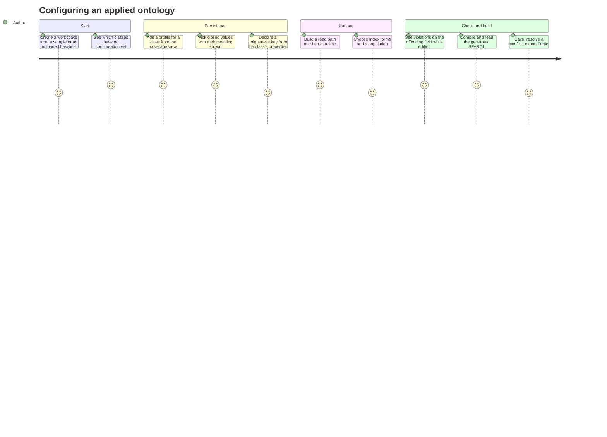
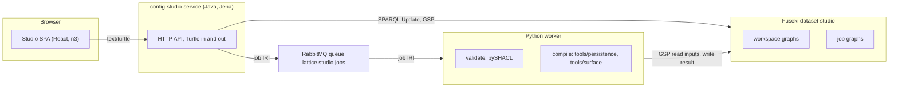
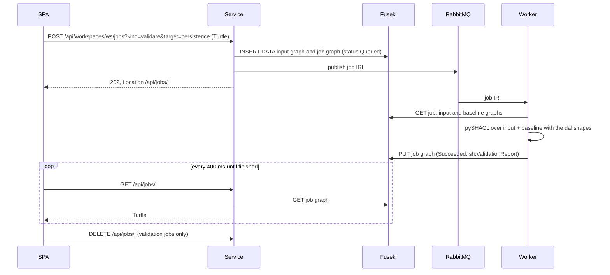
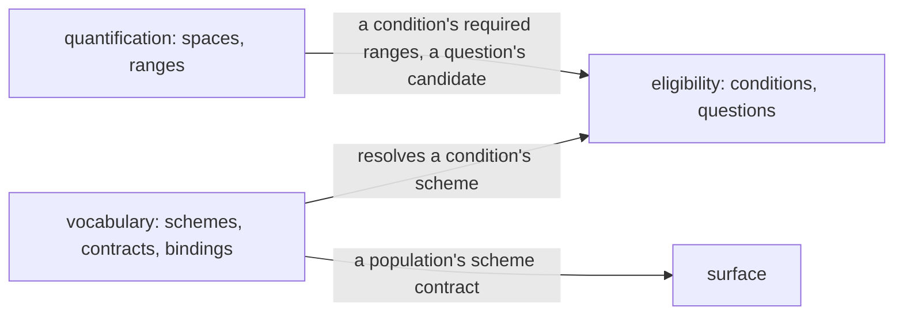

<!-- SPDX-License-Identifier: CC-BY-SA-4.0 -->

# Configuration Studio, a sketch

**Unit ID:** `config-studio`
**Plan:** [config-studio.md](../plans/config-studio.md)
**Status record:** [config-studio.md](../status/config-studio.md)
**ADR:** [A-136](../../architecture/decisions/ADR-A136-configuration-studio.md), Proposed

## 1. The scene

An adopter of LATTICE brings an applied ontology, its baseline: classes, properties and concept schemes. To make that ontology run they author two kinds of configuration over it.

- **Persistence configuration** (`dal:`, [ADR-A78](../../architecture/decisions/ADR-A78-persistence-profile-substrate-and-aggregate-boundaries.md)) says how each class is stored: scopes, aggregate boundaries, concurrency, ordering, receipts, identity, privacy and uniqueness keys. `tools/persistence` compiles it into a `dal:CompiledProfile` and SPARQL ([ADR-A79](../../architecture/decisions/ADR-A79-persistence-compiler-toolchain.md)).
- **Surface configuration** (`srf:`) declares promotion and index contracts over the baseline's classes and properties. `tools/surface` compiles it into generated surfaces.

Today both are written by hand in Turtle. The author must know which properties each `dal:` profile class takes, which closed values each takes, and which baseline terms a read path may traverse, and learns of a mistake only when a compiler or a SHACL run refuses it. The Surface Contract Studio (`apps/surface-contract-studio`) shows a typed editor for Surface, but it is fixture-backed and never reads a baseline, validates or compiles.

The studio closes that loop: open a baseline, author both configurations against it with forms that offer only what the ontology allows, see each SHACL violation on the field that caused it as you type, compile, and read the compiled profile, the generated SPARQL and the surfaces.

## 2. Who uses it and how

One role, the **configuration author**, a data or ontology engineer of an adopter. They know their baseline and roughly what they want stored and surfaced, and do not know the `dal:` or `srf:` vocabularies by heart.



### 2.1 Information architecture

```text
Workspaces (cards)  -- New workspace: sample | upload Turtle (files are sorted into three graphs)
  Workspace
    Overview    coverage matrix: baseline class x persistence profile x surface contracts
    Baseline    class tree, properties, schemes, "used by", replace baseline (with dangling-reference check)
    Persistence list of scopes, profiles, constraints, identity, privacy -> ontology-driven editor
    Surface     list of contracts and profiles -> ontology-driven editor + read path builder
    Build       compile jobs: compiled profile, SPARQL per operation, surfaces, diagnostics, gaps
  Inspector (right rail, follows the selection): Turtle of the node | issues | help from rdfs:comment
  Problems drawer (bottom): every issue, click to jump to the field
  Command palette (Cmd/Ctrl+K): jump to any class, node or view
```

The editor, inspector and problems drawer share one selection, as [ux-design.md §2.2](../../architecture/ux-design.md) asks for the Surface Studio.

### 2.2 Interaction rules

| Interaction | Mechanism | Failure shown as |
|---|---|---|
| Edit a field | the change applies to the in-browser graph, with undo and redo | none, edits are local until saved |
| Validate | 600 ms after the last edit, the unsaved graph is submitted as a validation job | each `sh:ValidationResult` on the field its focus node and path name, a badge in the navigation, and a row in the problems drawer |
| Save | `PUT` with `If-Match` on the graph's revision ([PAT-26](../../architecture/rdf-sparql-patterns-guide.md)) | `412` opens a dialog with the line diff between the stored and the local Turtle, and a choice to take theirs or keep mine |
| Compile | a compile job, polled until finished | typed job states, queued, running, succeeded, failed, never one generic spinner ([ux-design.md §2.5](../../architecture/ux-design.md)) |
| Read Turtle | read-only and highlighted, per node and per graph | the studio never offers a free-text Turtle box for configuration ([ux-design.md §2.5](../../architecture/ux-design.md)). A whole file may be imported, and is validated like any edit |
| Replace the baseline | upload, then a summary of terms added and removed | every configuration reference to a term the new baseline lacks is an issue |

## 3. Forms are read from the ontology

The `dal:` and `srf:` specifications already say what a form needs. Each property has an `rdfs:domain`, an `rdfs:range` and an `rdfs:comment`, and each closed set of values is a class whose individuals are typed with it, often with an `owl:oneOf`. For example `dal:strategy` has domain `dal:AggregateBoundaryProfile` and range `dal:AggregateBoundaryStrategy`, whose individuals are `dal:NamedGraphBoundary`, `dal:CompositePropertyBoundary` and `dal:NoBoundary`, each with a comment.

So the studio derives every field and every option from the vocabulary graphs it is served, and states only what the ontology cannot: which classes an editor groups into sections, and which properties pick a baseline term.

| Range of the property | Control |
|---|---|
| `xsd:string`, `xsd:anyURI` | text |
| `xsd:integer`, `xsd:long` | number |
| `xsd:boolean` | switch |
| a class with individuals in the vocabulary | a select, or chips when the property is not functional, each option with its comment |
| a class whose members the author creates, for example `dal:UniquenessConstraint` | a reference to a node of that type in the configuration, or a new one |
| none, and listed as a baseline pick, for example `dal:targetClass`, `srf:carrier`, `dal:keyProperty` | a picker over the baseline's classes or properties, with an RDF list where the property takes one |

A `dal:DataAccessProfile` is a convenience node that declares several dimensions at one scope. Its editor has one section per dimension class (`dal:AggregateBoundaryProfile`, `dal:ConcurrencyProfile`, `dal:OrderingProfile`, `dal:ReceiptProfile`, `dal:MetaTopologyProfile`, `dal:EpochProfile`, `dal:WriteDisciplineProfile`, `dal:PrivacyProfile`), whose fields are the properties with that domain. When the persistence ontology adds a property, the studio shows it without a change.

The read path is the one control that is not generic. It starts at the carrier and offers, at each hop, the properties whose domain is the current class, with an "any property" escape, and writes `srf:readProperty` for one hop and `srf:hasPathStep` for more, never both (`srf:S1`).

## 4. Architecture



- **Java owns HTTP and storage, Python owns semantics.** Validation and compilation run where the compilers and pySHACL already are, so the studio answers exactly as `mise run check` would. The service never interprets `dal:` or `srf:`. This is ADR-A118's split. A persistence validation also compiles (CS-D9).
- **RDF is the only exchange format.** Every API body is Turtle. Job descriptions, job results, SHACL reports and compiler diagnostics are graphs in the `cst:` vocabulary of [contracts/config-studio](../../../contracts/config-studio/README.md). The one JSON document is the AMQP topology.
- **A job message is a job IRI and nothing else.** The worker reads the job graph, which names its input graphs by reference ([ADR-A30](../../architecture/decisions/ADR-A30-shared-semantic-platform-cross-runtime-boundary.md)). Inputs are immutable by construction: a job's input graph is written once under the job's IRI, and a baseline revision is a new graph each time.
- **The store is the only state** (PRI-52). The service keeps no registry in memory. Job status is read from the job graph, which the worker writes.

### 4.1 The graphs

| Graph IRI | Written by | Holds |
|---|---|---|
| `urn:lattice:studio:ws:{ws}` | service | the `cst:Workspace` node, its label, the current baseline graph, and each configuration graph's revision |
| `urn:lattice:studio:ws:{ws}:baseline:{n}` | service, once | baseline revision n |
| `urn:lattice:studio:ws:{ws}:surface`, `...:persistence` | service | the saved configuration |
| `urn:lattice:studio:job:{job}` | service, then the worker | the `cst:Job`, its references, status, report and artefacts |
| `urn:lattice:studio:job:{job}:input` | service, once | the configuration as submitted |

A save is one SPARQL Update request that replaces the configuration graph and moves its revision, so the two never disagree. The check of `If-Match` against the stored revision and the update run under a per-workspace lock in the service. Two service instances would race, and the POC runs one.

### 4.2 A validation, end to end



A failure inside the job is written as `cst:Failed` with a message and acknowledged. A malformed message is dead-lettered. A worker that dies mid-job leaves the message unacknowledged, so it is redelivered and the job, which overwrites its own graph, runs again.

### 4.3 Costs

| Operation | Round trips | Data |
|---|---|---|
| open a workspace | 5 GETs (workspace, baseline, two configurations, vocabulary, cached) | baseline plus configuration, typically under 2,000 triples |
| an edit | none | a copy of the in-browser store, under 1 ms for 2,000 triples |
| a validation | 1 POST, about 3 polls, 1 DELETE. The worker makes 3 GSP reads and 1 write | 2 graphs written and deleted per validation |
| a save | 1 PUT, 1 SPARQL Update | the configuration graph |

Validation dominates. A burst of typing yields one job, because of the 600 ms debounce and because the UI keeps at most one validation in flight per graph, dropping a stale result.

## 5. Security

The service binds to `127.0.0.1` and has no authentication, as a single-user design tool. Every write needs `Content-Type: text/turtle` or a `DELETE`, neither of which a cross-site page can send without a CORS preflight, and the service answers no preflight. Bodies over 5 MiB are refused. Every Turtle body is parsed before it is stored, and every graph and update is built with Jena's typed API, never by concatenating strings (PRI-55). Static files are served from one directory with a normalised path check. Responses carry `nosniff`, `no-store` for the API, and a `default-src 'self'` content security policy. The worker accepts only a job IRI in the studio's namespace, runs one fixed operation per job kind, and never takes a path or a command from a message ([ADR-A35](../../architecture/decisions/ADR-A35-trusted-surface-worker-execution-boundary.md)).

Dependencies are few and current: React, n3 and lucide-react in the browser, Jena and the RabbitMQ client in the service (its HTTP server is the JDK's), rdflib, pySHACL and pika in the worker.

## 6. Decisions taken alone, for ratification

| ID | Decision | Alternatives | Why |
|---|---|---|---|
| CS-D1 | A React SPA and a Java service, as in the repository's other apps and ADR-A118 | Kotlin end to end. A Python service | matches the platform's split, and keeps the semantics in Python, where the checks are |
| CS-D2 | Turtle for every API body and job result | a JSON contract per view | asked for. The vocabularies already define the data, so a JSON mirror would be a second record of it |
| CS-D3 | Validation as an asynchronous worker job, not in the service | Jena SHACL in the service | one SHACL engine, pySHACL, as the repository's checks use. Jena and pySHACL differ on SHACL-SPARQL corners |
| CS-D4 | The message is the job IRI. No completion queue. Status is read from the job graph | request and completion events with JSON bodies, as in the authoring POC | the store is the only state, and there is nothing to keep in step |
| CS-D5 | Forms derived from `rdfs:domain` and `rdfs:range`, with a short list of baseline-picking properties | hand-written forms per class | the forms follow the ontology as it changes |
| CS-D6 | The JDK's `HttpServer` on virtual threads, not Javalin | Javalin, as the authoring service | one dependency fewer, and its Jetty line has carried advisories |
| CS-D7 | The studio is a proof of concept, outside the platform contracts, like ADR-A118 | a platform component | the store SPI and authentication are not yet decided |
| CS-D8 | Samples are manifests that name repository examples by module and role, staged through the catalogue | copies of the examples | a thing is recorded once |
| CS-D9 | A persistence validation also compiles, and the compiler's refusal and warnings join the SHACL report | SHACL alone | the `dal:` shapes target the dimension classes, so a `dal:DataAccessProfile` declaring several dimensions passes SHACL with a combination the compiler refuses, such as personal data with no erasure (found while building, see the status record) |

## 7. Out of scope

Projection contracts (they lower to MORK and need the MORK workflow), multiple users and authentication, the store SPI, a revision ledger (the Surface workflow's ADR-A33 covers that), housekeeping, and running generated SPARQL against a store.

## 8. Vocabulary, quantification and eligibility (added 2026-10-27)

At the maintainer's request the studio gained three more configurations beside persistence and surface, each validated by its layer's own engine as the author edits. A feature that waits on other work is shown and marked as under construction, naming what it waits on.

| Configuration | Holds | What its validation adds to the layer's shapes |
|---|---|---|
| vocabulary | concept schemes and their concepts, scheme contracts, bindings, binding scopes | the resolution table: every contract resolved by `tools/vocabulary` for every time segment its bindings draw and every set of the scopes they name |
| quantification | value spaces, units, quantities, bounds, ranges, range sets | nothing yet. Comparison and conversion have no reference implementation (under construction) |
| eligibility | conditions, admission profiles, questions | each condition compiled by `tools/mork_compilers`, each concept condition's expansion over its resolved scheme, and each `elg:Question` decided by the condition's compiled SPARQL against the decision its author expects |



- **Tests are the layer's own questions.** A test is an `elg:Question` with a candidate, and the studio adds `cst:expectedDecision`, and optionally `cst:resolutionTime` and `cst:resolutionScope`. So a test is RDF the eligibility layer already defines, and the compiled SPARQL that decides it is the one a deployment would run. A failed expectation is a violation, so the configuration does not conform while a test fails.
- **One table answers every resolution question.** Resolution depends on a contract, an instant and a set of scopes. The instants that matter are the bindings' bounds, and the scopes those the bindings name, so the worker resolves every combination once, at most 2⁶ sets per segment, and the browser answers "what applies on this date with these scopes" without a round trip. A contract with more than six scopes gets one row per binding's own scope set.
- **Each part validates with the others as context.** The browser sends every configuration as edited, merged, as the body of a job, and the job's target names the one whose shapes and engine run. Eligibility revalidates when vocabulary or quantification changes, and surface when vocabulary does.
- **A range is written as seven nodes at once.** A `qnt:Range` needs two `qnt:Bound`s and two `qnt:Quantity`s, so the studio writes them together and draws them on a number line. An interval test's candidate is a range set holding one closed point.

| ID | Decision | Alternatives | Why |
|---|---|---|---|
| CS-D10 | Three more configuration graphs, revisioned like persistence and surface | vocabulary and value spaces kept in the baseline | the baseline is the uploaded ontology, replaced whole. Schemes and ranges are authored and saved like any configuration |
| CS-D11 | Tests are `elg:Question` nodes with `cst:expectedDecision`, decided by the compiled SPARQL | a studio test-case vocabulary, or the reference evaluator | the question is the layer's own input. The reference evaluator is a test-time oracle that never runs on a live path (ADR-A-FM3) |
| CS-D12 | The worker computes the whole resolution table on each vocabulary validation | a resolve job per question the author asks | the table is small, and the browser answers each question at once |
| CS-D13 | A job's body is every configuration as edited | the target configuration, with the others read as saved | a surface population or a condition refers to vocabulary the author may not have saved yet |
| CS-D14 | Under construction: testing a profile's composed decision, testing a condition on bound subjects, and quantification's comparisons, conversions and canonical range sets | leaving them out | the author sees what exists and what it waits on |
