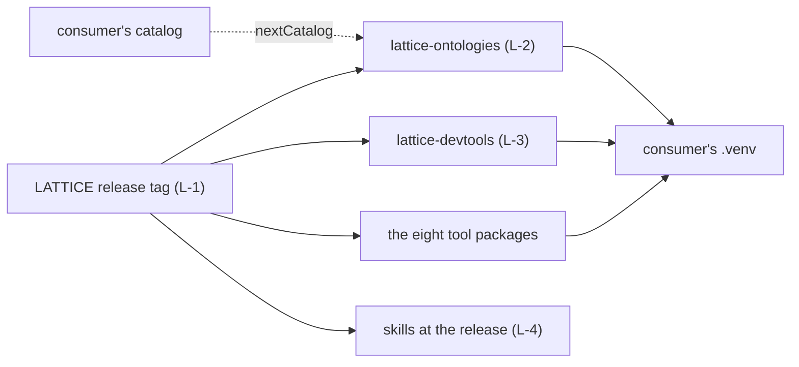

<!-- SPDX-License-Identifier: CC-BY-SA-4.0 -->

# Distributing LATTICE to projects built on it

**Unit:** `consumer-distribution` (sketch). **Status:** sketch, 2026-10-18. Nothing here is ratified.
**Reads with:** [ADR-A88](../../architecture/decisions/ADR-A88-ontology-import-resolution-for-consumers.md)
(import resolution for consumers), [ADR-A117](../../architecture/decisions/ADR-A117-agent-guidance-and-skill-library.md)
(agent guidance and skills), [ADR-A29](../../architecture/decisions/ADR-A29-repository-toolchain-and-environment-boundary.md)
(`mise`), [ADR-A121](../../architecture/decisions/ADR-A121-repository-catalogue.md) (the repository catalogue).

## 1. The scene

A project built on LATTICE, Open CBAA for example, needs three things from it: the ontologies its
own ontologies import, the tools that extract, check and instantiate them, and the agent skills that
carry LATTICE's way of working.

| Need | Today | Gap |
|---|---|---|
| ontologies | per-ontology release tags with raw links (`ontology-releases.md`), one generated catalog. ADR-A88 decision 4 lets a consumer pin a commit by submodule, vendored copy or package | no package exists, so a consumer copies or adds a submodule. No single tag names a whole release |
| tools | eight packages with their own `pyproject.toml`, installable from a git subdirectory | the scripts in `tools/*.py` (literate extraction, instantiation, catalog, versioning, release rows, agent guidance) are not packaged, and several assume LATTICE's own tree |
| skills | a plugin marketplace for Claude Code, `mise run skills:link` for Copilot | no way to state which release's skills a consumer is following |

## 2. The premise

> A consumer pins one LATTICE release, and installs everything it needs from LATTICE into its own
> environment at that release, with nothing copied into its repository.

## 3. Proposed additions

| # | Addition | Detail |
|---|---|---|
| L-1 | a repository release tag | names every package and ontology at once, separate from each ontology's own tag. A consumer pins it |
| L-2 | `lattice-ontologies` | a distribution package holding the ontology tree, its catalog and a resolver, `lattice_ontologies.catalog_path()`, so a consumer's catalog chains to it with `nextCatalog` (ADR-A88) |
| L-3 | `lattice-devtools` | one CLI, `lattice`, over the unpackaged scripts (`literate extract`, `instantiate`, `catalog build` and `check`, `versions check`, `releases build` and `check`, `agents build` and `link`). Each command takes `--root`, the consumer's repository |
| L-4 | pinning skills | where the plugin marketplace allows a ref, the guide shows how to install the skills of a release |

## 4. Consequences

- ADR-A88 decision 4 gains a fourth option, the package, which becomes the documented default. The
  submodule and vendored copy remain allowed.
- The scripts wrapped by L-3 gain a `--root` where they lack one, and their tests run against a
  fixture consumer tree as well as LATTICE's.
- The repository catalogue (ADR-A121) lists the two new packages.
- The developer guide gains a section for consumers: pin, bootstrap, chain the catalog, upgrade.

## 5. Questions CD-Q1 to CD-Q4

| ID | Question | Leaning |
|---|---|---|
| CD-Q1 | The release tag's form | a semantic version for the repository (`lattice-v0.N.M`), independent of each ontology's version |
| CD-Q2 | Where `lattice-ontologies` lives | `packages/ontologies/`, with its build copying `ontology/` at build time, so the source stays in one place |
| CD-Q3 | One CLI package, or commands added to the root `lattice-tooling` package | one package. The root package is a development environment (`package = false`) |
| CD-Q4 | The first consumer to prove it | Open CBAA, whose agent guidance already drifted from a copy (ADR-A117 context) |
